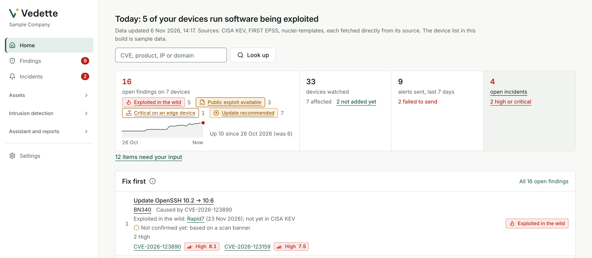

<picture>
  <source media="(prefers-color-scheme: dark)" srcset="docs/brand/readme-hero-dark.svg">
  
</picture>

# Vedette

**Know early. Know exactly. Know what to do.**

Vedette is free, open-source software for a small or mid-size office. It runs on one machine on your network and tells you, within an hour, when software or a device you own is on a list of vulnerabilities **being exploited in the wild**: which device, where it is exposed, and what to do about it.

[](LICENSE)
[](https://github.com/KNT048/vedette/actions/workflows/ci.yml)
[](https://github.com/KNT048/vedette/releases)

<picture>
  <source media="(prefers-color-scheme: dark)" srcset="docs/images/screenshot-home-dark.png">
  
</picture>

<sub>The home page, with the made-up sample data of a trial build.</sub>

## What it does

- **Watches what attackers are using now.** The CISA list of known exploited vulnerabilities is checked every hour, with FIRST EPSS, CVE.org and NVD for detail; VulnCheck's list can be added. Each feed is fetched straight from its source.
- **Knows what you have.** Devices are found by listening on the network and by scanning it, or added by hand and by import, with vendor, model, version and open services. Nothing is installed on staff computers.
- **Matches the two, and shows how sure it is.** A finding says whether the version is confirmed (the device reports it) or only suspected (read from a service banner), and whether the device is reachable from the Internet.
- **Tells you what to do.** Each finding starts with the update that fixes it. For a growing set of exploited CVEs it adds a checked workaround, a ready firewall rule to cut off access (FortiGate, MikroTik or generic) and how to tell whether you have already been hit.
- **Tells the right people.** Alerts by email, Slack, Telegram, Zalo or webhook, only for devices you have.
- **Sees your outside.** Your public IP and the domains you verify are scanned the way an attacker would see them (subdomains, open ports and services, known flaws; with nmap, nuclei, ZAP and, if you turn it on, OpenVAS).
- **In preview** (off by default, turn on under Settings › Modules): vulnerability scans of your internal devices; internal traps (a honeypot that raises an alert when touched); a log receiver that flags connections to known-bad addresses and your firewall's intrusion alerts; an AI assistant with your own provider and key; reports.

What it does **not** do: it does not sit in the network path, block traffic or replace your firewall, and it does not find every vulnerability. It watches and warns; the change is yours to make.

## Quick start

**You need** a fresh machine (a small PC, server or VM) with Ubuntu 26.04 (Ubuntu 24.04 and Debian 13 install too), amd64 or arm64, 4 GB of memory (8 GB recommended), 6 GB free under `/var`, a wired network port, and free ports 8443, 8444, 8765, 514 and 6514.

**1. Install.** Take `install.sh` from the newest [release](https://github.com/KNT048/vedette/releases) and run it as root:

```sh
VERSION=0.1.5    # the newest release on the Releases page
curl -fsSLO https://github.com/KNT048/vedette/releases/download/v$VERSION/install.sh
sudo sh install.sh
```

**2. Open the address it prints**, `https://<address of the machine>:8443`. The certificate is self-signed: accept it once.

**3. Follow the setup wizard:** terms of use, your administrator account (with the one-time setup code the installer printed), your network range, and the modules to turn on. A few minutes later Vedette is watching.

<details>
<summary><b>Check the installer's signature before you run it</b></summary>

Every release file is signed with [minisign](https://jedisct1.github.io/minisign/). Download the signature next to `install.sh` and check it against the release key (key ID `7B78764E550D48D0`, also in [docs/RELEASE_KEYS.md](docs/RELEASE_KEYS.md)):

```sh
curl -fsSLO https://github.com/KNT048/vedette/releases/download/v$VERSION/install.sh.minisig
minisign -Vm install.sh -P RWTQSA1VTnZ4e4eM2iBmUKE1/t5l9pmrScK2+wR/EohjSfFEZQ8VwT/m
```

It must print `Trusted comment: file:install.sh version:<VERSION>`. The script itself carries the checksum of the package it installs, and the container images are checked against signing keys built into Vedette before anything starts.
</details>

<details>
<summary><b>What the installer changes, and how to remove it</b></summary>

It checks the machine first and stops, changing nothing, if something is missing. Then it installs only the packages Vedette needs that are not there yet (Podman, chrony, nftables and a few others; nothing already installed is upgraded), installs the signed `vedette-host` package of that release, pulls the signed container images by digest and starts Vedette. It does not change your network settings.

Keep `install.sh`. Run it again to repair an install or to finish one that stopped half way. To remove Vedette and put the machine back as it was (this deletes Vedette's data and cannot be undone; `--keep-data` keeps it):

```sh
sudo sh install.sh --uninstall --yes
```

Every option and the checks after an install: [docs/RUNBOOK.md](docs/RUNBOOK.md), section 1.
</details>

Small machine, or you would rather set it up yourself on Docker or Podman? [Install the containers only](docs/INSTALL-CONTAINER.md) (some features need the full install).

## Status

Vedette is in **beta**. The 0.1.x releases are test releases for a lab or a spare machine, published on the beta channel; version 1.0 is on its way. A machine installed from a 0.1.x release updates in place from **Settings › Updates**: every release is signed, and you can roll back to the previous version with one click.

## What leaves your machine

Your devices, findings, logs and keys stay on the machine. The only data that goes out is listed in [PRIVACY.md](PRIVACY.md), and the app shows the same list under **Settings › Privacy**, with a switch for each flow that can be turned off. Nothing is sent to the Vedette project: it runs no server that could receive it.

## Documentation

| | |
|---|---|
| [Cookbook](docs/cookbook/) | Step-by-step guides for everyday tasks |
| [Operations runbook](docs/RUNBOOK.md) | Install, update, roll back, back up, troubleshoot |
| [Container-only install](docs/INSTALL-CONTAINER.md) | Vedette on your own Docker or Podman |
| [Product](docs/PRODUCT.md) · [Architecture](docs/ARCHITECTURE.md) · [Deployment](docs/DEPLOYMENT.md) | How Vedette is designed and built |
| [Contributing](CONTRIBUTING.md) | Run it from source, tests, pull requests |
| [Security policy](SECURITY.md) | Report a vulnerability in Vedette privately |
| [Privacy](PRIVACY.md) · [Terms of use](TERMS.md) · [Third-party notices](THIRD_PARTY_NOTICES.md) | What leaves the machine, your responsibilities, the licenses of what Vedette uses |

## License

Vedette's own code is licensed under [Apache-2.0](LICENSE); third-party components keep their own licenses ([THIRD_PARTY_NOTICES.md](THIRD_PARTY_NOTICES.md)). It is provided as is, without warranty. Vedette is a security testing tool: scan only systems you own or are authorized to test ([TERMS.md](TERMS.md)).

*Vedette* (French): a mounted sentry posted ahead of an outpost to raise the alarm early. It watches and warns; it does not fight.
