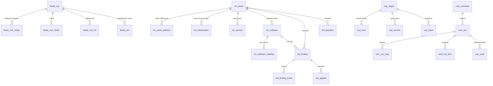

# Data model

How Vedette stores its data and the rules every table follows. The exact schema (every table, column, check and index) is
[`docs/SCHEMA.sql`](SCHEMA.sql), generated from the migrations by `make schema`; `TestSchemaFileIsCurrent` fails when it is
stale. This file explains what the tables are for and the rules the schema alone does not show. It does not repeat columns.

Section numbers are stable: code comments cite them (for example "DATA_MODEL 5.1 (2)").

## 1. General conventions

| Item | Rule |
|---|---|
| Databases | One SQLite file `vedette.db` for everything, plus `logs.db` for the volume of received log lines (module `logs`, `migrations/volume`). Both carry `core_schema_epoch`. |
| Table prefix | Every table starts with the `tables_prefix` of the module that creates it (`modules/<m>/MANIFEST.yaml`). Checked by `TestSchemaTablesUseTheirModulePrefix` (`cmd/vedette/schema_rules_test.go`). |
| Ownership | A module writes only its own tables. Another module reads its data through the owner's Go port (adapters in `cmd/vedette/*.go`), never with SQL. Exceptions: `core` export, purge and backup go over every table, and `vedette selfcheck` runs read-only queries across modules (section 5.8). |
| Cross-module foreign keys | A table may reference a table of its own module or of a module in its `depends` (same test as the prefix). Hard dependencies are real foreign keys (`fnd_finding.asset_id → inv_asset ON DELETE CASCADE`). Rows that must outlive their subject (histories, runs, incidents, sent notices and reports) keep a text id plus a name snapshot instead. |
| IDs | `TEXT`, made by the server, 1–96 characters. Natural keys (a module id, a channel type, a CVE id, a setting key) are used directly. Append-only histories use an `INTEGER AUTOINCREMENT` key. |
| Time | UTC ISO-8601 text with three millisecond digits and a trailing `Z` (`store.FormatTS`); every time column has a `GLOB` check for that shape. Fixed-width text, so text order is time order. Times of day are `HH:MM`. |
| Booleans | `INTEGER CHECK (x IN (0, 1))`. |
| Vocabularies | A **closed** set of two to five structural states may be a `CHECK (x IN (…))`. An **open** vocabulary (kinds, reasons, sources, origins) is text with a shape check (`[a-z0-9_]{1,40}`) and a Go type that owns the values, so adding a value never rebuilds a table. A `CHECK` listing more than five values must be on the allow-list in `TestLongValueListsAreTheAllowList`. |
| JSON | `TEXT CHECK (json_valid(x))`, only for a value read and written whole and never filtered, joined or counted (evidence for display, a sent document, a parser definition). The JSON columns are exactly the allow-list in `TestJSONColumnsAreTheAllowList`; anything that must be filtered is a child table. No code branches on the content of a note, evidence or detail text. |
| Derived values | Stored only when a list must sort, filter or watch it for change; then one function in the owning module writes it in the same transaction as its inputs, and a self-check recomputes it (section 5.8). Otherwise computed on read by one function. |
| Delete | Children of a device cascade with it. No soft delete except where a person's decision must survive (a disabled user, a removed software line). Hash-chained logs are deleted only by retention (section 5.3). |
| Secrets | No column holds a password, key or token in clear text (section 5.4). |
| Settings | Single configuration objects live in a key–value `<prefix>_setting` table or a one-row table (section 5.5). |

## 2. Relationship overview

The main foreign keys:

Write flow: a sensor, agent or person reports through `core/observe` → inventory stores observations and software readings and
resolves the device's current values and each software line's effective version → the findings match pass compares software lines
with the vulnerability catalogue (`feeds_cve_range`, `feeds_distro_fix`, `feeds_winrel*`) and writes `fnd_finding` → the urgency
pass rates each finding from `feeds_signal`, `feeds_kev`, device attributes and attacks seen on this network (`ids_alert`) → notify
turns finding events into notices. Every mutation by a person or the system writes `core_audit` in the same transaction.

## 3. `core` (prefix `core_`)

| Tables | What they hold |
|---|---|
| `core_user`, `core_user_totp`, `core_email_code`, `core_email_code_send`, `core_session` | Accounts and sign-in state. Passwords are argon2id hashes; session tokens are stored as SHA-256. |
| `core_org`, `core_setting` | The one organisation row (name, time zone, setup state) and the key–value settings of `core`. |
| `core_module` | Which module is switched on (section 5.6). |
| `core_secret` | Every stored secret, encrypted (section 5.4). |
| `core_audit`, `core_chain_anchor`, `core_chain_head` | The tamper-evident audit log and the bookkeeping of all three hash chains (section 5.3). |
| `core_connection`, `core_connection_tool` | Connections to devices and services that the AI and response modules use, with their allowed tools. |
| `core_sensor_cert` | Serials of the issued sensor certificates (the CA key is a `core_secret`). |
| `core_job_run` | Internal housekeeping ticks (`core/jobs`): the last 200 runs per job. Not shown as runs. |
| `core_run`, `core_run_step`, `core_run_item`, `core_run_log` | Every user-visible piece of scanning work (section 5.7). |
| `core_schedule` | Every schedule a person can set (section 5.7). |
| `core_schema_epoch`, `core_schema_file` | The schema generation, and the SHA-256 of every migration file the database applied (section 6). |

## 4. Data by module

### 4.1 `feeds` (`feeds_`)

One vulnerability catalogue, the signals that make a CVE urgent, and the indicator lists.

| Tables | What they hold |
|---|---|
| `feeds_cve` | One row per catalogue CVE: dates, NVD status, text, CWE, the record's solution and workaround, CISA's SSVC values. |
| `feeds_cve_metric` | CVSS scores per (CVE, source, version). Readers pick one with `feeds.PickCVSS` and band it with `feeds.Severity`. |
| `feeds_cve_range` | Affected version ranges, one row per range and origin (`nvd`, `cna`, `adp`), with the fixed version and the vendor's version notation when the origin states them and NVD's "running on" platform conditions. Vendor rows are kept beside NVD rows; precedence (NVD first) is applied when read. |
| `feeds_cve_ref` | References with their tags (vendor advisory, patch, mitigation, exploit). |
| `feeds_kev` | An entry on an exploited list in that list's own words (`cisa`, `vulncheck`, `custom:<feed id>`). |
| `feeds_signal` | Why a CVE is urgent and since when: one row per (CVE, kind, source); `qualifies` says whether it passes the quality rule of its kind. An exploited-list entry is also an `exploited` signal. |
| `feeds_epss`, `feeds_epss_baseline`, `feeds_epss_hist` | EPSS scores of every CVE; a short daily history for CVEs that have an entry or a signal (the "rising" display). |
| `feeds_distro_fix` | Distribution fix status per (release, package, CVE): Ubuntu, Debian, Alpine. |
| `feeds_winrel`, `feeds_winrel_update` | Windows releases and their cumulative updates. |
| `feeds_nvd_cursor` | Where each paged NVD pull stands. |
| `feeds_source`, `feeds_fetch_log` | Built-in and custom feeds, and one row per pull attempt. |
| `feeds_ioc`, `feeds_ioc_source` | Indicators of compromise merged over every feed that lists them. |
| `feeds_weekly_answer` | A person's answer to "do you have this product?" in the weekly digest. |

Retention: a CVE stays in the catalogue while it was published inside the window (365 days), or has an exploited-list entry, or has
a qualifying signal, or an open finding references it. Fetch log rows are kept 90 days (the newest good row of each feed always).
The read model of one CVE is `feeds.Brief`.

### 4.2 `inventory` (`inv_`), with `agent-intake` (`intake_`) and `sensor-passive` (`sp_`)

| Tables | What they hold |
|---|---|
| `inv_asset` | One row per device: its main address, the current value of each identity field (resolved from observations, section 5.1), flags a person sets (added, fragile, regular scan) and the per-device source switches (`scan_source`, `snmp_source`, `agent_source`). |
| `inv_asset_address` | The other addresses a device answers on (interfaces, Wi-Fi and Ethernet). An address belongs to one device. |
| `inv_observation` | What each source said about a device field. Append-only except that an exact repeat moves `seen_at`. |
| `inv_service` | Open ports and what answered on them, per source and address. Kept 90 days after no source reports them. |
| `inv_software` | One row per installed software line of a device: one product (`core/productid` key), or one release train of a product whose trains install side by side (`line`). Holds the effective reading and the line's state (`present`, `not_installed`, `removed`). |
| `inv_software_reading` | What each source reads now of a line: one row per (source, instance, address). |
| `inv_software_event` | Append-only history of a line (appeared, version changed, removed, a person's entry set or lapsed …). Text copies keep it readable after the line is pruned. |
| `inv_separate`, `inv_hand_seen`, `inv_detected_keep` | A person's decisions about identity: two devices kept apart, the MAC bound to a hand-added device, a detected value the person chose to override. |
| `inv_merged_from` | What a person's merge took in (the merged device's id, main interface, origin, name in Vedette and observations, and what the kept device was before), so Split off of that interface gives the device back as it was. |
| `inv_merged_reading` | The software readings each merged device brought (its line, source and instance), so Split off gives its software, and with it its findings, back. |
| `inv_source`, `inv_setting` | When each source first reported; inventory settings (LAN ranges, scan scope, fragile kinds …). |
| `intake_agent_tokens`, `intake_osquery_nodes` | osquery enrolment tokens (hashed; optionally for one device) and the enrolled nodes with their reporting rhythm (`NodeHealth`). |
| `intake_wazuh`, `intake_wazuh_agent`, `intake_prune_clock` | The one Wazuh connection, the agents it delivered, and the node-prune bookkeeping. |
| `sp_sensor`, `sp_span_stat`, `sp_seq` | The passive sensor's settings, its last SPAN measurement, and the batch sequence numbers already applied. |

Rules: the effective reading of a software line is written only by `inventory.Resolve` in the same transaction as any change to its
readings; every reader reads `inv_software` (through `inventory.SoftwareLine`), the matcher additionally gets the live readings that
differ. A removed line is deleted 400 days after `removed_at` (its history stays); software an agent has not reported for 30
days is deleted.
Device merges and deletes run the lifecycle participants (section 5.9).

### 4.3 `findings` (`fnd_`) and `mitigation` (`mit_`)

| Tables | What they hold |
|---|---|
| `fnd_finding` | One row per (device, CVE, software line) that was affected at some time: detection, handling and urgency in separate column groups (section 5.2). |
| `fnd_finding_event` | Append-only history of a finding (created, handled, reopened, urgency or fix changed …). The report's "handled" section reads it. |
| `fnd_question` | What Vedette cannot decide without a person (a version it needs, a platform, a package release …), with how many CVEs wait on the answer. Not a finding. |
| `fnd_reach_run` | The reachability audit run after a feed refresh (the newest 30 kept). |
| `mit_applied` | Remediation items a person marked applied on a finding. Never changes the finding's state. |
| `mit_ai_output` | The last AI-written remediation per finding and skill, kept apart from the signed packs. |
| `mit_pack`, `mit_pack_state` | Signed remediation packs, replaced whole on each load, and the version they came from. |

The read model of a finding is `findings.View`.

### 4.4 `notify` (`notify_`)

| Tables | What they hold |
|---|---|
| `notify_channel`, `notify_approver`, `notify_setting` | The channels (one row per type; secrets in `core_secret`), who may approve on each, and the quiet-hours and grouping rules. |
| `notify_notice`, `notify_notice_finding` | A vulnerability notice: one finding event (`created`, `urgency_changed`, `reopened`, `acceptance_expired` …) and the findings it covers. |
| `notify_incident`, `notify_incident_device` | Incidents (an open vocabulary of kinds) and the devices they concern. |
| `notify_send`, `notify_send_notice`, `notify_pending` | One row per message sent per channel, which notices it carried, and notices waiting for a channel. |
| `notify_tg_button`, `notify_slack_button`, `notify_slack_team`, `notify_slack_final` | State of approval buttons in chat messages. |
| `notify_box` | When notify first ran on this box and when the first-discovery summary last went out. |

Sends, notices and resolved incidents are deleted after 365 days; an open incident and the queue (`notify_pending`) are never
deleted by age.

### 4.5 `exposure` (`exp_`)

| Tables | What they hold |
|---|---|
| `exp_target` | Domains and public IPs to scan, as a tree (a subdomain under its apex), with the ownership proof of each node. A node with no proof of its own is covered by a verified ancestor. |
| `exp_consent` | The scanning commitment and terms a person accepted for a target. |
| `exp_host`, `exp_address` | Names found under a domain target and the addresses they resolve to. A name that is also its own target is scanned by that child target only. |
| `exp_service` | Open ports on a target's public addresses, with `first_seen`, `last_seen` and `state`. |
| `exp_issue` | Anything a scan engine reports as wrong (`surface`, `nuclei`, `zap`, `openvas`, `match`), with the same handling vocabulary as findings. |
| `exp_scan` | Per-run facts of an exposure scan, keyed by its `core_run`. |
| `exp_setting`, `exp_ignored`, `exp_outside`, `exp_attempt` | Module settings and last-run state, public IPs a person ignored, the outside-view lookup answer, and the rate limit of proof attempts. |

What changed between scans is read from `first_seen`, `last_seen` and `state`, not from a diff of documents.

### 4.6 `scan` (`scan_`)

`scan_setting` (one row: safety stops), `scan_probe` (one row per probe sent, kept 90 days; `run_id` points at its `core_run`),
`scan_event` (one row per CVE that triggered a re-scan, kept 365 days). Scan runs are `core_run` rows.

### 4.7 `honeypot` (`hp_`)

`hp_config`, `hp_trap_ips` (trap profiles and their services), `hp_tokens` (bait credentials; the password is a `core_secret`),
`hp_hits` (what touched a trap; test hits kept 7 days, real hits 365), `hp_ignored_day` (hits from the box's own scanner, per day,
30 days).

### 4.8 `logs` (`logs_`)

In `vedette.db`: `logs_sources`, `logs_retention`, `logs_siem` (forwarding; the signing key is a `core_secret`). In `logs.db`:
`logs_events` (received lines, kept as long as `logs_retention` says), the per-source and per-signature counters
(`logs_source_buckets`, `logs_source_seen`, `logs_signature_daily`, `logs_signature_buckets`, `logs_signature_addrs`),
`logs_volume` (bytes held, for the size bound), `logs_anomaly_sent` and `logs_ioc_hits`.

### 4.9 `ai` (`ai_`)

Profiles and job assignments (`ai_profile`, `ai_assignment`, `ai_setting`, `ai_downgrade`), customer rules, hooks, memory and
skills (`ai_rule`, `ai_hook`, `ai_hook_state`, `ai_memory`, `ai_memory_suggestion`, `ai_memory_rejected`, `ai_skill_state`),
uploaded knowledge (`ai_knowledge_doc`, `ai_knowledge_chunk` with the full-text index `ai_knowledge_chunk_fts`), cached results
(`ai_result`), connection reads (`ai_read`) and the hash-chained `ai_activity` log. Usage and run lists are views over
`ai_activity`; there is no separate runs table.

### 4.10 `reports` (`rep_`)

`rep_definition` (a report template with its section switches and recipients; its send schedule is a `core_schedule` row keyed
`reports.def:<id>`), `rep_history` (one row per send, holding the document exactly as sent), `rep_pdpl` (the data-protection
self-assessment).

### 4.11 `response` (`resp_`)

Settings, plans, the action catalogue, rules, allow and block lists (`resp_settings`, `resp_plans`, `resp_catalog`, `resp_rules`,
`resp_allowlist`, `resp_blocklist`, `resp_block_entries`), requests with their items and approvals (`resp_actions`), rule
bookkeeping and watched events (`resp_done`, `resp_events`), AI notes and hints (`resp_ai_notes`, `resp_hints`), approval tokens,
identity proofs and link codes (`resp_tokens`, `resp_identity`, `resp_link_codes`), and the hash-chained `resp_log`.

### 4.12 `mcp-server` (`mcp_`)

`mcp_tokens`: read-only MCP tokens, stored as SHA-256 with their scopes.

### 4.13 `auth-oidc` (`oidc_`)

`oidc_config` (the provider; the client secret is a `core_secret`) and `oidc_flow` (sign-ins in progress: hashes only, single use,
10 minutes).

### 4.14 `sensor-active` (`sa_`)

`sa_probe` (one row per nmap or SNMP job sent, kept 365 days), `sa_all_ports` (ports found by the weekly all-ports run, kept 14 days after a run last saw them),
`sa_snmp_device` (SNMP settings per device; secrets in `core_secret`), `sa_snmp_notice` (what the box changed in SNMP settings by
itself). Sweeps, device checks and SNMP reads are `core_run` rows.

### 4.15 `ids` (`ids_`)

`ids_alert` (IPS and IDS events of one signature between two addresses within one hour, deduplicated; device ids set when known)
and `ids_alert_cve` (the CVEs an alert names). Findings reads "which CVEs were attacked here" through the ids port. An alert is
kept 90 days after its last event, at most 50,000 alerts.

## 5. Deep dives

### 5.1 Device fields from observations (no overwrite, source precedence)

1. **Append only.** Every source adds rows to `inv_observation`; no value is updated or deleted. An observation that exactly
   repeats `(asset_id, field, source, value)` only moves `seen_at` and keeps the higher confidence. A trigger refuses any other
   update.
2. **The current value** of each field is the observation that wins, in this order: source rank `manual` = `declared` > `agent` >
   `snmp` > `nmap` = `scan` > `passive` (an OS a device states over LLDP, vouched for by its own network card, ranks between
   `snmp` and `nmap`); of two nmap OS readings the newer scan; higher confidence; newer `seen_at`; smaller id. Two exceptions
   come first unless a person typed the value: a readable host name beats a UUID-like one, and the MAC seen last wins.
   Code: `modules/inventory/merge.go`.
3. **One writer.** `RecomputeAsset(tx, asset_id)` folds a device's observations into the current columns and the `*_obs_id`
   columns of `inv_asset`, in the same transaction as the observation. No other code writes them.
4. **A person's edit** adds a `manual` observation; weaker values stay. To change a value, add a new one.
5. **The device summary** names the source of the most trusted value, with the confidence of the weakest of vendor, model and OS.

Software follows the same idea one level down: readings per source in `inv_software_reading`, one effective reading per line
written by `inventory.Resolve` (a person's entry holds until a later reading shows a newer release; otherwise the strongest source,
newest release among equals).

### 5.2 Findings: three separate facts

A finding is one CVE on one software line of one device. Its columns fall in three groups, each with one writer:

| Group | Columns | Written by |
|---|---|---|
| A. Detection | `detected`, `basis`, `verified`, `range_origin`, `matched_version`, `fix_*`, `evidence` | the match pass (and a scan result or a person's confirm for `verified`) |
| B. Handling | `state` (`open` / `handled`), `resolution`, `via`, `resolved_by`, `resolved_at`, `note`, `accepted_until`, `from_version`, `to_version` | `findings.Transition`, the one state machine |
| C. Urgency | `urgency` (1 under attack here … 5 update recommended), `urgency_at` | the urgency pass (`findings.Urgency`) |

- A row exists only for a pair that was affected at some time; "checked and not affected" is not stored. Undecidable pairs are
  `fnd_question` rows.
- The schema enforces that an open finding has no resolution, `via`, `resolved_by` or `resolved_at`, that a handled one has all
  four, that only `accepted` has a last day, and that `via = version_moved` carries two different versions (the "6.24 → 7.23"
  credit line).
- Every handled row says who (a person or `system`) and how (`via`); patch credit is a query on `fnd_finding_event`, never a parse
  of a note.
- Severity is not stored on the finding: it is the CVSS band of the CVE, read through `feeds.Brief`.
- `fix_key` (`<product key>|<fix kind>|<fix version>`, never NULL) groups findings by fix, so open findings counted by device and
  by fix always add up to the same total.

### 5.3 Hash-chained logs: `core_audit`, `ai_activity`, `resp_log`

- **Formula** (`core/chain`): `hash` = lowercase hex SHA-256 of `prev_hash` + `"\n"` + `canon(entry)`, where `entry` is every
  field of the row except `hash` and `seq`, and `canon` is JSON with keys sorted by code point, no whitespace, no HTML escaping.
  The first row's `prev_hash` is 64 zeros. Shared test vectors: `modules/core/testdata/chain_vectors.json`.
- **Writing.** A row is appended in the same transaction as the change it records, and `chainhead.Advance` moves
  `core_chain_head` (newest hash and row count) in that transaction. Triggers refuse updates and `INSERT OR REPLACE`.
- **Verification** reads the chain from the anchor or the genesis value and checks every link and the head; deleting the newest
  rows or adding a row around the helper breaks it.
- **Retention.** One transaction deletes the oldest rows, writes `core_chain_anchor` (the last row deleted) and lowers the head's
  count. `core_audit`: 365 days, at most 200,000 rows (`core/audit/prune.go`); its delete trigger allows only rows up to the
  anchor. `ai_activity`: the configured retention (default 365 days, minimum 90). `resp_log` is not pruned.
- **Limit.** The chain is tamper-evident, not tamper-proof: whoever can write the database file can rebuild the chain and the
  head. The log export carries the head hash and count so a copy kept elsewhere can be compared.

### 5.4 Secrets (`core/secrets`, AES-256-GCM)

- `core_secret` holds the nonce, the ciphertext with its tag, the key version and, where safe, the last four characters for the UI.
  The additional data is `id + "|" + purpose`, so a ciphertext copied to another row does not decrypt.
- Each owner names its own purpose constant next to the code that uses it (for example `feeds_source.secret`,
  `notify_channel.secret`, `ai_profile.api_key`, `core_user_totp`, `core_sensor_ca`). The owner row holds `secret_id`; deleting
  the owner deletes the secret in the same transaction.
- The master key lives in a key file outside the database (mode 0600). It is never written to the database, logs or exports.
- What is never stored in clear text: passwords (argon2id), session, MCP and enrolment tokens (SHA-256), email sign-in codes
  (HMAC with a key in `core_secret`), approval tokens and reply codes (hashes bound to the request and the approver). Secrets that
  must be sent out again (API keys, channel tokens, webhook URLs, SSH keys, SNMP and Wazuh credentials) are `core_secret` rows.
- The API returns only the last four characters; a blank secret on save keeps the stored one.

### 5.5 Settings tables

Single configuration objects are rows of a key–value table `<prefix>_setting(key, value JSON, updated_at, updated_by)`, one key
per object (`core_setting`, `inv_setting`, `notify_setting`, `ai_setting`, `resp_settings`, `hp_config`), or a one-row table with
typed columns (`scan_setting`, `exp_setting`, `logs_retention`). Go validates each object before it is written; a value never
holds a secret, only a `secret_id`. Defaults that are data are loaded by the module's migration (section 6, rule 8). Collections
(channels, profiles, rules, sources) are tables of their own. Every change writes `core_audit`.

### 5.6 Module on/off state

`core_module` holds `enabled` and when it changed; everything else about a module comes from its `MANIFEST.yaml`. Switching a
module off stops its routes and jobs and never deletes or drops its tables. The migrations of every installed module run at start
whether it is on or off, so the schema always matches the code, and a module switched on again finds its data as it was.
Device lifecycle participants (section 5.9) run for switched-off modules too.

### 5.7 Runs and schedules

- **Runs** (`core/run`). Every piece of scanning work a person can see is one `core_run` row: module, kind, the lane it occupies,
  trigger, subject, status, progress (`total`, `done`) and times. Phases or ranges are `core_run_step` rows, the devices or hosts
  it touched are `core_run_item` rows, and its log is `core_run_log`. The queue is the `queued` rows, so it survives a restart.
  At most one run per lane is live (a partial unique index). A sweep that cannot finish in one window is one run that waits
  between windows. Module detail stays in module tables keyed by `run_id` (`sa_probe`, `scan_probe`, `exp_scan`). Ended runs are
  deleted after 400 days; log lines after 30 days, at most 2,000 per run.
- **Schedules** (`core/schedule`). Every schedule a person sets is one `core_schedule` row, keyed by the owner (`owner_key`, for
  example `reports.def:<id>`). `next_due_at` is written by `core/schedule` in the same write as any rule change or run, from the
  pure function `schedule.Next`. Housekeeping ticks stay in `core/jobs` and are not schedules.

### 5.8 Self-check of data invariants

`vedette selfcheck [-db path]` opens the database read-only and prints one line per registered invariant with the number of rows
that break it; it exits 1 when any count is not zero. Each module registers its own (`core/selfcheck.Register`): runs and
schedules (`core/run`, `core/schedule`), inventory (one line per product and train, effective reading equals the resolver's,
present lines have a reading, one home per address), findings (handled rows are complete, open totals agree by device and by
fix, stored urgency equals the recomputed one, CVEs exist in the catalogue, catalogue retention, range precedence), and exposure
(services and issues belong to their target, subdomain targets sit under their parent, one target scans a name). Tests run the
same registry on fixtures (for example `cmd/vedette/addresses_count_test.go`).

Schema rules checked by tests on a freshly migrated database (`cmd/vedette/schema_rules_test.go`, `schema_test.go`): table
prefixes and cross-module foreign keys, the long value list allow-list, the JSON column allow-list, and `docs/SCHEMA.sql` equal
to the migrated schema. The export policy (`modules/core/export_policy.go`) classifies every column of every table, and a test
fails when a new column has no class.

### 5.9 Device lifecycle

When inventory merges two devices (one machine seen twice), splits an address off a device as a device of its own, or deletes one, it
calls every participant registered with `core/lifecycle` inside its own write transaction, before the write commits
(`cmd/vedette/devicelifecycle.go`). Each participant
moves or removes its own rows there, so every module's rows change with the device or none do. A merge folds colliding rows
(times widened, a person's decisions and history kept) instead of dropping them. Foreign keys with `ON DELETE CASCADE` do the
plain delete case; the hooks exist for merges, splits (rows kept by software line follow the line to the device split off), folded and moved findings,
pruned software lines and rows with snapshots. Events on the bus
announce the change after the commit and are never used for integrity.

## 6. Migration policy

Migrations run with [`goose`](https://github.com/pressly/goose), embedded in the binary; queries are generated with
[`sqlc`](https://sqlc.dev). Each module has its own version table `core_migration_<module>` and migrates in dependency order.

1. **Forward-only.** No `Down` section (`store.Migrate` refuses one). Rolling back means restoring the copy taken before the update.
2. **Expand, then contract** (from the first public release). A release only adds; deleting or renaming waits for the next one,
   so the previous binary still runs on the new schema.
3. **Files.** `modules/<m>/migrations/sqlite/NNNN_<description>.sql`, numbered per module; a migration touches only its module's
   tables.
4. **Two databases.** Module `logs` has two migration folders: `config` for `vedette.db` and `volume` for `logs.db`.
5. **Verified by effect.** Tests check the resulting schema (`docs/SCHEMA.sql`) and seed rows, not the exit code.
6. **A switched-off module keeps its data**; its migrations still run.
7. **Back up first, check after.** An update takes a copy of the database first; `store.Check` runs `integrity_check` and
   `foreign_key_check`.
8. **Built-in data** (catalogue rows, built-in hook states, default settings) is loaded by the migration with
   `INSERT … ON CONFLICT DO NOTHING`, not by start-up code.
9. **Hash-chained tables:** a migration never edits an existing row. A change of the canonical form is a new contract.

**Schema epoch and the baseline before the first public release.** The history restarted once: epoch 2
(`core/store/SCHEMA_EPOCH`) begins with one file `0001_<module>.sql` per module that creates the module's whole schema. Until the
first public release this baseline is edited in place, and rules 2 and 3 apply again from that release. `core_schema_epoch`
records the epoch and `core_schema_file` the SHA-256 of every migration file the database applied. At start
(`store.MigrateAll`), a database made before epoch 2 or of another epoch is refused with one message: install fresh
(`install.sh --uninstall --yes` without `--keep-data`, then install again). A database whose applied files differ from this
build's copies (a baseline edited after the database was made) is refused too, naming the file; goose would never run the new
copy. New migrations are applied and recorded (an update), and a file the binary does not have is ignored (a rollback that keeps
the database, rule 2). A database stamped by an earlier pre-release build with one hash of all its files is accepted once when
those files are unchanged, and then gets `core_schema_file`. Restoring a backup refuses one of another epoch, one without
`core_schema_file`, or one whose applied files differ; a backup of an earlier release of the epoch is restored and migrated up.

The release builder (`scripts/release`) enforces the history: every release is compared with the migrations of every earlier
release tag of the same epoch, whatever `rollback.safe` says, and is refused when an applied migration was removed or edited or a
new one is numbered below it. A release whose epoch is above the previous release's starts a new history and must declare
`rollback.safe=false`; an epoch never goes down.

## 7. SQLite

- Pure Go driver (`modernc.org/sqlite`), no cgo. Pragmas: `journal_mode=WAL`, `synchronous=NORMAL`, `foreign_keys=ON`,
  `busy_timeout=5000`; the journal mode is read back at open.
- One writer connection (writes are queued) and a pool of read-only readers (`query_only`).
- Only the `vedette` process opens the database. Sensors, the honeypot and scanners send their results to it; they never get a
  database file.
- Snapshots and backups use `VACUUM INTO` (`store.SnapshotTo`): one consistent file, never a raw copy of the WAL file.
- Foreign keys are on for every connection, set in the connection string.
- PostgreSQL is not supported. The schema avoids SQLite-only features except partial unique indexes, which PostgreSQL also has.

## 8. Size and retention

The tables that grow with the network or with time, and what bounds them:

| Table | Bound |
|---|---|
| `logs_events` (`logs.db`) | the retention a person chose (7, 30, 90 or 180 days) and a byte bound kept in `logs_volume` |
| `core_audit` | 365 days, at most 200,000 rows |
| `ai_activity` | the configured retention (default 365 days, minimum 90) |
| `core_run` and children | ended runs 400 days; log lines 30 days, at most 2,000 per run |
| `core_job_run` | the last 200 runs per job |
| `sa_probe` | 365 days |
| `scan_probe` | 90 days |
| `scan_event` | 365 days |
| `hp_hits` | test hits 7 days, real hits 365 days |
| `notify_send`, `notify_notice`, `notify_incident` | 365 days (open incidents and the queue kept) |
| `ids_alert` | 90 days after the last event, at most 50,000 rows |
| `inv_service` | 90 days after no source reports the port |
| `inv_software` | removed lines 400 days after removal; agent software 30 days after the last report |
| `intake_osquery_nodes` | nodes silent for 90 days |
| `feeds_cve` and children | the catalogue retention rule (section 4.1) |
| `feeds_fetch_log` | 90 days (the newest good pull of each feed kept) |
| `core_session` | a day after it ended |
| `exp_attempt` | 24 hours |
