# Mô hình dữ liệu (M2-0)

Trạng thái: **bản thảo spec, chưa có code backend.** Viết trước backend (M2-0 docs-first) để module Go dựng đúng từ đây.
Nguồn, theo thứ tự thắng: `docs/DECISIONS.md` (mới thắng cũ) → `docs/MODULE_CONTRACTS.md` (SYS-1…8) → mock API hiện tại (`web/src/features/*/contract.ts`, `mocks.ts`, `src/mocks/stores.ts`; mock là hợp đồng thực tế, D-18, D-22) → `docs/ARCHITECTURE.md` §4 (đã cũ, chỉ dùng khi không mâu thuẫn). Chỗ tôi tự quyết vì nguồn im lặng ghi **[ĐX]** (đề xuất); chỗ nguồn mâu thuẫn nhau hoặc còn thiếu nằm ở "Câu hỏi mở" cuối file.
Tên bảng và cột, kiểu, đường dẫn giữ tiếng Anh; văn xuôi tiếng Việt (D-28).

## 1. Quy ước chung

| Mục | Quy tắc (kiểm thử được) |
|---|---|
| Tiền tố bảng | Mỗi bảng bắt đầu bằng `tables_prefix` trong `MANIFEST.yaml` của module sở hữu (`rules/modules.md`). Test: mọi bảng trong migration của module `m` khớp `^<prefix>_`. |
| Bảng theo tiền tố | Lấy từ `modules/*/MANIFEST.yaml`: `core_` (`core`; `host` không sở hữu bảng) · `feeds_` · `inv_` (`inventory`) · `intake_` (`agent-intake`) · `sp_` (`sensor-passive`) · `sa_` (`sensor-active`) · `notify_` · `fnd_` (`findings`, D-57(6)) · `mit_` (`mitigation`) · `exp_` · `scan_` · `scc_` (`scan-credentialed`, D-57 (12)) · `hp_` · `logs_` · `ai_` · `rep_` · `resp_` · `mcp_` (`mcp-server`) · `oidc_` (`auth-oidc`). MODULES.md còn ghi `inv_*` cho sensor/agent và `scan_*` cho scan-credentialed: MANIFEST thắng (câu hỏi mở 19). |
| Đọc chéo module | Không module nào `SELECT` bảng của module khác; đi qua interface trong `core/` (SYS, `rules/modules.md`). Mock dùng `peek('notify_channels')` ở nhiều chỗ: backend thay bằng interface. |
| Khoá ngoại chéo module | Chỉ hướng tới `core_*` hoặc module nằm trong `depends` của mình. Các tham chiếu còn lại (ví dụ `resp_action.finding_id`) là **tham chiếu mềm**: TEXT không FK, kèm nhãn phi chuẩn hoá (tên thiết bị, CVE) để dòng vẫn đọc được sau khi đối tượng bị xoá. |
| Tên | `<prefix>_<danh từ số ít>`; riêng log dùng tên đã có trong hợp đồng: `core_audit`, `ai_activity`, `resp_log`. Bảng ánh xạ `collection('…')` của mock → bảng nằm ở mỗi mục (dòng "Mock"). |
| ID | `TEXT`, do máy chủ sinh, dạng `<tiền tố>-<chuỗi ngẫu nhiên chữ thường>` khớp `^[\w.-]{1,96}$` (regex `id` của `response/contract.ts`). Tiền tố mock đang dùng: `a` (tài sản), `f` (phát hiện), `u` (người dùng), `run`, `xt` (đích ngoài), `ls` (nguồn log), `hit`, `dec`, `tok`, `cf` (feed tuỳ chỉnh), `sn` (cảm biến), `cn` (kết nối AI), `act` (yêu cầu phản ứng), `rl` (resp_log), `au` (audit). Khoá tự nhiên (module `id`, `service`, `type`, `job`, `key`) dùng làm PK thẳng. |
| Thời gian | `ts` = ISO-8601 **UTC, đuôi `Z`, 3 chữ số ms** (khớp `z.iso.datetime()`); SQLite `TEXT`, Postgres `timestamptz`. Ngày thuần (`date_added`, snapshot) `YYYY-MM-DD`. Giờ-phút của cửa sổ lịch `HH:MM` theo `core_org.timezone` (lưu `TEXT`). |
| Boolean | SQLite `INTEGER CHECK (x IN (0,1))`, Postgres `boolean`. |
| Enum | `TEXT CHECK (x IN (…))` ở cả hai (không dùng `CREATE TYPE` của Postgres: thêm giá trị là một migration `ALTER`; CHECK sửa bằng migration thường). Giá trị enum lấy nguyên từ `contract.ts`. |
| JSON | Cột `json` = SQLite `TEXT CHECK (json_valid(x))`, Postgres `jsonb`. **Chỉ** cho dữ liệu đọc/ghi nguyên khối và không lọc/nối theo phần tử (ví dụ `evidence`, `parser`, `results` của một lần quét). Gì cần lọc, đếm, nối → bảng con. |
| IP / CIDR | `TEXT` ở cả hai (validate bằng `netip` ở biên, SYS-2). Không dùng `inet` để hai engine cùng ngữ nghĩa. |
| Số | `int` = SQLite `INTEGER`, Postgres `integer` (`bigint` cho bộ đếm và `seq`). `real` = `REAL` / `double precision`. Điểm tin cậy 0–1: `real CHECK (x BETWEEN 0 AND 1)`. |
| Xoá | Con của thiết bị: `ON DELETE CASCADE` (xoá thiết bị xoá luôn phát hiện, đúng `DeviceRow.findings_count` mô tả trong `inventory/contract.ts`). Không có xoá mềm, trừ người dùng (`core_user.disabled`) và thiết bị mong manh. Log chuỗi hash chỉ xoá theo retention (mục 5.3). |
| Chuỗi bí mật | Không cột nào chứa mật khẩu/khoá/token dạng rõ. Cột `secret_id` trỏ `core_secret` (mục 5.4); token một chiều lưu SHA-256 (`token_hash`) và `last4`. |
| Bảng cấu hình | Mỗi module có một bảng khoá–giá trị `<prefix>_setting` (mục 5.5) cho đối tượng cấu hình dạng một-hàng; tập hợp các hàng thì có bảng riêng. |
| Cache dẫn xuất | Không lưu thứ tính được rẻ từ bảng khác (số đếm `findings_count`, `counts` của danh sách thiết bị, `state` của nguồn log, `validity` của đích ngoài, `scannable`). Lưu khi tính đắt hoặc lịch sử không dựng lại được (EPSS tuần trước, snapshot, kết quả AI). |

Chú giải cột trong các bảng gọn bên dưới: `tên:kiểu` · `?` sau kiểu = nullable · `=giá trị` = default · `PK(...)` khoá chính · `FK a→b` khoá ngoại · `UQ(...)` unique · `IX(...)` index.
Kiểu viết tắt: `id`, `ts`, `date`, `hhmm`, `bool`, `int`, `real`, `text`, `json`, `blob`, `ip`, `enum(a|b)` như bảng ở trên.

## 2. Tổng quan quan hệ

```mermaid
erDiagram
  core_user ||--o{ core_session : has
  core_user ||--o| core_user_totp : "2FA app"
  core_user ||--o{ notify_approver : "approver of"
  core_secret ||--o{ core_user_totp : encrypts
  core_secret ||--o{ notify_channel : encrypts
  core_secret ||--o{ ai_profile : encrypts
  core_secret ||--o{ core_connection : encrypts
  core_secret ||--o{ feeds_source : encrypts
  inv_asset ||--o{ inv_observation : "merge, no overwrite"
  inv_asset ||--o{ inv_service : has
  inv_asset ||--o{ inv_software : has
  inv_software ||--o{ inv_software_kev : "match keys"
  inv_asset ||--o{ fnd_finding : "cascade"
  fnd_finding ||--o{ fnd_finding_history : history
  feeds_vuln ||--o{ fnd_finding : "cve (soft)"
  feeds_source ||--o{ feeds_fetch : fetched
  feeds_ioc ||--o{ feeds_ioc_source : seen_in
  inv_asset ||--o{ hp_hit : "src_asset (soft)"
  inv_asset ||--o{ logs_ioc_hit : "asset (soft)"
  logs_source ||--o{ logs_event : emits
  exp_target ||--o{ exp_snapshot : daily
  scan_run ||--o{ scan_probe : logs
  fnd_finding ||--o{ mit_ai_output : "AI cache"
  ai_profile ||--o{ ai_assignment : "primary/fallback"
  core_connection ||--o{ core_connection_tool : tools
  core_connection ||--o{ resp_catalog : "runs through"
  resp_rule ||--o{ resp_action : fires
  resp_action ||--o{ resp_action_item : items
  resp_action ||--o{ resp_approval : approvals
  resp_action ||--o{ resp_approval_token : "links, reply codes"
  notify_incident ||--o{ notify_send : sends
  core_audit }o--|| core_chain_anchor : "pruned head"
  ai_activity }o--|| core_chain_anchor : "pruned head"
  resp_log }o--|| core_chain_anchor : "pruned head"
```

Luồng ghi chính: sensor/agent/nhập tay → `inv_observation` → gộp thành cột hiện hành của `inv_asset` → khớp `inv_software_kev` với `feeds_vuln` → sự kiện `inventory.match.changed` → `fnd_finding` (do `findings` ghi, D-57(6)) → `notify_*` / `resp_*`. Mọi mutation ghi `core_audit` trong cùng giao dịch (SYS-3).

## 3. `core` (tiền tố `core_`)

Người dùng, phiên, bí mật, module, cấu hình hệ thống, kiểm toán, cập nhật, token MCP. Endpoint: `/auth/*`, `/me`, `/modules`, `/setup`, `/core/*`.

| Bảng (mock) | Cột | Khoá / index | Giữ | Đọc (R) / ghi (W) |
|---|---|---|---|---|
| **`core_user`** (`core_users`) | `id:id` · `name:text` · `email:text` (lưu chữ thường) · `role:enum(viewer\|operator\|admin)` · `password_hash:text` (argon2id **[ĐX]**; mật khẩu ≥ 12 ký tự, `MIN_PASSWORD`) · `cred_version:int=0` (+1 mỗi lần đổi hoặc đặt lại mật khẩu thật; **không** tăng khi chỉ băm lại với tham số argon2 mới. Đăng nhập, đổi mật khẩu, tắt 2 bước so `cred_version` trong giao dịch ghi để biết mật khẩu có bị đổi giữa lúc kiểm và lúc ghi không) · `twofa_method:enum(app\|email)?` (NULL = chưa bật 2 bước; `twofa` của API = `twofa_method IS NOT NULL`, D-35) · `disabled:bool=0` · `created_at:ts` · `last_login:ts?` · `temp_password_expires_at:ts?` (D-180; có = mật khẩu do quản trị viên đặt: đăng nhập được tới lúc đó, phiên bị giới hạn tới khi người dùng đổi mật khẩu, đổi xong về NULL; NULL với mọi mật khẩu người dùng tự chọn và mọi tài khoản có trước cột này) · `sso_issuer:text?` · `sso_subject:text?` (D-195: cả hai có = tài khoản SSO, khoá theo (`iss`, `sub`); `password_hash` là băm của giá trị ngẫu nhiên không ai giữ; không tính vào luật quản trị viên cuối, D-196 (3)) | PK(id) · UQ(email) · IX(role) · UQ(sso_issuer, sso_subject) WHERE sso_issuer NOT NULL | Mãi mãi; vô hiệu hoá thay vì xoá (log và `resp_approval` còn trỏ tên) | R `GET /me`, `/core/users`, `/core/account`; W `POST/PATCH /core/users*`, `POST /core/account/password`, `PATCH /core/account`, `POST /auth/login` (`last_login`) |
| **`core_user_totp`** (`core_totp`, `core_totp_pending`; CONTRACT core ghi `core_totp`) | `user_id:id` · `secret_id:id` FK→`core_secret` (purpose `core_user_totp`) · `confirmed:bool=0` · `last_step:int?` (số bước 30 s của mã TOTP được chấp nhận gần nhất; mã có bước ≤ `last_step` bị từ chối: chống dùng lại, WP-04b) · `created_at:ts` (hàng `confirmed=0` hết hạn sau 10 phút kể từ đây) | PK(user_id) FK user_id→core_user ON DELETE CASCADE | Hàng `confirmed=0` hết hạn sau 10 phút (kiểm khi xác nhận; bị thay ở lần bắt đầu kế tiếp; job dọn: `.ai/deferred/feat-core-auth.md`); xoá (cùng `core_secret`) khi tắt/đặt lại 2 bước | W `POST /core/account/2fa/start\|confirm\|disable`, `POST /core/users/{id}/2fa/reset` |
| **`core_email_code`** (`core_email_codes`) | `user_id:id` · `code_hash:text` (HMAC-SHA-256 của `user_id`, NUL và mã 6 số, hex; khoá 32 byte trong `core_secret` purpose `core_email_code.hmac_key`, tạo lần dùng đầu) · `expires_at:ts` (10 phút, D-35) · `tries:int=0` (tối đa 5) · `sent_at:ts` (gửi lại sau 60 s) | PK(user_id) FK→core_user CASCADE | Xoá khi dùng/hết hạn | W `POST /auth/login`, `/auth/login/resend-code`, `/core/account/2fa/email/*` |
| **`core_email_code_send`** (trong `core_email_codes.sends`) | `user_id:id` · `sent_at:ts` · `kind:signin\|stepup` (migration 0005) | IX(user_id, sent_at) | 1 giờ (giới hạn 5 mã/giờ mỗi `kind`, `MAX_SENDS_PER_HOUR`) | như trên |
| **`core_session`** (`core_sessions_list`; `core_session` của mock chỉ là "ai đang đăng nhập", không thành bảng) | `id:id` · `user_id:id` FK→core_user CASCADE · `token_hash:text` (SHA-256 của giá trị cookie `__Host-vedette_session`) · `csrf_hash:text` · `device:text` · `ip:ip` · `started_at:ts` · `last_seen:ts` · `expires_at:ts` · `revoked_at:ts?` | PK(id) · UQ(token_hash) · IX(user_id) | Xoá 30 ngày sau `expires_at`/`revoked_at` **[ĐX]** | R `GET /core/account`; W `POST /auth/login\|logout`, `DELETE /core/account/sessions/{id}`, `POST …/revoke-others` |
| **`core_org`** (`core_org`; một hàng, `CHECK (id=1)`) | `id:int=1` · `name:text` · `timezone:text=Asia/Ho_Chi_Minh` (tên IANA, kiểm theo danh sách) · `setup_complete:bool=0` · `data_mode:enum(sample\|clean)=clean` · `install_id:text` (sinh lúc cài, bất biến; gửi telemetry ẩn danh nếu bật, D-16) | PK(id) | Mãi mãi | R `GET /setup`, `GET /me` (`org`), `GET/PUT /core/general`; W `POST /core/setup`, `PUT /core/general` |
| **`core_module`** (`core_modules`) | `id:text` (id module: `core`,`feeds`,…) · `enabled:bool` · `enabled_at:ts?` · `disabled_at:ts?` · `version:text` (phiên bản mã module đã migrate) | PK(id) | Mãi mãi (mục 5.6) | R `GET /modules`, `GET /core/setup/modules`; W `PATCH /modules/{id}`, `POST /core/setup` |
| **`core_job_run`** (WP-04a; không có ở mock) | `id:id` · `module:text` · `job:text` · `started_at:ts` · `finished_at:ts?` · `status:enum(ok\|error\|cancelled)` · `error:text?` (câu ngắn, không bí mật) | PK(id) · IX(module, job, started_at) | 200 lần chạy gần nhất mỗi job (xoá khi chèn) | W `core/jobs`; R chẩn đoán (chưa có endpoint) |
| **`core_setting`** (nhiều cấu hình rời của mock: `core_privacy`, `core_updates`, `core_os`) | `key:text` · `value:json` · `updated_at:ts` · `updated_by:text` | PK(key) | Mãi mãi | mục 5.5 |
| **`core_idempotency`** **[ĐX]**, xem `API_CONVENTIONS.md` §5 | `key:text` (header `Idempotency-Key`) · `user_id:id` FK→core_user CASCADE · `method:text` · `path:text` · `request_hash:text` (SHA-256 của thân) · `status:int` · `response:json?` · `created_at:ts` · `completed_at:ts?` | PK(user_id, key) | **24 giờ** (job xoá hằng giờ) | W mọi POST có `Idempotency-Key` |
| **`core_connection`** (D-93, lát 13b-4; GUI mock `ai_connectors` cũ) | `id:id` · `name:text` (1–40) · `kind:enum(http\|ssh\|netconf-restconf\|automation\|mcp-http)` (kiểu chung D-58; `mcp-stdio` bị từ chối 400 `kind_unsupported`, D-94) · `target:text` (kiểu HTTP và `mcp-http`: URL `https://` gốc; `ssh`: `host[:port]`; `localhost` và tên máy dạng số không chuẩn bị từ chối, D-94) · `asset_id:id?` (mềm → `inv_asset`) · `auth_type:enum(none\|token\|basic\|ssh-key)` (theo loại, `KIND_AUTH`) · `username:text?` (Basic, SSH; với `auth_type=token` cột này giữ **tên header** của token (D-174), rỗng = `Authorization: Bearer`, và `username` của API là `null`) · `secret_id:id?` FK→`core_secret` (purpose `core_connection`; token, mật khẩu hoặc khoá riêng SSH không passphrase; API chỉ trả `last4`) · `pin:text?` (ghim lần Test đầu, TOFU: `tls-sha256:<64 hex>` = SHA-256 của chứng chỉ lá khi chuỗi không qua kho gốc hệ thống; `ssh:<loại khoá> SHA256:<base64>` = khoá máy chủ; NULL = chưa ghim; xoá bằng `clear_pin`) · `allow:json` (≤ 30 mục × 200 ký tự; kiểu HTTP: tiền tố URL nằm dưới `target`) · `enabled:bool=1` · `status:enum(ok\|error\|untested)=untested` · `last_test:ts?` · `key_fp:text?` (lệch so với thiết kế đầu, thêm ở lát 13b-4: dấu vân tay `SHA256:…` của **khoá công khai** của khoá riêng SSH, để danh sách không phải giải mã; không phải bí mật) · `pin_seen:ts?` (lệch như trên: thời điểm đặt `pin`, là `first_seen` của API) · `name_key:text` UQ (lệch như trên: tên viết thường theo Unicode bằng Go, để tên duy nhất ở mọi cỡ chữ của mọi chữ viết; SQLite `NOCASE` chỉ gập ASCII) · `updated_at:ts` (**chỉ đổi khi trường bảo mật đổi**: `kind`, `target`, `auth_type`, `username` (cũng là tên header của token), bí mật, `pin`, `allow`, `enabled`/`access` của công cụ; **không** đổi theo `name`, `asset_id`, `enabled` của chính kết nối (bộ ghi kiểm trực tiếp lúc gửi), `status`, `last_test`; nằm trong `conn.Fingerprint`) | PK(id) · UQ(name_key) | Mãi; xoá cùng `core_secret` trong một giao dịch; xoá khi `response` còn thay đổi đang hiệu lực (kể cả item thất bại "state unknown" mà bước có thể đã chạy) trên kết nối → 409 `in_use` | R `GET /core/connections` (admin), `core/conn` cho `response` (id + dấu vân tay) và về sau reader chỉ-đọc cho `ai`; W `POST/PUT/DELETE /core/connections*`, `POST /core/connections/{id}/test` (đặt `pin`, `status`, `last_test`) |
| **`core_connection_tool`** (D-93) | `connection_id:id` FK→`core_connection` ON DELETE CASCADE · `pos:int` (lệch so với thiết kế đầu, lát 13b-4: thứ tự công cụ như kind trình bày) · `name:text` (công cụ cố định theo loại: `http` `fetch_url`/`send_request`, `ssh` `run_allowed_command`/`run_approved_command`, `netconf-restconf` `get_config`/`apply_config`, `automation` `list_jobs`/`launch_job` (lệch so với thiết kế đầu `get_job`: theo mock GUI, nguồn của hợp đồng); `mcp-http`: tên dò được ở Test, ≤ 64 ký tự) · `access:enum(read\|write)` (công cụ MCP dò được luôn là `write`) · `description:text` (≤ 200) · `enabled:bool` (công cụ `write` khi tạo luôn 0, D-41/D-51; công cụ `read` của kiểu HTTP cũng 0, D-127) · `ident:text` (≤ 64; migration 0008: băm mô tả đã làm sạch + `inputSchema` của công cụ MCP như Test đã thấy, "" cho kiểu khác; D-127) | PK(connection_id, name) | cùng kết nối | như trên; `response` chỉ dùng công cụ `write` đang bật |
| **`core_sensor_cert`** (D-110; giao thức sensor SP-1, migration `0007`) | `serial:text` (hex chữ thường của serial x509, 1–64) · `role:enum(passive\|active)` · `not_after:ts` (hết hạn của lá) · `retired_at:ts?` (NULL = còn sống) | PK(serial) · partial IX(role) WHERE retired_at IS NULL | Mãi, không xoá hàng; mỗi vai có tối đa 2 hàng `retired_at IS NULL` (hiện hành và ngay trước); thứ tự cấp là `rowid` (chỉ thêm hàng) | R `core/pki` (`SerialValid` từ bộ nhớ nạp lúc `Open`); W `core/pki` (`Start`, `Renew`). Chỉ **lá của sensor**; lá máy chủ nằm trong bộ nhớ, khoá CA ở `core_secret` purpose `core_sensor_ca` |
| **`core_secret`** | mục 5.4 | | | |
| **`core_audit`** (`core_audit`) | mục 5.3 | | | R `GET /core/audit`, `/core/audit/export`, `/core/logs/export`; W: mọi mutation |
| **`core_chain_anchor`** | mục 5.3 | | | |
| **`core_chain_head`** (issue #17) | mục 5.3 | | | W: mọi lần nối vào `core_audit`/`ai_activity`/`resp_log` (`chainhead.Advance`, cùng giao dịch) |
| **`core_update_component`** (`core_updates.components`) | `id:text` (`software`,`data`,`pack-mitigation`,`pack-nuclei`,`pack-parsers`,…) · `kind:enum(software\|data\|content)` · `version:text` · `previous:text?` (để `POST /core/updates/rollback`) · `installed_at:ts` · `signature:enum(valid\|invalid\|unsigned)` | PK(id) | Mãi mãi | R `GET /core/updates`; W `POST /core/updates/apply\|rollback\|bundle` |
| **`core_update_history`** (`core_updates.history`) | `id:id` · `ts:ts` · `component:text` · `from_version:text?` · `to_version:text` · `action:enum(update\|rollback\|bundle)` · `user:text` | PK(id) · IX(ts) | 1 năm **[ĐX]** | R `GET /core/updates`; W như trên |
| **`core_os_run`** (`core_os_run`) | `id:id` · `scope:enum(security\|all)` · `status:enum(running\|done)` · `started_at:ts` · `finished_at:ts?` · `user:text` · `lines:json` (đuôi tối đa 500 dòng) · `result:json?` (`installed`, `security`, `backup`, `health[]`, `reboot_required`) | PK(id) · IX(started_at) | 1 năm **[ĐX]**; tối đa một dòng `running` (partial UQ `WHERE status='running'`, mã `busy`) | R `GET /core/updates/os/run`; W `POST /core/updates/os/install` |

Cấu hình `core_setting` (khoá → hình dạng, theo `core/contract.ts`): `privacy` `{telemetry:bool, last_sent:ts?, update_check:bool}` (D-16, D-17) · `updates` `{channel:stable|beta, mode:auto|manual, last_check:ts}` · `os` `{auto_security:bool, window:{mode:always|window, days:int[], from:hhmm, to:hhmm}, reboot_scheduled_at:ts?}` · `retention.audit` `{days:int}` **[ĐX]**.
Không lưu trong DB: trạng thái hệ điều hành của hộp (bản phát hành, kernel, gói chờ vá, cần khởi động lại) và danh sách gói do Vedette quản lý — lấy từ `vedette-host` mỗi lần "Check" (D-55); phiên bản các bản `available` lấy từ lần kiểm cập nhật (D-36: GitHub chỉ để phát hành bản cập nhật).

## 4. Dữ liệu theo module

### 4.1 `feeds` (`feeds_`) — D-36, D-37

Hộp tự kéo từ nguồn và tự phân tích (không qua GitHub). Dữ liệu feed là không tin cậy (SYS-6): parser fail-closed, giới hạn kích thước.

**`feeds_vuln`** (fixture `kev.json`; ARCH `feeds_vuln`) — một dòng một CVE khai thác thật.

| Cột | Kiểu | Null | Mặc định / ghi chú |
|---|---|---|---|
| `cve` | text | không | PK, khớp `^CVE-\d{4}-\d{4,}$` |
| `vendor`, `product` | text | không | `vendorProject`/`product` của KEV; khoá khớp kho = `lower(vendor)\|lower(product)` |
| `name` | text | không | tên lỗ hổng |
| `description` | text | có | |
| `required_action` | text | không | |
| `links` | json | không | mảng URL, `[]` |
| `date_added` | date | không | IX |
| `due_date` | date | có | |
| `ransomware` | bool | không | 0 |
| `epss` | real | có | điểm EPSS hiện tại |
| `epss_7d_ago` | real | có | để tính `max_epss_delta` của bảng nóng (`GET /feeds/hot`); cập nhật hằng ngày: đọc `epss` hôm nay trước khi ghi |
| `has_template` | bool | không | 0; có mẫu nuclei (feed `nuclei-templates`) |
| `source_id` | text | không | `cisa-kev` hoặc id feed tuỳ chỉnh loại `vulnerabilities` |
| `updated_at` | ts | không | |
| `kev_announced_at` | ts | có | lúc feeds phát `feeds.vuln.new_kev` cho CVE này (migration 0004); `scan` đọc lại để bù sự kiện bus bị lỡ (D-144, D-152); NULL = chưa từng phát (dòng có trước 0004) |

IX `(vendor, product)`, `(date_added)`. Giữ: mãi (cỡ nghìn dòng). **EPSS chỉ lưu cho CVE đã có trong bảng** (không nạp cả ~262k bản ghi của FIRST) — **[ĐX]**, xem câu hỏi mở. R: `GET /feeds/hot`, `/feeds/cve/{id}`, `/feeds/search`, `/feeds/status`, `GET /findings*` (kev); W: job kéo feed, `POST /feeds/sources/{id}/fetch`.

**`feeds_ioc`** (ARCH `feeds_ioc`; mục tiêu 50k dòng) — một dòng một chỉ báo, gộp từ nhiều nguồn.

| Cột | Kiểu | Null | Ghi chú |
|---|---|---|---|
| `id` | id | không | PK |
| `type` | enum(ip\|cidr\|domain\|url\|hash) | không | D-37; `ja3` của ARCH chưa có story → không đưa vào CHECK **[ĐX]** |
| `value` | text | không | chuẩn hoá chữ thường (domain, hash), `netip` (ip) |
| `category` | text | có | ví dụ "Tor exit node" |
| `score` | real | không | 0–1, độ tin cậy gộp; `verdict` (block ≥ ngưỡng, alert dưới) tính khi đọc, không lưu |
| `first_seen`, `last_seen` | ts | không | |
| `expires_at` | ts | có | TTL (ARCH `ttl`); NULL = không hết hạn |

UQ `(type, value)`. IX `(type, value)` phục vụ khớp log, `(expires_at)`. Giữ: xoá khi `expires_at` qua, hoặc khi mọi nguồn đã ngừng liệt kê **và** `last_seen` > 30 ngày **[ĐX]**. R: `GET /feeds/search`, khớp log (`logs`), SPAN; W: job feed.
**`feeds_ioc_source`**: `ioc_id:id` FK→feeds_ioc CASCADE · `source_id:text` · `last_seen:ts`; PK(ioc_id, source_id); IX(source_id).

| Bảng (mock) | Cột | Khoá / index | Giữ | R / W |
|---|---|---|---|---|
| **`feeds_source`** (`feeds_config.builtin` + `.custom`) | `id:id` (feed dựng sẵn: `cisa-kev`, `first-epss`, `nuclei-templates`, `ipsum`, `et-open`, `abusech-feodo`, `tor-exit`, `hagezi-tif`; tuỳ chỉnh: `cf-…`; `abusech-sslbl` đã bỏ theo D-92, hàng cũ bị xoá lúc khởi động cùng dữ liệu nó tải, trừ IOC mà feed khác cũng liệt kê) · `builtin:bool` · `name:text` · `kind:enum(vulnerabilities\|ioc)` · `format:enum(json\|csv\|rss\|stix\|lines)` · `url:text` · `default_url:text?` (chỉ feed dựng sẵn, nút "Reset") · `enabled:bool=1` · `interval_hours:int` (1–168; mặc định 24 vuln, 6 ioc) · `auth_type:enum(none\|header\|bearer\|basic)=none` · `auth_header_name:text?` · `auth_username:text?` · `secret_id:id?` FK→core_secret · `parser:json?` (NULL với feed dựng sẵn; `{format, records_path, delimiter, has_header, fields{…}}`) · `license:text?` · `answered_by:text?` (chỉ `cisa-kev`, D-91: `"CISA"` hoặc `"CISA GitHub mirror"`, nguồn đã trả lời lần kéo `ok` gần nhất; NULL tới lần `ok` đầu; migration `0003` của `feeds`) | PK(id) · IX(kind, enabled) | Feed dựng sẵn: không xoá được (chỉ tắt, sửa lịch/URL). Tuỳ chỉnh: xoá được | R `GET /feeds/sources`; W `PUT /feeds/sources/{id}`, `POST/PUT/DELETE /feeds/custom*` |
| **`feeds_fetch`** (`last_fetch`, `records`, `status`, `error` trong `feeds_config.builtin`) | `id:id` · `source_id:text` FK→feeds_source CASCADE · `started_at:ts` · `finished_at:ts?` · `status:enum(ok\|error)` · `records_accepted:int=0` · `records_rejected:int=0` · `reject_reasons:json` (≤ 200 mục, `MAX_REJECT_LIST`) · `error:text?` · `bytes:int?` · `etag:text?` (kéo có điều kiện, ARCH §8) · `last_modified:text?` | PK(id) · IX(source_id, started_at DESC) | 90 ngày, nhưng luôn giữ dòng `ok` mới nhất mỗi nguồn | R `GET /feeds/sources`, `/feeds/status`; W job, `POST /feeds/sources/{id}/fetch` |
| **`feeds_weekly_answer`** (`feeds_weekly_answers`) | `key:text` (khoá `vendor\|product` của câu hỏi tuần) · `answer:enum(have\|not_relevant)` · `user_id:id` · `answered_at:ts` | PK(key) | Mãi | R `GET /feeds/weekly`; W `POST /feeds/weekly/{id}` (S-FEED-2, `have` thì tạo phần mềm trên thiết bị khai tay qua interface `inventory`) |

`feeds_setting`: không cần (cấu hình nằm trong `feeds_source`). Không lưu: `kev_catalog_version`, `generated_at`, danh sách nguồn có giấy phép của `GET /feeds/status` (đọc từ `feeds_source`/`feeds_fetch` + mặc định trong mã).

### 4.2 `inventory` (`inv_`), cùng bảng cảm biến (`sp_`) và agent (`intake_`) mà `GET /inventory/*` hiển thị

**`inv_asset`** (`inv_assets`, `inv_meta`) — tài sản; các cột "hiện hành" là **kết quả gộp**, chỉ hàm `RecomputeAsset` được ghi (mục 5.1).

| Cột | Kiểu | Null | Mặc định / ghi chú |
|---|---|---|---|
| `id` | id | không | PK (`a-…`) |
| `ip` | ip | có | địa chỉ hiện biết; mock dùng `'—'` cho "chưa có IP": backend lưu NULL, API trả `"—"` như mock/contract (WP-10 chốt câu hỏi mở 10 theo contract); UQ một phần `WHERE ip IS NOT NULL` (mã `ip_in_use`, `duplicate_ip`) |
| `mac` | text | có | chữ thường `aa:bb:…`, hiện hành từ observation `mac`; UQ một phần `WHERE mac IS NOT NULL` (WP-10: khoá tìm thiết bị của cảm biến; một MAC đã thuộc thiết bị khác không thành MAC của thiết bị này, `RecomputeAsset` lấy giá trị tốt nhất còn trống) |
| `hostname` | text | có | hiện hành; **index thường** không phân biệt hoa thường (WP-10: không UQ vì cảm biến thấy cùng tên DHCP trên nhiều thiết bị và UQ làm `RecomputeAsset` thất bại; nhập CSV tự chặn trùng tên với thiết bị chưa có IP) |
| `kind` | enum(firewall\|router\|switch\|ap\|nas\|server\|pc\|printer\|camera\|nvr\|iot\|web\|unknown) | không | `unknown` |
| `vendor`, `model`, `os` | text | có | hiện hành từ observation cùng tên |
| `vendor_obs_id`, `model_obs_id`, `os_obs_id`, `kind_obs_id`, `hostname_obs_id`, `mac_obs_id` | id | có | observation đang thắng; để API trả `{value, source, confidence, seen_at}` (`Observed`) mà không tính lại |
| `origin` | enum(discovered\|manual) | không | `manual` = khai tay (`origin` của `Asset`) |
| `approved` | bool | không | 0 khi cảm biến mới thấy; 1 khi khai tay (S-INV-3) |
| `fragile` | bool | không | tính từ `kind` ∈ `inv_setting.fragile_kinds` lúc tạo; sửa tay qua `PATCH` (cờ `fragile_manual`) |
| `fragile_manual` | bool | không | 0; 1 = người dùng đã ghi đè theo chính sách loại |
| `regular_scan` | enum(follow\|allow\|never) | không | `follow` (D-45) |
| `first_scan_at` | ts | có | thời điểm quét nhẹ lần đầu (D-45); NULL = chưa quét hoặc khai tay |
| `suspicious` | bool | không | 0 (`POST …/suspicious`) |
| `is_box` | bool | không | 0; đúng một dòng = 1: chính hộp (D-53), không xoá được (mã `box_device`); UQ một phần `WHERE is_box=1` |
| `notes` | text | có | ≤ 2000 ký tự (mã `bad_notes`) |
| `first_seen`, `last_seen` | ts | không | |

IX `(kind)`, `(approved)`, `(last_seen)`. Trường `site` của `Asset` (mock hằng `hq`): **không có cột**, API trả hằng `hq` (D-24, không đa site). `fragile`/`approved`/`origin` đủ để dựng `counts` {all, pending, fragile, manual} của `GET /inventory/devices`. Giữ: mãi; xoá thủ công (`DELETE /inventory/devices/{id}`), cascade xuống mọi bảng con và `fnd_finding`. R: `GET /inventory/devices[/{id}]`, `/inventory/export.csv`, `/scans/targets`, `/honeypot/hits`, v.v.; W: `POST/PATCH/DELETE /inventory/devices*`, `POST /inventory/import`, cảm biến/agent.

**`inv_observation`** (`inv_obs`) — nhật ký quan sát, **không ghi đè**.

| Cột | Kiểu | Null | Ghi chú |
|---|---|---|---|
| `id` | id | không | PK |
| `asset_id` | id | không | FK→inv_asset ON DELETE CASCADE |
| `field` | enum(kind\|hostname\|mac\|vendor\|model\|os) | không | `ObsField` |
| `value` | text | không | |
| `source` | enum(manual\|agent\|snmp\|nmap\|passive\|scan) | không | `ObsSource` |
| `confidence` | real | không | 0–1 |
| `seen_at` | ts | không | lần thấy cuối của đúng giá trị này từ nguồn này |
| `evidence` | text | có | ARCH `evidence`; trống ở M2 |

UQ `(asset_id, field, source, value)`; IX `(asset_id, field)`; trigger `inv_observation_append_only` chặn `UPDATE` mọi cột trừ `seen_at`/`confidence` (WP-10). Giữ: mãi (cỡ ~25 dòng/thiết bị, mục 8). R: `GET /inventory/devices/{id}` (`observations[]` kèm `current`); W: `POST /inventory/devices`, `PATCH …/{id}`, sensor, agent, quét.

**`inv_service`** (`Asset.services`): `id:id` · `asset_id:id` FK CASCADE · `port:int` · `proto:enum(tcp\|udp)` · `name:text` · `product:text?` · `version:text?` · `source:enum(manual\|agent\|snmp\|nmap\|passive\|scan)` · `confidence:real` · `seen_at:ts`; UQ(asset_id, port, proto, source); IX(asset_id). Giữ: xoá dòng `seen_at` > 90 ngày không còn thấy **[ĐX]**. R `GET /inventory/devices/{id}`; W sensor/quét.

**`inv_software`** (`Asset.software`): `id:id` · `asset_id:id` FK CASCADE · `display:text` · `vendor:text` · `product:text` · `version:text?` · `cpe:text?` (ARCH; trống ở M2) · `source:enum(manual\|agent\|snmp\|nmap\|passive\|scan)` · `confidence:real` · `seen_at:ts`; UQ `(asset_id, lower(vendor), lower(product), ifnull(version,''), source)` (WP-10: chỉ mục biểu thức để version NULL cũng bị chặn trùng; mã `duplicate_software` còn chặn cùng vendor+product khác version khi khai tay); IX(asset_id). Chỉ dòng `source='manual'` xoá được từ API (mã `not_manual`). Giữ: dòng agent không còn thấy sau 30 ngày thì đánh dấu và xoá **[ĐX]**. R `GET /inventory/devices/{id}`, `/inventory/export.csv`; W `POST/DELETE /inventory/devices/{id}/software*`, agent osquery/Wazuh (`POST /intake/osquery/*`, đồng bộ Wazuh).
**`inv_software_kev`** (`Software.kev[]`): `software_id:id` FK→inv_software CASCADE · `kev_key:text` (`vendor\|product` chữ thường) ; PK(software_id, kev_key); IX(kev_key) — bảng nối của bộ khớp KEV (S-INV-2).

| Bảng (mock) | Cột | Khoá / index | Giữ | R / W |
|---|---|---|---|---|
| **`inv_setting`** (`inv_settings`, `inv_notify`, scope trong `inv_settings`) | khoá → `lan_ranges` `string[]` (1–16 dải **có tiền tố**, D-32; mã `no_prefix`, `host_bits`, `overlap_range`, `public_range`) · `active` `{enabled, days, from, to, rate, exclusions[]}` · `fragile_kinds` `kind[]` · `regular_scan_kinds` `kind[]` · `scope` `{confirmed_at, confirmed_by}` (ô cam kết D-26) · `notify_new` `{enabled}` | PK(key) | Mãi | R `GET/PUT /inventory/settings`, `PUT /inventory/notify-new`; W cùng |
| **`sp_sensor`** (`inv_sensors`; module `sensor-passive`; CONTRACT ghi `sp_sensor`, `sp_span_stat`, `sp_seq`) | `id:id` · `name:text` · `interface:text?` · `span:bool=0` · `version:text?` · `last_seen:ts?` · `devices_seen:int=0` (cập nhật định kỳ). `interfaces[]` và `status` (online\|offline theo `last_seen`) **tính khi đọc** từ `vedette-host`, không lưu. Chỉ cảm biến của chính hộp (D-24) | PK(id) | Mãi | R `GET /inventory/sensors`; W `PATCH /inventory/sensors/{id}` |
| **`sp_span_stat`** (module `sensor-passive`) | `sensor_id:id` FK→sp_sensor CASCADE · `packets_per_s:int` · `other_macs:int` (MAC nguồn khác MAC của hộp trong 5 phút) · `last_packet_at:ts?` · `measured_at:ts`. Đo thật trong bộ nhớ, ghi mỗi nhịp tim (POST-4) | PK(sensor_id) | Mãi (một hàng) | R `GET /inventory/sensors` (`span_status`, verdict tính khi đọc); W vòng bắt gói |
| **`sp_seq`** (module `sensor-passive`) | `sensor_id:id` FK→sp_sensor CASCADE · `epoch:text='local'` · `last_seq:int` (số lô cao nhất đã nhận) | PK(sensor_id, epoch) | Mãi | R/W `SubmitBatch` (PRE-3/POST-3); epoch mới khi giao thức sensor từ xa mở dãy mới |
| **`intake_agent_tokens`** (`inv_agent_tokens`; module `agent-intake`) | `id:id` · `name:text` · `kind:enum(osquery)` · `token_hash:text` · `last4:text` · `created_at:ts` · `last_received:ts?` · `expires_at:ts?` (mặc định 7 ngày, `expires_in_days` 0–365, D-34); `hosts` của GUI là số hàng `intake_osquery_nodes` của token, tính lúc đọc (không có cột) | PK(id) · UQ(token_hash) | Hết hạn không cắt máy đã đăng ký; token hết hạn quá 30 ngày chỉ bị xoá khi không còn máy (job `node-prune`, D-169 (4)); thu hồi = xoá (kéo theo các máy) | R `GET /inventory/agents`; W `POST/DELETE /inventory/agents/tokens*`, `POST /intake/osquery/*` (đăng ký) |
| **`intake_osquery_nodes`** (module `agent-intake`, WP-26 lát 2, D-169 (2), (5)) | `id:id` · `token_id:id` FK→`intake_agent_tokens` ON DELETE CASCADE · `node_key_hash:text` (SHA-256 của khoá 256 bit, không lưu khoá) · `host_identifier:text` · `hostname:text?` · `platform:text?` · `osquery_version:text?` · `enrolled_at:ts` · `last_seen:ts` · `last_result_at:ts?` · `bound_ip:text?` · `bound_mac:text?` (cặp đã gắn, NULL = chưa khớp: không ghi gì vào kho) | PK(id) · UQ(node_key_hash) · UQ(token_id, host_identifier) · IDX(last_seen) | Im 90 ngày thì xoá (job `node-prune`, Housekeeping); chết cùng token khi thu hồi | W `POST /intake/osquery/{enroll,config,log}` |
| **`intake_wazuh`** (`inv_wazuh`; module `agent-intake`; một hàng, `CHECK (id=1)`) | `id:int=1` · `url:text` · `username:text` · `secret_id:id` · `interval_minutes:int ∈ {5,15,60,360,1440}` · `status:enum(never\|connected\|error)=never` · `last_sync:ts?` · `agents:int=0` · `packages:int=0` · `error:text?` (D-33: tài khoản chỉ đọc `agent:read`, `syscollector:read`) | PK(id) | Mãi đến khi `DELETE /inventory/agents/wazuh` | R `GET /inventory/agents`; W `PUT/DELETE /inventory/agents/wazuh*` |

Không phải bảng: **catalog thiết bị/sản phẩm** (`GET /inventory/catalog`, 733 cặp KEV + danh sách SMB, D-30) là dữ liệu chỉ đọc trong content pack, nạp vào bộ nhớ; tập tin cài osquery (`/install/osquery.sh\|.ps1`) sinh từ mẫu trong mã + CA của hộp.

### 4.3 `findings` (`fnd_`) và `mitigation` (`mit_`) — D-21, D-31, D-36, D-52, D-57(6)

Phát hiện (finding) thuộc module `findings` (D-57(6), bảng `fnd_*`); `mitigation` chỉ giữ gói "What to do" (`mit_*`) và phụ thuộc `findings`. Nội dung khuyến nghị đã xác nhận do người duy trì ký, đi kèm bản cập nhật (không tự kéo từ GitHub riêng, D-36). Gói rule vá ảo đã bỏ (D-31): **không có** cột `rules{suricata,crs,crowdsec,nft}` của ARCH.

**`fnd_finding`** (`fnd_findings`; sở hữu: `findings`, xem `modules/findings/CONTRACT.md`) — **Phát hiện = CVE × tài sản**. Bộ khớp của `inventory` phát `inventory.match.changed`, `scan` phát `scan.finding.confirmed`; **chỉ `findings` ghi bảng**. Module khác đọc qua interface. Quy tắc trạng thái ở mục 5.2.

| Cột | Kiểu | Null | Mặc định / ghi chú |
|---|---|---|---|
| `id` | id | không | PK (`f-…`) |
| `asset_id` | id | không | FK→inv_asset ON DELETE CASCADE (`findings` phụ thuộc `inventory`) |
| `cve` | text | không | khớp `^CVE-\d{4}-\d{4,}$`; tham chiếu mềm tới `feeds_vuln` (CVE rời KEV vẫn giữ) |
| `status` | enum(confirmed\|suspected\|mitigated\|patched\|false_positive\|not_relevant) | không | |
| `severity` | enum(critical\|high\|medium\|low\|info) | không | lúc tạo: `critical` nếu `ransomware` hoặc `epss ≥ 0.5`, còn lại `high` (bộ khớp của mock) |
| `confidence` | real | không | 0.3 / 0.5 / ≥ 0.95 theo `basis` |
| `basis` | enum(scan\|version\|product) | không | |
| `evidence` | json | có | `{summary, template?, request?, response?, checked_at}` |
| `first_seen`, `last_seen` | ts | không | |
| `resolved_by` | text | có | email người xử lý |
| `resolved_at` | ts | có | |
| `resolution_note` | text | có | ≤ 500 ký tự (`note_too_long`); bắt buộc ≥ 3 ký tự với `false_positive`/`not_relevant` (`note_required`) |

UQ `(asset_id, cve)`. IX `(status)`, `(cve)`, `(asset_id, status)`. CHECK nhất quán: `status <> 'confirmed' OR (basis = 'scan' AND evidence IS NOT NULL)` (INV-2 của `findings`). Giữ: mãi (cùng thiết bị). R `GET /findings`, `/findings/{id}`, `/inventory/devices/{id}`, báo cáo, notify; W `POST /findings/{id}/status\|applied`, bộ khớp và `scan` (qua sự kiện).
**`fnd_finding_history`** (`Finding.history[]`): `id:id` · `finding_id:id` FK→fnd_finding CASCADE · `ts:ts` · `user:text` (email hoặc `system`) · `action:text` (`created`, `confirmed`, `rescanned`, `rescan_clear`, `reopened`, `patched`, `mitigated`, `false_positive`, `not_relevant`) · `note:text?`; IX(finding_id, ts). Chỉ thêm, không sửa. Giữ: cùng finding.
**`mit_applied`** (`AppliedEntry`; mục "Đã áp dụng", INV-4): `finding_id:id` FK→fnd_finding CASCADE · `item:enum(patch\|workaround\|fortigate\|mikrotik\|generic)` · `ts:ts` · `user:text`; PK(finding_id, item) (mỗi item một lần). Không đổi `status`. R `GET /findings/{id}`; W `POST /findings/{id}/applied`.

| Bảng (mock) | Cột | Khoá / index | Giữ | R / W |
|---|---|---|---|---|
| **`mit_pack`** (ARCH `mit_pack`; mock đọc `packs.ts`) | `cve:text` · `body:json` (gói: `patch`, `workaround`, `firewall[]`, `checklist`, `sources[]`) · `compromise:json?` (dấu hiệu "Tôi đã bị chưa?", S-MIT-3) · `confirmed_by:text` · `confirmed_at:ts` · `drafted_with:text` (model; nhãn "soạn với AI" giữ sau khi xác nhận) · `pack_version:text` | PK(cve) | Thay nguyên khối mỗi lần cài content pack `pack-mitigation` (giao dịch xoá-nạp lại); gói bị rút khỏi bản mới thì xoá | R `GET /findings`, `/findings/{id}`; W: bộ nạp content pack (không có endpoint ghi) |
| **`mit_ai_output`** (`mit_ai_outputs`) | `finding_id:id` · `skill:enum(explain\|mitigation-config)` · `payload:json` · `model:text` · `profile:text` · `created_at:ts` · `activity_id:id?` (tham chiếu mềm `ai_activity`) | PK(finding_id, skill) FK finding_id→fnd_finding CASCADE (`mitigation` phụ thuộc `inventory`) | Cùng finding; sinh lại thì thay hàng | R `GET /findings/{id}`; W `POST /findings/{id}/ai` |

Nhãn "AI tạo" lưu ngầm bằng việc hàng nằm trong `mit_ai_output`; API luôn trả kèm nhãn, không trộn với `mit_pack` (`rules/legal.md`).

### 4.4 `notify` (`notify_`) — D-38, D-46, D-52

Bí mật của kênh (token bot, URL webhook Slack, mật khẩu SMTP, khoá ký, `xapp-`/`xoxb-`) đều qua `core_secret` (SYS-4); API chỉ trả `secret_last4`.

| Bảng (mock) | Cột | Khoá / index | Giữ | R / W |
|---|---|---|---|---|
| **`notify_channel`** (`notify_channels`) | `type:enum(telegram\|slack\|zalo\|zalo-personal\|email\|webhook)` · `configured:bool=0` · `enabled:bool=0` · `fields:json` (không bí mật: telegram `chat_id`; slack `label`,`channel_id`; zalo `oa_id`,`user_id`; zalo-personal `user_id`; email `host`,`port`,`security`,`username`,`from`,`to`; webhook `url`) · `secret_id:id?` + `secret_last4:text?` · `app_token_secret_id:id?` + `app_token_last4:text?` · `bot_token_secret_id:id?` + `bot_token_last4:text?` (4 ký tự cuối cho UI, SYS-4) · `min_severity:enum(critical\|high\|medium\|low)=medium` · `approvals:bool=0` (chỉ slack, telegram, email, zalo-personal) · `last_test:json?` `{at, ok, detail}` · `rev:int=1` (tăng mỗi lần đổi ảnh hưởng tới việc gửi: bỏ bộ gửi đã cache) · `updated_at:ts` | PK(type) FK secret_* → core_secret | Mãi; `DELETE /notify/channels/{type}` xoá bí mật và đặt `configured=0` (hàng còn, để UI luôn đủ 6 kênh) | R `GET /notify/channels`; W `PUT/DELETE /notify/channels/{type}`, `POST …/test` |
| **`notify_approver`** (`channels[].approvers`) | `channel_type:enum` · `user_id:id` FK→core_user · `address:text` (Slack member ID / Telegram user ID / email đăng nhập / Zalo user ID hoặc số điện thoại) | PK(channel_type, user_id) FK channel_type→notify_channel CASCADE | Cùng kênh; user bị vô hiệu hoá thì loại khỏi tập hợp "đủ điều kiện duyệt" khi đọc (mã `viewer_not_allowed`, `no_such_user`) | R `GET /notify/channels`, `GET /response/settings`; W `PUT /notify/channels/{type}` |
| **`notify_setting`** (`notify_rules`) | khoá → `quiet` `{enabled, from:hhmm, to:hhmm, allow_critical}` · `grouping` `{enabled, window_min ∈ {15,60,240}}` | PK(key) | Mãi | R `GET /notify/channels`; W `PUT /notify/rules` |
| **`notify_incident`** (`notify_incidents`) | `id:id` · `kind:enum(trap\|bad_address\|log_anomaly\|unknown_device)` · `title:text` · `link:text` (`/honeypot/hits/<id>`, `/logs`, `/devices/<id>`) · `severity:enum(critical\|high\|medium\|low\|info)` · `what:text` · `action:text` · `first_seen:ts` · `last_seen:ts` · `count:int=1` (lặp được gộp, D-52) · `status:enum(new\|acknowledged\|resolved)=new` · `handled_by:text?` · `handled_at:ts?` · `note:text?` · `dedupe_key:text` | PK(id) · IX(status, last_seen DESC) · IX(dedupe_key) | Đã `resolved` giữ 1 năm **[ĐX]** | R `GET /notify/incidents[/{id}]`; W `PATCH /notify/incidents/{id}`, bộ sinh sự cố (trap, `logs`, `inventory`) |
| **`notify_incident_device`** | `incident_id:id` FK CASCADE · `asset_id:id` (mềm) · `name:text` (nhãn lúc ghi) | PK(incident_id, asset_id) | Cùng sự cố | như trên |
| **`notify_notice`** (`notify_alerts`, tin về lỗ hổng, D-52) | `id:id` · `created_at:ts` · `product:text` · `cves:json` | PK(id) · IX(created_at) | 1 năm **[ĐX]** | R `GET /notify/findings/{id}/notices`, `/notify/history` |
| **`notify_notice_finding`** | `notice_id:id` FK CASCADE · `finding_id:id` (mềm) | PK(notice_id, finding_id) · IX(finding_id) | cùng | R `GET /notify/findings/{id}/notices` |
| **`notify_send`** (`SendRecord`; `notify_approval_sends`) | `id:id` · `kind:enum(incident\|vuln\|approval)` · `ref_id:id` (id sự cố / notice / `resp_action`) · `channel:enum(…6 kênh)` · `to:text` · `at:ts` · `ok:bool` · `error:text?` · `what:text` · `link:text` · `message:json` (giữ nguyên `channel.Message` để gửi lại) · `recipient:text?` (người nhận khi gửi cho một người, ví dụ người duyệt: gửi lại đi đúng người đó) | PK(id) · IX(at DESC) · IX(kind, ref_id) | 1 năm **[ĐX]** | R `GET /notify/history`, `/notify/incidents`, `/notify/alerts/{id}/target`; W `POST /notify/history/{id}/resend`, bộ gửi |
| **`notify_send_notice`** | `send_id:id` FK→notify_send CASCADE · `notice_id:id` FK→notify_notice CASCADE | PK(send_id, notice_id) · IX(notice_id) | cùng `notify_send` | R `GET /notify/findings/{id}/notices` |
| **`notify_kev`** (`history.suppressed`, D-86 (4)) | `cve:text` · `seen_at:ts` · `matched:bool=0` (đã có finding khớp thiết bị) | PK(cve) · IX(seen_at) | 7 ngày đủ cho số đếm | R `GET /notify/history` (`suppressed` = số CVE `matched=0` trong 7 ngày); W sự kiện `feeds.vuln.new_kev`, `findings.finding.created` |
| **`notify_pending`** (hàng đợi gửi) | `id:id` · `channel:enum(…6 kênh)` · `notice_id:text` · `notice:json` · `reason:enum(now\|group\|quiet\|settle)` · `due_at:ts` · `state:enum(pending\|claimed\|sending)=pending` · `claimed_at:ts?` · `created_at:ts` | PK(id) · UQ(channel, notice_id) · IX(state, channel) | Tới khi gửi (xoá cùng lúc ghi `notify_send`) | W bộ gửi: `pending → claimed` (trong một giao dịch, hai lượt không lấy trùng) `→ sending` (ngay trước khi gọi mạng); lượt bị ngắt trả `claimed` về `pending`, ghi `sending` là "có thể đã gửi" (D-86 (3)) |

### 4.5 `exposure` (`exp_`) — D-25, D-26

| Bảng (mock) | Cột | Khoá / index | Giữ | R / W |
|---|---|---|---|---|
| **`exp_target`** (`exp_targets`, `exp_commitments`) | `id:id` · `kind:enum(domain\|ip)` · `value:text` (domain chuẩn hoá; IP công cộng của chính hộp) · `method:enum(dns_txt\|box_egress)?` · `token:text` (domain: giá trị trong TXT `vedette-verify=<token>`, công khai; IP: `''`) · `verified_at:ts?` · `last_check:json?` `{at, ok, message}` · `commitment_by:text?` · `commitment_at:ts?` (ô cam kết D-26: ai, khi nào) · `created_at:ts` · `last_scan_at:ts?` | PK(id) · UQ(value) | Mãi; tối đa 20 đích (`MAX_TARGETS`, mã `too_many`) | R `GET /exposure/targets[/{id}]`; W `POST/DELETE /exposure/targets*`, `…/verify`, `…/commitment`, `/exposure/box-ip/verify`, `…/scan`, job dò tự động (D-79) |
| **`exp_snapshot`** (`exp_snapshots`) | `id:id` · `target_id:id` FK→exp_target CASCADE · `date:date` · `scanned_at:ts` · `hosts:json` · `ports:json` · `admin_panels:json` · `certs:json` · `counts:json` `{subdomains, ips, ports, admin_panels, certs_expiring}` | PK(id) · UQ(target_id, date) | 365 ngày **[ĐX]** (ảnh theo ngày) | R `GET …/snapshots[/{date}]`, `…/diff`; W `POST …/scan` |
| **`exp_attempt`** (`exp_attempts`) | `id:int` (tự tăng) · `ts:ts` | PK(id) · IX(ts) | 24 giờ; giới hạn 10 lần bấm/giờ chung cho "Detect now", "Verify again" và kiểm DNS (`MAX_ATTEMPTS_PER_HOUR`, mã `rate_limited`); lần dò theo lịch và lần kiểm lúc quét không ghi vào đây (INV-5) | W `POST …/verify`, `/exposure/box-ip/verify` |
| **`exp_setting`** (một hàng, `id = 1`) | `auto:bool=1` (tự dò IP công cộng của hộp, D-79) · `interval_min:int=60` (1–1440, chu kỳ dò nhẹ) · `last_run_at:ts?` · `last_run_ok:bool?` · `last_run_message:text?` (≤ 1000; ba cột cùng NULL hoặc cùng có) · `last_deep_at:ts?` (lần dò đầy đủ nhiều kết nối gần nhất, kể cả thất bại; dò đầy đủ tự động tối đa mỗi giờ một lần, D-81) · `last_full_ok_at:ts?` (lần dò đầy đủ thành công gần nhất; kiểm lúc quét D-79 (2) dựa vào đây) | PK(id), CHECK id = 1 | Mãi | R `GET /exposure/targets` (khối `box_ip`); W `PUT /exposure/box-ip/settings` (admin, audit `exposure.box_ip_settings`), job dò tự động |
| **`exp_ignored`** | `value:text` (IPv4 công cộng, chỉ chặn: dò thấy cũng không thêm, không quét) · `ignored_by:text` · `ignored_at:ts` | PK(value) | Tới khi admin khôi phục | R `GET /exposure/targets` (danh sách `ignored`); W `DELETE /exposure/targets/{id}?ignore=true` (ghi), `DELETE /exposure/box-ip/ignored/{ip}` (khôi phục; không bao giờ cho phép một IP, chỉ để lần dò sau thêm lại; admin, audit) |

Dẫn xuất khi đọc, không lưu: `status` (verified/expired), `expires_at` (IP: lần thấy cuối + 30 ngày, gia hạn mỗi lần dò thấy lại, D-79; domain NULL, kiểm lại TXT ngay trước mỗi lần quét), `validity` (`expiring` khi ≤ 5 ngày), `scannable`, `blocked_reason`, `latest` counts (từ snapshot mới nhất).

### 4.6 `scan` (`scan_`) — gồm `scan-credentialed`

| Bảng (mock) | Cột | Khoá / index | Giữ | R / W |
|---|---|---|---|---|
| **`scan_setting`** (`scan_config`) | khoá `config` → `{window:{days,from,to}, rate:1–20 req/s, exclusions[] (≤200 IP/CIDR), stop_on_unresponsive, unresponsive_after:2–20, auto_rescan, schedule:{enabled, frequency:daily\|weekly, weekday, at}}`; `dangerous_checks` luôn false, không lưu (mã `dangerous_locked`); cột `kev_read_at` (ts, NULL = từ lần phát đầu) + `kev_read_cve` (text ≤ 64, mặc định `''`) là điểm đọc của lượt bù `new_kev` (D-152) | PK(key) | Mãi | R `GET /scans/config`; W `PUT /scans/config` |
| **`scan_run`** (`scan_runs`) | `id:id` · `trigger:enum(manual\|schedule\|new_kev)` · `trigger_note:text?` · `started_at:ts` · `started_by:text` · `ended_at:ts?` · `status:enum(running\|stopping\|done\|stopped\|auto_stopped)` · `total:int` · `done:int` · `current:json?` · `results:json` (`[{target_id,label,ip,template,result,finding_id,note}]`) · `matched:int` · `stop_reason:text?` · `stop_requested_at:ts?` | PK(id) · IX(started_at DESC) · UQ một phần `WHERE status IN ('running','stopping')` (mã `already_running`) | 1 năm **[ĐX]** | R `GET /scans/runs`; W `POST /scans/runs`, `…/{id}/stop`, bộ quét |
| **`scan_probe`** (`scan_probes`) | `id:id` · `ts:ts` · `run_id:id?` (mềm) · `ip:ip` · `label:text` · `template:text` · `request:text` · `result:enum(matched\|not_matched\|no_response\|banner)` | PK(id) · IX(ts) | **90 ngày** (`RETENTION_DAYS`; `retention_days` trả trong `GET /scans/probes`) | R `GET /scans/probes`, `/scans/probes.csv`; W bộ quét (SYS-7: log mọi probe) |
| **`scan_event`** (`scan_events`; quét lại theo KEV mới) | `id:id` · `ts:ts` · `cve:text` · `product:text` · `devices:json` · `latency_min:real?` · `run_id:id?` · `result:enum(matched\|clear\|skipped_off\|no_match\|pick_only\|stopped\|expired_no_template\|expired_scanner\|expired_zone)` | PK(id) · IX(ts) | 1 năm **[ĐX]** | R `GET /scans/events`; W bộ quét lại |
| **`scc_target`** (mock `scc_target`; module `scan-credentialed`; CONTRACT còn có `scc_run`, `scc_result`, chưa có trong mock) | `id:id` · `asset_id:id` (mềm → inv_asset; `scan-credentialed` phụ thuộc `scan`→`inventory`) · `port:int` · `username:text` · `secret_id:id` (khoá riêng SSH ≤ 16 KB, `last4` của khoá nằm ở `core_secret`) · `created_at:ts` · `last_test:json?` `{ok, ts, message}` | PK(id) · UQ(asset_id) (mã `exists`) | Đến khi xoá | R `GET /scans/credentialed`; W `POST/DELETE /scans/credentialed*`, `…/test` |

Danh sách đích quét (`GET /scans/targets`) tính khi đọc từ `inv_asset` + `exp_target` + `scan_setting.exclusions` + phạm vi (`inv_setting.scope`).

### 4.7 `honeypot` (`hp_`) — D-50

| Bảng (mock) | Cột | Khoá / index | Giữ | R / W |
|---|---|---|---|---|
| **`hp_setting`** (`hp_config`) | khoá `config` → `{secondary_ip:ip?, hostname:text}` (hostname NetBIOS ≤ 15 ký tự) | PK(key) | Mãi | R `GET /honeypot`; W `PUT /honeypot/config` |
| **`hp_trap`** (`hp_config.traps`) | `service:enum(smb\|rdp\|ssh\|mssql\|http)` · `enabled:bool=0` · `since:ts?` | PK(service) | Mãi (5 hàng cố định) | R `GET /honeypot`; W `PATCH /honeypot/traps/{service}` |
| **`hp_hit`** (`hp_hits`) | `id:id` · `ts:ts` · `kind:enum(service\|token\|scan)` · `service:enum(smb\|rdp\|ssh\|mssql\|http)?` · `label:text` · `port:int?` · `src_ip:ip` · `src_asset_id:id?` (mềm; kèm `src_name` suy ra khi đọc) · `is_test:bool=0` · `excerpt:text` · `trap_ip:text` · `trap_hostname:text` · `token_id:id?` (kind=token) · `events:json` (dòng thời gian: honeypot, firewall, AD) | PK(id) · IX(ts DESC) · IX(src_asset_id) · IX(src_ip) | 365 ngày **[ĐX]**; `is_test=1` xoá sau 7 ngày | R `GET /honeypot/hits[/{id}]`; W `POST /honeypot/test-hit\|test-scan`, `…/tokens/{id}/test`, OpenCanary (qua `core` ingest) |
| **`hp_decoy`** (`hp_decoys`) | `id:id` · `personality:enum(windows_fs\|nas\|printer\|camera\|linux)` · `name:text` · `ip:ip` · `enabled:bool=1` · `created_at:ts` | PK(id) · UQ(ip) | Mãi | R `GET /honeypot/decoys`; W `POST/PATCH/DELETE /honeypot/decoys*`. `services[]` suy ra từ `personality` (bảng trong mã) |
| **`hp_token`** (`hp_tokens`) | `id:id` · `type:enum(file\|credential\|url\|dns)` · `name:text` · `value:text` (tên file / tên tài khoản mồi / URL / tên DNS) · `secret_id:id?` (mật khẩu mồi) · `plant_at:text` · `created_at:ts` | PK(id) | Mãi | R `GET /honeypot/tokens`; W `POST/DELETE /honeypot/tokens*`. `triggers`, `last_triggered_at` = đếm/lấy max từ `hp_hit.token_id`, không lưu |
| **`hp_ignored_day`** (`ignored_7d`) | `day:date` · `count:int` | PK(day) | 30 ngày | R `GET /honeypot` (tổng 7 ngày) |

### 4.8 `logs` (`logs_`) — D-30, D-43

Nhận syslog (và metadata SPAN: DNS, TLS SNI, HTTP Host, luồng IP — **không lưu payload**, D-43). Dòng log là dữ liệu không tin cậy (SYS-6): giới hạn độ dài, không bao giờ nội suy vào lệnh.

| Bảng (mock) | Cột | Khoá / index | Giữ | R / W |
|---|---|---|---|---|
| **`logs_source`** (`logs_sources`) | `id:id` · `kind:enum(KIND_IDS)` (danh mục nguồn log ở `logs/kinds.ts`, D-30; CHECK sinh từ danh mục, test so khớp hai bên) · `name:text` · `sender_ip:ip` · `proto:enum(udp\|tcp\|tls)` · `port:int` (1–65535) · `created_at:ts` · `last_received:ts?` · `lines_per_hour:int=0` (trung bình trượt, job cập nhật mỗi phút) | PK(id) · UQ(sender_ip, port, proto) | Mãi; xoá nguồn → `logs_event` của nó xoá theo | R `GET /logs/sources`; W `POST/PUT/DELETE /logs/sources*` |
| **`logs_event`** (`logs_events`) | `id:int` (bigint tự tăng) · `ts:ts` · `source_id:id` FK→logs_source CASCADE · `line:text` (cắt ở 2 KB) · `signature:text?` (chữ ký đã chuẩn hoá để gộp mới/đột biến) | PK(id) · IX(ts DESC) · IX(source_id, ts DESC) | `logs_setting.retention.days` ∈ {7, 30, 90, 180}, mặc định 30 (`PUT /logs/retention`); job xoá theo lô hằng giờ | R `GET /logs/events`; W bộ thu syslog |
| **`logs_signature_day`** | `source_id:id` FK CASCADE · `signature:text` · `day:date` · `count:int` | PK(source_id, signature, day) | 8 ngày (đường nền 7 ngày, `baseline_days`) | R `GET /logs/digest`; W bộ thu |
| **`logs_ioc_hit`** (`logs_ioc_hits`) | `id:id` · `ts:ts` · `asset_id:id?` (mềm) · `src_ip:ip` · `dest:text` · `dest_kind:enum(ip\|domain)` · `seen_via:text` (`span_flow`, `span_dns`, `syslog:<tên nguồn>`) · `feeds:json` (tên feed khớp) · `confidence:real` | PK(id) · IX(ts DESC) · IX(src_ip) | 365 ngày **[ĐX]** (nuôi `resp_*` và sự cố) | R `GET /logs/digest`, `GET /response/events`; W bộ khớp IOC |
| **`logs_setting`** (`logs_retention`, `logs_siem`) | khoá `retention` `{days}` · `siem` `{enabled, format:syslog\|cef\|json, host, port, proto, url, secret_id?, events[] ⊂ findings\|alerts\|honeypot\|bad_conn, last_test}` | PK(key) | Mãi | R `GET /logs/siem`; W `PUT /logs/retention`, `PUT /logs/siem`, `POST /logs/siem/test` |

`GET /logs/digest` (mới / đột biến / kết nối xấu) tính từ `logs_signature_day` + `logs_ioc_hit`; không lưu. Cấu hình card mạng/SPAN của hộp (D-56) chưa có trong mock: không thiết kế bảng; trạng thái thật lấy từ `vedette-host` (câu hỏi mở).

### 4.9 `ai` (`ai_`) — D-11, D-29, D-39, D-48

Tất cả nhãn "AI tạo" bắt buộc; AI không có công cụ ghi (SYS-8; ngoại lệ D-41 nằm ở `resp_*`).

| Bảng (mock) | Cột | Khoá / index | Giữ | R / W |
|---|---|---|---|---|
| **`ai_profile`** (`ai_profiles`; `ai_config` chỉ là phản chiếu) | `id:id` · `name:text` (UQ không phân biệt hoa thường, mã `duplicate_name`) · `kind:enum(anthropic\|openai\|gemini\|openai-compatible\|custom)` · `api_style:enum(openai\|anthropic\|gemini)` · `base_url:text` · `model:text` · `secret_id:id?` · `location:enum(internal\|cloud)` · `daily_cap:int` (1.000–5.000.000 token) | PK(id) | Mãi; xoá hồ sơ → `ai_assignment` trỏ nó về NULL (trả `cleared_jobs`) | R `GET /ai/profiles`; W `POST/PUT/DELETE /ai/profiles*`, `POST …/test` |
| **`ai_assignment`** (`ai_assign.jobs`) | `job:enum(explain-finding\|mitigation-config\|cve-news\|log-digest\|log-investigate\|ask-my-data\|weekly-report\|pdpl-assessment\|translate-advisory\|response-plan)` · `primary_profile_id:id?` FK→ai_profile ON DELETE SET NULL · `fallback_profile_id:id?` FK→ai_profile ON DELETE SET NULL | PK(job) · CHECK(fallback IS NULL OR primary IS NOT NULL) (`fallback_without_primary`) · CHECK(fallback IS NULL OR fallback <> primary) (`same_profile`) | 10 hàng cố định | R `GET /ai/assignments`; W `PUT /ai/assignments` (kiểm `privacy_rule`: việc dùng dữ liệu nội bộ không được trỏ hồ sơ `cloud` khi `internal_only`) |
| **`ai_setting`** (`ai_config`, `ai_assign.internal_only`, `ai_knowledge_settings`, `ai_memory_settings`, `ai_activity_settings`) | khoá `config` `{tier:min\|med\|max, daily_cap, redact_pii}` · `assign` `{internal_only}` · `knowledge` `{index_profile:id?}` · `memory` `{suggest_enabled}` · `activity` `{retention_days}` (mặc định 365, tối thiểu 90, tối đa 3650) | PK(key) | Mãi | `/ai/config`, `/ai/assignments`, `/ai/knowledge/settings`, `/ai/memory/settings`, `/ai/activity/settings` |
| ~~**`ai_connection`**~~ (`ai_connectors`) **chưa từng xây; thay bằng `core_connection` (D-93, mục 3)** | `id:id` · `name:text` · `kind:enum(http\|ssh\|netconf-restconf\|automation\|mcp-http\|mcp-stdio)` (kiểu chung, D-58; không có cột `vendor`) · `target:text` · `asset_id:id?` (mềm) · `auth_type:enum(none\|token\|basic\|ssh-key)` · `secret_id:id?` · `allow:json` (≤ 30 mục × 200 ký tự: host, tiền tố URL, mẫu lệnh) · `enabled:bool` · `status:enum(ok\|error\|untested)=untested` · `last_test:ts?` | PK(id) · UQ(name) | Mãi | R `GET /ai/connections`; W `POST/PUT/DELETE /ai/connections*`, `…/test`; `resp_*` đọc qua interface |
| ~~**`ai_connection_tool`**~~ **thay bằng `core_connection_tool` (D-93)** | `connection_id:id` FK CASCADE · `name:text` · `access:enum(read\|write)` · `description:text` · `enabled:bool=1` | PK(connection_id, name) | cùng | như trên |
| **`ai_rule`** (`ai_rules`) | `id:id` · `text:text` (3–300 ký tự) · `jobs:json` (mảng job; rỗng = mọi việc) · `enabled:bool=1` · `created_at`, `updated_at` | PK(id); trigger chặn hàng thứ 31 | Mãi; tối đa 30 | R/W `/ai/rules*`. Quy tắc dựng sẵn (`builtin[]`) nằm trong mã |
| **`ai_memory`**, **`ai_memory_suggestion`** (`ai_memory`, `ai_memory_suggestions`) | memory: `id`, `text:text` (3–300), `source:enum(ai\|user)`, `created_at:ts`, `last_used_at:ts?`, `enabled:bool=1` · suggestion: `id`, `text`, `created_at:ts`, `evidence:text` | PK(id) | Mãi đến khi xoá; gợi ý bị từ chối thì xoá | R/W `/ai/memory*` |
| **`ai_skill_state`** (`ai_skills`) | `id:text` (id skill sản phẩm trong `skills/`) · `enabled:bool` | PK(id) | Mãi | R/W `/ai/skills*`; bản mô tả skill nằm trong content pack |
| **`ai_knowledge_doc`** (`ai_knowledge`) | `id:id` · `name:text` · `size:int` (≤ 10 MB) · `status:enum(uploading\|indexing\|ready)` · `chunks:int?` · `jobs:json` · `uploaded_at:ts` | PK(id) | Mãi đến khi xoá | R/W `/ai/knowledge*` |
| **`ai_knowledge_chunk`** (chỉ mục RAG, D-11 "BM25 trước") | `id:int` · `doc_id:id` FK→ai_knowledge_doc CASCADE · `ord:int` · `text:text` | PK(id) · IX(doc_id, ord); tìm kiếm: SQLite FTS5 `ai_knowledge_fts` (nội dung ngoài), Postgres cột `tsvector` + GIN | cùng tài liệu; tệp gốc **không** giữ, chỉ giữ đoạn văn bản (câu hỏi mở) | nội bộ khi gọi AI |
| **`ai_hook_state`** (`ai_hooks_builtin`) | `builtin_id:text` · `enabled:bool` (hook "write tools need approval" khoá luôn bật: CHECK trong mã, mã `locked`) | PK(builtin_id) | Mãi | R/W `/ai/hooks/builtin/{id}` |
| **`ai_hook`** (`ai_hooks`) | `id:id` · `name:text` · `when:enum(before_ai\|after_ai\|before_tool)` · `match_type:enum(keywords\|regex)` · `pattern:text` (≤ 200) · `action:enum(block\|mask\|approve)` · `message:text` (3–200) · `enabled:bool=1` · `name_key:text` (tên viết thường) · `created_at`, `updated_at` | PK(id), UNIQUE(name_key); trigger chặn hàng thứ 31 | Mãi; tối đa 30 | R/W `/ai/hooks*`; regex biên dịch bằng RE2 (Go `regexp`) |
| **`ai_activity`** (`ai_activity`) | mục 5.3 | | `activity.retention_days` | R `GET /ai/activity[/verify]`, `/ai/runs`, `/ai/usage`; W mọi lời gọi AI |
| **`ai_result`** (`ai_explains`, `ai_news`, `ai_asks`, `ai_log_digests`, `rep_weekly_ai`, tóm tắt PDPL) | `id:id` · `kind:enum(explain\|news\|ask\|log_digest\|weekly_summary\|pdpl_summary)` · `key:text` (CVE, câu hỏi, mức, `weekly`) · `inputs_hash:text` (cache theo ARCH `ai_run`) · `payload:json` · `model:text` · `profile:text` · `tokens_in:int` · `tokens_out:int` · `asked_by:text?` · `created_at:ts` | PK(id) · IX(kind, key, created_at DESC) · UQ một phần cho `explain`, `news`, `log_digest` theo `(kind, key, inputs_hash)` | 365 ngày **[ĐX]**; `ask` là lịch sử hỏi đáp | R `GET /ai/asks`, `/ai/cve/{id}/cached`, `/ai/logs/digest`; W `POST /ai/ask`, `/ai/cve/{id}/explain\|news`, `/ai/logs/digest`, `/reports/*/ai-summary` |
| **`ai_downgrade`** (`ai_downgrades`) | `id:id` · `ts:ts` · `from_tier:enum(min\|med\|max)` · `to_tier:enum(min\|med\|max)` · `reason:text` | PK(id) · IX(ts) | 90 ngày | R `GET /ai/usage` |

**Không có bảng `ai_run`.** Đồng hồ token và nhật ký lời gọi (`GET /ai/runs`, `GET /ai/usage`, mock `ai_runs` + `ai_sample_runs`) là **view trên `ai_activity`** (`tokens_in/out`, `job`, `profile`, `result`): một lời gọi, một nơi ghi. Trần `daily_cap` tính từ tổng token của `ai_activity` trong ngày theo múi giờ hộp. (Quyết định cần xác nhận: câu hỏi mở.)

### 4.10 `reports` (`rep_`)

| Bảng (mock) | Cột | Khoá / index | Giữ | R / W |
|---|---|---|---|---|
| **`rep_setting`** (`rep_schedule`, `rep_pdpl.org`) | khoá `schedule` `{enabled, day:1–7 (Thứ Hai = 1), hour:0–23, recipients[] ≤ 20 email}` (`next_run` tính khi đọc) · `pdpl_org` `{name, tax_code, address, sector, employees, data_volume, size, processing_service, contact_name, contact_email, contact_phone, sensitive, level?…}` | PK(key) | Mãi | R `GET /reports/schedule`, `/reports/pdpl`; W `PUT /reports/schedule`, `PUT /reports/pdpl/org` |
| **`rep_history`** (`rep_history`) | `id:id` · `ts:ts` · `trigger:enum(manual\|scheduled)` · `recipients:json` · `status:enum(sent\|failed)` · `error:text?` · `report:json` (ảnh chụp báo cáo đã gửi, để `GET /reports/weekly/history/{id}` dựng lại đúng nội dung) | PK(id) · IX(ts DESC) | 104 tuần **[ĐX]** | R `GET /reports/weekly/history[/{id}]`; W `POST /reports/weekly/send`, job lịch |
| **`rep_pdpl_report`** (`rep_pdpl.report`) | `id:id` · `generated_at:ts` · `org:json` (ảnh chụp thông tin tổ chức lúc tạo) · `content:json` | PK(id) · IX(generated_at DESC) | 5 bản gần nhất **[ĐX]** | R `GET /reports/pdpl`; W `POST /reports/pdpl/generate` |

`GET /reports/weekly/preview` tính từ `inv_*`/`feeds_*`, không lưu. PDF tạo khi tải, không lưu.

### 4.11 `response` (`resp_`) — D-40, D-41, D-44, D-46, D-47, D-48, D-51

Mọi thay đổi trạng thái một yêu cầu = **một dòng `core_audit` + một dòng `resp_log`** trong cùng giao dịch (`step()` của mock). Tham số hành động có kiểu, được kiểm và escape theo đường truyền (SYS-1; dữ liệu tác nhân do kẻ tấn công kiểm soát): máy chủ giữ mẫu, client không bao giờ gửi lệnh.

| Bảng (mock) | Cột | Khoá / index | Giữ | R / W |
|---|---|---|---|---|
| **`resp_setting`** (`response_settings`, `response_blocklist`) | khoá `settings` `{execution:bool=0, accepted_by:text?, accepted_at:ts?, max_per_hour:1–20=3, expiry_min:15–30=15, approval_channels[], breaker_max_per_hour:1–200=20, breaker_tripped_at:ts?, breaker_notified[], multi_target_max:1–1000=5, maintenance:[{id,name,start,end}], ai:{triggers[], budget_hour:1–20=2, budget_day:1–100=5, paused_at?, paused_reason?}}` · `blocklist` `{token_secret_id, last_fetch:{at, from}?}` | PK(key) | Mãi. `ai.paused_at` (13b-9): đặt khi cầu dao chất lượng đóng (≥ 5 trong 10 yêu cầu AI gần nhất đã quyết và quá nửa bị từ chối; `paused_reason` ghi lý do); chỉ `POST /response/ai/resume` (admin) xoá; `PUT /response/settings` không đụng tới | R `GET /response/settings\|blocklist\|ai`; W `PUT /response/settings`, `POST /response/execution\|breaker/reset\|blocklist/token\|ai/resume` |
| **`resp_allow`** (`response_allowlist`) | `value:text` (IP, CIDR hoặc domain) · `label:text` | PK(value) | Mãi; luôn có IP của hộp | R/W `GET/PUT /response/allowlist` |
| **`resp_catalog`** (`response_catalog`) | `id:id` · `builtin:bool` · `pack:enum(box\|fortigate\|mikrotik\|pfsense\|opnsense\|switch\|dns\|generic)` · `name:text` (1–80) · `description:text` (≤ 300) · `connection_id:id?` (mềm → `core_connection`, D-93) · `tool:text?` · `rollback_tool:text?` (chỉ cho kết nối MCP; hành động HTTP/SSH có `NULL`) · `run:json` · `rollback:json` · `verify:json` (mỗi cái `{cli, method, path, body, headers, expect}`, D-47; `expect` ≤ 200 ký tự, chỉ có nghĩa ở `verify`, D-95) · `precheck:json` (mẫu chỉ đọc cùng dạng, `{}` = không có; **lát 13b-2 đã làm**, migration `0002_response_precheck.sql`, cột `NOT NULL DEFAULT '{}'`, D-95) · `precheck_refuse:json` (mảng ≤ 8 chuỗi × ≤ 80 ký tự, `NOT NULL DEFAULT '[]'`; khớp chuỗi con → item `failed`, không ghi gì) · `precheck_expect:text` (≤ 80 ký tự ASCII in được, `NOT NULL DEFAULT ''`; đầu ra của kiểm trước phải chứa, không thì item `failed`; rỗng = không đòi) · `risk:enum(low\|medium\|high)` · `enabled:bool` · `ai_may_propose:bool` | PK(id) · IX(pack) | Mãi; hàng `builtin` do migration nạp idempotent theo `id`, không xoá được (mã `builtin`), chỉ sửa `enabled`, `ai_may_propose`, `connection_id`; xoá hàng đang được `resp_rule` dùng bị từ chối (`in_use`) | R `GET /response/catalog`; W `POST/PUT/DELETE /response/catalog*` |
| **`resp_rule`** (`response_rules`) | `id:id` · `name:text` · `enabled:bool` · `live:bool=0` (false = chạy khô) · `trigger:enum(honeypot\|ioc_connection\|finding\|unknown_device\|log_threshold\|new_port\|schedule\|manual)` · `match:enum(all\|any)` · `conditions:json` (≤ 10 `{field, op, value, n, window_min}`) · `actions:json` (1–6 `{action_id, params, ttl_min}`) · `pre_approved:bool=0` · `max_per_hour:1–100` · `schedule_min:int?` (15–10080) · `template_id:text?` · `last_fired:ts?` | PK(id) · IX(trigger, enabled) | Mãi; tối đa 30 (mã `limit`) | R `GET /response/rules\|templates\|triggers`; W `POST/PUT/DELETE /response/rules*`, `…/manual`, `…/run`, `…/simulate`, `POST /response/templates/{id}/clone` |
| **`resp_rule_done`** (`response_done`) | `rule_id:id` FK→resp_rule CASCADE · `detection_id:text` (`<nguồn>:<id>` ổn định: `hp_hit:…`, `logs_ioc_hit:…`, `fnd_finding:…`) | PK(rule_id, detection_id) | 30 ngày | W bộ chạy quy tắc (gộp trùng, `deduped`) |
| **`resp_action`** (`response_actions`) | `id:id` · `source:enum(ai\|rule)` · `proposal_id:text` (id đề xuất AI hoặc `rule:<id>`) · `rule_id:id?` · `rule_name:text?` · `trigger:enum(8)?` · `trigger_summary:text?` · `finding_id:id?` · `cve:text?` · `asset_id:id?` · `asset_name:text` · `title:text` · `risk:enum(low\|medium\|high)` (cao nhất trong các mục) · `status:enum(pending\|approved\|rejected\|expired\|executed\|failed\|rolled_back)` · `requested_at:ts` · `expires_at:ts` · `decided_at:ts?` · `requires_approvals:int` (1–2; rủi ro cao = 2, `two_because`) · `two_because:text?` · `note:text?` · `pre_approved:bool=0` · `sent_to:json` · `ai:json?` `{confidence, why, evidence[], second_check, in_app_only}` | PK(id) · IX(status, requested_at DESC) · IX(finding_id) · UQ một phần "một yêu cầu mở cho mỗi (đích, hành động)" `WHERE status='pending'` trên `dedupe_key:text` (D-51; mã `already_requested`) | 1 năm **[ĐX]** | R `GET /response/actions\|metrics`; W `POST /response/actions/{id}/approve\|reject\|rollback\|chat-decision`, `POST /response/proposals/{id}/request`, `POST /response/ai/proposals`, `POST /response/emergency-stop` |
| **`resp_action_item`** | `id:id` · `action_id:id` FK→resp_action CASCADE · `ord:int` · `catalog_id:id` (mềm) · `title:text` · `risk:enum(low\|medium\|high)` · `reversible:bool` · `connector_id:id?` · `connection:text?` · `tool:text` · `targets:int` · `change:json` (`{before, after, cli, rest, rollback, verify}`) · `ttl_min:int?` · `status:enum(pending\|skipped\|executed\|failed\|rolled_back)` · `executed_at:ts?` · `remove_at:ts?` · `rolled_back_at:ts?` · `result:text?` · `verified:json?` | PK(id) · IX(action_id, ord) · IX(remove_at) WHERE `status='executed'` (job TTL tự gỡ) | cùng `resp_action` | cùng |
| **`resp_approval`** (`ActionRequest.approvals`) | `action_id:id` FK CASCADE · `user_id:text` (`u-…` hoặc `rule:<id>` cho duyệt sẵn) · `name:text` · `email:text` · `via:enum(app\|slack\|telegram\|email\|zalo\|zalo-personal\|auto)` · `at:ts` · `items:json` (id mục đã duyệt) | PK(action_id, user_id) (người thứ hai phải khác người thứ nhất: `same_approver`) | cùng | cùng |
| **`resp_approval_token`** (tên trong migration: **`resp_tokens`**; mock `response_tokens`; định dạng token, HMAC và băm mã trả lời: `docs/specs/approval-tokens.md` §4.1, §7) — **v2, lát 13b-7 (migration 0003 tạo lại bảng; phần 1 chưa ghi dòng nào), D-96** | `token_hash:text` (64 hex; `kind=link`: SHA-256 của `token_id` 16 byte trong token `v1.<token_id>.<mac>`; `kind=code`: băm mã trả lời theo spec §7) · `kind:enum(link\|code)` · `decision:enum(approve\|reject)?` (chỉ `code`: mã `A-` hay `R-`; NULL với `link`, người duyệt chọn trên trang) · `action_id:id` (mềm → `resp_action`) · `user_id:id` · `address:text` (email đã gửi tới, hoặc Zalo user ID) · `channel:enum(email\|zalo\|zalo-personal)` (`zalo` = Zalo OA, liên kết để sau) · `key_id:text?` (khoá HMAC đã ký, chỉ `link`) · `expires_at:ts` (`min(now + 30 phút, hạn yêu cầu)`, D-46) · `used_at:ts?` (đặt bằng `UPDATE … WHERE used_at IS NULL` cùng giao dịch với quyết định; quyết định bị cổng từ chối không đặt) | PK(token_hash) · IX(action_id) · IX(channel, address) WHERE `kind='code' AND used_at IS NULL` (tra mã trả lời theo người gửi) | Xoá 7 ngày sau `expires_at` | R/W `GET/POST /response/approve/{token}` (công khai), `DecideFromChat`; W `notify` qua `TokenRecorder.RecordToken`/`RecordReplyCode` (do `response` cài) |
| **`resp_identity`** (D-191, migration 0004) | `user_id:id` · `channel:enum(email\|slack\|telegram\|zalo\|zalo-personal)` · `address:text` (địa chỉ/ID người đó đã chứng minh, ≤ 320) · `linked_at:ts` | PK(user_id, channel) | Giữ tới khi người đó gỡ (bằng chứng không khớp địa chỉ hiện tại thì vô hiệu, không cần dọn) | R `DecideFromChat`, `approverValid`, Settings; W `/response/me/identities/{channel}/confirm`, `DELETE /response/me/identities/{channel}` |
| **`resp_link_codes`** (D-191, migration 0004) | `user_id:id` · `channel` · `address:text` · `code_hash:text` (64 hex, SHA-256 gắn người, kênh, địa chỉ, mã; không lưu mã) · `expires_at:ts` (+10 phút) · `sent_at:ts` · `tries:int` (0..5) | PK(user_id, channel) | Xoá khi dùng, sai 5 lần, gỡ liên kết; mã mới ghi đè | W gửi mã email, nút chat chưa liên kết; R/W confirm |
| **`resp_plan`** (`response_plans`) | `id:id` · `finding_id:id` (mềm) · `cve:text` · `asset_id:id` (mềm) · `asset_name:text` · `generated_at:ts` · `model:text` · `profile:text` · `path:text` · `reads:json` · `steps:json` (bước `contain\|check\|patch` kèm đề xuất) | PK(id) · IX(finding_id) | 1 năm **[ĐX]** | R `GET /response/plans`; W job sinh kế hoạch (AI, finding Critical) |
| **`resp_ai_note`** (`response_ai_notes`) | `id:id` · `ts:ts` · `kind:enum(suggestion\|digest)` · `title:text` · `why:text` · `confidence:real` · `action_id:text` · `target:text` · `evidence:json` | PK(id) · IX(ts) | 90 ngày | R `GET /response/ai`; W `POST /response/ai/proposals` |
| **`resp_hint`** (`response_hints`) | `id:id` · `ts:ts` · `kind:enum(rule\|memory)` · `text:text` · `from_request:id` | PK(id) | Giữ 50 dòng mới nhất (lát 13b-9: sau mỗi lần ghi, xoá các dòng cũ hơn dòng thứ 50 theo `ts`, `rowid`) | R `GET /response/ai`; W `POST /response/actions/{id}/reject` (`remember`) |
| **`resp_log`** (`resp_log`) | mục 5.3 | | `resp_setting` chưa có khoá giữ log: mặc định 1 năm (D-48) **[ĐX]** | R `GET /response/log`, `/core/logs/export`; W mọi bước phản ứng |

`GET /response/events` (những gì các trigger đang theo dõi) là **view dẫn xuất** từ `hp_hit`, `logs_ioc_hit`, `fnd_finding`, `inv_asset`, không phải bảng; id sự kiện ổn định (`<nguồn>:<id>`) để `resp_rule_done` gộp trùng. Danh sách `triggers` và `templates` là dữ liệu trong mã/content pack.

### 4.12 `mcp-server` (`mcp_`) — S-MCP-1

| Bảng (mock) | Cột | Khoá / index | Giữ | R / W |
|---|---|---|---|---|
| **`mcp_tokens`** (`core_mcp_tokens`; theo CONTRACT `mcp-server`) | `id:id` · `name:text` · `scopes:json` (mảng con của `assets`, `findings`, `feeds`) · `token_hash:text` · `last4:text` · `created_at:ts` · `last_used:ts?` | PK(id) · UQ(token_hash) | Đến khi thu hồi | R `GET /core/mcp`; W `POST/DELETE /core/mcp/tokens*`. Công tắc bật/tắt máy chủ MCP là `core_module.enabled` của `mcp-server` (`PATCH /modules/mcp-server`, D-230), không có cột riêng. `token_hash` = SHA-256 hex của token (D-231); thu hồi = xoá dòng |

### 4.13 `auth-oidc` (`oidc_`) — S-CORE-3

| Bảng (mock) | Cột | Khoá / index | Giữ | R / W |
|---|---|---|---|---|
| **`oidc_config`** (một hàng, `CHECK (id=1)`; D-194..D-196) | `id:int=1` · `issuer:text` (https, ≤ 2048) · `client_id:text` (≤ 200) · `secret_id:id` FK→`core_secret` (purpose `oidc_config.client_secret`) · `secret_last4:text` · `scopes:text` (có `openid`) · `groups_claim:text` · `default_role:enum(viewer\|operator\|admin)?` (NULL = không có quyền, mặc định) · `role_map:json` (`[{group, role}]`, ≤ 10) · `redirect_uri:text` (ghim lúc lưu, D-194 (5)) · `updated_at:ts` | PK(id) | Mãi | R `GET /core/oidc`, `/auth/oidc/*`; W `PUT /core/oidc` |
| **`oidc_flow`** | `state_hash:text` (SHA-256) · `binding_hash:text` (SHA-256) · `nonce:text` · `verifier:text` (PKCE) · `issuer`, `client_id`, `redirect_uri` (cấu hình lúc bắt đầu) · `created_at:ts` · `expires_at:ts` | PK(state_hash) · IX(created_at) | 10 phút, dùng một lần; tối đa 1000 hàng (bỏ cũ nhất), dọn ở lần `start` kế tiếp | W `POST /auth/oidc/start` (thêm), `POST /auth/oidc/callback` (xoá) |

Người dùng và phiên đăng nhập bằng SSO nằm ở `core_user` (cột `sso_issuer`, `sso_subject`, D-195; UQ(sso_issuer, sso_subject) khi có), `core_session`; `auth-oidc` chỉ chạm tới chúng qua `core/auth.SSOSignIn`.

### 4.14 `sensor-active` (`sa_`) — D-84

| Bảng | Cột | Khoá / index | Giữ | R / W |
|---|---|---|---|---|
| **`sa_job`** (một lượt chạy nmap) | `id:id` (`saj-…`) · `kind:enum(sweep\|device)` · `reason:text?` (≤ 64; lý do quét thiết bị) · `started_at:ts` · `finished_at:ts?` · `status:enum(running\|done\|stopped\|failed)` · `targets:int=0` · `new_devices:int=0` · `error:text?` (≤ 1000) | PK(id); index (kind, started_at) | Mãi | R job `window-tick` (đã quét dò trong cửa sổ này chưa); W `sensoractive.Service` |
| **`sa_probe`** (nhật ký thăm dò, INV-9; một dòng gọn mỗi lần chạy nmap) | `id:int` AUTOINCREMENT · `time:ts` · `job_id:id` · `shape:enum(sweep\|normal\|gentle)` (mẫu dòng lệnh) · `rate:int` (1..1000, `--max-rate`) · `hosts:int` (1..64) · `flags:text` (≤ 300; phần cờ của argv đúng như đã duyệt, cách nhau bằng dấu cách) · `targets:text` (≤ 1100; các đích dạng dải gộp `a-b,c,d-e`, theo thứ tự gửi; quét thiết bị: một IP) · `result:text` (≤ 200; `started` trong lúc chạy) | PK(id); FK `job_id`→`sa_job`; index (time), (job_id) | 365 ngày (job `prune-probes`; INV-9 đòi ≥ 90) | R `Service.Probes` (argv = `flags` đã lưu; danh mục `scan_probes` sau này); W `Service` |
| **`sa_queue`** (thiết bị chờ quét trong cửa sổ) | `asset_id:id` · `queued_at:ts` · `reason:text` · `attempts:int=0` | PK(asset_id) | Đến khi quét xong, bị chặn hoặc thử lỗi 3 lần | R/W `Service` (`inventory.asset.discovered` xếp hàng) |
| **`sa_sweep`** (vị trí lượt quét dò, một dòng `id=1`) | `id:int` (=1) · `cursor:text?` (địa chỉ cuối của lô đã xong; NULL = không có lượt đang dở) · `updated_at:ts` | PK(id) | Một dòng | R/W `Service.DiscoverRanges`: cửa sổ cắt giữa lượt thì ngày sau tiếp tục từ `cursor`; hết dải thì xoá `cursor`, lượt sau bắt đầu lại từ địa chỉ đầu |

`asset_id` không có khoá ngoại sang `inv_asset` (rule 3: không FK chéo module); thiết bị đã xoá thì `ScanDevice` trả `ErrNotFound` và dòng bị bỏ. `sa_snmp` chưa tạo.

## 5. Chủ đề chuyên sâu

### 5.1 Gộp observation tài sản (không ghi đè, ưu tiên nguồn)

1. **Chỉ thêm.** Mọi nguồn (nhập tay, osquery, Wazuh, SNMP, nmap, thụ động, quét) chỉ `INSERT` vào `inv_observation`. Không `UPDATE`/`DELETE` giá trị của dòng đã có. Ngoại lệ duy nhất: quan sát **trùng đúng** `(asset_id, field, source, value)` thì dời `seen_at` tới thời điểm mới và `confidence = max(cũ, mới)` (idempotent, chặn bảng phình; vẫn không mất giá trị nào).
2. **Giá trị hiện hành** của mỗi `field` = dòng thắng theo thứ tự so sánh (lớn hơn thắng): (a) `source = manual`; (b) hạng nguồn **agent > snmp > nmap = scan > passive** (ARCH §4: manual > agent > snmp > nmap > passive; `scan` xếp ngang `nmap` **[ĐX]**); (c) `confidence` cao hơn; (d) `seen_at` mới hơn; (e) `id` nhỏ hơn (để kết quả tất định).
3. **Một chỗ ghi.** `RecomputeAsset(tx, asset_id)` duyệt observation của thiết bị, cập nhật cột hiện hành và `*_obs_id` của `inv_asset`, trong cùng giao dịch với `INSERT` observation và với `core_audit`. Không code nào khác ghi các cột đó.
4. **Sửa tay** (`PATCH /inventory/devices/{id}` với `kind`) = thêm observation `source=manual, confidence=1`. Giá trị cũ và mọi giá trị yếu hơn vẫn còn trong `observations[]` (`current=false`). Không có thao tác "xoá giá trị": muốn đổi, thêm giá trị tay mới.
5. `summary` của `DeviceRow` = nguồn của giá trị tin cậy nhất; độ tin cậy = của giá trị yếu nhất trong `vendor/model/os` (như mock `summaryOf`).
6. **Kiểm thử hợp đồng:** (i) với mọi thiết bị, cột hiện hành == gập (fold) của observation; (ii) số dòng observation không giảm sau mọi thao tác (trừ xoá thiết bị); (iii) thêm quan sát yếu hơn không đổi giá trị hiện hành; (iv) manual luôn thắng agent.
7. ~~Lệch mock cần sửa trước M2~~ Đã sửa ở WP-06: `markCurrent` (`web/src/features/inventory/mocks.ts`) xếp theo `compareObs` đúng thứ tự (2); test ở `inventory.test.tsx` (agent 0.5 thắng passive 0.99). Câu hỏi mở 1 chốt theo ARCH.

### 5.2 Phát hiện: `basis` và `status`

| `basis` | Nghĩa | Sinh bởi | `status` ban đầu | `confidence` |
|---|---|---|---|---|
| `product` | Chỉ khớp sản phẩm; chưa biết phiên bản có nằm trong khoảng bị ảnh hưởng không | Bộ khớp KEV của `inventory` (sự kiện `inventory.match.changed`) khi thêm/nhập thiết bị (S-INV-2) và khi feed mới về | `suspected` | 0.5; 0.3 nếu KEV ghi "Multiple products" |
| `version` | Nghi theo phiên bản trong khoảng bị ảnh hưởng | Bộ khớp, khi `feeds_vuln` có khoảng phiên bản (chưa có ở M1/M2: chưa sinh) | `suspected` | **[ĐX]** ≥ 0.7 |
| `scan` | Mẫu nuclei an toàn khớp thật | Module `scan` (sự kiện `scan.finding.confirmed`: `POST /scans/runs`, quét lại theo KEV) | `confirmed` | `max(cũ, 0.95)` |

Bất biến: (1) `confirmed` ⇒ `basis='scan'` (CHECK). (2) `basis` chỉ nâng `product → version → scan`, không hạ. (3) Mỗi cặp `(asset_id, cve)` đúng một dòng (UQ); bộ khớp bỏ qua cặp đã có, **kể cả đã đóng** (mock `have`), nên đóng `patched` không bị mở lại âm thầm. (4) Bộ khớp chỉ thêm, không bao giờ xoá.

Trạng thái: **mở** = `confirmed`, `suspected` (tính vào `findings_count`/danh sách đích quét); **đóng** = `mitigated`, `patched`, `false_positive`, `not_relevant`.

| Hành động (`POST /findings/{id}/status`) | Từ | Tới | Ghi |
|---|---|---|---|
| `patched`, `mitigated` | mọi trạng thái | cùng tên | `resolved_by/at`, `resolution_note` (tuỳ chọn) |
| `false_positive`, `not_relevant` | mọi trạng thái | cùng tên | như trên; `note` ≥ 3 ký tự bắt buộc |
| `reopen` | đã đóng (mở rồi → 409 `already_open`) | `confirmed` nếu `basis='scan'`, ngược lại `suspected` | xoá `resolved_*` |
| (quét khớp) | `suspected`, `confirmed` | `confirmed`, `basis='scan'`, có `evidence.template` + `checked_at` | event `confirmed` hoặc `rescanned` |
| (quét khớp) | `false_positive`, `not_relevant` | **không đổi** (lưu bằng chứng quét, `basis='scan'`) | không tự mở lại (POST-2 của `findings`); event `rescanned`; phát `findings.finding.status_changed` **một lần mỗi template** để người dùng quyết |
| (quét khớp) | `patched`, `mitigated` | `confirmed` **[ĐX]** (lỗ hổng vẫn còn: bản vá/giảm thiểu không hiệu quả) | event `reopened` (ghi chú: scan); câu hỏi mở 12 |
| (quét hết khớp) | mọi | không đổi | event `rescan_clear` (không tự đóng) |

`POST /findings/{id}/applied` (item ∈ patch, workaround, fortigate, mikrotik, generic) chỉ thêm một dòng `mit_applied` (mỗi item một lần), chỉ cho CVE có gói đã xác nhận (`no_pack`), **không đổi `status`**. Mỗi chuyển trạng thái = một `fnd_finding_history` + một `core_audit` (SYS-3). Phát hiện mới (`created`) phát `findings.finding.created`; `notify` gửi theo `min_severity` của kênh (D-52).

### 5.3 Log chuỗi hash: `core_audit`, `ai_activity`, `resp_log`

**Bảng.** Ba bảng cùng bộ cột khoá chuỗi: `seq:int` (bigint, tự tăng, **chỉ để sắp thứ tự, không nằm trong hash**), `prev_hash:text` (64 hex), `hash:text` (64 hex, UQ). IX(ts).

| Bảng | Cột còn lại (đều nằm trong hash) |
|---|---|
| `core_audit` | `id:id` · `ts:ts` · `user:text` (email hoặc `system`) · `action:text` (`<module>.<việc>`; `group` của `GET /core/audit` = phần trước dấu chấm) · `target:text` · `detail:text?` |
| `ai_activity` | `id:id` · `ts:ts` · `job:text` · `profile:text` · `model:text` · `trigger:text` (`user:<email>` / `system:schedule`) · `hooks:json` (tên hook) · `tools:json` (`[{name, access, args}]`) · `input_hash:text` · `output_hash:text` (SHA-256 nội dung gửi/nhận; **nội dung không lưu**) · `summary:text` · `tokens_in:int` · `tokens_out:int` · `result:enum(ok\|blocked_by_hook\|fallback_used\|error)` · `links:json?` (`[{kind:proposal\|action, id}]`) |
| `resp_log` | `id:id` · `ts:ts` · `kind:enum(rule_fired\|proposal\|request\|approved\|rejected\|executed\|rolled_back\|ttl_removed\|refused\|expired\|failed\|settings\|emergency_stop\|blocklist_token\|dry_run\|simulated\|deduped\|breaker\|ai_note)` · `actor:text` · `detail:text` (≤ 1500 ký tự một dòng) |

**Một công thức cho cả ba chuỗi (D-57 (14); thắng văn bản cũ của mục này):** `hash` = hex chữ thường của SHA-256 trên byte UTF-8 của `prev_hash` + `"\n"` + `canon(entry)`; `entry` = **mọi trường của dòng trừ `hash`** (`prev_hash` nằm trong `entry`; `seq` chỉ có ở DB nên không bao giờ vào). `canon` = JSON, khoá đối tượng sắp tăng theo **điểm mã Unicode** (trùng thứ tự byte UTF-8, không phải thứ tự UTF-16) ở mọi cấp, không khoảng trắng, chuỗi thoát như `JSON.stringify` (U+007F, U+2028, U+2029, `<`, `>`, `&` và ký tự không ASCII viết nguyên; Go phải tắt thoát HTML), giữ `null`, bỏ khoá vắng, số nguyên không dấu phẩy động, `ts` đúng chuỗi lưu. Không còn dạng mảng vị trí của `resp_log`: thêm cột mới vào dòng là thêm vào hash (đổi dạng = hợp đồng mới, mục 6 điểm 9).

`prev_hash` của dòng đầu chuỗi = `GENESIS` = 64 ký tự `0`. Mã Go dùng **vector kiểm thử chung** với mock TS (mock đã có test đối chiếu `webcrypto`); ghi vector vào `modules/core/testdata/chain_vectors.json`.

**Ghi.** Ghi dòng mới trong **cùng giao dịch** với thay đổi nghiệp vụ (SYS-3). Tuần tự hoá việc nối: SQLite `BEGIN IMMEDIATE`; Postgres `pg_advisory_xact_lock(hashtext('<tên chuỗi>'))`. Đọc `prev_hash` = `hash` của dòng `seq` lớn nhất (hoặc anchor/GENESIS). Không có `UPDATE`/`DELETE` ứng dụng trên ba bảng; role DB của ứng dụng bị `REVOKE UPDATE, DELETE` (Postgres) và trigger `BEFORE UPDATE/DELETE RAISE` (SQLite) ngoại trừ đường prune dưới đây.

**Xác minh.** `verify(chain)` duyệt `seq` tăng dần, streaming: dòng đầu so `prev_hash` với `core_chain_anchor` (nếu đã prune) hoặc GENESIS; mỗi dòng kiểm `prev_hash == hash` của dòng trước **và** `hash == recompute`. Kết quả `{ok, count, broken_at (chỉ số 1-based của dòng sai đầu tiên), entry_id}` (đúng `ActivityVerify`). Chạy: theo yêu cầu (`GET /ai/activity/verify`; `GET /response/log` trả `oldest first` để client tự kiểm) **và** job hằng đêm; sai → ghi sự cố (`kind=log_anomaly`) và banner trong Settings. `core_audit` cần endpoint verify (chưa có story: câu hỏi mở 4).

**Prune theo retention.** Một giao dịch: xoá các dòng cũ hơn hạn, ghi `core_chain_anchor(chain, last_pruned_id, last_pruned_hash, pruned_at)` = dòng bị xoá cuối cùng. Hạn: `ai_activity` theo `ai_setting.activity.retention_days` (mặc định 365, tối thiểu 90); `resp_log` mặc định 365; `core_audit` mặc định 365 **[ĐX]** (mock chỉ giữ 1.000 dòng cuối: bỏ). `core_chain_anchor`: `chain:text` PK (`core_audit`\|`ai_activity`\|`resp_log`) · `last_pruned_id:id` · `last_pruned_hash:text` · `pruned_at:ts`.

**Đầu chuỗi (chain head, issue #17).** `core_chain_head`: `chain:text` PK (`core_audit`\|`ai_activity`\|`resp_log`) · `last_hash:text` (hash dòng mới nhất) · `count:int` (số dòng chuỗi đang giữ) · `updated_at:ts`. Mỗi lần nối dòng mới gọi `chainhead.Advance(ctx, tx, chain, hash, now)` trong **cùng giao dịch** với `INSERT` (`audit.Append` đã làm; `ai_activity` và `resp_log` tự gọi trong append của mình). `verify` đọc head cùng snapshot rồi đòi: dòng mới nhất có `hash` = `last_hash` và số dòng = `count`; xoá những dòng mới nhất, thêm dòng không qua helper, hoặc chuỗi có dòng mà thiếu head đều thành `ok:false` (`broken_at` = chỉ số dòng đầu tiên thiếu/dư, hoặc dòng cuối khi chỉ khác hash). Prune retention phải **giảm `count`** (và đặt `last_hash` nếu xoá hết) trong cùng giao dịch với việc xoá và ghi anchor. Migration `0004` ghi head cho `core_audit` đã có dòng. Vẫn là tamper-evident: ai sửa được file DB sửa được cả head.

**Giới hạn phải nói thẳng:** chuỗi hash là **tamper-evident, không phải tamper-proof**. Ai ghi được vào file DB và biết thuật toán có thể dựng lại cả chuỗi; cắt bỏ phần đuôi bị phát hiện nhờ `core_chain_head` nhưng không nếu kẻ đó sửa luôn head (cần mốc ngoài). Giảm thiểu: `GET /core/logs/export` (D-48) ghi kèm `head_hash` và `count`; hash đầu chuỗi hằng tuần gửi kèm báo cáo tuần (tuỳ chọn, câu hỏi mở 5).

### 5.4 Bí mật (`core/secrets`, AES-256-GCM)

**Bảng `core_secret`:** `id:id` (`sec-…`) · `purpose:text` (ví dụ `notify_channel.secret`, `ai_profile.api_key`, `feeds_source.secret`, `scc_target.private_key`, `core_connection` (token, mật khẩu hoặc khoá riêng SSH của kết nối thiết bị, D-93; chỉ giải mã trong `core/conn/internal/cred`), `core_sensor_ca` (khoá CA của liên kết sensor, D-110, cùng chứng chỉ CA; chỉ giải mã trong `core/pki/ca.go`), `intake_wazuh.password`, `logs_siem.secret`, `oidc_config.client_secret`, `core_user_totp`, `hp_token.password`, `resp.blocklist_token`, `approval.hmac_key` (khoá HMAC ký token duyệt, tách khỏi khoá mã hoá dữ liệu), `core_email_code.hmac_key` (khoá HMAC của mã 2 bước qua email; một hàng, tạo lần dùng đầu bởi `secrets.OpenOrCreate`)) · `nonce:blob` (12 byte, ngẫu nhiên mỗi lần mã hoá) · `ciphertext:blob` (kèm tag GCM 16 byte) · `key_version:int` · `last4:text?` (4 ký tự cuối bản rõ, cho UI; NULL với khoá riêng/TOTP) · `created_at:ts` · `rotated_at:ts?`. PK(id). Bảng chủ sở hữu giữ `secret_id` (FK→core_secret); xoá chủ ⇒ xoá `core_secret` tương ứng trong cùng giao dịch (không để mồ côi).

**Mã hoá.** AES-256-GCM; **AAD = `id` + `"|"` + `purpose`** (gắn bản mã với chỗ dùng: chép `ciphertext` sang hàng khác thì giải mã thất bại). Khoá chủ 32 byte do installer sinh (`crypto/rand`) trong **file khoá mode 0600**, chủ sở hữu là user chạy `core` (đường dẫn do installer/`vedette-host` quyết, nằm ngoài volume DB: câu hỏi mở 6). Khoá không bao giờ vào DB, log, export, sao lưu. `key_version` cho phép xoay khoá: mã hoá lại từng hàng trong giao dịch, bản đã xoay có `rotated_at`.

**Không bao giờ lưu dạng rõ (kiểm thử được: không cột nào trong schema có tên `password`, `secret`, `token`, `api_key`, `private_key` kiểu text rõ — test quét schema):**

| Loại | Lưu thế nào | Vì sao |
|---|---|---|
| Mật khẩu người dùng | `core_user.password_hash` (argon2id, băm một chiều) | không cần đọc lại |
| Token phiên, token MCP, token đăng ký osquery | SHA-256 trong `token_hash` + `last4` | chỉ cần so khớp; giá trị hiện đúng một lần lúc tạo |
| Token duyệt qua email | băm của `token_id` (`token_id_hash`; trong migration là `resp_tokens.token_hash`, `kind=link`); phần HMAC kiểm bằng khoá `approval.hmac_key` | chống token giả không cần truy DB, trạng thái dùng/hết hạn lấy từ DB |
| Mã trả lời duyệt qua Zalo cá nhân (`A-`/`R-` + 6 ký tự, D-96) | SHA-256 gắn yêu cầu, người duyệt và quyết định (`resp_tokens.token_hash`, `kind=code`; công thức và vector: `approval-tokens.md` §7) | mã chỉ dùng được khi gửi từ đúng Zalo ID của người duyệt, sống ≤ 30 phút và một lần; băm gắn `request_id` + `user_id` nên không có bảng tra chung; không cần khoá chia giữa `notify` và `response` |
| Mã 2 bước qua email | HMAC-SHA-256 (`code_hash`) với khoá `core_email_code.hmac_key` trong `core_secret`, hết hạn 10 phút | mã chỉ có 10^6 giá trị: băm thường bị tra bảng ngay nếu lộ DB; có khoá thì không |
| Bí mật phải dùng lại để gọi ra ngoài (khoá API AI, mật khẩu SMTP, token Telegram/Slack, URL webhook, mật khẩu Wazuh, khoá SSH riêng, secret OIDC, bí mật feed, khoá ký SIEM, thông tin xác thực của kết nối thiết bị `core_connection`) | `core_secret` (AES-GCM) | |
| Khoá TOTP | `core_secret` (cần đọc lại để tính mã) | |
| Token danh sách chặn (`/response/blocklist/{token}.txt`) | `core_secret` (UI hiển thị lại URL đầy đủ), `last4` ở API | token là một phần URL phải hiển thị |
| Mật khẩu tài khoản mồi (`hp_token`) | `core_secret` | dù là mồi, không để rõ trong DB |

API chỉ trả `*_last4`; `PUT` với bí mật bỏ trống = giữ nguyên bí mật đã lưu. Log, `core_audit.detail`, `ai_activity` và gói chẩn đoán (D-42) **không** chứa bản rõ (lọc ở biên; AI có hook "chặn dữ liệu cá nhân"). `GET /core/data/export` và `/backup` không bao gồm file khoá (câu hỏi mở 6).

### 5.5 Bảng cấu hình

Hai kiểu, chọn theo hình dạng dữ liệu:
- **Đối tượng một-hàng** (mock: `inv_settings`, `scan_config`, `logs_retention`, `notify_rules`, `hp_config`, `ai_config`, `response_settings`, `rep_schedule`, `core_privacy`, `core_updates`, `core_oidc`…) → bảng `<prefix>_setting(key:text PK, value:json, updated_at:ts, updated_by:text)`, **một khoá = một đối tượng cấu hình**. Mã Go giữ một struct có kiểu cho mỗi khoá, validate ở biên (SYS-2) trước khi ghi; cột `value` không bao giờ chứa bí mật (chỉ `secret_id`). Thêm cấu hình mới = không cần `ALTER TABLE`; thêm trường vào struct = tương thích ngược nếu có giá trị mặc định. Mỗi `PUT` ghi `core_audit`.
- **Tập hợp theo hàng** (kênh, hồ sơ AI, quy tắc, nguồn log…) → bảng riêng như ở mục 4.

Khoá, hình dạng và nơi dùng liệt kê ở từng mục module. Cài sạch (`data_mode=clean`): migration nạp mặc định hợp lý cho các khoá "cấu hình" (cửa sổ quét, `lan_ranges=[]`, `retention.days=30`, `execution=false`…) và để trống các bảng "dữ liệu mẫu" (D-22 dữ liệu mẫu ≠ cấu hình).

### 5.6 Trạng thái bật/tắt module

`core_module(id, enabled, enabled_at, disabled_at, version)`. `tier`, `depends`, `permissions`, `ports`, `stories` lấy từ `MANIFEST.yaml` trong mã (không lưu, tránh lệch) và được `GET /modules` ghép vào.

- Tắt (`PATCH /modules/{id}`, `enabled=false`): `enabled=0`, `disabled_at=now`; module huỷ đăng ký route, dừng job, đóng cổng (SYS-5). **Không xoá, không `TRUNCATE`, không `DROP`** bảng nào; migration và dữ liệu giữ nguyên.
- Bật: kiểm `depends` đang bật; thiếu → `409 missing_dependencies` kèm `missing[]` (hoặc bật kèm khi `with_dependencies=true`, không tự bật ngầm). `core` (tier lõi) không tắt được (`400 core_module`). Tắt module mà module khác đang bật phụ thuộc vào nó → từ chối tương tự.
- Mỗi lần đổi ghi `core_audit` (`module.enable`/`module.disable`).
- Khi module tắt, API của module khác đọc dữ liệu của nó trả rỗng kèm cờ "module tắt" (S-CORE-1), không lỗi (ví dụ `emailChannelReady()`, `aiAvailable()` của mock).
- Khởi động: migration của **mọi** module đã cài chạy bất kể bật/tắt (mục 6) để lược đồ luôn đúng phiên bản mã.

## 6. Chính sách migration

**Chọn: [`goose`](https://github.com/pressly/goose) (chạy migration) + [`sqlc`](https://sqlc.dev) (sinh code truy vấn).** Giấy phép và phiên bản phải xác minh và ghi `THIRD_PARTY_NOTICES.md` cùng commit đầu tiên thêm chúng (`rules/legal.md`); không đoán ở đây.

| Lý do | Chi tiết |
|---|---|
| Hợp D-8 (một binary tĩnh) | `goose` là thư viện Go, nhúng migration bằng `embed.FS`, chạy lúc khởi động, không cần binary ngoài. Cặp driver thuần Go (`modernc.org/sqlite`, `pgx`) giữ cross-compile, không cgo **[ĐX]** |
| Cả hai engine | `goose` có dialect `sqlite3` và `postgres`; `sqlc` có engine `sqlite` và `postgresql`. |
| SQL thuần | Migration là `.sql` (đọc/duyệt được bằng mắt, AI sửa ít sai); chỉ dùng migration Go cho vá dữ liệu cần logic. |
| Kiểu an toàn | `sqlc` sinh hàm truy vấn có kiểu từ chính file SQL, khớp SYS-2 (không ghép chuỗi SQL, không ORM). |
| Không chọn | `golang-migrate` (không có migration Go xen kẽ gọn), `atlas` (mô hình khai báo mạnh nhưng thêm công cụ và giấy phép), ORM (sinh SQL khó kiểm với hai engine). |

Quy tắc (kiểm thử được):
1. **Một chiều (forward-only).** Không viết `Down`. Hoàn tác = khôi phục bản sao DB chụp **trước migration** (D-53: sao lưu DB trước khi cập nhật; D-55: A/B slot quay lại tag image cũ cùng bản sao DB).
2. **Mở rộng rồi thu hẹp (expand/contract).** Bản N chỉ thêm (bảng, cột nullable hoặc có default, index). Xoá/đổi tên chỉ ở bản N+1, sau khi N đã chạy ổn, để binary N-1 vẫn chạy trên lược đồ N (cho phép quay lại bằng A/B slot mà không phải khôi phục DB trong trường hợp thường).
3. **Một migration cho mỗi thay đổi của mỗi module.** Đường dẫn `modules/<m>/migrations/<dialect>/NNNN_<mô_tả>.sql`, `NNNN` tăng riêng từng module; mỗi module có **bảng phiên bản riêng** (tên bảng version của goose trỏ `core_migration_<module>`: bảng `core_` do `core` sở hữu, xác minh tuỳ chọn khi cài). Migration của module `m` **chỉ** chạm bảng mang tiền tố của `m` (test quét CREATE/ALTER/DROP).
4. **Hai thư mục dialect, cùng số thứ tự**, và test "đồng dạng lược đồ" chạy cả SQLite lẫn Postgres trong CI so khớp tập bảng/cột/null/kiểu theo bảng ánh xạ ở mục 1.
5. **Idempotent và có kiểm xác.** Chạy lại không đổi gì; sau migration, test kiểm **hiệu ứng** (bảng, cột, index tồn tại; hàng `builtin` có mặt), không dựa vào exit code (`rules/ships-as-code.md`).
6. **Giữ dữ liệu khi tắt module.** Module tắt: migration vẫn chạy ở lần nâng cấp; không migration nào xoá dữ liệu của module đang tắt. Bật lại không cần migrate trong lúc chạy.
7. **Sao lưu trước, kiểm sau.** Trước khi áp migration cần thiết: `vedette-host` chụp bản sao (SQLite: `VACUUM INTO`/online backup API; Postgres: `pg_dump`); sau: `PRAGMA integrity_check`/`foreign_key_check` (SQLite), kiểm số hàng các bảng log chuỗi + `verify` chuỗi; lỗi → dừng, giữ bản sao, báo trong Settings → Updates.
8. **Dữ liệu dựng sẵn** (hàng `builtin` của `resp_catalog`, `ai_hook_state`, `core_module`, `inv_setting` mặc định) nạp bằng migration `INSERT … ON CONFLICT DO NOTHING` (khoá tự nhiên), không bằng mã khởi động.
9. **Bảng log chuỗi hash:** không bao giờ sửa dòng cũ trong migration. Đổi dạng canonical = hợp đồng mới (thêm `canon_version`), không viết lại lịch sử.

## 7. SQLite (WAL) so với Postgres

| Chủ đề | SQLite (mặc định, D-8) | Postgres (tuỳ chọn) |
|---|---|---|
| Chế độ ghi | `PRAGMA journal_mode=WAL; synchronous=NORMAL; foreign_keys=ON; busy_timeout=5000`; **một writer**: `core` giữ một kết nối ghi (hàng đợi) + nhiều kết nối đọc; ghi dùng `BEGIN IMMEDIATE` | MVCC, nhiều writer; ghi chuỗi hash dùng advisory lock theo tên chuỗi |
| Tiến trình khác `core` | `sensor`, `honeypot`, `scan` (container riêng, D-55) **không mở DB**; đẩy sự kiện về `core` qua API nội bộ. Volume SQLite chỉ gắn vào container `core` | như SQLite (cùng đường API nội bộ), không cấp tài khoản DB cho sensor |
| Kiểu | Typing yếu: bù bằng `CHECK` (enum, bool, `json_valid`); thời gian `TEXT` ISO; FTS5 cho RAG | `timestamptz`, `jsonb`, `boolean`; `tsvector` + GIN cho RAG |
| Khoá/unique một phần | Có (`CREATE UNIQUE INDEX … WHERE`) | Có |
| Ghi hàng loạt | Gộp insert log theo lô 100–1.000 dòng/giao dịch (bộ thu syslog), nếu không WAL bị fsync quá nhiều | `COPY` hoặc batch |
| Bảo trì | Job `wal_checkpoint(TRUNCATE)` sau xoá retention lớn; `VACUUM` ngoài giờ cao điểm (khoá DB: chạy khi cửa sổ bảo trì); `PRAGMA optimize` hằng ngày | autovacuum |
| Sao lưu | `VACUUM INTO`/backup API (nhất quán, không chép file WAL tay); `GET /core/data/backup` dùng đường này | `pg_dump` |
| Phân tách | Nếu `logs_event`/`scan_probe` vượt ~2 GB: chuyển hai bảng sang file thứ hai (`ATTACH DATABASE`) để xoá retention và VACUUM không khoá bảng nghiệp vụ (đường nâng cấp, chưa làm) | phân vùng theo ngày `logs_event` |
| Khoá ngoại tắt khi nhập | Không tắt (`foreign_keys=ON` luôn) | như vậy |

Ghi chú: mọi truy vấn viết cho cả hai (không dùng cú pháp riêng một engine trong `sqlc` query chung); chỗ khác biệt (FTS, upsert nâng cao, `RETURNING` cũ) nằm ở file query theo dialect.

## 8. Ước lượng kích thước (mục tiêu: 1.000 thiết bị, 50k IOC, 7 ngày log)

**Là ước lượng, đo lại khi có code** (ARCH §8 cũng nói vậy). Giả định ghi cạnh từng dòng; mỗi hàng đã cộng index.

| Bảng | Số hàng | Cỡ/hàng | Tổng |
|---|---|---|---|
| `inv_asset` | 1.000 | 0,8 KB | 0,8 MB |
| `inv_observation` | 25.000 (25/thiết bị) | 0,25 KB | 6 MB |
| `inv_service` | 8.000 | 0,2 KB | 2 MB |
| `inv_software` + `inv_software_kev` | 25.000 (100 máy chủ osquery × ~200 gói + khai tay) | 0,4 KB | 10 MB |
| `fnd_finding` + `fnd_finding_history` | 2.000 + 10.000 | 1 KB / 0,25 KB | 5 MB |
| `feeds_ioc` + `feeds_ioc_source` | 50.000 + ~100.000 | 0,25 KB / 0,1 KB | ~23 MB |
| `feeds_vuln` | cỡ nghìn (KEV) | 1,2 KB | ~2 MB |
| `core_audit` (1 năm, ~300/ngày) | ~110.000 | 0,45 KB | ~50 MB |
| `ai_activity` (1 năm, ~100/ngày) | ~36.000 | 1,2 KB | ~45 MB |
| `resp_log` + `resp_action*` (1 năm) | ~20.000 | 0,6 KB | ~12 MB |
| `scan_probe` (90 ngày; 1.000 đích × 5 mẫu × 13 tuần) | ~65.000 | 0,4 KB | ~26 MB |
| `exp_snapshot` (365 ngày × 20 đích × ~10 KB) | 7.300 | 10 KB | ~73 MB |
| `hp_hit`, `notify_*`, `logs_ioc_hit`, còn lại | | | ~30 MB |
| **Cộng, không kể `logs_event`** | | | **~0,3 GB** |
| `logs_event` (7 ngày) | `r × 86.400 × 7` | ~0,4 KB (dòng 250 B + chỉ mục) | `r`=3 dòng/s → 0,7 GB · 5 → 1,2 GB · 8 → 1,9 GB · 10 → 2,4 GB |

Kết luận: mục tiêu ARCH §8 (toàn bộ SQLite ≤ 2 GB với 1.000 thiết bị, 50k IOC, 7 ngày log) đạt khi tốc độ log trung bình **≤ ~7 dòng/s** (≈ 600k dòng/ngày; 1,7 GB log + 0,3 GB còn lại). Vượt thì phải gộp theo chữ ký trước khi lưu hoặc cắt `line` ngắn hơn (`ponytail: trần 2 KB/dòng, nâng cấp: gộp theo chữ ký`). Bộ khớp IOC 50k mục chạy bằng index `(type, value)` hoặc bộ nhớ (~10 MB); 8 dòng/s là tải nhẹ với WAL nếu ghi theo lô.

## 9. Câu hỏi mở

| # | Câu hỏi | Gợi ý / ảnh hưởng |
|---|---|---|
| 1 | **Thứ tự gộp observation:** mock xếp manual > confidence > recency; ARCH §4 xếp manual > agent > snmp > nmap > passive. Spec chọn ARCH (nguồn trước tin cậy). Sửa mock và test cho khớp? | Đổi kết quả hiển thị ở dữ liệu mẫu có `os` passive 0.2 vs agent; cần quyết trước M2 |
| 2 | ~~Hai dạng hash canonical~~ Đã chốt bằng D-57 (14): một công thức cho cả ba chuỗi (mục 5.3); mock và vector kiểm thử theo công thức này. | |
| 3 | **`ai_runs` vs `ai_activity`:** spec bỏ bảng `ai_run`, `/ai/runs` và `/ai/usage` là view trên `ai_activity`. Mock lưu hai nơi (`ai_runs`, `ai_sample_runs`). Đồng ý? Retention tối thiểu 90 ngày của `ai_activity` đủ cho "đồng hồ tháng"? | Nếu không: giữ `ai_run` riêng (trần ngày không bị ảnh hưởng khi `ai_activity` bị prune) |
| 4 | **`core_audit` có hash chain** (D-48 chỉ nêu log AI/hành động; yêu cầu M2-0 nêu cả audit). Mock `AuditRow` không có `prev_hash/hash`; cần endpoint `GET /core/audit/verify` và cột `hash` trong `/core/audit/export`: **chưa có story ID** (rule no-imagined-features). Gắn S-CORE-6 hay story mới? | Chặn việc xây endpoint verify đến khi có story |
| 5 | **Neo ngoài cho chuỗi hash** (chống cắt đuôi): gửi `head_hash` hằng tuần qua kênh báo cáo / ghi vào báo cáo tuần? Có phải luồng dữ liệu ra mới → cập nhật PRIVACY.md? | Hiện chỉ có export kèm `head_hash` |
| 6 | **Đường dẫn và sao lưu file khoá chủ:** vị trí do installer/`vedette-host` quyết (D-55: container `core` + volume). Backup (`GET /core/data/backup`) có kèm khoá không? Nếu không, khôi phục trên máy mới mất mọi bí mật (phải nhập lại). | Đề xuất: không kèm; hiển thị cảnh báo; quy trình xoay/khôi phục khoá do installer |
| 7 | **Hạn dùng của phiên** (idle, tuyệt đối) và chính sách khoá đăng nhập sai: mock không có. Giá trị mặc định? | `core_session.expires_at` đang để trống chính sách |
| 8 | **EPSS:** chỉ lưu cho CVE đã có trong `feeds_vuln` (spec) hay nạp cả ~262k bản ghi (feed `first-epss`, 262.140 trong mock)? Nạp đủ ≈ +25 MB và cho phép tra EPSS mọi CVE. | Ảnh hưởng `GET /feeds/search` (tra theo CVE ngoài KEV) |
| 9 | **Nhận diện "cùng một thiết bị"** (khoá gộp quan sát từ sensor/agent: MAC rồi IP rồi hostname?) chưa có spec; cần ở M3 (sensor). Bảng `inv_asset` hiện chỉ có UQ theo `ip`, `hostname`. | Có thể cần bảng `inv_asset_key` |
| 10 | **`ip` rỗng:** mock dùng `'—'` cho thiết bị khai tay chưa có IP; backend lưu NULL. API trả `""` hay `null` (contract hiện là `string`)? | Sửa `contract.ts` nếu chọn `null` |
| 11 | **`site`:** `Asset.site` còn trong contract (mock `hq`) dù D-24 bỏ đa site. Giữ trường hằng hay gỡ khỏi contract? | Gỡ là đổi hợp đồng + FE |
| 12 | **Quét "khớp" trên finding đã `patched`/`mitigated`:** CONTRACT `mitigation` (POST-2) chỉ nói `false_positive`/`not_relevant` không tự mở lại. Spec để `patched`/`mitigated` + quét khớp ⇒ `confirmed` (lỗ hổng vẫn còn). Xác nhận? | Ảnh hưởng thông báo và đếm phát hiện mở |
| 13 | **Dữ liệu mẫu (`data_mode=sample`)** trên backend thật: bản demo dùng seed trong cùng bảng, hay chỉ có ở SPA mock? `POST /core/data/purge` xoá gì (trả `removed:{}`)? | Quyết định cột `data_mode` có ý nghĩa ở backend |
| 14 | **Bảng cấu hình mạng/SPAN của hộp (D-56)** và các endpoint tương ứng chưa có trong `contract.ts`. Trạng thái card mạng/SPAN lấy trực tiếp từ `vedette-host` hay lưu cấu hình đích trong DB? | Thiết kế sau khi có hợp đồng; hiện chỉ `inv_sensor.interface/span` |
| 15 | **`mit_ai_output` khoá theo gì:** mock khoá "CVE hoặc mức"; spec dùng `(finding_id, skill)`. Cùng CVE trên nhiều thiết bị có dùng chung kết quả không? | Ảnh hưởng chi phí token |
| 16 | **Tệp gốc tài liệu RAG** (`ai_knowledge_doc`): chỉ giữ đoạn văn bản (spec). Người dùng có cần tải lại tệp đã tải lên không? Nếu có phải lưu tệp trên volume. | Chưa có story tải lại |
| 17 | **Hạn giữ** đánh dấu **[ĐX]** (audit 1 năm, snapshot 365 ngày, hit bẫy 365 ngày, notify 1 năm, scan 1 năm…) chưa có quyết định; D-48 chỉ chốt 1 năm cho nhật ký AI/hành động. Xác nhận hoặc đổi. Có cần cài đặt chỉnh được cho từng loại? (ponytail: không thêm cài đặt chưa ai đặt) | `rules/no-imagined-features.md`: thêm cài đặt cần story |
| 18 | **Đủ giấy phép/phụ thuộc mới** cho `goose`, `sqlc` (công cụ build), `modernc.org/sqlite`, `pgx`: ghi `THIRD_PARTY_NOTICES.md` khi thêm. Chọn driver SQLite pure-Go (không cgo) có đủ hiệu năng ở mục tiêu 1.000 thiết bị? Cần đo. | `rules/legal.md` |
| 19 | **Tên bảng giữa file này và `modules/*/CONTRACT.md` ("Tables owned")** chưa thống nhất: file này dùng danh từ số ít; các CONTRACT giữ tên mock số nhiều (`ai_profiles`, `hp_hits`, `logs_events`, `resp_actions`…) và vài bảng khác tên (Phụ lục A). Tiền tố và chủ sở hữu bảng finding đã theo MANIFEST. Chọn một quy ước (đề xuất: số ít, theo mục 1) và sửa phía còn lại trước khi viết migration. | Test "mọi bảng khớp `<prefix>_`" chỉ kiểm tiền tố; tên đầy đủ cần một nguồn duy nhất |

## Phụ lục A. Đối chiếu tên bảng với `modules/*/CONTRACT.md`

Chỉ liệt kê chỗ **khác tên** hoặc **thừa/thiếu bảng**; còn lại chỉ khác số ít/số nhiều (câu hỏi mở 19).

| Module | CONTRACT ghi | File này | Ghi chú |
|---|---|---|---|
| `core` | `core_totp`, `core_job_run`, `core_setting`, `core_secret` | `core_user_totp`, (chưa có), `core_setting`, `core_secret`, `core_connection`, `core_connection_tool`, `core_sensor_cert` (D-110) | `core_job_run` (lịch sử job lập lịch) chưa có trong mock/GUI: thêm khi có story; `core_idempotency` là đề xuất mới; `core_connection*` (D-93) vào CONTRACT của `core` ở lát 13b-4 |
| `findings` | `fnd_finding`, `fnd_finding_history` | cùng tên | khớp (D-57(6)) |
| `mitigation` | `mit_applied`, `mit_ai_output`, `mit_pack` | cùng tên | khớp (đã sửa theo CONTRACT) |
| `notify` | `notify_rule`, `notify_message`, `notify_suppressed` | `notify_setting`, `notify_send` (+ `notify_notice*`, `notify_send_notice`), `notify_kev`, `notify_pending` | `notify_message` ≈ `notify_send` (một dòng mỗi lần gửi); `notify_rule` ≈ khoá `quiet`/`grouping` của `notify_setting` |
| `exposure` | `exp_commitment` (bảng riêng) | cột `commitment_by/at` trên `exp_target` | quan hệ 1–1; gộp cột cho gọn (`ponytail`) |
| `scan` | `scan_config`, `scan_result` | `scan_setting`, `results` JSON trong `scan_run` | tách `scan_result` thành bảng nếu cần lọc theo finding |
| `scan-credentialed` | `scc_target`, `scc_run`, `scc_result` | `scc_target` | hai bảng sau chưa có trong mock |
| `sensor-passive` | `sp_sensor`, `sp_span_stat`, `sp_seq` | `sp_sensor` | `sp_span_stat`, `sp_seq` chưa có trong mock (D-56) |
| `sensor-active` | `sa_job`, `sa_probe`, `sa_snmp` | `sa_job`, `sa_probe`, `sa_queue`, `sa_sweep` (mục 4.14) | `sa_snmp` chưa xây (D-84 (3)); `sa_queue` thêm (hàng đợi quét sống qua khởi động lại); `sa_sweep` thêm (con trỏ lượt quét dò) |
| `agent-intake` | `intake_agent_tokens`, `intake_osquery_nodes`, `intake_wazuh` | `intake_agent_tokens`, `intake_osquery_nodes` (lát 2); `intake_wazuh` ở lát 4 | `intake_osquery_nodes` thêm (D-169 (2)); cột `hosts` tính lúc đọc |
| `feeds` | `feeds_fetch_log` | `feeds_fetch` | đổi tên cho khớp |
| `response` | `resp_settings`, `resp_plans`, `resp_actions`, `resp_catalog`, `resp_rules`, `resp_allowlist`, `resp_blocklist`, `resp_tokens`, `resp_done`, `resp_ai_notes`, `resp_hints`, `resp_log` | `resp_setting`, `resp_plan`, `resp_action` (+ `_item`, `resp_approval`), `resp_catalog`, `resp_rule`, `resp_allow`, `resp_setting.blocklist`, `resp_approval_token`, `resp_rule_done`, `resp_ai_note`, `resp_hint`, `resp_log` | `resp_actions` ở CONTRACT có `items` lồng; file này tách `resp_action_item`, `resp_approval` |
| `ai` | `ai_runs`, `ai_sample_runs`, `ai_config`… | bỏ `ai_run` (view trên `ai_activity`); `ai_connection` bỏ, thay bằng `core_connection` (D-93) | câu hỏi mở 3; `ai_sample_runs` chỉ có ở bản xem trước, không thành bảng; `ai_connectors` chỉ còn trong mock GUI tới lát 13b-1 |
| `mcp-server`, `auth-oidc` | `mcp_tokens`, `oidc_config` | cùng tên | khớp |
