# Data model

Status: **draft spec.** Written ahead of the backend so that the Go modules are built correctly from it.
Sources, in order of precedence: the design decisions (newer wins over older) → `docs/MODULE_CONTRACTS.md` (SYS-1…8) → the current mock API (`web/src/features/*/contract.ts`, `mocks.ts`, `src/mocks/stores.ts`; the mock is the de facto contract) → `docs/ARCHITECTURE.md` §4 (outdated, used only where it does not contradict). Where a choice was made because the sources are silent it is marked **[PROPOSED]**; where the sources contradict each other or are incomplete, see "Open questions" at the end of the file.
Table and column names, types and paths are kept exactly as in the code.

## 1. General conventions

| Item | Rule (testable) |
|---|---|
| Table prefix | Every table starts with the `tables_prefix` from the owning module's `MANIFEST.yaml`. Test: every table in the migration of module `m` matches `^<prefix>_`. |
| Tables by prefix | Taken from `modules/*/MANIFEST.yaml`: `core_` (`core`; `host` owns no tables) · `feeds_` · `inv_` (`inventory`) · `intake_` (`agent-intake`) · `sp_` (`sensor-passive`) · `sa_` (`sensor-active`) · `notify_` · `fnd_` (`findings`) · `mit_` (`mitigation`) · `exp_` · `scan_` · `scc_` (`scan-credentialed`) · `hp_` · `logs_` · `ai_` · `rep_` · `resp_` · `mcp_` (`mcp-server`) · `oidc_` (`auth-oidc`). MODULES.md also lists `inv_*` for sensors/agents and `scan_*` for scan-credentialed: MANIFEST wins (open question 19). |
| Cross-module reads | No module `SELECT`s another module's table; they go through an interface in `core/` (SYS). The mock uses `peek('notify_channels')` in many places: the backend replaces it with an interface. |
| Cross-module foreign keys | Only towards `core_*` or a module in its own `depends`. All other references (for example `resp_action.finding_id`) are **soft references**: TEXT with no FK, together with a denormalised label (device name, CVE) so the row stays readable after the object is deleted. |
| Names | `<prefix>_<singular noun>`; logs are the exception and use the names already in the contract: `core_audit`, `ai_activity`, `resp_log`. The table mapping the mock's `collection('…')` to tables is in each section (the "Mock" line). |
| ID | `TEXT`, generated by the server, of the form `<prefix>-<random lowercase string>` matching `^[\w.-]{1,96}$` (the `id` regex of `response/contract.ts`). Prefixes the mock uses: `a` (asset), `f` (finding), `u` (user), `run`, `xt` (external target), `ls` (log source), `hit`, `dec`, `tok`, `cf` (custom feed), `sn` (sensor), `cn` (AI connection), `act` (response request), `rl` (resp_log), `au` (audit). Natural keys (module `id`, `service`, `type`, `job`, `key`) are used directly as the PK. |
| Time | `ts` = ISO-8601 **UTC, trailing `Z`, 3 millisecond digits** (matching `z.iso.datetime()`); SQLite `TEXT`, Postgres `timestamptz`. Plain dates (`date_added`, snapshot) `YYYY-MM-DD`. The hour-minute of a schedule window `HH:MM` in `core_org.timezone` (stored as `TEXT`). |
| Boolean | SQLite `INTEGER CHECK (x IN (0,1))`, Postgres `boolean`. |
| Enum | `TEXT CHECK (x IN (…))` on both engines (Postgres `CREATE TYPE` is not used: adding a value is an `ALTER` migration; a CHECK is changed by an ordinary migration). Enum values are taken verbatim from `contract.ts`. |
| JSON | A `json` column = SQLite `TEXT CHECK (json_valid(x))`, Postgres `jsonb`. **Only** for data that is read/written as a whole and is not filtered or joined by element (for example `evidence`, `parser`, the `results` of a scan). Anything that must be filtered, counted or joined → a child table. |
| IP / CIDR | `TEXT` on both engines (validated with `netip` at the boundary, SYS-2). `inet` is not used so that both engines have the same semantics. |
| Numbers | `int` = SQLite `INTEGER`, Postgres `integer` (`bigint` for counters and `seq`). `real` = `REAL` / `double precision`. A confidence score 0–1: `real CHECK (x BETWEEN 0 AND 1)`. |
| Delete | Children of a device: `ON DELETE CASCADE` (deleting a device also deletes its findings, exactly as `DeviceRow.findings_count` is described in `inventory/contract.ts`). No soft delete, except users (`core_user.disabled`) and fragile devices. Hash-chained logs are deleted only by retention (section 5.3). |
| Secret strings | No column holds a password/key/token in clear text. A `secret_id` column points to `core_secret` (section 5.4); one-way tokens store a SHA-256 (`token_hash`) and `last4`. |
| Settings tables | Each module has a key–value table `<prefix>_setting` (section 5.5) for single-row configuration objects; collections of rows get their own table. |
| Derived cache | Do not store what is cheap to compute from other tables (the `findings_count`, the `counts` of the device list, the `state` of a log source, the `validity` of an external target, `scannable`). Store it when computing is expensive or the history cannot be rebuilt (last week's EPSS, snapshots, AI results). |

Column legend in the compact tables below: `name:type` · `?` after a type = nullable · `=value` = default · `PK(...)` primary key · `FK a→b` foreign key · `UQ(...)` unique · `IX(...)` index.
Abbreviated types: `id`, `ts`, `date`, `hhmm`, `bool`, `int`, `real`, `text`, `json`, `blob`, `ip`, `enum(a|b)` as in the table above.

## 2. Relationship overview

```mermaid
erDiagram
  core_user ||--o{ core_session : has
  core_user ||--o| core_user_totp : "2FA app"
  core_user ||--o{ notify_approver : "approver of"
  core_secret ||--o{ core_user_totp : encrypts
  core_secret ||--o{ notify_channel : encrypts
  core_secret ||--o{ ai_profile : encrypts
  core_secret ||--o{ core_connection : encrypts
  core_secret ||--o{ feeds_source : encrypts
  inv_asset ||--o{ inv_observation : "merge, no overwrite"
  inv_asset ||--o{ inv_service : has
  inv_asset ||--o{ inv_software : has
  inv_software ||--o{ inv_software_kev : "match keys"
  inv_asset ||--o{ fnd_finding : "cascade"
  fnd_finding ||--o{ fnd_finding_history : history
  feeds_vuln ||--o{ fnd_finding : "cve (soft)"
  feeds_source ||--o{ feeds_fetch : fetched
  feeds_ioc ||--o{ feeds_ioc_source : seen_in
  inv_asset ||--o{ hp_hit : "src_asset (soft)"
  inv_asset ||--o{ logs_ioc_hit : "asset (soft)"
  logs_source ||--o{ logs_event : emits
  exp_target ||--o{ exp_snapshot : daily
  exp_target ||--o| exp_outside : "Shodan answer"
  core_run ||--o{ scan_probe : logs
  fnd_finding ||--o{ mit_ai_output : "AI cache"
  ai_profile ||--o{ ai_assignment : "primary/fallback"
  core_connection ||--o{ core_connection_tool : tools
  core_connection ||--o{ resp_catalog : "runs through"
  resp_rule ||--o{ resp_action : fires
  resp_action ||--o{ resp_action_item : items
  resp_action ||--o{ resp_approval : approvals
  resp_action ||--o{ resp_approval_token : "links, reply codes"
  notify_incident ||--o{ notify_send : sends
  core_audit }o--|| core_chain_anchor : "pruned head"
  ai_activity }o--|| core_chain_anchor : "pruned head"
  resp_log }o--|| core_chain_anchor : "pruned head"
```

Main write flow: sensor/agent/manual entry → `inv_observation` → merged into the current columns of `inv_asset` → `inv_software_kev` matched against `feeds_vuln` → event `inventory.match.changed` → `fnd_finding` (written by `findings`) → `notify_*` / `resp_*`. Every mutation writes `core_audit` in the same transaction (SYS-3).

## 3. `core` (prefix `core_`)

Users, sessions, secrets, modules, system settings, audit, updates, MCP tokens. Endpoints: `/auth/*`, `/me`, `/modules`, `/setup`, `/core/*`.

| Table (mock) | Columns | Key / index | Retention | Read (R) / write (W) |
|---|---|---|---|---|
| **`core_user`** (`core_users`) | `id:id` · `name:text` · `email:text` (stored lowercase) · `role:enum(viewer\|operator\|admin)` · `password_hash:text` (argon2id **[PROPOSED]**; password ≥ 12 characters, `MIN_PASSWORD`) · `cred_version:int=0` (+1 on every real password change or reset; **not** incremented when only re-hashing with new argon2 parameters. Sign-in, change password and turn off two-step compare `cred_version` inside the write transaction to learn whether the password changed between the check and the write) · `twofa_method:enum(app\|email)?` (NULL = two-step not on; the API's `twofa` = `twofa_method IS NOT NULL`) · `disabled:bool=0` · `created_at:ts` · `last_login:ts?` · `temp_password_expires_at:ts?` (set = the password was set by an administrator: sign-in works until then, the session is restricted until the user changes the password, and after the change it goes back to NULL; NULL for every password the user chose and every account that predates this column) · `sso_issuer:text?` · `sso_subject:text?` (both set = an SSO account, keyed by (`iss`, `sub`); `password_hash` is a hash of a random value that nobody holds; not counted in the last-administrator rule) | PK(id) · UQ(email) · IX(role) · UQ(sso_issuer, sso_subject) WHERE sso_issuer NOT NULL | Forever; disable instead of delete (logs and `resp_approval` still point to the name) | R `GET /me`, `/core/users`, `/core/account`; W `POST/PATCH /core/users*`, `POST /core/account/password`, `PATCH /core/account`, `POST /auth/login` (`last_login`) |
| **`core_user_totp`** (`core_totp`, `core_totp_pending`; CONTRACT core writes `core_totp`) | `user_id:id` · `secret_id:id` FK→`core_secret` (purpose `core_user_totp`) · `confirmed:bool=0` · `last_step:int?` (the 30 s step number of the most recently accepted TOTP code; a code whose step is ≤ `last_step` is refused: replay protection) · `created_at:ts` (a `confirmed=0` row expires 10 minutes after this) | PK(user_id) FK user_id→core_user ON DELETE CASCADE | A `confirmed=0` row expires after 10 minutes (checked on confirm; replaced at the next start; cleaned by a job); deleted (together with its `core_secret`) when two-step is turned off/reset | W `POST /core/account/2fa/start\|confirm\|disable`, `POST /core/users/{id}/2fa/reset` |
| **`core_email_code`** (`core_email_codes`) | `user_id:id` · `code_hash:text` (HMAC-SHA-256 of `user_id`, NUL and the 6-digit code, hex; a 32-byte key in `core_secret` purpose `core_email_code.hmac_key`, created on first use) · `expires_at:ts` (10 minutes) · `tries:int=0` (at most 5) · `sent_at:ts` (resend after 60 s) | PK(user_id) FK→core_user CASCADE | Deleted when used/expired | W `POST /auth/login`, `/auth/login/resend-code`, `/core/account/2fa/email/*` |
| **`core_email_code_send`** (in `core_email_codes.sends`) | `user_id:id` · `sent_at:ts` · `kind:signin\|stepup` (migration 0005) | IX(user_id, sent_at) | 1 hour (limit of 5 codes/hour per `kind`, `MAX_SENDS_PER_HOUR`) | as above |
| **`core_session`** (`core_sessions_list`; the mock's `core_session` is only "who is signed in" and is not a table) | `id:id` · `user_id:id` FK→core_user CASCADE · `token_hash:text` (SHA-256 of the `__Host-vedette_session` cookie value) · `csrf_hash:text` · `device:text` · `ip:ip` · `started_at:ts` · `last_seen:ts` · `expires_at:ts` · `revoked_at:ts?` | PK(id) · UQ(token_hash) · IX(user_id) | Deleted 30 days after `expires_at`/`revoked_at` **[PROPOSED]** | R `GET /core/account`; W `POST /auth/login\|logout`, `DELETE /core/account/sessions/{id}`, `POST …/revoke-others` |
| **`core_org`** (`core_org`; one row, `CHECK (id=1)`) | `id:int=1` · `name:text` · `timezone:text=Asia/Ho_Chi_Minh` (an IANA name, checked against the list) · `setup_complete:bool=0` · `data_mode:enum(sample\|clean)=clean` · `install_id:text` (generated at install, immutable; local only, never sent anywhere: no anonymous signal exists) | PK(id) | Forever | R `GET /setup`, `GET /me` (`org`), `GET/PUT /core/general`; W `POST /core/setup`, `PUT /core/general` |
| **`core_module`** (`core_modules`) | `id:text` (module id: `core`,`feeds`,…) · `enabled:bool` · `enabled_at:ts?` · `disabled_at:ts?` · `version:text` (the version of the module code that has been migrated) | PK(id) | Forever (section 5.6) | R `GET /modules`, `GET /core/setup/modules`; W `PATCH /modules/{id}`, `POST /core/setup` |
| **`core_job_run`** (not in the mock) | `id:id` · `module:text` · `job:text` · `started_at:ts` · `finished_at:ts?` · `status:enum(ok\|error\|cancelled)` · `error:text?` (a short sentence, no secrets) | PK(id) · IX(module, job, started_at) | The 200 most recent runs per job (deleted on insert) | W `core/jobs`; R diagnostics (no endpoint yet) |
| **`core_setting`** (the mock's several separate configurations: `core_privacy`, `core_updates`, `core_os`) | `key:text` · `value:json` · `updated_at:ts` · `updated_by:text` | PK(key) | Forever | section 5.5 |
| **`core_idempotency`** **[PROPOSED]**, see `API_CONVENTIONS.md` §5 | `key:text` (header `Idempotency-Key`) · `user_id:id` FK→core_user CASCADE · `method:text` · `path:text` · `request_hash:text` (SHA-256 of the body) · `status:int` · `response:json?` · `created_at:ts` · `completed_at:ts?` | PK(user_id, key) | **24 hours** (an hourly job deletes) | W every POST with an `Idempotency-Key` |
| **`core_connection`** (the former `ai_connectors` of the mock GUI) | `id:id` · `name:text` (1–40) · `kind:enum(http\|ssh\|netconf-restconf\|automation\|mcp-http)` (the common kind; `mcp-stdio` is refused with 400 `kind_unsupported`) · `target:text` (HTTP kinds and `mcp-http`: the root `https://` URL; `ssh`: `host[:port]`; `localhost` and non-standard numeric host names are refused) · `asset_id:id?` (soft → `inv_asset`) · `auth_type:enum(none\|token\|basic\|ssh-key)` (by kind, `KIND_AUTH`) · `username:text?` (Basic, SSH; with `auth_type=token` this column holds the token's **header name**, empty = `Authorization: Bearer`, and the API's `username` is `null`) · `secret_id:id?` FK→`core_secret` (purpose `core_connection`; a token, password or SSH private key without a passphrase; the API returns only `last4`) · `pin:text?` (pinned at the first Test, TOFU: `tls-sha256:<64 hex>` = SHA-256 of the leaf certificate when the chain does not pass the system root store; `ssh:<key type> SHA256:<base64>` = the host key; NULL = not pinned; cleared with `clear_pin`) · `allow:json` (≤ 30 entries × 200 characters; HTTP kinds: URL prefixes under `target`) · `enabled:bool=1` · `status:enum(ok\|error\|untested)=untested` · `last_test:ts?` · `key_fp:text?` (differs from the first design, added later: the `SHA256:…` fingerprint of the **public key** of the SSH private key, so the list does not have to decrypt; not a secret) · `pin_seen:ts?` (as above: when `pin` was set, the API's `first_seen`) · `name_key:text` UQ (as above: the name lowercased by Go for Unicode, so names are unique in every letter case of every script; SQLite `NOCASE` folds only ASCII) · `updated_at:ts` (**changes only when a security field changes**: `kind`, `target`, `auth_type`, `username` (also the token's header name), the secret, `pin`, `allow`, a tool's `enabled`/`access`; it does **not** change for `name`, `asset_id`, the connection's own `enabled` (the writer checks it directly at send time), `status`, `last_test`; it is part of `conn.Fingerprint`) | PK(id) · UQ(name_key) | Forever; deleted together with its `core_secret` in one transaction; deleting while `response` still has a change in effect on the connection (including a failed "state unknown" item whose step may have run) → 409 `in_use` | R `GET /core/connections` (admin), `core/conn` for `response` (id + fingerprint) and later a read-only reader for `ai`; W `POST/PUT/DELETE /core/connections*`, `POST /core/connections/{id}/test` (sets `pin`, `status`, `last_test`) |
| **`core_connection_tool`** | `connection_id:id` FK→`core_connection` ON DELETE CASCADE · `pos:int` (differs from the first design: the order of tools as the kind presents them) · `name:text` (tools fixed per kind: `http` `fetch_url`/`send_request`, `ssh` `run_allowed_command`/`run_approved_command`, `netconf-restconf` `get_config`/`apply_config`, `automation` `list_jobs`/`launch_job` (differs from the first design's `get_job`: it follows the GUI mock, the source of the contract); `mcp-http`: the name discovered at Test, ≤ 64 characters) · `access:enum(read\|write)` (a discovered MCP tool is always `write`) · `description:text` (≤ 200) · `enabled:bool` (a `write` tool is always 0 on creation; a `read` tool of an HTTP kind is also 0) · `ident:text` (≤ 64; migration 0008: a hash of the sanitised description + the `inputSchema` of the MCP tool as Test saw it, "" for other kinds) | PK(connection_id, name) | with the connection | as above; `response` uses only enabled `write` tools |
| **`core_sensor_cert`** (sensor protocol SP-1, migration `0007`) | `serial:text` (lowercase hex of the x509 serial, 1–64) · `role:enum(passive\|active)` · `not_after:ts` (expiry of the leaf) · `retired_at:ts?` (NULL = alive) | PK(serial) · partial IX(role) WHERE retired_at IS NULL | Forever, rows are never deleted; each role has at most 2 rows with `retired_at IS NULL` (current and the one just before); issue order is `rowid` (rows are only added) | R `core/pki` (`SerialValid` from memory loaded at `Open`); W `core/pki` (`Start`, `Renew`). Only the **sensor leaf**; the server leaf lives in memory and the CA key is in `core_secret` purpose `core_sensor_ca` |
| **`core_secret`** | section 5.4 | | | |
| **`core_audit`** (`core_audit`) | section 5.3 | | | R `GET /core/audit`, `/core/audit/export`, `/core/logs/export`; W: every mutation |
| **`core_chain_anchor`** | section 5.3 | | | |
| **`core_chain_head`** | section 5.3 | | | W: every append to `core_audit`/`ai_activity`/`resp_log` (`chainhead.Advance`, in the same transaction) |
| **`core_update_component`** (`core_updates.components`) | `id:text` (`software`,`data`,`pack-mitigation`,`pack-nuclei`,`pack-parsers`,…) · `kind:enum(software\|data\|content)` · `version:text` · `previous:text?` (for `POST /core/updates/rollback`) · `installed_at:ts` · `signature:enum(valid\|invalid\|unsigned)` | PK(id) | Forever | R `GET /core/updates`; W `POST /core/updates/apply\|rollback\|bundle` |
| **`core_update_history`** (`core_updates.history`) | `id:id` · `ts:ts` · `component:text` · `from_version:text?` · `to_version:text` · `action:enum(update\|rollback\|bundle)` · `user:text` | PK(id) · IX(ts) | 1 year **[PROPOSED]** | R `GET /core/updates`; W as above |
| **`core_os_run`** (`core_os_run`) | `id:id` · `scope:enum(security\|all)` · `status:enum(running\|done)` · `started_at:ts` · `finished_at:ts?` · `user:text` · `lines:json` (tail of at most 500 lines) · `result:json?` (`installed`, `security`, `backup`, `health[]`, `reboot_required`) | PK(id) · IX(started_at) | 1 year **[PROPOSED]**; at most one `running` row (partial UQ `WHERE status='running'`, code `busy`) | R `GET /core/updates/os/run`; W `POST /core/updates/os/install` |

`core_setting` configuration (key → shape, per `core/contract.ts`): `privacy` `{telemetry:bool, last_sent:ts?, update_check:bool}` (the `telemetry` flag is always false: no anonymous signal is sent, see `PRIVACY.md` §2) · `updates` `{channel:stable|beta, mode:auto|manual, last_check:ts}` · `os` `{auto_security:bool, window:{mode:always|window, days:int[], from:hhmm, to:hhmm}, reboot_scheduled_at:ts?}` · `retention.audit` `{days:int}` **[PROPOSED]**.
Not stored in the DB: the operating system state of the box (release, kernel, packages waiting for patches, reboot needed) and the list of packages managed by Vedette — fetched from `vedette-host` on every "Check"; the versions of `available` releases come from the update check (GitHub is used only to publish releases).

## 4. Data by module

### 4.1 `feeds` (`feeds_`)

The box pulls from sources and analyses by itself (not through GitHub). Feed data is untrusted (SYS-6): parsers fail closed, with size limits.

**`feeds_vuln`** (fixture `kev.json`; ARCH `feeds_vuln`) — one row per CVE exploited in the wild.

| Column | Type | Null | Default / notes |
|---|---|---|---|
| `cve` | text | no | PK, matches `^CVE-\d{4}-\d{4,}$` |
| `vendor`, `product` | text | no | KEV's `vendorProject`/`product`; the key matched against the inventory = `lower(vendor)\|lower(product)` |
| `name` | text | no | vulnerability name |
| `description` | text | yes | |
| `required_action` | text | no | |
| `links` | json | no | array of URLs, `[]` |
| `date_added` | date | no | IX |
| `due_date` | date | yes | |
| `ransomware` | bool | no | 0 |
| `epss` | real | yes | current EPSS score |
| `epss_7d_ago` | real | yes | to compute the hot board's `max_epss_delta` (`GET /feeds/hot`); updated daily: read today's `epss` before writing |
| `has_template` | bool | no | 0; a nuclei template exists (feed `nuclei-templates`) |
| `source_id` | text | no | `cisa-kev` or the id of a custom feed of type `vulnerabilities` |
| `updated_at` | ts | no | |
| `kev_announced_at` | ts | yes | when feeds emitted `feeds.vuln.new_kev` for this CVE (migration 0004); `scan` reads it back to compensate for a missed bus event; NULL = never emitted (a row that predates 0004) |

IX `(vendor, product)`, `(date_added)`. Retention: forever (thousands of rows). **EPSS is stored only for CVEs already in the table** (the whole ~262k-record FIRST dataset is not loaded) — **[PROPOSED]**, see the open questions. R: `GET /feeds/hot`, `/feeds/cve/{id}`, `/feeds/search`, `/feeds/status`, `GET /findings*` (kev); W: the feed-pull job, `POST /feeds/sources/{id}/fetch`.

**`feeds_ioc`** (ARCH `feeds_ioc`; target 50k rows) — one row per indicator, merged from several sources.

| Column | Type | Null | Notes |
|---|---|---|---|
| `id` | id | no | PK |
| `type` | enum(ip\|cidr\|domain\|url\|hash) | no | ARCH's `ja3` has no story → not put in the CHECK **[PROPOSED]** |
| `value` | text | no | normalised to lowercase (domain, hash), `netip` (ip) |
| `category` | text | yes | for example "Tor exit node" |
| `score` | real | no | 0–1, the merged confidence; `verdict` (block ≥ threshold, alert below) is computed on read, not stored |
| `first_seen`, `last_seen` | ts | no | |
| `expires_at` | ts | yes | TTL (ARCH `ttl`); NULL = never expires |

UQ `(type, value)`. IX `(type, value)` serves log matching, `(expires_at)`. Retention: deleted when `expires_at` passes, or when every source has stopped listing it **and** `last_seen` is more than 30 days ago **[PROPOSED]**. R: `GET /feeds/search`, log matching (`logs`), SPAN; W: the feed job.
**`feeds_ioc_source`**: `ioc_id:id` FK→feeds_ioc CASCADE · `source_id:text` · `last_seen:ts`; PK(ioc_id, source_id); IX(source_id).

| Table (mock) | Columns | Key / index | Retention | R / W |
|---|---|---|---|---|
| **`feeds_source`** (`feeds_config.builtin` + `.custom`) | `id:id` (built-in feeds: `cisa-kev`, `first-epss`, `nuclei-templates`, `ipsum`, `et-open`, `abusech-feodo`, `tor-exit`, `hagezi-tif`; custom: `cf-…`; `abusech-sslbl` has been removed, and its old row is deleted at startup together with the data it loaded, except for IOCs that another feed also lists) · `builtin:bool` · `name:text` · `kind:enum(vulnerabilities\|ioc)` · `format:enum(json\|csv\|rss\|stix\|lines)` · `url:text` · `default_url:text?` (built-in feeds only, the "Reset" button) · `enabled:bool=1` · `interval_hours:int` (1–168; default 24 for vuln, 6 for ioc) · `auth_type:enum(none\|header\|bearer\|basic)=none` · `auth_header_name:text?` · `auth_username:text?` · `secret_id:id?` FK→core_secret · `parser:json?` (NULL for built-in feeds; `{format, records_path, delimiter, has_header, fields{…}}`) · `license:text?` · `answered_by:text?` (`cisa-kev` only: `"CISA"` or `"CISA GitHub mirror"`, the copy the held catalogue came from ("newest from": every check asks both copies); NULL until the first `ok`; `feeds` migration `0003`) · `kev_copies:json?` (`cisa-kev` only: the result of the last check of each copy `{cisa, mirror}`: `version`, `released`, `checked_at`, `error`) · `catalog_released:ts?` (the `dateReleased` of the held catalogue) · `stale_watch_from:ts?`, `stale_alerted_at:ts?`, `stale_failed_since:ts?`, `stale_failed_checks:int` (`cisa-kev` only: one alert when both copies fail on two consecutive job checks or 6 checks, and one "up to date again"; migration `0016`) | PK(id) · IX(kind, enabled) | Built-in feeds cannot be deleted (only turned off, with the schedule/URL edited). Custom ones can be deleted | R `GET /feeds/sources`; W `PUT /feeds/sources/{id}`, `POST/PUT/DELETE /feeds/custom*` |
| **`feeds_fetch`** (`last_fetch`, `records`, `status`, `error` in `feeds_config.builtin`) | `id:id` · `source_id:text` FK→feeds_source CASCADE · `started_at:ts` · `finished_at:ts?` · `status:enum(ok\|error)` · `records_accepted:int=0` · `records_rejected:int=0` · `reject_reasons:json` (≤ 200 entries, `MAX_REJECT_LIST`) · `error:text?` · `bytes:int?` · `etag:text?` (conditional pull, ARCH §8) · `last_modified:text?` | PK(id) · IX(source_id, started_at DESC) | 90 days, but the newest `ok` row of each source is always kept | R `GET /feeds/sources`, `/feeds/status`; W the job, `POST /feeds/sources/{id}/fetch` |
| **`feeds_weekly_answer`** (`feeds_weekly_answers`) | `key:text` (the `vendor\|product` key of the weekly question) · `answer:enum(have\|not_relevant)` · `user_id:id` · `answered_at:ts` | PK(key) | Forever | R `GET /feeds/weekly`; W `POST /feeds/weekly/{id}` (S-FEED-2; `have` creates software on a hand-declared device through the `inventory` interface) |

`feeds_setting`: not needed (the configuration lives in `feeds_source`). Not stored: `kev_catalog_version`, `generated_at`, the list of licensed sources of `GET /feeds/status` (read from `feeds_source`/`feeds_fetch` + defaults in the code).

### 4.2 `inventory` (`inv_`), together with the sensor (`sp_`) and agent (`intake_`) tables that `GET /inventory/*` displays

**`inv_asset`** (`inv_assets`, `inv_meta`) — an asset; the "current" columns are a **merged result**, and only the `RecomputeAsset` function may write them (section 5.1).

| Column | Type | Null | Default / notes |
|---|---|---|---|
| `id` | id | no | PK (`a-…`) |
| `ip` | ip | yes | the currently known address; the mock uses `'—'` for "no IP yet": the backend stores NULL, and the API returns `"—"` like the mock/contract (settled per the contract, open question 10); partial UQ `WHERE ip IS NOT NULL` (codes `ip_in_use`, `duplicate_ip`) |
| `mac` | text | yes | lowercase `aa:bb:…`, current from the `mac` observation; partial UQ `WHERE mac IS NOT NULL` (the key by which a sensor finds a device; a MAC that already belongs to another device does not become this device's MAC, `RecomputeAsset` takes the best value still free) |
| `hostname` | text | yes | current; a **plain, case-insensitive index** (not UQ because a sensor sees the same DHCP name on several devices and a UQ would make `RecomputeAsset` fail; CSV import itself blocks a duplicate name against a device that has no IP yet) |
| `kind` | text `[a-z0-9_]{1,40}`, an id from `content/devicetypes/types.json` (89 types in 14 groups; the 13 old types keep their ids; Go checks the list, SQL checks only the shape since inventory migration 0004) | no | `unknown` |
| `vendor`, `model`, `os` | text | yes | current, from the observation of the same name |
| `vendor_obs_id`, `model_obs_id`, `os_obs_id`, `kind_obs_id`, `hostname_obs_id`, `mac_obs_id` | id | yes | the winning observation; so the API can return `{value, source, confidence, seen_at}` (`Observed`) without recomputing |
| `origin` | enum(discovered\|manual) | no | `manual` = declared by hand (`origin` of `Asset`) |
| `approved` | bool | no | 0 when only a sensor has seen it; 1 when declared by hand (S-INV-3) |
| `approved_at` | ts | yes | when a person approved a device a sensor saw, or when osquery enrolment approved it (INV-25); approving again does not move it; NULL = not approved, declared by hand, or approved before migration 0003 |
| `fragile` | bool | no | computed from `kind` ∈ `inv_setting.fragile_kinds` at creation; edited by hand through `PATCH` (flag `fragile_manual`) |
| `fragile_manual` | bool | no | 0; 1 = the user has overridden the per-type policy |
| `agent_key` | text | yes | the agent bound to the device (`osquery:<node id>`, migration 0008, unique); its reports find the device before its address; NULL = no agent bound |
| `agent_ip` | text | yes | the address the bound agent last reported from (migration 0008); a sensor seeing the device's burned-in MAC elsewhere after that report drops the binding |
| `ip_confirmed_at` | text | yes | when a sighting last tied the device to `ip` (its MAC seen there, its bound agent reporting from it, a person declaring it, or anything seen there for a device with no MAC; inventory migration 0012); a hint with only an address goes to the device only within 3 days of it |
| `user_name` | text | yes | the name a person gave the device in Vedette (inventory migration 0014; 1..64 characters, no < >); NULL = the default name; wins on every page, never an observation, never `hostname` |
| `regular_scan` | enum(follow\|allow\|never) | no | `follow` |
| `scan_source` | enum(on\|off) | yes | the network scan of this device (discovery's nmap, vulnerability scans), set by a person on its Sources card (migration 0015); NULL = default: on for a device a sensor found, off for one added by hand |
| `snmp_source` | enum(on\|off) | yes | the SNMP reads of this device, as `scan_source` (migration 0015) |
| `first_scan_at` | ts | yes | the time of the first light scan; NULL = not scanned yet or declared by hand |
| `suspicious` | bool | no | 0 (`POST …/suspicious`) |
| `is_box` | bool | no | 0; exactly one row = 1: the box itself, which cannot be deleted (code `box_device`); partial UQ `WHERE is_box=1` |
| `notes` | text | yes | ≤ 2000 characters (code `bad_notes`) |
| `first_seen`, `last_seen` | ts | no | |

IX `(kind)`, `(approved)`, `(last_seen)`. The `site` field of `Asset` (the mock's constant `hq`): **has no column**, the API returns the constant `hq` (no multi-site). `fragile`/`approved`/`origin` are enough to build the `counts` {all, pending, fragile, manual} of `GET /inventory/devices`. Retention: forever; deleted manually (`DELETE /inventory/devices/{id}`), cascading to every child table and `fnd_finding`. R: `GET /inventory/devices[/{id}]`, `/inventory/export.csv`, `/scans/targets`, `/honeypot/hits`, etc.; W: `POST/PATCH/DELETE /inventory/devices*`, `POST /inventory/import`, sensors/agents.

**`inv_observation`** (`inv_obs`) — the observation log, **never overwritten**.

| Column | Type | Null | Notes |
|---|---|---|---|
| `id` | id | no | PK |
| `asset_id` | id | no | FK→inv_asset ON DELETE CASCADE |
| `field` | enum(kind\|hostname\|mac\|vendor\|model\|os) | no | `ObsField` |
| `value` | text | no | |
| `source` | enum(manual\|declared\|agent\|snmp\|nmap\|passive\|scan) | no | `ObsSource`; `declared` = the system stores it for the OS of a software row the user declared (the `os` field only, ranked equal to `manual`, present only when the user has not typed an OS) |
| `confidence` | real | no | 0–1 |
| `seen_at` | ts | no | the last time this exact value was seen from this source |
| `evidence` | text | yes | ARCH `evidence`; empty in M2 |

UQ `(asset_id, field, source, value)`; IX `(asset_id, field)`; the trigger `inv_observation_append_only` blocks `UPDATE` of every column except `seen_at`/`confidence`. Retention: forever (about 25 rows per device, section 8). R: `GET /inventory/devices/{id}` (`observations[]` with `current`); W: `POST /inventory/devices`, `PATCH …/{id}`, sensors, agents, scans.

**`inv_service`** (`Asset.services`): `id:id` · `asset_id:id` FK CASCADE · `port:int` · `proto:enum(tcp\|udp)` · `name:text` · `product:text?` · `version:text?` · `source:enum(manual\|agent\|snmp\|nmap\|passive\|scan)` · `confidence:real` · `seen_at:ts`; UQ(asset_id, port, proto, source); IX(asset_id). Retention: rows whose `seen_at` is more than 90 days old and no longer seen are deleted **[PROPOSED]**. R `GET /inventory/devices/{id}`; W sensors/scans.

**`inv_software`** (`Asset.software`): `id:id` · `asset_id:id` FK CASCADE · `display:text` · `vendor:text` · `product:text` · `version:text?` · `cpe:text?` (ARCH; empty in M2) · `source:enum(manual\|agent\|snmp\|nmap\|passive\|scan)` · `confidence:real` · `seen_at:ts`; UQ `(asset_id, lower(vendor), lower(product), ifnull(version,''), source)` (an expression index so that a NULL version is also blocked as a duplicate; the code `duplicate_software` also blocks the same vendor+product with a different version when declared by hand); IX(asset_id); IX(asset_id, source) (migration 0009: the sources of the Devices page). Only a row with `source='manual'` can be deleted from the API (code `not_manual`). Retention: an `agent` row that is no longer reported after 30 days is deleted, by the job `inventory/retention` (counted only when inventory and agent-intake are both on; audit `inventory.software_expired`). R `GET /inventory/devices/{id}`, `/inventory/export.csv`; W `POST/DELETE /inventory/devices/{id}/software*`, the osquery/Wazuh agents (`POST /intake/osquery/*`, Wazuh sync).
**`inv_software_kev`** (`Software.kev[]`): `software_id:id` FK→inv_software CASCADE · `kev_key:text` (lowercase `vendor\|product`) ; PK(software_id, kev_key); IX(kev_key) — the join table of the KEV matcher (S-INV-2).
**`inv_separate`** (migration 0011): `a:id` FK→inv_asset CASCADE · `b:id` FK→inv_asset CASCADE · `decided_by:text` · `decided_at:ts`; PK(a, b), CHECK(a < b); IX(b) — a pair a person kept separate ("Keep separate"), never offered as "possibly the same device" again; gone with either device. Forever. R `PossibleSameAs`/`PossibleSamePairs`; W `KeepSeparate`.
**`inv_detected_keep`** (migration 0019, INV-47): `asset_id:id` FK→inv_asset CASCADE · `field:text` (hostname, vendor, model, os, kind) · `detected:text` · `kept_at:ts` · `kept_by:text` (the person); PK(asset_id, field, detected) — a detected value that differs from what a person entered, which the person chose to keep their own against ("Keep mine"); the notice stays hidden while the sources read that value; moved to the kept device on a merge, gone with the device. Forever. R `Detail.DetectedDiffers`; W `KeepEntered`.
**`inv_hand_seen`** (migration 0013): `asset_id:id` FK→inv_asset CASCADE · `mac:text` · `first_seen:ts` · `last_seen:ts`; PK(asset_id, mac); IX(mac) — each MAC any source (a hint, or an agent's card hinted by address only) saw at the address of a device added by hand and known by that address only (no MAC, no agent); a second MAC there means the address is shared, so no MAC binds by address and a newcomer is offered as possibly the same device. Gone with the device. R `resolve` (`firstAtHand`, `handHolder`), `PossibleSameAs`/`PossibleSamePairs`; W `Record` (`handClaims`, `handSeen`).

| Table (mock) | Columns | Key / index | Retention | R / W |
|---|---|---|---|---|
| **`inv_setting`** (`inv_settings`, `inv_notify`, scope in `inv_settings`) | key → `lan_ranges` `string[]` (1–16 ranges **with a prefix**; codes `no_prefix`, `host_bits`, `overlap_range`, `public_range`) · `active` `{enabled, days, from, to, rate, exclusions[]}` · `fragile_kinds` `kind[]` · `regular_scan_kinds` `kind[]` · `scope` `{confirmed_at, confirmed_by}` (the scan-scope confirmation box) · `notify_new` `{enabled}` | PK(key) | Forever | R `GET/PUT /inventory/settings`, `PUT /inventory/notify-new`; W same |
| **`sp_sensor`** (`inv_sensors`; module `sensor-passive`; CONTRACT writes `sp_sensor`, `sp_span_stat`, `sp_seq`) | `id:id` · `name:text` · `interface:text?` · `span:bool=0` · `version:text?` · `last_seen:ts?` · `devices_seen:int=0` (updated periodically). `interfaces[]` and `status` (online\|offline by `last_seen`) are **computed on read** from `vedette-host` and not stored. Only the box's own sensor | PK(id) | Forever | R `GET /inventory/sensors`; W `PATCH /inventory/sensors/{id}` |
| **`sp_span_stat`** (module `sensor-passive`) | `sensor_id:id` FK→sp_sensor CASCADE · `packets_per_s:int` · `other_macs:int` (source MACs other than the box's own MAC within 5 minutes) · `last_packet_at:ts?` · `measured_at:ts`. Measured for real in memory, written on every heartbeat | PK(sensor_id) | Forever (one row) | R `GET /inventory/sensors` (`span_status`, the verdict is computed on read); W the packet-capture loop |
| **`sp_seq`** (module `sensor-passive`) | `sensor_id:id` FK→sp_sensor CASCADE · `epoch:text='local'` · `last_seq:int` (the highest batch number received) | PK(sensor_id, epoch) | Forever | R/W `SubmitBatch`; a new epoch when the remote sensor protocol opens a new sequence |
| **`intake_agent_tokens`** (`inv_agent_tokens`; module `agent-intake`) | `id:id` · `name:text` · `kind:enum(osquery)` · `token_hash:text` · `last4:text` · `created_at:ts` · `last_received:ts?` · `expires_at:ts?` (default 7 days, `expires_in_days` 0–365) · `created_by:text?` (the creator; the audit row for approving the device of an enrolled machine records this name, NULL for tokens before `0004_first_report.sql`); the GUI's `hosts` is the number of `intake_osquery_nodes` rows of the token, computed on read (no column) | PK(id) · UQ(token_hash) | Expiry does not cut off machines already enrolled; a token that expired more than 30 days ago is deleted only when it has no machines left (job `node-prune`); revoke = delete (which also removes its machines) | R `GET /inventory/agents`; W `POST/DELETE /inventory/agents/tokens*`, `POST /intake/osquery/*` (enrolment) |
| **`intake_osquery_nodes`** (module `agent-intake`) | `id:id` · `token_id:id` FK→`intake_agent_tokens` ON DELETE CASCADE · `node_key_hash:text` (SHA-256 of the 256-bit key; the key is not stored) · `host_identifier:text` · `hostname:text?` · `platform:text?` · `osquery_version:text?` · `enrolled_at:ts` · `last_seen:ts` · `last_result_at:ts?` · `bound_ip:text?` · `bound_mac:text?` (the bound pair, NULL = not matched: nothing is written to the inventory) · `reported:text=''` (the queries of the first inventory report that have been received: `os_version`, `system_info`, `interfaces`, `packages`, `os_revision`; a query not yet received is asked again every minute at the top of the hour) · `approved_at:ts?` (enrolment has approved the device, once per machine, `0004_first_report.sql`; a machine enrolled before that version: job `approve-enrolled` at startup) · `kernel:text=''` (`0005_node_kernel.sql`) · `win_name:text=''` · `win_version:text=''` ("10.0.22631.4460", the Windows release with the UBR from the `os_revision` query) · `win_target:text=''` (x64, x86, arm64, `0006_node_windows.sql`) · `report_asked_at:ts?` (the last time a person pressed "I updated it: ask the agent now", S-MIT-1) · `software_taken_at:ts?` (the last time the inventory received a software list and closed the request; two columns: `0008_report_now.sql`) · `os_taken_at:ts?` (the last OS answer of the machine, `kernel_info`/`os_revision`, until the request opens; `0009_report_os.sql`) | PK(id) · UQ(node_key_hash) · UQ(token_id, host_identifier) · IDX(last_seen) | Deleted after 90 days of silence (job `node-prune`, an ordinary job, not Housekeeping: time while the module is off does not count, see `intake_prune_clock`); dies with the token when it is revoked | W `POST /intake/osquery/{enroll,config,log}` |
| **`intake_wazuh`** (`inv_wazuh`; module `agent-intake`; one row, `CHECK (id=1)`) | `id:int=1` · `url:text` · `username:text` · `secret_id:id` · `interval_minutes:int ∈ {5,15,60,360,1440}` · `status:enum(never\|connected\|error)=never` · `last_sync:ts?` · `agents:int=0` · `packages:int=0` · `error:text?` · `password_last4:text` · `tls_pin:text` (`system` or the SHA-256 hex of the public key) · `tls_pin_first_seen:ts` · `generation:int` (incremented on every Save; a new connection takes a random number that never equals that of a deleted connection; an old pull does not overwrite) · `next_pull:ts` · `resume_after:text?` + `pass_packages:int` (a long pass continues at the next beat) · `updated_at:ts` (a read-only account with `agent:read`, `syscollector:read`; migration `0002_wazuh.sql`) | PK(id) | Forever until `DELETE /inventory/agents/wazuh` | R `GET /inventory/agents`; W `PUT/DELETE /inventory/agents/wazuh*` |
| **`intake_prune_clock`** (module `agent-intake`, migration `0003_prune_clock.sql`; one row, `CHECK (id=1)`) | `id:int=1` · `last_run:ts` (the most recent run of the job `node-prune`) | PK(id) | Forever, one row. The first run after a gap of more than 3 hours (module off, box off, restart, upgrade) adds the gap to the `last_seen` of every machine (not beyond that moment), so 90 days of silence means 90 days of the job really running; when there is no row yet, the `last_seen` of every machine is set to that moment (the countdown starts again) | W/R job `node-prune` |
| **`intake_wazuh_agent`** (module `agent-intake`, migration `0007_wazuh_agents.sql`) | `agent_id:text` (Wazuh agent id, 3–10 digits) · `generation:int` (of the `intake_wazuh` connection that wrote it) · `ip:text` · `mac:text=''` (where the pull delivered the agent's data) · `seen_at:ts` | PK(agent_id) | Deleted with the connection, and when a new connection is first saved (it takes a random generation, never a deleted one's; a pull of an older connection writes no row); a completed pass deletes the agents the server no longer lists and every older generation; only the saved connection's generation is read | W the `wazuh-pull` job; R inventory (`Config.WazuhAgents`: the `wazuh` source of a device) |

Not tables: the **device/product catalogue** (`GET /inventory/catalog`, 733 KEV pairs + the SMB list) is read-only data in the content pack, loaded into memory; the osquery install files (`/install/osquery.sh\|.ps1`) are generated from a template in the code + the box's CA.

### 4.3 `findings` (`fnd_`) and `mitigation` (`mit_`)

A finding belongs to the `findings` module (tables `fnd_*`); `mitigation` keeps only the "What to do" pack (`mit_*`) and depends on `findings`. Confirmed recommendation content is signed by the maintainer and shipped with updates (not pulled from GitHub separately). The virtual-patch rule pack has been dropped: there is **no** `rules{suricata,crs,crowdsec,nft}` column from ARCH.

**`fnd_finding`** (`fnd_findings`; owner: `findings`, see `modules/findings/CONTRACT.md`) — **A finding = CVE × asset**. The `inventory` matcher emits `inventory.match.changed`, `scan` emits `scan.finding.confirmed`; **only `findings` writes the table**. Other modules read through an interface. The state rules are in section 5.2.

| Column | Type | Null | Default / notes |
|---|---|---|---|
| `id` | id | no | PK (`f-…`) |
| `asset_id` | id | no | FK→inv_asset ON DELETE CASCADE (`findings` depends on `inventory`) |
| `cve` | text | no | matches `^CVE-\d{4}-\d{4,}$`; a soft reference to `feeds_vuln` (a CVE that leaves KEV is kept) |
| `status` | enum(confirmed\|suspected\|mitigated\|patched\|false_positive\|not_relevant) | no | |
| `severity` | enum(critical\|high\|medium\|low\|info) | no | at creation: `critical` if `ransomware` or `epss ≥ 0.5`, otherwise `high` (the mock's matcher) |
| `confidence` | real | no | 0.3 / 0.5 / ≥ 0.95 theo `basis` |
| `basis` | enum(scan\|version\|product) | no | |
| `evidence` | json | yes | `{summary, template?, request?, response?, checked_at}` |
| `first_seen`, `last_seen` | ts | no | |
| `resolved_by` | text | yes | email of the person who handled it |
| `resolved_at` | ts | yes | |
| `resolution_note` | text | yes | ≤ 500 characters (`note_too_long`); required to be ≥ 3 characters with `false_positive`/`not_relevant` (`note_required`) |

UQ `(asset_id, cve)`. IX `(status)`, `(cve)`, `(asset_id, status)`. Consistency CHECK: `status <> 'confirmed' OR (basis = 'scan' AND evidence IS NOT NULL)` (INV-2 of `findings`). Retention: forever (with the device). R `GET /findings`, `/findings/{id}`, `/inventory/devices/{id}`, reports, notify; W `POST /findings/{id}/status\|applied`, the matcher and `scan` (through events).
**`fnd_finding_history`** (`Finding.history[]`): `id:id` · `finding_id:id` FK→fnd_finding CASCADE · `ts:ts` · `user:text` (email or `system`) · `action:text` (`created`, `confirmed`, `rescanned`, `rescan_clear`, `no_longer_matches`, `matches_again`, `reopened`, `patched`, `mitigated`, `false_positive`, `not_relevant`) · `note:text?`; IX(finding_id, ts). Append only, never edited. Retention: same as the finding.
**`mit_applied`** (`AppliedEntry`; the "Applied" section, INV-4): `finding_id:id` FK→fnd_finding CASCADE · `item:enum(patch\|workaround\|fortigate\|mikrotik\|generic)` · `ts:ts` · `user:text`; PK(finding_id, item) (each item once). Does not change `status`. R `GET /findings/{id}`; W `POST /findings/{id}/applied`.

| Table (mock) | Columns | Key / index | Retention | R / W |
|---|---|---|---|---|
| **`mit_pack`** (ARCH `mit_pack`; the mock reads `packs.ts`) | `cve:text` · `body:json` (the pack: `patch`, `workaround`, `firewall[]`, `checklist`, `sources[]`) · `compromise:json?` (the "Am I already compromised?" signs, S-MIT-3) · `confirmed_by:text` · `confirmed_at:ts` · `drafted_with:text` (the model; the "drafted with AI" label is kept after confirmation) · `pack_version:text` | PK(cve) | Replaced as a whole each time the `pack-mitigation` content pack is installed (a delete-and-reload transaction); a pack withdrawn from the new version is deleted | R `GET /findings`, `/findings/{id}`; W: the content-pack loader (no write endpoint) |
| **`mit_ai_output`** (`mit_ai_outputs`) | `finding_id:id` · `skill:enum(explain\|mitigation-config)` · `payload:json` · `model:text` · `profile:text` · `created_at:ts` · `activity_id:id?` (a soft reference to `ai_activity`) | PK(finding_id, skill) FK finding_id→fnd_finding CASCADE (`mitigation` depends on `inventory`) | With the finding; regenerating replaces the row | R `GET /findings/{id}`; W `POST /findings/{id}/ai` |

The "AI generated" label is stored implicitly by the row being in `mit_ai_output`; the API always returns it with the label, never mixed with `mit_pack`.

### 4.4 `notify` (`notify_`)

A channel's secrets (bot token, Slack webhook URL, SMTP password, signing key, `xapp-`/`xoxb-`) all go through `core_secret` (SYS-4); the API returns only `secret_last4`.

| Table (mock) | Columns | Key / index | Retention | R / W |
|---|---|---|---|---|
| **`notify_channel`** (`notify_channels`) | `type:enum(telegram\|slack\|zalo\|zalo-personal\|email\|webhook)` · `configured:bool=0` · `enabled:bool=0` · `fields:json` (no secrets: telegram `chat_id`; slack `label`,`channel_id`; zalo `oa_id`,`user_id`; zalo-personal `user_id`,`group`,`name`,`account` (`account` is set only by the box, from the QR sign-in); email `host`,`port`,`security`,`username`,`from`,`to`; webhook `url` is only `scheme://host/…`, the real URL is a secret) · `url_secret_id:id?` + `url_last4:text?` (the encrypted webhook URL) · `secret_id:id?` + `secret_last4:text?` · `app_token_secret_id:id?` + `app_token_last4:text?` · `bot_token_secret_id:id?` + `bot_token_last4:text?` (the last 4 characters for the UI, SYS-4) · `min_severity:enum(critical\|high\|medium\|low)=medium` · `approvals:bool=0` (slack, telegram, email, zalo-personal only) · `last_test:json?` `{at, ok, detail}` · `rev:int=1` (incremented on every change that affects sending: drops the cached sender) · `updated_at:ts` | PK(type) FK secret_* → core_secret | Forever; `DELETE /notify/channels/{type}` deletes the secrets and sets `configured=0` (the row stays so the UI always has all 6 channels) | R `GET /notify/channels`; W `PUT/DELETE /notify/channels/{type}`, `POST …/test` |
| **`notify_approver`** (`channels[].approvers`) | `channel_type:enum` · `user_id:id` FK→core_user · `address:text` (Slack member ID / Telegram user ID / sign-in email / Zalo user ID, never a phone number) · `name:text=''` (the Zalo account's display name from the picker, migration 0009; empty for other channels) | PK(channel_type, user_id) FK channel_type→notify_channel CASCADE | With the channel; a disabled user is removed from the "eligible to approve" set on read (codes `viewer_not_allowed`, `no_such_user`) | R `GET /notify/channels`, `GET /response/settings`; W `PUT /notify/channels/{type}` |
| **`notify_setting`** (`notify_rules`) | key → `quiet` `{enabled, from:hhmm, to:hhmm, allow_critical}` · `grouping` `{enabled, window_min ∈ {15,60,240}}` | PK(key) | Forever | R `GET /notify/channels`; W `PUT /notify/rules` |
| **`notify_incident`** (`notify_incidents`) | `id:id` · `kind:enum(trap\|bad_address\|log_anomaly\|unknown_device)` · `attempt:bool=0` (a blocked bad_address; separate grouping key) · `title:text` · `link:text` (`/honeypot/hits/<id>`, `/logs`, `/devices/<id>`) · `severity:enum(critical\|high\|medium\|low\|info)` · `what:text` · `action:text` · `first_seen:ts` · `last_seen:ts` · `count:int=1` (repeats are merged) · `status:enum(new\|acknowledged\|resolved)=new` · `handled_by:text?` · `handled_at:ts?` · `note:text?` · `dedupe_key:text` | PK(id) · IX(status, last_seen DESC) · IX(dedupe_key) | A `resolved` one is kept 1 year | R `GET /notify/incidents[/{id}]`; W `PATCH /notify/incidents/{id}`, the incident generators (trap, `logs`, `inventory`) |
| **`notify_incident_device`** | `incident_id:id` FK CASCADE · `asset_id:id` (soft) · `name:text` (the label at write time) | PK(incident_id, asset_id) | With the incident | as above |
| **`notify_notice`** (`notify_alerts`, a vulnerability message) | `id:id` · `event:text=''` (the finding event told: created, urgency_changed, reopened, acceptance_expired, first_run) · `created_at:ts` · `product:text` · `cves:json` | PK(id) · IX(created_at) | 1 year | R `GET /notify/findings/{id}/notices`, `/notify/history` |
| **`notify_notice_finding`** | `notice_id:id` FK CASCADE · `finding_id:id` (soft) · `layer:int=0` (the urgency layer the finding was told at, 1–4) | PK(notice_id, finding_id) · IX(finding_id) | same | R `GET /notify/findings/{id}/notices` |
| **`notify_send`** (`SendRecord`; `notify_approval_sends`) | `id:id` · `kind:enum(incident\|vuln\|approval)` · `ref_id:id` (incident id / notice / `resp_action`) · `channel:enum(…6 channels)` · `to:text` · `at:ts` · `ok:bool` · `error:text?` · `what:text` · `link:text` · `message:json` (the `channel.Message` kept as is so it can be resent) · `recipient:text?` (the recipient when sent to one person, for example an approver: a resend goes to exactly that person) | PK(id) · IX(at DESC) · IX(kind, ref_id) | 1 year | R `GET /notify/history`, `/notify/incidents`, `/notify/alerts/{id}/target`; W `POST /notify/history/{id}/resend`, the sender |
| **`notify_send_notice`** | `send_id:id` FK→notify_send CASCADE · `notice_id:id` FK→notify_notice CASCADE | PK(send_id, notice_id) · IX(notice_id) | same as `notify_send` | R `GET /notify/findings/{id}/notices` |
| **`notify_pending`** (the send queue) | `id:id` · `channel:enum(…6 channels)` · `notice_id:text` · `notice:json` · `reason:enum(now\|group\|quiet\|settle)` · `due_at:ts` · `state:enum(pending\|claimed\|sending)=pending` · `claimed_at:ts?` · `created_at:ts` | PK(id) · UQ(channel, notice_id) · IX(state, channel) | Until sent (deleted at the same time as the `notify_send` row is written) | W the sender: `pending → claimed` (in one transaction, so two passes do not take the same row) `→ sending` (just before the network call); an interrupted pass returns `claimed` to `pending`, and a `sending` row is recorded as "may have been sent" |

### 4.5 `exposure` (`exp_`)

| Table (mock) | Columns | Key / index | Retention | R / W |
|---|---|---|---|---|
| **`exp_target`** (`exp_targets`, `exp_commitments`) | `id:id` · `kind:enum(domain\|ip)` · `value:text` (a normalised domain; the box's own public IP) · `method:enum(dns_txt\|box_egress)?` · `token:text` (domain: the value in the TXT `vedette-verify=<token>`, public; IP: `''`) · `verified_at:ts?` · `last_check:json?` `{at, ok, message}` · `commitment_by:text?` · `commitment_at:ts?` · `commitment_version:text?` · `commitment_sentence:text?` · `commitment_user_id:text?` · `commitment_method:enum(app|email|sso)?` (the scan commitment made by an administrator's first Scan now records who, when, which version and exactly the sentence shown; both NULL on records older than these two columns) · `created_at:ts` · `last_scan_at:ts?` · `scan_every:enum(off\|daily\|weekly\|monthly)` (default weekly, exposure INV-36) · `sched_skip:text?` · `sched_skip_at:ts?` · `sched_retry_at:ts?` | PK(id) · UQ(value) | Forever; at most 20 targets (`MAX_TARGETS`, code `too_many`) | R `GET /exposure/targets[/{id}]`; W `POST/DELETE /exposure/targets*`, `…/verify`, `/exposure/box-ip/verify`, `…/scan`, `…/schedule`, the automatic detection job, the `scan-schedule` job |
| **`exp_snapshot`** (`exp_snapshots`) | `id:id` · `target_id:id` FK→exp_target CASCADE · `date:date` · `scanned_at:ts` · `hosts:json` · `ports:json` · `admin_panels:json` · `certs:json` · `counts:json` `{subdomains, ips, ports, admin_panels, certs_expiring}` | PK(id) · UQ(target_id, date) | 365 days **[PROPOSED]** (a snapshot per day) | R `GET …/snapshots[/{date}]`, `…/diff`; W `POST …/scan` |
| **`exp_attempt`** (`exp_attempts`) | `id:int` (auto-increment) · `ts:ts` | PK(id) · IX(ts) | 24 hours; a limit of 10 clicks/hour shared by "Detect now", "Verify again" and the DNS check (`MAX_ATTEMPTS_PER_HOUR`, code `rate_limited`); a scheduled detection and a check at scan time are not written here (INV-5) | W `POST …/verify`, `/exposure/box-ip/verify` |
| **`exp_setting`** (one row, `id = 1`) | `auto:bool=1` (automatically detect the box's public IP) · `interval_min:int=60` (1–1440, the cycle of the light detection) · `last_run_at:ts?` · `last_run_ok:bool?` · `last_run_message:text?` (≤ 1000; the three columns are all NULL or all set) · `last_deep_at:ts?` (the most recent full multi-connection detection, failures included; automatic full detection runs at most once an hour) · `last_full_ok_at:ts?` (the most recent successful full detection; the check at scan time relies on it) | PK(id), CHECK id = 1 | Forever | R `GET /exposure/targets` (the `box_ip` block); W `PUT /exposure/box-ip/settings` (admin, audit `exposure.box_ip_settings`), the automatic detection job |
| **`exp_ignored`** | `value:text` (a public IPv4, blocking only: detecting it again does not add it and it is not scanned) · `ignored_by:text` · `ignored_at:ts` | PK(value) | Until an administrator restores it | R `GET /exposure/targets` (the `ignored` list); W `DELETE /exposure/targets/{id}?ignore=true` (writes), `DELETE /exposure/box-ip/ignored/{ip}` (restores; never allows an IP, only lets the next detection add it again; admin, audit) |
| **`exp_outside`** (`exp_outside`) | `target_id:id` FK→exp_target CASCADE · `ip:text` (the IPv4 that was sent) · `checked_at:ts` · `checked_by:text` (the administrator who clicked) · `found:bool` (0: Shodan has no record, 404) · `answer:json` `{ports, hostnames, cpes, tags, vulns}` (checked and bounded, Shodan's words, not a Vedette finding) | PK(target_id) | The last answer for each IP, replaced at the next query; lost together with the target; every send has an `exposure.outside_view` row in `core_audit` | R `GET /exposure/targets/{id}/outside`; W `POST /exposure/targets/{id}/outside` (admin, only on click) |
| **`exp_engine_run`** (exposure INV-30) | `engine:enum(nuclei\|zap\|openvas)` · `run_id:text` (the external scan run; a row from migration 0012: the snapshot id) · `target:text` · `at:ts` (when the step ended) · `outcome:enum(ok\|partial\|failed\|stopped)` · `text:text` (≤ 300) | PK(engine) | One row per step, replaced when the step runs again; a run that skips a step leaves its row unchanged; deleting (or skipping) the target deletes its row | R Settings › Scanning (`GET /scanning`, the `last_run` of nuclei, zap, openvas); W the external scan run (`saveSteps`) |

Derived on read, not stored: `status` (verified/expired), `expires_at` (IP: last seen + 30 days, extended each time detection sees it again; domain NULL, the TXT is checked again just before every scan), `validity` (`expiring` when ≤ 5 days), `scannable`, `blocked_reason`, the `latest` counts (from the newest snapshot).

### 4.6 `scan` (`scan_`) — including `scan-credentialed`

| Table (mock) | Columns | Key / index | Retention | R / W |
|---|---|---|---|---|
| **`scan_setting`** (`scan_config`) | key `config` → `{window:{days,from,to}, rate:1–20 req/s, exclusions[] (≤200 IP/CIDR), stop_on_unresponsive, unresponsive_after:2–20, auto_rescan, schedule:{enabled, frequency:daily\|weekly, weekday, at}}`; `dangerous_checks` is always false and is not stored (code `dangerous_locked`); the column `kev_read_at` (ts, NULL = since the first emission) + `kev_read_cve` (text ≤ 64, default `''`) is the read point of the `new_kev` catch-up pass | PK(key) | Forever | R `GET /scans/config`; W `PUT /scans/config` |
| **`scan_run`** | Gone: a vulnerability check is a `core_run` (`kind=vuln_check`, lane `nuclei`) with one `core_run_step` per device and the result rows as `core_run_item`s; `scan_probe.run_id` references `core_run`. | | | |
| **`scan_probe`** (`scan_probes`) | `id:id` · `ts:ts` · `run_id:id?` (soft) · `ip:ip` · `label:text` · `template:text` · `request:text` · `result:enum(matched\|not_matched\|no_response\|banner)` | PK(id) · IX(ts) | **90 days** (`RETENTION_DAYS`; `retention_days` is returned in `GET /scans/probes`) | R `GET /scans/probes`, `/scans/probes.csv`; W the scanner (SYS-7: log every probe) |
| **`scan_event`** (`scan_events`; a re-scan on a new KEV entry) | `id:id` · `ts:ts` · `cve:text` · `product:text` · `devices:json` · `latency_min:real?` · `run_id:id?` · `result:enum(matched\|clear\|skipped_off\|no_match\|pick_only\|stopped\|expired_no_template\|expired_scanner\|expired_zone)` | PK(id) · IX(ts) | 1 year **[PROPOSED]** | R `GET /scans/events`; W the re-scanner |
| **`scc_target`** (mock `scc_target`; module `scan-credentialed`; CONTRACT also has `scc_run`, `scc_result`, not in the mock) | `id:id` · `asset_id:id` (soft → inv_asset; `scan-credentialed` depends on `scan`→`inventory`) · `port:int` · `username:text` · `secret_id:id` (an SSH private key ≤ 16 KB, the key's `last4` is in `core_secret`) · `created_at:ts` · `last_test:json?` `{ok, ts, message}` | PK(id) · UQ(asset_id) (code `exists`) | Until deleted | R `GET /scans/credentialed`; W `POST/DELETE /scans/credentialed*`, `…/test` |

The scan target list (`GET /scans/targets`) is computed on read from `inv_asset` + `exp_target` + `scan_setting.exclusions` + the scope (`inv_setting.scope`).

### 4.7 `honeypot` (`hp_`)

| Table (mock) | Columns | Key / index | Retention | R / W |
|---|---|---|---|---|
| **`hp_setting`** (`hp_config`) | key `config` → `{secondary_ip:ip?, hostname:text}` (NetBIOS hostname ≤ 15 characters) | PK(key) | Forever | R `GET /honeypot`; W `PUT /honeypot/config` |
| **`hp_trap`** (`hp_config.traps`) | `service:enum(smb\|rdp\|ssh\|mssql\|http)` · `enabled:bool=0` · `since:ts?` | PK(service) | Forever (5 fixed rows) | R `GET /honeypot`; W `PATCH /honeypot/traps/{service}` |
| **`hp_hit`** (`hp_hits`) | `id:id` · `ts:ts` · `kind:enum(service\|token\|scan)` · `service:enum(smb\|rdp\|ssh\|mssql\|http)?` · `label:text` · `port:int?` · `src_ip:ip` · `src_asset_id:id?` (soft; with `src_name` derived on read) · `is_test:bool=0` · `excerpt:text` · `trap_ip:text` · `trap_hostname:text` · `token_id:id?` (kind=token) · `events:json` (timeline: honeypot, firewall, AD) | PK(id) · IX(ts DESC) · IX(src_asset_id) · IX(src_ip) | 365 days **[PROPOSED]**; `is_test=1` is deleted after 7 days | R `GET /honeypot/hits[/{id}]`; W `POST /honeypot/test-hit\|test-scan`, `…/tokens/{id}/test`, OpenCanary (through `core` ingest) |
| **`hp_decoy`** (`hp_decoys`) | `id:id` · `personality:enum(windows_fs\|nas\|printer\|camera\|linux)` · `name:text` · `ip:ip` · `enabled:bool=1` · `created_at:ts` | PK(id) · UQ(ip) | Forever | R `GET /honeypot/decoys`; W `POST/PATCH/DELETE /honeypot/decoys*`. `services[]` is derived from `personality` (a table in the code) |
| **`hp_token`** (`hp_tokens`) | `id:id` · `type:enum(file\|credential\|url\|dns)` · `name:text` · `value:text` (file name / bait account name / URL / DNS name) · `secret_id:id?` (the bait password) · `plant_at:text` · `created_at:ts` | PK(id) | Forever | R `GET /honeypot/tokens`; W `POST/DELETE /honeypot/tokens*`. `triggers`, `last_triggered_at` = counted/taken as the max from `hp_hit.token_id`, not stored |
| **`hp_ignored_day`** (`ignored_7d`) | `day:date` · `count:int` | PK(day) | 30 days | R `GET /honeypot` (the 7-day total) |

### 4.8 `logs` (`logs_`)

Receives syslog (and SPAN metadata: DNS, TLS SNI, HTTP Host, IP flows — **no payload is stored**). A log line is untrusted data (SYS-6): length-limited, never interpolated into a command.

| Table (mock) | Columns | Key / index | Retention | R / W |
|---|---|---|---|---|
| **`logs_source`** (`logs_sources`) | `id:id` · `kind:enum(KIND_IDS)` (the log-source catalogue in `logs/kinds.ts`; the CHECK is generated from the catalogue and a test compares both sides) · `name:text` · `sender_ip:ip` · `proto:enum(udp\|tcp\|tls)` · `port:int` (1–65535) · `created_at:ts` · `last_received:ts?` · `lines_per_hour:int=0` (a sliding average, updated by a job every minute) | PK(id) · UQ(sender_ip, port, proto) | Forever; deleting a source deletes its `logs_event` rows | R `GET /logs/sources`; W `POST/PUT/DELETE /logs/sources*` |
| **`logs_event`** (`logs_events`) | `id:int` (bigint auto-increment) · `ts:ts` · `source_id:id` FK→logs_source CASCADE · `line:text` (cut at 2 KB) · `signature:text?` (the normalised signature, used to group new/spike) | PK(id) · IX(ts DESC) · IX(source_id, ts DESC) | `logs_setting.retention.days` ∈ {7, 30, 90, 180}, default 30 (`PUT /logs/retention`); an hourly job deletes in batches | R `GET /logs/events`; W the syslog receiver |
| **`logs_signature_daily`** (`logs.db`, volume migration 0003) | `day:date` (UTC) · `source_id:id` (no FK: `logs.db` and the main database do not reference each other, INV-12) · `signature:text` (1–256) · `dest:text` (the destination of the newest line, for display only) · `count:int` · `first_seen:ts` · `sample:text` (one sample line cut to ≤ 512) · `mined:bool` (whether the signature came from the pattern miner or from the bounded vocabulary) | PK(day, source_id, signature) WITHOUT ROWID · IX(source_id, signature, day) | `logs_retention` (at least 9 days: the 7-day baseline of `baseline_days` plus today); cap per source per day: 1,000 mined rows + 2,000 bounded rows, the rest is merged into the signature `(other)` | R `GET /logs/digest`; W the receiver |
| **`logs_signature_buckets`** (`logs.db`, 0003) | `source_id:id` · `bucket:int` (unix seconds / 300) · `sig_hash:int` (the first 64 bits of the SHA-256 of the signature) · `count:int` · `mined:bool` | PK(bucket, source_id, sig_hash) WITHOUT ROWID · IX(source_id, sig_hash, bucket) | 24 hours + one bucket; cap per source per bucket: 200 mined + 600 bounded, the rest goes under the hash of `(other)` | R `logs.Service.Counts` (`response` `log_threshold`); W the receiver |
| **`logs_signature_addrs`** (`logs.db`, volume migration 0004) | `source_id:id` · `bucket:int` · `sig_hash:int` · `addr:blob` (4 or 16 bytes: the remote address the line talks about, never the device that sent the log) · `count:int` | PK(bucket, source_id, sig_hash, addr) WITHOUT ROWID · IX(source_id, sig_hash, bucket) | 24 hours + one bucket; at most 50 addresses per signature and 500 rows per source per bucket | R `logs.Service.TopAddresses` (`response`); W the receiver |
| **`logs_anomaly_sent`** (`logs.db`, 0003) | `source_id:id` · `kind:enum(new\|spike\|summary\|covered)` · `signature:text` · `ref:text` (first seen for `new`, the UTC day for `spike`) · `target:text` · `bounded:bool` · `sent_at:ts` | PK(source_id, kind, signature, ref) WITHOUT ROWID | 3 days | remembers what `logs.anomaly.detected` has already reported (no re-reporting after a restart; cap of 20 events/hour/source); R/W the detection job |
| **`logs_ioc_hit`** (`logs_ioc_hits`; `logs.db`, volume migration 0005) | `id:id` · `ts:ts` · `src_ip:ip` · `dest:text` · `dest_kind:enum(ip\|domain)` · `seen_via:text` (`span_flow`, `span_dns`, `syslog:<source name>`) · `feeds:json` (the names of the matching feeds) · `confidence:real` · `source_id:id?` (the log source that saw the line; no FK) | PK(id) · IX(ts DESC) · IX(src_ip) | 365 days **[PROPOSED]** (feeds `resp_*` and incidents) | R `GET /logs/digest`, `response` through the `logs` interface (it does not read the table); W the IOC matcher. The device name is derived on read from `src_ip`; no `asset_id` is stored |
| **`logs_setting`** (`logs_retention`, `logs_siem`) | key `retention` `{days}` · `siem` `{enabled, format:syslog\|cef\|json, host, port, proto, url, secret_id?, events[] ⊂ findings\|alerts\|honeypot\|bad_conn, last_test}` | PK(key) | Forever | R `GET /logs/siem`; W `PUT /logs/retention`, `PUT /logs/siem`, `POST /logs/siem/test` |

`GET /logs/digest` (new / spike / bad connections) is computed from `logs_signature_daily` + `logs_ioc_hit`; not stored. The three counter tables and `logs_ioc_hit` live in `logs.db` (a separate file, INV-12); see `modules/logs/CONTRACT.md` "Tables owned". The box's network-card/SPAN configuration is not in the mock: no table is designed; the real state is taken from `vedette-host` (open question).

### 4.9 `ai` (`ai_`)

Every "AI generated" label is mandatory; the AI has no write tools (SYS-8; the exception, executing an approved action, lives in `resp_*`).

| Table (mock) | Columns | Key / index | Retention | R / W |
|---|---|---|---|---|
| **`ai_profile`** (`ai_profiles`; `ai_config` is only a mirror) | `id:id` · `name:text` (case-insensitive UQ, code `duplicate_name`) · `kind:enum(anthropic\|openai\|gemini\|openai-compatible\|custom)` · `api_style:enum(openai\|anthropic\|gemini)` · `base_url:text` · `model:text` · `secret_id:id?` · `location:enum(internal\|cloud)` · `monthly_budget:int` (1,000–150,000,000 tokens per month; before migration 0009 it was `daily_cap`) | PK(id) | Forever; deleting a profile → `ai_assignment` rows pointing at it go to NULL (returns `cleared_jobs`) | R `GET /ai/profiles`; W `POST/PUT/DELETE /ai/profiles*`, `POST …/test` |
| **`ai_assignment`** (`ai_assign.jobs`) | `job:enum(explain-finding\|mitigation-config\|cve-news\|log-digest\|log-investigate\|ask-my-data\|weekly-report\|pdpl-assessment\|translate-advisory\|response-plan)` · `primary_profile_id:id?` FK→ai_profile ON DELETE SET NULL · `fallback_profile_id:id?` FK→ai_profile ON DELETE SET NULL | PK(job) · CHECK(fallback IS NULL OR primary IS NOT NULL) (`fallback_without_primary`) · CHECK(fallback IS NULL OR fallback <> primary) (`same_profile`) | 10 fixed rows | R `GET /ai/assignments`; W `PUT /ai/assignments` (checks `privacy_rule`: a job that uses internal data must not point to a `cloud` profile when `internal_only`) |
| **`ai_setting`** (`ai_config`, `ai_assign.internal_only`, `ai_knowledge_settings`, `ai_memory_settings`, `ai_activity_settings`) | key `config` `{tier:min\|med\|max, monthly_budget, redact_pii}` · `budget_alerts` `{month, sent[]}` · `assign` `{internal_only}` · `knowledge` `{index_profile:id?}` · `memory` `{suggest_enabled}` · `activity` `{retention_days}` (default 365, minimum 90, maximum 3650) | PK(key) | Forever | `/ai/config`, `/ai/assignments`, `/ai/knowledge/settings`, `/ai/memory/settings`, `/ai/activity/settings` |
| ~~**`ai_connection`**~~ (`ai_connectors`) **never built; replaced by `core_connection` (section 3)** | `id:id` · `name:text` · `kind:enum(http\|ssh\|netconf-restconf\|automation\|mcp-http\|mcp-stdio)` (the common kind; no `vendor` column) · `target:text` · `asset_id:id?` (soft) · `auth_type:enum(none\|token\|basic\|ssh-key)` · `secret_id:id?` · `allow:json` (≤ 30 entries × 200 characters: hosts, URL prefixes, command patterns) · `enabled:bool` · `status:enum(ok\|error\|untested)=untested` · `last_test:ts?` | PK(id) · UQ(name) | Forever | R `GET /ai/connections`; W `POST/PUT/DELETE /ai/connections*`, `…/test`; `resp_*` reads through an interface |
| ~~**`ai_connection_tool`**~~ **replaced by `core_connection_tool`** | `connection_id:id` FK CASCADE · `name:text` · `access:enum(read\|write)` · `description:text` · `enabled:bool=1` | PK(connection_id, name) | same | as above |
| **`ai_rule`** (`ai_rules`) | `id:id` · `text:text` (3–300 characters) · `jobs:json` (an array of jobs; empty = every job) · `enabled:bool=1` · `created_at`, `updated_at` | PK(id); a trigger blocks the 31st row | Forever; at most 30 | R/W `/ai/rules*`. Built-in rules (`builtin[]`) live in the code |
| **`ai_memory`**, **`ai_memory_suggestion`** (`ai_memory`, `ai_memory_suggestions`) | memory: `id`, `text:text` (3–300), `source:enum(ai\|user)`, `created_at:ts`, `last_used_at:ts?`, `enabled:bool=1` · suggestion: `id`, `text`, `created_at:ts`, `evidence:text` | PK(id) | Forever until deleted; a rejected suggestion is deleted | R/W `/ai/memory*` |
| **`ai_skill_state`** (`ai_skills`) | `id:text` (the id of a product skill in `skills/`) · `enabled:bool` | PK(id) | Forever | R/W `/ai/skills*`; the skill descriptions live in the content pack |
| **`ai_knowledge_doc`** (`ai_knowledge`) | `id:id` · `name:text` · `size:int` (≤ 10 MB) · `status:enum(uploading\|indexing\|ready)` · `chunks:int?` (null until `ready`; 0 = unreadable) · `jobs:json` · `uploaded_at:ts` | PK(id) | Forever until deleted | R/W `/ai/knowledge*` |
| **`ai_knowledge_chunk`** (the RAG index, "BM25 first") | `id:int` · `doc_id:id` FK→ai_knowledge_doc CASCADE · `seq:int` (replaces `ord`) · `text:text` | PK(id) · UQ(doc_id, seq); search: SQLite FTS5 `ai_knowledge_chunk_fts` (external content, `unicode61 remove_diacritics 2`, migration 0005), Postgres a `tsvector` column + GIN | with the document; the original file is **not** kept, only the text chunks | internal when calling the AI |
| **`ai_hook_state`** (`ai_hooks_builtin`) | `builtin_id:text` · `enabled:bool` (the hook "write tools need approval" is locked on: a CHECK in the code, code `locked`) | PK(builtin_id) | Forever | R/W `/ai/hooks/builtin/{id}` |
| **`ai_hook`** (`ai_hooks`) | `id:id` · `name:text` · `when:enum(before_ai\|after_ai\|before_tool)` · `match_type:enum(keywords\|regex)` · `pattern:text` (≤ 200) · `action:enum(block\|mask\|approve)` · `message:text` (3–200) · `enabled:bool=1` · `name_key:text` (the lowercase name) · `created_at`, `updated_at` | PK(id), UNIQUE(name_key); a trigger blocks the 31st row | Forever; at most 30 | R/W `/ai/hooks*`; a regex is compiled with RE2 (Go `regexp`) |
| **`ai_activity`** (`ai_activity`) | section 5.3 | | `activity.retention_days` | R `GET /ai/activity[/verify]`, `/ai/runs`, `/ai/usage`; W every AI call |
| **`ai_result`** (`ai_explains`, `ai_news`, `ai_asks`, `ai_log_digests`, `rep_weekly_ai`, the PDPL summary) | `id:id` · `kind:enum(explain\|news\|ask\|log_digest\|weekly_summary\|pdpl_summary)` · `key:text` (CVE, question, level, `weekly`) · `inputs_hash:text` (cache per ARCH `ai_run`) · `payload:json` · `model:text` · `profile:text` · `tokens_in:int` · `tokens_out:int` · `asked_by:text?` · `created_at:ts` | PK(id) · IX(kind, key, created_at DESC) · partial UQ for `explain`, `news`, `log_digest` by `(kind, key, inputs_hash)` | 365 days **[PROPOSED]**; `ask` is the question-and-answer history | R `GET /ai/asks`, `/ai/cve/{id}/cached`, `/ai/logs/digest`; W `POST /ai/ask`, `/ai/cve/{id}/explain\|news`, `/ai/logs/digest`, `/reports/*/ai-summary` |
| **`ai_downgrade`** (`ai_downgrades`) | `id:id` · `ts:ts` · `from_tier:enum(min\|med\|max)` · `to_tier:enum(min\|med\|max)` · `reason:text` | PK(id) · IX(ts) | 90 days | R `GET /ai/usage` |

**There is no `ai_run` table.** The token meter and the call log (`GET /ai/runs`, `GET /ai/usage`, mock `ai_runs` + `ai_sample_runs`) are a **view over `ai_activity`** (`tokens_in/out`, `job`, `profile`, `result`): one call, one place that writes it. The `monthly_budget` is computed from the sum of the tokens in `ai_activity` in the calendar month in the box's timezone. (A decision that needs confirmation: open question.)

### 4.10 `reports` (`rep_`)

| Table (mock) | Columns | Key / index | Retention | R / W |
|---|---|---|---|---|
| **`rep_setting`** (`rep_schedule`, `rep_pdpl.org`) | key `schedule` `{enabled, day:1–7 (Monday = 1), hour:0–23, recipients[] ≤ 20 emails}` (`next_run` is computed on read) · `pdpl_org` `{name, tax_code, address, sector, employees, data_volume, size, processing_service, contact_name, contact_email, contact_phone, sensitive, level?…}` | PK(key) | Forever | R `GET /reports/schedule`, `/reports/pdpl`; W `PUT /reports/schedule`, `PUT /reports/pdpl/org` |
| **`rep_history`** (`rep_history`) | `id:id` · `ts:ts` · `trigger:enum(manual\|scheduled)` · `recipients:json` · `status:enum(sent\|failed)` · `error:text?` · `report:json` (a snapshot of the report that was sent, so `GET /reports/weekly/history/{id}` can rebuild exactly the same content) | PK(id) · IX(ts DESC) | 104 weeks **[PROPOSED]** | R `GET /reports/weekly/history[/{id}]`; W `POST /reports/weekly/send`, the schedule job |
| **`rep_pdpl_report`** (`rep_pdpl.report`) | `id:id` · `generated_at:ts` · `org:json` (a snapshot of the organisation details at generation) · `content:json` | PK(id) · IX(generated_at DESC) | the 5 most recent **[PROPOSED]** | R `GET /reports/pdpl`; W `POST /reports/pdpl/generate` |

`GET /reports/weekly/preview` is computed from `inv_*`/`feeds_*`, not stored. The PDF is generated on download, not stored.

### 4.11 `response` (`resp_`)

Every state change of a request = **one `core_audit` row + one `resp_log` row** in the same transaction (the mock's `step()`). Action parameters are typed, checked and escaped for the transport (SYS-1; agent data is attacker-controlled): the server holds the template and the client never sends a command.

| Table (mock) | Columns | Key / index | Retention | R / W |
|---|---|---|---|---|
| **`resp_setting`** (`response_settings`, `response_blocklist`) | key `settings` `{execution:bool=0, accepted_by:text?, accepted_at:ts?, max_per_hour:1–20=3, expiry_min:15–30=15, approval_channels[], breaker_max_per_hour:1–200=20, breaker_tripped_at:ts?, breaker_notified[], multi_target_max:1–1000=5, maintenance:[{id,name,start,end}], ai:{triggers[], budget_hour:1–20=2, budget_day:1–100=5, paused_at?, paused_reason?}}` · `blocklist` `{token_secret_id, last_fetch:{at, from}?}` | PK(key) | Forever. `ai.paused_at`: set when the quality circuit breaker closes (≥ 5 of the last 10 decided AI requests and more than half rejected; `paused_reason` records the reason); only `POST /response/ai/resume` (admin) clears it; `PUT /response/settings` does not touch it | R `GET /response/settings\|blocklist\|ai`; W `PUT /response/settings`, `POST /response/execution\|breaker/reset\|blocklist/token\|ai/resume` |
| **`resp_allow`** (`response_allowlist`) | `value:text` (an IP, CIDR or domain) · `label:text` | PK(value) | Forever; always contains the box's IP | R/W `GET/PUT /response/allowlist` |
| **`resp_catalog`** (`response_catalog`) | `id:id` · `builtin:bool` · `pack:enum(box\|fortigate\|mikrotik\|pfsense\|opnsense\|switch\|dns\|generic)` · `name:text` (1–80) · `description:text` (≤ 300) · `connection_id:id?` (soft → `core_connection`) · `tool:text?` · `rollback_tool:text?` (only for MCP connections; HTTP/SSH actions have `NULL`) · `run:json` · `rollback:json` · `verify:json` (each `{cli, method, path, body, headers, expect}`; `expect` ≤ 200 characters, meaningful only in `verify`) · `precheck:json` (a read-only template of the same shape, `{}` = none; migration `0002_response_precheck.sql`, column `NOT NULL DEFAULT '{}'`) · `precheck_refuse:json` (an array of ≤ 8 strings × ≤ 80 characters, `NOT NULL DEFAULT '[]'`; a substring match → the item is `failed`, nothing is written) · `precheck_expect:text` (≤ 80 printable ASCII characters, `NOT NULL DEFAULT ''`; the precheck output must contain it, otherwise the item is `failed`; empty = not required) · `risk:enum(low\|medium\|high)` · `enabled:bool` · `ai_may_propose:bool` | PK(id) · IX(pack) | Forever; a `builtin` row is loaded by a migration idempotently by `id`, cannot be deleted (code `builtin`), and only `enabled`, `ai_may_propose`, `connection_id` can be edited; deleting a row that a `resp_rule` uses is refused (`in_use`) | R `GET /response/catalog`; W `POST/PUT/DELETE /response/catalog*` |
| **`resp_rule`** (`response_rules`) | `id:id` · `name:text` · `enabled:bool` · `live:bool=0` (false = dry run) · `trigger:enum(honeypot\|ioc_connection\|finding\|unknown_device\|log_threshold\|new_port\|schedule\|manual)` · `match:enum(all\|any)` · `conditions:json` (≤ 10 `{field, op, value, n, window_min}`) · `actions:json` (1–6 `{action_id, params, ttl_min}`) · `pre_approved:bool=0` · `max_per_hour:1–100` · `schedule_min:int?` (15–10080) · `template_id:text?` · `last_fired:ts?` | PK(id) · IX(trigger, enabled) | Forever; at most 30 (code `limit`) | R `GET /response/rules\|templates\|triggers`; W `POST/PUT/DELETE /response/rules*`, `…/manual`, `…/run`, `…/simulate`, `POST /response/templates/{id}/clone` |
| **`resp_rule_done`** (`response_done`) | `rule_id:id` FK→resp_rule CASCADE · `detection_id:text` (a stable `<source>:<id>`: `hp_hit:…`, `logs_ioc_hit:…`, `fnd_finding:…`) | PK(rule_id, detection_id) | 30 days | W the rule runner (de-duplication, `deduped`) |
| **`resp_action`** (`response_actions`) | `id:id` · `source:enum(ai\|rule\|person)` (`person`: a person asked from an incident, migration 0005) · `proposal_id:text` (an AI proposal id, `rule:<id>` or `incident:<id>`) · `rule_id:id?` · `rule_name:text?` · `trigger:enum(8)?` · `trigger_summary:text?` · `finding_id:id?` · `cve:text?` · `asset_id:id?` · `asset_name:text` · `title:text` · `risk:enum(low\|medium\|high)` (the highest among the items) · `status:enum(pending\|approved\|rejected\|expired\|executed\|failed\|rolled_back)` · `requested_at:ts` · `expires_at:ts` · `decided_at:ts?` · `requires_approvals:int` (1–2; high risk = 2, `two_because`) · `two_because:text?` · `note:text?` · `pre_approved:bool=0` · `sent_to:json` · `ai:json?` `{confidence, why, evidence[], second_check, in_app_only}` | PK(id) · IX(status, requested_at DESC) · IX(finding_id) · partial UQ "one open request per (target, action)" `WHERE status='pending'` on `dedupe_key:text` (code `already_requested`) | 1 year **[PROPOSED]** | R `GET /response/actions\|metrics`; W `POST /response/actions/{id}/approve\|reject\|rollback\|chat-decision`, `POST /response/proposals/{id}/request`, `POST /response/ai/proposals`, `POST /response/emergency-stop` |
| **`resp_action_item`** | `id:id` · `action_id:id` FK→resp_action CASCADE · `ord:int` · `catalog_id:id` (soft) · `title:text` · `risk:enum(low\|medium\|high)` · `reversible:bool` · `connector_id:id?` · `connection:text?` · `tool:text` · `targets:int` · `change:json` (`{before, after, cli, rest, rollback, verify}`) · `ttl_min:int?` · `status:enum(pending\|skipped\|executed\|failed\|rolled_back)` · `executed_at:ts?` · `remove_at:ts?` · `rolled_back_at:ts?` · `result:text?` · `verified:json?` | PK(id) · IX(action_id, ord) · IX(remove_at) WHERE `status='executed'` (the TTL job removes it by itself) | same as `resp_action` | same |
| **`resp_approval`** (`ActionRequest.approvals`) | `action_id:id` FK CASCADE · `user_id:text` (`u-…` or `rule:<id>` for a pre-approval) · `name:text` · `email:text` · `via:enum(app\|slack\|telegram\|email\|zalo\|zalo-personal\|auto)` · `at:ts` · `items:json` (the ids of the approved items) | PK(action_id, user_id) (the second person must differ from the first: `same_approver`) | same | same |
| **`resp_approval_token`** (the name in the migration: **`resp_tokens`**; mock `response_tokens`; token format, HMAC and the hashing of reply codes: `docs/specs/approval-tokens.md` §4.1, §7) — **v2 (migration 0003 recreates the table)** | `token_hash:text` (64 hex; `kind=link`: SHA-256 of the 16-byte `token_id` inside the token `v1.<token_id>.<mac>`; `kind=code`: the hash of the reply code per spec §7) · `kind:enum(link\|code)` · `decision:enum(approve\|reject)?` (`code` only: the code `A-` or `R-`; NULL for `link`, the approver chooses on the page) · `action_id:id` (soft → `resp_action`) · `user_id:id` · `address:text` (the email it was sent to, or a Zalo user ID) · `channel:enum(email\|zalo\|zalo-personal)` (`zalo` = Zalo OA, link later) · `key_id:text?` (the HMAC key that signed it, `link` only) · `expires_at:ts` (`min(now + 30 minutes, the request's expiry)`) · `used_at:ts?` (set with `UPDATE … WHERE used_at IS NULL` in the same transaction as the decision; a decision refused by a gate does not set it) | PK(token_hash) · IX(action_id) · IX(channel, address) WHERE `kind='code' AND used_at IS NULL` (look up a reply code by sender) | Deleted 7 days after `expires_at` | R/W `GET/POST /response/approve/{token}` (public), `DecideFromChat`; W `notify` through `TokenRecorder.RecordToken`/`RecordReplyCode` (installed by `response`) |
| **`resp_identity`** (migration 0004) | `user_id:id` · `channel:enum(email\|slack\|telegram\|zalo\|zalo-personal)` · `address:text` (the address/ID that person proved, ≤ 320) · `linked_at:ts` | PK(user_id, channel) | Kept until that person unlinks (a proof that does not match the current address is invalid, no cleanup needed) | R `DecideFromChat`, `approverValid`, Settings; W `/response/me/identities/{channel}/confirm`, `DELETE /response/me/identities/{channel}` |
| **`resp_link_codes`** (migration 0004) | `user_id:id` · `channel` · `address:text` · `code_hash:text` (64 hex, a SHA-256 bound to the person, channel, address and code; the code is not stored) · `expires_at:ts` (+10 minutes) · `sent_at:ts` · `tries:int` (0..5) | PK(user_id, channel) | Deleted when used, after 5 wrong tries, or when the link is removed; a new code overwrites | W sending an email code, a chat button that is not linked yet; R/W confirm |
| **`resp_plan`** (`response_plans`) | `id:id` · `finding_id:id` (soft) · `cve:text` · `asset_id:id` (soft) · `asset_name:text` · `generated_at:ts` · `model:text` · `profile:text` · `path:text` · `reads:json` · `steps:json` (steps `contain\|check\|patch` with a proposal) | PK(id) · IX(finding_id) | 1 year **[PROPOSED]** | R `GET /response/plans`; W the plan-generating job (AI, Critical finding) |
| **`resp_ai_note`** (`response_ai_notes`) | `id:id` · `ts:ts` · `kind:enum(suggestion\|digest)` · `title:text` · `why:text` · `confidence:real` · `action_id:text` · `target:text` · `evidence:json` | PK(id) · IX(ts) | 90 days | R `GET /response/ai`; W `POST /response/ai/proposals` |
| **`resp_hint`** (`response_hints`) | `id:id` · `ts:ts` · `kind:enum(rule\|memory)` · `text:text` · `from_request:id` | PK(id) | The newest 50 rows are kept (after every write, rows older than the 50th by `ts`, `rowid` are deleted) | R `GET /response/ai`; W `POST /response/actions/{id}/reject` (`remember`) |
| **`resp_log`** (`resp_log`) | section 5.3 | | `resp_setting` has no key for log retention yet: default 1 year **[PROPOSED]** | R `GET /response/log`, `/core/logs/export`; W every response step |

`GET /response/events` (what the triggers are watching) is a **derived view** over `hp_hit`, `logs_ioc_hit`, `fnd_finding`, `inv_asset`, not a table; event ids are stable (`<source>:<id>`) so that `resp_rule_done` can de-duplicate. The `triggers` and `templates` lists are data in the code/content pack.

### 4.12 `mcp-server` (`mcp_`) — S-MCP-1

| Table (mock) | Columns | Key / index | Retention | R / W |
|---|---|---|---|---|
| **`mcp_tokens`** (`core_mcp_tokens`; per the `mcp-server` CONTRACT) | `id:id` · `name:text` · `scopes:json` (a subset array of `assets`, `findings`, `feeds`) · `token_hash:text` · `last4:text` · `created_at:ts` · `last_used:ts?` | PK(id) · UQ(token_hash) | Until revoked | R `GET /core/mcp`; W `POST/DELETE /core/mcp/tokens*`. The on/off switch of the MCP server is `core_module.enabled` of `mcp-server` (`PATCH /modules/mcp-server`), with no column of its own. `token_hash` = the SHA-256 hex of the token; revoke = delete the row |

### 4.13 `auth-oidc` (`oidc_`) — S-CORE-3

| Table (mock) | Columns | Key / index | Retention | R / W |
|---|---|---|---|---|
| **`oidc_config`** (one row, `CHECK (id=1)`) | `id:int=1` · `issuer:text` (https, ≤ 2048) · `client_id:text` (≤ 200) · `secret_id:id` FK→`core_secret` (purpose `oidc_config.client_secret`) · `secret_last4:text` · `scopes:text` (contains `openid`) · `groups_claim:text` · `default_role:enum(viewer\|operator\|admin)?` (NULL = no access, the default) · `role_map:json` (`[{group, role}]`, ≤ 10) · `redirect_uri:text` (pinned at save time) · `updated_at:ts` | PK(id) | Forever | R `GET /core/oidc`, `/auth/oidc/*`; W `PUT /core/oidc` |
| **`oidc_flow`** | `state_hash:text` (SHA-256) · `binding_hash:text` (SHA-256) · `nonce:text` · `verifier:text` (PKCE) · `issuer`, `client_id`, `redirect_uri` (the configuration at start) · `created_at:ts` · `expires_at:ts` | PK(state_hash) · IX(created_at) | 10 minutes, single use; at most 1000 rows (the oldest is dropped), cleaned at the next `start` | W `POST /auth/oidc/start` (adds), `POST /auth/oidc/callback` (deletes) |

Users and sessions that sign in through SSO live in `core_user` (columns `sso_issuer`, `sso_subject`; UQ(sso_issuer, sso_subject) when present) and `core_session`; `auth-oidc` touches them only through `core/auth.SSOSignIn`.

### 4.14 `sensor-active` (`sa_`)

| Table | Columns | Key / index | Retention | R / W |
|---|---|---|---|---|
| **`sa_probe`** (the probe log, INV-9; one compact row per nmap run) | `id:int` AUTOINCREMENT · `time:ts` · `run_id:id?` (→ `core_run`, ON DELETE SET NULL) · `shape:enum(sweep\|normal\|gentle)` (the command-line pattern) · `rate:int` (1..1000, `--max-rate`) · `hosts:int` (1..64) · `flags:text` (≤ 300; the flag part of the argv exactly as approved, separated by spaces) · `targets:text` (≤ 1100; the targets as merged ranges `a-b,c,d-e`, in the order sent; a device scan: one IP) · `result:text` (≤ 200; `started` while running) | PK(id); FK `run_id`→`core_run` ON DELETE SET NULL; index (time), (run_id) | 365 days (job `prune-probes`; INV-9 requires ≥ 90) | R `Service.Probes` (argv = the stored `flags`; the `scan_probes` catalogue later); W `Service` |

Every sweep, device check, SNMP read, scan of every port and service scan is a run of `core_run` (kinds `lan_sweep`, `device_check`, `snmp_read`, `all_ports`, `service_scan`): the queue of device checks is waiting runs, the cursor of a pass is the done count of its steps (CIDR blocks), what a check found is its items. `sa_all_ports` and `sa_snmp_device` keep `asset_id` without a foreign key to `inv_asset` (the rows go with the device through core/lifecycle).

## 5. Deep dives

### 5.1 Merging asset observations (no overwrite, source precedence)

1. **Append only.** Every source (manual entry, osquery, Wazuh, SNMP, nmap, passive, scan) only `INSERT`s into `inv_observation`. No `UPDATE`/`DELETE` of the value of an existing row. The only exception: an observation that **exactly repeats** `(asset_id, field, source, value)` moves `seen_at` to the new time and sets `confidence = max(old, new)` (idempotent, keeps the table from bloating; no value is lost).
2. The **current value** of each `field` = the row that wins by this comparison order (greater wins): (a) `source = manual` (or `declared`, ranked equal to `manual` but never standing alongside `manual` on one device: when the user types an OS the `declared` row is dropped); (b) source rank **agent > snmp > nmap = scan > passive** (ARCH §4: manual > agent > snmp > nmap > passive; `scan` ranked equal to `nmap` **[PROPOSED]**); (c) higher `confidence`; (d) newer `seen_at`; (e) smaller `id` (so the result is deterministic). Two exceptions come before (b), when no value is `manual`: a readable `hostname` beats a UUID-style name; the most recently seen `mac` wins (the MAC is where the device answers now, and an old nmap MAC does not hold on to an address of a private Wi-Fi address that has changed). A `passive` `model` with no letters never wins. For `os` only: the OS a device states in its LLDP description, on a network card of that vendor (content/catalog/network-os.json `lldp_oui`), ranks between `snmp` and `nmap`: nmap's OS fingerprint is a guess (inventory INV-44).
3. **One place that writes.** `RecomputeAsset(tx, asset_id)` walks the device's observations and updates the current columns and the `*_obs_id` columns of `inv_asset`, in the same transaction as the observation `INSERT` and `core_audit`. No other code writes those columns.
4. **A manual edit** (`PATCH /inventory/devices/{id}` with `kind`) = adds an observation with `source=manual, confidence=1`. The old value and every weaker value stay in `observations[]` (`current=false`). There is no "delete a value" operation: to change one, add a new manual value.
5. The `summary` of `DeviceRow` = the source of the most trusted value; its confidence = that of the weakest value among `vendor/model/os` (like the mock's `summaryOf`).
6. **Contract tests:** (i) for every device, the current columns == the fold of the observations; (ii) the number of observation rows never decreases after any operation (except deleting a device); (iii) adding a weaker observation does not change the current value; (iv) manual always beats agent.
7. ~~A mock drift to fix before M2~~ Fixed: `markCurrent` (`web/src/features/inventory/mocks.ts`) orders by `compareObs` in exactly the order of (2); the test in `inventory.test.tsx` (agent 0.5 beats passive 0.99). Open question 1 was settled per ARCH.

### 5.2 Findings: `basis` and `status`

| `basis` | Meaning | Produced by | Initial `status` | `confidence` |
|---|---|---|---|---|
| `product` | Only the product matches; it is not yet known whether the version falls in the affected range | The KEV matcher of `inventory` (event `inventory.match.changed`) when a device is added/imported (S-INV-2) and when a new feed arrives | `suspected` | 0.5; 0.3 if KEV says "Multiple products" |
| `version` | Suspected from a version in the affected range | The matcher, when `feeds_vuln` has a version range (not in M1/M2: not produced yet) | `suspected` | **[PROPOSED]** ≥ 0.7 |
| `scan` | A safe nuclei template really matches | The `scan` module (event `scan.finding.confirmed`: `POST /scans/runs`, re-scan on KEV) | `confirmed` | `max(old, 0.95)` |

Invariants: (1) `confirmed` → `basis='scan'` (CHECK). (2) `basis` only rises `product → version → scan`, never falls. (3) Each `(asset_id, cve)` pair has exactly one row (UQ); the matcher skips a pair that already exists, **even a closed one** (mock `have`), so a `patched` closure is not silently reopened. (4) The matcher only adds, never deletes.

State: **open** = `confirmed`, `suspected` (counted in `findings_count`/the scan target list); **closed** = `mitigated`, `patched`, `false_positive`, `not_relevant`.

| Action (`POST /findings/{id}/status`) | From | To | Writes |
|---|---|---|---|
| `patched`, `mitigated` | any state | same name | `resolved_by/at`, `resolution_note` (optional) |
| `false_positive`, `not_relevant` | any state | same name | as above; a `note` of ≥ 3 characters is required |
| `reopen` | closed (already open → 409 `already_open`) | `confirmed` if `basis='scan'`, otherwise `suspected` | clears `resolved_*` |
| (scan matches) | `suspected`, `confirmed` | `confirmed`, `basis='scan'`, with `evidence.template` + `checked_at` | event `confirmed` or `rescanned` |
| (scan matches) | `false_positive`, `not_relevant` | **unchanged** (the scan evidence is stored, `basis='scan'`) | not reopened automatically (POST-2 of `findings`); event `rescanned`; emits `findings.finding.status_changed` **once per template** so the user decides |
| (scan matches) | `patched`, `mitigated` | `confirmed` **[PROPOSED]** (the vulnerability is still there: the patch/mitigation was ineffective) | event `reopened` (note: scan); open question 12 |
| (scan no longer matches) | any | unchanged | event `rescan_clear` (does not close by itself) |

`POST /findings/{id}/applied` (item ∈ patch, workaround, fortigate, mikrotik, generic) only adds one `mit_applied` row (each item once), only for a CVE that has a confirmed pack (`no_pack`), and **does not change `status`**. Every state transition = one `fnd_finding_history` row + one `core_audit` row (SYS-3). A new finding (`created`) emits `findings.finding.created`; `notify` sends according to the channel's `min_severity`.

### 5.3 Hash-chained logs: `core_audit`, `ai_activity`, `resp_log`

**Tables.** The three tables share the same chain key columns: `seq:int` (bigint, auto-increment, **only for ordering, not part of the hash**), `prev_hash:text` (64 hex), `hash:text` (64 hex, UQ). IX(ts).

| Table | Remaining columns (all part of the hash) |
|---|---|
| `core_audit` | `id:id` · `ts:ts` · `user:text` (email or `system`) · `action:text` (`<module>.<verb>`; the `group` of `GET /core/audit` = the part before the dot) · `target:text` · `detail:text?` |
| `ai_activity` | `id:id` · `ts:ts` · `job:text` · `profile:text` · `model:text` · `trigger:text` (`user:<email>` / `system:schedule`) · `hooks:json` (hook names) · `tools:json` (`[{name, access, args}]`) · `input_hash:text` · `output_hash:text` (SHA-256 of the content sent/received; **the content is not stored**) · `summary:text` · `tokens_in:int` · `tokens_out:int` · `result:enum(ok\|blocked_by_hook\|fallback_used\|error)` · `links:json?` (`[{kind:proposal\|action, id}]`); outside the hash: `profile_id`, `outcome` (`capped\|not_sent`, 0007), `stop` (`end\|max_tokens\|tool_use\|other`, the stop reason of the final answer, 0008), `retried` (0\|1: a truncated answer was resent with a higher cap, 0008) |
| `resp_log` | `id:id` · `ts:ts` · `kind:enum(rule_fired\|proposal\|request\|approved\|rejected\|executed\|rolled_back\|ttl_removed\|refused\|expired\|failed\|settings\|emergency_stop\|blocklist_token\|dry_run\|simulated\|deduped\|breaker\|ai_note)` · `actor:text` · `detail:text` (≤ 1500 characters, one line) |

**One formula for all three chains (it wins over the older text of this section):** `hash` = the lowercase hex of the SHA-256 over the UTF-8 bytes of `prev_hash` + `"\n"` + `canon(entry)`; `entry` = **every field of the row except `hash`** (`prev_hash` is inside `entry`; `seq` exists only in the DB, so it never goes in). `canon` = JSON, object keys sorted ascending by **Unicode code point** (the same as UTF-8 byte order, not UTF-16 order) at every level, no whitespace, strings escaped like `JSON.stringify` (U+007F, U+2028, U+2029, `<`, `>`, `&` and non-ASCII characters are written as they are; Go must turn HTML escaping off), `null` is kept, absent keys are dropped, integers have no decimal point, and `ts` is exactly the stored string. The positional-array form of `resp_log` is gone: adding a new column to a row adds it to the hash (changing the form = a new contract, section 6 point 9).

The `prev_hash` of the first row of a chain = `GENESIS` = 64 `0` characters. The Go code uses a **shared test vector** with the TS mock (the mock already has a test that compares against `webcrypto`); the vector is stored in `modules/core/testdata/chain_vectors.json`.

**Writing.** Write the new row in the **same transaction** as the business change (SYS-3). Serialise appending: SQLite `BEGIN IMMEDIATE`; Postgres `pg_advisory_xact_lock(hashtext('<chain name>'))`. Read `prev_hash` = the `hash` of the row with the largest `seq` (or the anchor/GENESIS). There is no application `UPDATE`/`DELETE` on the three tables; the application's DB role has `REVOKE UPDATE, DELETE` (Postgres) and a `BEFORE UPDATE/DELETE RAISE` trigger (SQLite), except for the prune path below.

**Verification.** `verify(chain)` walks `seq` ascending, streaming: the first row compares `prev_hash` with `core_chain_anchor` (if pruned) or GENESIS; every row checks `prev_hash ==` the `hash` of the previous row **and** `hash == recompute`. The result is `{ok, count, broken_at (the 1-based index of the first bad row), entry_id}` (exactly `ActivityVerify`). It runs: on demand (`GET /ai/activity/verify`; `GET /response/log` returns `oldest first` so the client can check by itself) **and** as a nightly job; a failure → records an incident (`kind=log_anomaly`) and a banner in Settings. `core_audit` needs a verify endpoint (no story yet: open question 4).

**Pruning by retention.** One transaction: delete the rows older than the limit and write `core_chain_anchor(chain, last_pruned_id, last_pruned_hash, pruned_at)` = the last row deleted. Limits: `ai_activity` by `ai_setting.activity.retention_days` (default 365, minimum 90); `resp_log` default 365; `core_audit` 365 days, at most 200,000 rows (core INV-37: job `core/audit-prune`; the anchor moves first, the delete trigger allows only rows ≤ the row the anchor points to, migration `0011`; the preview build's mock keeps only 1,000 rows because it lives in browser memory). `core_chain_anchor`: `chain:text` PK (`core_audit`\|`ai_activity`\|`resp_log`) · `last_pruned_id:id` · `last_pruned_hash:text` · `pruned_at:ts`.

**Chain head.** `core_chain_head`: `chain:text` PK (`core_audit`\|`ai_activity`\|`resp_log`) · `last_hash:text` (the hash of the newest row) · `count:int` (the number of rows the chain currently holds) · `updated_at:ts`. Every append of a new row calls `chainhead.Advance(ctx, tx, chain, hash, now)` in the **same transaction** as the `INSERT` (`audit.Append` already does; `ai_activity` and `resp_log` call it themselves in their own append). `verify` reads the head in the same snapshot and then requires: the newest row has `hash` = `last_hash` and the number of rows = `count`; deleting the newest rows, adding a row that bypasses the helper, or a chain that has rows but no head all become `ok:false` (`broken_at` = the index of the first missing/extra row, or the last row when only the hash differs). Retention pruning must **decrease `count`** (and set `last_hash` if it deletes everything) in the same transaction as the delete and the anchor write. Migration `0004` writes a head for a `core_audit` that already has rows. It is still tamper-evident: whoever can edit the DB file can edit the head too.

**A limitation that must be stated plainly:** the hash chain is **tamper-evident, not tamper-proof**. Whoever can write to the DB file and knows the algorithm can rebuild the whole chain; cutting off the tail is detected thanks to `core_chain_head`, but not if the attacker also edits the head (an outside anchor is needed). Mitigation: `GET /core/logs/export` writes `head_hash` and `count` with it; the head hash of the chain is sent weekly with the weekly report (optional, open question 5).

### 5.4 Secrets (`core/secrets`, AES-256-GCM)

**Table `core_secret`:** `id:id` (`sec-…`) · `purpose:text` (for example `notify_channel.secret`, `ai_profile.api_key`, `feeds_source.secret`, `scc_target.private_key`, `core_connection` (a device connection's token, password or SSH private key; decrypted only in `core/conn/internal/cred`), `core_sensor_ca` (the CA key of the sensor link, together with the CA certificate; decrypted only in `core/pki/ca.go`), `core_box_ca` (the box's own CA key + certificate, which signs the self-generated 8443 certificate and is pinned by osquery; decrypted only in `cmd/vedette/boxca.go`), `intake_wazuh.password`, `logs_siem.secret`, `oidc_config.client_secret`, `core_user_totp`, `hp_token.password`, `resp.blocklist_token`, `approval.hmac_key` (the HMAC key that signs approval tokens, separate from the data-encryption key), `core_email_code.hmac_key` (the HMAC key of two-step codes sent by email; one row, created on first use by `secrets.OpenOrCreate`)) · `nonce:blob` (12 bytes, random on every encryption) · `ciphertext:blob` (with the 16-byte GCM tag) · `key_version:int` · `last4:text?` (the last 4 characters of the plaintext, for the UI; NULL for private keys/TOTP) · `created_at:ts` · `rotated_at:ts?`. PK(id). The owning table holds `secret_id` (FK→core_secret); deleting the owner → deleting the matching `core_secret` in the same transaction (no orphans).

**Encryption.** AES-256-GCM; **AAD = `id` + `"|"` + `purpose`** (binds the ciphertext to its place of use: copying `ciphertext` to another row makes decryption fail). The 32-byte master key is generated by the installer (`crypto/rand`) in a **key file with mode 0600**, owned by the user that runs `core` (the path is decided by the installer/`vedette-host`, outside the DB volume: open question 6). The key never goes into the DB, logs, exports or backups. `key_version` allows key rotation: re-encrypt row by row in a transaction, and a rotated row has `rotated_at`.

**Never stored in clear text (testable: no column in the schema is named `password`, `secret`, `token`, `api_key`, `private_key` with a clear text type — a test scans the schema):**

| Kind | How it is stored | Why |
|---|---|---|
| User passwords | `core_user.password_hash` (argon2id, one-way hash) | never needs to be read back |
| Session tokens, MCP tokens, osquery enrollment tokens | SHA-256 in `token_hash` + `last4` | only needs to be compared; the value is shown exactly once at creation |
| Email approval tokens | the hash of `token_id` (`token_id_hash`; in the migration it is `resp_tokens.token_hash`, `kind=link`); the HMAC part is checked with the key `approval.hmac_key` | defeats forged tokens without a DB lookup; the used/expired state comes from the DB |
| Approval reply codes through personal Zalo (`A-`/`R-` + 6 characters) | a SHA-256 bound to the request, the approver and the decision (`resp_tokens.token_hash`, `kind=code`; formula and vectors: `approval-tokens.md` §7) | the code is usable only when sent from the approver's own Zalo ID, lives ≤ 30 minutes and works once; the hash is bound to `request_id` + `user_id`, so there is no shared lookup table; no key has to be shared between `notify` and `response` |
| Two-step codes by email | HMAC-SHA-256 (`code_hash`) with the key `core_email_code.hmac_key` in `core_secret`, expires in 10 minutes | the code has only 10^6 values: a plain hash would be looked up immediately if the DB leaked; with a key it cannot |
| Secrets that must be reused to call out (AI API keys, SMTP passwords, Telegram/Slack tokens, webhook URLs, Wazuh passwords, private SSH keys, OIDC secrets, feed secrets, SIEM signing keys, the credentials of a device connection `core_connection`) | `core_secret` (AES-GCM) | |
| TOTP keys | `core_secret` (must be read back to compute the code) | |
| Blocklist token (`/response/blocklist/{token}.txt`) | `core_secret` (the UI shows the full URL again), `last4` in the API | the token is part of the URL that must be displayed |
| Bait account password (`hp_token`) | `core_secret` | even though it is bait, it is not left in clear text in the DB |

The API returns only `*_last4`; a `PUT` with a blank secret = keep the stored secret. Logs, `core_audit.detail`, `ai_activity` and the diagnostic bundle contain **no** plaintext (filtered at the boundary; the AI has a "block personal data" hook). `GET /core/data/export` and `/backup` do not include the key file (open question 6).

### 5.5 Settings tables

Two kinds, chosen by the shape of the data:
- **Single-row objects** (mock: `inv_settings`, `scan_config`, `logs_retention`, `notify_rules`, `hp_config`, `ai_config`, `response_settings`, `rep_schedule`, `core_privacy`, `core_updates`, `core_oidc`…) → a table `<prefix>_setting(key:text PK, value:json, updated_at:ts, updated_by:text)`, **one key = one configuration object**. The Go code keeps a typed struct for each key and validates at the boundary (SYS-2) before writing; the `value` column never holds a secret (only `secret_id`). Adding a configuration = no `ALTER TABLE` needed; adding a field to the struct = backward compatible if it has a default value. Every `PUT` writes `core_audit`.
- **Collections of rows** (channels, AI profiles, rules, log sources…) → their own tables as in section 4.

Keys, shapes and places of use are listed in each module's section. A clean install (`data_mode=clean`): the migration loads sensible defaults for the "configuration" keys (scan window, `lan_ranges=[]`, `retention.days=30`, `execution=false`…) and leaves the "sample data" tables empty (sample data ≠ configuration).

### 5.6 Module on/off state

`core_module(id, enabled, enabled_at, disabled_at, version)`. `tier`, `depends`, `permissions`, `ports`, `stories` come from `MANIFEST.yaml` in the code (not stored, to avoid drift) and `GET /modules` joins them in.

- Off (`PATCH /modules/{id}`, `enabled=false`): `enabled=0`, `disabled_at=now`; the module unregisters its routes, stops its jobs and closes its ports (SYS-5). It does **not delete, `TRUNCATE` or `DROP`** any table; migrations and data stay as they are.
- On: check that the `depends` are on; if one is missing → `409 missing_dependencies` with `missing[]` (or enable them together when `with_dependencies=true`, never enabling silently). `core` (the core tier) cannot be turned off (`400 core_module`). Turning off a module that another enabled module depends on → refused in the same way.
- Every change writes `core_audit` (`module.enable`/`module.disable`).
- While a module is off, the API of another module that reads its data returns empty with a "module off" flag (S-CORE-1), not an error (for example the mock's `emailChannelReady()`, `aiAvailable()`).
- Startup: the migrations of **every** installed module run whether on or off (section 6), so the schema always matches the code version.

## 6. Migration policy

**Chosen: [`goose`](https://github.com/pressly/goose) (runs migrations) + [`sqlc`](https://sqlc.dev) (generates query code).** The licences and versions must be verified and recorded in `THIRD_PARTY_NOTICES.md` in the first commit that adds them; they are not guessed here.

| Reason | Details |
|---|---|
| Fits one static binary | `goose` is a Go library, embeds migrations with `embed.FS`, runs at startup, and needs no external binary. A pair of pure-Go drivers (`modernc.org/sqlite`, `pgx`) keeps cross-compilation and avoids cgo **[PROPOSED]** |
| Both engines | `goose` has the dialects `sqlite3` and `postgres`; `sqlc` has the engines `sqlite` and `postgresql`. |
| Plain SQL | A migration is `.sql` (readable and reviewable by eye); Go migrations are used only for data patches that need logic. |
| Type safe | `sqlc` generates typed query functions from the SQL files themselves, matching SYS-2 (no SQL string concatenation, no ORM). |
| Not chosen | `golang-migrate` (no neat interleaved Go migrations), `atlas` (a strong declarative model but adds a tool and a licence), an ORM (the SQL it generates is hard to check with two engines). |

Rules (testable):
1. **Forward-only.** No `Down` is written. Rolling back = restoring the DB copy taken **before the migration** (back up the DB before updating; an A/B slot returns to the old image tag together with the DB copy).
2. **Expand, then contract.** Release N only adds (tables, nullable columns or columns with a default, indexes). Deleting/renaming happens only in release N+1, after N has run stably, so that binary N-1 still runs on schema N (allowing a roll back by A/B slot without restoring the DB in the ordinary case).
3. **One migration per change per module.** Path `modules/<m>/migrations/<dialect>/NNNN_<description>.sql`, with `NNNN` increasing separately per module; each module has its **own version table** (goose's version table name points to `core_migration_<module>`: a `core_` table owned by `core`, verified optionally at install). A migration of module `m` touches **only** tables carrying the prefix of `m` (a test scans CREATE/ALTER/DROP).
4. **Two dialect folders, the same sequence numbers**, and a "schema isomorphism" test that runs both SQLite and Postgres in CI and compares the set of tables/columns/nulls/types against the mapping table in section 1.
5. **Idempotent and verified.** Running again changes nothing; after a migration, a test checks the **effect** (tables, columns and indexes exist; `builtin` rows are present), not relying on the exit code.
6. **Keep data when a module is off.** A module that is off: its migrations still run at an upgrade; no migration deletes the data of a module that is off. Turning it on again needs no migration at run time.
7. **Back up first, check after.** Before applying a migration that is needed: `vedette-host` takes a copy (SQLite: `VACUUM INTO`/the online backup API; Postgres: `pg_dump`); after: `PRAGMA integrity_check`/`foreign_key_check` (SQLite), check the row counts of the hash-chained log tables + `verify` the chains; an error → stop, keep the copy, and report in Settings → Updates.
8. **Built-in data** (the `builtin` rows of `resp_catalog`, `ai_hook_state`, `core_module`, the default `inv_setting`) is loaded by a migration `INSERT … ON CONFLICT DO NOTHING` (natural key), not by startup code.
9. **Hash-chained log tables:** never edit an old row in a migration. Changing the canonical form = a new contract (add `canon_version`), never rewrite history.

**Schema epoch and the baseline before the first public release.** The migration history has been redone once: epoch 2 (`core/store/SCHEMA_EPOCH`) starts from **one** file `0001_<module>.sql` per module, which creates the module's whole schema. Until the first public release, the baseline is **edited in place** (rules 2 and 3 apply again from that release). The table `core_schema_epoch` (one row, written by `core/store` before the first migration) holds the epoch number and the SHA-256 of every migration file embedded in the binary; at startup, a database that has no such row but already has tables (a build from before epoch 2) or that has a different row (a different pre-release build) is refused with a message: install fresh (`install.sh --uninstall --yes`, without `--keep-data`, then install again). Restoring a backup also refuses a backup that has a different epoch row. The release tooling treats a version with a higher epoch than the previous one as new history, never `rollback.safe=true`. `make schema` writes `docs/SCHEMA.sql` (the schema of every module as a fresh install); a test reports when that file is stale.

## 7. SQLite (WAL) versus Postgres

| Topic | SQLite (default) | Postgres (optional) |
|---|---|---|
| Write mode | `PRAGMA journal_mode=WAL; synchronous=NORMAL; foreign_keys=ON; busy_timeout=5000`; **a single writer**: `core` holds one write connection (queued) + several read connections; writes use `BEGIN IMMEDIATE` | MVCC, several writers; hash-chain writes use an advisory lock by chain name |
| Processes other than `core` | `sensor`, `honeypot`, `scan` (separate containers) **do not open the DB**; they push events to `core` through the internal API. The SQLite volume is mounted only in the `core` container | the same as SQLite (the same internal API path); no DB account is given to a sensor |
| Types | Weak typing: compensated with `CHECK` (enum, bool, `json_valid`); time as ISO `TEXT`; FTS5 for RAG | `timestamptz`, `jsonb`, `boolean`; `tsvector` + GIN for RAG |
| Partial keys/unique | Yes (`CREATE UNIQUE INDEX … WHERE`) | Yes |
| Bulk writes | Batch log inserts in groups of 100–1,000 rows per transaction (the syslog receiver), otherwise WAL is fsynced too often | `COPY` or batch |
| Maintenance | A `wal_checkpoint(TRUNCATE)` job after a large retention delete; `VACUUM` outside peak hours (it locks the DB: run it in the maintenance window); a daily `PRAGMA optimize` | autovacuum |
| Backup | `VACUUM INTO`/the backup API (consistent, never copy the WAL file by hand); `GET /core/data/backup` uses this path | `pg_dump` |
| Separation | If `logs_event`/`scan_probe` exceed ~2 GB: move the two tables to a second file (`ATTACH DATABASE`) so that retention deletes and VACUUM do not lock the business tables (an upgrade path, not done yet) | partition `logs_event` by day |
| Foreign keys off during import | Not turned off (`foreign_keys=ON` always) | the same |

Note: every query is written for both engines (no engine-specific syntax in shared `sqlc` queries); where they differ (FTS, advanced upsert, old `RETURNING`) the query lives in a per-dialect file.

## 8. Size estimate (target: 1,000 devices, 50k IOCs, 7 days of logs)

**An estimate, to be re-measured once the code exists** (ARCH §8 says the same). Assumptions are written next to each row; each row already includes its indexes.

| Table | Rows | Size/row | Total |
|---|---|---|---|
| `inv_asset` | 1,000 | 0.8 KB | 0.8 MB |
| `inv_observation` | 25,000 (25/device) | 0.25 KB | 6 MB |
| `inv_service` | 8,000 | 0.2 KB | 2 MB |
| `inv_software` + `inv_software_kev` | 25,000 (100 osquery hosts × ~200 packages + hand-declared) | 0.4 KB | 10 MB |
| `fnd_finding` + `fnd_finding_history` | 2,000 + 10,000 | 1 KB / 0.25 KB | 5 MB |
| `feeds_ioc` + `feeds_ioc_source` | 50,000 + ~100,000 | 0.25 KB / 0.1 KB | ~23 MB |
| `feeds_vuln` | on the order of a thousand (KEV) | 1.2 KB | ~2 MB |
| `core_audit` (1 year, ~300/day) | ~110,000 | 0.45 KB | ~50 MB |
| `ai_activity` (1 year, ~100/day) | ~36,000 | 1.2 KB | ~45 MB |
| `resp_log` + `resp_action*` (1 year) | ~20,000 | 0.6 KB | ~12 MB |
| `scan_probe` (90 days; 1,000 targets × 5 templates × 13 weeks) | ~65,000 | 0.4 KB | ~26 MB |
| `exp_snapshot` (365 days × 20 targets × ~10 KB) | 7,300 | 10 KB | ~73 MB |
| `hp_hit`, `notify_*`, `logs_ioc_hit`, the rest | | | ~30 MB |
| **Total, not counting `logs_event`** | | | **~0.3 GB** |
| `logs_event` (7 days) | `r × 86,400 × 7` | ~0.4 KB (a 250 B line + index) | `r`=3 lines/s → 0.7 GB · 5 → 1.2 GB · 8 → 1.9 GB · 10 → 2.4 GB |

Conclusion: the ARCH §8 target (the whole SQLite ≤ 2 GB with 1,000 devices, 50k IOCs, 7 days of logs) is met when the average log rate is **≤ ~7 lines/s** (≈ 600k lines/day; 1.7 GB of logs + 0.3 GB for the rest). Beyond that, lines must be merged by signature before storing or `line` must be cut shorter (`ponytail: cap 2 KB/line, upgrade: merge by signature`). The 50k-entry IOC matcher runs on the `(type, value)` index or in memory (~10 MB); 8 lines/s is a light load for WAL if writes are batched.

## 9. Open questions

| # | Question | Hint / impact |
|---|---|---|
| 1 | **Observation merge order:** the mock ranks manual > confidence > recency; ARCH §4 ranks manual > agent > snmp > nmap > passive. The spec chose ARCH (source trusted first). Fix the mock and the tests to match? | Changes the displayed result in sample data with a passive `os` of 0.2 versus an agent; needs a decision before M2 |
| 2 | ~~Two canonical hash forms~~ Settled: one formula for all three chains (section 5.3); the mock and the test vectors follow this formula. | |
| 3 | **`ai_runs` vs `ai_activity`:** the spec drops the `ai_run` table; `/ai/runs` and `/ai/usage` are views over `ai_activity`. The mock stores in two places (`ai_runs`, `ai_sample_runs`). Agreed? Is the minimum 90-day retention of `ai_activity` enough for the "monthly meter"? | If not: keep a separate `ai_run` (the daily cap is not affected when `ai_activity` is pruned) |
| 4 | **`core_audit` with a hash chain** (the design decisions mention only the AI/action logs; the M2-0 request mentions audit too). The mock's `AuditRow` has no `prev_hash/hash`; it needs the endpoint `GET /core/audit/verify` and a `hash` column in `/core/audit/export`: **no story ID yet** (no features without a story). Attach S-CORE-6 or a new story? | Blocks building the verify endpoint until there is a story |
| 5 | **An external anchor for the hash chain** (against tail truncation): send `head_hash` weekly through the report channel / put it in the weekly report? Is that a new outbound data flow → update PRIVACY.md? | Today only the export carries `head_hash` |
| 6 | **Path and backup of the master key file:** the location is decided by the installer/`vedette-host` (the `core` container + a volume). Does the backup (`GET /core/data/backup`) include the key? If not, a restore on a new machine loses every secret (they must be entered again). | Proposal: not included; show a warning; the key rotation/restore procedure belongs to the installer |
| 7 | **Session lifetime** (idle, absolute) and the failed-sign-in lockout policy: the mock has none. Default values? | `core_session.expires_at` currently has no policy |
| 8 | **EPSS:** store it only for CVEs already in `feeds_vuln` (the spec) or load all ~262k records (feed `first-epss`, 262,140 in the mock)? Loading everything ≈ +25 MB and allows an EPSS lookup for every CVE. | Affects `GET /feeds/search` (a lookup by CVE outside KEV) |
| 9 | **Recognising "the same device"** (the key for merging observations from a sensor/agent: MAC, then IP, then hostname?) has no spec yet; it is needed at M3 (sensor). The table `inv_asset` currently has only a UQ on `ip`, `hostname`. | May need a table `inv_asset_key` |
| 10 | **Empty `ip`:** the mock uses `'—'` for a hand-declared device with no IP yet; the backend stores NULL. Does the API return `""` or `null` (the contract is currently `string`)? | Edit `contract.ts` if `null` is chosen |
| 11 | **`site`:** `Asset.site` remains in the contract (mock `hq`) although the product has dropped multi-site. Keep a constant field or remove it from the contract? | Removing it is a contract change + a frontend change |
| 12 | **A "matching" scan on a finding that is already `patched`/`mitigated`:** the `mitigation` CONTRACT (POST-2) says only that `false_positive`/`not_relevant` do not reopen by themselves. The spec makes `patched`/`mitigated` + a matching scan → `confirmed` (the vulnerability is still there). Confirm? | Affects notifications and the count of open findings |
| 13 | **Sample data (`data_mode=sample`)** on the real backend: does the demo build use a seed in the same tables, or does it exist only in the SPA mock? What does `POST /core/data/purge` delete (it returns `removed:{}`)? | Decides whether the `data_mode` column has meaning on the backend |
| 14 | **The box's network/SPAN configuration table** and the matching endpoints are not in `contract.ts` yet. Is the state of the network card/SPAN taken directly from `vedette-host`, or is the target configuration stored in the DB? | Design after the contract exists; currently only `inv_sensor.interface/span` |
| 15 | **What `mit_ai_output` is keyed by:** the mock keys by "CVE or level"; the spec uses `(finding_id, skill)`. Does the same CVE on several devices share one result? | Affects token cost |
| 16 | **The original file of a RAG document** (`ai_knowledge_doc`): only the text chunks are kept (the spec). Do users need to download an uploaded file again? If so the file has to be stored on a volume. | No story for re-download |
| 17 | **Retention periods** marked **[PROPOSED]** (audit 1 year, snapshots 365 days, trap hits 365 days, scan 1 year…) have no decision yet (notify 1 year is settled); the design decisions only settle 1 year for the AI/action logs. Confirm or change. Is a per-kind adjustable setting needed? (ponytail: do not add a setting nobody has asked for) | adding a setting needs a story |
| 18 | **Licences and new dependencies** for `goose`, `sqlc` (build tools), `modernc.org/sqlite`, `pgx`: record in `THIRD_PARTY_NOTICES.md` when adding. Does the pure-Go SQLite driver (no cgo) perform well enough at the target of 1,000 devices? Needs measuring. | |
| 19 | **Table names between this file and `modules/*/CONTRACT.md` ("Tables owned")** are not yet aligned: this file uses singular nouns; the CONTRACTs keep the mock's plural names (`ai_profiles`, `hp_hits`, `logs_events`, `resp_actions`…) and a few tables are named differently (Appendix A). Prefixes and the owner of the finding tables already follow MANIFEST. Choose one convention (proposal: singular, per section 1) and fix the other side before writing migrations. | The test "every table matches `<prefix>_`" only checks the prefix; the full name needs a single source |

## Appendix A. Table names compared with `modules/*/CONTRACT.md`

Only the places where **the name differs** or **a table is extra/missing** are listed; everything else differs only in singular/plural (open question 19).

| Module | CONTRACT says | This file | Notes |
|---|---|---|---|
| `core` | `core_totp`, `core_job_run`, `core_setting`, `core_secret` | `core_user_totp`, (none yet), `core_setting`, `core_secret`, `core_connection`, `core_connection_tool`, `core_sensor_cert` | `core_job_run` (the history of scheduled jobs) is not in the mock/GUI yet: add it when there is a story; `core_idempotency` is a new proposal; `core_connection*` entered the `core` CONTRACT with the connections work |
| `findings` | `fnd_finding`, `fnd_finding_history` | same names | matches |
| `mitigation` | `mit_applied`, `mit_ai_output`, `mit_pack` | same names | matches (fixed to follow the CONTRACT) |
| `notify` | `notify_rule`, `notify_message`, `notify_suppressed` | `notify_setting`, `notify_send` (+ `notify_notice*`, `notify_send_notice`), `notify_pending` | `notify_message` ≈ `notify_send` (one row per send); `notify_rule` ≈ the `quiet`/`grouping` keys of `notify_setting` |
| `exposure` | `exp_commitment` (a separate table) | the columns `commitment_by/at` on `exp_target` | a 1–1 relationship; the columns are merged for compactness (`ponytail`) |
| `scan` | `scan_config`, `scan_result` | `scan_setting`, `results` JSON in `scan_run` | split `scan_result` into a table if filtering by finding is needed |
| `scan-credentialed` | `scc_target`, `scc_run`, `scc_result` | `scc_target` | the last two are not in the mock yet |
| `sensor-passive` | `sp_sensor`, `sp_span_stat`, `sp_seq` | `sp_sensor` | `sp_span_stat`, `sp_seq` are not in the mock yet |
| `sensor-active` | `sa_probe`, `sa_all_ports`, `sa_snmp_device`, `sa_snmp_notice` | `sa_probe`, `sa_all_ports`, `sa_snmp_device`, `sa_snmp_notice`; its runs are `core_run` rows | jobs, queue, cursor and the old shared SNMP credentials moved to core/run and to each device |
| `agent-intake` | `intake_agent_tokens`, `intake_osquery_nodes`, `intake_wazuh` | `intake_agent_tokens`, `intake_osquery_nodes`; `intake_wazuh` (`0002_wazuh.sql`); `intake_prune_clock` (`0003_prune_clock.sql`); the columns `created_by`, `reported`, `approved_at` (`0004_first_report.sql`); `kernel` (`0005_node_kernel.sql`); `win_name`, `win_version`, `win_target` (`0006_node_windows.sql`); `intake_wazuh_agent` (`0007_wazuh_agents.sql`); `report_asked_at`, `software_taken_at` (`0008_report_now.sql`, S-MIT-1); `os_taken_at` (`0009_report_os.sql`) | `intake_osquery_nodes` added; the column `hosts` is computed on read; `intake_prune_clock` added (one row: the last run of `node-prune`) |
| `feeds` | `feeds_fetch_log` | `feeds_fetch` | renamed to match |
| `response` | `resp_settings`, `resp_plans`, `resp_actions`, `resp_catalog`, `resp_rules`, `resp_allowlist`, `resp_blocklist`, `resp_tokens`, `resp_done`, `resp_ai_notes`, `resp_hints`, `resp_log` | `resp_setting`, `resp_plan`, `resp_action` (+ `_item`, `resp_approval`), `resp_catalog`, `resp_rule`, `resp_allow`, `resp_setting.blocklist`, `resp_approval_token`, `resp_rule_done`, `resp_ai_note`, `resp_hint`, `resp_log` | `resp_actions` in the CONTRACT has nested `items`; this file splits out `resp_action_item`, `resp_approval` |
| `ai` | `ai_runs`, `ai_sample_runs`, `ai_config`… | `ai_run` dropped (a view over `ai_activity`); `ai_connection` dropped, replaced by `core_connection` | open question 3; `ai_sample_runs` exists only in the preview build and does not become a table; `ai_connectors` remains only in the GUI mock |
| `mcp-server`, `auth-oidc` | `mcp_tokens`, `oidc_config` | same names | matches |
