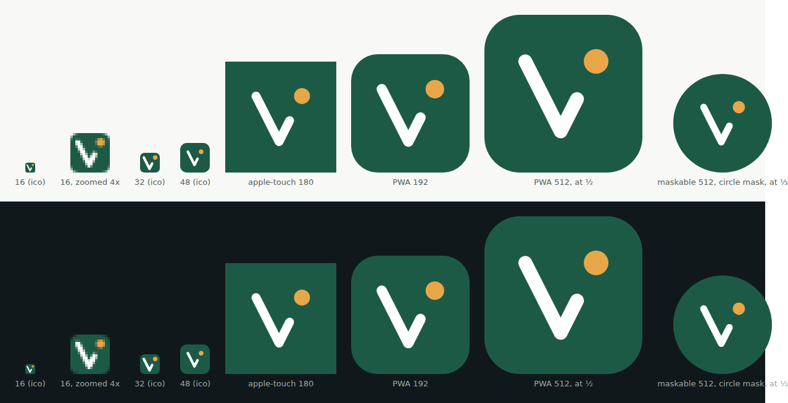
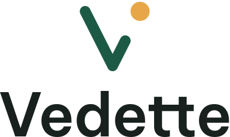
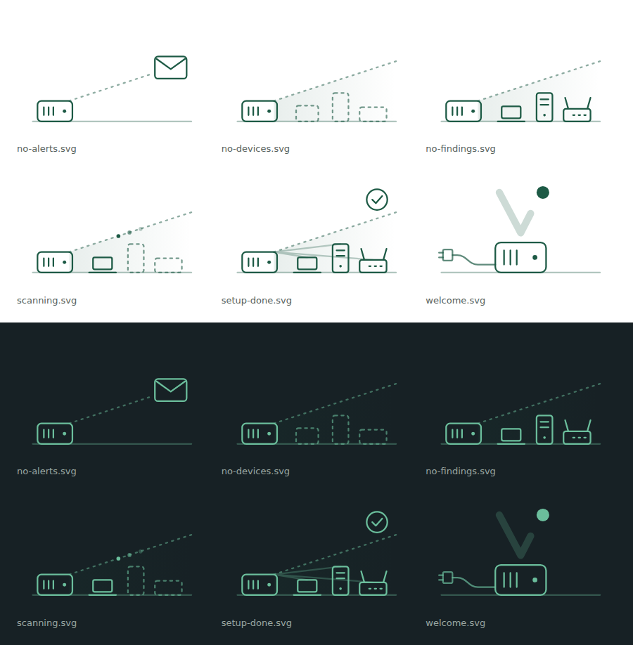

# Vedette brand

Everything here is hand-written SVG, plus PNG and ICO files rendered from it by a script in the repo. There are no design-tool files and no font dependency at run time.

## The idea: the sightline

A *vedette* is a sentry posted ahead of the camp. It watches and warns; it does not fight. The mark is a **V drawn as a line of sight**. The left stroke is the lookout's full view. The right stroke stops short, and the **signal dot** sits where it would end: out of everything the box can see, the one thing that needs you. In the product, that one thing is a vulnerability exploited in the wild that matches a device you own.

What we took from leading security brands, and where Vedette differs:
- **Tailscale** (a 3×3 dot grid forming a T): a mark made of a few primitives can stay legible down to a tab icon. Vedette uses two strokes and one dot, nothing finer.
- **Wiz** (a four-point spark, an "optimistic" identity): a security brand doesn't have to look menacing. Vedette stays calm, in a deep green with one warm accent instead of red alarms.
- **1Password** (the keyhole "1", later a separate wordmark and brand icon): the mark and the wordmark should each work alone. Vedette's mark also works as the app icon by itself.
- **CrowdStrike** (the falcon, a predator) and **Tenable** (a plain wordmark): predator and attack imagery is common in the category, so Vedette avoids it. It is a lookout, not a hunter. It also uses no shields, no padlocks, and no eyes that could read as surveillance.

## Logo

| Variant | Light background | Dark background |
|---|---|---|
| Horizontal (default) | [`logo-horizontal.svg`](logo-horizontal.svg) | [`logo-horizontal-dark.svg`](logo-horizontal-dark.svg) |
| Stacked (square spaces, splash) | [`logo-stacked.svg`](logo-stacked.svg) | [`logo-stacked-dark.svg`](logo-stacked-dark.svg) |
| Mark only | [`mark.svg`](mark.svg) | [`mark-dark.svg`](mark-dark.svg) |
| App icon (mark on a green tile) | [`app-icon.svg`](app-icon.svg) | same file on both |

&nbsp;&nbsp;&nbsp;&nbsp;&nbsp;&nbsp;

- **Wordmark:** "Vedette" set in Be Vietnam Pro SemiBold (OFL-1.1) with −1.5 % tracking. The two t's share one crossbar, the one custom detail. The text is converted to outlined paths, so the logo looks the same everywhere and never loads a font.
- **Clear space:** keep a margin of at least **X** around the logo on every side, where X is the diameter of the signal dot. Nothing else goes inside that margin, including text, edges and other logos.
- **Minimum size:**

| Variant | Smallest size |
|---|---|
| Mark | 16 px. Below 24 px use `web/public/favicon.svg`, which has a heavier stroke and a larger dot made for 16 px. |
| Horizontal logo | 20 px tall |
| Stacked logo | 48 px tall |

## Colours

The colours come from the theme tokens in `web/src/index.css`. The brand adds no new colour.

| Role | Hex | Token |
|---|---|---|
| Vedette green: the mark on light backgrounds, the app-icon tile, the social card | `#1d5a45` | light `--accent` (and `--focus`) |
| Mint: the mark on dark backgrounds | `#6bbe9c` | dark `--accent` |
| Signal amber: **only** the dot, in both themes | `#e7a748` | dark `--warn` |
| Ink: the wordmark on light backgrounds | `#18211d` | light `--ink` |
| Light ink: the wordmark on dark backgrounds | `#e3eae7` | dark `--ink` |
| Paper, light (backgrounds, `theme-color`) | `#f8f9f7` | light `--paper` |
| Paper, dark (backgrounds, `theme-color`) | `#11181b` | dark `--paper` |
| White: the mark on the green tile | `#ffffff` | light `--accent-ink` |
| Muted: taglines | `#56615c` / `#9aa7a2` | light / dark `--muted` |

Amber is the colour the app already uses for warnings, so the signal dot means the same thing in the logo as on screen.

## Do and don't

**Do**
- Use the light files on light backgrounds and the `-dark` files on dark ones.
- Use the app icon (the tile) wherever a square icon is expected, and the bare mark next to text.
- Keep the dot amber. In one-colour printing, the whole logo may be a single colour (ink or white).

**Don't**
- Recolour the dot to red or green, animate it like an alarm, or add a second dot.
- Close the V or move the dot onto the stroke. The gap is the idea.
- Stretch, rotate, outline, add a shadow or a gradient, or set "Vedette" in another typeface next to the mark.
- Put the logo on a busy photo or on a mid-tone colour where neither the light nor the dark variant has contrast.

## App icons and thumbnails

| File | Size | Made from |
|---|---|---|
| `web/public/favicon.svg` | vector | hand-tuned for 16 px |
| `web/public/favicon.ico` | 16, 32, 48 (PNG inside ICO) | `favicon.svg` (16, 32), `app-icon.svg` (48) |
| `web/public/apple-touch-icon.png` | 180 | `app-icon-ios.svg` (square, iOS rounds the corners) |
| `web/public/icon-192.png`, `icon-512.png` | 192, 512 | `app-icon.svg` |
| `web/public/icon-maskable-512.png` | 512 | `app-icon-maskable.svg` (mark inside the 80 % safe circle) |
| `web/public/manifest.webmanifest` | | names the three PWA icons |
| `docs/brand/social-preview.png` | 1280×640 | `social-preview.svg`. Upload it under GitHub → Settings → Social preview. |
| `docs/brand/readme-hero.svg`, `readme-hero-dark.svg` | 1280×360, vector | the top of the repo README, through `<picture>` |

The web interface has no Open Graph image. The box runs on a private network, so link-preview bots can't fetch from it, and the login page serves no meta tags for previews.

## Illustrations

`web/src/assets/illustrations/` holds a family of line drawings for empty states and milestones: `no-devices`, `no-findings`, `no-alerts`, `scanning`, `welcome` and `setup-done`. They follow these rules:
- They use a 240×160 view box, one 2-unit round stroke, and `currentColor` only, so the screen sets the colour (normally `text-accent`). Light and dark mode come free.
- Depth comes from opacity, not from extra colours: 1 for the subject, .6 to .7 for placeholders, .5 for the dashed sightline, .35 for the ground, and a .1 to 0 wash for the field of view.
- They share one scene: the Vedette box on the ground, watching across a field toward the customer's devices.
- They are decorative. Each has `aria-hidden="true"`, and the text next to it carries the meaning.
- Render them inline (for example imported with `?raw`), not through ``. An `` can't inherit `currentColor`. Each gradient id is unique (`vw-nd`, `vw-nf` and so on), so two drawings can share a page.

## Changing and re-rendering

- **PNG and ICO files:** after changing an SVG, run `make brand`. This runs `scripts/brand/render.mjs` with the repo's pinned Playwright Chromium and writes every PNG plus `favicon.ico`. Commit the output. `make brand PREVIEW=1` also refreshes `preview/` (the icon grid, the tab mock, the README hero and the illustrations).
- **Logo geometry or taglines:** edit `scripts/brand/outline.py` and run it in a throwaway Python venv. The pinned packages are listed at the top of the script. It rewrites the logo, icon, hero and social SVGs, converting the text to outlines from Be Vietnam Pro files fetched with `npm pack` (the exact command is at the top of the script; the app's interface font is Inter, which the logo does not use). Then run `make brand`.
- **Illustrations:** these are hand-written. Edit the SVG directly and keep to the rules above.
