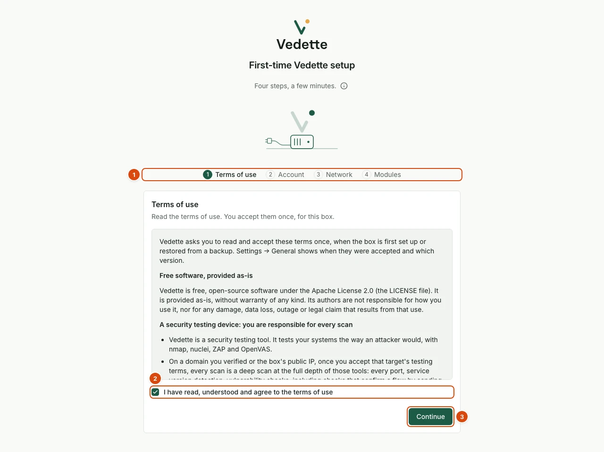
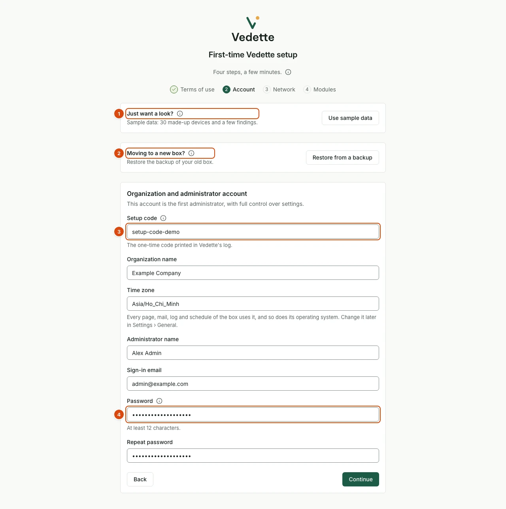
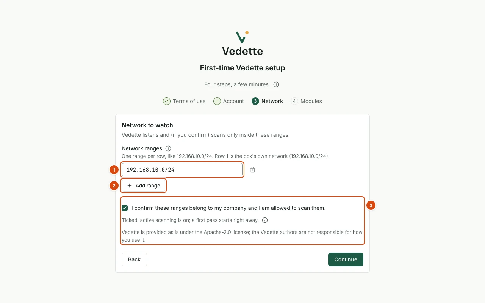
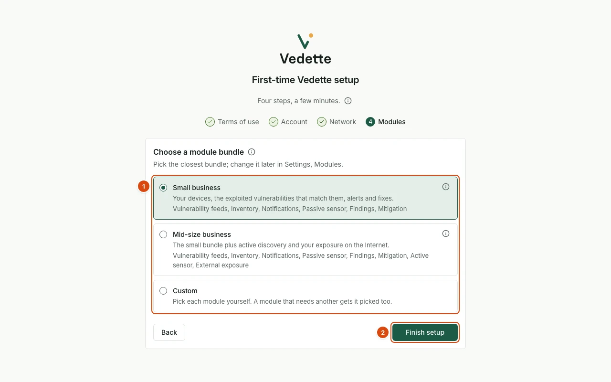
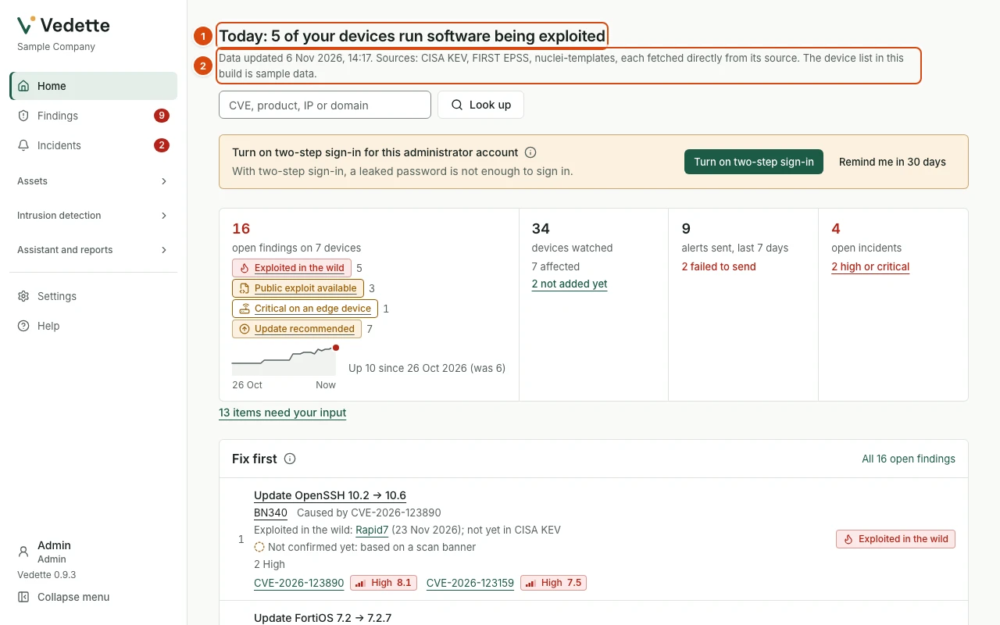

# Install Vedette and finish the setup wizard

**Goal:** a running Vedette box that watches your network, with you as its first administrator.
**Time:** about 15 minutes: 5 for the install, a few for the wizard.

## Before you start

- A spare machine (amd64 or arm64) with a fresh Ubuntu 26.04 (Ubuntu 24.04 and Debian 13 also install), at least 4 GB of memory (8 GB recommended), 6 GB free under `/var` and a wired network port.
- Free TCP ports 8443 (web interface), 8444 (sensor link) and 8765 (MCP server, local only).
- Root access (sudo) on that machine, and the version of the release you want (GitHub, Releases).

## Steps

1. **Run the installer** on the machine, with the version of the release in the address:

   ```
   curl -fsSL https://github.com/KNT048/vedette/releases/download/v<version>/install.sh | sudo sh
   ```

   To read and check the script first, download `install.sh` and `install.sh.minisig` and verify them with minisign, as the README shows. At the end the installer prints the address of the box (`https://<box>:8443`) and a **one-time setup code**.

2. **Open the address** in a browser. The certificate is self-signed: accept it once.

3. **Terms of use** (step 1 of 4). Read them, tick the box, press **Continue**.

   

   ① the four steps of the wizard ② the tick box ③ Continue

4. **Account** (step 2). Enter the setup code, the organization name, your name, your sign-in email and a password of at least 12 characters.

   

   ① **Use sample data** opens a demo box with made-up devices instead (nothing is scanned) ② **Restore from a backup** brings back the data of an old box (recipe 08) ③ the setup code: lost it? run `journalctl -u vedette-core | grep setup_code` on the box ④ the password

5. **Network** (step 3). Row 1 is already the box's own network. Add other private ranges your devices live in. Tick the confirmation only if Vedette may scan these ranges: a first pass then starts right away. Without the tick Vedette only listens.

   

   ① the box's own network ② Add range ③ the confirmation and the line that says what it does now

6. **Modules** (step 4). Pick **Small business** (your devices, the exploited vulnerabilities that match them, alerts and fixes) or **Mid-size business** (adds active scanning and your Internet exposure). Press **Finish setup**.

   

   ① the bundles ② Finish setup

   Internal traps, reports, logs and the AI assistant are Preview modules: no bundle turns them on. Turn each on later from its row in **Settings → Modules**.

## Check that it worked

You land on **Home**. Its title answers the first question ("Today: … of your devices run software being exploited"), and the line under it says when the vulnerability data was last updated.



① the answer of the day ② the time of the last data update and its sources

Within the first hour **Devices** starts to fill with what the sensor hears. **Settings → General** shows when the terms of use were accepted.

## Next

- The wizard has no alert step: set up a channel now ([recipe 04](04-alerts-email-telegram-zalo.md)).
- Add the devices the sensor cannot see ([recipe 02](02-add-devices-and-agents.md)).
