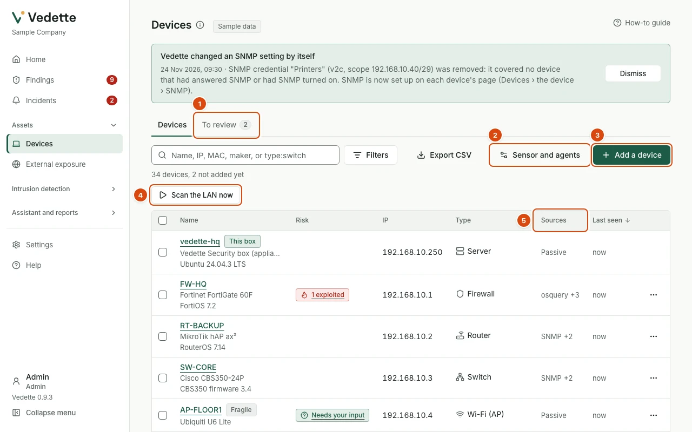
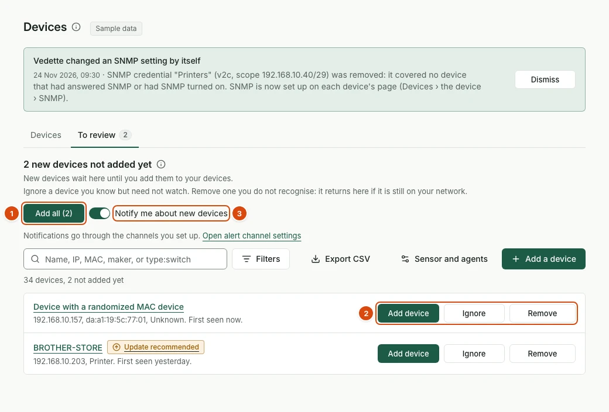
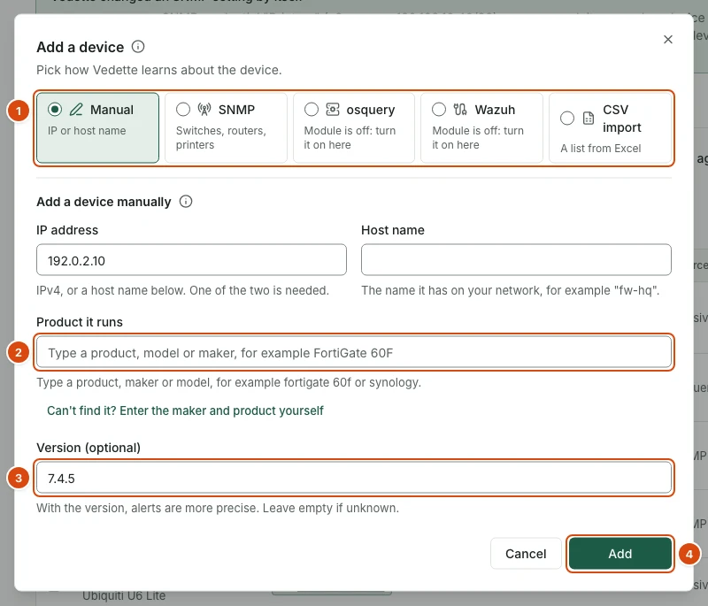
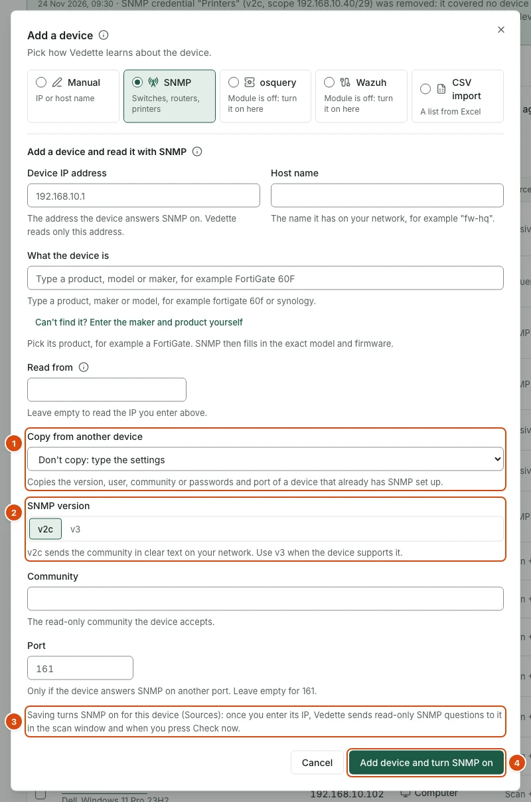
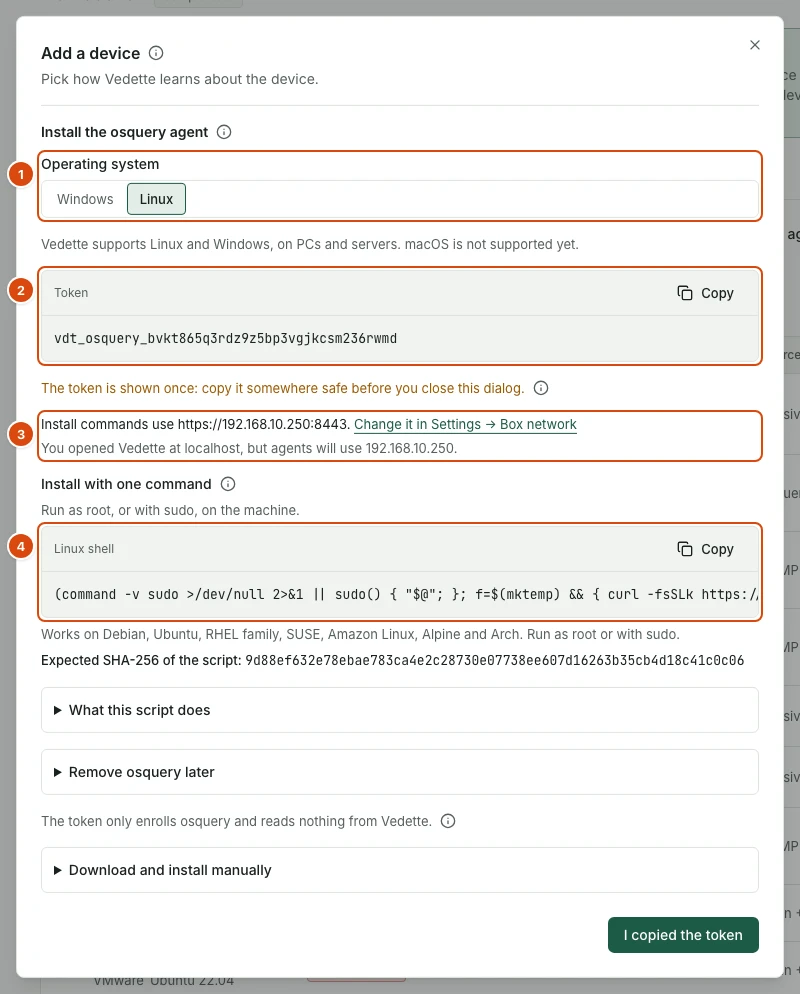
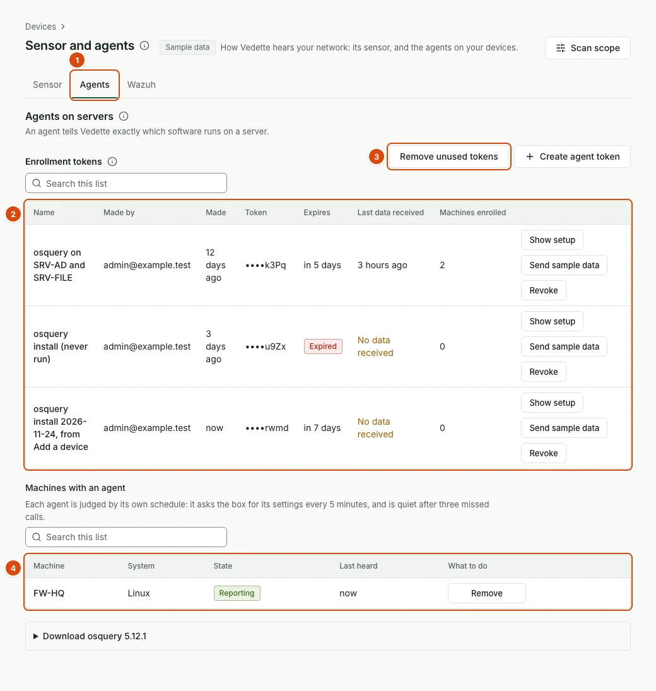

# Add your devices (and an agent on a server)

**Goal:** every device you care about is in the Devices list with its product and version, so Vedette can match exploited vulnerabilities to it.

**Time:** 5 minutes for the first devices; a few more for each agent.

## Before you start

- Setup is done ([recipe 01](01-install-and-setup.md)). Vedette already lists what its sensor hears on the network.
- For SNMP: the device's read-only community (v2c) or its v3 user.
- For the osquery agent: root or sudo on the server.

## Steps

1. **Open Assets → Devices.** Each row shows the device, its risk, IP, type, where Vedette learned it (Sources) and when it was last seen.

   

   ① To review: new devices the sensor found ② Sensor and agents: the sensor, the agents and the scan scope ③ Add a device ④ Scan the LAN now (only when you confirmed scanning) ⑤ Sources: Scan, Passive, Manual, SNMP, osquery…

2. **Add what the sensor found.** Open **To review**. Press **Add device** on yours, **Ignore** on a device you know but need not watch, **Remove** on one you do not recognise (it comes back if it is still on the network). **Add all** takes them all.

   

   ① Add all ② the three choices on one device ③ Notify me about new devices, through your alert channels

3. **Add a device by hand** (a firewall, a NAS, anything the sensor cannot identify): **Add a device → Manual**. Enter the IP address or host name, type the product (for example "fortigate 60f") and pick it from the list, and add the version if you know it. Press **Add**.

   

   ① the five ways: Manual, SNMP, osquery, Wazuh, CSV import ② the product it runs ③ the version: alerts are more precise with it ④ Add

4. **Let a switch, router or printer report its own model and firmware: SNMP.** **Add a device → SNMP**. Enter the IP, pick the product, choose v2c or v3 and enter the community or user. Press **Add device and turn SNMP on**.

   

   ① Copy from another device reuses settings you already entered ② v2c sends the community in clear text: use v3 when the device supports it ③ when Vedette asks: in the scan window and on Check now ④ Add device and turn SNMP on

5. **Install the osquery agent on a Linux or Windows server.** **Add a device → osquery**. If the Agent intake module is off, press **Turn on Agent intake** in the dialog. Pick the operating system and press **Create install command**. Copy the token somewhere safe (it is shown once), then copy the one-line command and run it as root on the server.

   

   ① the operating system ② the token, shown once ③ the address the agent will call: change it in Settings → Box network if it is wrong ④ the one-line install command, with the script's SHA-256 under it

   Each **Create install command** makes a new token; the Agents tab shows when it expires and removes the unused ones. To remove osquery from a server later, open **Remove osquery later** in the same dialog.

6. **Many devices at once:** **Add a device → CSV import → Download sample file**, fill it in Excel and choose it (up to 500 rows, 200 KB).

7. **Already run Wazuh?** **Add a device → Wazuh** shows how to create a read-only API user; Vedette then reads the software Wazuh knows.

## Check that it worked

- The device appears in **Devices** with its product and version, and SNMP or osquery under **Sources**.
- For an agent: **Devices → Sensor and agents → Agents** lists the token with **Machines enrolled** and the machine under **Machines with an agent**. An agent asks the box for its settings every 5 minutes and counts as quiet after three missed calls.

  

  ① Agents ② the enrollment tokens: who made them, when they expire, how many machines used them ③ Remove unused tokens ④ the machines that report through an agent

## Next

Vedette now matches exploited vulnerabilities to these devices: read what it found ([recipe 03](03-read-and-fix-a-finding.md)).
