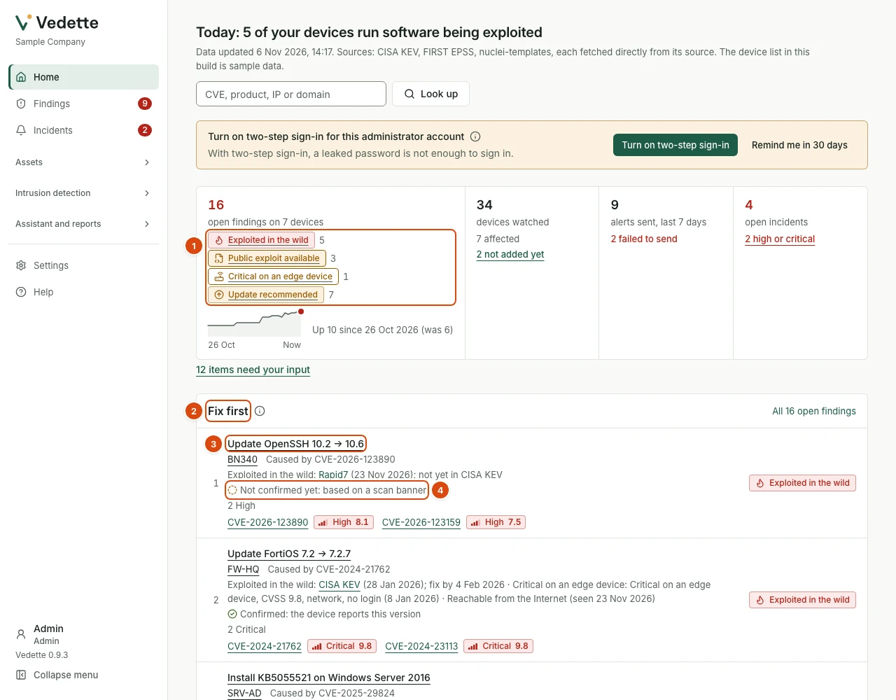
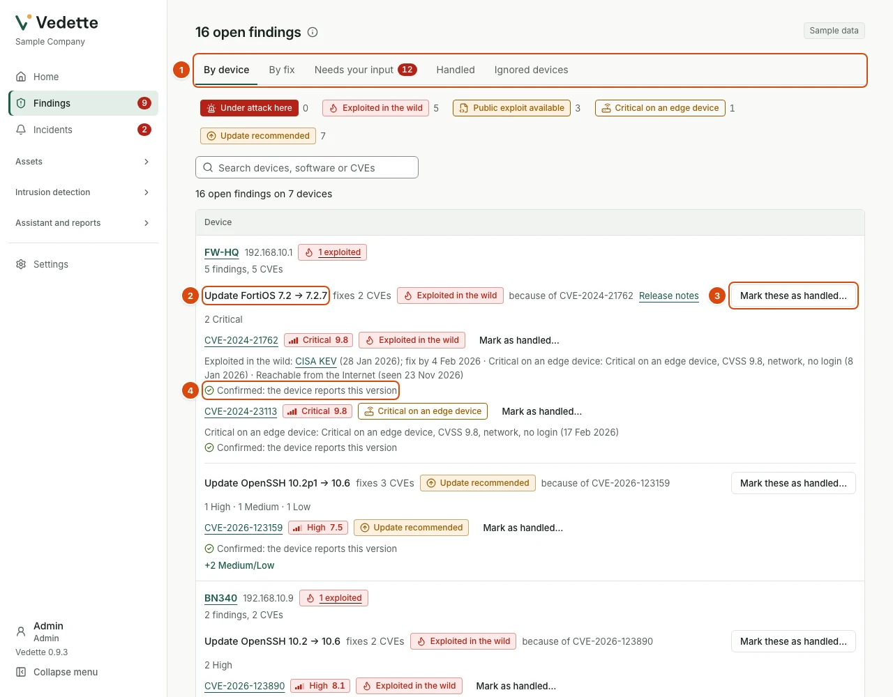
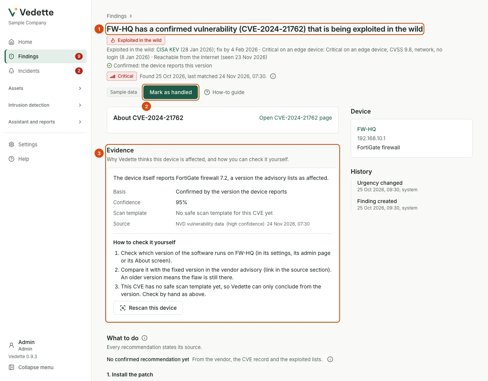
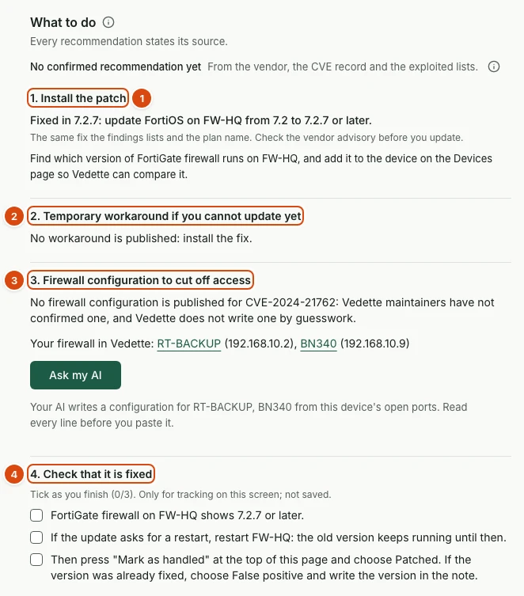
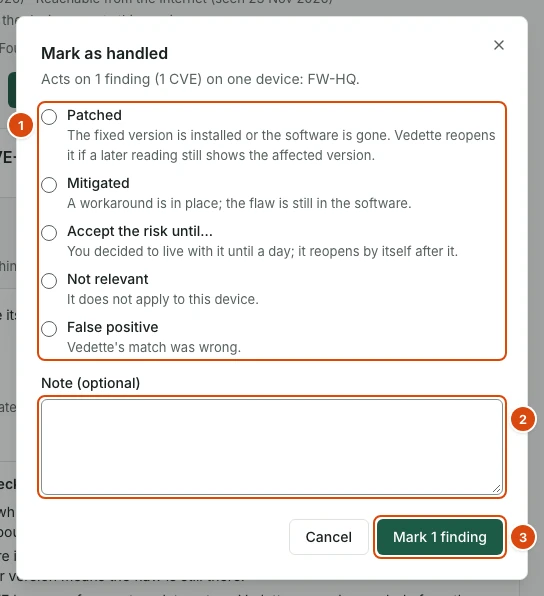

# Read a finding and fix it

**Goal:** know which vulnerability to deal with first, fix it, and have Vedette close it. Check whether you were already hit.

**Time:** a few minutes to read; the fix itself depends on the device.

## Before you start

- At least one device with its product and version ([recipe 02](02-add-devices-and-agents.md)).

## Steps

1. **Start at Home → Fix first.** Vedette ranks the work: **Under attack here** first (seen on your network), then **Exploited in the wild**, **Public exploit available**, **Critical on an edge device**, and **Update recommended** last. Each Fix first item is one update that closes the findings under it.

   

   ① the open findings by status ② Fix first ③ the update to install, on which device, and the CVE that makes it urgent ④ how sure Vedette is: "Confirmed" (the device reports the version) or "Not confirmed yet" (for example from a scan banner)

2. **Open Findings.** **By device** groups the open findings per device and per update; **By fix** groups them per update to install; **Needs your input** lists questions only you can answer (for example, confirm a version); **Handled** keeps what was dealt with.

   

   ① the views ② the update that fixes this group of findings ③ Mark these as handled… for the whole group ④ the confirmation line of one finding

3. **Open the finding** (click its CVE). The title says the device, the CVE and why it is urgent; **Evidence** says why Vedette thinks the device is affected, how sure it is (Basis, Confidence) and how to check it yourself.

   

   ① the title and the status ② Mark as handled ③ Evidence: basis, confidence, source and how to check it yourself

4. **Read What to do.** It is a short plan, each part with its source: install the patch (the fixed version), a temporary workaround when the vendor publishes one, the firewall configuration that cuts off access (or **Ask my AI** for one, when the AI module is on), and how to check the fix.

   

   ① install the patch: the version that fixes it ② a workaround if you cannot update yet ③ the firewall configuration ④ the checklist to confirm the fix

   Below it, **Have I been hit?** lists the signs an intruder tends to leave on this kind of device and what to do if you see them.

5. **Install the update** on the device, following the vendor advisory.

6. **Let Vedette see the new version.**
   - A device that reports its own version (SNMP, osquery, Wazuh, the box itself): nothing to do. The new version is read at the next check and the findings it fixes close by themselves. For an agent you can press **I updated it: ask the agent now** on the finding.
   - A version someone typed in: press **I updated …** (with the product name) at the top of the finding, type the version it runs now, press **Save and check**. Vedette closes every finding that version fixes.

7. **Cannot patch now, or not affected?** Press **Mark as handled** and pick what is true: Patched, Mitigated (a workaround is in place), Accept the risk until a date (it reopens by itself after it), Not relevant, or False positive. Add a note for the next person.

   

   ① the five outcomes ② the note ③ Mark 1 finding

## Check that it worked

- The finding moves to **Findings → Handled** and the device's count drops.
- The next periodic report lists it under "Handled this period" with who and why ([recipe 07](07-periodic-report.md)).

## Next

Get told the moment a new exploited vulnerability matches one of your devices ([recipe 04](04-alerts-email-telegram-zalo.md)).
