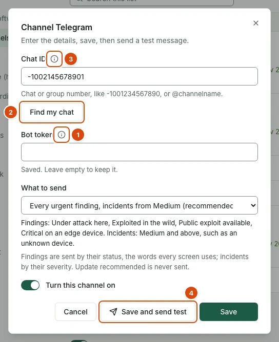

# Get alerts by email, Telegram, Zalo or Slack

**Goal:** Vedette messages you when an exploited vulnerability matches one of your devices, or when a trap is touched.
**Time:** 5 minutes per channel.

## Before you start

- **Email:** your mail server or provider and a sending account.
- **Telegram:** a bot token from @BotFather. Send any message to the bot (or add it to a group) first.
- **Zalo personal:** a separate Zalo account that sends the alerts (an unofficial channel: Zalo may lock that account).
- **Zalo OA:** an Official Account and an app on Zalo Developers (OA ID, recipient ID, App ID, secret key, refresh token).
- **Slack** and **Webhook** work the same way: Set up, fill in, Save and send test.

## Steps

1. **Open Settings → Alert channels.** Each channel shows whether it is on and when it was last tested.

   

   ① Set up a channel ② Edit one already set up ③ Send test ④ the result of the last test ⑤ Quiet hours and Grouping, below the list

2. **Email:** press **Set up** (or **Edit**). Pick the **Provider**: it fills in the server, port and encryption. Enter the username, the Send from address, the recipients (comma-separated) and the password. Choose **What to send**, tick **Turn this channel on**, press **Save and send test**.

   

   ① Provider ② Send to ③ What to send: by status, the words every screen uses ④ Save and send test

   For Microsoft 365, Outlook.com and Gmail the provider list also offers a sign-in with that account instead of a password.

3. **Telegram:** press **Set up**, paste the bot token, press **Find my chat** (it fills in the chat ID from your last message to the bot), choose What to send, press **Save and send test**.

   

   ① Bot token ② Find my chat ③ Chat ID, filled in for you ④ Save and send test

4. **Zalo personal:** press **Set up**, then **Sign in with a QR code** using the separate Zalo account. Pick the group or friend who receives the alerts, or find one by invite link or phone number. Press **Save and send test**.

   

   ① the warning: use a separate account ② Sign in with a QR code ③ who receives the alerts

5. **Zalo OA** (a business Official Account): the form explains where each value is on Zalo Developers. Fill them in and press **Save and send test**. Vedette renews the access token by itself.

6. **Optional:** set **Quiet hours** (messages are held, then sent together; Critical can still go out at once) and **Grouping** (one message per product within 15 minutes, 1 hour or 4 hours), then **Save quiet hours and grouping**.

## Check that it worked

- The channel's row shows "Tested …: success", and the test message arrives.
- Later, **History** at the bottom of the page lists every message with its result. A failed one says why and offers **Send again**.

  

  ① Not sent: alerts that could not go out ② a failed message and the reason ③ Send again

## Next

Check what your company exposes to the Internet ([recipe 05](05-external-exposure-scan.md)), or set a trap ([recipe 06](06-honeypot-decoys.md)).
