# Get alerts by email, Telegram, Zalo or Slack

**Goal:** Vedette messages you when an exploited vulnerability matches one of your devices, or when a trap is touched.

**Time:** 5 minutes per channel; 15 minutes for Microsoft 365 the first time.

## Before you start

- **Email:** your mail server or provider and a sending account.
- **Email through Microsoft 365:** a work or school mailbox, and an account that may register apps in Microsoft Entra (the Application Developer role or higher). See **Email through Microsoft 365** below.
- **Telegram:** a bot token from @BotFather. Send any message to the bot (or add it to a group) first.
- **Zalo personal:** a separate Zalo account that sends the alerts (an unofficial channel: Zalo may lock that account).
- **Zalo OA:** an Official Account and an app on Zalo Developers (OA ID, recipient ID, App ID, secret key, refresh token).
- **Slack** and **Webhook** work the same way: Set up, fill in, Save and send test.

## Steps

1. **Open Settings → Alert channels.** Each channel shows whether it is on and when it was last tested.

   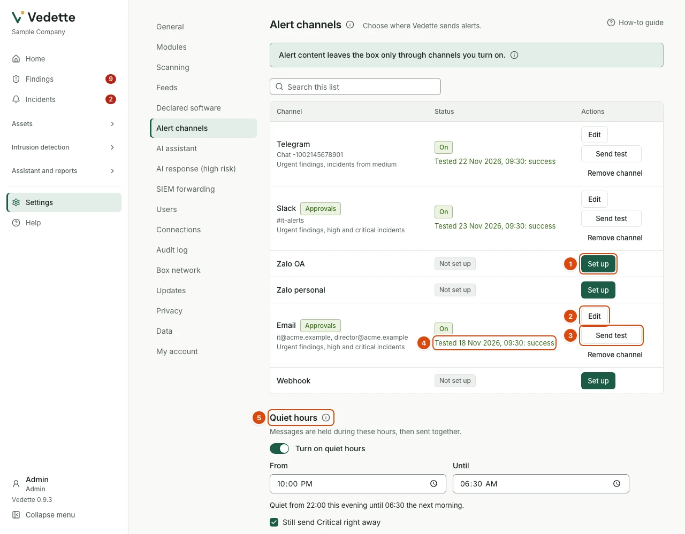

   ① Set up a channel ② Edit one already set up ③ Send test ④ the result of the last test ⑤ the Settings tab: Quiet hours and Grouping ⑥ History of sent messages

2. **Email:** press **Set up** (or **Edit**). Pick the **Provider**: it fills in the server, port and encryption. Enter the username, the Send from address, the recipients (comma-separated) and the password. Choose **What to send**, tick **Turn this channel on**, press **Save and send test**.

   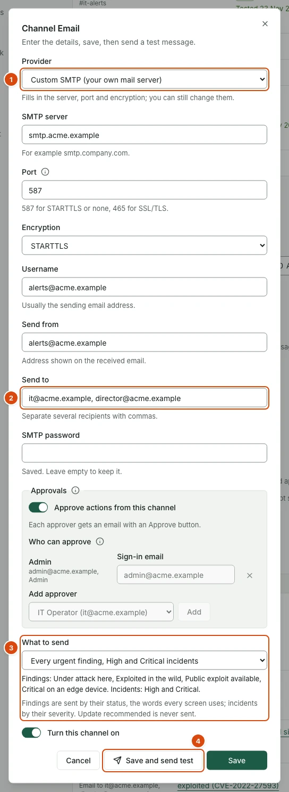

   ① Provider ② Send to ③ What to send: by status, the words every screen uses ④ Save and send test

   For Microsoft 365, pick one of the two Microsoft providers instead of a password: see **Email through Microsoft 365** below.

3. **Telegram:** press **Set up**, paste the bot token, press **Find my chat** (it fills in the chat ID from your last message to the bot), choose What to send, press **Save and send test**.

   

   ① Bot token ② Find my chat ③ Chat ID, filled in for you ④ Save and send test

4. **Zalo personal:** press **Set up**, then **Sign in with a QR code** using the separate Zalo account. Pick the group or friend who receives the alerts, or find one by invite link or phone number. Press **Save and send test**.

   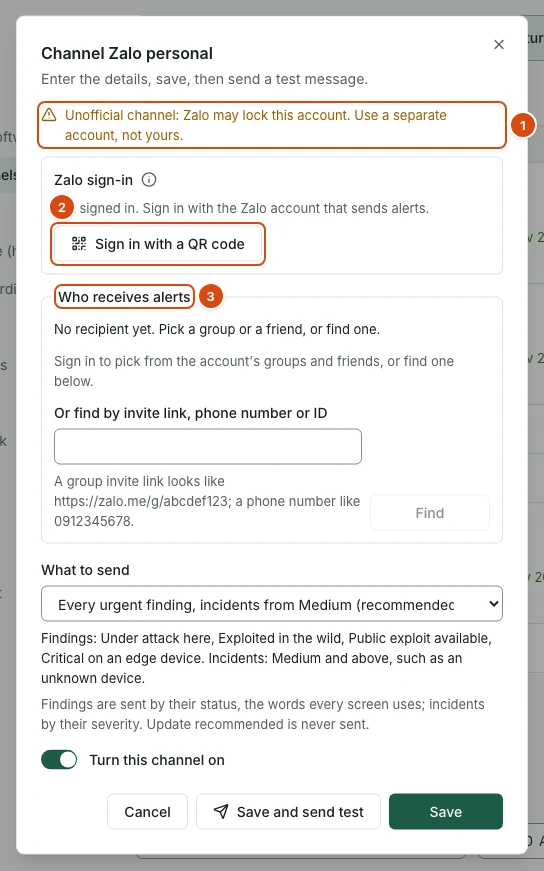

   ① the warning: use a separate account ② Sign in with a QR code ③ who receives the alerts

5. **Zalo OA** (a business Official Account): the form explains where each value is on Zalo Developers. Fill them in and press **Save and send test**. Vedette renews the access token by itself.

6. **Optional:** on the **Settings** tab, set **Quiet hours** (messages are held, then sent together; Critical can still go out at once) and **Grouping** (one message per product within 15 minutes, 1 hour or 4 hours), then **Save quiet hours and grouping**.

## Email through Microsoft 365

Vedette offers two ways to send from a Microsoft 365 mailbox. Neither stores a user password.

| Provider in Vedette | How it signs in | Pick it when |
| --- | --- | --- |
| **Microsoft 365 (sign in as the user)** | The mailbox's user signs in once with a code. No secret to copy. | You want the quickest setup, or nobody can grant admin consent for an app permission. |
| **Microsoft Graph (app, client secret)** | An app with a client secret sends through Microsoft Graph. | You already do this for another tool (for example GitLab's Microsoft Graph mailer), or the mail must keep working when the person who signed in leaves. |

Both start in the Microsoft Entra admin center. Both need a work or school mailbox: personal Outlook.com, Hotmail and Live accounts are not supported in this version (the provider list has no option for them). Without a work or school mailbox, use **Gmail (personal account)** with an app password, or Telegram.

### Option 1: Microsoft 365 (sign in as the user)

1. **Open App registrations.** Sign in to [entra.microsoft.com](https://entra.microsoft.com), then open **Entra ID** → **App registrations** and press **New registration**.

   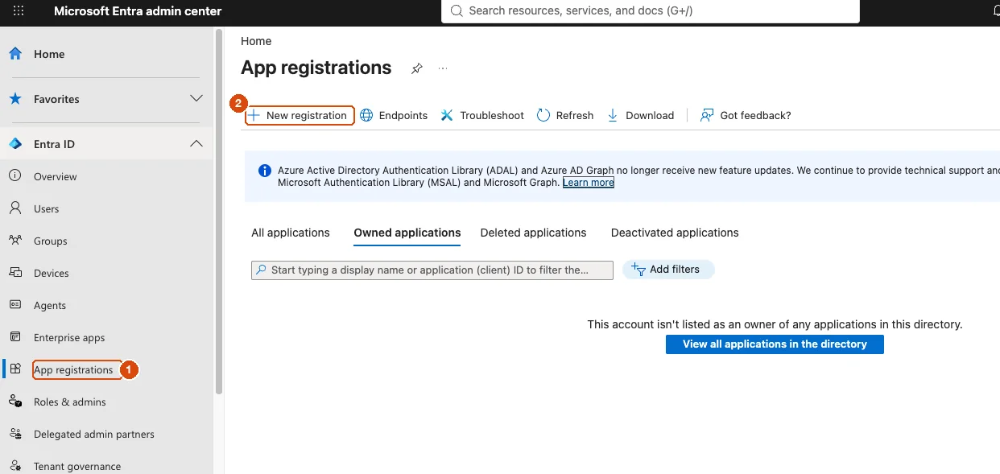

   ① App registrations ② New registration

2. **Register the app.** Give it a name you will recognise, for example "Vedette alerts". Under **Supported account types** choose **Single tenant only** (your organization only). Leave **Redirect URI** empty. Press **Register**.

   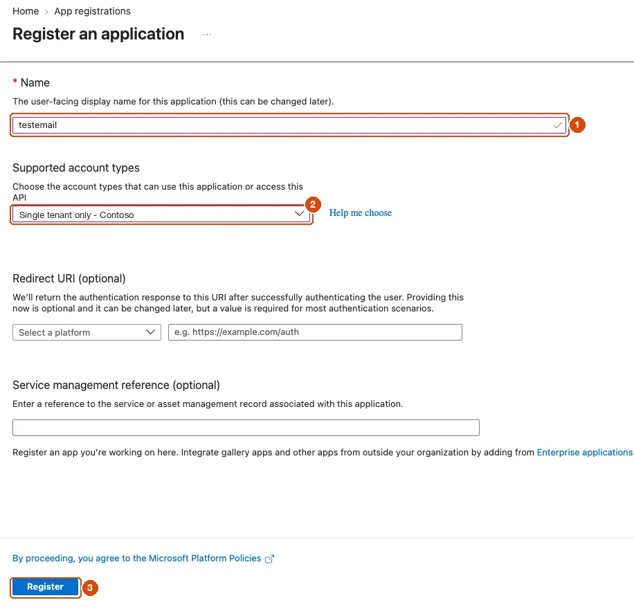

   ① Name ② Supported account types: single tenant ③ Register

3. **Copy the two IDs.** The app's **Overview** page shows them. Keep them for step 6.

   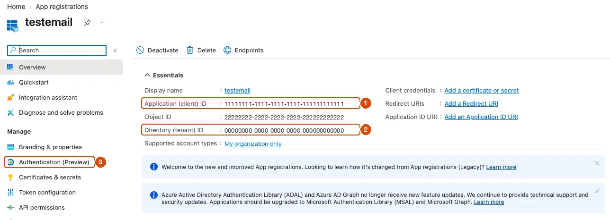

   ① Application (client) ID ② Directory (tenant) ID ③ Authentication, for the next step

   The Object ID is not needed.

4. **Allow public client flows.** Open **Authentication**, the **Settings** tab, and set **Allow public client flows** to **Enabled**, then save. Without it, Microsoft refuses the app when Vedette asks for a sign-in code. In the older layout of this page the same switch is under **Advanced settings** and says **Yes**.

   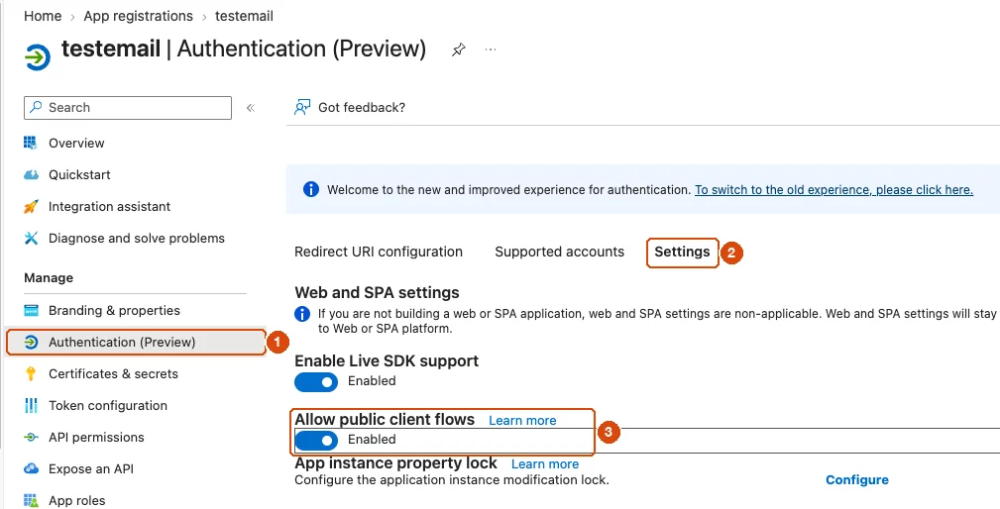

   ① Authentication ② Settings ③ Allow public client flows: Enabled

   You do not need to add API permissions: Microsoft asks for consent when the mailbox user signs in. If your organization does not let users consent to apps, an administrator adds **API permissions** → **Add a permission** → **Microsoft Graph** → **Delegated permissions** → **SMTP.Send**, and presses **Grant admin consent**.

5. **Turn on SMTP AUTH for the mailbox,** if it is off. This sign-in sends through Microsoft's SMTP server with a token, and Microsoft turns SMTP AUTH off in many tenants. In the Microsoft 365 admin center: **Users** → **Active users** → the mailbox → **Mail** → **Manage email apps** → tick **Authenticated SMTP** → **Save changes** ([Microsoft's guide](https://learn.microsoft.com/en-us/exchange/clients-and-mobile-in-exchange-online/authenticated-client-smtp-submission)).

6. **Fill in Vedette.** Open **Settings** → **Alert channels**, press **Set up** (or **Edit**) on Email, and pick the provider **Microsoft 365 (sign in as the user)**. The server, port and encryption fill in by themselves. In **Tenant ID**, replace "organizations" with the Directory (tenant) ID; in **Client ID**, paste the Application (client) ID.

   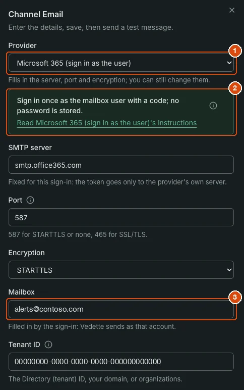

   ① Provider ② the provider's instructions, in Vedette ③ Mailbox: filled in by the sign-in, you do not type it

7. **Sign in with the code.** Press **Sign in with Microsoft**. Vedette shows a code and an address (microsoft.com/devicelogin). On any computer or phone, open that address, enter the code and sign in as the mailbox that sends the alerts. Back in Vedette the dialog says "Signed in as …" (press **I have signed in, check now** if it has not changed yet). The code expires after about 15 minutes: press **Sign in with Microsoft** again for a new one.

8. **Send a test.** Fill in **Send from** (the mailbox address) and **Send to** (who gets the alerts, separated by commas), choose **What to send**, tick **Turn this channel on** and press **Save and send test**.

   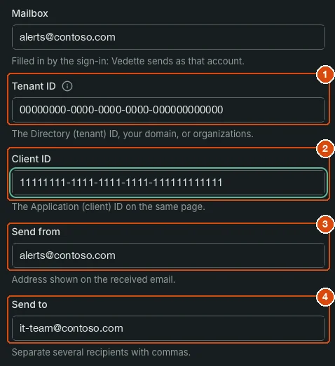

   ① Tenant ID ② Client ID ③ Send from: the mailbox itself ④ Send to

   The test mail arrives within a minute:

   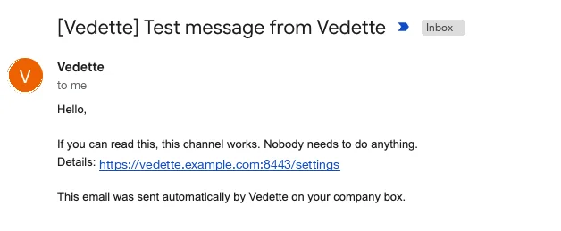

The sign-in keeps working until the user's password changes, an administrator revokes it, or it is not used for 90 days. Vedette then reports that Microsoft no longer accepts the saved sign-in: open the Email channel and sign in again.

### Option 2: Microsoft Graph (app, client secret)

This is the same setup many administrators already use for GitLab's Microsoft Graph mailer. A tenant administrator who can grant admin consent (Global Administrator or Privileged Role Administrator) does steps 2 and 3.

1. **Register the app** as in Option 1, steps 1 to 3: **Entra ID** → **App registrations** → **New registration**, single tenant, then copy the **Application (client) ID** and the **Directory (tenant) ID** from **Overview**. You can reuse the app from Option 1. Public client flows are not needed here.

2. **Give it Mail.Send.** Open **API permissions** → **Add a permission** → **Microsoft Graph** → **Application permissions** (not Delegated) → search **Mail.Send**, tick it and press **Add permissions**. Then press **Grant admin consent for** your organization and **Yes**. The status column must say **Granted** ([Microsoft's guide to admin consent](https://learn.microsoft.com/en-us/entra/identity/enterprise-apps/grant-admin-consent)).

3. **Create a client secret.** Open **Certificates & secrets** → **Client secrets** → **New client secret**. Enter a description, choose when it expires (at most 24 months; Microsoft recommends less than 12) and press **Add**. Copy the **Value** right away, not the **Secret ID**: Microsoft never shows the value again once you leave the page ([Microsoft's guide](https://learn.microsoft.com/en-us/entra/identity-platform/how-to-add-credentials)). Write down the expiry date: when the secret expires, email alerts stop until you create a new one and save it in Vedette.

4. **Fill in Vedette.** In **Settings** → **Alert channels** → Email, pick **Microsoft Graph (app, client secret)**. There is no server, port or encryption to fill in. Enter:
   - **Mailbox to send as**: the mailbox the alerts come from, for example alerts@company.com. It must be an Exchange Online mailbox in your tenant: a licensed user mailbox or a shared mailbox.
   - **Tenant ID** and **Client ID**: the two IDs from Overview.
   - **Client secret**: the Value from step 3.
   - **Send from**: the same mailbox address, or one that mailbox may send as.
   - **Send to**: who gets the alerts, separated by commas.

5. **Send a test.** Choose **What to send**, tick **Turn this channel on** and press **Save and send test**.

**Optional, recommended: limit the app to one mailbox.** The application permission Mail.Send lets the app send as any mailbox in your organization. An Exchange administrator can limit it to the alert mailbox with RBAC for Applications in Exchange Online, which replaces the older application access policies ([Microsoft's guide](https://learn.microsoft.com/en-us/exchange/permissions-exo/application-rbac)). With RBAC for Applications, remove the Mail.Send consent from the app registration afterwards, or the scope has no effect.

**A channel saved with the old setting.** A channel saved earlier with **Microsoft 365 (app permission, admin)** (the app permission over SMTP) still shows that setting, but it is no longer offered. Switch it to **Microsoft Graph (app, client secret)**: give the app Mail.Send as in step 2, enter the client secret again, and press **Save and send test**.

### When the test fails

The channel's row and the History show one sentence that says what Microsoft refused. Find it below.

| Vedette says | What to do |
| --- | --- |
| Microsoft refused the app registration. Check the client ID and the tenant ID, and turn on Allow public client flows … | Option 1, step 4: set Allow public client flows to Enabled. Check that the Client ID is the Application (client) ID. |
| Microsoft refused the sign-in request. Check the tenant ID … | The Tenant ID must be the Directory (tenant) ID. A single-tenant app does not work with "organizations". |
| Microsoft refused the permission. Add the delegated permission SMTP.Send … | Add SMTP.Send as in the note under Option 1, step 4, and grant admin consent. |
| The sign-in was declined, or The sign-in expired before it was finished | Press Sign in with Microsoft again, enter the new code within 15 minutes and approve. |
| Microsoft refused the sign-in (SMTP code 535). Check that SMTP AUTH is on for the mailbox … | Option 1, step 5: tick Authenticated SMTP for the mailbox. |
| Microsoft no longer accepts the saved sign-in … | The password changed, or the sign-in was revoked or unused for a long time. Open the Email channel and sign in again. |
| Microsoft refused the client ID or the client secret … | Option 2: the secret is wrong, is the Secret ID instead of the Value, or has expired. Create a new one and save it. |
| Microsoft does not know this client ID in this tenant … | The Client ID or the Tenant ID is from another app or tenant. Copy both again from Overview. |
| Microsoft Graph denied sending as … | Option 2, step 2: Mail.Send must be an Application permission with admin consent granted. If an administrator limited the app to some mailboxes, include this one. |
| Microsoft Graph refused the sender email … | Send from must be the mailbox address, or the mailbox needs Send As permission for that address. |
| Microsoft Graph cannot find the mailbox … | Check the Mailbox to send as: it must exist in this tenant and be an Exchange Online mailbox (a user mailbox needs a license). |
| Microsoft Graph refused the sign-in token … | Check the Tenant ID, the Client ID and the client secret. |
| Vedette could not reach Microsoft Graph, or could not reach Microsoft's sign-in service | The box needs internet access and DNS for login.microsoftonline.com and graph.microsoft.com (Option 1 also uses smtp.office365.com on port 587). |

A changed permission can take a few minutes to reach Microsoft's servers; wait five minutes, then press **Send test** again.

### Custom SMTP with a password

**Custom SMTP** with a Microsoft 365 username and password stops working by default at the end of December 2026, when Microsoft turns off Basic authentication for SMTP AUTH ([Microsoft's announcement](https://techcommunity.microsoft.com/blog/exchange/updated-exchange-online-smtp-auth-basic-authentication-deprecation-timeline/4489835)). The two options above sign in with OAuth and are not affected. Vedette shows the same warning when Custom SMTP points at a Microsoft server.

## Check that it worked

- The channel's row shows "Tested …: success", and the test message arrives.
- Later, **History** (top right of Alert channels) lists every message with its result; filter it by channel, result or kind. A failed one says why and offers **Send again**.

  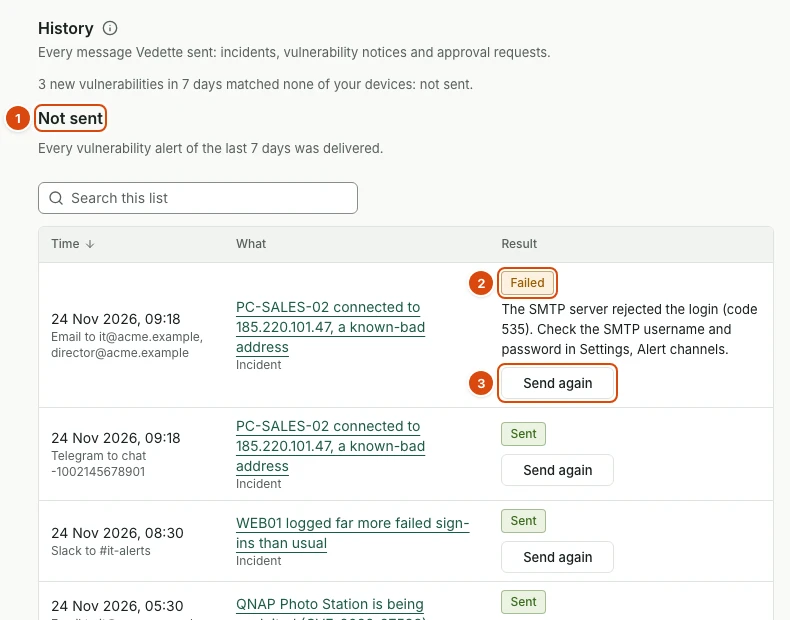

  ① Not sent: alerts that could not go out ② a failed message and the reason ③ Send again

## Next

Check what your company exposes to the Internet ([recipe 05](05-external-exposure-scan.md)), or set a trap ([recipe 06](06-honeypot-decoys.md)).
