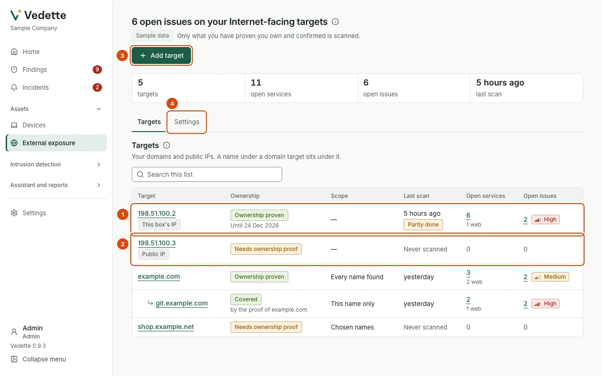
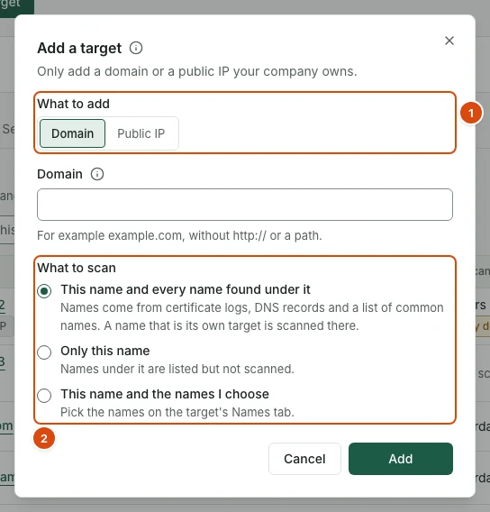
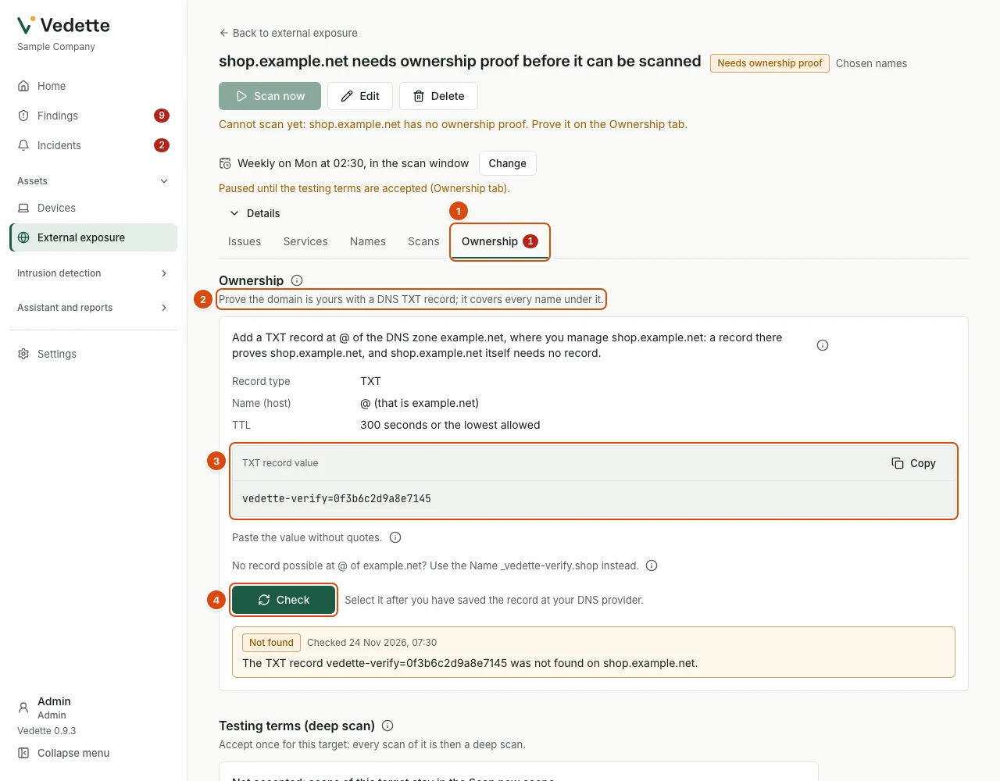
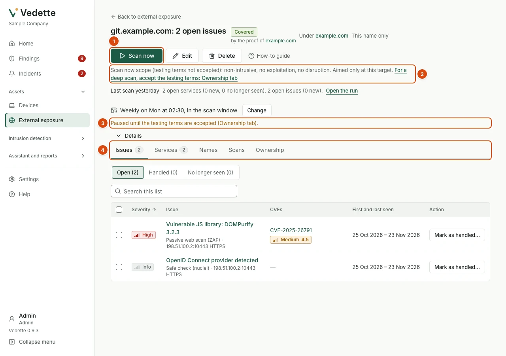
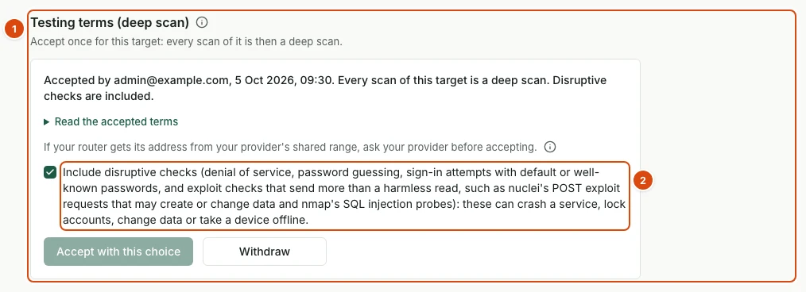

# Check what your company exposes to the Internet

**Goal:** see which services and known exploited vulnerabilities are reachable on your public IP or domain, the way an attacker sees them.
**Time:** a few minutes to set up; a scan runs on its own.

## Before you start

- The **External exposure** module is on (Mid-size bundle, or Settings → Modules).
- You own the IP or domain and are allowed to scan it. An address your provider shares between customers (carrier-grade NAT) is not yours to test.

## Steps

1. **Open Assets → External exposure.** The box adds its own public IP by itself: its ownership is proven because the box reaches the Internet through it.

   

   ① the box's own IP, ownership proven ② a target that still needs its ownership proof ③ Add target ④ Settings: automatic detection of the box's public IP, and the optional OpenVAS scan

2. **Add a domain or another public IP:** **Add target**, choose **Domain** or **Public IP**, choose what to scan (the name and every name found under it, only this name, or the names you choose) and press **Add**.

   

   ① Domain or Public IP ② what to scan

3. **Prove that it is yours.** Open the target, tab **Ownership**. For a domain, add the TXT record it shows at your DNS provider and press **Check**. For an IP, serve the token file on it or set a reverse DNS name, as the tab explains.

   

   ① Ownership ② the proof this target needs ③ the TXT record to add ④ Check

4. **Scan it.** On the target page, read the sentence next to **Scan now**: a standard scan is non-intrusive (services, versions, safe checks for exploited vulnerabilities, a passive web scan) and aimed only at this target. Pressing **Scan now** records that you confirm it and starts the scan at once.

   

   ① Scan now ② what the scan does ③ the schedule, paused until the testing terms are accepted ④ the tabs: Issues, Services, Names, Scans, Ownership

5. **Optional deep scan:** tab **Ownership → Testing terms (deep scan)**. Read the terms (every port, vulnerability checks, web scanning, sign-in checks) and accept them once for this target. From then on every scan of it, including the scheduled ones, is a deep scan. Leave **Include disruptive checks** off unless you accept that a service may crash or an account may lock.

   

   ① the testing terms and who accepted them ② disruptive checks, off unless you accept outages

## Check that it worked

- **Scans** lists each run with its depth and result.
- **Services** lists the open ports and versions; **Issues** lists what is exposed, with its severity and **Mark as handled…**.
- The exposure page's counters show the open services, open issues and the time of the last scan.

## Next

Exposed issues show up in the periodic report too ([recipe 07](07-periodic-report.md)).
