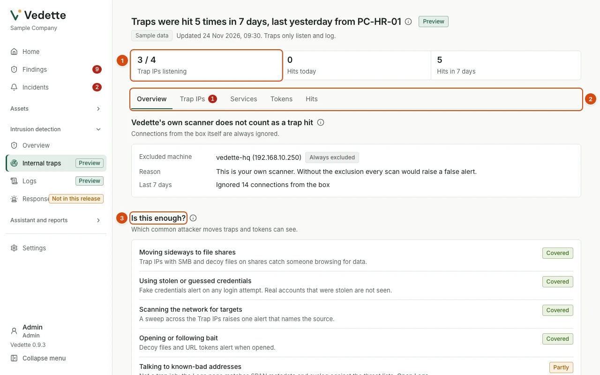
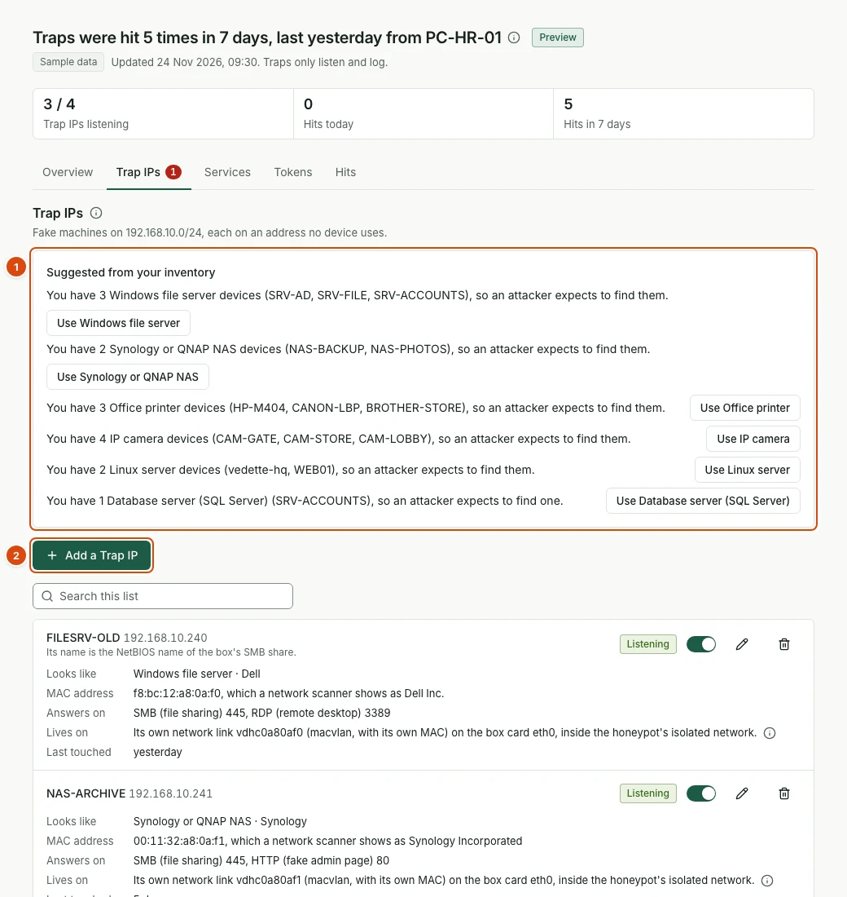
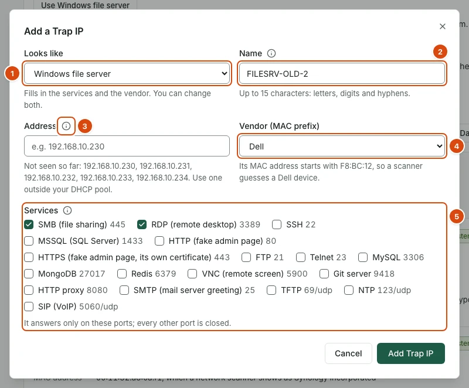
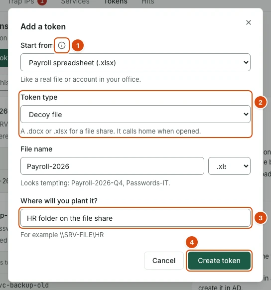
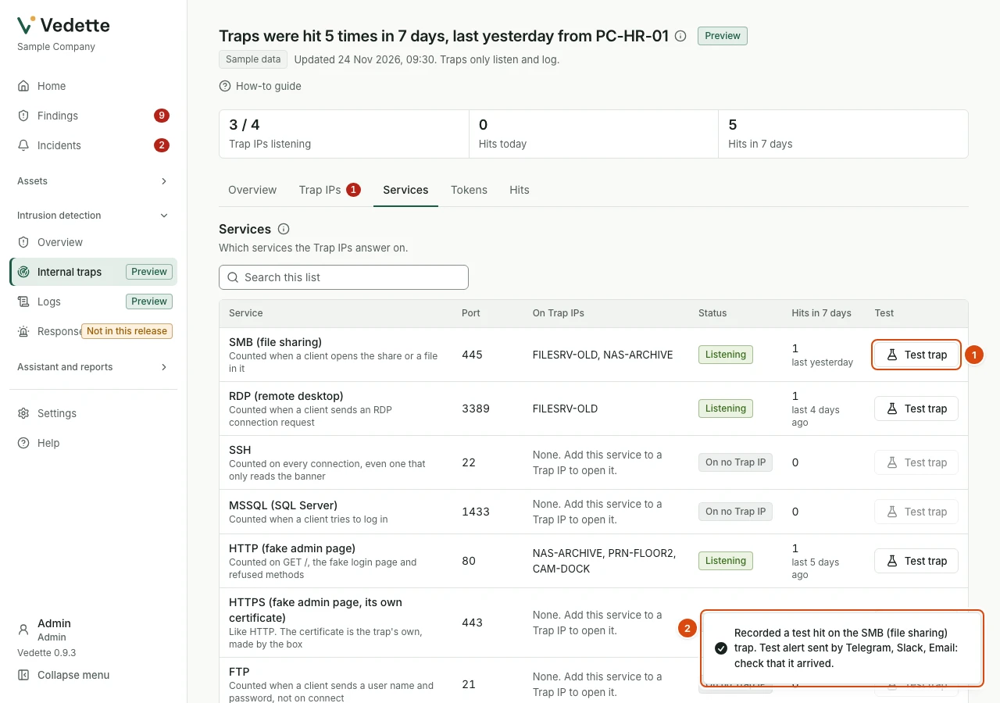
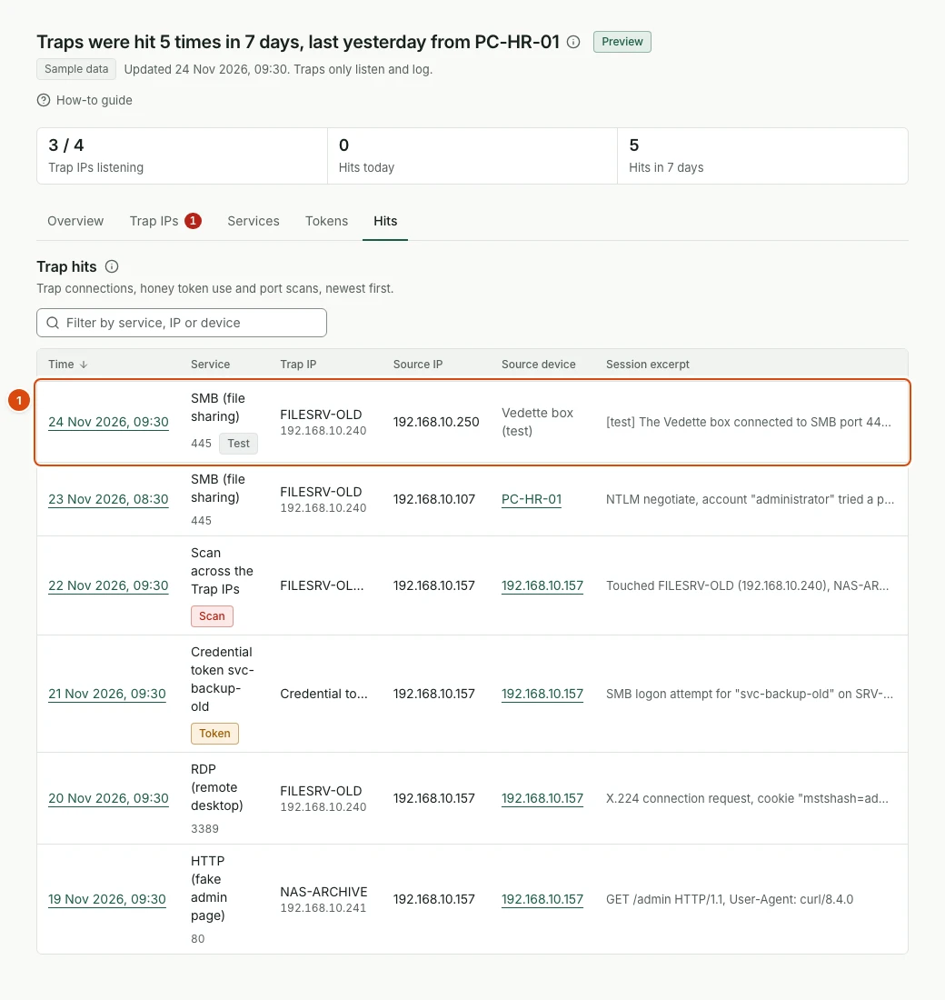

# Set a trap for intruders (decoy machines and honey tokens)

**Goal:** fake machines and bait files on your network. Nobody has a reason to touch them, so anyone who does raises an alert, with almost no false alarms.
**Time:** 10 minutes.

## Before you start

- **Settings → Modules → Internal traps** is on (a Preview module; no setup bundle turns it on).
- One free IP address per decoy machine, outside your DHCP pool.
- An alert channel works ([recipe 04](04-alerts-email-telegram-zalo.md)).

## Steps

1. **Open Intrusion detection → Internal traps.** The overview shows how many decoy machines (Trap IPs) listen, the hits today and in 7 days, and **Is this enough?**: which attacker moves your traps can see. Connections from the Vedette box itself are always ignored.

   

   ① the counters ② the tabs: Trap IPs, Services, Tokens, Hits ③ Is this enough?

2. **Add a decoy machine:** tab **Trap IPs**. Use a suggestion ("You have 3 Windows file server devices, so an attacker expects to find them") or press **Add a Trap IP**.

   

   ① suggestions from your own devices ② Add a Trap IP

3. **Describe it:** pick what it **Looks like** (Windows file server, NAS, printer, camera, Linux server, SQL Server), give it a name (up to 15 characters), an address (Vedette lists addresses no device has used), a vendor (the start of its MAC address, so a scanner guesses that maker) and the services it answers on. Press **Add Trap IP**.

   

   ① Looks like ② Name ③ Address ④ Vendor ⑤ Services: it answers only on these ports

4. **Plant honey tokens:** tab **Tokens → Add a token**. Start from a template (payroll spreadsheet, password list, VPN guide, old admin account…), choose the type (decoy file, fake credentials, URL token), the file name and where you will plant it. Press **Create token**, then put the file, credentials or link where an intruder would look.

   

   ① Start from ② Token type ③ where you will plant it ④ Create token

5. **Test the trap:** tab **Services → Test trap** on a listening service. Vedette records a test hit and sends a test alert through your channels.

   

   ① Test trap ② the result: which channels the test alert went to

## Check that it worked

- The test alert arrives on your phone or mailbox.
- **Hits** lists every touch, newest first, with the trap, the source address and device, and what the visitor tried.

  

  ① one hit: when, which service and trap, from which device, what it did

- For a real check, connect to a Trap IP from another computer (for example `ssh <trap IP>` on a trap with SSH): a hit and an incident appear and an alert goes out.

## Next

Hits and incidents are counted in the periodic report ([recipe 07](07-periodic-report.md)).
