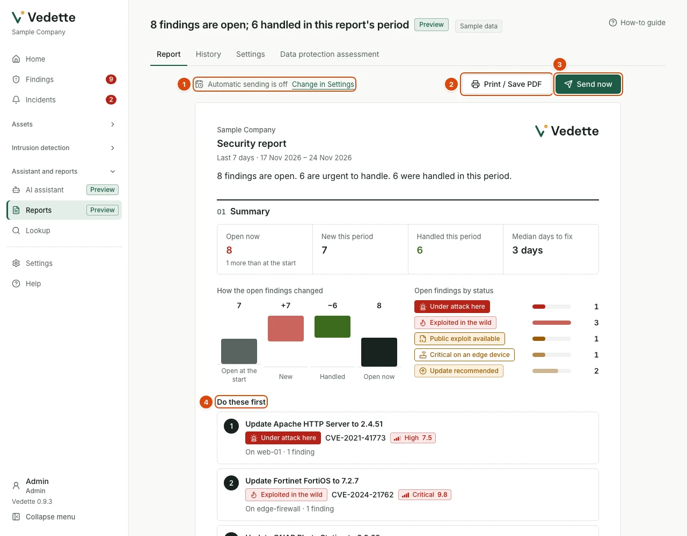
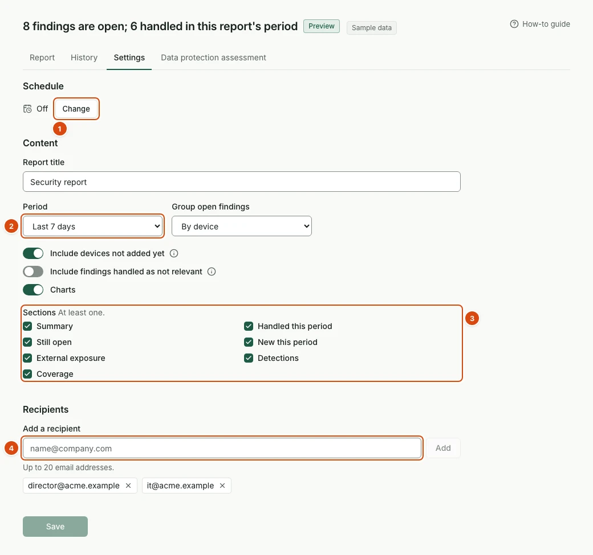
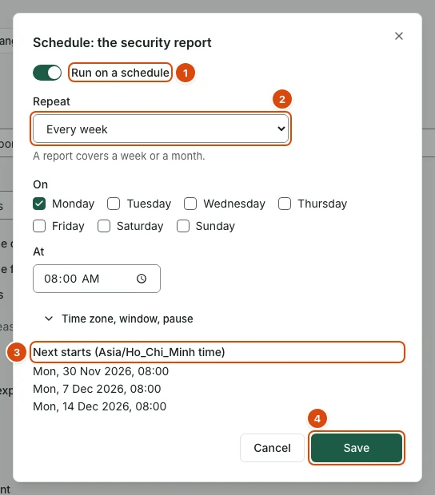
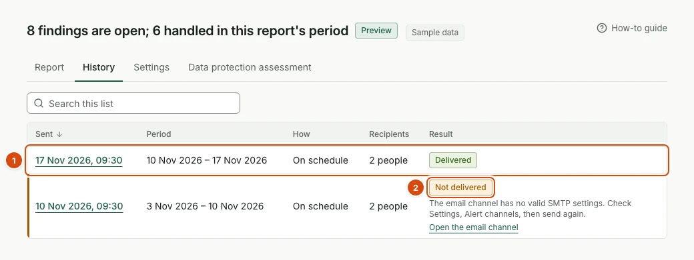

# Send a weekly security report

**Goal:** a short report of what is open, what was handled and what to do first, emailed every week or every month.
**Time:** 5 minutes.

## Before you start

- **Settings → Modules → Reports** is on (a Preview module).
- An email channel works ([recipe 04](04-alerts-email-telegram-zalo.md)).

## Steps

1. **Open Assistant and reports → Reports.** The **Report** tab shows the current report: the summary, what changed, **Do these first**, what was handled in the period (by whom and why) and what is still open.

   

   ① whether it is sent automatically ② Print / Save PDF ③ Send now ④ Do these first

2. **Choose the content:** tab **Settings**. Set the report title, the period (last 7 days, last 30 days or the last calendar month), how open findings are grouped (by device or by CVE), the sections and the recipients (up to 20). Press **Save**.

   

   ① Schedule → Change ② Period ③ Sections ④ add a recipient

3. **Turn on the schedule:** **Schedule → Change**, turn on **Run on a schedule**, choose every week or every month, the day and the time. Check the next start times, then **Save**. Keep the period of step 2 in step with it: a weekly report with "Last 7 days".

   

   ① Run on a schedule ② Repeat ③ the next start times ④ Save

4. **Send one now** to try it: tab **Report → Send now**, check the recipients, press **Send**.

## Check that it worked

- Tab **History** lists each report with its period, how it was sent (on schedule or by whom), the recipients and **Delivered**. A report that was not delivered says why.

  

  ① a delivered report ② one that was not delivered, and why

- The recipients get the report by email.

The **Data protection assessment** tab helps prepare the assessment Vietnamese personal data law asks for; it is not covered here.

## Next

Keep the box itself up to date and backed up ([recipe 08](08-updates-backup-restore.md)).
