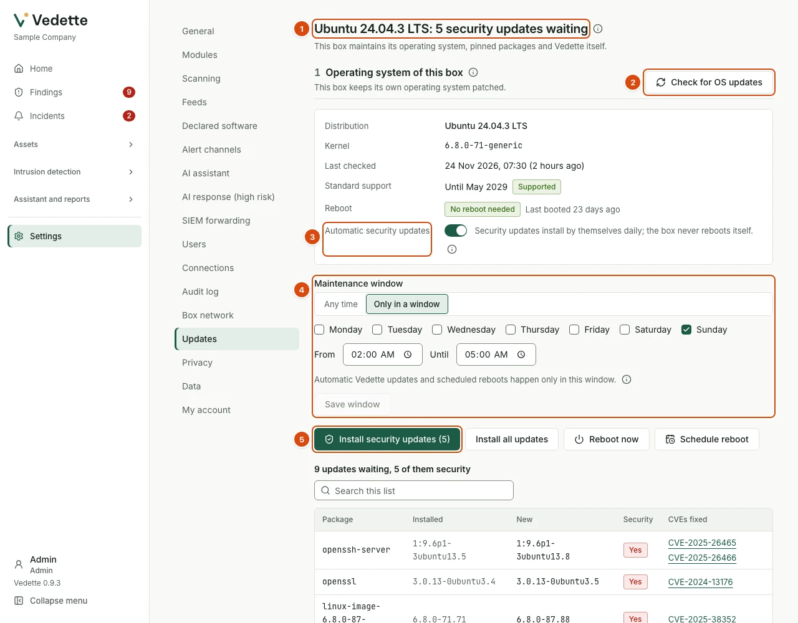
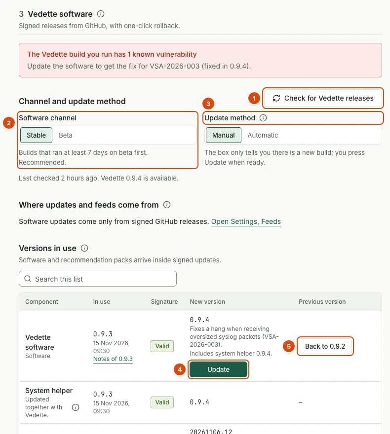
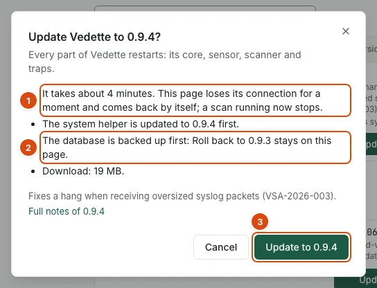
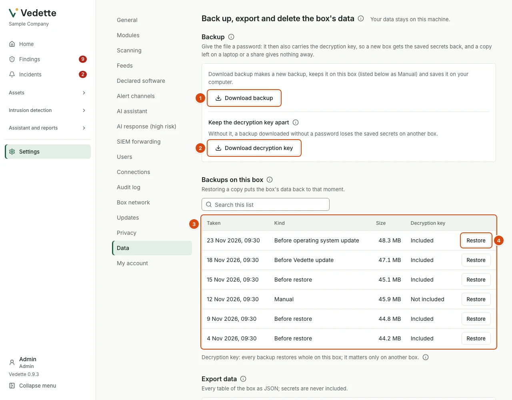
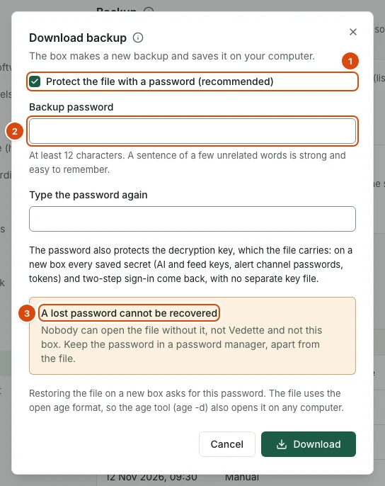
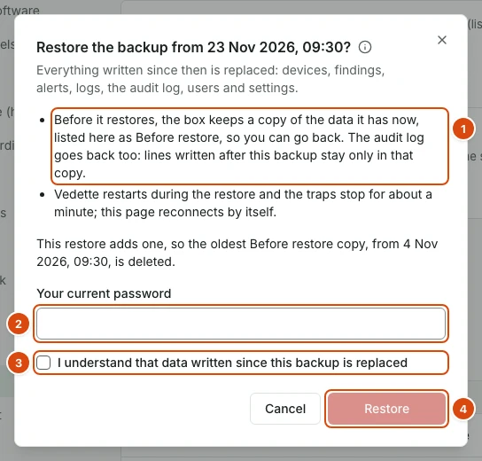

# Keep Vedette up to date, back it up, restore it

**Goal:** the box runs the newest signed Vedette on a patched operating system, and you can go back (roll back or restore) if something goes wrong.

**Time:** 5 minutes, plus about 4 minutes per Vedette update.

## Before you start

- An administrator account.
- For a restore: your password (and your two-step code if you use two-step sign-in).

## Part A: updates

1. **Open Settings → Updates.** One page in three parts: 1 the operating system of the box, 2 the packages Vedette manages, 3 the Vedette software.

   

   ① the headline: what waits ② Check for OS updates ③ automatic security updates ④ the maintenance window ⑤ Install security updates

2. **Operating system:** security updates install by themselves every day; the box never restarts itself. When it shows **Reboot required**, press **Reboot now** or **Schedule reboot**. To keep automatic work to quiet hours, choose **Only in a window**, the days and times, and **Save window**.

3. **Vedette software:** press **Check for Vedette releases**. A new version shows in **Versions in use** with its notes and an **Update** button. Choose the **Software channel** (Stable is recommended) and the **Update method**: Manual (the box tells you, you press Update) or Automatic (it installs in the maintenance window).

   

   ① Check for Vedette releases ② Software channel ③ Update method ④ Update ⑤ Back to the previous version

4. **Update:** press **Update** and read the dialog: every part of Vedette restarts, it takes about 4 minutes, the page reconnects by itself, a running scan stops, and the database is backed up first. Press **Update to …**.

   

   ① how long it takes and what stops ② the backup made first, which makes the rollback possible ③ Update to the new version

5. **Roll back** if the new version misbehaves: **Versions in use → Back to …** on the Vedette software row. The box then switches to manual updates. If the release changed the data format, the dialog says that data written since the update is lost, and asks you to accept it.

## Part B: backup and restore

1. **Open Settings → Data.** **Download backup** makes a new backup, keeps a copy on the box (listed as Manual) and saves it on your computer. The box also keeps a backup before every Vedette update, operating system update and restore.

   

   ① Download backup ② Download decryption key ③ Backups on this box ④ Restore

2. **Give the backup a password** (recommended). The file then also carries the decryption key: on a new box every saved secret (AI and feed keys, alert channel passwords, tokens) and two-step sign-in come back. Keep the password in a password manager, apart from the file: a lost password cannot be recovered.

   

   ① protect the file with a password ② the backup password ③ a lost password cannot be recovered

   A backup downloaded without a password needs the separate key file (**Download decryption key**) to bring the secrets back on another box.

3. **Restore on the same box:** **Backups on this box → Restore** on a row. Everything written since that backup is replaced; the box first keeps a "Before restore" copy so you can go back. Enter your password, tick that you understand, press **Restore**. Vedette restarts and the page reconnects by itself.

   

   ① the copy kept before the restore ② your password ③ the confirmation ④ Restore

4. **Move to a new box:** install Vedette on the new machine ([recipe 01](01-install-and-setup.md)). On the wizard's Account step choose **Restore from a backup**, enter the setup code, choose the backup file and enter its password (or add the key file), press **Check the backup**, then **Restore**. Sign in with your password from the old box.

## Check that it worked

- After an update: **Update history** lists the change and who made it, **Versions in use** shows the new version with Signature "Valid", and the sidebar shows the version you run.
- After a restore: the page says the backup was restored and a new "Before restore" row appears under **Backups on this box**.
