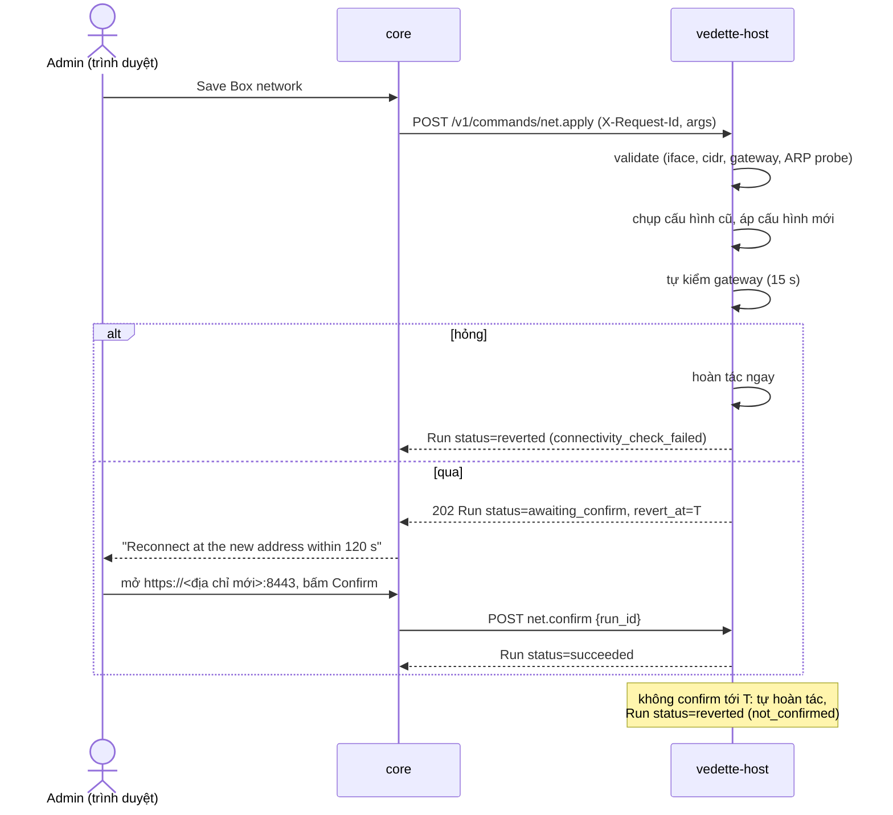

# Host API: socket nội bộ của `vedette-host`

Trạng thái: bản nháp M2-0 (docs-first), 2026-11-09; khung (framework) đã cài ở WP-07a, các điều đã chốt khi cài ở §15. Văn xuôi tiếng Việt; tên trường, lệnh, thông điệp, đường dẫn bằng tiếng Anh.
Truy vết: D-53 (cập nhật OS, một lần chạy tại một thời điểm, sao lưu DB trước, kiểm sức khoẻ sau, tiến trình trực tiếp, kiểm toán), D-55 (appliance container, `vedette-host` thay `vedette-updater`, Podman + Quadlet, socket nội bộ với **danh sách lệnh cố định**), D-56 (cấu hình mạng, SPAN, IP phụ cho bẫy, NTP), D-50 (bẫy trên IP phụ), D-48 (xuất log), D-12/`update-manifest.md`; SYS-1…8 (`MODULE_CONTRACTS.md`); story S-CORE-2, S-CORE-7, S-CORE-6, S-HP-1.

## 1. Mục đích

`vedette-host` là tiến trình **root, rất nhỏ** (systemd) làm những việc container `core` **không được phép** làm: cập nhật OS, cấu hình mạng, kéo/chạy/hoàn tác container, sao lưu. `core` (Go, nhận input không tin cậy từ web) gọi host qua một socket nội bộ. Giá trị bảo mật của thiết kế nằm ở một điều: **API này là danh sách lệnh cố định, mỗi lệnh có tham số kiểu chặt, và không có lệnh thực thi tổng quát** (SYS-1). Nếu `core` bị chiếm, kẻ tấn công chỉ làm được những gì danh sách cho phép, với tham số đã bị host kiểm lại.

Chỉ tồn tại trên kiểu cài **Appliance**. Kiểu "Chỉ container" (D-55) không có host: `core` thấy socket vắng mặt và GUI nói rõ tính năng nào bị hạn chế.

## 2. Actors

| Actor | Vai trò |
|---|---|
| `vedette-host` | server trên unix socket, root |
| `core` | **client duy nhất**; áp RBAC (admin cho mọi thao tác ghi) trước khi gọi host |
| Quản trị viên | kích hoạt qua GUI; host không biết người dùng, chỉ nhận nhãn `actor` do core đặt để ghi kiểm toán |
| `systemd`/`podman`/`apt` | công cụ host điều khiển bằng argv cố định |

Mô hình đe doạ: **`core` bị coi là có thể bị chiếm.** Mọi lệnh có kiểm tra độc lập ở host, ngưỡng nhịp, và hậu quả bị giới hạn. Host không tin trường nào từ `core` ngoài nhãn `actor` (và chỉ để hiển thị).

## 3. Transport và xác thực

- **Unix domain socket** `/run/vedette/host.sock`, HTTP/1.1 JSON (không TCP, không bind mạng).
- Quyền: thư mục `/run/vedette` mode `0750 root:vedette`, socket mode `0660 root:vedette`; `vedette` là nhóm của tài khoản Quadlet chạy `core`. Socket **chỉ bind-mount vào container `core`**, không vào `sensor`/`honeypot`/`scan`/`greenbone`.
- Xác thực client (cả ba lớp phải đạt, chạy trên **mọi** kết nối):
  1. **Quyền tệp** ở trên.
  2. `SO_PEERCRED`: `uid` của peer phải bằng uid của tài khoản chạy `core` (ghi trong `/etc/vedette/host.conf`, installer sinh, ships-as-code).
  3. Kiểm `pid` của peer thuộc **cgroup của unit `vedette-core.service`** (`/proc/<pid>/cgroup`): chặn tiến trình khác cùng uid.
  Sai bất kỳ lớp nào → đóng kết nối, ghi kiểm toán `peer_not_allowed`.
- Không có token ứng dụng hay mật khẩu; vì client là một container cùng máy. Nếu sau này cần thêm chữ ký request ở tầng ứng dụng: câu hỏi mở §14.
- Tiêu đề bắt buộc: `Content-Type: application/json` (với POST), `X-Request-Id: <uuid v4>` (khoá idempotency; **bắt buộc cho mọi lệnh ghi**), `X-Vedette-Actor: <label>` (regex `^[a-zA-Z0-9_.@:-]{1,64}$`, hoặc `system` cho job tự động), `X-Vedette-Host-Proto: 1`.

## 4. Mô hình lệnh

- Lệnh ghi: `POST /v1/commands/<name>`, body `{ "args": { … } }`. Tham số lạ → `400 invalid_args` (không bỏ qua, khác sensor protocol: ở đây fail-closed).
- Response `202`: `Run`.

| Trường `Run` | Kiểu | Ghi chú |
|---|---|---|
| `run_id` | string | `rn_<16 hex>` |
| `command` | string | tên lệnh |
| `status` | enum | `queued` \| `running` \| `awaiting_confirm` \| `succeeded` \| `failed` \| `reverted` \| `refused` |
| `started_at`, `finished_at` | datetime | |
| `actor`, `request_id` | string | |
| `result` | object? | kết quả riêng từng lệnh (§6) |
| `error` | `{code,message}`? | |
| `revert_at` | datetime? | chỉ `net.apply` khi `awaiting_confirm` |
| `audit_id` | string | khoá bản ghi kiểm toán của host (§9) |

- `GET /v1/runs/{id}`, `GET /v1/runs?limit=…`: trạng thái; **run bền** (ghi đĩa `/var/lib/vedette-host/runs/`), sống qua restart của host và của `core`. Giữ 90 ngày hoặc 500 run.
- **Một lần chạy ghi tại một thời điểm** (D-53): lệnh ghi thứ hai khi đang có run `queued|running|awaiting_confirm` → `409 busy` kèm `{ "run_id": "<đang chạy>" }`. Lệnh chỉ đọc không bị khoá.
- **Idempotency:** cùng `X-Request-Id` + cùng `command` + cùng `args` (so sánh băm) → trả lại **đúng run đó** (`200`, không chạy lại). Cùng `X-Request-Id` nhưng khác lệnh/tham số → `422 request_id_reuse`. Bản ghi giữ 30 ngày.
- Tiến trình: `GET /v1/runs/{id}/events` là **SSE** (`text/event-stream`). Mỗi sự kiện: `{ "seq": n, "ts": …, "kind": "log"|"progress"|"state", "line": string≤2 KiB?, "percent": 0-100?, "status": …? }`. Hỗ trợ `Last-Event-ID` để nối lại. Giữ tối đa 10 000 dòng/run (dòng cũ nhất bị bỏ, `truncated: true`). `core` chuyển tiếp ra GUI qua SSE của chính nó (khớp `OsRun.lines`).
- Mọi đường dẫn tệp mà host đọc/ghi do **host quyết định** theo `id` kiểu hex; không lệnh nào nhận đường dẫn từ client (ngoại lệ không có).

## 5. Lệnh chỉ đọc (không khoá, không kiểm toán nặng)

| Endpoint | Trả về |
|---|---|
| `GET /v1/info` | `{ host_version, proto, commands[], runner: "podman", os: {distro, release, kernel}, arch, booted_at, time }` |
| `GET /v1/state/os` | bản chụp cuối từ `os.check` (gói chờ, security, cần reboot, hạn hỗ trợ, reboot hẹn): đủ cho `OsState` |
| `GET /v1/state/net` | danh sách card (tên, MAC, trạng thái, tốc độ), cấu hình hiện tại, **thống kê SPAN thật** (gói/giây, số MAC khác hộp, lần nhận cuối; D-56), IP phụ của bẫy, NTP |
| `GET /v1/state/containers` | từng service: image/tag/digest đang chạy, `previous`, trạng thái unit, health |
| `GET /v1/state/backups` | danh sách sao lưu `{backup_id, kind, created_at, size, sha256, version, db_schema, includes_secrets}` |
| `GET /v1/audit?since=…` | bản ghi kiểm toán của host (phân trang; phục vụ D-48) |
| `GET /v1/backups/{id}/content`, `GET /v1/exports/{id}/content` | tải tệp (xem lệnh liên quan); chỉ tệp host đã tạo |

## 6. Danh sách lệnh (đầy đủ)

Tên lệnh là **hợp đồng**: không có tên nào ngoài bảng này. Mọi lệnh ghi áp dụng §4 (khoá chung, idempotency, kiểm toán). Mọi giá trị đi vào argv qua kiểu đã kiểm, không bao giờ nối chuỗi.

Quy ước kiểm tra: `ip` = `netip.ParseAddr` (IPv4 unicast); `cidr` = `netip.ParsePrefix` (**độ dài tiền tố bắt buộc**, D-32); `iface` = tên card **có trong** `GET /v1/state/net` và khớp `^[a-z][a-z0-9._-]{0,14}$`; `service` ∈ {`core`,`sensor`,`honeypot`,`scan`,`greenbone`}; `uuid`/`hex` theo độ dài cố định.

### 6.1 `os.check`

Cập nhật chỉ mục apt và tính lại danh sách gói chờ. Args: `{}`.
Hiệu ứng: `apt-get update` rồi mô phỏng nâng cấp để liệt kê gói; đánh dấu `security` theo kho nguồn (`-security`); đọc `/var/run/reboot-required`; hạn hỗ trợ bản phát hành từ bảng tĩnh trong host (cập nhật qua bản host mới). Kết quả: `{ pending[], security_count, reboot_required, reboot_reasons[], last_check }` (khớp `OsState`).
Idempotent: chạy lại làm mới chỉ mục. Tiến trình: stream đầu ra apt (đã lọc). Từ chối: `busy`; `dpkg_locked` (đang có `unattended-upgrades`/apt khác giữ khoá: thử lại sau 60 giây, không tự cưỡng chế); `not_appliance`. *Chính sách "tắt kiểm tra cập nhật" (Privacy) là việc của `core`: nếu tắt, `core` không gọi lệnh này (host không biết cài đặt đó).* Timeout 5 phút.

### 6.2 `os.install`

Args: `{ "scope": "security" | "all" }`.
Hiệu ứng, theo thứ tự (D-53): (1) kiểm điều kiện; (2) **`backup.create` nội bộ** (`kind=pre_os_update`); (3) chạy **danh sách lệnh apt cố định** (`apt-get -y install --only-upgrade …`, với danh sách gói do **host tự tính lại từ trạng thái apt**, không nhận tên gói từ client); (4) **kiểm sức khoẻ** (tất cả unit `vedette-*` đang chạy, `core` trả `/healthz`, sensor còn heartbeat); (5) báo `reboot_required`. Kết quả: `{ installed, security, backup_id, health[{name,ok}], reboot_required }` (khớp `OsRunResult`).
Từ chối: `busy`; `dpkg_inconsistent` (`dpkg --audit` không sạch); `low_disk` (< 1 GiB trống ở `/var`, tham số); `no_check` (chưa có `os.check` trong 24 giờ: host tự chạy `os.check` trước, không từ chối; xem `stale_check` nếu apt lỗi); `not_appliance`. Không bao giờ nâng bản phát hành (`do-release-upgrade`, đổi codename trong sources): lệnh **không tồn tại** (D-53). Timeout 60 phút. Health check hỏng **không** tự gỡ gói (apt không hoàn tác được): run `failed`, giữ nguyên, báo; sao lưu DB ở bước 2 là chỗ quay về cho dữ liệu.

### 6.3 `os.auto_security.set`

Args: `{ "enabled": bool }`. Ghi `/etc/apt/apt.conf.d/52vedette-unattended` từ mẫu cố định (origin chỉ là kho security của distro hiện tại) và bật/tắt timer `apt-daily*.timer` theo `enabled`; **xác minh bằng hiệu ứng** (`apt-config dump` và trạng thái timer), không bằng exit code (rule ships-as-code). Idempotent. Từ chối: `busy`, `not_appliance`. Cửa sổ bảo trì (ngày/giờ) do `core` giữ; unattended-upgrades chạy theo timer của apt, nên **không** tôn trọng cửa sổ của Vedette (hạn chế đã biết, §14).

### 6.4 `os.reboot` và `os.reboot.cancel`

`os.reboot` args: `{ "when": "now" | "at", "at": "<RFC3339 UTC>" }` (`at` bắt buộc khi `when=at`, tối thiểu 60 giây sau, tối đa 7 ngày sau; `core` đổi từ cửa sổ `HH:MM` cục bộ sang thời điểm tuyệt đối trước khi gọi).
Hiệu ứng: `now` → chạy `systemctl reboot` ngay sau khi run chuyển `succeeded` (host ghi run **trước** khi reboot); `at` → lưu lịch bền, host tự đặt hẹn giờ và `systemctl reboot` lúc đó. Idempotent: một lịch reboot duy nhất; đặt lại thay lịch cũ. Sau khi máy khởi động lại, Quadlet đưa mọi container lên; host kiểm và ghi `reboot_completed`.
`os.reboot.cancel` args `{}`: xoá lịch (không có lịch → thành công, không làm gì).
Từ chối: `install_in_progress` (một `os.install` đang chạy); `net_pending_confirm` (không reboot khi đang chờ xác nhận mạng); `at_in_past`, `at_too_far`; `not_appliance`. Nhịp: tối đa 3 `os.reboot now`/24 giờ (mặc định; chặn vòng lặp reboot từ `core` bị chiếm).

### 6.5 `net.apply`, `net.confirm`, `net.revert`

`net.apply` args (trạng thái mong muốn của **phần Vedette quản lý**):

| Trường | Kiểu | Quy tắc |
|---|---|---|
| `mgmt.iface` | iface | bắt buộc |
| `mgmt.mode` | `dhcp` \| `static` | |
| `mgmt.address` | cidr | bắt buộc khi `static`; unicast, không phải địa chỉ mạng/broadcast |
| `mgmt.gateway` | ip | trong cùng mạng với `address` |
| `mgmt.dns` | ip[≤ 3] | unicast; không loopback |
| `span.iface` | iface \| null | khác `mgmt.iface`; card không có IP, chế độ nghe (promisc), không giữ IPv6 |
| `ntp` | string[≤ 4] | IPv4 hoặc tên theo regex tên (`^[a-zA-Z0-9][a-zA-Z0-9_.-]{0,63}$`) |
| `confirm_timeout_s` | int | 30–600, mặc định 120 |

Hiệu ứng: ghi cấu hình mạng cho **backend phát hiện được** (câu hỏi mở §14: Ubuntu dùng netplan, Debian 12 mặc định ifupdown/systemd-networkd), áp dụng, rồi vào **chế độ tự hoàn tác**:

1. Host **chụp** cấu hình cũ (tệp sinh + trạng thái chạy).
2. Áp cấu hình mới.
3. Tự kiểm kết nối (tới gateway mới bằng ARP/ICMP trong 15 giây). Hỏng → **hoàn tác ngay** (`status=reverted`, `error.code=connectivity_check_failed`).
4. Qua tự kiểm: `status=awaiting_confirm`, `revert_at = now + confirm_timeout_s`. Hẹn giờ hoàn tác **bền** (systemd transient timer), sống qua restart host/`core`/reboot.
5. Nếu admin đến được hộp ở địa chỉ mới qua GUI, `core` gọi `net.confirm {run_id}` → `status=succeeded`, huỷ hẹn giờ. Hết giờ mà chưa confirm → host **tự hoàn tác** về cấu hình đã chụp (`status=reverted`, `error.code=not_confirmed`).
`net.revert {run_id}` huỷ sớm và hoàn tác ngay (admin bấm "Cancel").

Idempotent: áp cùng trạng thái đang chạy → `succeeded` không đổi gì, **không** vào chế độ chờ xác nhận. IP phụ của bẫy (§6.6) được **áp lại** sau mỗi `net.apply` hoặc revert.
Từ chối: `busy`; `pending_confirm` (đang có run chờ xác nhận); `iface_unknown`; `same_iface` (mgmt = span); `address_conflict` (phát hiện địa chỉ trùng bằng ARP probe, DAD cho IPv4); `gateway_outside_subnet`; `invalid_args` với `details[]`; `last_mgmt_removed` (kết quả sẽ không còn card quản trị); `not_appliance`. Timeout áp dụng 30 giây (+ cửa sổ xác nhận).

### 6.6 `decoy_ip.add` và `decoy_ip.remove`

IP phụ cho bẫy (D-50, D-55: OpenCanary trên IP phụ, macvlan). Args: `{ "ip": ip }` (`add` thêm `"iface"` tuỳ chọn, mặc định `mgmt.iface`).
Hiệu ứng: gán địa chỉ cho network macvlan của container `honeypot` trên card quản trị; lưu vào trạng thái bền của host (áp lại sau `net.apply`/reboot); MAC là **địa chỉ local-administered** do host sinh ổn định từ IP (câu hỏi mở §14: giả OUI hãng cho "vai giả").
Từ chối (`add`): `ip_not_in_mgmt_subnet`; `ip_is_gateway|ip_is_host|ip_is_network|ip_is_broadcast`; `ip_in_use` (ARP probe thấy ai trả lời trong 3 giây); `duplicate_decoy`; `limit_reached` (tối đa 32, mặc định); `not_appliance`. Việc chặn trùng với **thiết bị trong kho** là của `core` (honeypot module từ chối trước); host kiểm lại **mạng thật** bằng ARP.
`remove`: IP không có → thành công, không làm gì (idempotent). Host không tắt container `honeypot`; `core` gọi `container.start`/cấu hình honeypot theo DB sau đó.
Không có lệnh nhận danh sách tuỳ ý, chỉ từng IP một.

### 6.7 `container.pull`

Args:

| Trường | Kiểu | Ghi chú |
|---|---|---|
| `service` | service | |
| `version` | semver | phải trùng `release-manifest.version` |
| `source` | `registry` \| `bundle` | |
| `bundle_id` | hex(32) | bắt buộc nếu `source=bundle`; thư mục `import/<bundle_id>/` do host biết |
| `index`, `index_sig` | base64 | `index.json` và `.minisig` (≤ 256 KiB mỗi tệp) |
| `manifest`, `manifest_sig` | base64 | `release-manifest.json` và `.minisig` |

Hiệu ứng (`update-manifest.md` §5): host **tự xác minh** (không tin `core`): minisign `index` và `manifest` bằng khoá nhúng trong host; khoá không bị thu hồi; `index.sequence ≥` giá trị cao nhất host đã lưu; `service` có trong `manifest.images` và `digest` khớp; bản không bị thu hồi; `platform` khớp CPU; ref nằm trong **namespace registry cố định của host** (biên dịch/cấu hình khi cài, không do client); kéo **theo digest** (`registry` hoặc nạp `oci-archive` từ bundle); xác minh chữ ký cosign; đối chiếu `size`; gán tên cục bộ `vedette-<service>:<version>`. Kết quả: `{ digest, size, verified: ["minisign","cosign"] }`.
Idempotent: image đã có đúng digest → `succeeded` ngay. Từ chối: `busy`; `signature_invalid`; `key_revoked`; `release_revoked`; `digest_not_in_manifest`; `registry_not_allowed`; `sequence_regress`; `platform_mismatch`; `bundle_missing`; `low_disk` (< 2 × `size`); `not_appliance`. Timeout 30 phút. Không có lệnh kéo image theo tên/tag tuỳ ý.

### 6.8 `container.start`

Args: `{ "service": service, "version": semver }`.
Hiệu ứng: `version` phải đã được `container.pull` **và** xác minh thành công trên host này; ghi drop-in Quadlet chọn digest đó; lưu digest đang chạy làm `previous`; `systemctl restart vedette-<service>.service` (tên unit sinh từ enum); chờ `active` + healthcheck (mặc định 120 giây). Kết quả: `{ digest, previous_digest, healthy }`. Cũng dùng để bật service đang tắt (`greenbone`, `honeypot` khi module bật, SYS-5): khi đó `previous` không đổi.
Idempotent: đang chạy đúng digest và khoẻ → `succeeded`, không restart.
Từ chối: `busy`; `not_pulled`; `release_revoked`; `downgrade_not_allowed` (hạ phiên bản phải đi bằng `container.rollback`); `unit_failed` (khởi động hỏng → host **tự đưa về `previous`** và báo `reverted`); `not_appliance`. Thứ tự khuyến nghị cho `core`: `sensor`/`honeypot`/`scan` trước, **`core` sau cùng** (host giữ run bền nên tiếp tục khi `core` lên lại). `greenbone` chỉ khi đã bật tuỳ chọn.

### 6.9 `container.stop`

Args: `{ "service": service, "persist": bool }`. `persist=false`: `systemctl stop` (tự lên lại sau reboot); `persist=true`: dừng và `systemctl disable` (module tắt, SYS-5; `container.start` bật lại).
Từ chối: **`cannot_stop_core`** (`service=core`: lệnh sẽ giết chính bên gọi; dừng `core` chỉ có thể qua `os.reboot`, `container.start` (restart có kiểm soát) hoặc `backup.restore`); `busy`; `not_appliance`. Idempotent: đã dừng → thành công.

### 6.10 `container.rollback`

Args: `{ "service": service }`.
Hiệu ứng: đổi drop-in Quadlet về `previous` đã lưu và restart; kiểm sức khoẻ; sau rollback `previous` trở thành bản vừa gỡ (rollback hai lần = quay lại). Kết quả `{ digest, from_digest }`.
Từ chối: `busy`; `no_previous`; `previous_revoked` (digest cũ nằm trong danh sách thu hồi đã lưu); `unit_failed` (rollback cũng hỏng: host **dừng ở trạng thái cuối và báo**, không vòng lặp); `not_appliance`. Hoàn tác phần mềm **không** hoàn tác DB: `core` phải gọi `backup.restore` nếu manifest khai `rollback.safe=false` (`update-manifest.md` §10).

### 6.11 `backup.create`

Args: `{ "kind": "manual" | "pre_update" | "pre_os_update" | "pre_restore", "include_secrets": bool, "label": string≤64 }`.
Hiệu ứng: **sao lưu trực tuyến SQLite bằng API backup** (an toàn với WAL, không dừng `core`) của DB trong volume `core`, cộng thư mục cấu hình cần để khôi phục; nén zstd; tính SHA-256; ghi `manifest` nhỏ (`version`, `db_schema`, `created_at`, `includes_secrets`) → `/var/lib/vedette-host/backups/<backup_id>.tar.zst`. Kết quả `{ backup_id, size, sha256 }`.
`include_secrets=false` (mặc định cho `manual`): **không** chứa khoá `core/secrets` và các bí mật (khớp "backup không chứa mật khẩu hay khoá" của GUI); bản đó **tải được** (`GET /v1/backups/{id}/content`). `kind` bắt đầu bằng `pre_`: **bắt buộc** `include_secrets=true` (để khôi phục được) và **không tải được** (`403 contains_secrets`); chỉ tồn tại trên máy.
Lưu giữ: host giữ 3 bản `pre_*` gần nhất và `manual` cho tới khi admin xoá (≤ 10, mặc định); quá thì xoá cũ nhất.
Từ chối: `busy`; `low_disk` (< 2 × cỡ DB); `db_unreadable`; `not_appliance`. Timeout 15 phút.

### 6.12 `backup.restore`

Args: `{ "backup_id": hex }`.
Hiệu ứng: kiểm `backup_id` có trong chỉ mục của host và `sha256` còn đúng; tự `backup.create kind=pre_restore` bản hiện tại; dừng `core` (đường **duy nhất** host dừng `core`, vì client đã kết thúc quyền chạy), thay DB/cấu hình, khởi động lại `core`, kiểm sức khoẻ. Hỏng → thay lại bản `pre_restore`, `status=reverted`. Kết quả `{ restored_backup_id, pre_restore_backup_id, version }`.
Từ chối: `busy`; `backup_unknown`; `checksum_mismatch`; `schema_newer` (DB từ phiên bản mới hơn `core` đang chạy); `secrets_missing` (bản không có khoá mà DB cần chúng); `low_disk`; `not_appliance`. Lưu ý hiệu ứng: run phải **bền** vì kết nối client đứt khi `core` dừng; `core` lên lại gọi `GET /v1/runs/{id}` để biết kết quả. Khôi phục từ **tệp do người dùng tải lên**: chưa có lệnh (§14).

### 6.13 `logs.export`

Args: `{ "units": string[], "since": datetime, "until": datetime }`; `units` ⊂ {`vedette-core`,`vedette-sensor`,`vedette-honeypot`,`vedette-scan`,`vedette-greenbone`,`vedette-host`}; `until - since ≤ 31 ngày`.
Hiệu ứng: đọc journal bằng argv cố định (`journalctl -u <unit> --since <t> --until <t> -o json --no-pager`), **lọc bí mật** theo mẫu đã biết (`vdt_osquery_…`, đường dẫn `…/blocklist/<token>`, `xapp-…`, `xoxb-…`, `Authorization: Bearer …`, `password=`) như lớp phòng thủ phụ (SYS-4: bình thường không log bí mật), nén thành `/var/lib/vedette-host/exports/<export_id>.jsonl.zst`, trả `{ export_id, size, sha256 }`; tải bằng `GET /v1/exports/{id}/content`; tệp tự xoá sau 24 giờ.
Từ chối: `busy`; `range_too_large`; `unit_unknown`; `output_too_large` (> 256 MiB: dừng và báo, không cắt âm thầm); `not_appliance`. Timeout 10 phút. Phục vụ D-48 (phần log nền tảng); log nghiệp vụ (kiểm toán, AI, phản ứng) do `core` xuất.

## 7. Những thứ **không** có (và sẽ bị từ chối nếu thử)

SYS-1 áp dụng triệt để. API này **không** có và không bao giờ nhận:

- thực thi tổng quát (shell, `exec`, `sh -c`, chạy tệp, chạy script, `eval`);
- đọc/ghi tệp tuỳ ý, đường dẫn do client đưa;
- `apt install|remove|purge` gói tuỳ chọn, thêm/sửa nguồn apt, nâng cấp bản phát hành OS;
- điều khiển `systemd` tuỳ chọn (chỉ unit `vedette-*` theo `service` enum, chỉ qua các lệnh container);
- tham số `podman` tuỳ chọn, `--privileged`, `--cap-add`, mount, mạng host, pull image theo tên tuỳ ý;
- thay đổi `sysctl`, tường lửa (UFW/nft), người dùng, SSH, khoá, chứng chỉ hệ điều hành.

Gọi tới đường dẫn/lệnh không có trong §5–§6: `404 unknown_command`. Đây là hợp đồng kiểm được: test hợp đồng liệt kê `GET /v1/info.commands` và so với bảng này; thêm một lệnh phải sửa tài liệu này, `CONTRACT.md` và test cùng lúc.

## 8. Sequence: áp cấu hình mạng với tự hoàn tác

## 9. Kiểm toán (SYS-3)

- Host ghi **mỗi** lệnh (cả bị từ chối) vào `/var/log/vedette-host/audit.jsonl` (root, `0600`, chỉ thêm): `{ seq, id, ts, request_id, actor, peer: {uid, pid, unit}, command, args_digest, args_redacted, result: "ok"|"refused"|"failed"|"reverted", code?, run_id?, prev_hash, hash }` (`seq` tăng dần từ 1, nằm trong phần được băm) với `hash = SHA-256(prev_hash "\n" canonical-JSON(các trường còn lại))` (cùng kiểu chuỗi hash D-48). `core` **không ghi được** tệp này nên không xoá/sửa dấu vết của chính nó.
- `core` đồng thời ghi `core_audit` (ai bấm gì); hai nhật ký đối chiếu bằng `request_id`. `args_redacted` bỏ giá trị nhạy (bất kỳ chuỗi nào trông như khoá/token; bản thân lệnh không nhận bí mật).
- `GET /v1/audit?since=…` cho phép `core` kéo nhật ký host để gộp vào "tải mọi log của hộp" (D-48).

## 10. Giới hạn

| Mục | Giới hạn mặc định |
|---|---|
| Thân request | 512 KiB (chỉ `container.pull` cần lớn) |
| Số request/phút từ `core` | 60; lệnh ghi 10/phút |
| Run đồng thời (ghi) | 1 |
| Timeout theo lệnh | `os.check` 5 ph; `os.install` 60 ph; `net.apply` 30 s + cửa sổ xác nhận ≤ 600 s; `container.pull` 30 ph; `container.start` 3 ph; `backup.create` 15 ph; `backup.restore` 30 ph; `logs.export` 10 ph |
| Dòng sự kiện/run | 10 000; mỗi dòng ≤ 2 KiB |
| Run giữ lại | 90 ngày hoặc 500 |
| `logs.export` | ≤ 31 ngày, ≤ 256 MiB |
| IP phụ cho bẫy | ≤ 32 |
| `os.reboot now` | ≤ 3/24 giờ |
| Thời gian chờ xác nhận mạng | 30–600 s (mặc định 120) |

Các con số trên là điểm xuất phát chưa đo (ARCH §8).

## 11. Xử lý lỗi

Định dạng chung `{ "error": { "code": "snake_case", "message": "English", "details": [ { "field": "args.ip", "reason": "…" } ]? } }`.

| HTTP | Nhóm `code` |
|---|---|
| 400 | `invalid_args`, `invalid_request_id`, `invalid_actor` |
| 403 | `peer_not_allowed` |
| 404 | `unknown_command`, `run_not_found`, `backup_unknown` |
| 409 | `busy`, `pending_confirm`, `install_in_progress`, các từ chối do trạng thái hệ thống |
| 412 | các từ chối do điều kiện tiên quyết (`low_disk`, `dpkg_inconsistent`, `address_conflict`, `not_appliance`, `signature_invalid`…) |
| 422 | `request_id_reuse` |
| 429 | `rate_limited` (+ `retry_after_s`) |
| 503 | `host_shutting_down` |

Từ chối (`status=refused`) vẫn **tạo run** và bản ghi kiểm toán, để GUI thấy lý do. Khi mất kết nối giữa chừng, `core` hỏi lại `GET /v1/runs/{id}` (nhờ `X-Request-Id` biết run nào) thay vì gửi lại lệnh.

## 12. Cân nhắc bảo mật (ánh xạ SYS)

| SYS | Áp dụng |
|---|---|
| SYS-1 | Danh sách lệnh đóng; mỗi lệnh dựng argv từ hằng + giá trị đã kiểm; binary đường dẫn tuyệt đối; môi trường sạch (`PATH`, `LANG=C`, `DEBIAN_FRONTEND=noninteractive`); không shell; §7 |
| SYS-2 | Schema chặt cho từng lệnh, `invalid_args` nếu trường lạ; IP qua `netip`, tên qua regex chuẩn; không giá trị nào đến từ chuỗi tự do vào argv |
| SYS-3 | Chuỗi kiểm toán hash của host (§9) cộng `core_audit` |
| SYS-4 | Host không nhận bí mật qua API; `include_secrets` chỉ cho sao lưu cục bộ; log được lọc; khoá nằm trong `core/secrets` |
| SYS-5 | `container.stop persist=true` thực hiện "tắt module = không cổng, không job"; dữ liệu giữ nguyên |
| SYS-6 | Mọi manifest/bundle/log là dữ liệu không tin cậy: host tự xác minh chữ ký, giới hạn kích thước, fail-closed; log lọc |
| SYS-7 | Host chỉ nói chuyện ra các host cố định (registry, GitHub, mirror apt) và ARP/ICMP trong LAN cho kiểm tra mạng |
| SYS-8 | AI không có đường tới socket (không bind vào các container khác `core`; `core` không chuyển lệnh do AI sinh) |

Các biện pháp "hậu quả giới hạn" khi `core` bị chiếm: nhịp lệnh (reboot, ghi), cửa sổ xác nhận tự hoàn tác cho mạng, mọi lệnh đảo ngược/được sao lưu (`pre_*`), host tự xác minh chữ ký (không thể ép chạy image lạ), `cannot_stop_core`, không có đường đọc tệp tuỳ ý. Rủi ro còn lại: `core` bị chiếm vẫn có thể gây gián đoạn (dừng `sensor`, reboot theo nhịp); chấp nhận vì không có đường leo thang quyền hay thực thi.

## 13. Versioning

- `X-Vedette-Host-Proto` là số nguyên; `GET /v1/info` trả `proto` và `commands[]` (khả năng). Đường dẫn `/v1`.
- Host hỗ trợ proto **N và N−1**. Khi appliance cập nhật, `core` và `host` có thể lệch trong thời gian ngắn (cập nhật host là câu hỏi mở của `update-manifest.md`): `core` chỉ gọi lệnh có trong `commands[]`, thiếu → coi tính năng đó không có (hiển thị rõ), không đoán.
- Thêm lệnh = bản mới (minor); đổi nghĩa/xoá tham số = `v2`.
- Tên unit, thư mục, hằng cố định sinh bởi installer (ships-as-code) và ghi trong `/etc/vedette/host.conf`.

## 14. Câu hỏi mở

1. **Ai mở cổng vào (UFW)?** D-55 nhắc UFW nhưng allowlist không có lệnh tường lửa: cổng 8443 (UI/API), syslog, cổng sensor, cổng bẫy trên IP phụ cần được mở do installer lúc cài và do host khi module bật. Cần quyết (thêm lệnh `firewall.*` bị chặt, hay installer mở sẵn theo cấu hình và host chỉ đổi theo module).
2. **Cập nhật chính `vedette-host`** (cũng ở `update-manifest.md`): chưa có lệnh `host.self_update`; phải thêm một lệnh có xác minh chữ ký, hoặc để installer/apt.
3. Backend mạng: netplan (Ubuntu) / ifupdown hoặc systemd-networkd (Debian 12): host hỗ trợ cái nào, hay chuẩn hoá một cái khi cài.
4. Sao lưu: `pre_*` chứa khoá `core/secrets` (cần để khôi phục) nhưng không tải xuống được; tuy nhiên người dùng muốn **sao lưu khôi phục được trên máy khác** thì sao (cần cách bảo vệ khoá bằng mật khẩu, chưa có story). Khôi phục từ tệp tải lên cũng chưa có lệnh.
5. `decoy_ip.add`: giả OUI theo vai (D-50 "vai giả") cần host đặt MAC theo hãng; hiện dùng MAC local-administered. Giả OUI có nên không?
6. Cần chữ ký request ở tầng ứng dụng giữa `core` và host (HMAC theo khoá cài sẵn) ngoài `SO_PEERCRED` + cgroup, hay đủ?
7. Cửa sổ bảo trì của Vedette không điều khiển được `unattended-upgrades` (§6.3); chấp nhận hay thêm tham số lịch.
8. Có cần `backup.delete` và lịch sao lưu định kỳ không có story (D-22 chỉ nói sao lưu/xuất/xoá dữ liệu).
9. Mọi con số giới hạn (§10) là điểm xuất phát, chưa đo.

## 15. Đã chốt khi cài khung (WP-07a)

Mã: `host/{api,config,peer,server,client}`, `cmd/vedette-host`; hợp đồng test ở `modules/host/contract_test.go`. Lệnh hệ thống (§6) chưa có: `DefaultRegistry()` rỗng, thêm ở WP-07b.

**`/etc/vedette/host.conf`** (installer sinh, WP-08). Dòng `key = value`, bỏ qua dòng trống và dòng bắt đầu bằng `#`; chặt: khoá lạ, khoá lặp, thiếu khoá, giá trị sai đều là lỗi, tối đa 4 KiB. Tệp phải là tệp thường, thuộc root, nhóm/người khác không ghi được.

| Khoá | Ý nghĩa |
|---|---|
| `core_uid` | uid chạy `core` (số thập phân, **không** được là 0) |
| `core_unit` | tên unit systemd của `core`, dạng `vedette-core.service` |
| `socket` | đường dẫn tuyệt đối, sạch, tối đa 100 byte (`/run/vedette/host.sock`); cờ `-socket` ghi đè |
| `socket_gid` | gid của nhóm `vedette`: chủ nhóm của socket (0660) và thư mục chứa (0750) |

Cờ khác: `-state-dir` (mặc định `/var/lib/vedette-host`), `-audit-log` (mặc định `/var/log/vedette-host/audit.jsonl`), `-version`. Tiến trình từ chối khởi động nếu không phải root hoặc không phải Linux.

**Xác thực người gọi (§3).**
- Lớp 3: chỉ cgroup v2. Dòng hợp nhất `0::<path>` của `/proc/<pid>/cgroup` phải có **một thành phần đường dẫn** đúng bằng tên unit (container Quadlet nằm trong cgroup con của unit, nên khớp theo thành phần, không theo toàn đường dẫn); dòng v1/hybrid bị bỏ qua; không có dòng hợp nhất, hai dòng hợp nhất, `..`, hậu tố `(deleted)`, tệp > 64 KiB hoặc có NUL → từ chối.
- Chạy ở `Accept`, trước khi đọc byte nào, cho **mọi** kết nối. Từ chối → đóng kết nối + dòng kiểm toán `peer_not_allowed` (command `-`), tối đa một dòng mỗi 10 giây (số dòng bỏ qua ghi ở `args_redacted.skipped`) để người lạ không làm đầy đĩa.
- Thư mục chứa socket: nếu đã có, **không sửa**, chỉ kiểm (không mở hơn 0750, nếu mở hơn thì từ chối khởi động); nếu chưa có thì tạo 0750 và chown nhóm. Socket cũ không ai nghe thì thay; tệp không phải socket hoặc socket đang sống thì từ chối.

**Tiêu đề và thân.** `X-Request-Id` (uuid v4, chữ thường hay hoa đều nhận) và `X-Vedette-Actor` bắt buộc trên **mọi** `POST /v1/commands/<name>` (kể cả lệnh chỉ đọc và lệnh lạ). `X-Vedette-Host-Proto` bắt buộc trên mọi request; hiện chỉ nhận `1` (N=1, N−1 chưa có). Thiếu/sai proto hoặc `Content-Type` → `400 invalid_args` kèm `details[]` (không có mã riêng). Thân `{"args":{…}}`, trường lạ ở thân hoặc ở `args` → `400 invalid_args`; thiếu `args` hoặc thân rỗng = `{}`; `args: null` bị từ chối; thân > 512 KiB → `400 invalid_args`. Query lạ ở `GET` → `400 invalid_args`. (Go khớp tên trường JSON không phân biệt hoa thường; chấp nhận, mọi giá trị vẫn qua kiểm kiểu.)

**Lệnh chỉ đọc trong bảng lệnh.** Mục bảng có cờ `write`. Lệnh chỉ đọc cũng chạy bằng `POST /v1/commands/<name>`, không lấy khoá ghi, không tính nhịp ghi, vẫn tạo run và dòng kiểm toán; `GET /v1/state/*` (§5) **chưa có** ở 07a và trả `404 unknown_command` như mọi đường dẫn lạ (§7); 07b thêm chúng làm lớp mỏng trên lệnh chỉ đọc.

**Run.** Mọi lệnh tạo run. Lệnh ghi: `queued` (giữ khoá, ghi đĩa) → kiểm điều kiện đồng bộ `Check` (≤ 5 giây; từ chối trả `409`/`412` theo §11, run `refused`, khoá nhả, khoá idempotency xoá để thử lại cùng id được) → `running`. Khoá ghi chỉ nhả **sau** khi run cuối cùng và dòng kiểm toán đã ghi, rồi mới phát sự kiện `state` cuối: client thấy sự kiện cuối thì khoá đã rảnh. Hết timeout (POST-4): ngữ cảnh bị huỷ; handler không trả trong 3 giây thì run vẫn `failed` (`timeout`), khoá nhả, goroutine bị bỏ (ghi log). Khi host khởi động lại, run `queued|running|awaiting_confirm` thành `failed` mã `host_restarted` (07b phải quyết định việc `net.apply` đang `awaiting_confirm`). Idempotency áp dụng cho mọi `POST` đã chấp nhận (lệnh ghi): cùng `X-Request-Id` + lệnh + băm tham số → `200` và run cũ, kể cả sau restart; lệnh khác hoặc tham số khác → `422 request_id_reuse` (cả với lệnh chỉ đọc); bị từ chối thì **không** nhớ id.

**Lỗi bổ sung (§11).** `503 audit_unavailable` (chuỗi kiểm toán hỏng hoặc không ghi được: chặn mọi `POST`, vẫn đọc được), `500 internal` (host không ghi được run), mã run `timeout`, `host_restarted`, `command_failed` (lỗi chung, không lộ nội dung), `host_shutting_down`. Đối tượng `error` có thêm `run_id` (khi `busy`: run đang giữ khoá) và `retry_after_s` (khi `rate_limited`, kèm tiêu đề `Retry-After`). Nhịp 60/phút tính **mọi** request đã qua xác thực (kể cả `GET` và mở SSE): `core` phải dùng SSE thay vì hỏi `GET /v1/runs/{id}` mỗi giây.

**Sự kiện.** `truncated: true` đặt trên mọi sự kiện của run đã bỏ dòng cũ. Ngoài 10 000 sự kiện còn **tổng 8 MiB** mỗi run (bỏ cũ nhất) để 500 run không làm đầy đĩa. Sự kiện của run đã xong lưu `runs/<id>.events.json`; run bị từ chối hoặc phục hồi sau restart chỉ có một sự kiện `state`. Dòng: UTF-8 hợp lệ, ký tự điều khiển thành dấu cách, ≤ 2 KiB.

**Kiểm toán (§9).** Một dòng cho mỗi lệnh, ghi khi run kết thúc (`audit_id` được cấp từ lúc tạo run); `args_digest` = SHA-256 của JSON mã hoá tham số đã giải mã (hoặc của thân thô khi không giải mã được); công thức chuỗi là `core/chain` (D-57 (14)), dòng ghi bằng JSON chuẩn hoá (khoá sắp xếp). Khi khởi động host duyệt **toàn bộ** tệp; sai → không ghi thêm gì (`audit_unavailable`, `/v1/info.audit_ok=false`), không tự sửa; dòng cụt (không có `\n` cuối) cũng tính là hỏng. `GET /v1/audit?since=<seq>&limit=<1..500, mặc định 100>` trả `{records, next}` (`next` = giá trị `since` của trang sau). Yêu cầu không thành lệnh (tiêu đề sai) vẫn có dòng kiểm toán với `actor: "-"`; `rate_limited` bị giới hạn một dòng mỗi 10 giây. `args_redacted` che theo tên khoá (`pass|secret|token|key|auth|cred|private|cookie|session|signature|bearer`), tiền tố biết trước (`vdt_`, `xapp-`, `xoxb-`, `sk-`, `ghp_`, `Bearer `…), JWT, PEM, và chuỗi dài ≥ 20 ký tự trộn số/hoa/thường có entropy cao; giới hạn độ sâu 6, 32 phần tử, chuỗi 256 ký tự, tổng 4 KiB.

**Giới hạn đã biết (ponytail).** Run bị cắt theo mốc 500 kéo theo bản ghi idempotency của nó dù chưa đủ 30 ngày (chỉ xảy ra khi > 500 run trong 30 ngày). `GET /v1/audit` đọc tệp từ đầu mỗi trang (nâng cấp: chỉ mục offset). Chưa xoay vòng tệp kiểm toán.
