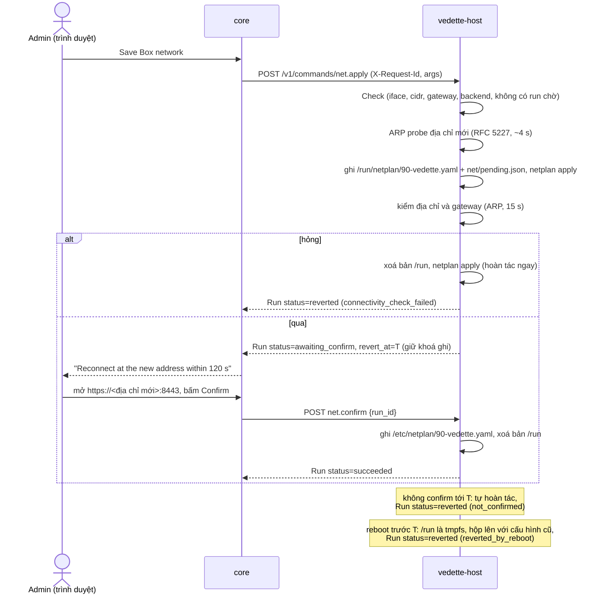

# Host API: socket nội bộ của `vedette-host`

Trạng thái: bản nháp M2-0 (docs-first), 2026-11-09; khung (framework) đã cài ở WP-07a, lệnh OS/sao lưu/xuất log ở WP-07b phần 1 (D-85, D-87: host không mở DB của `core`); các điều đã chốt khi cài ở §15 và §16; `net.*`, `decoy_ip.*`, `container.*` chốt trên giấy ở WP-07b phần 3, lát 3-0 (D-99…D-107, §18), 2026-11-10. Văn xuôi tiếng Việt; tên trường, lệnh, thông điệp, đường dẫn bằng tiếng Anh.
Truy vết: D-53 (cập nhật OS, một lần chạy tại một thời điểm, sao lưu DB trước, kiểm sức khoẻ sau, tiến trình trực tiếp, kiểm toán), D-55 (appliance container, `vedette-host` thay `vedette-updater`, Podman + Quadlet, socket nội bộ với **danh sách lệnh cố định**), D-56 (cấu hình mạng, SPAN, IP phụ cho bẫy, NTP), D-50 (bẫy trên IP phụ), D-48 (xuất log), D-85 (tar+gzip, không `backup.delete`, unattended-upgrades theo timer của apt, khoá `core_data`), D-99 (netplan + networkd), D-100 (lớp phủ `/run` cho cửa sổ xác nhận), D-101 (root chỉ gửi/đọc khung ARP), D-102 (namespace `vedette-hp`), D-103 (minisign và cosign kiểm trong mã), D-104 (kéo/khởi động/hoàn tác/thu hồi), D-105 (unit Quadlet là mã), D-106 (chrony), D-107 (seam test), D-12/`update-manifest.md`; SYS-1…8 (`MODULE_CONTRACTS.md`); story S-CORE-2, S-CORE-7, S-CORE-6, S-CORE-8, S-HP-1, S-HP-2.

## 1. Mục đích

`vedette-host` là tiến trình **root, rất nhỏ** (systemd) làm những việc container `core` **không được phép** làm: cập nhật OS, cấu hình mạng, kéo/chạy/hoàn tác container, sao lưu. `core` (Go, nhận input không tin cậy từ web) gọi host qua một socket nội bộ. Giá trị bảo mật của thiết kế nằm ở một điều: **API này là danh sách lệnh cố định, mỗi lệnh có tham số kiểu chặt, và không có lệnh thực thi tổng quát** (SYS-1). Nếu `core` bị chiếm, kẻ tấn công chỉ làm được những gì danh sách cho phép, với tham số đã bị host kiểm lại.

Chỉ tồn tại trên kiểu cài **Appliance**. Kiểu "Chỉ container" (D-55) không có host: `core` thấy socket vắng mặt và GUI nói rõ tính năng nào bị hạn chế.

## 2. Actors

| Actor | Vai trò |
|---|---|
| `vedette-host` | server trên unix socket, root |
| `core` | **client duy nhất**; áp RBAC (admin cho mọi thao tác ghi) trước khi gọi host |
| Quản trị viên | kích hoạt qua GUI; host không biết người dùng, chỉ nhận nhãn `actor` do core đặt để ghi kiểm toán |
| `systemd`/`podman`/`apt` | công cụ host điều khiển bằng argv cố định |

Mô hình đe doạ: **`core` bị coi là có thể bị chiếm.** Mọi lệnh có kiểm tra độc lập ở host, ngưỡng nhịp, và hậu quả bị giới hạn. Host không tin trường nào từ `core` ngoài nhãn `actor` (và chỉ để hiển thị).

## 3. Transport và xác thực

- **Unix domain socket** `/run/vedette/host.sock`, HTTP/1.1 JSON (không TCP, không bind mạng).
- Quyền: thư mục `/run/vedette` mode `0750 root:vedette` (do chính host tạo lúc `Listen` khi chưa có và kiểm khi có; unit không có `RuntimeDirectory=`, D-157), socket mode `0660 root:vedette`; `vedette` là nhóm của tài khoản Quadlet chạy `core`. Socket **chỉ bind-mount vào container `core`**, không vào `sensor`/`honeypot`/`scan`/`greenbone`.
- Xác thực client (cả ba lớp phải đạt, chạy trên **mọi** kết nối):
  1. **Quyền tệp** ở trên.
  2. `SO_PEERCRED`: `uid` của peer phải bằng uid của tài khoản chạy `core` (ghi trong `/etc/vedette/host.conf`, installer sinh, ships-as-code).
  3. Kiểm `pid` của peer thuộc **cgroup của unit `vedette-core.service`** (`/proc/<pid>/cgroup`): chặn tiến trình khác cùng uid.
  Sai bất kỳ lớp nào → đóng kết nối, ghi kiểm toán `peer_not_allowed`.
- Không có token ứng dụng hay mật khẩu; vì client là một container cùng máy. Nếu sau này cần thêm chữ ký request ở tầng ứng dụng: câu hỏi mở §14.
- Tiêu đề bắt buộc: `Content-Type: application/json` (với POST), `X-Request-Id: <uuid v4>` (khoá idempotency; **bắt buộc cho mọi lệnh ghi**), `X-Vedette-Actor: <label>` (regex `^[a-zA-Z0-9_.@:-]{1,64}$`, hoặc `system` cho job tự động), `X-Vedette-Host-Proto: 1`.

## 4. Mô hình lệnh

- Lệnh ghi: `POST /v1/commands/<name>`, body `{ "args": { … } }`. Tham số lạ → `400 invalid_args` (không bỏ qua, fail-closed; giao thức sensor cũng vậy từ D-109).
- Response `202`: `Run`.

| Trường `Run` | Kiểu | Ghi chú |
|---|---|---|
| `run_id` | string | `rn_<16 hex>` |
| `command` | string | tên lệnh |
| `status` | enum | `queued` \| `running` \| `awaiting_confirm` \| `succeeded` \| `failed` \| `reverted` \| `refused` |
| `started_at`, `finished_at` | datetime | |
| `actor`, `request_id` | string | |
| `result` | object? | kết quả riêng từng lệnh (§6) |
| `error` | `{code,message}`? | |
| `revert_at` | datetime? | chỉ `net.apply` khi `awaiting_confirm` |
| `parked_deadline` | datetime? | chỉ khi run `running` đang đỗ (`server.Parked`, §6.14, D-316): run sống qua lần host khởi động lại và kết thúc chậm nhất lúc này |
| `audit_id` | string | khoá bản ghi kiểm toán của host (§9) |

- `GET /v1/runs/{id}`, `GET /v1/runs?limit=…`: trạng thái; **run bền** (ghi đĩa `/var/lib/vedette-host/runs/`), sống qua restart của host và của `core`. Giữ 90 ngày hoặc 500 run.
- **Một lần chạy ghi tại một thời điểm** (D-53): lệnh ghi thứ hai khi đang có run `queued|running` → `409 busy` kèm `{ "run_id": "<đang chạy>" }`; khi run `awaiting_confirm` của `net.apply` giữ khoá → `409 pending_confirm` kèm `run_id` đó, chỉ `net.confirm`/`net.revert` mang đúng `run_id` đi qua (D-100, §6.5). Lệnh chỉ đọc không bị khoá.
- **Idempotency:** cùng `X-Request-Id` + cùng `command` + cùng `args` (so sánh băm) → trả lại **đúng run đó** (`200`, không chạy lại). Cùng `X-Request-Id` nhưng khác lệnh/tham số → `422 request_id_reuse`. Bản ghi giữ 30 ngày.
- Tiến trình: `GET /v1/runs/{id}/events` là **SSE** (`text/event-stream`). Mỗi sự kiện: `{ "seq": n, "ts": …, "kind": "log"|"progress"|"state", "line": string≤2 KiB?, "percent": 0-100?, "status": …? }`. Hỗ trợ `Last-Event-ID` để nối lại. Giữ tối đa 10 000 dòng/run (dòng cũ nhất bị bỏ, `truncated: true`). `core` chuyển tiếp ra GUI qua SSE của chính nó (khớp `OsRun.lines`).
- Mọi đường dẫn tệp mà host đọc/ghi do **host quyết định** theo `id` kiểu hex; không lệnh nào nhận đường dẫn từ client (ngoại lệ không có).

## 5. Lệnh chỉ đọc (không khoá, không kiểm toán nặng)

| Endpoint | Trả về |
|---|---|
| `GET /v1/info` | `{ host_version, proto, commands[], runner: "podman", os: {distro, release, kernel}, arch, booted_at, time }` |
| `GET /v1/state/os` | bản chụp cuối từ `os.check` (gói chờ, security, cần reboot, hạn hỗ trợ, reboot hẹn): đủ cho `OsState`. Chưa từng kiểm → `404 no_check_yet`. Cờ cần reboot, giờ khởi động, lịch reboot và `auto_security` được đọc lại lúc gọi, không lấy từ bản chụp |
| `GET /v1/state/net` | danh sách card (tên, MAC, trạng thái, tốc độ, **bộ đếm** gói/byte/lỗi của giao diện từ `/sys/class/net/*`; card SPAN: chế độ nghe, có IP hay không), cấu hình đang chạy (quản trị, SPAN, DNS, gateway từ `/proc/net/route`, NTP), run đang chờ xác nhận (`pending: {run_id, revert_at}` hoặc `null`), decoy `[{ip, mac}]` (D-102). **Không** có số MAC khác hộp hay lần nhận gói cuối: root không đọc lưu lượng (D-101); hai số đó do container `sensor` đo (`sensor-passive` `SpanStats()`) và `core` gộp vào `span_status` | **Đã có từ lát 3-3** (thân: `host/api/net.go`): `{interfaces[{name, mac, state, speed_mbps, role, promisc, addresses[], counters{rx/tx packets, bytes, errors, dropped}}], config{mgmt{iface, mode, address, gateway, dns[], search[]}\|null, span\|null, ntp[]}, default_route{iface, gateway, mac?}\|null, default_routes6[{iface, gateway, mac?}], pending\|null, decoys[], resolvers[]}`; **D-390** thêm ba trường tuỳ chọn (không đổi proto: client của `core` không từ chối trường lạ, host cũ không gửi thì `core` hiểu là không có): `default_routes6` từ `/proc/net/ipv6_route`: **mọi** route `::/0` của mọi bảng (VPN, VRF, policy) và mỗi next hop của route equal-cost (cờ UP+GATEWAY và không REJECT, next hop unicast, link-local được; metric thấp trước; cùng next hop trên cùng card một lần; tối đa 16; `gateway` không có zone, `iface` là card; luôn là mảng), `mac` của gateway trên mỗi route (mục bảng neighbour của kernel trên đúng card của route, trạng thái REACHABLE/STALE/DELAY/PROBE/PERMANENT, không NOARP, MAC unicast 6 byte; đọc bằng một lần dump netlink `RTM_GETNEIGH`, không chạy chương trình; không có mục thì vắng; `core` chỉ gieo gateway, DNS và MAC đã đứng yên: của câu trả lời đầu tiên, hay có mặt 3 câu trả lời liên tiếp trong ≥ 10 phút, D-390), `resolvers` là DNS đang dùng (dòng `nameserver` của `/run/systemd/resolve/resolv.conf` và `/etc/resolv.conf`; chỉ đọc tệp thường 1 B–64 KiB, không qua link ở thành phần cuối (`O_NOFOLLOW`), `/etc/resolv.conf` theo link đúng một cấp, `O_NONBLOCK|O_NOCTTY`, fstat phải trùng lstat; bỏ stub loopback `127.0.0.53`/`::1`, unspecified, multicast; bỏ zone; không trùng; tối đa 16; luôn là mảng); `decoys` có thật từ lát 3-5 (nội dung của `hp/decoys.json`, theo IP; tệp hỏng hay không đọc được thì `[]` và một dòng log); từ lát 3-4 `pending` là `{run_id, revert_at, reboot_at?}` khi một run đang chờ (hoặc host đã lên lịch reboot sau một lần hoàn tác hỏng) và `net/pending.json` đọc được, và `config.ntp` là các máy chủ trong `vedette.sources` (`[]` = pool mặc định); chi tiết ở §18 "Đã xây ở lát 3-3" và "Đã xây ở lát 3-4"
| `GET /v1/state/containers` | từng service: `version` và `digest` đang chạy, `previous {version, digest}`, bản mới nhất đã kéo, `enabled` (unit có `[Install] WantedBy=`, D-105), trạng thái unit, health |
| `GET /v1/state/backups` | danh sách sao lưu `{backup_id, kind, created_at, size, sha256, version, db_schema, includes_secrets}` |
| `GET /v1/audit?since=…` | bản ghi kiểm toán của host (phân trang; phục vụ D-48) |
| `GET /v1/backups/{id}/content`, `GET /v1/exports/{id}/content` | tải tệp (xem lệnh liên quan); chỉ tệp host đã tạo và ghi trong chỉ mục (`id` = 32 hex; id lạ → `404 backup_unknown` / `export_unknown`; sao lưu có khoá → `403 contains_secrets`) |

## 6. Danh sách lệnh (đầy đủ)

Tên lệnh là **hợp đồng**: không có tên nào ngoài bảng này. Mọi lệnh ghi áp dụng §4 (khoá chung, idempotency, kiểm toán). Mọi giá trị đi vào argv qua kiểu đã kiểm, không bao giờ nối chuỗi.

Quy ước kiểm tra: `ip` = `netip.ParseAddr` (IPv4 unicast); `cidr` = `netip.ParsePrefix` (**độ dài tiền tố bắt buộc**, D-32); `iface` = tên card **có trong** `GET /v1/state/net` và khớp `^[a-z][a-z0-9._-]{0,14}$`; `service` ∈ {`core`,`sensor`,`honeypot`,`scan`,`greenbone`}; `uuid`/`hex` theo độ dài cố định.

### 6.1 `os.check`

Cập nhật chỉ mục apt và tính lại danh sách gói chờ. Args: `{}`.
Hiệu ứng: `apt-get update` rồi mô phỏng nâng cấp để liệt kê gói; đánh dấu `security` theo kho nguồn (`-security`); đọc `/var/run/reboot-required`; hạn hỗ trợ bản phát hành từ bảng tĩnh trong host (cập nhật qua bản host mới). Kết quả: `{ pending[], security_count, reboot_required, reboot_reasons[], last_check }` (khớp `OsState`).
Idempotent: chạy lại làm mới chỉ mục. Tiến trình: đầu và cuối đầu ra apt (đã lọc), ghi sau khi apt xong (`core/exec` chưa stream). Từ chối: `busy`; `dpkg_locked` (`409`, `retry_after_s: 60`: đang có `unattended-upgrades`/apt khác giữ khoá, host hỏi nhân qua `fcntl F_GETLK` trên bốn tệp khoá của apt/dpkg, **không** lấy khoá; lỗi khi hỏi tính là đang giữ; không tự cưỡng chế); `not_appliance` (`412`: bản phát hành không có trong bảng hỗ trợ). Chi tiết chốt ở §16. *Chính sách "tắt kiểm tra cập nhật" (Privacy) là việc của `core`: nếu tắt, `core` không gọi lệnh này (host không biết cài đặt đó).* Timeout 5 phút.

### 6.2 `os.install`

Args: `{ "scope": "security" | "all", "snapshot": hex32 }`. `snapshot` là id bản chụp `core` vừa tạo (§6.11, D-87) để host chép vào bản sao lưu `pre_os_update`; thiếu hoặc sai dạng → `400 invalid_args`, bản chụp thiếu/quá cũ/sai hợp đồng → `412 snapshot_required|snapshot_invalid` ngay ở bước kiểm (trước khi apt chạy).
Hiệu ứng, theo thứ tự (D-53): (1) kiểm điều kiện; (2) **`backup.create` nội bộ** (`kind=pre_os_update`); (3) chạy **danh sách lệnh apt cố định** (`apt-get -y install --only-upgrade …`, với danh sách gói do **host tự tính lại từ trạng thái apt**, không nhận tên gói từ client); (4) **kiểm sức khoẻ** (tất cả unit `vedette-*` đang chạy, `core` trả `/healthz`, sensor còn heartbeat); (5) báo `reboot_required`. Kết quả: `{ installed, security, backup_id, health[{name,ok}], reboot_required }` (khớp `OsRunResult`).
Chi tiết thực hiện (§16): argv cài là `apt-get -y -q -o Dpkg::Options::=--force-confdef -o Dpkg::Options::=--force-confold --no-remove install --only-upgrade <gói…>` (thêm `--no-remove` và hai tuỳ chọn conffile so với bản nháp: apt không được gỡ gói và không được hỏi); không có gói nào để cài → thành công, `installed: 0`, **không** sao lưu, **không** chạy apt; kiểm sức khoẻ ở phần 1 chỉ gồm unit `core`. Run `failed` mang `result` (số gói đã cài, `health[]`) kèm `error` (`apt_failed`, `health_check_failed`).
Từ chối: `busy`; `dpkg_inconsistent` (`dpkg --audit` không sạch); `low_disk` (< 1 GiB trống ở `/var`, tham số); `stale_check` (chưa có `os.check` trong 24 giờ thì host tự chạy `os.check` trước, không từ chối; chỉ khi bước đó hỏng vì apt mới `failed` mã `stale_check`; `no_check` không còn là mã từ chối); `not_appliance`. Không bao giờ nâng bản phát hành (`do-release-upgrade`, đổi codename trong sources): lệnh **không tồn tại** (D-53). Timeout 60 phút. Health check hỏng **không** tự gỡ gói (apt không hoàn tác được): run `failed`, giữ nguyên, báo; sao lưu DB ở bước 2 là chỗ quay về cho dữ liệu.

### 6.3 `os.auto_security.set`

Args: `{ "enabled": bool }`. Ghi `/etc/apt/apt.conf.d/52vedette-unattended` từ mẫu cố định (origin chỉ là kho security của distro hiện tại) và bật/tắt timer `apt-daily*.timer` theo `enabled`; **xác minh bằng hiệu ứng** (`apt-config dump` và trạng thái timer), không bằng exit code (rule ships-as-code). Mẫu: `#clear` rồi chỉ origin security của distro (Ubuntu: `${distro_id}:${distro_codename}-security` và hai kho ESM; Debian: `Origins-Pattern` với `label=Debian-Security`), `Automatic-Reboot "false"`, `APT::Periodic::Unattended-Upgrade` `"1"|"0"`; ghi bằng tệp tạm + `rename`, mode `0644`. **Xác minh bằng hiệu ứng**: `apt-config dump` phải cho đúng công tắc và (khi bật) mọi origin đều là security; `systemctl is-enabled` của hai timer phải in `enabled`/`disabled` (đọc đầu ra, không đọc mã thoát); sai → `failed` mã `effect_not_verified`. Idempotent. Từ chối: `busy`, `not_appliance`. Cửa sổ bảo trì (ngày/giờ) do `core` giữ; unattended-upgrades chạy theo timer của apt, nên **không** tôn trọng cửa sổ của Vedette: chấp nhận ở D-85 (hộp Ubuntu/Debian đều chạy như vậy), GUI sẽ ghi trong phần trợ giúp.

### 6.4 `os.reboot` và `os.reboot.cancel`

`os.reboot` args: `{ "when": "now" | "at", "at": "<RFC3339 UTC>" }` (`at` bắt buộc khi `when=at`, tối thiểu 60 giây sau, tối đa 7 ngày sau; `core` đổi từ cửa sổ `HH:MM` cục bộ sang thời điểm tuyệt đối trước khi gọi).
Hiệu ứng: `now` → chạy `systemctl reboot` ngay sau khi run chuyển `succeeded` (host ghi run **trước** khi reboot); `at` → lưu lịch bền, host tự đặt hẹn giờ và `systemctl reboot` lúc đó. Idempotent: một lịch reboot duy nhất; đặt lại thay lịch cũ. Sau khi máy khởi động lại, Quadlet đưa mọi container lên; host kiểm và ghi `reboot_completed`.
`os.reboot.cancel` args `{}`: xoá lịch (không có lịch → thành công, không làm gì).
Từ chối: `install_in_progress` (`409`; một `os.install` đang chạy. Khoá ghi chung trả `busy` trước, nên mã này là lớp phòng thủ thứ hai); `net_pending_confirm` (`409`; không reboot khi đang chờ xác nhận mạng; phần 1 chưa có lệnh `net.*` nên hàm kiểm trả `false`, phần 3 nối `Deps.NetPending` vào trạng thái chờ thật, D-100; khoá ghi chung của run đang chờ trả `pending_confirm` trước, nên mã này là lớp thứ hai); `at_in_past` (`412`; `at` phải cách bây giờ ≥ 60 giây), `at_too_far` (`412`; > 7 ngày); `reboot_limit_reached` (`409`). Nhịp: tối đa 3 reboot `now`/24 giờ (mặc định; chặn vòng lặp reboot từ `core` bị chiếm); **mọi** lần host tự reboot (cả theo lịch) tính vào bộ đếm bền; đủ 3 thì `now` bị từ chối, còn lịch tới giờ thì bị bỏ (`reboot_skipped_limit`). `not_appliance` không áp dụng (không đụng apt). Chi tiết chốt ở §16.

### 6.5 `net.apply`, `net.confirm`, `net.revert`

`net.apply` args (trạng thái mong muốn của **phần Vedette quản lý**):

| Trường | Kiểu | Quy tắc |
|---|---|---|
| `mgmt.iface` | iface | bắt buộc |
| `mgmt.mode` | `dhcp` \| `static` | |
| `mgmt.address` | cidr | bắt buộc khi `static`; unicast, không phải địa chỉ mạng/broadcast |
| `mgmt.gateway` | ip | trong cùng mạng với `address` |
| `mgmt.dns` | ip[≤ 3] | unicast; không loopback |
| `span.iface` | iface \| null | khác `mgmt.iface`; card không có IP, chế độ nghe (promisc), không giữ IPv6 |
| `ntp` | string[≤ 4] | IPv4 hoặc tên theo regex tên (`^[a-zA-Z0-9][a-zA-Z0-9_.-]{0,63}$`); rỗng = `pool.ntp.org` (D-106) |
| `confirm_timeout_s` | int | 30–600, mặc định 120 |

`net.confirm` và `net.revert` args: `{ "run_id": "rn_<16 hex>" }`.

Hiệu ứng (D-99, D-100): host dựng `/etc/netplan/90-vedette.yaml` (renderer `networkd`; **tệp netplan duy nhất** trên hộp, 0600) từ struct có kiểu, không ghép chuỗi; NTP không nằm trong netplan mà ghi vào `/etc/chrony/sources.d/vedette.sources` (D-106). Chỉ khi **phần quản trị** đổi (`mgmt.iface`, `mgmt.mode`, `mgmt.address` gồm tiền tố, `mgmt.gateway`) mới vào **chế độ tự hoàn tác**:

1. `Check` (chỉ đọc): card có thật, `same_iface`, `gateway_outside_subnet`, không có run đang chờ (`pending_confirm`), backend dùng được (`net_backend_unsupported`).
2. Trong run: ARP probe địa chỉ tĩnh mới theo RFC 5227 (D-101, khoảng 4 giây); có máy trả lời → run `refused` mã `address_conflict`.
3. Ghi bản mới vào `/run/netplan/90-vedette.yaml` (tmpfs; netplan cho tệp ở `/run` che hoàn toàn tệp cùng tên ở `/etc`) và `net/pending.json` `{run_id, revert_at, boot_id, old_sha, new_sha}` (0600, ghi nguyên tử). **Trên đĩa vẫn là cấu hình cũ.**
4. `netplan apply`, rồi **kiểm hiệu ứng**: địa chỉ có trên card (DHCP: có IPv4 trong 15 giây) và gateway trả lời ARP trong 15 giây (thử lại mỗi giây). Hỏng → **hoàn tác ngay** (`status=reverted`, `error.code=connectivity_check_failed`).
5. Áp lại decoy (§6.6). Qua: `status=awaiting_confirm`, `revert_at = now + confirm_timeout_s`. Run **giữ khoá ghi** suốt cửa sổ: lệnh ghi khác → `409 pending_confirm` kèm `run_id`; chỉ `net.confirm`/`net.revert` mang đúng `run_id` đó đi qua. Hẹn giờ hoàn tác chạy trong tiến trình host (không dùng systemd transient timer).
6. Admin đến được hộp ở địa chỉ mới qua GUI, `core` gọi `net.confirm {run_id}`: host ghi `/etc/netplan/90-vedette.yaml` nguyên tử, xoá bản ở `/run` (cấu hình đang chạy không đổi), xoá `pending.json` → `status=succeeded`. Hết giờ mà chưa confirm → host **tự hoàn tác**: xoá bản ở `/run`, `netplan apply`, áp lại decoy, kiểm hiệu ứng → `status=reverted`, `error.code=not_confirmed`.

`net.revert {run_id}` huỷ sớm và hoàn tác ngay (admin bấm "Cancel"): `status=reverted`, `error.code=cancelled`. Hoàn tác mà `netplan apply` hỏng → `status=failed`, `error.code=revert_failed`: tệp trên đĩa vẫn là cấu hình cũ nên khởi động lại hộp sẽ đưa nó về; GUI nói vậy.

**Reboot và host sập.** Reboot trong cửa sổ: `/run` là tmpfs nên hộp lên lại với cấu hình cũ trên đĩa; host thấy `pending.json` mang `boot_id` khác → run `reverted`, mã `reverted_by_reboot`. Host sập (cùng `boot_id`): lúc khởi động, trước khi nghe socket, host đặt lại hẹn giờ cho run đang chờ, hoặc hoàn tác ngay nếu đã qua `revert_at`. GUI nói trước: "If the box restarts before you confirm, it comes back on the old address." (S-CORE-8).

**Không cần xác nhận:** chỉ đổi `mgmt.dns`, `span.iface` hay `ntp` → ghi thẳng `/etc` (và chrony), `succeeded` ngay (khớp GUI "DNS-only changes apply at once"). Idempotent: áp cùng trạng thái đang chạy → `succeeded` không đổi gì, **không** vào chế độ chờ xác nhận. IP phụ của bẫy (§6.6) được **áp lại** sau mỗi `net.apply` hoặc hoàn tác.
Từ chối: `busy`; `pending_confirm` (`409`, kèm `run_id` của run đang chờ); `iface_unknown`; `same_iface` (mgmt = span); `span_has_address` (`412`; card SPAN đang giữ địa chỉ không phải link-local: đổi SPAN áp ngay, không cửa sổ xác nhận, nên tước địa chỉ của card quản trị phiên admin đang đi qua sẽ cắt đứt không hoàn tác được); `span_not_physical` (`412`; card SPAN không phải card vật lý: VLAN, bridge, bond, veth, giao diện podman); `address_conflict` (`412`, trả từ run sau ARP probe); `gateway_outside_subnet`; `net_backend_unsupported` (`412`: có tệp netplan khác tệp của host ở `/etc/netplan`, `/run/netplan` hoặc `/lib/netplan`, hoặc thiếu `/usr/sbin/netplan`; installer phải giao netplan độc quyền cho host, D-99); `invalid_args` với `details[]`; `last_mgmt_removed` (kết quả sẽ không còn card quản trị); `not_appliance`. `net.confirm`/`net.revert`: `run_id` không phải run đang chờ (đã kết thúc hoặc không tồn tại) → `412 not_awaiting_confirm` (GUI: "409 when none is pending or it expired"). Timeout `net.apply` 120 giây (+ cửa sổ xác nhận); `net.confirm`, `net.revert` 60 giây.

### 6.6 `decoy_ip.add` và `decoy_ip.remove`

IP phụ cho bẫy (D-50, D-55, D-102). Args `add`: `{ "ip": ip, "oui": hex6? }`; `remove`: `{ "ip": ip }`. Không có tham số card: card cha luôn là card quản trị (`mgmt.iface`), vì decoy phải nằm trong subnet quản trị.
Hiệu ứng (D-102): host giữ network namespace **`vedette-hp`** (tạo lúc host khởi động, trước unit honeypot; `/run/netns` là tmpfs). Mỗi decoy là một link macvlan `vdh<8 hex của IP>` (`mode bridge`) trên card quản trị, chuyển vào `vedette-hp`, có địa chỉ, bảng định tuyến riêng (subnet + `default via <gateway>`) và `ip rule from <ip>`. Container `honeypot` vào namespace đó bằng `Network=ns:/run/netns/vedette-hp` (Quadlet, D-105) nên thấy decoy mới mà không phải khởi động lại. Namespace có sysctl hằng `arp_ignore=1`, `arp_announce=2`, `rp_filter=2`, `ip_unprivileged_port_start=0` (container không cần `NET_BIND_SERVICE`) và ruleset nft hằng chặn mọi kết nối **mới** đi ra (`ct state established,related accept; oif lo accept; ct state new drop` ở hook output, và chuỗi `forward` `policy drop`, D-121): bẫy chỉ trả lời kết nối vào. Trạng thái bền `hp/decoys.json`; áp lại sau `net.apply`, hoàn tác và mỗi lần host khởi động; decoy rơi ra ngoài subnet quản trị hiện tại bị gỡ và báo (honeypot hiện `conflict`).
**MAC** (trả lời §14.5): mặc định 6 byte đầu của `HMAC-SHA256(hp/mac.key, ip)` (khoá 32 byte riêng mỗi bản cài, 0600), bit local-administered bật, bit multicast tắt: ổn định theo IP, khác nhau giữa các hộp. Có `oui` (6 hex; unicast, quản lý toàn cầu: hai bit thấp của byte đầu bằng 0) thì MAC = OUI + 3 byte HMAC, để decoy giống hãng của vai giả; `core` lấy OUI từ bảng OUI của D-83. Kết quả `{ ip, mac }`.
Từ chối (`add`): `ip_not_in_mgmt_subnet`; `ip_is_gateway|ip_is_host|ip_is_network|ip_is_broadcast`; `ip_in_use` (ARP probe theo RFC 5227: 3 probe cách nhau 1 giây, nghe tới 2 giây sau probe cuối, khoảng 4 giây; có máy trả lời, D-101); `duplicate_decoy` (IP đã là decoy, kể cả khác `oui`: gỡ rồi thêm lại); `limit_reached` (tối đa 32, mặc định); `invalid_args` (`oui` không đúng 6 hex, là multicast hoặc local-administered); `not_appliance`. Việc chặn trùng với **thiết bị trong kho** là của `core` (honeypot module từ chối trước); host kiểm lại **mạng thật** bằng ARP.
`remove`: IP không có → thành công, không làm gì (idempotent). Host không tắt container `honeypot`; `core` gọi `container.start`/cấu hình honeypot theo DB sau đó.
Không có lệnh nhận danh sách tuỳ ý, chỉ từng IP một. Với nhịp 10 lệnh ghi/phút, 32 decoy mất từ 3 phút: `core` chỉ gửi phần khác nhau giữa DB và `decoys` của `GET /v1/state/net`, không gửi lại mọi IP (honeypot CONTRACT). Timeout 30 giây mỗi lệnh.

**Đã xây ở lát 3-5** (`host/ops/{decoy,decoyargv,decoystate,hpns,mac}.go`, `host/api/decoy.go`; chi tiết ở §18 "Đã xây ở lát 3-5"). Khác với chữ ở trên: (1) hai mã từ chối mới `link_name_in_use` (đã có link tên `vdh<8 hex>` ngoài namespace mà host không tạo: không đụng vào) và `mac_in_use` (MAC dẫn xuất trùng MAC của một decoy khác, chỉ xảy ra khi có `oui`); mã lỗi kết thúc `hp_namespace_unavailable`, `mac_key_invalid`, `decoys_state_invalid`, `decoy_failed`; (2) `remove` trả `{removed: bool}`; (3) áp lại (D-120) **không bao giờ** làm hỏng hay hoàn tác một lần đổi mạng vì decoy: decoy không còn hợp lệ bị gỡ khỏi trạng thái, và "báo" là một dòng kiểm toán `decoy_ip/decoy_dropped` (kèm `ip`, `reason`) cùng một dòng log, và decoy biến mất khỏi `decoys` của `GET /v1/state/net`; (4) `decoy_ip.add` chỉ nhận IPv4.

### 6.7 `container.pull`

Args:

| Trường | Kiểu | Ghi chú |
|---|---|---|
| `service` | service | |
| `version` | semver | phải trùng `release-manifest.version` (khác → `412 manifest_mismatch`) |
| `source` | `registry` \| `bundle` | `bundle` chưa có ở phần 3 → `412 bundle_unsupported` (để sau, `.ai/deferred/feat-host-net-containers.md`) |
| `bundle_id` | hex(32) | chỉ khi `source=bundle` (để sau) |
| `index`, `index_sig` | base64 | `index.json` và `.minisig` (≤ 256 KiB mỗi tệp); **bắt buộc ở mọi lần kéo** (D-104) |
| `manifest`, `manifest_sig` | base64 | `release-manifest.json` và `.minisig` (≤ 256 KiB mỗi tệp); chữ ký cosign của image nằm **trong** manifest (`images[].cosign`, `update-manifest.md` §4.2) |

Thân request của lệnh này tới **1 MiB** (lệnh khác 512 KiB, §10): hai tài liệu và hai chữ ký ở dạng base64 tới khoảng 700 KiB.
Hiệu ứng (`update-manifest.md` §5, D-103, D-104): host **tự xác minh** (không tin `core`), bằng gói `internal/release`, **trước** khi kéo:
1. JSON giải mã chặt (trường lạ, khoá trùng, khoá trùng sau gập chữ → `signature_invalid` hoặc `invalid_args`).
2. Index: minisign định dạng `ED` (từ chối `Ed` cũ), `key_id` là một khoá nhúng chưa bị index đã lưu thu hồi (`key_revoked`); `sequence ≥` giá trị host đã lưu (bằng được; nhỏ hơn → `sequence_regress`); index mới hơn được lưu và là **nguồn thu hồi duy nhất** của host; hết hạn chỉ cảnh báo.
3. Manifest: minisign như trên; `version` trùng args; bản và digest không bị thu hồi (`release_revoked`); `install_modes` có `appliance` và `platforms` có `linux/<GOARCH>` (`platform_mismatch`); `service` có trong `images` (`digest_not_in_manifest`); `images[].ref` phải đúng `ghcr.io/knt048/vedette-<service>:<version>` (`registry_not_allowed`). Không cần là bản mới nhất của kênh (kéo lại được bản cũ).
4. Cosign: `images[].cosign.signature` là ECDSA P-256 trên SHA-256 của `images[].cosign.payload`, kiểm bằng khoá cosign nhúng; payload có `critical.type` = `cosign container image signature` và `critical.image.docker-manifest-digest` bằng `images[].digest` (`signature_invalid`). Không kiểm Rekor (ngoại tuyến, D-57 (3)).
5. `podman pull -q ghcr.io/knt048/vedette-<service>@sha256:<64 hex>`: tham chiếu dựng từ **hằng biên dịch** và digest đã kiểm, không bao giờ từ chuỗi của request; `podman image inspect` xác nhận digest; gắn tag `localhost/vedette-<service>:<version>`; lưu bản đã kéo `{version, digest, key_id, manifest}`.
Không so số byte với `size` (Podman không cho biết số byte đã tải; digest ghim đã bảo đảm toàn vẹn); `size` chỉ dùng cho `low_disk`. Kết quả: `{ digest, size, verified: ["minisign","cosign"] }`.
Idempotent: image đã có đúng digest → `succeeded` ngay (vẫn kiểm chữ ký; index được lưu chỉ khi mới hơn). Từ chối: `busy`; `signature_invalid`; `key_revoked`; `release_revoked`; `digest_not_in_manifest`; `registry_not_allowed`; `sequence_regress`; `platform_mismatch`; `manifest_mismatch`; `bundle_unsupported`; `low_disk` (< 2 × `size`); `not_appliance`. Timeout 45 phút (30 → 45 ở SP-6: thêm bước dựng `scan`). Không có lệnh kéo image theo tên/tag tuỳ ý. **Với `service=scan`, sau khi kéo và tag image nền, host dựng image có nmap trên hộp (D-147, §18): thêm mã run `scan_build_failed` (`failed`), bản ghi thêm `base_digest`, `nmap_version`.**

**Đã xây ở lát 3-7 (D-130)** (`host/ops/{pull,pullstate,podmanargv}.go`, `host/api/containers.go`, `host/client` `ContainerPull`; host CONTRACT INV-19):
- **Mọi từ chối quyết trong `Check`**, nên `core` nhận `412` ngay và không run nào bắt đầu, không lời gọi `podman` nào. Thứ tự: `not_appliance` (bảng phát hành của `os.install`), `bundle_unsupported`, `no_trusted_keys`, `release_state_invalid`, index (`signature_invalid`, `key_revoked`, `sequence_regress`), manifest (`signature_invalid`, `key_revoked`, `release_revoked`, `registry_not_allowed` cho **mọi** image của manifest), `manifest_mismatch` (version khác args; hoặc version là `latest` của **một kênh nào đó** trong index mà SHA-256 của manifest khác `manifest_sha256` của **bất kỳ** kênh nào như vậy, `update-manifest.md` §5.3 bước 4; manifest không còn là `latest` của kênh nào thì không có băm để so, nên một manifest đã bị thay thế phải bị thu hồi bằng `image_digest` trong index), `not_appliance` (manifest không có `appliance` trong `install_modes`), `platform_mismatch` hoặc `digest_not_in_manifest` (service không có trong `images`), chữ ký cosign (`signature_invalid`), `low_disk` (đo sau một lần `image inspect` hỏi "ảnh đã có chưa": ảnh đã có thì không cần chỗ trống, nên từ chối `low_disk` có đúng một lời gọi `podman` chỉ đọc). `busy` do khung chung (409). Mỗi lỗi có kiểu của `internal/release` ánh xạ đúng một mã; câu chữ của lỗi gốc không bao giờ vào câu trả lời.
- **Args**: `source` bắt buộc (`registry`|`bundle`); `bundle_id` chỉ đi với `bundle` (hex 32; `registry` mà có → `400`); với `bundle` host bỏ qua bốn tài liệu và trả `412 bundle_unsupported`. Với `registry`, mỗi tài liệu là base64 chuẩn có đệm, **không** xuống dòng, 1 byte tới 256 KiB sau giải mã, mỗi chữ ký 1 byte tới 2 KiB (`release.MaxSigBytes`; sai → `400 invalid_args`); thân tối đa 1 MiB (`Spec.MaxBody`). `version` là phiên bản phát hành thuần (không `+build`, không tiền tố `v`; phần prerelease tối đa 32 ký tự vì phải làm tag Podman, dài hơn → `400 invalid_args`). Trường lạ (`image`, `ref`, `digest`, `registry`, `argv`…) → `400`: không trường nào của request nêu tham chiếu, digest hay đường dẫn.
- **Index đã lưu** (D-108 L2): `releases/index.json` = `{index, sig, carried}` (index thô base64, chữ ký, danh sách thu hồi được mang theo, trần 4096). Mỗi lần nạp, `VerifyIndex` chạy lại trên index thô với danh sách mang theo làm index đã lưu; hỏng, không xác minh được (kể cả vì khoá nhúng đã đổi), có trường lạ, symlink → `412 release_state_invalid` và host **không đoán "chưa có index"** (đoán vậy mở lại tấn công phát lại và đóng băng). Người vận hành xoá tệp (thông báo nêu đường dẫn) và host bắt đầu lại từ trống. Index **khác** bản đã lưu (khác SHA-256 hoặc khác khoá ký: sequence lớn hơn, hoặc khôi phục bằng khoá dự phòng) được lưu nguyên tử **ngay khi được nhận, kể cả khi manifest sau đó bị từ chối** (một thu hồi không được mất vì chính index đó là lý do từ chối); mỗi lần lưu có một cảnh báo trong log và một dòng kiểm toán `release_index_stored` (`old_sequence`, `new_sequence`, `signer`, `backup_signed`, `revoked_added`, `revoked_dropped` và số lượng; tối đa 16 tên mỗi danh sách); sequence bằng với cùng byte được nhận và không ghi lại. `Start` xoá các tệp `.tmp-*` của lần ghi bị cắt giữa chừng trong `releases/` và `containers/`. Khoá nhúng đã nghỉ (`Trust.Retired`) vẫn xác minh được index đã lưu (§5.2 của `update-manifest.md`); khi chưa lưu gì, `sequence` phải ≥ sàn của bản dựng (`release.MinSequenceText`).
- **`low_disk`**: đo bằng `Deps.FreeBytes` (statfs, `Bavail × Bsize`) trên `/var/lib/containers` (graph root mặc định của Podman, **không** hỏi `podman info`; installer cài `storage.conf` mặc định); đường đó chưa có (ENOENT, ENOTDIR) thì đi lên cha gần nhất có thật, lỗi khác (ví dụ không đủ quyền) thì không đo chỗ khác mà từ chối. Từ chối khi trống < 2 × `size` (đúng 2 × là đủ); không đo được → cũng `low_disk`.
- **Argv của Podman** (`podmanargv.go`, bốn dạng, dựng từ danh sách đóng, `digestRE` và `tagVersionRE`, hằng `release.RegistryPrefix`; bộ kiểm chấp nhận đúng những gì bộ dựng làm ra, có fuzz): `pull -q ghcr.io/knt048/vedette-<service>@sha256:<64 hex>`; `image inspect --format json <ref>` với `<ref>` là tham chiếu kéo hoặc `localhost/vedette-<service>:<version>`; `tag <tham chiếu kéo> localhost/vedette-<service>:<version>`; `container inspect vedette-<service>` (lát 3-6). Không có `rmi` ở lát này (lát 3-8a thêm `rmi <Id>` và `image ls --format json` cho việc giữ lại, §6.8; lab 2026-11-12 thêm `untag <Id> <tag cục bộ>`).
- **Trình tự run** (lặp lại mọi kiểm tra rồi): `image inspect <tham chiếu kéo>` (có sẵn?) → nếu chưa có `pull -q` → `image inspect` đọc lại → `tag` → `image inspect <tag>` đọc lại → ghi bản đã kéo. Đầu ra `image inspect` không được tin: đúng một ảnh (mảng JSON một phần tử, không dữ liệu thừa, ≤ 1 MiB), `Id` 64 hex, và `Digest` bằng digest đã kiểm **hoặc** `RepoDigests` chứa tham chiếu kéo; `Os`/`Architecture` nếu có phải là `linux`/`<GOARCH>`; ≤ 256 `RepoDigests`. Sai → run `failed` `effect_not_verified`, không tag, không ghi.
- **Idempotent**: ảnh đã có đúng digest → không `pull`, nhưng vẫn kiểm chữ ký, vẫn `tag` (tag có thể thiếu từ lần trước) và ghi bản đã kéo.
- **Kéo dở dang**: lỗi ở bất kỳ bước nào → không ghi bản đã kéo (bản ghi của lần kéo trước giữ nguyên), không tag của lần này. **Không `podman rmi`**: kéo theo digest chỉ tạo ảnh khi nội dung khớp digest, nên thứ còn lại là nội dung đã xác minh mà lần thử lại tìm thấy ngay; và `rmi` có thể gỡ ảnh mà một container đang chạy dùng. Giữ lại/gỡ là việc của lát 3-8 (D-104 (6)).
- **Bản đã kéo**: `containers/pulled-<service>.json` = `{service, version, digest, key_id, size, pulled_at, manifest, manifest_sig}` (manifest và chữ ký là byte đã ký, base64, để `container.start` có `version` và `rollback` xác minh lại với index đã lưu); mỗi service một bản (lần kéo cuối), nguyên tử, 0600; đọc chặt (không trường lạ, đúng khuôn mọi giá trị; không hợp lệ thì coi như chưa kéo). `GET /v1/state/containers` đọc nó thành `latest_pulled {version, digest}`.
- **Kết quả**: `{digest, size (của manifest), verified: ["minisign","cosign"], index_expired}`; `index_expired: true` khi index dùng để xác minh đã quá `expires_at` (kèm một dòng kiểm toán `index_expired`); `container.start` ở 3-8 và GUI của `core` phải hiện điều đó. Timeout 45 phút (lời gọi `pull` tối đa 25 phút; `podman build` của `scan` tối đa 15 phút và kiểm `nmap --version` tối đa 1 phút, D-147).
- **Mã mới**: `no_trusted_keys` (412: binary này không nhúng khoá phát hành thật nên từ chối mọi lần kéo; fail closed), `release_state_invalid` (412), `pull_failed` (run `failed`: Podman không kéo/tag được, hoặc không ghi được bản đã kéo), `effect_not_verified` (run `failed`, mã sẵn có).
- Index hết hạn chỉ cảnh báo (D-104): một dòng trong log của run, `index_expired` trong kết quả và trong kiểm toán.

### 6.8 `container.start`

Args: `{ "service": service, "version": semver?, "restart": bool?, "snapshot": hex32? }`.
- `version` **tuỳ chọn**: bỏ = bật và khởi động bản hiện tại (bật service đang tắt: `greenbone`, `honeypot` khi module bật, SYS-5; `previous` không đổi); có = chuyển sang bản đó.
- `restart` **tuỳ chọn** (mặc định `false`): khởi động lại cả khi đang chạy đúng digest (honeypot nạp lại `opencanary.conf` mà `core` vừa ghi).
- `snapshot` **bắt buộc khi `service=core`** (hợp đồng bản chụp §6.11): khi digest đổi, host tạo bản sao lưu `pre_update` từ bản chụp đó **trong run**, trước khi đổi unit (cùng mã D-87 của `backup.create`); thiếu → `400 invalid_args`, bản chụp thiếu/quá cũ/sai hợp đồng → `412 snapshot_required|snapshot_invalid` ở bước kiểm. Với service khác, có `snapshot` → `400 invalid_args`.

Hiệu ứng (D-104, D-105): khi có `version`, bản đó phải đã được `container.pull` **và** xác minh thành công trên host này (`not_pulled`); kiểm lại khoá và thu hồi theo index đã lưu (`key_revoked`, `release_revoked`); thấp hơn bản đang chạy theo thứ tự SemVer → `downgrade_not_allowed` (hạ phiên bản phải đi bằng `container.rollback`); bản đang chạy thấp hơn `min_upgrade_from` của manifest đích → `upgrade_path_required`. Rồi: ghi nhật ký chuyển `containers/transition.json` → (`core`) bản `pre_update` → host dựng **toàn bộ** unit `/etc/containers/systemd/vedette-<service>.container` từ mẫu hằng (chỉ điền digest, dòng `[Install] WantedBy=multi-user.target`, và `core_uid`/`core_gid` cho `core`; không drop-in), ghi an toàn (D-105), giữ byte cũ ở `containers/units/<service>.prev` → `systemctl daemon-reload` → `systemctl restart vedette-<service>.service` (tên unit sinh từ enum) → **kiểm hiệu ứng**: `podman container inspect` cho đúng `ImageDigest` và health `healthy` trong 120 giây (hỏi lặp). Đổi bản thành công: bản đang chạy trước đó thành `previous`; ảnh ngoài bản đang chạy, `previous` và bản mới nhất đã kéo bị gỡ (`podman untag <Id> <tag cục bộ>` rồi `podman rmi <Id>`, không bao giờ `prune -a`; xem "Giữ lại ảnh"). Kết quả: `{ version, digest, previous_digest, healthy, backup_id? }`.
Idempotent: đang chạy đúng digest, khoẻ và không `restart` → `succeeded`, không restart, không sao lưu.
Hỏng: unit cũ được ghi lại và khởi động lại (với `core` mà manifest đích có `rollback.safe=false`, kèm khôi phục bản `pre_update` vừa tạo như §6.10) → `status=reverted`, `error.code=unit_failed`; host chết giữa chừng → lúc khởi động host đọc `transition.json` và đặt lại lần đổi dở dang không khoẻ (như `restore.json`).
**Đã xây ở lát 3-6 (D-123)**: chỉ `version` bỏ trống và `restart`; có `version` → `412 not_pulled` tới lát 3-7/3-8. Từ chối: `busy`; `not_pulled`; `key_revoked`; `release_revoked`; `downgrade_not_allowed`; `upgrade_path_required`; `snapshot_required`/`snapshot_invalid` (`core`); `low_disk` (`core`, như §6.11); `not_appliance`. Thứ tự khuyến nghị cho `core`: `sensor`/`honeypot`/`scan` trước, **`core` sau cùng** (host giữ run bền nên tiếp tục khi `core` lên lại; `core` hỏi lại `GET /v1/runs/{id}`). `greenbone` chỉ khi đã bật tuỳ chọn. Timeout **15 phút** cho mọi service (một con số cho cả lệnh: restart tới `TimeoutStartSec` của unit, chờ khoẻ 120 s, hoàn tác; sao lưu + khôi phục của `core` ở lát 3-8; D-123 L6).

**Đã xây ở lát 3-8a (D-138)** (`host/ops/{update,versions,retain}.go`, `containers.go`, `coredata.go`, `host/api`; host CONTRACT INV-20, INV-21):
- **Mọi từ chối ở `Check`** (412 đồng bộ, không run, không lời gọi `podman` ghi, không đổi tệp nào): `not_appliance`, `unit_unknown`/`host_conf_incomplete`, `transition_pending`, `unit_unsafe`, `not_pulled` (không có bản đã kéo đúng `version`, **hoặc** chưa lưu index, **hoặc** bản ghi không khớp manifest đã ký của nó, **hoặc** ảnh không còn trên máy: một `podman image inspect` chỉ đọc), `no_trusted_keys`, `release_state_invalid`, rồi chữ ký manifest **kiểm lại với index đã lưu** (`key_revoked`, `release_revoked` cho phiên bản hay digest, cosign kiểm lại), `downgrade_not_allowed` (thứ tự SemVer, prerelease thấp hơn bản thường), `upgrade_path_required` (`min_upgrade_from`), và cho `core` khi digest đổi `snapshot_required`/`snapshot_invalid`/`low_disk`/`db_unreadable` bằng đúng `backupPreflight` của `backup.create`. `Run` gọi lại cùng hàm (`planStartVersion`) trên cái đúng lúc đó. Args: `core` mà có `version` thì **bắt buộc** `snapshot` (thiếu → `400`, kể cả khi digest không đổi); dịch vụ khác có `snapshot` → `400`.
- **Đã chạy bản nào**: `containers/versions-<service>.json` = `{service, current, previous}`, mỗi bản là bản ghi đã kéo (kèm manifest và chữ ký đã ký) cộng `backup_id` của bản `pre_update` làm lúc chuyển **vào** bản đó (`core`); một tệp, một lần ghi nguyên tử. Khi chưa có `current` (unit do bootstrap/installer dựng, bootstrap 3-8b sẽ ghi bản ghi đầu) thì lần `container.start` có `version` đầu tiên của đúng digest unit đang ghim **chỉ ghi nhận** (`current`, không restart, không `previous`); chuyển digest từ một unit chưa có `current` bị `412 current_version_unknown` (đóng kín, sửa sau review: không có bản đang chạy thì `downgrade` và `min_upgrade_from` không có gì để so).
- **Chuyển digest (`Run`)**: nhật ký (`op: start`, thêm `version`, `from_digest`) → `core`: `createBackup(kind=pre_update)` từ `snapshot` **trong run** (cùng mã D-87, cận 15 ph; nhật ký cập nhật `backup_id`, và `db_revert: backup` khi manifest đích `rollback.safe=false`) → ghi unit → `daemon-reload` → `restart` → chờ khoẻ 120 s. Thành công: nhật ký `verified` + `applied` (bền) → ghi `versions` (`previous` = bản vừa rời) → xoá nhật ký → giữ lại ảnh. Kết quả `{version, digest, previous_digest, healthy, restarted, backup_id?, index_expired?}`. Không khoẻ → unit cũ ghi lại + restart (`reverted` `unit_failed`); `core` mà bản đích `rollback.safe=false` thì **trước đó** dừng `core`, khôi phục bản `pre_update` vừa tạo (cùng `extract` + `swap` của §6.12), rồi unit cũ, restart và chờ khoẻ; bước đặt lại hỏng → `failed` `unit_failed`, nhật ký giữ `pending`. Đã chạy đúng digest và khoẻ, không `restart` → `succeeded`, không restart, không sao lưu (chỉ ghi nhận phiên bản).
- **Host chết giữa chừng**: `Start` mở rộng cơ chế 3-6, không thêm cơ chế thứ hai: nhật ký `pending` → đặt lại byte (như cũ); nếu byte đã là bản mới và `db_revert=backup` thì sau READY `AfterReady` dừng `core`, khôi phục bản `pre_update`, rồi mới khởi động bản cũ; nhật ký `verified` + `applied` → ghi nốt `versions` (idempotent) rồi xoá. Nhật ký có thêm `version`, `from_digest`, `backup_id`, `db_revert` (`backup`|`aside`), `applied`; mọi giá trị đọc chặt (sai → cô lập như D-123 L7).
- **Giữ lại ảnh** (`retain.go`): sau một lần start đổi digest, một lần start xác nhận phiên bản, hoặc một lần rollback **thành công** (không bao giờ sau thất bại): `podman image ls --format json` (chỉ đọc, ≤ 1 MiB, ≤ 512 ảnh) rồi `podman rmi <Id>` (Id 64 hex của `image ls`) cho từng ảnh của service mà **mọi** tên đều thuộc `ghcr.io/knt048/vedette-<service>` hoặc `localhost/vedette-<service>`, không có container (`Containers = 0`) và không có digest nào (`Digest` hay `RepoDigests`) nằm trong tập giữ: digest của **mọi** unit, mọi `current`/`previous`, mọi bản đã kéo (của mọi service, nên ảnh hai service dùng chung không bao giờ bị gỡ) và digest của container đang chạy. Cả ảnh còn lại của một lần kéo hỏng (chỉ có tên digest) bị gỡ nếu không ai giữ. Không `prune`, không `-f` (Podman tự từ chối ảnh có container), ≤ 16 `rmi` mỗi run; `rmi` hỏng chỉ ghi nhật ký và dòng kiểm toán `image_removal_failed`, không làm run hỏng. Argv của Podman nay có **bảy** dạng (`pull -q`, `image inspect`, `tag`, `container inspect`, `image ls --format json`, `rmi <Id 64 hex>`, `untag <Id> <tag cục bộ>`) cộng **bốn** của dựng `scan` tại chỗ (D-147, cuối mục này). **Lab 2026-11-12 (Podman 4.9.3)**: `rmi <Id>` từ chối ảnh có hơn một tên trong `Names` (thoát 125, "by ID with more than one tag"), và mọi bản đã kéo có hai (`localhost/vedette-<service>:<version>` và tham chiếu kéo), nên trước `rmi` host chạy `podman untag <Id> <tag cục bộ>` cho các tag cục bộ (giữ một tên; đã chạy thật: `untag` thoát 0, rồi `rmi <Id>` thoát 0); `untag` hỏng → không `rmi`, ghi như `rmi` hỏng; `untag` xong mà `rmi` hỏng → dòng kiểm toán có `untagged`. Ảnh vẫn còn hai tên registry sau đó thì bị bỏ qua (không tính vào 16).
- **Kiểm toán** (`actor: system`, qua `Ops.note`): `version_switch`, `pre_update_backup_made` (`backup.create`), `backup_restored` (`backup.restore`), `image_removed`, `image_removal_failed`, `index_expired`, `versions_recorded`; `index_expired` còn trong kết quả và dòng log của run.
- **Sau review (D-138)**: `current_version_unknown` (412): chưa biết bản đang chạy (không có `current`) mà digest đích khác digest của unit → từ chối (đóng kín; `vedette-host -bootstrap` (3-8b) ghi bản ghi đầu; một lần `container.start` với `version` của đúng digest unit đang ghim chỉ ghi nhận). `transition_pending` (412) là mã của các lệnh **chạm `core`** (`container.*` của `core`, `backup.*`) khi nhật ký của `core` còn đó (đang đặt lại DB, hoặc đã `unrecoverable`); lệnh khác (`os.*`, dịch vụ khác, `net.*`, `decoy_ip.*`) vẫn chạy. Đặt lại DB **không bỏ cuộc** khi lỗi chữa được bằng thử lại (lùi dần tới 5 phút, ghi log; một run hỏng ở bước đặt lại tự khởi động lại vòng thử sau khi nhả khoá); lỗi không chữa được (`errUnrecoverable`) → dừng, để `core` dừng, một dòng kiểm toán `core_data_unrecoverable`, nhật ký `unrecoverable`, RUNBOOK. `container.rollback` của `core` còn có **`412 core_data_invalid`** khi một tệp cạnh DB (hay tệp `.rollback` cũ) không phải tệp thường: kiểm trước khi dừng `core`. Thứ lạ gặp lúc đặt lại bị đổi tên `<tên>.quarantine-<unix nano>`, không bao giờ duyệt hay xoá. Nhật ký ghi thêm `aside` (đúng các tên đã/sắp đổi tên, ghi **trước** khi đổi); `setAside` xoá mọi tệp `.rollback` cũ trước, chỉ `Remove` tệp thường (không `RemoveAll`, thư mục/symlink do `core` đặt thì để nguyên và báo lỗi). Nhật ký `verified` mà ghi không được → không `settle`, run `failed` `unit_unwritable` (không hoàn tác một lần chuyển tốt; `Start` sau đó đặt lại bản cũ). Gỡ ảnh bằng `podman rmi <Id>` (64 hex, từ `image ls`), kiểm giữ trên `Digest`+`RepoDigests`. Sao lưu `pre_update` trong run có cận 15 phút (bằng `backup.create`).
- Timeout `container.start` **45 phút** cho mọi service (một số cho cả lệnh; test `TestTimeLimitsAreConsistent` kiểm cận xấu nhất của `core`), sửa 15 phút ở trên.

### 6.9 `container.stop`

Args: `{ "service": service, "persist": bool }`. `persist=false`: `systemctl stop` (unit giữ `[Install]`, tự lên lại sau reboot); `persist=true` (module tắt, SYS-5): host dựng lại unit **không có** dòng `[Install] WantedBy=` (unit do Quadlet sinh không `systemctl enable`/`disable` được; bộ sinh áp `[Install]` lúc `daemon-reload`, D-105), `systemctl daemon-reload`, rồi `systemctl stop`; `container.start` dựng lại có `[Install]`. Kiểm hiệu ứng: `systemctl is-active` in `inactive` (đọc đầu ra, không đọc mã thoát).
**Đã xây ở lát 3-6 (D-123)**: toàn bộ lệnh; kiểm hiệu ứng đọc đầu ra `is-active` (chỉ `inactive`, tối đa 20 s), mã thêm `stop_not_verified`. Từ chối: **`cannot_stop_core`** (`service=core`: lệnh sẽ giết chính bên gọi; dừng `core` chỉ có thể qua `os.reboot`, `container.start` (restart có kiểm soát), `container.rollback` hoặc `backup.restore`); `busy`; `not_appliance`. Idempotent: đã dừng (và đúng trạng thái `[Install]`) → thành công. Timeout 2 phút.

### 6.10 `container.rollback`

Args: `{ "service": service }`.
Hiệu ứng (D-104, D-105): chỉ về `previous` đã lưu (đã xác minh lúc kéo); kiểm lại theo index đã lưu (`previous_revoked`: bản hoặc digest cũ đã bị thu hồi, hay khoá ký của nó) và theo `rollback.min_version` của manifest **đang chạy** (`previous` thấp hơn → `rollback_not_allowed`); ghi `containers/transition.json`; dựng lại unit với digest của `previous` như §6.8 và restart; kiểm hiệu ứng (digest, health trong 120 giây); sau rollback `previous` trở thành bản vừa gỡ (rollback hai lần = quay lại). **`core` mà manifest đang chạy có `rollback.safe=false`**: trong **cùng một run**, host dừng `core` → khôi phục bản `pre_update` của lần chuyển sang bản đang chạy (cùng mã thay tệp qua tay cầm của §6.12, D-87) → ghi unit của `previous` → khởi động → kiểm sức khoẻ; hỏng thì đặt lại cả DB lẫn unit của bản đang chạy (`status=reverted`). Thay câu cũ "`core` gọi `backup.restore`": cả hai bước đều dừng `core`, và khôi phục dưới image mới sẽ chạy lại migration. GUI cảnh báo "data written since the update is lost" và xin xác nhận trước khi `core` gọi lệnh (S-CORE-2). Host không bao giờ tự rollback vì thu hồi; `core` quyết (`update-manifest.md` §8). Kết quả `{ digest, from_digest, restored_backup_id? }`.
Từ chối: `busy`; `no_previous`; `previous_revoked`; `rollback_not_allowed`; `rollback_backup_missing` (`412`: `rollback.safe=false` mà bản `pre_update` của lần chuyển đó không còn trong chỉ mục, ví dụ đã bị lưu giữ xoá; từ D-157 lưu giữ không xoá bản mà `versions` còn trỏ tới); `restore_failed` (`412`, D-157: chỉ mục sao lưu không đọc được, nên chưa biết bản có hay không; thử lại sau, khác `rollback_backup_missing`); `unit_failed` (rollback hỏng: đặt lại bản đang chạy, `reverted`; nếu chính bước đặt lại hỏng → `failed` `rollback_revert_failed`, host **dừng ở trạng thái cuối và báo**, không vòng lặp); `not_appliance`. Timeout 3 phút; `core` 30 phút (như `backup.restore`).

**Đã xây ở lát 3-8a (D-138)** (cùng tệp với §6.8; host CONTRACT INV-20, INV-21):
- **`Check`** (412, không ghi): `not_appliance`, `unit_unknown`, `transition_pending`, `unit_unsafe`, `no_previous` (không có `previous` và `current` khớp unit; hoặc ảnh của `previous` không còn trên máy), `previous_revoked` (manifest đã lưu của `previous` kiểm lại với index đã lưu: phiên bản, digest ảnh hay khoá ký bị thu hồi), `rollback_not_allowed` (`previous` thấp hơn `rollback.min_version` của manifest **đang chạy**), `rollback_backup_missing` (xem dưới). Manifest đang chạy được kiểm chữ ký với một index **không thu hồi gì**: một bản đang chạy đã bị thu hồi vẫn rời đi được.
- **`previous` có thể cao hơn bản đang chạy** (sau một lần rollback `previous` là bản vừa rời): với dịch vụ **không phải `core`**, rollback lần hai đi **lên** (quay lại chỗ bắt đầu); `rollback_not_allowed` chỉ xét `min_version`, không dùng `release.CheckRollback`. Với **`core`** thì **`412 rollback_is_upgrade`** ("dùng `container.start` có `version` và `snapshot`", cái đó tạo bản `pre_update` mới): đi lên bằng rollback sẽ dùng bản sao lưu của một thời điểm khác. Khi đổi chỗ `current`/`previous`, `backup_id` không bao giờ mang sang bản ghi không thuộc về nó (bản thành `current` mất `backup_id`).
- **Gửi lại phải dùng cùng `X-Request-Id`** (L1): rollback là công tắc (hai lần quay lại chỗ bắt đầu), nên `core` gửi lại sau khi mất kết nối phải dùng **đúng request ID cũ** để host trả run cũ thay vì chạy lần nữa; không thêm tham số nào.
- **Từ chối bổ sung**: `not_pulled` (không có bản ghi hay index đã lưu), `release_state_invalid` (index đã lưu hỏng), `rollback_is_upgrade` (`core`, ở trên), `current_version_unknown` (chưa biết bản đang chạy), `transition_pending`.
- **`core` đi xuống từ bản có `rollback.safe=false`**: bản `pre_update` của lần chuyển **vào** bản đang chạy (`backup_id` trong bản ghi `current`) phải còn trong chỉ mục **và** tệp còn (`rollback_backup_missing`); `core` không đi lên bằng rollback (`rollback_is_upgrade`). Trong **một run**: giải nén và kiểm bản sao lưu (checksum, chỗ trống) **trước khi** đụng gì → nhật ký (`op: rollback`, `db_revert: aside`) → dừng `core` → **đổi tên** `vedette.db` (cùng `-wal`/`-shm`/`-journal`) và khoá (khi bản sao lưu có khoá) thành `<tên>.rollback` trong tay cầm `os.Root` (không sao chép: host không mở DB, D-87, và không có bản chụp để giữ trạng thái hiện tại vì §6.10 không có `snapshot`) → `swap` bản sao lưu (mã của §6.12) → ghi unit của `previous` → `daemon-reload` → `restart` → chờ khoẻ. Hỏng → dừng `core`, trả các tệp `.rollback` về chỗ cũ, ghi lại unit đang chạy, restart, chờ khoẻ (`reverted` `unit_failed`); chính bước đó hỏng → `failed` `rollback_revert_failed`, host **dừng**, nhật ký giữ `pending` (không vòng lặp). Thành công: nhật ký `verified` + `applied`, **xoá** các tệp `.rollback`, `versions` đổi chỗ `current` và `previous`.
- **Dịch vụ khác, hoặc `core` an toàn (`rollback.safe=true`) hay đi lên**: chỉ unit: ghi, reload, restart, chờ khoẻ; hỏng → `revertUnit` (như `container.start`), `reverted`; đặt lại hỏng → `failed` `rollback_revert_failed`.
- Kết quả `{digest, from_digest, restored_backup_id?}`. Giữ lại ảnh chạy sau khi thành công (§6.8). Dòng kiểm toán `rollback_start`, `backup_restored`, `versions_recorded`, `image_removed`. Timeout 30 phút cho mọi service (một số cho cả lệnh).

### 6.11 `backup.create`

Args: `{ "kind": "manual" | "pre_update" | "pre_os_update" | "pre_restore", "include_secrets": bool, "label": string≤64, "snapshot": hex32 }`.
Hiệu ứng (D-87): **host không bao giờ mở, phân tích hay chạy SQL trên dữ liệu của `core`.** `core` tự tạo bản chụp nhất quán của chính nó (hợp đồng bên dưới), host chỉ **chép byte của bản chụp theo file descriptor** vào tar + gzip của thư viện chuẩn Go (D-85, không zstd), kèm tệp khoá khi `include_secrets` (không có thư mục cấu hình nào khác: mọi cấu hình của `core` nằm trong DB, `DATA_MODEL` §5); tính SHA-256 của tệp nén; ghi `manifest.json` nhỏ (`version`, `db_schema` lấy từ `snapshot.json` của `core`, `created_at`, `includes_secrets`) → `/var/lib/vedette-host/backups/<backup_id>.tar.gz` (0600). Kết quả `{ backup_id, size, sha256 }`. Chi tiết chốt ở §16.
`include_secrets=false` (mặc định cho `manual`): **không** chứa khoá `core/secrets` và các bí mật (khớp "backup không chứa mật khẩu hay khoá" của GUI); bản đó **tải được** (`GET /v1/backups/{id}/content`). `kind` bắt đầu bằng `pre_`: **bắt buộc** `include_secrets=true` (để khôi phục được) và **không tải được** (`403 contains_secrets`); chỉ tồn tại trên máy.
Lưu giữ: host giữ 3 bản `pre_update`/`pre_os_update` gần nhất, riêng 3 bản `pre_restore` gần nhất (nhóm riêng: khôi phục nhiều lần không đẩy bản của lần cập nhật ra, và bản giữ dữ liệu vừa bị thay không bị cập nhật đẩy ra) và `manual` cho tới khi admin xoá (≤ 10, mặc định); quá thì xoá cũ nhất. **D-157**: bản mà `versions-<dịch vụ>.json` (`current`/`previous`.`backup_id`) hay một nhật ký chuyển còn trỏ tới không bao giờ bị xoá và không tính vào hạn mức 3; bản vừa tạo luôn được giữ và tính vào hạn mức, kể cả khi đồng hồ lùi (bản cũ nhất khác bị loại); không đọc được một tệp `versions-*.json` hay nhật ký thì lượt đó giữ mọi bản `pre_update` (chỉ loại này được tham chiếu), loại khác hết hạn bình thường, và ghi dòng kiểm toán `backup_retention_unknown`. `os.install` qua `412 transition_pending` khi nhật ký của `core` đang chờ hoặc `unrecoverable`, như `backup.create`.
Từ chối: `busy`; `snapshot_required` (`412`: không có thư mục/`snapshot.json` của id đó, hoặc bản chụp quá 10 phút); `snapshot_invalid` (`412`: sai hợp đồng bên dưới); `low_disk` (< 2 × cỡ bản chụp DB); `db_unreadable` (cũng khi `core_data` không có trong `host.conf` hoặc cây thư mục không an toàn); `key_unreadable` (cần khoá mà bản chụp không có khoá); `not_appliance` không áp dụng (không đụng apt). Timeout 15 phút.

**Hợp đồng bản chụp của `core` (D-87).** Trước mỗi lệnh cần sao lưu (`backup.create`, `os.install` cho bản `pre_os_update`, `backup.restore` cho bản `pre_restore`), `core` (phía `core` là WP-07b phần 2) tự tạo bản chụp nhất quán của mình bằng `VACUUM INTO` hoặc API backup của SQLite vào `<core_data>/snapshots/<id>/`, rồi gọi lệnh với `args.snapshot = <id>`. `<id>` là 32 hex thường do `core` sinh ngẫu nhiên. Thư mục có đúng các tệp:

| Tệp | Nội dung | Ràng buộc |
|---|---|---|
| `vedette.db` | DB đã nhất quán, **một tệp tự đủ** (không `-wal`, `-shm`) | bắt buộc; 1 byte đến 64 GiB |
| `vedette.key` | bản sao khoá `core/secrets` | chỉ khi `includes_key: true`; 1 đến 4096 byte |
| `snapshot.json` | `{"created_at": RFC 3339, "db_schema": "module=phiên_bản,…", "includes_key": bool}` | bắt buộc; ≤ 4 KiB; không trường lạ, không dữ liệu thừa; `db_schema` theo văn phạm của manifest (≤ 64 cặp, có thể rỗng) |

Mọi tệp: tệp thường (không symlink, không FIFO, không thiết bị), thuộc `core_uid`, **đúng một liên kết**, trong giới hạn cỡ ở trên; thư mục `snapshots/<id>` nằm trong `core_data` (symlink trỏ ra ngoài bị `os.Root` chặn). `core` ghi `snapshot.json` **cuối cùng**; host đọc nó **đầu tiên** (thiếu = chưa có bản chụp = `snapshot_required`). Tuổi tối đa **10 phút** tính từ `created_at` (quá thì `snapshot_required`: hãy tạo bản mới; ghi trước đồng hồ của host hơn 1 phút thì `snapshot_invalid`). Mọi thứ khác sai hợp đồng → `snapshot_invalid`. `db_schema` và `includes_key` là lời khai của `core`: host chỉ ghi vào manifest và dùng làm cảnh báo sớm, **không kiểm lại bằng cách mở DB**. Host không xoá gì trong cây của `core`; `core` tự dọn thư mục bản chụp (sau lệnh, hoặc lúc `core` khởi động). Cùng một id có thể dùng cho nhiều lệnh trong 10 phút.

### 6.11a `backup.purge`

Args: `{}` (mọi trường → `400 invalid_args`). Hiệu ứng (D-156): **xoá (không ghi đè)** mọi bản sao lưu của kho (`backups/`, mọi `kind`) cùng chỉ mục `index.json` và tệp tạm `.tmp-*` do host ghi; cùng lượt, dưới khoá ghi, xoá phần còn lại của chính host: kho `exports/` với chỉ mục (`<hex32>.jsonl.gz`, `index.json`, `.tmp-*`) và tệp/thư mục tạm của các run trong `tmp/` (`ex-<số>`, `bk-`/`rs-`/`rb-`/`rv-`/`rl-<số>`), cùng luật tên đúng và `os.Root` bên dưới. **Nhật ký systemd (journal) nằm ngoài phạm vi**: không phải của host, host không xoá; bản xuất log đã bị lọc bí mật. Mục đích: để "Delete all data" (D-154) giữ lời hứa "không còn gì trên máy": bản `pre_*` và `manual` chứa DB cũ và có khi cả khoá, và `container.rollback`/`backup.restore` sau đó có thể khôi phục chúng. **Không có xoá từng bản** (D-85 hẹp lại thành "không xoá chọn lọc"). Chỉ xoá tệp thường do host ghi (tên `<32 hex>.tar.gz`, `index.json`, `.tmp-<số>`), qua `os.Root` mở trên kho (không đi theo đường dẫn, không theo symlink; symlink hay tên lạ nằm lại, đích của nó không bị chạm); xoá chỉ mục **trước**, rồi từng bản (một lần sập giữa chừng chỉ để lại tệp mồ côi, `sweepBackups` dọn lúc khởi động). Không bao giờ chạm `core_data`. Kho chưa có thư mục = `deleted: 0`.
Là **một run** như mọi lệnh (khung không có lệnh đồng bộ), `Timeout` 1 phút, giữ khoá ghi: đang có run khác → `409 busy`. `Check` như `backup.create` (§6.11): nhật ký chuyển unit của `core` đang chờ hoặc `unrecoverable` → `412 transition_pending`, mọi bản còn nguyên (nhật ký có thể còn cần một bản; muốn xoá thì xử lý chuyển đó trước). Kết quả `{ "deleted": n }` (số bản đã xoá). Kiểm toán (`actor: system`): `backups_purged` `{deleted}`. Lỗi xoá → `failed` `purge_failed`.
Hệ quả: sau purge, `container.rollback` của `core` với bản `rollback.safe=false` → `412 rollback_backup_missing` (không khôi phục gì); `os.install` vẫn tạo được bản `pre_os_update` nội bộ.

### 6.12 `backup.restore`

Args: `{ "backup_id": hex, "snapshot": hex32 }`. `snapshot` là bản chụp **trạng thái hiện tại** của `core` (hợp đồng §6.11): host giữ nó làm bản `pre_restore`.
Hiệu ứng: kiểm `backup_id` có trong chỉ mục của host và `sha256` còn đúng; kiểm chỗ trống theo cỡ các thành viên mà tiêu đề archive khai báo (tổng × 1,1, ở thư mục tạm của host và ở `core_data`); tự `backup.create kind=pre_restore` từ bản chụp `snapshot`; dừng `core` (đường **duy nhất** host dừng `core`, vì client đã kết thúc quyền chạy), **ghi lại các tệp của archive vào `core_data` qua tay cầm `os.Root`** (tên ngẫu nhiên `O_EXCL`, `fchown core_uid:core_gid` và `fchmod 0600` trên descriptor, `fsync`, `rename` trong tay cầm; `-wal`/`-shm`/`-journal` cũ bị xoá), khởi động lại `core`, kiểm sức khoẻ. **Host không mở DB trong archive**: `core` tự kiểm DB khi khởi động (schema mới hơn hoặc DB hỏng → `core` không lên → kiểm sức khoẻ hỏng). Hỏng → thay lại bản `pre_restore`, `status=reverted`. Kết quả `{ restored_backup_id, pre_restore_backup_id, version }`.
Từ chối: `busy`; `backup_unknown` (`404`); `restore_failed` (`412` ở `Check`, D-157: chỉ mục sao lưu không đọc được nên chưa biết `backup_id` có hay không; thử lại sau); `snapshot_required`/`snapshot_invalid` (`412`, §6.11: không có bản chụp trạng thái hiện tại thì không có `pre_restore`, nên không khôi phục); `checksum_mismatch` (tệp đổi so với chỉ mục); `schema_newer` (`409`; cảnh báo sớm: `db_schema` trong manifest (do host ghi lúc sao lưu) so với `db_schema` trong `snapshot.json` mới của `core`; có module mà phiên bản trong sao lưu cao hơn, hoặc chỉ có trong sao lưu; quyết định cuối là của `core` lúc khởi động); `secrets_missing` (`412`; host không đọc được `core_secret` nên từ chối thận trọng khi archive không có khoá **và** bản chụp hiện tại cũng không có khoá); `low_disk` (`412`; ở bước kiểm: < 2 × cỡ bản chụp; trong run: dưới tổng cỡ thành viên × 1,1; chưa viết byte nào, chưa dừng `core`); kiểm tra giải nén/chữ ký tệp hỏng → `failed` `restore_failed`. Hỏng sau khi dừng `core` → thay lại `pre_restore`, `status=reverted`, `error.code=restore_health_failed` (nếu cả bước thay lại hỏng: `failed` `restore_revert_failed`, `core` đứng yên, bản `pre_restore` còn trong chỉ mục). Chi tiết chốt ở §16. Lưu ý hiệu ứng: run phải **bền** vì kết nối client đứt khi `core` dừng; `core` lên lại gọi `GET /v1/runs/{id}` để biết kết quả. Khôi phục từ **tệp do người dùng tải lên**: chưa có lệnh (§14).
**Đường ra khỏi `core_data_unrecoverable` (D-142, D-138 (9))**: khi nhật ký chuyển unit của `core` hợp lệ và mang `unrecoverable` (host đã bỏ cuộc đặt lại dữ liệu của `core`, thông báo `transition_pending` trỏ RUNBOOK), `backup.restore` **không** bị `transition_pending` ở `Check`; mọi lệnh khác chạm `core` (`container.*` của `core`, `backup.create`) vẫn bị. Một nhật ký còn đang được xử lý (không `unrecoverable`), hỏng hay không đọc được vẫn chặn khôi phục. Các bước như trên (bản `pre_restore` từ `snapshot` của `core`, dừng `core`, `swap` qua tay cầm D-87, khởi động, kiểm sức khoẻ); **khôi phục thành công và `core` khoẻ** thì host xoá nhật ký và ghi dòng kiểm toán `core_data_recovered` (`actor: system`, `run_id`, `restored_backup_id`, `pre_restore_backup_id`); thất bại (đã đặt lại trạng thái trước) thì nhật ký ở lại. Các tệp `*.rollback`/`*.quarantine-*` cạnh DB không bị đụng (dọn tay). Cần `core` đang chạy để tạo `snapshot`: nếu `core` đứng yên thì chỉ còn RUNBOOK tay.

### 6.13 `logs.export`

Args: `{ "units": string[], "since": datetime, "until": datetime }`; `units` ⊂ {`vedette-core`,`vedette-sensor`,`vedette-honeypot`,`vedette-scan`,`vedette-greenbone`,`vedette-host`}; `until - since ≤ 31 ngày`.
Hiệu ứng: đọc journal bằng argv cố định (`journalctl -u <unit> --since <t> --until <t> -o json --no-pager`), **lọc bí mật** theo mẫu đã biết (`vdt_osquery_…`, đường dẫn `…/blocklist/<token>`, `xapp-…`, `xoxb-…`, `Authorization: Bearer …`, `password=`) như lớp phòng thủ phụ (SYS-4: bình thường không log bí mật), ghi từng dòng đã lọc, nén gzip (thư viện chuẩn, D-85) thành `/var/lib/vedette-host/exports/<export_id>.jsonl.gz`, trả `{ export_id, size, sha256 }`; tải bằng `GET /v1/exports/{id}/content`; tệp tự xoá sau 24 giờ; host giữ tối đa **3** bản xuất và **512 MiB** tổng (xoá bản cũ nhất trước); mỗi lần tải ghi một dòng kiểm toán `logs.download`.
Từ chối: `busy`; `low_disk` (`412`: chỗ trống < 2 × 256 MiB, như sao lưu); `range_too_large` (`412`); `unit_unknown` (`412`); `output_too_large` (`412`, > 64 MiB văn bản của **một** unit hoặc > 256 MiB cộng dồn các unit: dừng và báo, không cắt âm thầm; dòng không phải JSON hoặc > 1 MiB bị thay bằng một dòng ghi chú, không bỏ im lặng). Dạng sai của `units`/`since`/`until` là `400 invalid_args`. Timeout 10 phút. Chi tiết chốt ở §16. Phục vụ D-48 (phần log nền tảng); log nghiệp vụ (kiểm toán, AI, phản ứng) do `core` xuất.

### 6.14 `host.self_update`

**Trạng thái: đã xây (D-316, 2026-11-12; lát 2a và 2b)** (`host/api/selfupdate.go`, `host/ops/selfupdate.go`, `selfupdatestate.go`, `selfupdateargv.go`: args, mã, `Check`, `Run` tới `server.Parked`, hai bộ kiểm argv, đọc/ghi chặt ba tệp, nhận bản đầu, `GET /v1/state/host`), lát 2b: goroutine kết thúc, `Start`/`Resume`/`AfterReady`, bộ áp `-self-update-apply` (`selfupdatesettle.go`, `selfupdateapply.go`, `cmd/vedette-host/apply.go`), lệnh trong bảng lệnh. Lát 2b chốt: bộ áp lấy `<state>` từ đường dẫn của chính bản sao (`<state>/selfupdate/applier`), không từ cờ; host không ghi sự kiện `log` "handed to vedette-host-upgrade" (khung không có cách thêm sự kiện cho run đỗ; dòng kiểm toán `self_update_dispatched` thay); lưới an toàn: quá `deadline` + 15 phút thì run kết thúc `self_update_interrupted` bất kể unit, và `Resume` không giữ run đó nữa; `rollback_failed`, `self_update_interrupted` và panic của goroutine bật cổng ghi (`409 transition_pending` mọi lệnh ghi); host sau gặp lại nhật ký đó và bật lại cổng, tới khi người vận hành xử lý và xoá nhật ký (RUNBOOK §5.6); nhật ký chỉ xoá sau `SettleParked` (một host bị dừng giữa chừng để nhật ký cho host sau). Lát 2a chốt: `verifyRelease` là phần chung với `container.pull`; mô phỏng còn từ chối khi apt **nâng** một gói khác đang cài; tên tệp từ chối prerelease có `-` bên trong và build metadata; nhận bản đầu tỉa ngay về hai tệp (kế hoạch §1 "Split of slice 2"). Kế hoạch: `docs/plans/2026-11-12-host-self-update.md`. Story: S-CORE-2 (tiêu chí D-316). Thay câu "để sau" của §14.2 và §18.

Host nâng **chính gói `.deb` của nó** lên bản `vedette-host` của một bản phát hành đã ký (D-57 (21)). Ba điều quyết định hình dạng lệnh:
1. **Host không lên mạng.** `core` tải `.deb` từ GitHub Release (cùng gốc `DefaultReleaseBase` và cùng danh sách host chuyển hướng của luồng 6 PRIVACY, D-81) vào `core_data`, host đọc nó **theo descriptor** như bản chụp (D-87), chép vào thư mục chỉ root ghi được và kiểm SHA-256 với mục `host.files[]` của một manifest **đã ký minisign** (kiểm lại như §6.7). Nguồn byte không quan trọng; chỉ chữ ký quyết.
2. **`dpkg` chạy ngoài cgroup của unit** (D-155 (8)): postinst của bản nâng cấp `try-restart vedette-host.service`, và `KillMode=control-group` giết mọi thứ trong cgroup của host, kể cả một `dpkg` do host chạy. Host khởi động một unit tạm `vedette-host-upgrade.service` bằng `systemd-run`; tiến trình trong đó (**bộ áp**: **bản sao** của binary **cũ**, `<state>/selfupdate/applier`, chạy ở chế độ `-self-update-apply`) chạy apt/dpkg, sống qua lần restart của host, và quyết khoẻ hay hoàn tác.
3. **Bên quyết hoàn tác không phải bản mới.** Một bản mới chết ngay lúc khởi động không thể tự lùi; bộ áp nằm ngoài unit và là bản sao của binary cũ (không phải `/usr/lib/vedette/vedette-host`, tệp mà dpkg thay bằng bản mới ngay khi giải gói), nên vẫn còn để cài lại bản trước, kể cả khi phải chạy lại sau reboot (mẫu "commit" của Mender: bản mới phải tự chứng minh, không thì lùi).
4. **Run đỗ lại, không chạy suốt.** Lần restart của host do postinst gửi SIGTERM; `Server.Shutdown` huỷ ngữ cảnh của mọi run đang chạy và run đó kết thúc `failed` (`host/server/server.go` `Shutdown`, `handlers.go` nhánh `outcome`/`finish`). Vì vậy `Run` **trả về ngay sau khi giao cho bộ áp** với giá trị `server.Parked` (như `server.Awaiting` của D-100): run ở lại `running` trên đĩa, **khoá ghi vẫn giữ**, `Shutdown` để nguyên nó, và lúc khởi động `Options.Resume` giữ lại run đỗ; một goroutine của `Ops` (host cũ trước restart, host mới sau) kết thúc nó bằng `SettleParked`.

**Args.**

| Trường | Kiểu | Ghi chú |
|---|---|---|
| `version` | semver | phải trùng `release-manifest.version` (khác → `412 manifest_mismatch`) |
| `index`, `index_sig`, `manifest`, `manifest_sig` | base64 | như §6.7: base64 chuẩn có đệm, 1 byte–256 KiB mỗi tài liệu, chữ ký ≤ 2 KiB; thân ≤ 1 MiB (`Spec.MaxBody` như `container.pull`) |
| `package` | hex(32) | id tệp `core` đã ghi: host đọc **đúng** `<core_data>/host-packages/<package>.deb`; không nhận đường dẫn, tên tệp hay URL |

Trường lạ (`url`, `path`, `sha256`, `deb`, `argv`…) → `400 invalid_args`. Lệnh ghi: khoá ghi chung (§4) **giữ suốt run, qua cả lần host tự khởi động lại** (dưới); `409 busy`/`pending_confirm`/`rebooting` như mọi lệnh ghi.

**Tệp của host** (`<state>/selfupdate/`, 0700 root; mọi tệp 0600, ghi nguyên tử tạm + `fsync` + `rename` + `fsync` thư mục, đọc chặt, symlink bị từ chối):
- `packages/vedette-host_<semver>_<arch>.deb`: **bản đang chạy (`current`) và bản trước nó (`previous`)**, không hơn (giữ lại sau mỗi lần thành công). Tên dùng **dạng SemVer** của phiên bản (`0.2.0-rc.1`, không phải dạng Debian `0.2.0~rc.1`), đúng tên tài sản của GitHub Release và của `host.files[].name`; một bộ kiểm duy nhất `^vedette-host_<SemVer theo release.validVersion>_(amd64|arm64)\.deb$` (`release.ParseHostPackageName` trong `internal/release`, dùng bởi host và builder `scripts/release`; `install.sh` `host_version_ok` là cùng quy tắc bằng sh, test `TestInstallShHostVersionRuleIsTheOneRule` giữ hai bên trùng nhau) cho adopt, `install.sh`, builder, argv và retention. `versions.json` = `{current: {version, sha256, size}, previous: {…}|null}`.
- `staged/<sha256>.deb`: bản sắp cài, chép từ `core_data`.
- `applier`: bản sao (0700 root) của binary đang chạy, chép từ `/proc/self/exe` ở Run bước 4; đây là thứ `systemd-run` chạy.
- `journal.json`: nhật ký của lần nâng cấp (dưới).
- `started.json` = `{version, pid, boot_id, at}`: **lời chứng của host mới**, ghi sau khi `Ops.Start` xong, socket đang nghe và đã gửi `READY=1`.
- `installed-by-us`: tên các gói mà một lần tự nâng đã cho apt **mới** cài (một tên mỗi dòng, sắp xếp, không trùng; Run 3c), để `install.sh --uninstall` trả chúng cho apt cùng danh sách của chính nó (D-316 (9)): một tên chỉ bị gỡ khi gói không đánh dấu manual và hoặc apt `autoremove` thấy không còn cần, hoặc gỡ nó không kéo theo gói nào ngoài các danh sách của Vedette. Host không bao giờ xoá tên; `install.sh --uninstall --keep-data` xoá cả tệp; vắng khi chưa lần nào thêm gói.

**Định dạng trạng thái không đổi khi chưa "commit" (Mender).** Một bản host mới không được viết lại tệp trạng thái của host (`runs/`, `idem/`, `containers/*`, `releases/`, `backups/index.json`, `net/`, `hp/`, chuỗi kiểm toán, `selfupdate/*`) sang dạng bản trước không đọc được, **chừng nào** còn `journal.json` của một lần tự nâng chưa kết thúc `installed`: bộ áp có thể cài lại bản cũ, và bản cũ phải khởi động được trên đó. Quy tắc chung: định dạng trạng thái chỉ thêm trường tuỳ chọn mà bản trước bỏ qua được **hoặc** bản trước đọc chặt nhưng bản mới không ghi trường mới cho tới khi run `succeeded`; mọi đổi định dạng thật phải có bước chuyển chạy **sau** `SettleParked(succeeded)`. Test: thư mục trạng thái mẫu của bản N+1 (chụp lúc `checking`) được bản N đọc lên đủ để khởi động (lát 2 của kế hoạch; mỗi bản phát hành giữ mẫu của mình trong `testdata`).

**Nhận bản đầu (adopt).** Lúc `Start`, khi `versions.json` vắng hoặc `current.version` khác phiên bản của chính binary: nếu `packages/vedette-host_<SemVer của binary>_<arch>.deb` có (tệp thường, root, 0600) thì ghi nó làm `current` (SHA-256 tính lúc đó; `previous` = `current` cũ nếu tệp của nó còn), dòng kiểm toán `host_package_adopted`. `install.sh` đặt tệp đó (0600 root, thư mục `install -d -m 0700`) sau khi đã kiểm SHA-256 nướng trong script (D-166) và tên/phiên bản bằng `dpkg-deb`, **trước** khi apt cài nó: khi nâng cấp, postinst khởi động lại host ngay trong lần chạy apt đó, nên tệp phải có sẵn để host mới nhận; cài lần đầu thì host khởi động sau, ở `start_and_wait`. Ghi bằng tên tạm, `sync` tệp, đổi tên (`mv -fT`), `sync` thư mục; apt hỏng mà gói không `installed` bản đó thì xoá lại tệp lần chạy này vừa ghi. Sau khi cài, `install.sh` kiểm lại tệp (0600 root, cùng SHA-256). Làm ở mọi lần cài, sửa và nâng cấp bằng `install.sh`; tệp đã đúng thì không ghi lại. Cài lại cùng phiên bản (apt không đổi gì, postinst không khởi động lại) mà `versions.json` không chứa SHA-256 của tệp → `systemctl try-restart vedette-host.service` để host nhận nó. Preflight của `install.sh` từ chối (không đổi gì) khi còn `selfupdate/journal.json` hay `vedette-host-upgrade.service` không `inactive`/`failed`/`unknown`. `--uninstall` xoá nó cùng `/var/lib/vedette-host`; `--keep-data` giữ cả thư mục đó. Thư mục chỉ root ghi nên nhận theo kiểu tin-lần-đầu là đủ. Binary phiên bản `dev` (không phải SemVer) không nhận gì.

**`Check`** (chỉ đọc, ≤ 5 s; từ chối = `412` trừ khi ghi khác, không run nào chạy, không đổi tệp nào ngoài việc lưu index mới như §6.7 PULL-1). Thứ tự:
1. `not_appliance` (bảng phát hành §16); `host_version_unknown` (binary đang chạy không có phiên bản SemVer: bản dựng dev); `transition_pending` (còn nhật ký chuyển unit của bất kỳ service nào, `restore.json`, hay `journal.json` của một lần nâng cấp chưa xong: một việc phục hồi tại một thời điểm); `busy` (`409`, kèm `run_id` khi biết) khi `systemctl is-active vedette-host-upgrade.service` không in `inactive`/`failed`/`unknown` (bộ áp của lần trước còn sống).
2. Tài liệu, **đúng hàm của `container.pull`** (`verifyPull` phần index + manifest): `no_trusted_keys`, `release_state_invalid`, `signature_invalid`, `key_revoked`, `sequence_regress`, `release_revoked`, `manifest_mismatch` (bản khác `args.version`, hoặc SHA-256 khác `manifest_sha256` của kênh có bản đó là `latest`, §6.7), `not_appliance` (`install_modes` không có `appliance`).
3. Gói trong manifest: `no_host_package` (manifest không có `host`); `platform_mismatch` (không có mục `host.files[]` tên đúng `vedette-host_<host.version>_<arch>.deb`, `<arch>` = `amd64`|`arm64` từ `GOARCH`); mục có `size` 1 byte–256 MiB.
4. Phiên bản (`host.version` so với binary đang chạy, thứ tự SemVer của `internal/release`): `test_version_refused` khi `host.version` có prerelease `-test.` (hay kết thúc `-test`, cùng quy tắc `refuseTestVersion` của `scripts/release` và `install.sh`) mà gốc tin cậy của bản dựng không phải khoá thử (`Trust.TestOnly=false`) và chính host đang chạy không phải bản thử (phiên bản của nó không có `-test.` và không kết thúc bằng `-test`, cùng quy tắc: bản dựng kênh thử của `make install-artifacts` tin khoá tạm qua overlay, D-166, D-382, nên nâng cấp được lên một bản thử khác; bản phát hành không bao giờ mang `-test.`); `downgrade_not_allowed` khi thấp hơn. **Bằng nhau → không từ chối**: run `succeeded`, `changed: false`, không chạm gì (idempotent).
5. `current_package_missing`: thứ bộ áp sẽ cài lại khi hoàn tác là **bản đang chạy** (`from` = `versions.json.current`), nên ba thứ phải khớp nhau: `current.version` = phiên bản của binary đang chạy = phiên bản `dpkg-query` in cho `vedette-host` (đổi `~` về `-`) với trạng thái `installed`; và tệp `.deb` của `current` còn, đúng SHA-256 bản ghi. Sai bất kỳ điều nào → từ chối: không có đường lùi thì không nâng.
6. Tệp của `core`: mở `host-packages/<package>.deb` qua tay cầm `os.Root` của `core_data` (`openCore`, D-87: `O_RDONLY|O_NOFOLLOW|O_NONBLOCK`, `fstat` trên descriptor: tệp thường, `nlink == 1`, chủ `core_uid`); vắng → `package_missing`; sai dạng hay cỡ khác `size` của manifest → `package_invalid`; `core_data` không an toàn → `db_unreadable` (mã sẵn có của §6.11).
7. `low_disk`: trống < 2 × `size` ở `<state>` hoặc ở `/usr/lib/vedette` (statfs, đi lên cha có thật như §6.7).
8. `dpkg_locked` (`409`, `retry_after_s: 60`, cùng phép hỏi `F_GETLK` của `os.check`); `dpkg_inconsistent` (`dpkg --audit` không sạch).

**Run** (host đang chạy, bản cũ):
1. Gọi lại `Check` trên trạng thái lúc đó.
2. Chép tệp của `core` (descriptor đã kiểm, đúng `size` byte, dừng ở `size`) sang `staged/<tmp>`, tính SHA-256 trong cùng lượt; khác `host.files[].sha256` → xoá bản chép, run `failed` `checksum_mismatch` (không gì đổi). Đổi tên thành `staged/<sha256>.deb`.
3. `dpkg-deb --field <staged> Package Version Architecture`: phải đúng `vedette-host`, `host.version` với `-` của prerelease thành `~` (quy ước của D-155 (1)), và `<arch>`; sai → `failed` `package_mismatch` (lỗi của job phát hành; không gì đổi).
3b. **Phụ thuộc**: bản mới có thể thêm `Depends` (như `conntrack` ở D-268), nên cài bằng `apt-get` với tệp cục bộ (như `install.sh`), không bằng `dpkg -i` trần. Bản chụp apt của `os.check` cũ hơn 24 giờ hay chưa có → `apt-get -q update` trước (như `os.install`, cùng luồng 6 PRIVACY). Rồi mô phỏng `apt-get -s -q -o Debug::NoLocking=1 --no-remove --no-install-recommends install <staged>`: apt không giải được, hay có dòng `Remv`/`Purg` → `failed` `dependencies_unavailable` (không gì đổi).
3c. **Ghi phụ thuộc mới** (D-316 (9)): tên các gói mới của mô phỏng (dòng `Inst` không `[bản cũ]`, khác `vedette-host`) gộp vào `selfupdate/installed-by-us` **trước** khi cài (như `install.sh` `record_new_packages`). Một gói mới có tên ngoài quy tắc tên gói Debian, hay có hậu tố kiến trúc `:<arch>` (bộ lọc của `install.sh` không bao giờ gỡ tên đó), được báo là `failed` `dependencies_unavailable` ở 3b, không gì đổi. Không có gói mới thì không ghi; tệp có mà không đọc được (liên kết, quá 64 KiB) hay ghi hỏng → `failed` `applier_failed` (không gì đổi), câu báo nêu đường dẫn của tệp; tệp hỏng chặn mọi lần tự nâng sau tới khi người vận hành sửa hay xoá nó.
4. Chép `/proc/self/exe` (binary đang chạy, tức bản `from`) sang `<state>/selfupdate/applier` (tạm `O_EXCL` + `fsync` + `rename`, 0700 root); lỗi → `failed` `applier_failed`.
5. Ghi `journal.json` = `{run_id, request_id, from: {version, sha256}, to: {version, sha256, size}, applier_sha256, phase: "staged", attempt: 0, boot_id, started_at, deadline, reason: null, log: []}` (`deadline` = `started_at` + 130 phút, xem "Thời hạn"); dòng kiểm toán `self_update_staged`.
6. **Đỗ trước, giao sau** (review r2: giao trong `Run` rồi mới đỗ để hở một khe mà SIGTERM kết thúc run `failed shutting_down`, nhả khoá, trong khi bộ áp vẫn nâng): `Run` trả `server.Parked{Deadline: deadline}` ngay, **chưa** gọi `systemd-run`. Khung ghi run `running`, **giữ khoá ghi**, không áp `Spec.Timeout` nữa (`Spec.Timeout` 10 phút chỉ phủ Check + chép + `apt-get update` + mô phỏng). Một SIGTERM trước khi đỗ kết thúc run như mọi lệnh (`failed`), lúc đó chưa có bộ áp nào: nhật ký `staged` bị dọn lúc `Start` (dưới, "Nhật ký mồ côi").
7. **Giao** (lượt đầu của goroutine kết thúc, chỉ trên run đã đỗ): ghi `attempt: 1`, `phase: "dispatched"` vào nhật ký **rồi** `systemd-run --unit=vedette-host-upgrade --collect --quiet --service-type=exec --property=RuntimeMaxSec=60min --setenv=NEEDRESTART_MODE=l --setenv=NEEDRESTART_SUSPEND=1 --description=… <state>/selfupdate/applier -self-update-apply rn_<16 hex>` (argv cố định, chỉ `run_id` thay đổi và đã qua regex; `<state>` là hằng của bản dựng hay cờ `-state-dir` đã kiểm lúc khởi động). Lỗi (kể cả tên unit đã có) → `SettleParked(failed, applier_failed)`, xoá nhật ký, `staged/` và `applier`, không gì đổi. Thành công → dòng kiểm toán `self_update_dispatched`, sự kiện `log` "handed to vedette-host-upgrade". Host chết giữa lúc ghi `attempt: 1` và `systemd-run`: lúc khởi động nhật ký `dispatched` mà unit không chạy được xử lý như bộ áp chết (dưới). Bình thường host cũ **bị postinst khởi động lại** sau đó: `Shutdown` không đụng run đỗ (như run `awaiting_confirm`), run vẫn `running` trên đĩa và khoá đi theo nó sang host mới.

**Bộ áp** (`<state>/selfupdate/applier -self-update-apply <run_id>`, root, trong `vedette-host-upgrade.service`, cgroup riêng). Không mở socket, không lấy `host.lock`, **không ghi chuỗi kiểm toán** (một tệp chỉ thêm có một người ghi: host); ghi pha và tối đa 50 dòng log (≤ 512 byte mỗi dòng) vào `journal.json`, và log ra journald của unit tạm. Mọi tiến trình con qua `core/exec` với bộ kiểm argv riêng (bảng dưới). Các bước:
1. Đọc `journal.json` chặt; `run_id` phải khớp, `attempt` ≥ 1; kiểm lại SHA-256 của `staged/<to.sha256>.deb` và của `packages/<from>.deb`. Sai → pha `not_started`, `reason: package_changed`.
2. **Chọn cách cài** (H2 của review: dpkg bị cắt giữa lúc giải gói để lại `/var/lib/dpkg/updates/` không rỗng, và apt từ chối mọi lần cài "dpkg was interrupted"): `dpkg-query` cho trạng thái của `vedette-host` và `dpkg --audit`. Trạng thái `installed` và `--audit` sạch → **apt** (bước 3). Trạng thái khác (`half-installed`, `unpacked`, `half-configured`, `triggers-*`) hay `--audit` không sạch → **`dpkg -i <tệp>`**: chỉ đụng gói này, dpkg tự đọc nhật ký `updates/` của chính nó, và phụ thuộc mới đã được apt cài ở lần 1 (thiếu thì `dpkg -i` hỏng → hoàn tác). Không bao giờ `dpkg --configure -a` (đụng gói khác). **`dpkg -i` không tự chờ khoá** (khác apt với `DPkg::Lock::Timeout`), và đường này chạy đúng lúc sau reboot khi timer `apt-daily*` hay bắn (review r2): trước mỗi `dpkg -i` (cài hay hoàn tác) bộ áp chờ bằng đúng phép hỏi `F_GETLK` của `host/ops/lock.go` (bốn tệp khoá `lock-frontend`, `lock`, `lists/lock`, `archives/lock`) mỗi 5 s, tối đa **10 phút tổng** cho lần cài đó; `dpkg -i` thoát khác 0 mà phép hỏi lại thấy khoá bị giữ (bị lấy giữa lúc hỏi và lúc dpkg mở khoá) → chờ tiếp trong **cùng** ngân sách 10 phút rồi thử lại **một** lần; hết ngân sách → coi như lần cài đó hỏng (bước 5 hoặc `rollback_failed`).
3. Pha `installing` → `apt-get -y -q --no-remove --no-install-recommends -o DPkg::Lock::Timeout=600 -o Dpkg::Options::=--force-confdef -o Dpkg::Options::=--force-confold install <staged>` (môi trường `DEBIAN_FRONTEND=noninteractive NEEDRESTART_MODE=l NEEDRESTART_SUSPEND=1`, như `install.sh` `apt_run`; apt **tự chờ** khoá dpkg tới 10 phút thay vì hỏi `F_GETLK` rồi chạy, nên `unattended-upgrades` chen vào giữa không làm hỏng lần cài; gói không có conffile, D-155 (2); apt cài phụ thuộc mới từ kho, không gỡ gì), hoặc `dpkg -i <staged>` theo bước 2. postinst `try-restart` host (đồng bộ: chờ tới `READY=1` của host mới hoặc `TimeoutStartSec`).
4. Pha `checking` → **kiểm hiệu ứng, không tin mã thoát**: `dpkg-query -W -f=${Version}|${db:Status-Status} vedette-host` in đúng bản mới và `installed`; nếu `started.json` chưa mang bản mới sau 10 s (postinst không restart được, ví dụ `policy-rc.d` cấm) thì bộ áp tự `systemctl restart vedette-host.service` (nó ở ngoài cgroup nên an toàn). **Khoẻ** = trong 120 s `started.json` có `version` = bản mới, `boot_id` hiện tại và `pid` = `MainPID` của `systemctl show vedette-host.service -p ActiveState,MainPID,NRestarts` với `ActiveState=active`, rồi **giữ nguyên** 30 s (cùng `MainPID`, `NRestarts` không tăng). Khoẻ → pha `installed`, bộ áp thoát 0.
5. Không khoẻ hay apt/dpkg hỏng (bất kỳ bước 3–4) → pha `rolling_back`, `reason: self_update_unhealthy|install_failed`. **Kiểm hiệu ứng trước**: `dpkg-query` in bản `from` với `installed` và phép kiểm khoẻ của bước 4 qua với **bản `from`** (ví dụ apt hết giờ chờ khoá trước khi đổi gì) → `rolled_back` ngay, không cài lại. Không thì cài lại **`from`** (= `versions.json.current` lúc bắt đầu, `packages/vedette-host_<from>_<arch>.deb`, SHA-256 kiểm lại): cách cài chọn như bước 2, apt với argv của bước 3 thêm `--allow-downgrades` (chỉ tệp cục bộ đó; phụ thuộc mới mà bản mới kéo về ở lại, không gỡ gì; không `--force-*` của dpkg), hoặc `dpkg -i <tệp from>` khi gói dở dang → cùng phép kiểm khoẻ với bản `from` → `rolled_back`. Đặt lại cũng hỏng → `rollback_failed`, bộ áp **dừng** (không vòng lặp; RUNBOOK "vedette-host self-update stopped half way": `dpkg -i` tay tệp `from` trong `packages/`).

**Goroutine kết thúc và lần host khởi động lại (bình thường).** Khung (lát 1 của kế hoạch): `server.Parked` là giá trị `Run` trả về cho lệnh khai `Spec.Parks`; run lưu `running` + `parked_deadline`, giữ khoá, một dòng kiểm toán `parked`; `Shutdown` không huỷ và không kết thúc run đỗ; `recover()` hỏi `Options.Resume` cho run `awaiting_confirm` **và run đỗ** (`running` có `parked_deadline`; run dở dang khác không được hỏi, vì `(*Ops).Resume` của mạng sẽ coi một `net.apply` bị cắt ngang là "đã giữ" và bỏ qua phần dọn mồ côi) và giữ run đỗ khi được trả lời có, với khoá ghi; `(*Server).SettleParked(runID, status, result, *RunError)` (tên riêng vì `Settle` của run chờ đã có; `result` nil giữ `Parked.Result`) kết thúc run đỗ đúng một lần (so-và-đổi; bên thua `ErrNotParked`) rồi mới nhả khoá. Đã xây ở lát 1 (`host/server/parked.go`, CONTRACT FW-7). `Start` của host (mới hay cũ) đọc `journal.json` **trước** khi nghe socket; `Options.Resume` trả "giữ" cho run `running` của `host.self_update` mà nhật ký hợp lệ trỏ tới; lệnh ghi khác → `409 busy` kèm `run_id`. Host mới gửi `READY=1` **trước** khi chờ bất cứ thứ gì của bộ áp (postinst đang chờ READY đó: chờ ngược lại là kẹt). Sau `READY=1`: ghi `started.json`, dòng kiểm toán `self_update_resumed`, rồi goroutine kết thúc (cùng mã chạy trong host cũ từ bước Run 6, và lượt đầu của nó là bước giao 7) mỗi 2 s đọc nhật ký **và** `systemctl is-active vedette-host-upgrade.service`, và **kết thúc run** (`SettleParked`) khi pha kết thúc:
- `installed` → `versions.json` (`previous` = bản vừa rời, `current` = bản mới, chép `staged` sang `packages/`), xoá `.deb` ngoài hai bản đó và `staged/`, dòng kiểm toán `self_update_installed`, run `succeeded`.
- `rolled_back` → xoá `staged/`, `versions.json` không đổi, dòng `self_update_rolled_back` (`reason`), run `reverted` với `error.code` = `reason`.
- `rollback_failed` → dòng `self_update_rollback_failed`, run `failed` `rollback_failed`; nhật ký **giữ** (chặn `transition_pending` cho mọi lệnh có `Check` mục 1 tới khi người vận hành xử lý theo RUNBOOK và xoá nó).
- `not_started` → run `failed` với `reason` (`dpkg_locked`, `package_changed`), không gì đổi.
- Các dòng log của bộ áp **không** thành sự kiện `log` của run (đã xây, lát 2b: khung không có cách thêm sự kiện cho run đỗ); chúng ở `journal.json` khi pha còn mở, ở journald của unit tạm, và mã kết thúc của run nói kết quả. Ghi lại như một chỗ lệch được chấp nhận (Opus r1 lát 2b).
Xong thì xoá `journal.json` và `applier` (trừ `rollback_failed`, giữ cả hai). `core` mất kết nối socket trong lúc host khởi động lại, nối lại và hỏi `GET /v1/runs/{id}` (§4; cùng cách với `container.start` của `core`).

**Bộ áp chết (sập, `RuntimeMaxSec`, hộp khởi động lại).** Goroutine kết thúc thấy ngay (mỗi lượt đọc, không chỉ lúc `Start`) nhật ký chưa kết thúc mà unit tạm không chạy (`inactive`/`failed`/`unknown`, đọc lại sau 2 s cho chắc): `attempt` = 1 **và** bây giờ + 60 phút (`RuntimeMaxSec` của một lần bộ áp) ≤ `deadline` → ghi `attempt: 2` rồi chạy lại **đúng argv** của bước 7; `attempt` = 1 mà lần chạy lại sẽ vượt `deadline` → không chạy lại, run `failed` `self_update_interrupted` (nhật ký giữ, RUNBOOK), để run không bao giờ sống quá `deadline` mà `core` chờ (review r2). Lần chạy lại vẫn là **bản sao `applier` của binary cũ** (không phải `/usr/lib/vedette/vedette-host`, có thể đã là bản mới); bộ áp làm tiếp theo pha: `dispatched` → bắt đầu từ bước 1; `installing`/`checking` → kiểm hiệu ứng trước (bản mới đã `installed` và khoẻ → `installed`), không thì cài lại `<staged>` theo bước 2–3 (gói dở dang → `dpkg -i`), rồi kiểm như trên; `rolling_back` → bước 5 một lần. `attempt` = 2 mà bộ áp lại chết → run `failed` `self_update_interrupted`, nhật ký giữ, RUNBOOK. Trước khi chạy lại, host kiểm `applier` còn là tệp thường, root, 0700 (SHA-256 của nó ghi trong nhật ký ở bước 5 và được so lại); sai → `self_update_interrupted`. Giới hạn còn lại (ghi trong D-316): bản mới chết **trước** khi đọc nhật ký **và** hộp khởi động lại trong cửa sổ bộ áp → không ai chạy lại bộ áp; GUI thấy host không trả lời, RUNBOOK là đường ra.

**Nhật ký mồ côi** (có `journal.json` mà run của nó không còn `running`: SIGTERM trước khi đỗ, run bị `recover()` kết thúc vì tệp run hỏng, hay bản ghi run đã bị tỉa). Lúc `Start`, trước khi nghe socket:
- `attempt` = 0 (`staged`: chưa bộ áp nào chạy, chưa gì đổi) → xoá nhật ký, `staged/` và `applier`, dòng kiểm toán `self_update_abandoned` `{run_id, phase}`. Lần gửi lại của `core` với cùng `X-Request-Id` nhận run cũ đã `failed`; `core` bắt đầu lại bằng một request mới.
- `attempt` ≥ 1 (bộ áp đã được giao, có thể đã đổi gói) → **không** xoá: host bật cổng chặn lệnh ghi (cùng cơ chế `Options.WriteGate` của `os.reboot`, §16) trả `409 transition_pending` cho mọi lệnh ghi, chạy cùng goroutine kết thúc trên nhật ký nhưng không có run để `SettleParked` (bộ áp chết thì áp quy tắc chạy lại ở trên), ghi dòng kiểm toán theo pha như bình thường, và khi pha kết thúc thì hạ cổng và dọn như trên (`rollback_failed`/`self_update_interrupted`: giữ nhật ký và cổng, RUNBOOK). Theo thiết kế "đỗ trước, giao sau", trường hợp này chỉ xảy ra khi tệp run hỏng hay mất.

**Kết quả** `{from, to, changed, sha256, rolled_back_to?}`. Trạng thái và mã:

| Kết thúc | `status` | `error.code` | Hộp đang chạy |
|---|---|---|---|
| bản mới khoẻ | `succeeded` | — | bản mới |
| cùng phiên bản | `succeeded`, `changed: false` | — | không đổi |
| bản mới không khoẻ | `reverted` | `self_update_unhealthy` | bản cũ (cài lại) |
| apt/dpkg hỏng | `reverted` | `install_failed` | bản cũ (cài lại) |
| hỏng trước khi đổi gì | `failed` | `checksum_mismatch`, `package_mismatch`, `dependencies_unavailable`, `applier_failed`, `dpkg_locked`, `package_changed` | bản cũ, không chạm |
| đặt lại hỏng / bị cắt quá 2 lần | `failed` | `rollback_failed`, `self_update_interrupted` | không chắc: RUNBOOK |

**Thời hạn** (ba đồng hồ, test `TestTimeLimitsAreConsistent` kiểm cả hoàn tác và lần chạy lại):
- Phần trước khi đỗ (`Spec.Timeout`): **10 phút** = Check + chép ≤ 256 MiB + `apt-get update` ≤ 5 ph + mô phỏng + `dpkg-deb`.
- Một lần bộ áp (`RuntimeMaxSec`): **60 phút** ≥ 2 × kiểm hiệu ứng (một lần nhìn + ổn định 30 s, ngữ cảnh ≤ 1 phút) + 2 × nửa (`applyHalf` = chờ khoá ≤ 10 ph **tổng**, gồm phép hỏi `F_GETLK` bốn tệp khoá trước cả apt lẫn `dpkg -i` và phần còn lại làm `DPkg::Lock::Timeout` của apt, + công cụ với restart của postinst hoặc restart của chính bộ áp ≤ 16 ph, cùng một ngữ cảnh 26 ph; + khoẻ 2,5 ph) = 59 phút; mỗi phần là một ngữ cảnh có hạn trong mã (`applyEffect`, `applyStep`, `applyHalf`), `TestTimeLimitsAreConsistent` cộng chúng. Lần thử lại của `dpkg -i` nằm trong cùng ngữ cảnh. Bộ áp mà ngữ cảnh của chính nó kết thúc (`RuntimeMaxSec`, reboot, `systemctl stop`) không ghi pha nào nữa: pha thật cuối cùng ở lại và host giao lần hai hay kết thúc `self_update_interrupted` (review H1).
- Cả run: `deadline` = `journal.started_at` + **130 phút** (10 + 2 × 60; lần chạy lại sau một lần bộ áp đầu chạy hết 60 phút không được bảo đảm: lần thứ hai chỉ được giao khi nó kết thúc kịp), ghi trong nhật ký và trong run nên host khởi động lại tính **cùng một mốc** (không bắt đầu lại đồng hồ). Lần bộ áp thứ hai chỉ được giao khi bây giờ + 60 phút ≤ `deadline`, nên mọi bộ áp đều dừng trước `deadline`; `core` chờ bước `host` tới `deadline` + **20 phút** (lưới an toàn 15 phút của host bên dưới + 5 phút; `coreWaitPastDeadline` của `host/ops` và `selfUpdateGrace` của `modules/core`, `TestTimeLimitsAreConsistent` kiểm nó lớn hơn lưới an toàn; review Opus r1 lát 5) và không bao giờ bỏ cuộc trước khi run có thể kết thúc. Quá `deadline` mà nhật ký chưa kết thúc: host **không** dừng unit tạm (dừng nó có thể cắt dpkg giữa chừng; `RuntimeMaxSec` đã chặn mỗi lần chạy); nó chờ tới khi unit không chạy nữa rồi kết thúc `self_update_interrupted`, và **quá `deadline` + 15 phút** kết thúc run `self_update_interrupted` bất kể unit hay nhật ký còn đọc được không (lưới an toàn, đã xây ở lát 2b; `Resume` cũng không giữ run đó nữa; nhật ký `installed` mà host không ghi được `versions.json` thì run `succeeded`, nhật ký giữ, cổng ghi bật); tới lúc đó GUI vẫn thấy run `running` với bước của nó. Lần giao **đầu** cũng chỉ khi bây giờ + 60 phút ≤ `deadline` (host chết giữa lúc đỗ và lúc giao rồi trở lại muộn: `failed` `applier_failed`, không gì đổi). Khoá ghi giữ tối đa chừng ấy (cùng cỡ với hai lần `container.start` 45 ph).

**Argv mới** (bảng §16; đường dẫn hằng `/usr/bin/systemd-run`, `/usr/bin/dpkg-deb`, `/usr/bin/dpkg-query`, `apt-get` sẵn có; mọi tệp do host dựng từ `<state>` hằng + 64 hex hay tên gói đã kiểm; có fuzz):

| Ai | Binary | Argv |
|---|---|---|
| host | `systemd-run` | đúng dạng ở bước Run 7 (`rn_<16 hex>` là phần duy nhất thay đổi; đường dẫn chạy là `<state>/selfupdate/applier`) |
| host | `systemctl` | `is-active vedette-host-upgrade.service` |
| host | `dpkg-deb` | `--field <state>/selfupdate/staged/<64 hex>.deb Package Version Architecture` |
| host | `dpkg-query` | `-W -f=${Version}\|${db:Status-Status} vedette-host` (Check mục 5) |
| host | `apt-get` | `-s -q -o Debug::NoLocking=1 --no-remove --no-install-recommends install <staged>` (mô phỏng; dạng `-q update` sẵn có) |
| bộ áp | `apt-get` | `-y -q --no-remove --no-install-recommends -o DPkg::Lock::Timeout=600 -o Dpkg::Options::=--force-confdef -o Dpkg::Options::=--force-confold install <state>/selfupdate/staged/<64 hex>.deb`; cùng dạng thêm `--allow-downgrades` chỉ với `<state>/selfupdate/packages/vedette-host_<SemVer>_<amd64\|arm64>.deb` |
| bộ áp | `dpkg` | `--audit`; `-i <state>/selfupdate/staged/<64 hex>.deb`; `-i <state>/selfupdate/packages/vedette-host_<SemVer>_<amd64\|arm64>.deb` (chỉ khi gói dở dang, bước 2) |
| bộ áp | `dpkg-query` | `-W -f=${Version}\|${db:Status-Status} vedette-host` |
| bộ áp | `systemctl` | `show vedette-host.service -p ActiveState,MainPID,NRestarts`; `restart vedette-host.service` |

Môi trường của mọi `apt-get`/`dpkg` của bộ áp: `DEBIAN_FRONTEND=noninteractive`, `NEEDRESTART_MODE=l`, `NEEDRESTART_SUSPEND=1` (danh sách khoá `core/exec` `Binary.Env` thêm hai khoá `NEEDRESTART_*`, giá trị hằng).

Bộ kiểm argv của **host** không nhận `apt-get install <tệp>` (chỉ dạng mô phỏng `-s`), `dpkg -i` (chỉ `dpkg --audit` sẵn có của §16) hay `systemctl restart vedette-host.service` (test: không lời gọi nào làm điều đó từ cgroup của host); bộ áp là runner riêng, chỉ dựng trong `-self-update-apply`.

**Kiểm toán** (`actor: system`, ngoài dòng `accepted`/kết quả của khung): `self_update_staged` `{from, to, sha256}`, `self_update_dispatched` `{unit, attempt}`, `self_update_resumed` `{run_id, phase}`, `self_update_installed` `{from, to}`, `self_update_rolled_back` `{from, to, reason}`, `self_update_rollback_failed` `{from, to}`, `self_update_interrupted` `{attempt}`, `host_package_adopted` `{version, sha256}`, `host_package_removed` `{version}`.

**Đọc** (§5): `GET /v1/info` đã có `host_version` và `commands[]`. Mới: `GET /v1/state/host` = `{version, previous: {version}|null, packages_kept: [version…], update: {run_id, phase, to}|null}` (đọc `versions.json` và `journal.json`; tệp hỏng → trường đó `null` và một dòng log).

**Phía `core` và GUI** (không thuộc host, ghi để nối; S-CORE-2 tiêu chí D-316; đã xây: GUI lát 4, `core` lát 5 `modules/core/updates_host.go`, core CONTRACT INV-35; kiến trúc gói lấy theo `/v1/info.arch` của host): khi manifest đang cài có `host.version` cao hơn `host_version`, run phần mềm của `core` (D-340) có bước đầu `host`: tải `<base>/v<version>/vedette-host_<host.version>_<arch>.deb` (trần = `size`, kiểm SHA-256 trước khi gọi host để báo sớm) vào `<core_data>/host-packages/<hex32>.deb` (`O_EXCL`, 0600), gọi `host.self_update`, xoá tệp khi run kết thúc (và quét tệp cũ hơn 1 giờ lúc khởi động, như bản chụp). Bước `host` không `succeeded` → run phần mềm dừng (`failed` hay `reverted`), **không image nào bị chạm**: bản phát hành mới có thể cần lệnh của host mới. **Host quá cũ để tự nâng** (`host.version` cao hơn `host_version` nhưng `commands[]` không có `host.self_update`): `core` **không** bỏ qua bước mà dừng run trước mọi lời gọi host (`failed`, mã API `host_too_old`) với câu "This box's system helper (<running>) is too old to update itself. Run install.sh of release <version> on the box (it upgrades the helper and keeps your data), then apply again." (cùng lý do: image mới có thể cần host mới). Host đã nâng mà bước image sau đó hỏng → host mới ở lại (host phục vụ proto N và N−1, §13). **Rollback** phần mềm (`container.rollback`) **không** hạ host; không có lệnh hạ host bằng tay. Thành phần `host` trong `UpdatesState.components` có `previous: null` (không nút Rollback).

**Đề xuất cho `modules/host/CONTRACT.md`** (chưa sửa; thêm cùng PR mã ở lát 1 của kế hoạch, kèm test):
- **INV-26 (chỉ gói đã ký, chỉ đi lên)**: `host.self_update` chỉ đưa cho `dpkg` một tệp mà host **tự chép** vào `<state>/selfupdate/staged/` (root, 0700) và có SHA-256 + cỡ bằng mục `host.files[]` tên `vedette-host_<host.version>_<arch>.deb` của manifest đã qua đúng các kiểm tra của `container.pull` (khoá nhúng, index đã lưu, thu hồi, `install_modes`, hash manifest); `host.version` phải **cao hơn** bản đang chạy (bằng = không làm gì), không `-test.` trừ bản dựng khoá thử; mọi từ chối ở `Check`; host không mở kết nối mạng nào và không nhận đường dẫn, URL hay hash từ request. Test: `TestContract_SelfUpdate_RefusalsAreAllDecidedInCheckWithNoWrite` (mọi mã của `Check`), `…_ABitFlipInThePackageIsChecksumMismatchAndDpkgNeverRuns`, `…_TheStagedCopyIsWhatDpkgGetsNotCoresFile` (đổi tệp của `core` sau khi chép), `…_SameVersionIsANoOp`, `…_NoNetworkInTheSelfUpdatePath` (quét mã).
- **INV-27 (apt/dpkg ngoài cgroup)**: `apt-get install <tệp>` chỉ chạy trong `vedette-host-upgrade.service` do `systemd-run` tạo; bộ kiểm argv của tiến trình host chỉ nhận dạng mô phỏng `-s`, không nhận `dpkg -i` hay `systemctl restart vedette-host.service`; argv `systemd-run` đúng một dạng. Test: `TestValidateSystemdRun`, `FuzzValidateSystemdRun`, `TestContract_SelfUpdate_TheHostRunnerRefusesDpkgInstall`.
- **INV-28 (luôn về trạng thái biết được)**: mỗi run kết thúc ở bản mới khoẻ (`succeeded`), bản cũ cài lại và khoẻ (`reverted`), không đổi gì (`failed` với mã "trước khi đổi"), hoặc `failed` `rollback_failed`/`self_update_interrupted` với nhật ký giữ lại và mọi lệnh ghi khác `transition_pending`; khoẻ = lời chứng `started.json` của đúng phiên bản, `boot_id`, `MainPID`, ổn định 30 s, không tin mã thoát; bộ áp chạy tối đa 2 lần, luôn là bản sao `applier` của binary `from`; không vòng lặp; run đỗ (`server.Parked`) sống qua `Shutdown` và `recover()` với khoá ghi; mọi `apt-get` của bộ áp chờ khoá dpkg (`DPkg::Lock::Timeout`), gói dở dang được cài bằng `dpkg -i` chỉ của gói này, hoàn tác kiểm hiệu ứng trước khi cài lại; host mới không đổi định dạng trạng thái trước khi run `succeeded`. Test (markers của `opstest.SelfUpdate` ở lát 2): `…_SIGTERMWhileParkedKeepsTheRunRunningAndTheLockHeld` (lát 1, khung), `…_TheApplierIsDispatchedOnlyAfterTheRunIsParked`, `…_ASIGTERMBeforeParkingStartsNoApplierAndTheStagedJournalIsCleared`, `…_AFailedDispatchSettlesApplierFailedAndCleansUp`, `…_AnOrphanJournalAfterDispatchGatesWritesUntilItsPhaseEnds`, `…_ASecondApplierIsNotStartedWhenItWouldPassTheDeadline`, `…_DpkgInstallWaitsForTheLockAndRetriesOnceWithinTenMinutes` (marker "lock taken right after the probe"), `…_TheApplierIsTheCopyOfTheOldBinaryEvenAfterUnpack`, `…_ADpkgInterruptedMidUnpackIsFinishedWithDpkgInstallNotApt` (marker "dpkg interrupted": `updates/` không rỗng, apt từ chối), `…_UnattendedUpgradesTakingTheLockBetweenCheckAndInstallIsWaitedFor` (marker "lock taken after Check"), `…_ARollbackWhoseEffectIsAlreadyThereDoesNotReinstall`, `…_ADeadApplierIsSeenByTheSettleLoopNotOnlyAtStart`, `…_TheDeadlineCountsFromTheJournalAcrossRestarts`, `…_StateWrittenByTheNewHostBeforeCommitStartsTheOldHost` (mẫu `testdata` N+1 → N), `…_AnUnhealthyNewHostIsReplacedByThePreviousPackage`, `…_AnAptFailureReinstallsThePrevious`, `…_ANewDependencyIsInstalledAndAMissingOneIsRefusedBeforeAnyChange`, `…_ARollbackThatFailsStopsAndKeepsTheJournal`, `…_TheHostRestartedByPostinstKeepsTheRunAndTheLock`, `…_AHostRestartedAtEachPhaseFinishesOrRollsBack` (sau `dispatched`, `installing`, `checking`, `rolling_back`), `…_ADeadApplierIsDispatchedAgainOnceThenInterrupted`, `…_PostinstWithoutRestartIsRestartedByTheApplier`.
- **INV-29 (không hạ bằng tay)**: không lệnh nào hạ `vedette-host`; chỉ bộ áp, sau một lần nâng hỏng, cài lại đúng bản **`from`** của nhật ký (= `versions.json.current` lúc bắt đầu, đã kiểm ở `Check` là bản đang chạy theo binary và theo `dpkg-query`; SHA-256 kiểm lại). `previous` của `versions.json` chỉ để hiển thị và lưu giữ, không bao giờ được cài. `container.rollback` không chạm host. Test: `TestContract_INV1_CommandTableIsClosedAndMatchesTheSpec` (bảng lệnh), `…_SelfUpdate_DowngradeIsRefused`.
- **INV-30 (một người ghi kiểm toán)**: bộ áp không mở tệp kiểm toán, socket hay `host.lock`; pha và log của nó đi qua `journal.json`, host chuyển chúng thành dòng kiểm toán và sự kiện. Test: `…_TheApplierNeverWritesTheAuditChain` (quét mã + chuỗi vẫn kiểm được sau mọi kịch bản).
- **POST-5**: `succeeded` → `dpkg-query` in bản mới `installed`, `GET /v1/info.host_version` là bản mới, `versions.json` có `previous` = bản cũ với `.deb` còn và đúng SHA-256, `packages/` chỉ hai tệp, `staged/` rỗng, nhật ký xoá; `reverted` → cùng điều đó với bản cũ và `versions.json` không đổi.
- **FORBID-7**: chạy `dpkg`/`apt` cài **gói `vedette-host`** từ cgroup của `vedette-host.service` (`os.install` vẫn chạy apt trong cgroup của host như §6.2, nhưng không kho apt nào có gói `vedette-host` (D-81); lát 2 của kế hoạch thêm lớp thứ hai: `os.install` bỏ tên đó khỏi danh sách nâng cấp); hạ `vedette-host` theo yêu cầu của `core`.

## 7. Những thứ **không** có (và sẽ bị từ chối nếu thử)

SYS-1 áp dụng triệt để. API này **không** có và không bao giờ nhận:

- thực thi tổng quát (shell, `exec`, `sh -c`, chạy tệp, chạy script, `eval`);
- đọc/ghi tệp tuỳ ý, đường dẫn do client đưa;
- `apt install|remove|purge` gói tuỳ chọn, thêm/sửa nguồn apt, nâng cấp bản phát hành OS;
- điều khiển `systemd` tuỳ chọn (chỉ unit `vedette-*` theo `service` enum, chỉ qua các lệnh container);
- tham số `podman` tuỳ chọn, `--privileged`, `--cap-add`, mount, mạng host, pull image theo tên tuỳ ý;
- thay đổi `sysctl`, tường lửa (UFW/nft), người dùng, SSH, khoá, chứng chỉ hệ điều hành. Ngoại lệ duy nhất: các sysctl và ruleset nft **hằng** bên trong namespace `vedette-hp` của §6.6 (D-102), không tham số nào từ request.

Gọi tới đường dẫn/lệnh không có trong §5–§6: `404 unknown_command`. Đây là hợp đồng kiểm được: test hợp đồng liệt kê `GET /v1/info.commands` và so với bảng này; thêm một lệnh phải sửa tài liệu này, `CONTRACT.md` và test cùng lúc.

## 8. Sequence: áp cấu hình mạng với tự hoàn tác

## 9. Kiểm toán (SYS-3)

- Host ghi **mỗi** lệnh (cả bị từ chối) vào `/var/log/vedette-host/audit.jsonl` (root, `0600`, chỉ thêm): `{ seq, id, ts, request_id, actor, peer: {uid, pid, unit}, command, args_digest, args_redacted, result: "ok"|"refused"|"failed"|"reverted", code?, run_id?, prev_hash, hash }` (`seq` tăng dần từ 1, nằm trong phần được băm) với `hash = SHA-256(prev_hash "\n" canonical-JSON(các trường còn lại))` (cùng kiểu chuỗi hash D-48). `core` **không ghi được** tệp này nên không xoá/sửa dấu vết của chính nó.
- `core` đồng thời ghi `core_audit` (ai bấm gì); hai nhật ký đối chiếu bằng `request_id`. `args_redacted` bỏ giá trị nhạy (bất kỳ chuỗi nào trông như khoá/token; bản thân lệnh không nhận bí mật).
- `GET /v1/audit?since=…` cho phép `core` kéo nhật ký host để gộp vào "tải mọi log của hộp" (D-48).

## 10. Giới hạn

| Mục | Giới hạn mặc định |
|---|---|
| Thân request | 512 KiB; riêng `container.pull` 1 MiB (giới hạn theo lệnh, `Spec.MaxBody`, D-103) |
| Số request/phút từ `core` | 60; lệnh ghi 10/phút |
| Run đồng thời (ghi) | 1 (run `awaiting_confirm` vẫn giữ khoá, D-100) |
| Timeout theo lệnh | `os.check` 5 ph; `os.install` 60 ph; `net.apply` 120 s + cửa sổ xác nhận ≤ 600 s (probe 4 s + NTP ≤ 15 s + `netplan apply` + địa chỉ ≤ 15 s + gateway ≤ 15 s có thể vượt 60 s); `net.confirm`, `net.revert` 60 s; `decoy_ip.add`, `decoy_ip.remove` 30 s; `container.pull` 30 ph; `container.start` 45 ph cho mọi service (một số cho cả lệnh: `core` sao lưu ≤ 15 ph + restart + chờ khoẻ + khôi phục, D-138); `container.stop` 2 ph; `container.rollback` 30 ph cho mọi service (một số cho cả lệnh, như `backup.restore`); `os.auto_security.set` 2 ph; `os.reboot` và `os.reboot.cancel` 30 s; `backup.create` 15 ph; `backup.restore` 30 ph; `logs.export` 10 ph; `host.self_update` 10 ph tới lúc đỗ, mỗi lần bộ áp `RuntimeMaxSec` 60 ph, cả run ≤ 130 ph tính từ `journal.started_at` (thiết kế D-316, §6.14 "Thời hạn") |
| ARP | probe ≈ 4 s (3 probe cách 1 s + nghe 2 s, RFC 5227); kiểm gateway ≤ 15 s; khung đúng 42 byte (D-101) |
| Kiểm sức khoẻ container | `healthy` trong 120 s (hỏi lặp, D-105) |
| Image giữ lại mỗi service | bản đang chạy, `previous`, bản mới nhất đã kéo (D-104) |
| Dòng sự kiện/run | 10 000; mỗi dòng ≤ 2 KiB |
| Run giữ lại | 90 ngày hoặc 500 |
| `logs.export` | ≤ 31 ngày, ≤ 256 MiB |
| IP phụ cho bẫy | ≤ 32 |
| `os.reboot now` | ≤ 3/24 giờ |
| Thời gian chờ xác nhận mạng | 30–600 s (mặc định 120) |

Các con số trên là điểm xuất phát chưa đo (ARCH §8).

## 11. Xử lý lỗi

Định dạng chung `{ "error": { "code": "snake_case", "message": "English", "details": [ { "field": "args.ip", "reason": "…" } ]? } }`.

| HTTP | Nhóm `code` |
|---|---|
| 400 | `invalid_args`, `invalid_request_id`, `invalid_actor` |
| 403 | `peer_not_allowed`, `contains_secrets` (tải sao lưu có khoá) |
| 404 | `unknown_command`, `run_not_found`, `backup_unknown`, `no_check_yet`, `export_unknown` |
| 409 | `busy`, `pending_confirm` (kèm `run_id` của run đang chờ xác nhận mạng, D-100), `install_in_progress`, `net_pending_confirm`, `dpkg_locked` (kèm `retry_after_s`), `reboot_limit_reached`, `rebooting` (host đã bắt đầu reboot: mọi lệnh ghi bị từ chối tới khi `boot_id` đổi, tối đa 10 phút), `schema_newer`, các từ chối do trạng thái hệ thống |
| 412 | các từ chối do điều kiện tiên quyết (`low_disk`, `dpkg_inconsistent`, `address_conflict`, `not_appliance`, `at_in_past`, `at_too_far`, `db_unreadable`, `key_unreadable`, `snapshot_required`, `snapshot_invalid`, `checksum_mismatch`, `secrets_missing`, `unit_unknown`, `range_too_large`, `output_too_large`, `signature_invalid`…). Phần 3 thêm: mạng `iface_unknown`, `same_iface`, `span_has_address`, `span_not_physical`, `gateway_outside_subnet`, `last_mgmt_removed`, `net_backend_unsupported`, `not_awaiting_confirm`; decoy `ip_not_in_mgmt_subnet`, `ip_is_gateway`, `ip_is_host`, `ip_is_network`, `ip_is_broadcast`, `ip_in_use`, `duplicate_decoy`, `limit_reached`; image `signature_invalid`, `key_revoked`, `release_revoked`, `digest_not_in_manifest`, `registry_not_allowed`, `sequence_regress`, `platform_mismatch`, `manifest_mismatch`, `bundle_unsupported`, `no_trusted_keys`, `release_state_invalid`, `not_pulled`, `downgrade_not_allowed`, `upgrade_path_required`, `cannot_stop_core`, `unit_unsafe`, `host_conf_incomplete`, `transition_pending` (journal của lần đổi unit trước chưa khôi phục: thử lại sau), `no_previous`, `previous_revoked`, `rollback_not_allowed`, `rollback_is_upgrade`, `rollback_backup_missing`, `current_version_unknown`, `core_data_invalid` |
| 422 | `request_id_reuse` |
| 429 | `rate_limited` (+ `retry_after_s`) |
| 503 | `host_shutting_down` |

Mã kết thúc của run (trong `error.code`, không phải từ chối HTTP) do phần 3 thêm: `connectivity_check_failed`, `not_confirmed`, `cancelled`, `reverted_by_reboot` (đều `reverted`), `revert_failed` (`failed`), `unit_failed` (`reverted`; `failed` khi unit cũ cũng không đặt lại được), `unit_unwritable` (`failed`), `stop_not_verified` (`failed`), `rollback_revert_failed` (`failed`), `pull_failed` (`failed`), (thiết kế D-316, §6.14: `self_update_unhealthy`, `install_failed` (`reverted`); `checksum_mismatch`, `package_mismatch`, `dependencies_unavailable`, `applier_failed`, `dpkg_locked`, `package_changed`, `rollback_failed`, `self_update_interrupted` (`failed`); từ chối `412` mới `host_version_unknown`, `no_host_package`, `test_version_refused`, `current_package_missing`, `package_missing`, `package_invalid`), `scan_build_failed` (`failed`: SP-6, D-147; image nền của `scan` đã kéo và kiểm nhưng image có nmap dựng trên hộp thì không, hoặc nmap dưới sàn; image trước và unit trước giữ nguyên), `effect_not_verified` (`failed`).
Từ chối (`status=refused`) vẫn **tạo run** và bản ghi kiểm toán, để GUI thấy lý do. Khi mất kết nối giữa chừng, `core` hỏi lại `GET /v1/runs/{id}` (nhờ `X-Request-Id` biết run nào) thay vì gửi lại lệnh.

## 12. Cân nhắc bảo mật (ánh xạ SYS)

| SYS | Áp dụng |
|---|---|
| SYS-1 | Danh sách lệnh đóng; mỗi lệnh dựng argv từ hằng + giá trị đã kiểm; binary đường dẫn tuyệt đối; môi trường sạch (`PATH`, `LANG=C`, `DEBIAN_FRONTEND=noninteractive`); không shell; §7 |
| SYS-2 | Schema chặt cho từng lệnh, `invalid_args` nếu trường lạ; IP qua `netip`, tên qua regex chuẩn; không giá trị nào đến từ chuỗi tự do vào argv |
| SYS-3 | Chuỗi kiểm toán hash của host (§9) cộng `core_audit` |
| SYS-4 | Host không nhận bí mật qua API; `include_secrets` chỉ cho sao lưu cục bộ; log được lọc; khoá nằm trong `core/secrets` |
| SYS-5 | `container.stop persist=true` thực hiện "tắt module = không cổng, không job"; dữ liệu giữ nguyên |
| SYS-6 | Mọi manifest/bundle/log là dữ liệu không tin cậy: host tự xác minh chữ ký, giới hạn kích thước, fail-closed; log lọc |
| SYS-7 | Host chỉ nói chuyện ra các host cố định (registry `ghcr.io` qua `podman pull`, mirror apt) và ARP trong LAN cho kiểm tra mạng (D-101; không ICMP); index và manifest do `core` tải từ GitHub rồi đưa cho host kiểm. Đồng hồ do chrony giữ (D-106), không phải host |
| SYS-8 | AI không có đường tới socket (không bind vào các container khác `core`; `core` không chuyển lệnh do AI sinh) |

Các biện pháp "hậu quả giới hạn" khi `core` bị chiếm: nhịp lệnh (reboot, ghi), cửa sổ xác nhận tự hoàn tác cho mạng (cấu hình mới chỉ ghi bền khi xác nhận, D-100), mọi lệnh đảo ngược/được sao lưu (`pre_*`), host tự xác minh chữ ký và dựng tham chiếu kéo từ hằng (không thể ép chạy image lạ, D-103, D-104), không hạ bản ngoài `previous` đã xác minh, `cannot_stop_core`, không có đường đọc tệp tuỳ ý, root không phân tích lưu lượng bắt được (D-101). Rủi ro còn lại: `core` bị chiếm vẫn có thể gây gián đoạn (dừng `sensor`, reboot theo nhịp); chấp nhận vì không có đường leo thang quyền hay thực thi.

## 13. Versioning

- `X-Vedette-Host-Proto` là số nguyên; `GET /v1/info` trả `proto` và `commands[]` (khả năng). Đường dẫn `/v1`.
- Host hỗ trợ proto **N và N−1**. Khi appliance cập nhật, `core` và `host` có thể lệch trong thời gian ngắn (host tự cập nhật bằng `.deb` ký theo D-57 (21), `host.self_update` §6.14, thiết kế D-316; một bản host phải phục vụ `core` của bản phát hành liền trước, vì rollback phần mềm không hạ host): `core` chỉ gọi lệnh có trong `commands[]`, thiếu → coi tính năng đó không có (hiển thị rõ), không đoán.
- Thêm lệnh = bản mới (minor); đổi nghĩa/xoá tham số = `v2`.
- Tên unit, thư mục, hằng cố định sinh bởi installer (ships-as-code) và ghi trong `/etc/vedette/host.conf`.

## 14. Câu hỏi mở

1. **Ai mở cổng vào (UFW)?** D-55 nhắc UFW nhưng allowlist không có lệnh tường lửa: cổng 8443 (UI/API), syslog, cổng sensor, cổng bẫy trên IP phụ cần được mở do installer lúc cài và do host khi module bật. Cần quyết (thêm lệnh `firewall.*` bị chặt, hay installer mở sẵn theo cấu hình và host chỉ đổi theo module).
2. ~~**Cập nhật chính `vedette-host`**~~ **Đã chốt (D-57 (21)):** host tự cập nhật bằng gói `.deb` đã ký trên GitHub Release, kiểm sức khoẻ, hỏng thì về bản trước. Lệnh `host.self_update` **không** có ở phần 3. **Thiết kế (D-316):** §6.14; mã theo `docs/plans/2026-11-12-host-self-update.md`.
3. ~~Backend mạng~~ **Đã chốt (D-99):** netplan với renderer `networkd` trên Ubuntu 24.04, Ubuntu 26.04 và Debian 13; installer giao netplan độc quyền cho host (thay nửa Debian của D-57 (22)).
4. Sao lưu: `pre_*` chứa khoá `core/secrets` (cần để khôi phục) nhưng không tải xuống được; tuy nhiên người dùng muốn **sao lưu khôi phục được trên máy khác** thì sao (cần cách bảo vệ khoá bằng mật khẩu, chưa có story). Khôi phục từ tệp tải lên cũng chưa có lệnh.
5. ~~`decoy_ip.add`: giả OUI theo vai?~~ **Đã chốt (D-102):** có, tuỳ chọn: tham số `oui`; mặc định vẫn là MAC local-administered sinh bằng HMAC (§6.6). Việc `core` chọn OUI theo vai để sau.
6. Cần chữ ký request ở tầng ứng dụng giữa `core` và host (HMAC theo khoá cài sẵn) ngoài `SO_PEERCRED` + cgroup, hay đủ?
7. ~~Cửa sổ bảo trì không điều khiển được `unattended-upgrades`~~ **Đã chốt (D-85):** chấp nhận; unattended-upgrades chạy theo timer của apt (Ubuntu và Debian đều ship như vậy); GUI ghi trong trợ giúp.
8. ~~`backup.delete` và lịch sao lưu định kỳ~~ **Đã chốt (D-85):** chưa có story, không làm; chỉ lưu giữ tự động (§6.11). **Hẹp lại (D-156):** chỉ có `backup.purge` xoá toàn bộ (§6.11a), vẫn không xoá chọn lọc.
9. Mọi con số giới hạn (§10) là điểm xuất phát, chưa đo.

## 15. Đã chốt khi cài khung (WP-07a)

Mã: `host/{api,config,peer,server,client}`, `cmd/vedette-host`; hợp đồng test ở `modules/host/contract_test.go`. Lệnh hệ thống (§6) nằm ở `host/ops` từ WP-07b (§16); `DefaultRegistry()` đã bỏ, `cmd/vedette-host` dựng registry một lần từ `ops.Commands()`.

**`/etc/vedette/host.conf`** (installer sinh, WP-08). Dòng `key = value`, bỏ qua dòng trống và dòng bắt đầu bằng `#`; chặt: khoá lạ, khoá lặp, thiếu khoá, giá trị sai đều là lỗi, tối đa 4 KiB. Tệp phải là tệp thường, thuộc root, nhóm/người khác không ghi được.

| Khoá | Ý nghĩa |
|---|---|
| `core_uid` | uid chạy `core` (số thập phân, **không** được là 0) |
| `core_gid` | gid của `core`: tệp khôi phục vào `core_data` thuộc `core_uid:core_gid`, mode 0600; **không bao giờ** lấy chủ từ một mục có sẵn trong cây của `core` (số thập phân, bắt buộc) |
| `core_unit` | tên unit systemd của `core`, dạng `vedette-core.service` |
| `socket` | đường dẫn tuyệt đối, sạch, tối đa 100 byte (`/run/vedette/host.sock`); cờ `-socket` ghi đè |
| `socket_gid` | gid của nhóm `vedette` (**bằng `core_gid`**: `core` vào socket bằng nhóm chính của nó, D-123 L4): chủ nhóm của socket (0660) và thư mục chứa (0750) |
| `core_data` | tuỳ chọn: thư mục dữ liệu của `core` (tuyệt đối, sạch, ≤ 200 byte, không `..`, không `//`, không phải `/`), chứa `vedette.db`, `vedette.key` và `snapshots/`; installer ghi (WP-08). Host mở **một lần mỗi lệnh** bằng `os.OpenRoot` sau khi kiểm (lúc khởi động và mỗi lệnh) rằng nó là thư mục thật (không symlink), thuộc `core_uid` hoặc root, và **mọi thư mục cha thuộc root, nhóm/người khác không ghi được** (như sshd `StrictModes`, không có ngoại lệ cho bit sticky: trong thư mục sticky chủ của một mục vẫn đổi tên được nó, mà `core` là chủ của `core_data`; `/tmp` không được làm cha. Installer (WP-08) đặt `core_data` dưới `/var/lib/vedette` hoặc tương đương, root sở hữu, 0755). Thiếu hoặc không an toàn → sao lưu trả `db_unreadable`. Host không bao giờ nhận đường dẫn từ request (D-85, D-87) |
| `core_cgroup` | tuỳ chọn: đường dẫn cgroup (tuyệt đối, sạch, không `..`, không ký tự điều khiển) mà tiến trình `core` phải nằm **tại hoặc dưới**; mặc định `/system.slice/<core_unit>`. Core chạy rootless (Quadlet của người dùng) nằm dưới user manager, nên installer ghi đường dẫn thật (WP-08). *D-105 chốt `core` là unit Quadlet **hệ thống**, rootful, `User=<core_uid>:<core_gid>` cố định, nên mặc định là đúng; khoá giữ lại cho cài đặt khác* |
| `sensor_uid` | **tuỳ chọn như một cặp với `sensor_gid`** (thiếu: host vẫn chạy, chỉ unit `core`, `sensor`, `scan` trả `412 host_conf_incomplete`, D-123 L8): uid chạy container `sensor` và `scan` (số thập phân, **không** được là 0, khác `core_uid`); điền vào `User=<sensor_uid>:<sensor_gid>` của hai unit, không `UserNS` (D-114 (3)). Installer tạo người dùng hệ thống riêng (WP-08) |
| `sensor_gid` | gid của `sensor`/`scan` (số thập phân, không 0, khác `core_gid` và `socket_gid`): nhóm của volume khoá `vedette-creds-{passive,active}` (`Group=`), của tệp khoá `0640 core_uid:sensor_gid`, và `PodmanArgs=--group-add=<sensor_gid>` của `core` (D-114 (4)) |

Cờ khác: `-state-dir` (mặc định `/var/lib/vedette-host`), `-audit-log` (mặc định `/var/log/vedette-host/audit.jsonl`), `-version`. Tiến trình từ chối khởi động nếu không phải root hoặc không phải Linux.

**Xác thực người gọi (§3).**
- Lớp 3: chỉ cgroup v2, **neo vào đường dẫn**: `/proc/<pid>/cgroup` phải đúng **một dòng** `0::<path>` với `path == neo` hoặc bắt đầu bằng `neo + "/"` (neo = `core_cgroup`, mặc định `/system.slice/<core_unit>`; container Quadlet nằm trong cgroup con). Khớp "tên unit ở đâu đó trong đường dẫn" bị bỏ vì tiến trình cùng uid có thể tự tạo cgroup mang tên đó dưới cha khác. Nhiều dòng (kể cả dòng giả do tên thư mục chứa xuống dòng, và bố cục v1/hybrid), mọi ký tự điều khiển, hậu tố `(deleted)`, tệp > 64 KiB → từ chối.
- Chống tái dùng pid (pid đọc từ `SO_PEERCRED` có thể bị tiến trình khác chiếm trước khi đọc `/proc`): kernel ≥ 6.5 dùng `SO_PEERPIDFD`, `fdinfo` của pidfd phải vẫn ghi đúng pid **trước và sau** khi đọc cgroup (tiến trình đã chết → `Pid: -1` → từ chối); kernel cũ hơn: từ chối tiến trình có thời điểm bắt đầu (`/proc/<pid>/stat` field 22 + `btime`) sau thời điểm accept. Phương án dự phòng kiểm cả trước và sau khi đọc cgroup. Mã Linux chưa chạy được trên máy phát triển (deferred).
- Chạy ở `Accept`, trước khi đọc byte nào, cho **mọi** kết nối. Từ chối → đóng kết nối + dòng kiểm toán `peer_not_allowed` (command `-`), tối đa một dòng mỗi 10 giây (số dòng bỏ qua ghi ở `args_redacted.skipped`) để người lạ không làm đầy đĩa.
- Thư mục chứa socket: nếu đã có, **không sửa**, chỉ kiểm: là thư mục thật (không symlink), thuộc uid 0 và gid `socket_gid`, không mở hơn 0750; sai thì từ chối khởi động. Chưa có thì tạo 0750 và đặt chủ như vậy. Socket cũ không ai nghe thì thay; tệp không phải socket hoặc socket đang sống thì từ chối. Sau `bind`, theo đường dẫn: `Lchown` (không đi theo symlink), `chmod 0660`, và kiểm đường dẫn vẫn là đúng socket vừa tạo (cùng inode) trước và sau. Không dùng `umask` quanh `bind` (đặt `umask` là trạng thái toàn tiến trình); thư mục thuộc root không ai khác ghi được nên không ai thay được đường dẫn giữa `bind` và `chmod`. Thư mục state và log cũng phải thuộc uid 0; tệp kiểm toán mở bằng `O_NOFOLLOW`, thuộc uid 0, mode 0600. Không có `ReadTimeout` ở máy chủ HTTP (sẽ cắt luồng sự kiện); mọi request (trừ luồng sự kiện) có hạn đọc thân 30 giây (`BodyDeadline`); luồng sự kiện mà có thân thì đóng kết nối sau phản hồi.

**Tiêu đề và thân.** `X-Request-Id` (uuid v4, chữ thường hay hoa đều nhận) và `X-Vedette-Actor` bắt buộc trên **mọi** `POST /v1/commands/<name>` (kể cả lệnh chỉ đọc và lệnh lạ). `X-Vedette-Host-Proto` bắt buộc trên mọi request; hiện chỉ nhận `1` (N=1, N−1 chưa có). Thiếu/sai proto hoặc `Content-Type` → `400 invalid_args` kèm `details[]` (không có mã riêng). Thân `{"args":{…}}`, trường lạ ở thân hoặc ở `args` → `400 invalid_args`; thiếu `args` hoặc thân rỗng = `{}`; `args: null` bị từ chối; thân > 512 KiB → `400 invalid_args`. Query lạ ở `GET` → `400 invalid_args`. (Go khớp tên trường JSON không phân biệt hoa thường; chấp nhận, mọi giá trị vẫn qua kiểm kiểu.)

**Lệnh chỉ đọc trong bảng lệnh.** Mục bảng có cờ `write`. Lệnh chỉ đọc cũng chạy bằng `POST /v1/commands/<name>`, không lấy khoá ghi, không tính nhịp ghi, vẫn tạo run và dòng kiểm toán; `GET /v1/state/*` (§5) **chưa có** ở 07a và trả `404 unknown_command` như mọi đường dẫn lạ (§7); 07b thêm chúng làm lớp mỏng qua `server.Readers` (§16): `state/os` và `state/backups` và hai đường tải đã có từ phần 1, `state/net` và `state/containers` vẫn `404 unknown_command` tới khi lệnh của chúng có.

**Run.** Mọi lệnh tạo run. Lệnh ghi: `queued` (giữ khoá, ghi đĩa) → kiểm điều kiện đồng bộ `Check` (≤ 5 giây; từ chối trả `409`/`412` theo §11, run `refused`, khoá nhả, khoá idempotency xoá để thử lại cùng id được) → `running`. Khoá ghi chỉ nhả **sau** khi run cuối cùng và dòng kiểm toán đã ghi, rồi mới phát sự kiện `state` cuối: client thấy sự kiện cuối thì khoá đã rảnh. Ghi run cuối và nhả khoá là một bước (cùng giữ khoá nội bộ của server): client đọc `GET /runs/{id}` thấy trạng thái cuối rồi gửi ngay lệnh ghi kế tiếp thì không bao giờ gặp `409 busy` vì chính run đó (ngoại lệ: khoá giữ có chủ đích khi goroutine chưa trả về). Hết timeout (POST-4): ngữ cảnh bị huỷ; handler không trả trong 3 giây (`KillGrace`) thì client thấy run `failed` (`timeout`) nhưng **khoá ghi vẫn giữ** tới khi goroutine thật sự trả về (INV-3: không bao giờ hai lệnh ghi cùng lúc; lệnh ghi mới → `409 busy` kèm run đó). Nếu 5 phút sau đó vẫn chưa trả về, host ghi log ERROR, một dòng kiểm toán `host_wedged` và thoát với mã 70 để systemd khởi động lại (`Restart=always`, `KillMode=control-group` giết tiến trình con; run đã được ghi `failed`/`timeout` từ trước nên khôi phục không đụng tới; dòng `host_wedged` là bản ghi của sự việc). `Check` cũng có hạn (5 giây + `KillGrace`) và **chỉ được đọc, không được đổi hệ thống**: panic thành lỗi 500; một `Check` bỏ qua hạn thì run `failed` (500) nhưng khoá ghi giữ tới khi goroutine của nó trả về (cùng trần `host_wedged` như trên). Mỗi run chạy được có **hai** dòng kiểm toán: `accepted` (peer, tham số đã che, ghi trước khi chạy; sống sót qua crash) và dòng kết quả; dòng phục hồi `host_restarted` tham chiếu dòng `accepted` (`args_redacted.accepted_audit_id`). Run bị từ chối chỉ có một dòng. Khi host khởi động lại, run `queued|running|awaiting_confirm` thành `failed` mã `host_restarted` (07b phải quyết định việc `net.apply` đang `awaiting_confirm`; **đã quyết ở D-100**: run chờ được `Options.Resume` giữ lại hoặc hoàn tác, §6.5, §18); ngoại lệ thứ hai là run đỗ `running` có `parked_deadline` của lệnh khai `Spec.Parks` (D-316, §6.14, CONTRACT FW-7): `Options.Resume` giữ nó cùng khoá ghi). Idempotency áp dụng cho mọi `POST` đã chấp nhận (lệnh ghi): cùng `X-Request-Id` + lệnh + băm tham số → `200` và run cũ, kể cả sau restart; lệnh khác hoặc tham số khác → `422 request_id_reuse` (cả với lệnh chỉ đọc); bị từ chối thì **không** nhớ id.

**Lỗi bổ sung (§11).** `503 audit_unavailable` (chuỗi kiểm toán hỏng hoặc không ghi được: chặn mọi `POST`, vẫn đọc được), `500 internal` (host không ghi được run), mã run `timeout`, `host_restarted`, `command_failed` (lỗi chung, không lộ nội dung), `host_shutting_down`. Đối tượng `error` có thêm `run_id` (khi `busy`: run đang giữ khoá) và `retry_after_s` (khi `rate_limited`, kèm tiêu đề `Retry-After`). Nhịp 60/phút tính **mọi** request đã qua xác thực (kể cả `GET`, mở SSE và đường dẫn lạ): `core` phải dùng SSE thay vì hỏi `GET /v1/runs/{id}` mỗi giây.

**Sự kiện.** `truncated: true` đặt trên mọi sự kiện của run đã bỏ dòng cũ. Ngoài 10 000 sự kiện còn **tổng 8 MiB** mỗi run (bỏ cũ nhất) để 500 run không làm đầy đĩa. Sự kiện của run đã xong lưu `runs/<id>.events.json`; run bị từ chối hoặc phục hồi sau restart chỉ có một sự kiện `state`. Dòng: UTF-8 hợp lệ, ký tự điều khiển thành dấu cách, ≤ 2 KiB. Phía client: mỗi sự kiện SSE ≤ 64 KiB (`ErrEventTooLarge`, không thử lại); host đóng kết nối mà không trả lời (thường do kiểm peer từ chối) → `ErrDenied`, khác `ErrUnreachable` (không nối được socket).

**Kiểm toán (§9).** Dòng kết quả ghi khi run kết thúc (`audit_id` được cấp từ lúc tạo run) và, cho run chạy được, dòng `accepted` ghi lúc bắt đầu (`result: "accepted"`, ngoài danh sách §9 gốc); `args_digest` = SHA-256 của JSON mã hoá tham số đã giải mã (hoặc của thân thô khi không giải mã được); công thức chuỗi là `core/chain` (D-57 (14)), dòng ghi bằng JSON chuẩn hoá (khoá sắp xếp). Khi khởi động host duyệt **toàn bộ** tệp; sai → không ghi thêm gì (`audit_unavailable`, `/v1/info.audit_ok=false`), không tự sửa; dòng cụt (không có `\n` cuối) cũng tính là hỏng. `GET /v1/audit?since=<seq>&limit=<1..500, mặc định 100>` trả `{records, next}` (`next` = giá trị `since` của trang sau). Yêu cầu không thành lệnh (tiêu đề sai) vẫn có dòng kiểm toán với `actor: "-"`; `rate_limited` bị giới hạn một dòng mỗi 10 giây; đường dẫn lạ vượt nhịp không ghi kiểm toán. `peer_not_allowed` giới hạn **theo uid** (mỗi uid một dòng mỗi 10 giây). Hết cửa sổ mà có sự kiện bị bỏ qua thì host ghi **một dòng tóm tắt** (số lần bỏ qua, tối đa 8 pid) ở lần từ chối kế tiếp của uid bất kỳ hoặc ở lượt quét định kỳ, rồi xoá mục. Bảng tối đa 256 uid cùng một cửa sổ; thừa thì dồn vào mục `overflow`, dòng tóm tắt của nó liệt kê tối đa 32 uid không có mục riêng (`args_redacted.uids`). Tham số được ghi là tham số **đã giải mã** (mã hoá lại), không phải thân thô; đối tượng JSON có hai khoá chỉ khác hoa/thường hoặc trùng khoá bị `400 invalid_args` (Go khớp tên trường không phân biệt hoa thường, nên thân thô và giá trị chạy có thể khác nhau). Hai khoá bị coi là một khi `encoding/json` coi là cùng trường (so khớp gập chữ Unicode đơn giản: `s` và `ſ`, `k` và dấu Kelvin `K`; so bằng `ToLower(ToUpper(k))`). Khoá cũng bị che nếu trông như bí mật. `args_redacted` che theo tên khoá (`pass|secret|token|key|auth|cred|private|cookie|session|signature|bearer`), tiền tố biết trước (`vdt_`, `xapp-`, `xoxb-`, `sk-`, `ghp_`, `Bearer `…), JWT, PEM, và chuỗi dài ≥ 20 ký tự trộn số/hoa/thường có entropy cao; giới hạn độ sâu 6, 32 phần tử, chuỗi 256 ký tự, tổng 4 KiB.

**Giới hạn đã biết (ponytail).** Run bị cắt theo mốc 500 kéo theo bản ghi idempotency của nó dù chưa đủ 30 ngày (chỉ xảy ra khi > 500 run trong 30 ngày). `GET /v1/audit` đọc tệp từ đầu mỗi trang (nâng cấp: chỉ mục offset). Chưa xoay vòng tệp kiểm toán.

**`core/exec` Env.** `Binary.Env` chỉ nhận khoá trong danh sách cho phép (`DEBIAN_FRONTEND`, và `HOME` với đường dẫn tuyệt đối, sạch, khác `/`: chỉ container `scan` dùng cho nuclei, D-133); `LD_*`, `LC_*`, `PATH`, `LANG`… bị từ chối theo tên.

## 16. Đã chốt khi cài lệnh OS, sao lưu, xuất log (WP-07b phần 1)

Mã: `host/ops` (lệnh và đọc trạng thái), `host/ops/opstest` (máy giả cho test), `host/api/ops.go` (kiểu args/kết quả), `host/client/ops.go` (hàm gọi có kiểu). Thêm ở khung `host/server`: `Options.Readers` (các đường `GET` của §5 do lệnh cung cấp; hàm vắng → `404 unknown_command`), `Server.Note` (dòng kiểm toán do chính host làm: `actor: "system"`, `result: "ok"`, mã như `reboot_started`, `reboot_completed`), `Server.WriteActive`, `RunContext.AfterFinish` (việc chạy **sau khi** run đã ghi xong và khoá đã nhả: reboot), `Failure.Result` và `Reverted` (run `failed`/`reverted` vẫn mang `result`), `Refuse` nhận `404`, `RefuseRetry` (`retry_after_s`). `args_redacted` không che giá trị bool/số dưới khoá nhạy (`include_secrets: true` phải đọc được).

**Tiến trình con.** Một `exec.Runner` duy nhất (`PATH`, `LANG=C`, `DEBIAN_FRONTEND=noninteractive`, không shell). Đường dẫn là hằng (`/usr/bin/apt-get`, `apt-config`, `dpkg`, `systemctl`, `journalctl`); chỉ test thay đường dẫn (qua `ops.NewWithDeps`, một hàm test mà hợp đồng cấm `cmd/vedette-host` và `host/server` tham chiếu), **không bao giờ** thay bộ kiểm argv. Argv hợp lệ duy nhất:

| Binary | Argv |
|---|---|
| `apt-get` | `-q update`; `-q -s -o Debug::NoLocking=1 dist-upgrade` (chỉ mô phỏng, `dist-upgrade` chỉ đi cùng `-s`); `-y -q -o Dpkg::Options::=--force-confdef -o Dpkg::Options::=--force-confold --no-remove install --only-upgrade <1..3000 tên gói>`; mỗi tên qua `^[a-z0-9][a-z0-9+.-]{1,127}(:[a-z0-9-]{2,20})?$` (ký tự đầu không thể là `-`) |
| `apt-config` | `dump` |
| `dpkg` | `--audit` |
| `systemctl` | `reboot`; `stop\|start\|is-active <core_unit>`; `is-enabled apt-daily.timer\|apt-daily-upgrade.timer`; `enable\|disable --now apt-daily.timer apt-daily-upgrade.timer` |
| `journalctl` | `-u <một trong sáu unit> --since <t UTC> --until <t UTC> -o json --no-pager` |
| `systemd-run`, `dpkg-deb`, `dpkg-query`, `apt-get -s … install <staged>`, `systemctl is-active vedette-host-upgrade.service` | `host.self_update` (D-316): đúng các dạng của bảng "Argv mới" ở §6.14; bộ áp có runner riêng (apt/dpkg cài, `systemctl show|restart vedette-host.service`), runner của host không bao giờ có các dạng đó |

**Bảng hỗ trợ** (tĩnh, trong mã; D-57 (1)): `ubuntu/24.04` (hết hạn chuẩn 2029-05-31, mở rộng 2034-04-25), `ubuntu/26.04` (2031-05-29, 2036-04-23), `debian/13` (2028-08-09, 2030-06-30). Bản khác → `412 not_appliance` ở `os.check`, `os.install`, `os.auto_security.set`. Ngày chính xác lấy từ `distro-info-data` 2026.10.12 (`/usr/share/distro-info/{ubuntu,debian}.csv`, dữ liệu mà công cụ của chính Ubuntu và Debian đọc), đối chiếu 2026-11-11 với https://ubuntu.com/about/release-cycle (chỉ ghi tháng) và https://www.debian.org/releases/trixie/.

**`os.check`.** Chọn mô phỏng `apt-get -s dist-upgrade` thay `apt list --upgradable`: một lần đọc cho ra tên, bản cũ, bản mới và **mọi** origin (`Inst libc6 [2.39-0ubuntu8.2] (2.39-0ubuntu8.3 Ubuntu:24.04/noble-updates, Ubuntu:24.04/noble-security [amd64])`); gói không có `[bản cũ]` là phụ thuộc mới (không vào danh sách nâng cấp, `apt install` tự kéo). `security` = có origin có kho (sau `/`) kết thúc `-security` (gồm `-apps-security`, `-infra-security` của ESM). Bộ phân tích là hàm thuần (`ParseSimulation`, fuzz): dòng không khớp bị bỏ, tên/phiên bản/origin qua regex chặt, tối đa 5000 gói, dòng > 4 KiB dừng đọc và đánh dấu cắt. `mirrors` = tên host từ các dòng `Get:/Hit:/Ign:/Err:` của `apt-get update` (http/https, ≤ 20). `cves` luôn `[]` (host không biết CVE; `core` điền). Bản chụp `os/snapshot.json` (0600, ghi nguyên tử) là nguồn của `GET /v1/state/os`.

**`os.install`.** Thứ tự: (1) `Check` đọc: `not_appliance`, `dpkg_locked`, `dpkg --audit`, chỗ trống `/var`, và bản chụp của `core` (`snapshot_required|invalid`, `low_disk`, §6.11); (2) trong run: bản chụp quá 24 giờ hoặc chưa có thì chạy `os.check` trước (cùng run, cùng khoá); (3) **mô phỏng lại** rồi lọc theo `scope` (security = `security: true`); (4) không có gói → xong, không sao lưu; (5) `backup.create` nội bộ `pre_os_update` từ `args.snapshot` (lỗi ở đây dừng trước khi apt chạy); (6) `apt-get … install --only-upgrade` với danh sách của host; (7) **xác minh bằng hiệu ứng**: mô phỏng lại, `installed` = số gói của danh sách không còn chờ (không tin mã thoát), `security` đếm trong số đó; (8) ghi lại bản chụp; (9) kiểm sức khoẻ (phần 1: unit `core` `active`); (10) `reboot_required`. Không bước nào gỡ gói hay đảo ngược: không có `apt remove|purge|autoremove`, không `--reinstall`, không `do-release-upgrade`, không sửa nguồn apt (test quét literal và argv ghi lại).

**`os.reboot`.** `reboot.json` (0600): lịch duy nhất `{at, set_at, boot_id}`, các lần host đã bắt đầu reboot trong 24 giờ, lần đang chờ `{boot_id, started_at, kind}`. `now`: ghi bộ đếm và `boot_id` **trong** run, rồi `AfterFinish` chạy `systemctl reboot` **sau** khi run `succeeded` đã ghi (test đọc tệp run lúc `systemctl` nhận lệnh); `Note reboot_started` ghi trước. `at`: lưu lịch, hẹn giờ của host (`AfterFunc`); hẹn giờ tới sớm hơn `at` thì đặt lại; đang có lệnh ghi chạy (`Server.WriteActive`) hoặc `os.install` thì hoãn 1 phút; trễ hơn 24 giờ thì bỏ (`reboot_schedule_expired`). Khi host khởi động: `boot_id` của lần chờ khác `boot_id` hiện tại → `Note reboot_completed` (một lần); lần chờ cùng `boot_id` bị bỏ (reboot chưa xảy ra); lịch có `boot_id` khác bị bỏ (`reboot_schedule_dropped`, hộp đã khởi động lại rồi), lịch trễ > 5 phút bị bỏ, còn lại hẹn giờ lại. `os.reboot.cancel` không có lịch → thành công, không làm gì. **Cổng chặn lệnh ghi:** từ lúc host quyết định reboot (ghi `Pending` vào `reboot.json`, rồi nâng cổng) tới khi `boot_id` đổi, `Options.WriteGate` từ chối mọi lệnh ghi bằng `409 rebooting` (có một dòng kiểm toán và một run `refused` trong danh sách, như mọi lệnh bị từ chối ở §4: không chạy gì, không giữ khoá `X-Request-Id`; lần gửi lại đúng `X-Request-Id` của lệnh đã nhận vẫn trả run cũ), để `core` không ngắt dpkg hay một lần khôi phục giữa chừng bằng việc xếp lệnh trước lúc tắt máy; đọc trạng thái vẫn chạy. Cổng tự hạ sau 10 phút nếu reboot không tới (và ngay khi `systemctl reboot` hỏng); host khởi động lại cùng `boot_id` trong 10 phút vẫn giữ cổng. Trần 3 reboot/24 giờ đếm cả các lần ghi mốc ở **tương lai** (đồng hồ bị lùi không đặt lại trần). Chặn tắt máy bằng logind inhibitor quanh `os.install` còn là việc để sau (`.ai/deferred`).

**Sao lưu: định dạng và những gì bị loại.** `backups/<backup_id>.tar.gz` (`backup_id` = 32 hex ngẫu nhiên) gồm đúng ba thành viên theo thứ tự: `manifest.json`, `vedette.db`, và `vedette.key` chỉ khi `include_secrets`. Manifest: `{version: 1, db_schema, created_at, includes_secrets}`; `version` là số phiên bản **định dạng sao lưu** (host không biết phiên bản phần mềm của `core`); `db_schema` là chuỗi `module=phiên_bản` sắp xếp, phân tách bằng dấu phẩy, do **`core` khai trong `snapshot.json`** (từ các bảng goose `core_migration_<module>` của nó, phiên bản cao nhất đã áp; host không đọc DB), rỗng khi chưa có. Chỉ mục `backups/index.json` liệt kê `{backup_id, kind, label, created_at, size, sha256, version, db_schema, includes_secrets}`; chỉ tệp có trong chỉ mục mới được tải hay khôi phục; tệp mồ côi (sập giữa `rename` và ghi chỉ mục) bị xoá lúc khởi động. **Không có khoá thì không có bí mật:** `core/secrets` chỉ lưu bí mật dạng bản mã AES-256-GCM trong `core_secret` (khoá là tệp riêng ngoài DB), và `DATA_MODEL` §5.4 quy định không cột nào chứa bí mật dạng rõ (mật khẩu là băm argon2id, token là SHA-256), nên bỏ tệp khoá là đủ để bản sao lưu vô dụng với kẻ lấy được nó; host **không** đọc hay sửa nội dung bảng (D-87: không mở DB). `pre_*` ép `include_secrets=true` (lưu giá trị đã ép vào args và kiểm toán), không tải được; nếu hộp chưa có tệp khoá (core chưa chạy lần nào: bản chụp có `includes_key: false`) thì `pre_*` không có khoá và manifest ghi `false`. `manual` có `include_secrets=true` cũng không tải được. Lưu giữ: 3 bản `pre_update`/`pre_os_update` mới nhất (chung một nhóm), 3 bản `pre_restore` mới nhất (nhóm riêng) và 10 bản `manual` mới nhất.

**Sao lưu: bản chụp do `core` tạo (D-87).** Host **không** nhập `database/sql` hay driver SQL nào (test hợp đồng INV-13 kiểm cả `opstest`), không mở, không phân tích, không chạy SQL trên DB của `core`: lần rà soát bảo mật cho thấy khi root làm việc theo đường dẫn và phân tích DB do `core` định nghĩa, một `core` bị chiếm có thể khiến root chmod một tệp bất kỳ (symlink thay `-wal`), chép một DB SQLite khác của root ra ngoài (symlink thay `vedette.db`), hoặc tính biểu thức SQL do `core` viết (cột sinh, bảng ảo FTS5). Theo Home Assistant Supervisor, Proxmox vzdump/TrueNAS và hướng dẫn "untrusted database files" của SQLite: bên có đặc quyền chỉ chép byte, bên có dữ liệu tự chụp. Hợp đồng bản chụp ở §6.11. Host đọc `snapshot.json` (văn bản nhỏ, kiểm chặt bởi `parseSnapshotMeta`, fuzz), rồi chép `vedette.db` (và `vedette.key` khi cần) **đúng cỡ đã kiểm trên descriptor** vào tar+gzip; tệp lớn lên sau khi kiểm bị cắt ở cỡ đã kiểm, tệp ngắn đi là lỗi. Không còn `PRAGMA quick_check`, `journal_mode=DELETE` hay đếm `core_secret` ở phía host: DB do `core` chụp phải tự đủ một tệp, và `core` kiểm DB khi khởi động. `db_schema` trong manifest và chỉ mục là lời khai của `core` trong `snapshot.json`. Hệ quả chấp nhận: một bản chụp hỏng chỉ lộ ra khi khôi phục (core không lên, host thay lại bản trước).

**`core` không đáng tin: truy cập theo descriptor (D-87).** Thư mục `core_data` thuộc `core`. Mỗi lệnh dùng nó: (1) kiểm bằng đường dẫn **một lần duy nhất, trong `checkChain`**: `core_data` là thư mục thật không phải symlink, thuộc `core_uid` hoặc root; mọi thư mục cha (sau khi giải symlink của các cha, do root quản) thuộc root, không nhóm/người khác ghi được (kể cả khi có sticky bit); (2) mở thư mục bằng `open(O_DIRECTORY|O_NONBLOCK)` (một FIFO thay vào không chặn được host), so dev/ino với thư mục đã kiểm, rồi `os.OpenRoot` trên đường dẫn của chính descriptor đó (`/proc/self/fd/N`, `/dev/fd/N` trên macOS dev) và so lại `os.SameFile` (bị đổi giữa chừng → `db_unreadable`); dung lượng trống đo bằng `Fstatfs` trên tay cầm (bị đổi giữa chừng → `db_unreadable`); (3) mọi tệp mở qua tay cầm đó (`openat`, không đi ra ngoài cây) với `O_RDONLY|O_NOFOLLOW|O_NONBLOCK`, rồi `fstat` **trên descriptor**: tệp thường (FIFO/thiết bị bị loại, và `O_NONBLOCK` làm FIFO không chặn được `open`), `nlink == 1`, chủ là `core_uid`, cỡ trong trần; `Root.OpenFile` bỏ qua `O_NOFOLLOW` ở thành phần cuối và đi theo symlink nằm trong cây, nên `Root.Lstat` + `SameFile` mới là chỗ từ chối symlink (test giữ hành vi này). Mọi `chmod`/`chown` là `f.Chmod`/`f.Chown` trên descriptor; `Root.Chmod/Chown` (racy theo tài liệu Go) và `os.Lstat/Chmod/Chown/Lchown/...` theo đường dẫn không còn trong `host/ops` ngoài `checkChain`/`openCore`; `Config.CoreData` chỉ được đọc ở `openCore`, `checkChain`, `checkCoreAtStart`, `NewWithDeps` (test hợp đồng INV-14 kiểm kiểu bằng `go/types`). Học từ systemd-tmpfiles CVE-2017-18078 (chmod/chown theo đường dẫn bằng root trên cây người dùng ghi được) và OpenSSH privilege separation. Khi khôi phục, tệp mới được ghi dưới tên ngẫu nhiên `.vedette-restore-<hex>` bằng `O_EXCL|O_NOFOLLOW` qua tay cầm, `fchown core_uid:core_gid` (từ `host.conf`, không từ mục nào có sẵn), `fchmod 0600`, `fsync`, `rename` đè **trong tay cầm** (rename thay symlink/FIFO chứ không mở chúng; thư mục `core` đặt sẵn ở tên đích bị `RemoveAll` trước); `-wal`, `-shm`, `-journal` cũ bị xoá (kể cả symlink, không đi theo); tệp tạm của một lần khôi phục chết giữa chừng bị dọn lúc host khởi động: chỉ tệp thường tên đúng `^\.vedette-restore-[0-9a-f]{16}$`, xoá bằng `Root.Remove` (không `RemoveAll`), đọc tối đa 4096 tên mỗi lần quét (`core` không giữ host ở khởi động được). Một FIFO được thay vào ở bất kỳ lúc nào làm run `snapshot_invalid` ngay, không chặn.

**Khôi phục.** Thứ tự: tra chỉ mục (`backup_unknown`) → SHA-256 và cỡ tệp so với chỉ mục (`checksum_mismatch`) → đọc cỡ khai báo của các thành viên, kiểm chỗ trống thư mục tạm (tổng × 1,1, `low_disk`) → giải nén vào thư mục tạm 0700 của host (chỉ ba tên cố định, tên đầu tiên phải là manifest, kiểu thường, mỗi thành viên có trần cỡ, dừng đúng cỡ khai báo, không PAX/liên kết/thiết bị/thư mục/đường dẫn; archive hỏng → `restore_failed`) → `schema_newer` (manifest so với `db_schema` của bản chụp hiện tại) → `secrets_missing` → `backup.create pre_restore` từ bản chụp hiện tại → ghi `restore.json` → `systemctl stop` + đợi `inactive` → kiểm chỗ trống `core_data` rồi thay (qua tay cầm, như trên) → `systemctl start` + đợi `active` và còn `active` sau thời gian ổn định → health. Hỏng ở bước thay/khởi động: dừng, thay lại `pre_restore`, khởi động; `reverted`. `restore.json` còn lại lúc host khởi động nghĩa là host chết giữa chừng: nếu `core` đang chạy chỉ xoá dấu và ghi `restore_interrupted action=none`; nếu `core` không chạy thì thay lại `pre_restore`, khởi động, ghi `action=reverted`. Bản sao lưu không có khoá khôi phục lên **khoá của chính hộp** (không đụng tệp khoá). Run bền qua việc `core` bị dừng (test mở client mới hỏi `GET /v1/runs/{id}` và phát lại cùng `X-Request-Id`).

**`logs.export`.** Với mỗi unit (bỏ trùng, sắp xếp) chạy `journalctl` một lần; `until` làm tròn lên giây. Mỗi dòng: giới hạn 1 MiB, phải là đối tượng JSON, qua lọc bí mật (`RedactJournalLine`: khối PEM, `Authorization: Bearer|Basic`, `Bearer`, `vdt_…`, `/blocklist/<token>`, `xapp-`/`xoxb-`/`xoxp-`…, `sk-`/`ghp_`/`gho_`/…, `github_pat_`/`glpat-`, `AKIA…`, JWT, `password|passwd|pwd|secret|token|api_key` dạng `khoá=giá-trị` hoặc `khoá: giá-trị`). Các quy tắc không bao giờ ăn dấu `"` hay `\` nên dòng JSON hợp lệ vẫn hợp lệ (fuzz kiểm cả tính lũy đẳng). Trần 256 MiB tính trên văn bản đã lọc cộng dồn qua các unit; mỗi `journalctl` bị cắt ở **64 MiB** (cờ `Truncated` → `output_too_large`: `core/exec` giữ đầu ra trong bộ nhớ, nên một export không bao giờ giữ quá cỡ đó; đường nâng cấp: cho `Runner` ghi thẳng ra bộ lọc). Trước khi chạy: `low_disk` nếu chỗ trống < 2 × 256 MiB. Dòng JSON có trường là **mảng số** (journald in trường chứa TAB, ESC, CR hoặc UTF-8 sai thành mảng byte) được giải mã thành byte, lọc bí mật ở dạng văn bản rồi mã hoá lại thành mảng; rồi các quy tắc chạy trên cả dòng; mảng được nhận ở bất kỳ vị trí nào trong dòng (cả `"F":["text",[…]]` và `"F":[[…],[…]]` của trường xuất hiện hai lần). Các trường `COREDUMP_*` và `_COREDUMP*` của systemd-coredump (ngăn xếp, môi trường của tiến trình sập) bị bỏ khỏi bản xuất. Tệp `exports/<export_id>.jsonl.gz` (0600) + chỉ mục; xoá sau 24 giờ (khi khởi động, mỗi giờ, mỗi lần xuất, mỗi lần tải); giữ tối đa 3 bản và 512 MiB tổng (bản mới nhất luôn giữ, xoá cũ nhất trước); mỗi lần tải sao lưu hay xuất log ghi một dòng kiểm toán của host (`backup.download`, `logs.download`; không ghi được dòng thì không phục vụ tệp).

**Giới hạn đã biết (ponytail).** `core/exec` gom đầu ra rồi mới trả, nên tiến trình apt hiện sau khi lệnh apt xong, và một unit của export dùng tới 64 MiB RAM (nâng cấp: cho `Runner` ghi thẳng ra tệp). Kiểm sức khoẻ phần 1 chỉ có unit `core`; sensor/honeypot/scan/greenbone và `/healthz` chờ lệnh container. Hạn hỗ trợ trong bảng tĩnh cần đối chiếu. Mô hình systemd của `core` (hệ thống hay người dùng, Quadlet rootless) chưa kiểm trên máy thật (D-105 đã chọn unit hệ thống rootful; kiểm lab vẫn còn). Gói có tên kết thúc bằng `+` hoặc `-` (ví dụ `g++`) không qua được quy tắc tên gói (apt đọc chúng là bộ sửa đổi) nên không bao giờ được host nâng cấp. Phía `core` của hợp đồng bản chụp (tạo `snapshots/<id>/`) đã cài ở WP-07b phần 2 (§17). Tệp nhị phân `vedette-host` vẫn **liên kết** `modernc.org/sqlite` một cách gián tiếp (qua `core/chain` → `core/store`, host chỉ dùng công thức băm của `core/chain`); mã đó không được gọi, nhưng tách công thức băm ra gói không phụ thuộc SQL là việc để sau (deferred).

## 17. Đã chốt khi cài phía `core` (WP-07b phần 2)

Mã: `modules/core/{snapshot,handlers_os,oshost,osrun,osview,osmaint}.go`, `core/store` (`SnapshotTo`, `SchemaVersions`), `cmd/vedette` (`-host-socket`); hợp đồng ở `modules/core/CONTRACT.md` INV-18…INV-21 (bảng ánh xạ mã host → mã API nằm ở INV-21).

- **`core_data` của `core`** là thư mục chứa file DB (`filepath.Dir` của cờ `-db`); khoá ở cờ `-key`. Host khôi phục tên cố định `vedette.db` và `vedette.key` vào `core_data`, nên installer (WP-08) phải truyền `-db <core_data>/vedette.db -key <core_data>/vedette.key` và ghi cùng đường dẫn đó vào `core_data` của `host.conf`; `main` cảnh báo khi tên hay thư mục lệch.
- **Viết bản chụp.** `vedette.db` bằng `VACUUM INTO` trên **kết nối ghi** của `core/store` (kết nối đọc là `query_only`, SQLite từ chối): trong lúc chép các ghi khác đợi (DB của hộp nhỏ; đường nâng cấp: kết nối chỉ-đọc riêng không `query_only`). Tệp đích được tạo trước bằng `O_EXCL` mode 0600 (`VACUUM INTO` chấp nhận tệp rỗng), nên không bao giờ có cửa sổ mode 0644. `snapshot.json` được ghi thành `<id>.meta` cạnh thư mục `snapshots/<id>/` rồi `rename` vào: thư mục không bao giờ có nửa tệp, và chỉ khi mọi tệp khác xong tệp này mới xuất hiện. `db_schema` lấy từ các bảng goose (`core_migration_<module>`, phần sau `core_migration_`, nên gạch dưới như `sensor_passive`: văn phạm manifest không nhận gạch ngang).
- **Có khoá hay không.** `os.install` (bản `pre_os_update` giữ trên hộp) viết bản chụp **có** khoá; `backup.create` cho bản tải về (`manual`, `include_secrets: false`) viết bản chụp **không** có khoá, `includes_key: false`, không có tệp khoá.
- **Vòng đời bản chụp.** Cùng id có thể dùng nhiều lệnh trong 10 phút nhưng `core` dùng mỗi bản chụp cho đúng một lệnh. Bản chụp của `os.install` sống **đến khi run kết thúc** (host chép nó ở bước 5 *trong* run, sau bước `os.check` nếu bản chụp apt đã cũ), rồi `core` xoá; bản chụp của `backup.create` bị xoá ngay khi run xong. Lúc khởi động `core` quét thư mục và tệp `.meta` cũ hơn 1 giờ (tên khác dạng 32 hex bị bỏ qua).
- **Theo dõi run.** `core` mở **một** luồng SSE cho mỗi run cài (`Events` của `host/client`, nối lại bằng `Last-Event-ID`), giữ 500 dòng cuối trong bộ nhớ cho `GET /core/updates/os/run`; host chỉ bị hỏi lại khi `core` khởi động (dựng lại từ `ListRuns` và sự kiện đã lưu). Lệnh ngắn (`os.check`, `os.auto_security.set`, `os.reboot*`, `backup.create`) được đợi ngay trong request bằng luồng sự kiện rồi `GetRun`.
- **Idempotency và nhãn.** Mỗi lời gọi một `X-Request-Id` UUID v4 mới (người dùng bấm hai lần là hai lệnh; hai lần thật sự cùng lúc thì lệnh thứ hai nhận `busy`). `X-Vedette-Actor` là email người dùng nếu khớp `^[a-zA-Z0-9_.@:-]{1,64}$`, không thì `user:<id>`.
- **Giờ reboot.** `core` đổi `window`/`custom` thành một thời điểm UTC trong khoảng từ 2 phút đến 7 ngày trừ 1 phút kể từ giờ của `core` (biên an toàn cho khoảng 60 giây đến 7 ngày của host, §6.4); múi giờ là múi của tổ chức, không bao giờ múi của máy.

## 18. Đã chốt cho phần 3 (WP-07b phần 3: `net.*`, `decoy_ip.*`, `container.*`)

Chốt trên giấy ở lát 3-0 (2026-11-10, D-99…D-107) trước khi viết mã; mã theo các lát 3-1…3-8, mỗi lát một PR. Mã dự kiến: `host/server` (run chờ xác nhận, `Settle`, giới hạn thân theo lệnh, `Readers.Net`/`Readers.Containers`; **đã có ở lát 3-1**, xem "Đã xây ở lát 3-1" dưới), `internal/release` (minisign, cosign, index, manifest, SemVer, thu hồi; thuần, dùng chung với `core`), `host/ops/{netstate,netplan,arpframe,arp_linux,arp_other,net,netpending,ntp,decoy,hpns,mac,quadlet,units,containers,pull}.go`, `cmd/vedette-host` (`-bootstrap`).

**Ràng buộc cho lát 3-7 (D-108):** host lưu index **thô** cùng chữ ký của nó và danh sách thu hồi được mang theo (bản, digest, khoá); khi nạp lại thì xác minh lại bằng `release.VerifyIndex` rồi áp lại danh sách mang theo, vì danh sách đó không thuộc index đã ký và có thể dài hơn 256 mục (trần 4096). Index và manifest lấy từ `internal/release`; `VerifyImage` chỉ nhận manifest do `VerifyManifest` tạo. **Đã xây ở lát 3-7** (§6.7, D-130): `releases/index.json` giữ index thô, chữ ký và danh sách mang theo; nạp lại bằng `VerifyIndex` với danh sách đó làm index đã lưu.

**Khung: run chờ xác nhận (D-100).** Handler trả `server.Awaiting{RevertAt, Result}` → run `awaiting_confirm`, một dòng kiểm toán `awaiting_confirm`, một sự kiện `state`; **khoá ghi vẫn giữ**. `(*Server).Settle(runID, status, *RunError)` kết thúc run chờ đúng một lần (so-và-đổi: xác nhận chạy đua với hẹn giờ thì một bên thắng, bên kia nhận `not_awaiting_confirm`), ghi run, dòng kiểm toán kết quả và sự kiện cuối, rồi mới nhả khoá. `Spec.WhileAwaiting` (chỉ `net.confirm`, `net.revert`) cho lệnh đi qua khoá khi và chỉ khi `args.run_id` là run đang chờ; mọi lệnh ghi khác → `409 pending_confirm` kèm `run_id`. `Options.Resume func(api.Run) bool`: `recover()` hỏi trước khi biến run `awaiting_confirm` thành `host_restarted`; `Ops.Start` (trước `Listen`) dựng lại hẹn giờ từ `net/pending.json` hoặc hoàn tác (§6.5). Gửi lại `net.confirm` cùng `X-Request-Id` trả run cũ (§4). `Spec.MaxBody`: giới hạn thân theo lệnh (mặc định 512 KiB; `container.pull` 1 MiB). `GET /v1/state/net` và `GET /v1/state/containers` có từ lát 3-3 và 3-6.

**Đã xây ở lát 3-1** (`host/server/awaiting.go` và các tệp kề; chưa lệnh sản xuất nào dùng, test dùng lệnh chỉ có trong `_test.go`):
- `server.Awaiting{RevertAt, Result}` là giá trị `Run` trả về (giá trị hoặc con trỏ, lỗi `nil`) và chỉ hợp lệ với lệnh khai `Spec.Awaits` (lệnh ghi, không `WhileAwaiting`), đang giữ khoá, khi chưa có run chờ; `RevertAt` phải ở tương lai và không quá 660 s sau lúc run bắt đầu. Không hợp lệ → run `failed command_failed`, khoá nhả. Run lưu `awaiting_confirm` + `revert_at` + `result`, giữ khoá, ghi dòng kiểm toán `awaiting_confirm` (kết quả `awaiting_confirm`, cạnh `accepted` và kết quả cuối) và một sự kiện `state`; sự kiện được ghi ra đĩa ngay để nối tiếp sau khi host khởi động lại. `AfterFinish` của lệnh chạy khi `Settle` kết thúc run. Lệnh dựng hẹn giờ trong `rc.OnParked(fn)` (chạy ngay sau khi run đã chờ, nên hẹn giờ bắn sớm không gặp run "chưa chờ"). Sau khởi động lại `AfterFinish` và `OnParked` **không** còn: `Ops.Start` dựng lại hẹn giờ từ `pending.json` (lát 3-4). Sự kiện của run chờ ghi ra đĩa sau mỗi sự kiện; khi `Settle`/`Finish` nhả khoá mà một lệnh `WhileAwaiting` còn chạy, khoá được trao cho lệnh đó.
- `(*Server).Claim(runID) (*Claimed, error)` rồi `Claimed.Finish(status, *RunError)`: Claim là so-và-đổi, lấy run ra khỏi trạng thái chờ nhưng **giữ khoá**; `net.confirm` và `net.revert` Claim trước, làm hiệu ứng, rồi Finish (cuộc đua với hẹn giờ phân định trước mọi hiệu ứng; bên thua nhận `ErrNotAwaiting`/`412`). `(*Server).Settle(runID, status, *RunError) error` = Claim + Finish: `status` là `succeeded`, `failed` hay `reverted` (hai loại sau cần `RunError`); giữ `result` của run chờ. `ErrNotAwaiting` khi không có run chờ đúng id (cũng là kết quả của bên thua trong cuộc đua xác nhận/hẹn giờ), `ErrShuttingDown` sau khi `Shutdown` bắt đầu. `(*Server).AwaitingConfirm() bool` nối `Deps.NetPending` (qua `ops.Notifier`, nil nghĩa là hỏi server).
- `Spec.WhileAwaiting` (lệnh ghi có `run_id` trong args): chạy chỉ khi `args.run_id` là run đang chờ, ngược lại `412 not_awaiting_confirm` (khung từ chối, lệnh không chạy); mỗi lần một lệnh (`busy` kèm run_id). Lệnh ghi khác khi có run chờ: `409 pending_confirm` kèm `run_id` (mã mới `pending_confirm`, `not_awaiting_confirm` ở `host/api`).
- `Options.Resume func(api.Run) bool`, gọi trong `New` (trước `Listen`); `true` giữ run và khoá (luôn coi là run ghi; `revert_at` quá `started_at + 660 s` bị kẹp), còn lại `failed host_restarted`. Chỉ run chờ đầu tiên được giữ.
- `Spec.MaxBody` (mặc định 512 KiB, trần 4 MiB). `Readers.Net`, `Readers.Containers` có đường `GET /v1/state/net|containers`; `nil` trả `404 unknown_command` như hiện nay.
- `core`: `mapHostCode` ánh xạ `pending_confirm` và `net_pending_confirm` thành `409 pending_confirm` (API_CONVENTIONS mục 409).

**Tệp hệ thống host ghi (không gì khác):** `/etc/netplan/90-vedette.yaml` (0600) và bản phủ `/run/netplan/90-vedette.yaml`; `/etc/chrony/sources.d/vedette.sources`; `/etc/containers/systemd/vedette-<service>.container` (0644); namespace `/run/netns/vedette-hp` cùng link `vdh<8 hex>` của nó. Mọi tệp ghi qua `os.Root`, tệp tạm `O_CREATE|O_EXCL|O_NOFOLLOW`, `fsync`, rename, `fsync` thư mục; thư mục **chứa** tệp (chỉ lá, không cả chuỗi cha) phải là thư mục thường (không symlink), thuộc chủ của host và nhóm/người khác không ghi được; mã của lát 3-4 (`netfs.go`) **không** đi ngược chuỗi cha tới `/`. Lý do (review lát 3-4): các cha (`/`, `/etc`, `/run`, `/etc/chrony`) là thư mục hệ thống của distro thuộc root, nên ai ghi đè được chúng đã là root và đã thắng; kiểm cả chuỗi như `ChainTop` của `coredata.go` chỉ có ý nghĩa với cây của `core` (người dùng không phải root) và với thư mục unit Quadlet do installer dựng (D-105, lát 3-6), nơi nó vẫn là yêu cầu. Trạng thái riêng dưới `-state-dir` (0600, ghi nguyên tử): `net/pending.json`, `hp/decoys.json`, `hp/mac.key`, `containers/units/<service>.prev`, `containers/transition-<service>.json`, index đã lưu và bản đã kéo của từng service.

**Tiến trình con (thêm vào bảng argv của §16).** Đường dẫn binary là hằng (chỉ test thay, `Deps.BinPaths`, D-107); mọi giá trị đi qua kiểu đã kiểm; văn phạm chi tiết nằm trong bộ kiểm argv của từng binary và có fuzz.

| Binary | Argv |
|---|---|
| `netplan` | `apply` (và `generate --root-dir <tmp>` chỉ trong test trên CI Linux) |
| `ip` | `netns add vedette-hp`; `link add link <mgmt> name vdh<8 hex> address <mac> type macvlan mode bridge`; `link set vdh<8 hex> netns vedette-hp`; `-n vedette-hp` với `addr`, `link set … up`, `route` (subnet và `default via <gw>`, bảng 100–131), `rule from <ip> lookup <bảng>`, `link del`; `netns exec vedette-hp` + đường dẫn tuyệt đối của `sysctl` hoặc `nft` |
| `sysctl` | `-w` bốn khoá hằng của §6.6 với giá trị hằng, chỉ trong `vedette-hp` |
| `nft` | nạp ruleset hằng của §6.6; `list ruleset` để kiểm hiệu ứng; chỉ trong `vedette-hp` |
| `chronyc` | `reload sources`; `-N -c sources` |
| `podman` | `pull -q ghcr.io/knt048/vedette-<service>@sha256:<64 hex>`; `image inspect --format json <ref>` (`<ref>`: tham chiếu kéo hoặc `localhost/vedette-<service>:<version>`); `tag <tham chiếu kéo> localhost/vedette-<service>:<version>`; `container inspect vedette-<service>`; `image ls --format json` và `rmi <Id 64 hex>` (lát 3-8); `untag <Id> <tag cục bộ>` (giữ lại ảnh, lab 2026-11-12); bốn dạng dựng `scan` tại chỗ (`build … --network vedette-int --cap-drop NET_RAW …`, `run … nmap --version`, `tag <Id> localhost/vedette-scan-nmap:<version>`, `image inspect <Id>`; D-147) |
| `systemctl` | thêm `daemon-reload`; `restart\|stop\|is-active vedette-<service>.service` (tên từ enum `service`) |

**Mạng (D-99, D-100, D-106).** Host không bao giờ đọc hay phân tích tệp netplan nó không viết: thấy tệp lạ là `net_backend_unsupported`. Installer (WP-08) cài `netplan.io` trên Debian, tắt mạng của cloud-init (`/etc/cloud/cloud.cfg.d/99-vedette-network.cfg`), dời tệp netplan khác, không để ifupdown/NetworkManager quản card, và sở hữu `chrony.conf` (`sourcedir /etc/chrony/sources.d`, không pool của distro). `netplan apply` có thể làm các card khác chớp lại (rủi ro ghi nhận; kiểm ở lab).

**ARP (D-101).** Socket `AF_PACKET` qua `golang.org/x/sys/unix`; khung dựng và đọc bằng hàm thuần, đúng 42 byte, fuzz; chỉ khung ARP có IP người gửi bằng địa chỉ đang thăm dò mới là xung đột, khung từ MAC của chính hộp bị bỏ. Root không đếm MAC, không đọc gói nào khác (INV-18 của host CONTRACT). `vedette-host.service` thêm `AF_PACKET` vào `RestrictAddressFamilies` (`DEPLOYMENT.md` §12).

**Decoy (D-102).** `vedette-host.service` là `Type=notify`: host tạo `vedette-hp` (sysctl, ruleset nft) và áp lại decoy trong `Ops.Start`, rồi gửi `READY=1`, nên unit honeypot (`After=vedette-host.service`) không bao giờ vào một namespace chưa có. Decoy ngoài subnet quản trị sau `net.apply` bị gỡ và báo; `core` hiện `conflict`. macvlan không chạy trên Wi-Fi và bị chặn bởi chính sách MAC của vSwitch VMware/Hyper-V (decoy im lặng): GUI phải nói, lab phải kiểm.

**Đã xây ở lát 3-5** (`host/ops/{decoy,decoyargv,decoystate,hpns,hpns_linux,hpns_other,mac}.go`, `host/api/decoy.go`, `cmd/vedette-host/notify.go`; host CONTRACT DECOY-1…DECOY-8, D-102, D-120):
- **Namespace** (`hpns.go`). `Ops.Start` gọi `ensureHP(configure=true)` **trước** `recoverNet` (một lần hoàn tác lúc khởi động áp lại decoy vào nó): tạo `vedette-hp` bằng `ip netns add` khi thiếu, đặt sysctl (một lời gọi `ip netns exec vedette-hp /usr/sbin/sysctl -w` với bốn khoá hằng của D-102 (3)), nạp ruleset nft hằng từ stdin (`… /usr/sbin/nft -f -`, bắt đầu bằng `flush ruleset` nên nạp lại là thay nguyên tử) rồi **kiểm hiệu ứng**: `… nft list ruleset` phải có bảng `inet vedette_hp` với chuỗi hook `output` chứa `ct state established,related accept` rồi `ct state new drop`; không thì namespace không dùng được. Start thất bại thì ghi log và dòng kiểm toán `decoy_ip/hp_namespace_failed` và host vẫn phục vụ (lệnh mạng phải còn chạy); `decoy_ip.add` thử lại (`ensureHP(false)`: tạo lại nếu thiếu, nạp lại ruleset nếu `list` không có luật) và thất bại là `hp_namespace_unavailable`, không tạo link nào. `ip netns exec` chạy `sysctl` và `nft` thành root trong namespace: văn phạm `ip` chỉ nhận đúng ba dạng đó (đường dẫn tuyệt đối hằng `/usr/sbin/sysctl`, `/usr/sbin/nft`); `sysctl` và `nft` **không** có mục riêng trong danh sách cho phép (chạy ngoài namespace, `nft` sẽ đổi tường lửa của chính hộp). Khác bảng argv ở trên: không có "binary" `sysctl`/`nft` riêng; hai binary đó chỉ tới được qua `ip netns exec`.
- **Kiểm `/run/netns/vedette-hp`** (`checkNSFile`): `lstat` thư mục `/run/netns` (thư mục thường, không symlink, chủ là chủ của host, nhóm/người khác không ghi được) và tên (tệp thường, không symlink, đúng chủ), rồi mở bằng `O_NOFOLLOW|O_NONBLOCK` và hỏi **bằng descriptor**: là tệp thường, cùng inode với lần `lstat`, và `fstatfs` báo hệ tệp là **nsfs** (`0x6e736673`, `unix.NSFS_MAGIC`). Namespace gắn bind-mount hiện ra là tệp thường trên nsfs; tệp rỗng, bản chép, symlink, thư mục hay FIFO thì không. Không qua kiểm thì `errNotOurNS` và host **không đụng** gì (không `ip netns add` đè, không `del`). `Deps.IsNsfs` là chỗ test thay (không có nsfs trong test); `hpns_other.go` (không phải Linux) luôn nói "không".
- **MAC** (`mac.go`): `hp/mac.key` 32 byte ngẫu nhiên, 0600, tạo một lần bằng `writeFileAtomic` khi vắng; từ chối symlink, không phải tệp thường, sai chủ, quyền khác 0600, độ dài khác 32 (không bao giờ tạo lại khoá đang có: đổi khoá là đổi mọi MAC). HMAC-SHA256 chạy trên **4 byte của IPv4** (không phải chuỗi). Mặc định: 6 byte đầu, bit `0x02` bật, bit `0x01` tắt; có `oui` (đúng 6 hex, hai bit thấp của byte đầu bằng 0, hoa thường đều nhận): `oui` + 3 byte đầu của HMAC. `oui` rỗng = không có.
- **Bảng định tuyến**: chỉ số bảng của mỗi decoy là số thấp nhất trong 100…131 chưa decoy nào dùng, **lưu cùng decoy** trong `hp/decoys.json` và giữ tới khi gỡ; 32 bảng cho tối đa 32 decoy nên luôn còn bảng khi giới hạn cho phép thêm; tệp trạng thái bị từ chối nếu hai decoy chung bảng.
- **`decoy_ip.add`**: thứ tự `not_appliance` (cùng bảng phát hành của `os.install`), `ip_not_in_mgmt_subnet`, `ip_is_network|broadcast|gateway|host`, `duplicate_decoy`, `limit_reached` (đều trong `Check` và kiểm lại trong run), rồi trong run: probe ARP (`ip_in_use`; lỗi probe là `arp_probe_failed`), khoá MAC, `mac_in_use`, `link_name_in_use`, `ensureHP`, gỡ link `vdh*` mồ côi, tạo link (`link add` → `link set … netns` → `addr add` → `link set up` → `route flush table` (bảng chưa có thì không có gì để xoá: iproute2 6.19+ trả exit 2 với `Error: ipv4: FIB table does not exist.` của kernel, chỉ đúng câu đó được coi là thành công, #475) → `route replace <subnet>` → `route replace default via` khi hộp có gateway → `rule del` (bỏ qua lỗi) → `rule add`), ghi `hp/decoys.json`, **kiểm hiệu ứng** bằng `ip -n vedette-hp -j addr show` (link có đúng MAC, cờ `UP` và địa chỉ với độ dài tiền tố của mạng quản trị). Bước nào hỏng thì gỡ đúng thứ vừa tạo (link của chính mình, trong namespace hay trong host ngay sau khi `link add` thành công và trước khi `link set netns`) và khôi phục trạng thái. Mạng quản trị: card, địa chỉ và gateway tĩnh từ tệp netplan của host; DHCP hay chưa cấu hình thì địa chỉ IPv4 đầu tiên của card (route mặc định cho card chưa cấu hình) và gateway từ `/proc/net/route`.
- **`link_name_in_use`**: trước `ip link add`, tên `vdh<8 hex>` không được có trong danh sách link của host (`Interfaces()`); có thì từ chối và không chạy lệnh nào. Xoá chỉ xảy ra **trong namespace** (`-n vedette-hp link del`); xoá ở namespace của host chỉ để dọn link vừa tạo ngay sau khi `link set netns` thất bại.
- **`decoy_ip.remove`**: IP không có → `{removed:false}`, không chạy `ip`. Có: ghi trạng thái **trước** (sập giữa chừng để lại link không ai sở hữu, lần áp lại sau gỡ nó; thứ tự ngược sẽ mang decoy đã gỡ trở lại), rồi `rule del`, `route flush table`, `link del` (lỗi bị bỏ qua), rồi kiểm: link còn trong namespace thì run `failed decoy_failed`.
- **Áp lại** (`reapplyDecoys(ctx, hint)`, móc của lát 3-4, và `Ops.Start` sau `recoverNet`): đọc `hp/decoys.json`; không có decoy thì chỉ gỡ link mồ côi; có thì `ensureHP`, tìm mạng quản trị (`hint` là cấu hình đang áp, `nil` là đọc; DHCP chờ địa chỉ tới `NetWait`), liệt kê namespace, gỡ mồ côi, rồi mỗi decoy: ngoài subnet hay thành địa chỉ network/broadcast/gateway/của hộp thì **gỡ và báo**; link còn đúng (MAC, `UP`, địa chỉ, cùng card cha) thì dựng lại bảng định tuyến (gateway có thể đã đổi); còn lại thì dựng lại từ đầu, hỏng thì gỡ và báo `apply_failed`. **Báo**: một dòng kiểm toán `decoy_ip/decoy_dropped` (actor `system`, chi tiết `ip` và `reason`: mã từ chối của §6.6 hoặc `apply_failed`), một dòng log, và decoy không còn trong `decoys` của `state/net`, nên `core` thấy nó mất khi so với DB và honeypot hiện `conflict`. Không thêm trường nào vào `state/net`. Áp lại **không bao giờ** thất bại một lần đổi mạng (D-120): lỗi được ghi `decoy_ip/decoy_reapply_failed` và để nguyên decoy; chỉ lỗi ghi `decoys.json` trả lỗi.
- **`hp/decoys.json`**: `{"decoys":[{ip, mac, table, iface}]}`, 0600, nguyên tử. Đọc như đầu vào thù địch (D-87): tối đa 64 KiB, `DisallowUnknownFields`, không dữ liệu thừa, tối đa 32 mục, IPv4 chuẩn tắc unicast, MAC chữ thường unicast, bảng 100…131, tên card theo regex, IP/MAC/bảng không trùng; symlink hay không phải tệp thường là không hợp lệ. Người ghi (add, remove, áp lại) đổi tên tệp không hợp lệ thành `decoys.json.invalid` (giữ bằng chứng), ghi dòng kiểm toán `decoy_ip/decoys_state_invalid` rồi bắt đầu từ trạng thái rỗng; link `vdh*` mà không mục nào sở hữu bị gỡ ở lần áp lại. Người đọc (`state/net`) chỉ trả `[]`.
- **`vedette-host.service` `Type=notify`**: `cmd/vedette-host/notify.go` (`sdNotify`, một datagram `READY=1` tới `NOTIFY_SOCKET`, đường dẫn hay `@` trừu tượng) gửi **sau `Listen`** (sau `Ops.Start`: namespace sẵn sàng, decoy đã áp lại, run dở đã khôi phục, socket đã có). Đơn vị mẫu trong `DEPLOYMENT.md` §6 đã khai `Type=notify`; kho chưa có tệp unit nào (installer, WP-08), nên chưa có tệp để sửa.
- **Argv** (`decoyargv.go`): mọi dòng lệnh dựng từ giá trị có kiểu (`netip`, hằng) bằng các hàm `argv…`, và `validateIP` khớp **toàn bộ** argv với một khuôn cố định (mỗi từ cố định phải bằng, mỗi chỗ giá trị phải qua regex hay `netip` chuẩn tắc, không từ nào bắt đầu bằng `-` ngoài `-n`, `-j`, `-w`, `-f`, `-` cố định); tiền tố 1…30; bảng 100…131 không số 0 đứng đầu. Fuzz: `FuzzValidateIP`, `FuzzDecoyBuilders`, `FuzzParseDecoys`.

**Đã xây ở lát 3-7** (`host/ops/{pull,pullstate,podmanargv}.go`, D-130): `container.pull` đầy đủ như §6.7 ("Đã xây ở lát 3-7"); `Deps.Keys` (gốc tin cậy; mặc định `release.Embedded`, bản dựng không có khoá thật từ chối mọi lần kéo) và `Deps.Arch` là seam test (D-107); `releases/` là thư mục trạng thái mới (0700). Argv của Podman: xem bảng trên. PRIVACY luồng 6 thêm `ghcr.io`.

**Sau review lát 3-5 (D-121)**: (1) unit `vedette-host.service` không có tuỳ chọn namespace hệ tệp nào và có `TimeoutStartSec=15min` (DEPLOYMENT.md §6, §12; **16 phút từ D-123**, thêm 60 s đặt lại unit dở). (2) `checkNSFile`: namespace phải là nsfs, `NS_GET_NSTYPE` = `CLONE_NEWNET`, không phải namespace của tiến trình host (`Deps.IsNsfs` đổi tên `Deps.IsNetNS`); tệp rỗng cùng `st_dev` với `/run/netns` là dấu vết `ip netns add` chết giữa chừng và bị `unlinkat` qua `os.Root` rồi tạo lại. (3) Sysctl thêm `forwarding=0` và `disable_ipv6=1` (`all` và `default`), đọc lại bằng `ip netns exec vedette-hp /usr/sbin/sysctl -n <khoá>` và so giá trị; `lo` bật bằng `ip -n vedette-hp link set lo up`; ruleset thêm `oif lo accept` trước `ct state new drop` và chuỗi `forward` `policy drop`; `hasEgressDrop` kiểm chặt (đúng ba luật theo thứ tự, không `flags dormant`, `forward` rỗng policy drop). (4) Egress không chứng minh được: link `vdh*` bị xoá, `hp/decoys.json` giữ, `decoys[]` của `state/net` chỉ liệt kê khi `ensureHP` gần nhất thành công (dòng kiểm toán `decoy_ip/decoys_closed`). (5) Áp lại dừng khi ngữ cảnh bị huỷ, giữ mọi mục. (6) `hp/decoys.json` chỉ được đặt sang `decoys.json.invalid-<unix nano>` (giữ 3 tệp) khi hỏng thật; lỗi I/O trả nguyên. (7) Lúc `Start`, link `vdh<8 hex>` của host có MAC dẫn xuất từ khoá bị xoá (`host_link_reclaimed`). (8) Thư mục `hp` hỏng tắt decoy (`hp_state_unusable`), host vẫn chạy.

**Chữ ký, kéo, khởi động, hoàn tác (D-103, D-104).** Gốc tin cậy nhúng trong binary: khoá minisign đang dùng, khoá minisign dự phòng ngoại tuyến, khoá cosign; kien tạo cả ba ngoại tuyến (phần riêng không bao giờ vào repo hay hộp), lát 3-2 nhúng phần công khai. Test dùng gốc tin cậy riêng qua `Deps.Keys` (D-107; sản xuất không được tham chiếu). Không có đường nào cho `core` đặt registry, tag hay tham chiếu tuỳ ý. Multi-arch: `images[].digest` phải là digest của index đa nền tảng (kiểm ở lab). `source=bundle` để sau (`bundle_unsupported`).

**Unit Quadlet (D-105).** Mẫu theo service (test hợp đồng trên unit đã dựng): `core`: bridge `vedette-int`, `PublishPort=8443:8443` (không kèm IP), `127.0.0.1:8444:8444` và syslog `514:5514/udp`, `514:5514/tcp` (D-167) và syslog qua TLS `6514:5515/tcp` (D-214), `User=<core_uid>:<core_gid>`, không `UserNS=auto`, `DropCapability=ALL`; `sensor`: `Network=host`, chỉ `NET_RAW` (D-114); `scan`: `Network=host`, chỉ `NET_RAW`; `honeypot`: `Network=ns:/run/netns/vedette-hp`, `DropCapability=ALL`, `ContainersConfModule=/usr/lib/vedette/honeypot-containers.conf` (tệp của gói `.deb`, xoá `default_sysctls`, #486); `greenbone`: `vedette-int`, theo upstream. Không unit nào có `--privileged`, `PodmanArgs` tự do hay mount ngoài bảng. Trường của `podman inspect` khác nhau giữa 4.9 và 5.4: bộ đọc chịu cả hai, kiểm ở lab. `Notify=healthy` để sau khi mọi distro hỗ trợ có Podman ≥ 5.

**Khởi động lần đầu (lát 3-8b, D-142).** `vedette-host -bootstrap -index <tệp> -index-sig <tệp> -manifest <tệp> -manifest-sig <tệp> [-services core,sensor,scan,honeypot] [-force-units] [-config …] [-state-dir …]` chạy **một lần rồi thoát**, bằng root, cho `install.sh` (WP-08; installer không phải `core` nên không qua được kiểm peer của socket); không có lệnh nào của registry tên `bootstrap` và không có đường nào tới nó qua socket. Chữ ký cosign của ảnh nằm **trong manifest** (§6.7) nên không có cờ riêng cho chúng. Hệ điều hành: Debian/Ubuntu trong bảng hỗ trợ (cùng `platform()` với mọi lệnh container); khác → `not_appliance`.
- **Từ chối khi daemon đang chạy**: hai lớp: phép thử của `Listen` (socket nhận kết nối) và khoá `flock` `<state-dir>/host.lock` mà daemon giữ suốt đời, bootstrap giữ suốt lượt chạy (nên hai bootstrap không chạy cùng lúc); mã thoát 6 `daemon_running`. Bootstrap ghi vào chuỗi kiểm toán `-audit-log` của daemon: `release_index_stored` khi lưu index mới và một dòng `installed` cho mỗi service đã ghi gì (chạy lại không đổi gì thì không có dòng); không mở được thì thoát 1. `-services` con mà một service **ngoài** danh sách đã có `current` khác phiên bản của bản này → `mixed_versions`.
- **Kiểm**: đúng `verifyPull` của `container.pull` cho từng service (khoá nhúng, index đã lưu và sàn `sequence`, thu hồi, nền tảng, `install_modes` có `appliance`, hash manifest trong index, cosign), rồi `renderFor` (`host_conf_incomplete`), nhật ký chuyển unit không còn, chuỗi thư mục Quadlet an toàn (`unit_unsafe`), chỗ trống cho **tổng** cỡ các ảnh cần kéo (`low_disk`). Mọi từ chối quyết **trước** lần ghi đầu tiên (trừ việc lưu index mới hơn, như `container.pull`, để thu hồi không bị mất).
- **Làm**: tạo `core_data` nếu `host.conf` có và thư mục chưa có (0700, `core_uid:core_gid`; cha là của root); kéo từng ảnh bằng cùng văn phạm `podman` và `pullAndRecord` (ghi `containers/pulled-<service>.json`); **chỉ sau khi ảnh cuối kéo xong** mới ghi unit từ mẫu hằng bằng bộ ghi D-105 và `containers/versions-<service>.json` với `current` = bản ghi đã xác minh. **Không khởi động gì**: installer tự `systemctl daemon-reload`, khởi động dịch vụ và kiểm sức khoẻ.
- **Lặp lại**: cùng tài liệu trên hộp đã xong → không ghi gì (`nothing to do`); bản khác trên hộp đã có `current` (hay unit của host ghim ảnh khác) → `already_installed` (mã thoát 4; nâng cấp đi qua `container.pull` và `container.start`; `-force-units` không đổi điều đó khi đã có `current`). Hỏng giữa chừng (ví dụ ảnh thứ ba không kéo được) → không unit nào được ghi, chạy lại sau khi sửa thì xong.
- **Unit không phải của host** (L2, khác một byte): từ chối `unit_foreign` (mã 5); với `-force-units` mới ghi đè, in một dòng cho **mỗi** tệp bị thay và giữ byte cũ ở `containers/units/<service>.prev`. Một tệp không phải tệp thường/liên kết vẫn `unit_unsafe`.
- **Chỗ khoá (D-123 L3)**: khoá chủ của `core` là `<core_data>/vedette.key`, đúng tệp mà `backup.*` đọc và `backup.restore` ghi lại (§17); unit `core` **bind thư mục `core_data`** vào `/var/lib/vedette` (giá trị kiểm chặt) và **không** có `-key` hay mount khoá riêng, nên khoá mà `core` đọc (mặc định `/var/lib/vedette/vedette.key`) là tệp đó (D-142 H1); bootstrap không tạo khoá (`core` tạo ở lần chạy đầu), chỉ tạo thư mục: chưa có thì tương đối với cha đã kiểm (cha phải có, thật, của root, không ai khác ghi được; không `MkdirAll`), có sẵn thì kiểm (chủ `core_uid` + 0700; thư mục rỗng của người khác được giao cho `core`; còn lại `core_data_invalid`).
- **Mã thoát và một dòng stderr** `vedette-host: bootstrap: <mã>: <thông điệp>` (không bí mật, không nội dung tài liệu): 0 xong; 1 hỏng (`bootstrap_failed`, `pull_failed`, `effect_not_verified`, `unit_unwritable`, …); 2 dùng sai (`invalid_args`); 3 bị từ chối bởi một kiểm tra (mọi mã của §6.7: `signature_invalid`, `key_revoked`, `release_revoked`, `sequence_regress`, `platform_mismatch`, `not_appliance`, `manifest_mismatch`, `digest_not_in_manifest`, `no_trusted_keys`, `low_disk`, `host_conf_incomplete`, `transition_pending`, `core_data_invalid`, `mixed_versions`, …); 4 `already_installed`; 5 `unit_foreign`, `unit_unsafe`; 6 `daemon_running`.

**Phía `core` (không thuộc host, ghi để nối; phần màn hình mạng đã làm ở `modules/core/handlers_network.go`, CONTRACT INV-25, D-118: `run_id` chờ lấy từ `state/net.pending` thay vì `ListRuns`, `previous_address` ở `core_setting`):** màn hình mạng gộp mỗi `PUT` thành trạng thái mong muốn đầy đủ rồi gọi `net.apply`, nhớ `run_id` chờ xác nhận và dựng lại từ `ListRuns` lúc khởi động, gộp `span_status` từ bộ đếm của host và số đo của `sensor`, sau xác nhận làm mới IP của "This box"; bộ chuyển honeypot (thay `notAnAppliance`) đọc `/v1/info.commands`, so `decoys` của `GET /v1/state/net` với DB và chỉ thêm/gỡ phần khác, khởi động với `restart` khi cấu hình đổi, dừng với `persist`, truyền `oui`; cập nhật phần mềm kiểm index/manifest bằng `internal/release`, chụp bản rồi `container.pull` từng service → `container.start` (`core` sau cùng, kèm `snapshot`), rollback qua `container.rollback` sau khi người dùng xác nhận mất dữ liệu khi `rollback.safe=false`. Bảng ánh xạ mã host → mã API thêm vào `modules/core/CONTRACT.md` như INV-21.

**Đã xây ở lát 3-3** (`host/ops/{netstate,netplan,arpframe,arpprobe,arp_linux,arp_other}.go`, `host/api/net.go`; chưa lệnh `net.*` nào):
- `GET /v1/state/net` (§5). Liệt kê mọi giao diện không phải `lo` có địa chỉ (VLAN, bond, bridge, WireGuard, bridge Podman: `core` coi mọi địa chỉ đó là của hộp), cộng card có phần cứng cha (`/sys/class/net/<card>/device`) và card mà tệp netplan của host nêu tên; thứ tự card quản trị, card vật lý, phần còn lại; card vật lý có bộ đếm, link ảo có thể bằng 0. Bộ đếm và trạng thái đọc qua `os.OpenRoot(<root>/sys)`: gốc là `/sys` (không phải `/sys/class/net`) vì `class/net/<card>` là symlink tương đối vào `/sys/devices`; link ra ngoài `/sys` bị từ chối và đọc như "không có". `role` là `management` cho card tệp netplan của host nêu (nếu host chưa ghi tệp thì **card của route mặc định được đánh dấu quản trị**) và `span` cho card SPAN. `promisc` là cờ `IFF_PROMISC` của kernel (sensor đặt trên socket của nó; netplan không có khoá này). Tối đa 64 giao diện × 64 địa chỉ (card quản trị không bị cắt; địa chỉ global trước link-local); `core` nhận tối đa 2048 địa chỉ. Cấu hình (`config`) chỉ đọc lại từ tệp `90-vedette.yaml` mà host đã dựng (`/run/netplan` che `/etc/netplan`), và chỉ khi tệp đúng từng byte với cái host sẽ dựng; không thì `config.mgmt = null`. Tệp `/run` có mà hỏng thì `null`, **không** lùi về `/etc` (netplan chạy tệp `/run`); mở bằng `O_NONBLOCK|O_NOFOLLOW` và `fstat` thường.
- Bộ dựng netplan: `renderNetplan` (struct có kiểu, `go.yaml.in/yaml/v3`, header "Written by vedette-host", mọi giá trị kiểm trước: xem host CONTRACT NET-2). Tĩnh: `dhcp4: false`, `addresses`, `routes: [{to: default, via}]`, `nameservers`; DHCP: `dhcp4: true`; SPAN: `dhcp4/dhcp6/accept-ra: false`, `link-local: []`, `optional: true`.
- `CheckBackend()` = nửa "backend dùng được" của `Check` của `net.apply` (D-99): `412 net_backend_unsupported`; liệt kê `/etc/netplan`, `/run/netplan`, `/lib/netplan`, không mở tệp lạ.
- ARP: `Deps.Probe` (`Prober`): `Probe` (3 probe cách 1 s, nghe 2 s) và `GatewayCheck` (thử lại mỗi 1 s tới 15 s). Khung dựng/đọc bằng hàm thuần, đúng 42 byte; **42 byte được phân tích; khung dài hơn bị cắt về 42 byte đầu** (Ethernet đệm tới 60, card có thể giữ FCS hay đuôi; từ chối khung dài sẽ làm kiểm tra "mở" sai), phần còn lại không bao giờ được đọc. Socket tạo với giao thức 0 rồi `bind` đặt `ETH_P_ARP` và card cùng lúc (không gói nào xếp hàng trước), và khung có `Ifindex` khác card bị bỏ. Xung đột: ARP có IP người gửi là địa chỉ bị thăm dò, hoặc probe của máy khác cho cùng địa chỉ (RFC 5227 §2.1.1), từ MAC khác của hộp. Kiểm gateway: chỉ một reply từ IP gateway gửi tới địa chỉ nguồn của ta.
- Argv: văn phạm `netplan generate --root-dir <thư mục>` có trong mã nhưng **không** có trong runner sản xuất (nó chỉ kiểm chuỗi); chỉ test CI dùng. Lát 3-4 quyết định không đưa nó vào sản xuất: không ai cần (`netplan apply` tự kiểm tệp). Không thêm `ip` hay `networkctl` (không cần).
- Phía `core` (`cmd/vedette`): `host/client.StateNet`; `deps.HostNet` nay có thật: một `hostNetCache` chung (mọi địa chỉ của mọi giao diện và decoy dưới dạng `/32` hoặc `/128`, tối đa 2048; 30 s, nhớ lỗi 10 s, một lời gọi cho mọi người gọi) cho `boxSources` (D-94, INV-23), `ProtectedIPs` của `sensor-active` và địa chỉ hộp của honeypot (không bao giờ là decoy).

**Đã xây ở lát 3-4** (`host/ops/{net,netpending,netfs,ntp}.go`, `host/api/net.go`, `host/client`, `cmd/vedette-host`; xem host CONTRACT NET-6…NET-11):
- `net.apply` (`Spec.Awaits`, 120 s), `net.confirm`, `net.revert` (`Spec.WhileAwaiting`, 60 s, arg `run_id` dạng `rn_<16 hex>`) theo đúng §6.5 và D-100. Args `{mgmt{iface, mode, address, gateway, dns[]}, span{iface|null}, ntp[], confirm_timeout_s}`: **trạng thái đầy đủ** (trường vắng là "không có"); `mgmt.search` không có trong args (không story nào cần; tệp vẫn render được `search` rỗng). `Check` trả `412` `same_iface`, `gateway_outside_subnet`, `iface_unknown` (card không có trên máy hoặc là `lo`), `net_backend_unsupported`; `last_mgmt_removed` **không bao giờ xảy ra** (`mgmt` bắt buộc nên kết quả luôn có card quản trị) và `not_appliance` không áp dụng (không đụng apt). Kết quả: `{changed, confirm}`. Mã kết thúc thêm ngoài §11: `netplan_apply_failed` (`failed` khi chưa thể hoàn tác được gì, `reverted` khi đã hoàn tác), `ntp_not_applied` (`failed`; chrony không liệt kê nguồn, tệp cũ đã được đặt lại), `arp_probe_failed` (`failed`; không probe được, chưa đổi gì), `boot_id_unreadable` (`failed`; không phân biệt được reboot với sập), `pending_invalid` (`reverted`; note hay overlay không tin được, ở confirm và lúc khởi động), `confirm_failed` (`reverted` khi `/etc` ghi hỏng; `failed` khi `/etc` đã ghi mà overlay không xoá được).
- Phân loại và thứ tự (§6.5, NET-6): đổi phần quản trị (`iface`, `mode`, `address` kèm tiền tố, `gateway`; hoặc host chưa ghi cấu hình nào) → probe → NTP → note → overlay → `netplan apply` → kiểm hiệu ứng → móc decoy → `Awaiting`; còn lại ghi thẳng `/etc` và áp ngay. **NTP làm trước phần mạng và không thuộc hoàn tác** (D-100 (5)): hết giờ hay `net.revert` chỉ trả netplan về, danh sách NTP mới giữ nguyên; NTP hỏng thì chưa đụng netplan.
- `net/pending.json` `{run_id, revert_at, boot_id, old_sha, new_sha}` ghi hai lần (lúc dựng với `revert_at` tạm, rồi lúc chờ với `revert_at = now + confirm_timeout_s`); `old_sha` là băm tệp `/etc` trước đổi (`""` khi chưa có). `Ops.Resume` giữ run chờ khi có note; `Ops.Start` (trước `Listen`) đặt lại hẹn giờ, hoàn tác ngay, `reverted_by_reboot` hay `pending_invalid` theo CONTRACT NET-8; note hay overlay không có run được dọn (`confirm_completed_at_start`, `pending_dropped_at_start`, `reverted_at_start`: dòng kiểm toán của host). Hẹn giờ là `Deps.AfterFunc` đặt trong `rc.OnParked`; `Ops.Close` dừng nó (run vẫn chờ trên đĩa).
- Chrony (D-106): `vedette.sources` (0644) qua `os.Root`; `chronyc reload sources`; kiểm hiệu ứng bằng `chronyc -N -c sources`.
- Argv sản xuất: `netplan apply`, `chronyc reload sources`, `chronyc -N -c sources`; không `generate`.
- Seam kiểm thử: `Deps.NetPoll` (1 s), `Deps.NetWait` (15 s) cho hai kiểm hiệu ứng, `Deps.NetRetryGap` (30 s) giữa các lần thử của revert; `Notifier.Claim`.
- Sau review độc lập (2026-11-10): (H-1) khung đo cận 660 s bằng `elapsed (đồng hồ đơn điệu) + (RevertAt - now)`, và lệnh đăng ký `AfterFinish` ngay khi có overlay: run kết thúc mà chưa từng `OnParked` (khung từ chối park, lỗi sau overlay, panic) thì overlay được gỡ (`undoOverlay`, ghi dòng kiểm toán `unwatched_overlay_undone`); `readNetplanConfig` coi overlay không có run chờ là lạ. (M-1) overlay còn trong `/run` hay `boot_id` không đọc được lúc khởi động = hoàn tác đầy đủ (`netplan apply`), không bao giờ dọn lặng lẽ; mã `pending_invalid` (note lạ, overlay còn) hay `not_confirmed` (không đọc được boot id). (M-2) `412 span_has_address` và `412 span_not_physical` (đọc `/sys/class/net/<card>/device`). (M-3) `netplan apply` hỏng khi hoàn tác: thử tối đa 3 lần cách nhau ~30 s; còn hỏng thì host lên lịch `os.reboot` sau 60 s qua đường reboot sẵn có (D-100 (8)), ghi kiểm toán `reboot_scheduled_after_failed_revert`, và `state/net` có `pending.reboot_at`; `net.confirm` trong phút đó nhận `412` vì overlay đã gỡ. (L-1) run được `Resume` mà `/etc` đã bằng `new_sha` = confirm đã xong → `succeeded`. (L-2) tên NTP mà mọi nhãn đều là số thập phân hay `0x`-hex bị từ chối (dạng `inet_aton`). (L-3) lỗi sau khi NTP đã đổi nói "The NTP servers were updated; the network change was not kept." (L-4) hoàn tác so `/etc` với `old_sha`, lệch thì log và ghi kiểm toán `etc_differs_from_old_sha` rồi vẫn gỡ overlay. (L-5) `restore` của DNS/SPAN hỏng → `failed revert_failed` ("could not be restored"). `net/pending.json` có thêm `started_at` (giờ tường; hẹn giờ dựng lại lúc khởi động kẹp ≤ 660 s từ đó vì đồng hồ đơn điệu mất sau restart) và `reboot_at`; `net.confirm` Finish đúng một lần kể cả khi panic.

**Đã xây ở lát 3-6** (`host/ops/{quadlet,units,containers,contstate}.go`, `host/api/containers.go`, `host/config`; D-123, host CONTRACT INV-17):
- **Sửa sau review (D-123, mục "Sửa đổi")**: khôi phục lúc `Start` chỉ đặt lại byte và `daemon-reload` (không restart, không chờ khoẻ); trạng thái được trả lại sau READY bởi `Ops.AfterReady` dưới khoá ghi (`Server.WithWriteLock`); journal mỗi service `containers/transition-<service>.json` có pha `pending|restored|verified` và `was_active`; `412 transition_pending`; unit "của host" = byte giống hệt; `Pull=never`; `sensor`/`scan` `Wants=` core; `core` gắn `/run/vedette` (thư mục) và `config` rw / `log` ro; `Exec=` của `core` khớp cờ thật; `core_gid == socket_gid`; `failed` coi là đã dừng.
- Mẫu unit hằng cho `core`, `sensor`, `honeypot`, `scan` (`greenbone` chưa có mẫu: `412 unit_unknown`); chỗ điền: digest `sha256:<64 hex thường>`, `[Install]` (nối cuối, không có trong mẫu), `core_uid/gid`, `sensor_uid/gid` (số 1…2^31-1). Không drop-in, không chuỗi tự do. Tệp golden ở `host/ops/testdata/units/`. `host.conf` có thêm hai khoá bắt buộc `sensor_uid`, `sensor_gid` (§15).
- Ghi (`units.go`): chuỗi thư mục tới `/etc/containers/systemd` phải thật, thuộc root, không nhóm/người khác ghi (không ngoại lệ sticky), mở bằng `os.OpenRoot` rồi so lại bằng descriptor (`SameFile`), tệp tạm `O_EXCL|O_NOFOLLOW` 0644, `fsync`, `Rename`, `fsync` thư mục; symlink/thư mục/FIFO ở tên unit bị từ chối (`412 unit_unsafe`); host không tạo thư mục; `.prev` giữ byte cũ khi byte khác, lỗi ở đó chặn ghi.
- `container.start` (không version) và `container.stop` theo §6.8/§6.9; nhật ký `containers/transition-<service>.json` và khôi phục lúc `Start` (byte) và sau READY (trạng thái); `GET /v1/state/containers` dạng `{services:[{service, installed, version, digest, configured_digest, previous, latest_pulled, enabled, unit_state, health}]}` (`version`, `previous` là `null` tới lát 3-8; `latest_pulled` do `container.pull` ghi từ lát 3-7).
- Argv: `systemctl daemon-reload`, `restart|stop|is-active vedette-<service>.service`; `podman container inspect vedette-<service>`. Fuzz: `FuzzRenderUnit`, `FuzzParseUnit`, `FuzzValidateSystemctlContainers`, `FuzzValidatePodmanPull`, `FuzzClassifyActive`, `FuzzParseInspect`.
- Seam kiểm thử: `Deps.HealthWait` (120 s), `HealthPoll` (2 s), `Sleep`; `opstest.StatefulContainers`.

**Còn để sau** (`.ai/deferred/feat-host-net-containers.md`): bundle, `host.self_update` (thiết kế ở §6.14, D-316), IPv6 quản trị, `core` chọn `oui`, phát hiện quét cổng trên decoy bằng `log` của nft trong `vedette-hp`, `firewall.*` (§14.1), logind inhibitor, `Notify=healthy`, và toàn bộ kiểm lab trên Ubuntu 24.04, Ubuntu 26.04, Debian 13.

**Unit `sensor`/`scan`, volume khoá và dựng `scan` tại chỗ (giao thức sensor, D-110, D-113, D-114; chốt ở lát SP-0, mã ở lát SP-6 sau lát 3-6 và 3-7).** Thay phần `sensor`/`scan` của đoạn "Unit Quadlet (D-105)" ở trên (`NET_RAW` + `NET_BIND_SERVICE`) và thêm vào `core`; phần còn lại của đoạn đó giữ nguyên. Chỗ điền thêm vào mẫu: `sensor_uid`, `sensor_gid` (§15). Host không bao giờ đọc, ghi hay thấy khoá của sensor: `core` tự ghi vào volume (D-110 (4), D-87).

| Unit | Mẫu (test hợp đồng trên unit đã dựng) |
|---|---|
| `vedette-core.container` | thêm `Volume=vedette-creds-passive.volume:/var/lib/vedette-creds/passive` và `Volume=vedette-creds-active.volume:/var/lib/vedette-creds/active` (đọc-ghi); `PodmanArgs` thêm `--group-add=<sensor_gid>` hằng (Quadlet 4.9 không có `GroupAdd=`); vẫn `PublishPort=127.0.0.1:8444:8444` |
| `vedette-sensor.container` | `Network=host`; `User=<sensor_uid>:<sensor_gid>`; **không** `UserNS`; `DropCapability=ALL`, **chỉ** `AddCapability=NET_RAW` (bỏ `NET_BIND_SERVICE` tới khi có syslog; không bao giờ `NET_ADMIN`); `NoNewPrivileges=true`; `ReadOnly=true`; `Tmpfs=/tmp`; `Volume=vedette-creds-passive.volume:/var/lib/vedette-creds:ro`; `Exec=passive …` |
| `vedette-scan.container` | như `sensor`, nhưng `Volume=vedette-creds-active.volume:/var/lib/vedette-creds:ro`, `Exec=active …`, và `Image=` là ID 64 hex của image dựng tại chỗ (dưới), `RunInit=true` |
| `vedette-creds-passive.volume`, `vedette-creds-active.volume` | `[Volume]` `VolumeName=` hằng, `User=<core_uid>`, `Group=<sensor_gid>`; ghi bằng cùng mã ghi an toàn của D-105 (2) |

Không unit nào khác gắn hai volume khoá; mỗi volume chỉ gắn đọc-ghi ở `core` và chỉ đọc ở container của đúng vai. Thêm vào danh sách "Tệp hệ thống host ghi" ở trên: `/etc/containers/systemd/vedette-creds-{passive,active}.volume` (0644); thêm vào bảng tiến trình con: `podman build` (và `podman run` cho bước kiểm `nmap --version`), văn phạm chốt ở SP-6. Đường lùi nếu lab thấy ambient `NET_RAW` không chạy với uid không root trên Podman 4.9 hoặc 5.x: `User=0`, vẫn không `UserNS`, vẫn chỉ `NET_RAW` (D-114 (3)).

**Dựng `scan` tại chỗ (D-57 (2), D-113 (7)).** Dự án không phân phối nmap (D-4, `LEGAL.md`): image `ghcr.io/knt048/vedette-scan` chỉ là **image nền** (Debian slim + `vedette-sensor`), được ký và kéo như mọi service (§6.7). Với `service=scan`, sau bước 5 của §6.7, `container.pull` chạy `podman build` với argv cố định từ Containerfile **hằng** trong binary của host: `FROM` đúng digest vừa kiểm, `apt-get install --no-install-recommends nmap` từ kho gói Debian; tag `localhost/vedette-scan-nmap:<version>` (khác `localhost/vedette-scan:<version>` của image nền); kiểm hiệu ứng `nmap --version` trong image vừa dựng. Dựng hỏng → image trước giữ nguyên, run `failed` mã `scan_build_failed`. **Đã chốt ở SP-6 (D-147)**: (a) argv cố định, mười sáu phần tử, `build --pull=never --no-cache --network vedette-int --cap-drop NET_RAW --iidfile <ngữ cảnh>/iid --build-arg BASE_IMAGE=ghcr.io/knt048/vedette-scan@sha256:<digest đã kiểm> --build-arg NMAP_MIN_VERSION=<sàn hằng, = pins.env> --tag localhost/vedette-scan-nmap:<version> <thư mục ngữ cảnh của host>`; ngữ cảnh `<state>/build/scan-*` (0700) chỉ chứa `Containerfile` hằng (bản sao của `deploy/containers/scan/Containerfile.onbox`), xoá sau lượt chạy; mạng `vedette-int`, đúng tên đó, không mạng nào khác hay thiếu (apt cần; PRIVACY luồng 6; #467: trên hộp có Docker, policy FORWARD DROP bỏ gói của mạng mặc định `podman`, chỉ `vedette-int` được luật `DOCKER-USER` của D-267 cho qua; `install.sh` khởi động `vedette-int-network.service` trước `-bootstrap`, và `-bootstrap` đồng bộ luật `DOCKER-USER` một lần trước khi dựng vì daemon chưa chạy; container dựng là hàng xóm của `core` trên `vedette-int`, tới được 8443/5514/5515 vốn đã mở ra LAN và 8444 trong namespace của `core` (mTLS, không có chứng chỉ khách), không tới loopback của host; `--cap-drop NET_RAW` vì apt không cần và cầu nối dùng chung; mạng dựng riêng bị loại, xem D-267). (b) kiểm `run --rm --pull=never --network none --cap-drop ALL --read-only --security-opt no-new-privileges --memory=256m --pids-limit=64 --entrypoint nmap <ID> --version`: dòng đầu **không rỗng** `Nmap version <M.m…> ( … )`, ≤ 4 KiB, major.minor ≥ sàn. (c) ID image dựng đọc từ tệp `--iidfile` (không dò tag), tag phải trỏ vào nó; hỏng sau `build`: `tag <ID cũ> <tag>` và `rmi <ID mới>` (trừ ID mà unit, bản ghi hay container đang giữ); bản ghi không đổi. **Khi `-bootstrap`, `scan_build_failed` không dừng cài đặt: `scan` bị bỏ qua (không unit, không bản ghi), thoát 0, một dòng kiểm toán `service_skipped`.** (d) bản ghi `pulled-scan.json`: `digest` = `sha256:<ID image dựng>`, `base_digest` = digest manifest đã ký, `nmap_version`. (e) unit ghim `Image=<ID 64 hex>`; `container.start`/`rollback` kiểm bằng `image inspect <ID>` và trường `Image` của `container inspect`. (f) hai `.volume` do host ghi (D-147 (6)). Rà soát của SP-6 phải tấn công: root chạy `podman build` (bước `RUN` chạy bằng root của container, có mạng, tin khoá apt của image nền), `--group-add` mở rộng quyền của `core`, chèn unit qua giá trị `host.conf`.
