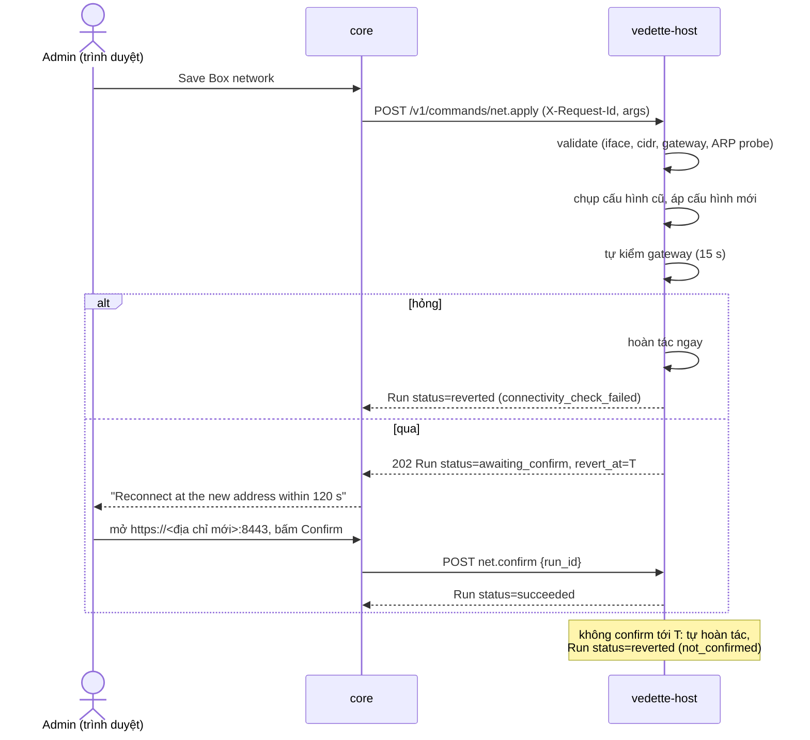

# Host API: socket nội bộ của `vedette-host`

Trạng thái: bản nháp M2-0 (docs-first), 2026-11-09; khung (framework) đã cài ở WP-07a, lệnh OS/sao lưu/xuất log ở WP-07b phần 1 (D-85, D-87: host không mở DB của `core`); các điều đã chốt khi cài ở §15 và §16. Văn xuôi tiếng Việt; tên trường, lệnh, thông điệp, đường dẫn bằng tiếng Anh.
Truy vết: D-53 (cập nhật OS, một lần chạy tại một thời điểm, sao lưu DB trước, kiểm sức khoẻ sau, tiến trình trực tiếp, kiểm toán), D-55 (appliance container, `vedette-host` thay `vedette-updater`, Podman + Quadlet, socket nội bộ với **danh sách lệnh cố định**), D-56 (cấu hình mạng, SPAN, IP phụ cho bẫy, NTP), D-50 (bẫy trên IP phụ), D-48 (xuất log), D-85 (tar+gzip, không `backup.delete`, unattended-upgrades theo timer của apt, khoá `core_data`), D-12/`update-manifest.md`; SYS-1…8 (`MODULE_CONTRACTS.md`); story S-CORE-2, S-CORE-7, S-CORE-6, S-HP-1.

## 1. Mục đích

`vedette-host` là tiến trình **root, rất nhỏ** (systemd) làm những việc container `core` **không được phép** làm: cập nhật OS, cấu hình mạng, kéo/chạy/hoàn tác container, sao lưu. `core` (Go, nhận input không tin cậy từ web) gọi host qua một socket nội bộ. Giá trị bảo mật của thiết kế nằm ở một điều: **API này là danh sách lệnh cố định, mỗi lệnh có tham số kiểu chặt, và không có lệnh thực thi tổng quát** (SYS-1). Nếu `core` bị chiếm, kẻ tấn công chỉ làm được những gì danh sách cho phép, với tham số đã bị host kiểm lại.

Chỉ tồn tại trên kiểu cài **Appliance**. Kiểu "Chỉ container" (D-55) không có host: `core` thấy socket vắng mặt và GUI nói rõ tính năng nào bị hạn chế.

## 2. Actors

| Actor | Vai trò |
|---|---|
| `vedette-host` | server trên unix socket, root |
| `core` | **client duy nhất**; áp RBAC (admin cho mọi thao tác ghi) trước khi gọi host |
| Quản trị viên | kích hoạt qua GUI; host không biết người dùng, chỉ nhận nhãn `actor` do core đặt để ghi kiểm toán |
| `systemd`/`podman`/`apt` | công cụ host điều khiển bằng argv cố định |

Mô hình đe doạ: **`core` bị coi là có thể bị chiếm.** Mọi lệnh có kiểm tra độc lập ở host, ngưỡng nhịp, và hậu quả bị giới hạn. Host không tin trường nào từ `core` ngoài nhãn `actor` (và chỉ để hiển thị).

## 3. Transport và xác thực

- **Unix domain socket** `/run/vedette/host.sock`, HTTP/1.1 JSON (không TCP, không bind mạng).
- Quyền: thư mục `/run/vedette` mode `0750 root:vedette`, socket mode `0660 root:vedette`; `vedette` là nhóm của tài khoản Quadlet chạy `core`. Socket **chỉ bind-mount vào container `core`**, không vào `sensor`/`honeypot`/`scan`/`greenbone`.
- Xác thực client (cả ba lớp phải đạt, chạy trên **mọi** kết nối):
  1. **Quyền tệp** ở trên.
  2. `SO_PEERCRED`: `uid` của peer phải bằng uid của tài khoản chạy `core` (ghi trong `/etc/vedette/host.conf`, installer sinh, ships-as-code).
  3. Kiểm `pid` của peer thuộc **cgroup của unit `vedette-core.service`** (`/proc/<pid>/cgroup`): chặn tiến trình khác cùng uid.
  Sai bất kỳ lớp nào → đóng kết nối, ghi kiểm toán `peer_not_allowed`.
- Không có token ứng dụng hay mật khẩu; vì client là một container cùng máy. Nếu sau này cần thêm chữ ký request ở tầng ứng dụng: câu hỏi mở §14.
- Tiêu đề bắt buộc: `Content-Type: application/json` (với POST), `X-Request-Id: <uuid v4>` (khoá idempotency; **bắt buộc cho mọi lệnh ghi**), `X-Vedette-Actor: <label>` (regex `^[a-zA-Z0-9_.@:-]{1,64}$`, hoặc `system` cho job tự động), `X-Vedette-Host-Proto: 1`.

## 4. Mô hình lệnh

- Lệnh ghi: `POST /v1/commands/<name>`, body `{ "args": { … } }`. Tham số lạ → `400 invalid_args` (không bỏ qua, khác sensor protocol: ở đây fail-closed).
- Response `202`: `Run`.

| Trường `Run` | Kiểu | Ghi chú |
|---|---|---|
| `run_id` | string | `rn_<16 hex>` |
| `command` | string | tên lệnh |
| `status` | enum | `queued` \| `running` \| `awaiting_confirm` \| `succeeded` \| `failed` \| `reverted` \| `refused` |
| `started_at`, `finished_at` | datetime | |
| `actor`, `request_id` | string | |
| `result` | object? | kết quả riêng từng lệnh (§6) |
| `error` | `{code,message}`? | |
| `revert_at` | datetime? | chỉ `net.apply` khi `awaiting_confirm` |
| `audit_id` | string | khoá bản ghi kiểm toán của host (§9) |

- `GET /v1/runs/{id}`, `GET /v1/runs?limit=…`: trạng thái; **run bền** (ghi đĩa `/var/lib/vedette-host/runs/`), sống qua restart của host và của `core`. Giữ 90 ngày hoặc 500 run.
- **Một lần chạy ghi tại một thời điểm** (D-53): lệnh ghi thứ hai khi đang có run `queued|running|awaiting_confirm` → `409 busy` kèm `{ "run_id": "<đang chạy>" }`. Lệnh chỉ đọc không bị khoá.
- **Idempotency:** cùng `X-Request-Id` + cùng `command` + cùng `args` (so sánh băm) → trả lại **đúng run đó** (`200`, không chạy lại). Cùng `X-Request-Id` nhưng khác lệnh/tham số → `422 request_id_reuse`. Bản ghi giữ 30 ngày.
- Tiến trình: `GET /v1/runs/{id}/events` là **SSE** (`text/event-stream`). Mỗi sự kiện: `{ "seq": n, "ts": …, "kind": "log"|"progress"|"state", "line": string≤2 KiB?, "percent": 0-100?, "status": …? }`. Hỗ trợ `Last-Event-ID` để nối lại. Giữ tối đa 10 000 dòng/run (dòng cũ nhất bị bỏ, `truncated: true`). `core` chuyển tiếp ra GUI qua SSE của chính nó (khớp `OsRun.lines`).
- Mọi đường dẫn tệp mà host đọc/ghi do **host quyết định** theo `id` kiểu hex; không lệnh nào nhận đường dẫn từ client (ngoại lệ không có).

## 5. Lệnh chỉ đọc (không khoá, không kiểm toán nặng)

| Endpoint | Trả về |
|---|---|
| `GET /v1/info` | `{ host_version, proto, commands[], runner: "podman", os: {distro, release, kernel}, arch, booted_at, time }` |
| `GET /v1/state/os` | bản chụp cuối từ `os.check` (gói chờ, security, cần reboot, hạn hỗ trợ, reboot hẹn): đủ cho `OsState`. Chưa từng kiểm → `404 no_check_yet`. Cờ cần reboot, giờ khởi động, lịch reboot và `auto_security` được đọc lại lúc gọi, không lấy từ bản chụp |
| `GET /v1/state/net` | danh sách card (tên, MAC, trạng thái, tốc độ), cấu hình hiện tại, **thống kê SPAN thật** (gói/giây, số MAC khác hộp, lần nhận cuối; D-56), IP phụ của bẫy, NTP |
| `GET /v1/state/containers` | từng service: image/tag/digest đang chạy, `previous`, trạng thái unit, health |
| `GET /v1/state/backups` | danh sách sao lưu `{backup_id, kind, created_at, size, sha256, version, db_schema, includes_secrets}` |
| `GET /v1/audit?since=…` | bản ghi kiểm toán của host (phân trang; phục vụ D-48) |
| `GET /v1/backups/{id}/content`, `GET /v1/exports/{id}/content` | tải tệp (xem lệnh liên quan); chỉ tệp host đã tạo và ghi trong chỉ mục (`id` = 32 hex; id lạ → `404 backup_unknown` / `export_unknown`; sao lưu có khoá → `403 contains_secrets`) |

## 6. Danh sách lệnh (đầy đủ)

Tên lệnh là **hợp đồng**: không có tên nào ngoài bảng này. Mọi lệnh ghi áp dụng §4 (khoá chung, idempotency, kiểm toán). Mọi giá trị đi vào argv qua kiểu đã kiểm, không bao giờ nối chuỗi.

Quy ước kiểm tra: `ip` = `netip.ParseAddr` (IPv4 unicast); `cidr` = `netip.ParsePrefix` (**độ dài tiền tố bắt buộc**, D-32); `iface` = tên card **có trong** `GET /v1/state/net` và khớp `^[a-z][a-z0-9._-]{0,14}$`; `service` ∈ {`core`,`sensor`,`honeypot`,`scan`,`greenbone`}; `uuid`/`hex` theo độ dài cố định.

### 6.1 `os.check`

Cập nhật chỉ mục apt và tính lại danh sách gói chờ. Args: `{}`.
Hiệu ứng: `apt-get update` rồi mô phỏng nâng cấp để liệt kê gói; đánh dấu `security` theo kho nguồn (`-security`); đọc `/var/run/reboot-required`; hạn hỗ trợ bản phát hành từ bảng tĩnh trong host (cập nhật qua bản host mới). Kết quả: `{ pending[], security_count, reboot_required, reboot_reasons[], last_check }` (khớp `OsState`).
Idempotent: chạy lại làm mới chỉ mục. Tiến trình: đầu và cuối đầu ra apt (đã lọc), ghi sau khi apt xong (`core/exec` chưa stream). Từ chối: `busy`; `dpkg_locked` (`409`, `retry_after_s: 60`: đang có `unattended-upgrades`/apt khác giữ khoá, host hỏi nhân qua `fcntl F_GETLK` trên bốn tệp khoá của apt/dpkg, **không** lấy khoá; lỗi khi hỏi tính là đang giữ; không tự cưỡng chế); `not_appliance` (`412`: bản phát hành không có trong bảng hỗ trợ). Chi tiết chốt ở §16. *Chính sách "tắt kiểm tra cập nhật" (Privacy) là việc của `core`: nếu tắt, `core` không gọi lệnh này (host không biết cài đặt đó).* Timeout 5 phút.

### 6.2 `os.install`

Args: `{ "scope": "security" | "all", "snapshot": hex32 }`. `snapshot` là id bản chụp `core` vừa tạo (§6.11, D-87) để host chép vào bản sao lưu `pre_os_update`; thiếu hoặc sai dạng → `400 invalid_args`, bản chụp thiếu/quá cũ/sai hợp đồng → `412 snapshot_required|snapshot_invalid` ngay ở bước kiểm (trước khi apt chạy).
Hiệu ứng, theo thứ tự (D-53): (1) kiểm điều kiện; (2) **`backup.create` nội bộ** (`kind=pre_os_update`); (3) chạy **danh sách lệnh apt cố định** (`apt-get -y install --only-upgrade …`, với danh sách gói do **host tự tính lại từ trạng thái apt**, không nhận tên gói từ client); (4) **kiểm sức khoẻ** (tất cả unit `vedette-*` đang chạy, `core` trả `/healthz`, sensor còn heartbeat); (5) báo `reboot_required`. Kết quả: `{ installed, security, backup_id, health[{name,ok}], reboot_required }` (khớp `OsRunResult`).
Chi tiết thực hiện (§16): argv cài là `apt-get -y -q -o Dpkg::Options::=--force-confdef -o Dpkg::Options::=--force-confold --no-remove install --only-upgrade <gói…>` (thêm `--no-remove` và hai tuỳ chọn conffile so với bản nháp: apt không được gỡ gói và không được hỏi); không có gói nào để cài → thành công, `installed: 0`, **không** sao lưu, **không** chạy apt; kiểm sức khoẻ ở phần 1 chỉ gồm unit `core`. Run `failed` mang `result` (số gói đã cài, `health[]`) kèm `error` (`apt_failed`, `health_check_failed`).
Từ chối: `busy`; `dpkg_inconsistent` (`dpkg --audit` không sạch); `low_disk` (< 1 GiB trống ở `/var`, tham số); `stale_check` (chưa có `os.check` trong 24 giờ thì host tự chạy `os.check` trước, không từ chối; chỉ khi bước đó hỏng vì apt mới `failed` mã `stale_check`; `no_check` không còn là mã từ chối); `not_appliance`. Không bao giờ nâng bản phát hành (`do-release-upgrade`, đổi codename trong sources): lệnh **không tồn tại** (D-53). Timeout 60 phút. Health check hỏng **không** tự gỡ gói (apt không hoàn tác được): run `failed`, giữ nguyên, báo; sao lưu DB ở bước 2 là chỗ quay về cho dữ liệu.

### 6.3 `os.auto_security.set`

Args: `{ "enabled": bool }`. Ghi `/etc/apt/apt.conf.d/52vedette-unattended` từ mẫu cố định (origin chỉ là kho security của distro hiện tại) và bật/tắt timer `apt-daily*.timer` theo `enabled`; **xác minh bằng hiệu ứng** (`apt-config dump` và trạng thái timer), không bằng exit code (rule ships-as-code). Mẫu: `#clear` rồi chỉ origin security của distro (Ubuntu: `${distro_id}:${distro_codename}-security` và hai kho ESM; Debian: `Origins-Pattern` với `label=Debian-Security`), `Automatic-Reboot "false"`, `APT::Periodic::Unattended-Upgrade` `"1"|"0"`; ghi bằng tệp tạm + `rename`, mode `0644`. **Xác minh bằng hiệu ứng**: `apt-config dump` phải cho đúng công tắc và (khi bật) mọi origin đều là security; `systemctl is-enabled` của hai timer phải in `enabled`/`disabled` (đọc đầu ra, không đọc mã thoát); sai → `failed` mã `effect_not_verified`. Idempotent. Từ chối: `busy`, `not_appliance`. Cửa sổ bảo trì (ngày/giờ) do `core` giữ; unattended-upgrades chạy theo timer của apt, nên **không** tôn trọng cửa sổ của Vedette: chấp nhận ở D-85 (hộp Ubuntu/Debian đều chạy như vậy), GUI sẽ ghi trong phần trợ giúp.

### 6.4 `os.reboot` và `os.reboot.cancel`

`os.reboot` args: `{ "when": "now" | "at", "at": "<RFC3339 UTC>" }` (`at` bắt buộc khi `when=at`, tối thiểu 60 giây sau, tối đa 7 ngày sau; `core` đổi từ cửa sổ `HH:MM` cục bộ sang thời điểm tuyệt đối trước khi gọi).
Hiệu ứng: `now` → chạy `systemctl reboot` ngay sau khi run chuyển `succeeded` (host ghi run **trước** khi reboot); `at` → lưu lịch bền, host tự đặt hẹn giờ và `systemctl reboot` lúc đó. Idempotent: một lịch reboot duy nhất; đặt lại thay lịch cũ. Sau khi máy khởi động lại, Quadlet đưa mọi container lên; host kiểm và ghi `reboot_completed`.
`os.reboot.cancel` args `{}`: xoá lịch (không có lịch → thành công, không làm gì).
Từ chối: `install_in_progress` (`409`; một `os.install` đang chạy. Khoá ghi chung trả `busy` trước, nên mã này là lớp phòng thủ thứ hai); `net_pending_confirm` (`409`; không reboot khi đang chờ xác nhận mạng; chưa có lệnh `net.*` nên hàm kiểm trả `false`); `at_in_past` (`412`; `at` phải cách bây giờ ≥ 60 giây), `at_too_far` (`412`; > 7 ngày); `reboot_limit_reached` (`409`). Nhịp: tối đa 3 reboot `now`/24 giờ (mặc định; chặn vòng lặp reboot từ `core` bị chiếm); **mọi** lần host tự reboot (cả theo lịch) tính vào bộ đếm bền; đủ 3 thì `now` bị từ chối, còn lịch tới giờ thì bị bỏ (`reboot_skipped_limit`). `not_appliance` không áp dụng (không đụng apt). Chi tiết chốt ở §16.

### 6.5 `net.apply`, `net.confirm`, `net.revert`

`net.apply` args (trạng thái mong muốn của **phần Vedette quản lý**):

| Trường | Kiểu | Quy tắc |
|---|---|---|
| `mgmt.iface` | iface | bắt buộc |
| `mgmt.mode` | `dhcp` \| `static` | |
| `mgmt.address` | cidr | bắt buộc khi `static`; unicast, không phải địa chỉ mạng/broadcast |
| `mgmt.gateway` | ip | trong cùng mạng với `address` |
| `mgmt.dns` | ip[≤ 3] | unicast; không loopback |
| `span.iface` | iface \| null | khác `mgmt.iface`; card không có IP, chế độ nghe (promisc), không giữ IPv6 |
| `ntp` | string[≤ 4] | IPv4 hoặc tên theo regex tên (`^[a-zA-Z0-9][a-zA-Z0-9_.-]{0,63}$`) |
| `confirm_timeout_s` | int | 30–600, mặc định 120 |

Hiệu ứng: ghi cấu hình mạng cho **backend phát hiện được** (câu hỏi mở §14: Ubuntu dùng netplan, Debian 12 mặc định ifupdown/systemd-networkd), áp dụng, rồi vào **chế độ tự hoàn tác**:

1. Host **chụp** cấu hình cũ (tệp sinh + trạng thái chạy).
2. Áp cấu hình mới.
3. Tự kiểm kết nối (tới gateway mới bằng ARP/ICMP trong 15 giây). Hỏng → **hoàn tác ngay** (`status=reverted`, `error.code=connectivity_check_failed`).
4. Qua tự kiểm: `status=awaiting_confirm`, `revert_at = now + confirm_timeout_s`. Hẹn giờ hoàn tác **bền** (systemd transient timer), sống qua restart host/`core`/reboot.
5. Nếu admin đến được hộp ở địa chỉ mới qua GUI, `core` gọi `net.confirm {run_id}` → `status=succeeded`, huỷ hẹn giờ. Hết giờ mà chưa confirm → host **tự hoàn tác** về cấu hình đã chụp (`status=reverted`, `error.code=not_confirmed`).
`net.revert {run_id}` huỷ sớm và hoàn tác ngay (admin bấm "Cancel").

Idempotent: áp cùng trạng thái đang chạy → `succeeded` không đổi gì, **không** vào chế độ chờ xác nhận. IP phụ của bẫy (§6.6) được **áp lại** sau mỗi `net.apply` hoặc revert.
Từ chối: `busy`; `pending_confirm` (đang có run chờ xác nhận); `iface_unknown`; `same_iface` (mgmt = span); `address_conflict` (phát hiện địa chỉ trùng bằng ARP probe, DAD cho IPv4); `gateway_outside_subnet`; `invalid_args` với `details[]`; `last_mgmt_removed` (kết quả sẽ không còn card quản trị); `not_appliance`. Timeout áp dụng 30 giây (+ cửa sổ xác nhận).

### 6.6 `decoy_ip.add` và `decoy_ip.remove`

IP phụ cho bẫy (D-50, D-55: OpenCanary trên IP phụ, macvlan). Args: `{ "ip": ip }` (`add` thêm `"iface"` tuỳ chọn, mặc định `mgmt.iface`).
Hiệu ứng: gán địa chỉ cho network macvlan của container `honeypot` trên card quản trị; lưu vào trạng thái bền của host (áp lại sau `net.apply`/reboot); MAC là **địa chỉ local-administered** do host sinh ổn định từ IP (câu hỏi mở §14: giả OUI hãng cho "vai giả").
Từ chối (`add`): `ip_not_in_mgmt_subnet`; `ip_is_gateway|ip_is_host|ip_is_network|ip_is_broadcast`; `ip_in_use` (ARP probe thấy ai trả lời trong 3 giây); `duplicate_decoy`; `limit_reached` (tối đa 32, mặc định); `not_appliance`. Việc chặn trùng với **thiết bị trong kho** là của `core` (honeypot module từ chối trước); host kiểm lại **mạng thật** bằng ARP.
`remove`: IP không có → thành công, không làm gì (idempotent). Host không tắt container `honeypot`; `core` gọi `container.start`/cấu hình honeypot theo DB sau đó.
Không có lệnh nhận danh sách tuỳ ý, chỉ từng IP một.

### 6.7 `container.pull`

Args:

| Trường | Kiểu | Ghi chú |
|---|---|---|
| `service` | service | |
| `version` | semver | phải trùng `release-manifest.version` |
| `source` | `registry` \| `bundle` | |
| `bundle_id` | hex(32) | bắt buộc nếu `source=bundle`; thư mục `import/<bundle_id>/` do host biết |
| `index`, `index_sig` | base64 | `index.json` và `.minisig` (≤ 256 KiB mỗi tệp) |
| `manifest`, `manifest_sig` | base64 | `release-manifest.json` và `.minisig` |

Hiệu ứng (`update-manifest.md` §5): host **tự xác minh** (không tin `core`): minisign `index` và `manifest` bằng khoá nhúng trong host; khoá không bị thu hồi; `index.sequence ≥` giá trị cao nhất host đã lưu; `service` có trong `manifest.images` và `digest` khớp; bản không bị thu hồi; `platform` khớp CPU; ref nằm trong **namespace registry cố định của host** (biên dịch/cấu hình khi cài, không do client); kéo **theo digest** (`registry` hoặc nạp `oci-archive` từ bundle); xác minh chữ ký cosign; đối chiếu `size`; gán tên cục bộ `vedette-<service>:<version>`. Kết quả: `{ digest, size, verified: ["minisign","cosign"] }`.
Idempotent: image đã có đúng digest → `succeeded` ngay. Từ chối: `busy`; `signature_invalid`; `key_revoked`; `release_revoked`; `digest_not_in_manifest`; `registry_not_allowed`; `sequence_regress`; `platform_mismatch`; `bundle_missing`; `low_disk` (< 2 × `size`); `not_appliance`. Timeout 30 phút. Không có lệnh kéo image theo tên/tag tuỳ ý.

### 6.8 `container.start`

Args: `{ "service": service, "version": semver }`.
Hiệu ứng: `version` phải đã được `container.pull` **và** xác minh thành công trên host này; ghi drop-in Quadlet chọn digest đó; lưu digest đang chạy làm `previous`; `systemctl restart vedette-<service>.service` (tên unit sinh từ enum); chờ `active` + healthcheck (mặc định 120 giây). Kết quả: `{ digest, previous_digest, healthy }`. Cũng dùng để bật service đang tắt (`greenbone`, `honeypot` khi module bật, SYS-5): khi đó `previous` không đổi.
Idempotent: đang chạy đúng digest và khoẻ → `succeeded`, không restart.
Từ chối: `busy`; `not_pulled`; `release_revoked`; `downgrade_not_allowed` (hạ phiên bản phải đi bằng `container.rollback`); `unit_failed` (khởi động hỏng → host **tự đưa về `previous`** và báo `reverted`); `not_appliance`. Thứ tự khuyến nghị cho `core`: `sensor`/`honeypot`/`scan` trước, **`core` sau cùng** (host giữ run bền nên tiếp tục khi `core` lên lại). `greenbone` chỉ khi đã bật tuỳ chọn.

### 6.9 `container.stop`

Args: `{ "service": service, "persist": bool }`. `persist=false`: `systemctl stop` (tự lên lại sau reboot); `persist=true`: dừng và `systemctl disable` (module tắt, SYS-5; `container.start` bật lại).
Từ chối: **`cannot_stop_core`** (`service=core`: lệnh sẽ giết chính bên gọi; dừng `core` chỉ có thể qua `os.reboot`, `container.start` (restart có kiểm soát) hoặc `backup.restore`); `busy`; `not_appliance`. Idempotent: đã dừng → thành công.

### 6.10 `container.rollback`

Args: `{ "service": service }`.
Hiệu ứng: đổi drop-in Quadlet về `previous` đã lưu và restart; kiểm sức khoẻ; sau rollback `previous` trở thành bản vừa gỡ (rollback hai lần = quay lại). Kết quả `{ digest, from_digest }`.
Từ chối: `busy`; `no_previous`; `previous_revoked` (digest cũ nằm trong danh sách thu hồi đã lưu); `unit_failed` (rollback cũng hỏng: host **dừng ở trạng thái cuối và báo**, không vòng lặp); `not_appliance`. Hoàn tác phần mềm **không** hoàn tác DB: `core` phải gọi `backup.restore` nếu manifest khai `rollback.safe=false` (`update-manifest.md` §10).

### 6.11 `backup.create`

Args: `{ "kind": "manual" | "pre_update" | "pre_os_update" | "pre_restore", "include_secrets": bool, "label": string≤64, "snapshot": hex32 }`.
Hiệu ứng (D-87): **host không bao giờ mở, phân tích hay chạy SQL trên dữ liệu của `core`.** `core` tự tạo bản chụp nhất quán của chính nó (hợp đồng bên dưới), host chỉ **chép byte của bản chụp theo file descriptor** vào tar + gzip của thư viện chuẩn Go (D-85, không zstd), kèm tệp khoá khi `include_secrets` (không có thư mục cấu hình nào khác: mọi cấu hình của `core` nằm trong DB, `DATA_MODEL` §5); tính SHA-256 của tệp nén; ghi `manifest.json` nhỏ (`version`, `db_schema` lấy từ `snapshot.json` của `core`, `created_at`, `includes_secrets`) → `/var/lib/vedette-host/backups/<backup_id>.tar.gz` (0600). Kết quả `{ backup_id, size, sha256 }`. Chi tiết chốt ở §16.
`include_secrets=false` (mặc định cho `manual`): **không** chứa khoá `core/secrets` và các bí mật (khớp "backup không chứa mật khẩu hay khoá" của GUI); bản đó **tải được** (`GET /v1/backups/{id}/content`). `kind` bắt đầu bằng `pre_`: **bắt buộc** `include_secrets=true` (để khôi phục được) và **không tải được** (`403 contains_secrets`); chỉ tồn tại trên máy.
Lưu giữ: host giữ 3 bản `pre_*` gần nhất và `manual` cho tới khi admin xoá (≤ 10, mặc định); quá thì xoá cũ nhất.
Từ chối: `busy`; `snapshot_required` (`412`: không có thư mục/`snapshot.json` của id đó, hoặc bản chụp quá 10 phút); `snapshot_invalid` (`412`: sai hợp đồng bên dưới); `low_disk` (< 2 × cỡ bản chụp DB); `db_unreadable` (cũng khi `core_data` không có trong `host.conf` hoặc cây thư mục không an toàn); `key_unreadable` (cần khoá mà bản chụp không có khoá); `not_appliance` không áp dụng (không đụng apt). Timeout 15 phút.

**Hợp đồng bản chụp của `core` (D-87).** Trước mỗi lệnh cần sao lưu (`backup.create`, `os.install` cho bản `pre_os_update`, `backup.restore` cho bản `pre_restore`), `core` (phía `core` là WP-07b phần 2) tự tạo bản chụp nhất quán của mình bằng `VACUUM INTO` hoặc API backup của SQLite vào `<core_data>/snapshots/<id>/`, rồi gọi lệnh với `args.snapshot = <id>`. `<id>` là 32 hex thường do `core` sinh ngẫu nhiên. Thư mục có đúng các tệp:

| Tệp | Nội dung | Ràng buộc |
|---|---|---|
| `vedette.db` | DB đã nhất quán, **một tệp tự đủ** (không `-wal`, `-shm`) | bắt buộc; 1 byte đến 64 GiB |
| `vedette.key` | bản sao khoá `core/secrets` | chỉ khi `includes_key: true`; 1 đến 4096 byte |
| `snapshot.json` | `{"created_at": RFC 3339, "db_schema": "module=phiên_bản,…", "includes_key": bool}` | bắt buộc; ≤ 4 KiB; không trường lạ, không dữ liệu thừa; `db_schema` theo văn phạm của manifest (≤ 64 cặp, có thể rỗng) |

Mọi tệp: tệp thường (không symlink, không FIFO, không thiết bị), thuộc `core_uid`, **đúng một liên kết**, trong giới hạn cỡ ở trên; thư mục `snapshots/<id>` nằm trong `core_data` (symlink trỏ ra ngoài bị `os.Root` chặn). `core` ghi `snapshot.json` **cuối cùng**; host đọc nó **đầu tiên** (thiếu = chưa có bản chụp = `snapshot_required`). Tuổi tối đa **10 phút** tính từ `created_at` (quá thì `snapshot_required`: hãy tạo bản mới; ghi trước đồng hồ của host hơn 1 phút thì `snapshot_invalid`). Mọi thứ khác sai hợp đồng → `snapshot_invalid`. `db_schema` và `includes_key` là lời khai của `core`: host chỉ ghi vào manifest và dùng làm cảnh báo sớm, **không kiểm lại bằng cách mở DB**. Host không xoá gì trong cây của `core`; `core` tự dọn thư mục bản chụp (sau lệnh, hoặc lúc `core` khởi động). Cùng một id có thể dùng cho nhiều lệnh trong 10 phút.

### 6.12 `backup.restore`

Args: `{ "backup_id": hex, "snapshot": hex32 }`. `snapshot` là bản chụp **trạng thái hiện tại** của `core` (hợp đồng §6.11): host giữ nó làm bản `pre_restore`.
Hiệu ứng: kiểm `backup_id` có trong chỉ mục của host và `sha256` còn đúng; kiểm chỗ trống theo cỡ các thành viên mà tiêu đề archive khai báo (tổng × 1,1, ở thư mục tạm của host và ở `core_data`); tự `backup.create kind=pre_restore` từ bản chụp `snapshot`; dừng `core` (đường **duy nhất** host dừng `core`, vì client đã kết thúc quyền chạy), **ghi lại các tệp của archive vào `core_data` qua tay cầm `os.Root`** (tên ngẫu nhiên `O_EXCL`, `fchown core_uid:core_gid` và `fchmod 0600` trên descriptor, `fsync`, `rename` trong tay cầm; `-wal`/`-shm`/`-journal` cũ bị xoá), khởi động lại `core`, kiểm sức khoẻ. **Host không mở DB trong archive**: `core` tự kiểm DB khi khởi động (schema mới hơn hoặc DB hỏng → `core` không lên → kiểm sức khoẻ hỏng). Hỏng → thay lại bản `pre_restore`, `status=reverted`. Kết quả `{ restored_backup_id, pre_restore_backup_id, version }`.
Từ chối: `busy`; `backup_unknown` (`404`); `snapshot_required`/`snapshot_invalid` (`412`, §6.11: không có bản chụp trạng thái hiện tại thì không có `pre_restore`, nên không khôi phục); `checksum_mismatch` (tệp đổi so với chỉ mục); `schema_newer` (`409`; cảnh báo sớm: `db_schema` trong manifest (do host ghi lúc sao lưu) so với `db_schema` trong `snapshot.json` mới của `core`; có module mà phiên bản trong sao lưu cao hơn, hoặc chỉ có trong sao lưu; quyết định cuối là của `core` lúc khởi động); `secrets_missing` (`412`; host không đọc được `core_secret` nên từ chối thận trọng khi archive không có khoá **và** bản chụp hiện tại cũng không có khoá); `low_disk` (`412`; ở bước kiểm: < 2 × cỡ bản chụp; trong run: dưới tổng cỡ thành viên × 1,1; chưa viết byte nào, chưa dừng `core`); kiểm tra giải nén/chữ ký tệp hỏng → `failed` `restore_failed`. Hỏng sau khi dừng `core` → thay lại `pre_restore`, `status=reverted`, `error.code=restore_health_failed` (nếu cả bước thay lại hỏng: `failed` `restore_revert_failed`, `core` đứng yên, bản `pre_restore` còn trong chỉ mục). Chi tiết chốt ở §16. Lưu ý hiệu ứng: run phải **bền** vì kết nối client đứt khi `core` dừng; `core` lên lại gọi `GET /v1/runs/{id}` để biết kết quả. Khôi phục từ **tệp do người dùng tải lên**: chưa có lệnh (§14).

### 6.13 `logs.export`

Args: `{ "units": string[], "since": datetime, "until": datetime }`; `units` ⊂ {`vedette-core`,`vedette-sensor`,`vedette-honeypot`,`vedette-scan`,`vedette-greenbone`,`vedette-host`}; `until - since ≤ 31 ngày`.
Hiệu ứng: đọc journal bằng argv cố định (`journalctl -u <unit> --since <t> --until <t> -o json --no-pager`), **lọc bí mật** theo mẫu đã biết (`vdt_osquery_…`, đường dẫn `…/blocklist/<token>`, `xapp-…`, `xoxb-…`, `Authorization: Bearer …`, `password=`) như lớp phòng thủ phụ (SYS-4: bình thường không log bí mật), ghi từng dòng đã lọc, nén gzip (thư viện chuẩn, D-85) thành `/var/lib/vedette-host/exports/<export_id>.jsonl.gz`, trả `{ export_id, size, sha256 }`; tải bằng `GET /v1/exports/{id}/content`; tệp tự xoá sau 24 giờ; host giữ tối đa **3** bản xuất và **512 MiB** tổng (xoá bản cũ nhất trước); mỗi lần tải ghi một dòng kiểm toán `logs.download`.
Từ chối: `busy`; `low_disk` (`412`: chỗ trống < 2 × 256 MiB, như sao lưu); `range_too_large` (`412`); `unit_unknown` (`412`); `output_too_large` (`412`, > 64 MiB văn bản của **một** unit hoặc > 256 MiB cộng dồn các unit: dừng và báo, không cắt âm thầm; dòng không phải JSON hoặc > 1 MiB bị thay bằng một dòng ghi chú, không bỏ im lặng). Dạng sai của `units`/`since`/`until` là `400 invalid_args`. Timeout 10 phút. Chi tiết chốt ở §16. Phục vụ D-48 (phần log nền tảng); log nghiệp vụ (kiểm toán, AI, phản ứng) do `core` xuất.

## 7. Những thứ **không** có (và sẽ bị từ chối nếu thử)

SYS-1 áp dụng triệt để. API này **không** có và không bao giờ nhận:

- thực thi tổng quát (shell, `exec`, `sh -c`, chạy tệp, chạy script, `eval`);
- đọc/ghi tệp tuỳ ý, đường dẫn do client đưa;
- `apt install|remove|purge` gói tuỳ chọn, thêm/sửa nguồn apt, nâng cấp bản phát hành OS;
- điều khiển `systemd` tuỳ chọn (chỉ unit `vedette-*` theo `service` enum, chỉ qua các lệnh container);
- tham số `podman` tuỳ chọn, `--privileged`, `--cap-add`, mount, mạng host, pull image theo tên tuỳ ý;
- thay đổi `sysctl`, tường lửa (UFW/nft), người dùng, SSH, khoá, chứng chỉ hệ điều hành.

Gọi tới đường dẫn/lệnh không có trong §5–§6: `404 unknown_command`. Đây là hợp đồng kiểm được: test hợp đồng liệt kê `GET /v1/info.commands` và so với bảng này; thêm một lệnh phải sửa tài liệu này, `CONTRACT.md` và test cùng lúc.

## 8. Sequence: áp cấu hình mạng với tự hoàn tác

## 9. Kiểm toán (SYS-3)

- Host ghi **mỗi** lệnh (cả bị từ chối) vào `/var/log/vedette-host/audit.jsonl` (root, `0600`, chỉ thêm): `{ seq, id, ts, request_id, actor, peer: {uid, pid, unit}, command, args_digest, args_redacted, result: "ok"|"refused"|"failed"|"reverted", code?, run_id?, prev_hash, hash }` (`seq` tăng dần từ 1, nằm trong phần được băm) với `hash = SHA-256(prev_hash "\n" canonical-JSON(các trường còn lại))` (cùng kiểu chuỗi hash D-48). `core` **không ghi được** tệp này nên không xoá/sửa dấu vết của chính nó.
- `core` đồng thời ghi `core_audit` (ai bấm gì); hai nhật ký đối chiếu bằng `request_id`. `args_redacted` bỏ giá trị nhạy (bất kỳ chuỗi nào trông như khoá/token; bản thân lệnh không nhận bí mật).
- `GET /v1/audit?since=…` cho phép `core` kéo nhật ký host để gộp vào "tải mọi log của hộp" (D-48).

## 10. Giới hạn

| Mục | Giới hạn mặc định |
|---|---|
| Thân request | 512 KiB (chỉ `container.pull` cần lớn) |
| Số request/phút từ `core` | 60; lệnh ghi 10/phút |
| Run đồng thời (ghi) | 1 |
| Timeout theo lệnh | `os.check` 5 ph; `os.install` 60 ph; `net.apply` 30 s + cửa sổ xác nhận ≤ 600 s; `container.pull` 30 ph; `container.start` 3 ph; `os.auto_security.set` 2 ph; `os.reboot` và `os.reboot.cancel` 30 s; `backup.create` 15 ph; `backup.restore` 30 ph; `logs.export` 10 ph |
| Dòng sự kiện/run | 10 000; mỗi dòng ≤ 2 KiB |
| Run giữ lại | 90 ngày hoặc 500 |
| `logs.export` | ≤ 31 ngày, ≤ 256 MiB |
| IP phụ cho bẫy | ≤ 32 |
| `os.reboot now` | ≤ 3/24 giờ |
| Thời gian chờ xác nhận mạng | 30–600 s (mặc định 120) |

Các con số trên là điểm xuất phát chưa đo (ARCH §8).

## 11. Xử lý lỗi

Định dạng chung `{ "error": { "code": "snake_case", "message": "English", "details": [ { "field": "args.ip", "reason": "…" } ]? } }`.

| HTTP | Nhóm `code` |
|---|---|
| 400 | `invalid_args`, `invalid_request_id`, `invalid_actor` |
| 403 | `peer_not_allowed`, `contains_secrets` (tải sao lưu có khoá) |
| 404 | `unknown_command`, `run_not_found`, `backup_unknown`, `no_check_yet`, `export_unknown` |
| 409 | `busy`, `pending_confirm`, `install_in_progress`, `net_pending_confirm`, `dpkg_locked` (kèm `retry_after_s`), `reboot_limit_reached`, `rebooting` (host đã bắt đầu reboot: mọi lệnh ghi bị từ chối tới khi `boot_id` đổi, tối đa 10 phút), `schema_newer`, các từ chối do trạng thái hệ thống |
| 412 | các từ chối do điều kiện tiên quyết (`low_disk`, `dpkg_inconsistent`, `address_conflict`, `not_appliance`, `at_in_past`, `at_too_far`, `db_unreadable`, `key_unreadable`, `snapshot_required`, `snapshot_invalid`, `checksum_mismatch`, `secrets_missing`, `unit_unknown`, `range_too_large`, `output_too_large`, `signature_invalid`…) |
| 422 | `request_id_reuse` |
| 429 | `rate_limited` (+ `retry_after_s`) |
| 503 | `host_shutting_down` |

Từ chối (`status=refused`) vẫn **tạo run** và bản ghi kiểm toán, để GUI thấy lý do. Khi mất kết nối giữa chừng, `core` hỏi lại `GET /v1/runs/{id}` (nhờ `X-Request-Id` biết run nào) thay vì gửi lại lệnh.

## 12. Cân nhắc bảo mật (ánh xạ SYS)

| SYS | Áp dụng |
|---|---|
| SYS-1 | Danh sách lệnh đóng; mỗi lệnh dựng argv từ hằng + giá trị đã kiểm; binary đường dẫn tuyệt đối; môi trường sạch (`PATH`, `LANG=C`, `DEBIAN_FRONTEND=noninteractive`); không shell; §7 |
| SYS-2 | Schema chặt cho từng lệnh, `invalid_args` nếu trường lạ; IP qua `netip`, tên qua regex chuẩn; không giá trị nào đến từ chuỗi tự do vào argv |
| SYS-3 | Chuỗi kiểm toán hash của host (§9) cộng `core_audit` |
| SYS-4 | Host không nhận bí mật qua API; `include_secrets` chỉ cho sao lưu cục bộ; log được lọc; khoá nằm trong `core/secrets` |
| SYS-5 | `container.stop persist=true` thực hiện "tắt module = không cổng, không job"; dữ liệu giữ nguyên |
| SYS-6 | Mọi manifest/bundle/log là dữ liệu không tin cậy: host tự xác minh chữ ký, giới hạn kích thước, fail-closed; log lọc |
| SYS-7 | Host chỉ nói chuyện ra các host cố định (registry, GitHub, mirror apt) và ARP/ICMP trong LAN cho kiểm tra mạng |
| SYS-8 | AI không có đường tới socket (không bind vào các container khác `core`; `core` không chuyển lệnh do AI sinh) |

Các biện pháp "hậu quả giới hạn" khi `core` bị chiếm: nhịp lệnh (reboot, ghi), cửa sổ xác nhận tự hoàn tác cho mạng, mọi lệnh đảo ngược/được sao lưu (`pre_*`), host tự xác minh chữ ký (không thể ép chạy image lạ), `cannot_stop_core`, không có đường đọc tệp tuỳ ý. Rủi ro còn lại: `core` bị chiếm vẫn có thể gây gián đoạn (dừng `sensor`, reboot theo nhịp); chấp nhận vì không có đường leo thang quyền hay thực thi.

## 13. Versioning

- `X-Vedette-Host-Proto` là số nguyên; `GET /v1/info` trả `proto` và `commands[]` (khả năng). Đường dẫn `/v1`.
- Host hỗ trợ proto **N và N−1**. Khi appliance cập nhật, `core` và `host` có thể lệch trong thời gian ngắn (cập nhật host là câu hỏi mở của `update-manifest.md`): `core` chỉ gọi lệnh có trong `commands[]`, thiếu → coi tính năng đó không có (hiển thị rõ), không đoán.
- Thêm lệnh = bản mới (minor); đổi nghĩa/xoá tham số = `v2`.
- Tên unit, thư mục, hằng cố định sinh bởi installer (ships-as-code) và ghi trong `/etc/vedette/host.conf`.

## 14. Câu hỏi mở

1. **Ai mở cổng vào (UFW)?** D-55 nhắc UFW nhưng allowlist không có lệnh tường lửa: cổng 8443 (UI/API), syslog, cổng sensor, cổng bẫy trên IP phụ cần được mở do installer lúc cài và do host khi module bật. Cần quyết (thêm lệnh `firewall.*` bị chặt, hay installer mở sẵn theo cấu hình và host chỉ đổi theo module).
2. **Cập nhật chính `vedette-host`** (cũng ở `update-manifest.md`): chưa có lệnh `host.self_update`; phải thêm một lệnh có xác minh chữ ký, hoặc để installer/apt.
3. Backend mạng: netplan (Ubuntu) / ifupdown hoặc systemd-networkd (Debian 12): host hỗ trợ cái nào, hay chuẩn hoá một cái khi cài.
4. Sao lưu: `pre_*` chứa khoá `core/secrets` (cần để khôi phục) nhưng không tải xuống được; tuy nhiên người dùng muốn **sao lưu khôi phục được trên máy khác** thì sao (cần cách bảo vệ khoá bằng mật khẩu, chưa có story). Khôi phục từ tệp tải lên cũng chưa có lệnh.
5. `decoy_ip.add`: giả OUI theo vai (D-50 "vai giả") cần host đặt MAC theo hãng; hiện dùng MAC local-administered. Giả OUI có nên không?
6. Cần chữ ký request ở tầng ứng dụng giữa `core` và host (HMAC theo khoá cài sẵn) ngoài `SO_PEERCRED` + cgroup, hay đủ?
7. ~~Cửa sổ bảo trì không điều khiển được `unattended-upgrades`~~ **Đã chốt (D-85):** chấp nhận; unattended-upgrades chạy theo timer của apt (Ubuntu và Debian đều ship như vậy); GUI ghi trong trợ giúp.
8. ~~`backup.delete` và lịch sao lưu định kỳ~~ **Đã chốt (D-85):** chưa có story, không làm; chỉ lưu giữ tự động (§6.11).
9. Mọi con số giới hạn (§10) là điểm xuất phát, chưa đo.

## 15. Đã chốt khi cài khung (WP-07a)

Mã: `host/{api,config,peer,server,client}`, `cmd/vedette-host`; hợp đồng test ở `modules/host/contract_test.go`. Lệnh hệ thống (§6) nằm ở `host/ops` từ WP-07b (§16); `DefaultRegistry()` đã bỏ, `cmd/vedette-host` dựng registry một lần từ `ops.Commands()`.

**`/etc/vedette/host.conf`** (installer sinh, WP-08). Dòng `key = value`, bỏ qua dòng trống và dòng bắt đầu bằng `#`; chặt: khoá lạ, khoá lặp, thiếu khoá, giá trị sai đều là lỗi, tối đa 4 KiB. Tệp phải là tệp thường, thuộc root, nhóm/người khác không ghi được.

| Khoá | Ý nghĩa |
|---|---|
| `core_uid` | uid chạy `core` (số thập phân, **không** được là 0) |
| `core_gid` | gid của `core`: tệp khôi phục vào `core_data` thuộc `core_uid:core_gid`, mode 0600; **không bao giờ** lấy chủ từ một mục có sẵn trong cây của `core` (số thập phân, bắt buộc) |
| `core_unit` | tên unit systemd của `core`, dạng `vedette-core.service` |
| `socket` | đường dẫn tuyệt đối, sạch, tối đa 100 byte (`/run/vedette/host.sock`); cờ `-socket` ghi đè |
| `socket_gid` | gid của nhóm `vedette`: chủ nhóm của socket (0660) và thư mục chứa (0750) |
| `core_data` | tuỳ chọn: thư mục dữ liệu của `core` (tuyệt đối, sạch, ≤ 200 byte, không `..`, không `//`, không phải `/`), chứa `vedette.db`, `vedette.key` và `snapshots/`; installer ghi (WP-08). Host mở **một lần mỗi lệnh** bằng `os.OpenRoot` sau khi kiểm (lúc khởi động và mỗi lệnh) rằng nó là thư mục thật (không symlink), thuộc `core_uid` hoặc root, và **mọi thư mục cha thuộc root, nhóm/người khác không ghi được** (như sshd `StrictModes`, không có ngoại lệ cho bit sticky: trong thư mục sticky chủ của một mục vẫn đổi tên được nó, mà `core` là chủ của `core_data`; `/tmp` không được làm cha. Installer (WP-08) đặt `core_data` dưới `/var/lib/vedette` hoặc tương đương, root sở hữu, 0755). Thiếu hoặc không an toàn → sao lưu trả `db_unreadable`. Host không bao giờ nhận đường dẫn từ request (D-85, D-87) |
| `core_cgroup` | tuỳ chọn: đường dẫn cgroup (tuyệt đối, sạch, không `..`, không ký tự điều khiển) mà tiến trình `core` phải nằm **tại hoặc dưới**; mặc định `/system.slice/<core_unit>`. Core chạy rootless (Quadlet của người dùng) nằm dưới user manager, nên installer ghi đường dẫn thật (WP-08) |

Cờ khác: `-state-dir` (mặc định `/var/lib/vedette-host`), `-audit-log` (mặc định `/var/log/vedette-host/audit.jsonl`), `-version`. Tiến trình từ chối khởi động nếu không phải root hoặc không phải Linux.

**Xác thực người gọi (§3).**
- Lớp 3: chỉ cgroup v2, **neo vào đường dẫn**: `/proc/<pid>/cgroup` phải đúng **một dòng** `0::<path>` với `path == neo` hoặc bắt đầu bằng `neo + "/"` (neo = `core_cgroup`, mặc định `/system.slice/<core_unit>`; container Quadlet nằm trong cgroup con). Khớp "tên unit ở đâu đó trong đường dẫn" bị bỏ vì tiến trình cùng uid có thể tự tạo cgroup mang tên đó dưới cha khác. Nhiều dòng (kể cả dòng giả do tên thư mục chứa xuống dòng, và bố cục v1/hybrid), mọi ký tự điều khiển, hậu tố `(deleted)`, tệp > 64 KiB → từ chối.
- Chống tái dùng pid (pid đọc từ `SO_PEERCRED` có thể bị tiến trình khác chiếm trước khi đọc `/proc`): kernel ≥ 6.5 dùng `SO_PEERPIDFD`, `fdinfo` của pidfd phải vẫn ghi đúng pid **trước và sau** khi đọc cgroup (tiến trình đã chết → `Pid: -1` → từ chối); kernel cũ hơn: từ chối tiến trình có thời điểm bắt đầu (`/proc/<pid>/stat` field 22 + `btime`) sau thời điểm accept. Phương án dự phòng kiểm cả trước và sau khi đọc cgroup. Mã Linux chưa chạy được trên máy phát triển (deferred).
- Chạy ở `Accept`, trước khi đọc byte nào, cho **mọi** kết nối. Từ chối → đóng kết nối + dòng kiểm toán `peer_not_allowed` (command `-`), tối đa một dòng mỗi 10 giây (số dòng bỏ qua ghi ở `args_redacted.skipped`) để người lạ không làm đầy đĩa.
- Thư mục chứa socket: nếu đã có, **không sửa**, chỉ kiểm: là thư mục thật (không symlink), thuộc uid 0 và gid `socket_gid`, không mở hơn 0750; sai thì từ chối khởi động. Chưa có thì tạo 0750 và đặt chủ như vậy. Socket cũ không ai nghe thì thay; tệp không phải socket hoặc socket đang sống thì từ chối. Sau `bind`, theo đường dẫn: `Lchown` (không đi theo symlink), `chmod 0660`, và kiểm đường dẫn vẫn là đúng socket vừa tạo (cùng inode) trước và sau. Không dùng `umask` quanh `bind` (đặt `umask` là trạng thái toàn tiến trình); thư mục thuộc root không ai khác ghi được nên không ai thay được đường dẫn giữa `bind` và `chmod`. Thư mục state và log cũng phải thuộc uid 0; tệp kiểm toán mở bằng `O_NOFOLLOW`, thuộc uid 0, mode 0600. Không có `ReadTimeout` ở máy chủ HTTP (sẽ cắt luồng sự kiện); mọi request (trừ luồng sự kiện) có hạn đọc thân 30 giây (`BodyDeadline`); luồng sự kiện mà có thân thì đóng kết nối sau phản hồi.

**Tiêu đề và thân.** `X-Request-Id` (uuid v4, chữ thường hay hoa đều nhận) và `X-Vedette-Actor` bắt buộc trên **mọi** `POST /v1/commands/<name>` (kể cả lệnh chỉ đọc và lệnh lạ). `X-Vedette-Host-Proto` bắt buộc trên mọi request; hiện chỉ nhận `1` (N=1, N−1 chưa có). Thiếu/sai proto hoặc `Content-Type` → `400 invalid_args` kèm `details[]` (không có mã riêng). Thân `{"args":{…}}`, trường lạ ở thân hoặc ở `args` → `400 invalid_args`; thiếu `args` hoặc thân rỗng = `{}`; `args: null` bị từ chối; thân > 512 KiB → `400 invalid_args`. Query lạ ở `GET` → `400 invalid_args`. (Go khớp tên trường JSON không phân biệt hoa thường; chấp nhận, mọi giá trị vẫn qua kiểm kiểu.)

**Lệnh chỉ đọc trong bảng lệnh.** Mục bảng có cờ `write`. Lệnh chỉ đọc cũng chạy bằng `POST /v1/commands/<name>`, không lấy khoá ghi, không tính nhịp ghi, vẫn tạo run và dòng kiểm toán; `GET /v1/state/*` (§5) **chưa có** ở 07a và trả `404 unknown_command` như mọi đường dẫn lạ (§7); 07b thêm chúng làm lớp mỏng qua `server.Readers` (§16): `state/os` và `state/backups` và hai đường tải đã có từ phần 1, `state/net` và `state/containers` vẫn `404 unknown_command` tới khi lệnh của chúng có.

**Run.** Mọi lệnh tạo run. Lệnh ghi: `queued` (giữ khoá, ghi đĩa) → kiểm điều kiện đồng bộ `Check` (≤ 5 giây; từ chối trả `409`/`412` theo §11, run `refused`, khoá nhả, khoá idempotency xoá để thử lại cùng id được) → `running`. Khoá ghi chỉ nhả **sau** khi run cuối cùng và dòng kiểm toán đã ghi, rồi mới phát sự kiện `state` cuối: client thấy sự kiện cuối thì khoá đã rảnh. Hết timeout (POST-4): ngữ cảnh bị huỷ; handler không trả trong 3 giây (`KillGrace`) thì client thấy run `failed` (`timeout`) nhưng **khoá ghi vẫn giữ** tới khi goroutine thật sự trả về (INV-3: không bao giờ hai lệnh ghi cùng lúc; lệnh ghi mới → `409 busy` kèm run đó). Nếu 5 phút sau đó vẫn chưa trả về, host ghi log ERROR, một dòng kiểm toán `host_wedged` và thoát với mã 70 để systemd khởi động lại (`Restart=always`, `KillMode=control-group` giết tiến trình con; run đã được ghi `failed`/`timeout` từ trước nên khôi phục không đụng tới; dòng `host_wedged` là bản ghi của sự việc). `Check` cũng có hạn (5 giây + `KillGrace`) và **chỉ được đọc, không được đổi hệ thống**: panic thành lỗi 500; một `Check` bỏ qua hạn thì run `failed` (500) nhưng khoá ghi giữ tới khi goroutine của nó trả về (cùng trần `host_wedged` như trên). Mỗi run chạy được có **hai** dòng kiểm toán: `accepted` (peer, tham số đã che, ghi trước khi chạy; sống sót qua crash) và dòng kết quả; dòng phục hồi `host_restarted` tham chiếu dòng `accepted` (`args_redacted.accepted_audit_id`). Run bị từ chối chỉ có một dòng. Khi host khởi động lại, run `queued|running|awaiting_confirm` thành `failed` mã `host_restarted` (07b phải quyết định việc `net.apply` đang `awaiting_confirm`). Idempotency áp dụng cho mọi `POST` đã chấp nhận (lệnh ghi): cùng `X-Request-Id` + lệnh + băm tham số → `200` và run cũ, kể cả sau restart; lệnh khác hoặc tham số khác → `422 request_id_reuse` (cả với lệnh chỉ đọc); bị từ chối thì **không** nhớ id.

**Lỗi bổ sung (§11).** `503 audit_unavailable` (chuỗi kiểm toán hỏng hoặc không ghi được: chặn mọi `POST`, vẫn đọc được), `500 internal` (host không ghi được run), mã run `timeout`, `host_restarted`, `command_failed` (lỗi chung, không lộ nội dung), `host_shutting_down`. Đối tượng `error` có thêm `run_id` (khi `busy`: run đang giữ khoá) và `retry_after_s` (khi `rate_limited`, kèm tiêu đề `Retry-After`). Nhịp 60/phút tính **mọi** request đã qua xác thực (kể cả `GET`, mở SSE và đường dẫn lạ): `core` phải dùng SSE thay vì hỏi `GET /v1/runs/{id}` mỗi giây.

**Sự kiện.** `truncated: true` đặt trên mọi sự kiện của run đã bỏ dòng cũ. Ngoài 10 000 sự kiện còn **tổng 8 MiB** mỗi run (bỏ cũ nhất) để 500 run không làm đầy đĩa. Sự kiện của run đã xong lưu `runs/<id>.events.json`; run bị từ chối hoặc phục hồi sau restart chỉ có một sự kiện `state`. Dòng: UTF-8 hợp lệ, ký tự điều khiển thành dấu cách, ≤ 2 KiB. Phía client: mỗi sự kiện SSE ≤ 64 KiB (`ErrEventTooLarge`, không thử lại); host đóng kết nối mà không trả lời (thường do kiểm peer từ chối) → `ErrDenied`, khác `ErrUnreachable` (không nối được socket).

**Kiểm toán (§9).** Dòng kết quả ghi khi run kết thúc (`audit_id` được cấp từ lúc tạo run) và, cho run chạy được, dòng `accepted` ghi lúc bắt đầu (`result: "accepted"`, ngoài danh sách §9 gốc); `args_digest` = SHA-256 của JSON mã hoá tham số đã giải mã (hoặc của thân thô khi không giải mã được); công thức chuỗi là `core/chain` (D-57 (14)), dòng ghi bằng JSON chuẩn hoá (khoá sắp xếp). Khi khởi động host duyệt **toàn bộ** tệp; sai → không ghi thêm gì (`audit_unavailable`, `/v1/info.audit_ok=false`), không tự sửa; dòng cụt (không có `\n` cuối) cũng tính là hỏng. `GET /v1/audit?since=<seq>&limit=<1..500, mặc định 100>` trả `{records, next}` (`next` = giá trị `since` của trang sau). Yêu cầu không thành lệnh (tiêu đề sai) vẫn có dòng kiểm toán với `actor: "-"`; `rate_limited` bị giới hạn một dòng mỗi 10 giây; đường dẫn lạ vượt nhịp không ghi kiểm toán. `peer_not_allowed` giới hạn **theo uid** (mỗi uid một dòng mỗi 10 giây). Hết cửa sổ mà có sự kiện bị bỏ qua thì host ghi **một dòng tóm tắt** (số lần bỏ qua, tối đa 8 pid) ở lần từ chối kế tiếp của uid bất kỳ hoặc ở lượt quét định kỳ, rồi xoá mục. Bảng tối đa 256 uid cùng một cửa sổ; thừa thì dồn vào mục `overflow`, dòng tóm tắt của nó liệt kê tối đa 32 uid không có mục riêng (`args_redacted.uids`). Tham số được ghi là tham số **đã giải mã** (mã hoá lại), không phải thân thô; đối tượng JSON có hai khoá chỉ khác hoa/thường hoặc trùng khoá bị `400 invalid_args` (Go khớp tên trường không phân biệt hoa thường, nên thân thô và giá trị chạy có thể khác nhau). Hai khoá bị coi là một khi `encoding/json` coi là cùng trường (so khớp gập chữ Unicode đơn giản: `s` và `ſ`, `k` và dấu Kelvin `K`; so bằng `ToLower(ToUpper(k))`). Khoá cũng bị che nếu trông như bí mật. `args_redacted` che theo tên khoá (`pass|secret|token|key|auth|cred|private|cookie|session|signature|bearer`), tiền tố biết trước (`vdt_`, `xapp-`, `xoxb-`, `sk-`, `ghp_`, `Bearer `…), JWT, PEM, và chuỗi dài ≥ 20 ký tự trộn số/hoa/thường có entropy cao; giới hạn độ sâu 6, 32 phần tử, chuỗi 256 ký tự, tổng 4 KiB.

**Giới hạn đã biết (ponytail).** Run bị cắt theo mốc 500 kéo theo bản ghi idempotency của nó dù chưa đủ 30 ngày (chỉ xảy ra khi > 500 run trong 30 ngày). `GET /v1/audit` đọc tệp từ đầu mỗi trang (nâng cấp: chỉ mục offset). Chưa xoay vòng tệp kiểm toán.

**`core/exec` Env.** `Binary.Env` chỉ nhận khoá trong danh sách cho phép (`DEBIAN_FRONTEND`); `LD_*`, `LC_*`, `PATH`, `LANG`… bị từ chối theo tên.

## 16. Đã chốt khi cài lệnh OS, sao lưu, xuất log (WP-07b phần 1)

Mã: `host/ops` (lệnh và đọc trạng thái), `host/ops/opstest` (máy giả cho test), `host/api/ops.go` (kiểu args/kết quả), `host/client/ops.go` (hàm gọi có kiểu). Thêm ở khung `host/server`: `Options.Readers` (các đường `GET` của §5 do lệnh cung cấp; hàm vắng → `404 unknown_command`), `Server.Note` (dòng kiểm toán do chính host làm: `actor: "system"`, `result: "ok"`, mã như `reboot_started`, `reboot_completed`), `Server.WriteActive`, `RunContext.AfterFinish` (việc chạy **sau khi** run đã ghi xong và khoá đã nhả: reboot), `Failure.Result` và `Reverted` (run `failed`/`reverted` vẫn mang `result`), `Refuse` nhận `404`, `RefuseRetry` (`retry_after_s`). `args_redacted` không che giá trị bool/số dưới khoá nhạy (`include_secrets: true` phải đọc được).

**Tiến trình con.** Một `exec.Runner` duy nhất (`PATH`, `LANG=C`, `DEBIAN_FRONTEND=noninteractive`, không shell). Đường dẫn là hằng (`/usr/bin/apt-get`, `apt-config`, `dpkg`, `systemctl`, `journalctl`); chỉ test thay đường dẫn (qua `ops.NewWithDeps`, một hàm test mà hợp đồng cấm `cmd/vedette-host` và `host/server` tham chiếu), **không bao giờ** thay bộ kiểm argv. Argv hợp lệ duy nhất:

| Binary | Argv |
|---|---|
| `apt-get` | `-q update`; `-q -s -o Debug::NoLocking=1 dist-upgrade` (chỉ mô phỏng, `dist-upgrade` chỉ đi cùng `-s`); `-y -q -o Dpkg::Options::=--force-confdef -o Dpkg::Options::=--force-confold --no-remove install --only-upgrade <1..3000 tên gói>`; mỗi tên qua `^[a-z0-9][a-z0-9+.-]{1,127}(:[a-z0-9-]{2,20})?$` (ký tự đầu không thể là `-`) |
| `apt-config` | `dump` |
| `dpkg` | `--audit` |
| `systemctl` | `reboot`; `stop\|start\|is-active <core_unit>`; `is-enabled apt-daily.timer\|apt-daily-upgrade.timer`; `enable\|disable --now apt-daily.timer apt-daily-upgrade.timer` |
| `journalctl` | `-u <một trong sáu unit> --since <t UTC> --until <t UTC> -o json --no-pager` |

**Bảng hỗ trợ** (tĩnh, trong mã; D-57 (1)): `ubuntu/24.04` (hết hạn chuẩn 2029-05-31, mở rộng 2034-04-30), `ubuntu/26.04` (2031-04-30, 2036-04-30), `debian/13` (2028-08-09, 2030-06-30). Bản khác → `412 not_appliance` ở `os.check`, `os.install`, `os.auto_security.set`. Ngày lấy từ lịch phát hành của hãng, cần đối chiếu lại trước khi phát hành (deferred).

**`os.check`.** Chọn mô phỏng `apt-get -s dist-upgrade` thay `apt list --upgradable`: một lần đọc cho ra tên, bản cũ, bản mới và **mọi** origin (`Inst libc6 [2.39-0ubuntu8.2] (2.39-0ubuntu8.3 Ubuntu:24.04/noble-updates, Ubuntu:24.04/noble-security [amd64])`); gói không có `[bản cũ]` là phụ thuộc mới (không vào danh sách nâng cấp, `apt install` tự kéo). `security` = có origin có kho (sau `/`) kết thúc `-security` (gồm `-apps-security`, `-infra-security` của ESM). Bộ phân tích là hàm thuần (`ParseSimulation`, fuzz): dòng không khớp bị bỏ, tên/phiên bản/origin qua regex chặt, tối đa 5000 gói, dòng > 4 KiB dừng đọc và đánh dấu cắt. `mirrors` = tên host từ các dòng `Get:/Hit:/Ign:/Err:` của `apt-get update` (http/https, ≤ 20). `cves` luôn `[]` (host không biết CVE; `core` điền). Bản chụp `os/snapshot.json` (0600, ghi nguyên tử) là nguồn của `GET /v1/state/os`.

**`os.install`.** Thứ tự: (1) `Check` đọc: `not_appliance`, `dpkg_locked`, `dpkg --audit`, chỗ trống `/var`, và bản chụp của `core` (`snapshot_required|invalid`, `low_disk`, §6.11); (2) trong run: bản chụp quá 24 giờ hoặc chưa có thì chạy `os.check` trước (cùng run, cùng khoá); (3) **mô phỏng lại** rồi lọc theo `scope` (security = `security: true`); (4) không có gói → xong, không sao lưu; (5) `backup.create` nội bộ `pre_os_update` từ `args.snapshot` (lỗi ở đây dừng trước khi apt chạy); (6) `apt-get … install --only-upgrade` với danh sách của host; (7) **xác minh bằng hiệu ứng**: mô phỏng lại, `installed` = số gói của danh sách không còn chờ (không tin mã thoát), `security` đếm trong số đó; (8) ghi lại bản chụp; (9) kiểm sức khoẻ (phần 1: unit `core` `active`); (10) `reboot_required`. Không bước nào gỡ gói hay đảo ngược: không có `apt remove|purge|autoremove`, không `--reinstall`, không `do-release-upgrade`, không sửa nguồn apt (test quét literal và argv ghi lại).

**`os.reboot`.** `reboot.json` (0600): lịch duy nhất `{at, set_at, boot_id}`, các lần host đã bắt đầu reboot trong 24 giờ, lần đang chờ `{boot_id, started_at, kind}`. `now`: ghi bộ đếm và `boot_id` **trong** run, rồi `AfterFinish` chạy `systemctl reboot` **sau** khi run `succeeded` đã ghi (test đọc tệp run lúc `systemctl` nhận lệnh); `Note reboot_started` ghi trước. `at`: lưu lịch, hẹn giờ của host (`AfterFunc`); hẹn giờ tới sớm hơn `at` thì đặt lại; đang có lệnh ghi chạy (`Server.WriteActive`) hoặc `os.install` thì hoãn 1 phút; trễ hơn 24 giờ thì bỏ (`reboot_schedule_expired`). Khi host khởi động: `boot_id` của lần chờ khác `boot_id` hiện tại → `Note reboot_completed` (một lần); lần chờ cùng `boot_id` bị bỏ (reboot chưa xảy ra); lịch có `boot_id` khác bị bỏ (`reboot_schedule_dropped`, hộp đã khởi động lại rồi), lịch trễ > 5 phút bị bỏ, còn lại hẹn giờ lại. `os.reboot.cancel` không có lịch → thành công, không làm gì. **Cổng chặn lệnh ghi:** từ lúc host quyết định reboot (ghi `Pending` vào `reboot.json`, rồi nâng cổng) tới khi `boot_id` đổi, `Options.WriteGate` từ chối mọi lệnh ghi bằng `409 rebooting` (có một dòng kiểm toán, không tạo run; lần gửi lại đúng `X-Request-Id` của lệnh đã nhận vẫn trả run cũ), để `core` không ngắt dpkg hay một lần khôi phục giữa chừng bằng việc xếp lệnh trước lúc tắt máy; đọc trạng thái vẫn chạy. Cổng tự hạ sau 10 phút nếu reboot không tới (và ngay khi `systemctl reboot` hỏng); host khởi động lại cùng `boot_id` trong 10 phút vẫn giữ cổng. Trần 3 reboot/24 giờ đếm cả các lần ghi mốc ở **tương lai** (đồng hồ bị lùi không đặt lại trần). Chặn tắt máy bằng logind inhibitor quanh `os.install` còn là việc để sau (`.ai/deferred`).

**Sao lưu: định dạng và những gì bị loại.** `backups/<backup_id>.tar.gz` (`backup_id` = 32 hex ngẫu nhiên) gồm đúng ba thành viên theo thứ tự: `manifest.json`, `vedette.db`, và `vedette.key` chỉ khi `include_secrets`. Manifest: `{version: 1, db_schema, created_at, includes_secrets}`; `version` là số phiên bản **định dạng sao lưu** (host không biết phiên bản phần mềm của `core`); `db_schema` là chuỗi `module=phiên_bản` sắp xếp, phân tách bằng dấu phẩy, do **`core` khai trong `snapshot.json`** (từ các bảng goose `core_migration_<module>` của nó, phiên bản cao nhất đã áp; host không đọc DB), rỗng khi chưa có. Chỉ mục `backups/index.json` liệt kê `{backup_id, kind, label, created_at, size, sha256, version, db_schema, includes_secrets}`; chỉ tệp có trong chỉ mục mới được tải hay khôi phục; tệp mồ côi (sập giữa `rename` và ghi chỉ mục) bị xoá lúc khởi động. **Không có khoá thì không có bí mật:** `core/secrets` chỉ lưu bí mật dạng bản mã AES-256-GCM trong `core_secret` (khoá là tệp riêng ngoài DB), và `DATA_MODEL` §5.4 quy định không cột nào chứa bí mật dạng rõ (mật khẩu là băm argon2id, token là SHA-256), nên bỏ tệp khoá là đủ để bản sao lưu vô dụng với kẻ lấy được nó; host **không** đọc hay sửa nội dung bảng (D-87: không mở DB). `pre_*` ép `include_secrets=true` (lưu giá trị đã ép vào args và kiểm toán), không tải được; nếu hộp chưa có tệp khoá (core chưa chạy lần nào: bản chụp có `includes_key: false`) thì `pre_*` không có khoá và manifest ghi `false`. `manual` có `include_secrets=true` cũng không tải được. Lưu giữ: 3 bản `pre_*` mới nhất (chung một nhóm) và 10 bản `manual` mới nhất.

**Sao lưu: bản chụp do `core` tạo (D-87).** Host **không** nhập `database/sql` hay driver SQL nào (test hợp đồng INV-13 kiểm cả `opstest`), không mở, không phân tích, không chạy SQL trên DB của `core`: lần rà soát bảo mật cho thấy khi root làm việc theo đường dẫn và phân tích DB do `core` định nghĩa, một `core` bị chiếm có thể khiến root chmod một tệp bất kỳ (symlink thay `-wal`), chép một DB SQLite khác của root ra ngoài (symlink thay `vedette.db`), hoặc tính biểu thức SQL do `core` viết (cột sinh, bảng ảo FTS5). Theo Home Assistant Supervisor, Proxmox vzdump/TrueNAS và hướng dẫn "untrusted database files" của SQLite: bên có đặc quyền chỉ chép byte, bên có dữ liệu tự chụp. Hợp đồng bản chụp ở §6.11. Host đọc `snapshot.json` (văn bản nhỏ, kiểm chặt bởi `parseSnapshotMeta`, fuzz), rồi chép `vedette.db` (và `vedette.key` khi cần) **đúng cỡ đã kiểm trên descriptor** vào tar+gzip; tệp lớn lên sau khi kiểm bị cắt ở cỡ đã kiểm, tệp ngắn đi là lỗi. Không còn `PRAGMA quick_check`, `journal_mode=DELETE` hay đếm `core_secret` ở phía host: DB do `core` chụp phải tự đủ một tệp, và `core` kiểm DB khi khởi động. `db_schema` trong manifest và chỉ mục là lời khai của `core` trong `snapshot.json`. Hệ quả chấp nhận: một bản chụp hỏng chỉ lộ ra khi khôi phục (core không lên, host thay lại bản trước).

**`core` không đáng tin: truy cập theo descriptor (D-87).** Thư mục `core_data` thuộc `core`. Mỗi lệnh dùng nó: (1) kiểm bằng đường dẫn **một lần duy nhất, trong `checkChain`**: `core_data` là thư mục thật không phải symlink, thuộc `core_uid` hoặc root; mọi thư mục cha (sau khi giải symlink của các cha, do root quản) thuộc root, không nhóm/người khác ghi được (kể cả khi có sticky bit); (2) mở thư mục bằng `open(O_DIRECTORY|O_NONBLOCK)` (một FIFO thay vào không chặn được host), so dev/ino với thư mục đã kiểm, rồi `os.OpenRoot` trên đường dẫn của chính descriptor đó (`/proc/self/fd/N`, `/dev/fd/N` trên macOS dev) và so lại `os.SameFile` (bị đổi giữa chừng → `db_unreadable`); dung lượng trống đo bằng `Fstatfs` trên tay cầm (bị đổi giữa chừng → `db_unreadable`); (3) mọi tệp mở qua tay cầm đó (`openat`, không đi ra ngoài cây) với `O_RDONLY|O_NOFOLLOW|O_NONBLOCK`, rồi `fstat` **trên descriptor**: tệp thường (FIFO/thiết bị bị loại, và `O_NONBLOCK` làm FIFO không chặn được `open`), `nlink == 1`, chủ là `core_uid`, cỡ trong trần; `Root.OpenFile` bỏ qua `O_NOFOLLOW` ở thành phần cuối và đi theo symlink nằm trong cây, nên `Root.Lstat` + `SameFile` mới là chỗ từ chối symlink (test giữ hành vi này). Mọi `chmod`/`chown` là `f.Chmod`/`f.Chown` trên descriptor; `Root.Chmod/Chown` (racy theo tài liệu Go) và `os.Lstat/Chmod/Chown/Lchown/...` theo đường dẫn không còn trong `host/ops` ngoài `checkChain`/`openCore`; `Config.CoreData` chỉ được đọc ở `openCore`, `checkChain`, `checkCoreAtStart`, `NewWithDeps` (test hợp đồng INV-14 kiểm kiểu bằng `go/types`). Học từ systemd-tmpfiles CVE-2017-18078 (chmod/chown theo đường dẫn bằng root trên cây người dùng ghi được) và OpenSSH privilege separation. Khi khôi phục, tệp mới được ghi dưới tên ngẫu nhiên `.vedette-restore-<hex>` bằng `O_EXCL|O_NOFOLLOW` qua tay cầm, `fchown core_uid:core_gid` (từ `host.conf`, không từ mục nào có sẵn), `fchmod 0600`, `fsync`, `rename` đè **trong tay cầm** (rename thay symlink/FIFO chứ không mở chúng; thư mục `core` đặt sẵn ở tên đích bị `RemoveAll` trước); `-wal`, `-shm`, `-journal` cũ bị xoá (kể cả symlink, không đi theo); tệp tạm của một lần khôi phục chết giữa chừng bị dọn lúc host khởi động: chỉ tệp thường tên đúng `^\.vedette-restore-[0-9a-f]{16}$`, xoá bằng `Root.Remove` (không `RemoveAll`), đọc tối đa 4096 tên mỗi lần quét (`core` không giữ host ở khởi động được). Một FIFO được thay vào ở bất kỳ lúc nào làm run `snapshot_invalid` ngay, không chặn.

**Khôi phục.** Thứ tự: tra chỉ mục (`backup_unknown`) → SHA-256 và cỡ tệp so với chỉ mục (`checksum_mismatch`) → đọc cỡ khai báo của các thành viên, kiểm chỗ trống thư mục tạm (tổng × 1,1, `low_disk`) → giải nén vào thư mục tạm 0700 của host (chỉ ba tên cố định, tên đầu tiên phải là manifest, kiểu thường, mỗi thành viên có trần cỡ, dừng đúng cỡ khai báo, không PAX/liên kết/thiết bị/thư mục/đường dẫn; archive hỏng → `restore_failed`) → `schema_newer` (manifest so với `db_schema` của bản chụp hiện tại) → `secrets_missing` → `backup.create pre_restore` từ bản chụp hiện tại → ghi `restore.json` → `systemctl stop` + đợi `inactive` → kiểm chỗ trống `core_data` rồi thay (qua tay cầm, như trên) → `systemctl start` + đợi `active` và còn `active` sau thời gian ổn định → health. Hỏng ở bước thay/khởi động: dừng, thay lại `pre_restore`, khởi động; `reverted`. `restore.json` còn lại lúc host khởi động nghĩa là host chết giữa chừng: nếu `core` đang chạy chỉ xoá dấu và ghi `restore_interrupted action=none`; nếu `core` không chạy thì thay lại `pre_restore`, khởi động, ghi `action=reverted`. Bản sao lưu không có khoá khôi phục lên **khoá của chính hộp** (không đụng tệp khoá). Run bền qua việc `core` bị dừng (test mở client mới hỏi `GET /v1/runs/{id}` và phát lại cùng `X-Request-Id`).

**`logs.export`.** Với mỗi unit (bỏ trùng, sắp xếp) chạy `journalctl` một lần; `until` làm tròn lên giây. Mỗi dòng: giới hạn 1 MiB, phải là đối tượng JSON, qua lọc bí mật (`RedactJournalLine`: khối PEM, `Authorization: Bearer|Basic`, `Bearer`, `vdt_…`, `/blocklist/<token>`, `xapp-`/`xoxb-`/`xoxp-`…, `sk-`/`ghp_`/`gho_`/…, `github_pat_`/`glpat-`, `AKIA…`, JWT, `password|passwd|pwd|secret|token|api_key` dạng `khoá=giá-trị` hoặc `khoá: giá-trị`). Các quy tắc không bao giờ ăn dấu `"` hay `\` nên dòng JSON hợp lệ vẫn hợp lệ (fuzz kiểm cả tính lũy đẳng). Trần 256 MiB tính trên văn bản đã lọc cộng dồn qua các unit; mỗi `journalctl` bị cắt ở **64 MiB** (cờ `Truncated` → `output_too_large`: `core/exec` giữ đầu ra trong bộ nhớ, nên một export không bao giờ giữ quá cỡ đó; đường nâng cấp: cho `Runner` ghi thẳng ra bộ lọc). Trước khi chạy: `low_disk` nếu chỗ trống < 2 × 256 MiB. Dòng JSON có trường là **mảng số** (journald in trường chứa TAB, ESC, CR hoặc UTF-8 sai thành mảng byte) được giải mã thành byte, lọc bí mật ở dạng văn bản rồi mã hoá lại thành mảng; rồi các quy tắc chạy trên cả dòng; mảng được nhận ở bất kỳ vị trí nào trong dòng (cả `"F":["text",[…]]` và `"F":[[…],[…]]` của trường xuất hiện hai lần). Các trường `COREDUMP_*` và `_COREDUMP*` của systemd-coredump (ngăn xếp, môi trường của tiến trình sập) bị bỏ khỏi bản xuất. Tệp `exports/<export_id>.jsonl.gz` (0600) + chỉ mục; xoá sau 24 giờ (khi khởi động, mỗi giờ, mỗi lần xuất, mỗi lần tải); giữ tối đa 3 bản và 512 MiB tổng (bản mới nhất luôn giữ, xoá cũ nhất trước); mỗi lần tải sao lưu hay xuất log ghi một dòng kiểm toán của host (`backup.download`, `logs.download`; không ghi được dòng thì không phục vụ tệp).

**Giới hạn đã biết (ponytail).** `core/exec` gom đầu ra rồi mới trả, nên tiến trình apt hiện sau khi lệnh apt xong, và một unit của export dùng tới 64 MiB RAM (nâng cấp: cho `Runner` ghi thẳng ra tệp). Kiểm sức khoẻ phần 1 chỉ có unit `core`; sensor/honeypot/scan/greenbone và `/healthz` chờ lệnh container. Hạn hỗ trợ trong bảng tĩnh cần đối chiếu. Mô hình systemd của `core` (hệ thống hay người dùng, Quadlet rootless) chưa kiểm trên máy thật. Gói có tên kết thúc bằng `+` hoặc `-` (ví dụ `g++`) không qua được quy tắc tên gói (apt đọc chúng là bộ sửa đổi) nên không bao giờ được host nâng cấp. Phía `core` của hợp đồng bản chụp (tạo `snapshots/<id>/`) đã cài ở WP-07b phần 2 (§17). Tệp nhị phân `vedette-host` vẫn **liên kết** `modernc.org/sqlite` một cách gián tiếp (qua `core/chain` → `core/store`, host chỉ dùng công thức băm của `core/chain`); mã đó không được gọi, nhưng tách công thức băm ra gói không phụ thuộc SQL là việc để sau (deferred).

## 17. Đã chốt khi cài phía `core` (WP-07b phần 2)

Mã: `modules/core/{snapshot,handlers_os,oshost,osrun,osview,osmaint}.go`, `core/store` (`SnapshotTo`, `SchemaVersions`), `cmd/vedette` (`-host-socket`); hợp đồng ở `modules/core/CONTRACT.md` INV-18…INV-21 (bảng ánh xạ mã host → mã API nằm ở INV-21).

- **`core_data` của `core`** là thư mục chứa file DB (`filepath.Dir` của cờ `-db`); khoá ở cờ `-key`. Host khôi phục tên cố định `vedette.db` và `vedette.key` vào `core_data`, nên installer (WP-08) phải truyền `-db <core_data>/vedette.db -key <core_data>/vedette.key` và ghi cùng đường dẫn đó vào `core_data` của `host.conf`; `main` cảnh báo khi tên hay thư mục lệch.
- **Viết bản chụp.** `vedette.db` bằng `VACUUM INTO` trên **kết nối ghi** của `core/store` (kết nối đọc là `query_only`, SQLite từ chối): trong lúc chép các ghi khác đợi (DB của hộp nhỏ; đường nâng cấp: kết nối chỉ-đọc riêng không `query_only`). Tệp đích được tạo trước bằng `O_EXCL` mode 0600 (`VACUUM INTO` chấp nhận tệp rỗng), nên không bao giờ có cửa sổ mode 0644. `snapshot.json` được ghi thành `<id>.meta` cạnh thư mục `snapshots/<id>/` rồi `rename` vào: thư mục không bao giờ có nửa tệp, và chỉ khi mọi tệp khác xong tệp này mới xuất hiện. `db_schema` lấy từ các bảng goose (`core_migration_<module>`, phần sau `core_migration_`, nên gạch dưới như `sensor_passive`: văn phạm manifest không nhận gạch ngang).
- **Có khoá hay không.** `os.install` (bản `pre_os_update` giữ trên hộp) viết bản chụp **có** khoá; `backup.create` cho bản tải về (`manual`, `include_secrets: false`) viết bản chụp **không** có khoá, `includes_key: false`, không có tệp khoá.
- **Vòng đời bản chụp.** Cùng id có thể dùng nhiều lệnh trong 10 phút nhưng `core` dùng mỗi bản chụp cho đúng một lệnh. Bản chụp của `os.install` sống **đến khi run kết thúc** (host chép nó ở bước 5 *trong* run, sau bước `os.check` nếu bản chụp apt đã cũ), rồi `core` xoá; bản chụp của `backup.create` bị xoá ngay khi run xong. Lúc khởi động `core` quét thư mục và tệp `.meta` cũ hơn 1 giờ (tên khác dạng 32 hex bị bỏ qua).
- **Theo dõi run.** `core` mở **một** luồng SSE cho mỗi run cài (`Events` của `host/client`, nối lại bằng `Last-Event-ID`), giữ 500 dòng cuối trong bộ nhớ cho `GET /core/updates/os/run`; host chỉ bị hỏi lại khi `core` khởi động (dựng lại từ `ListRuns` và sự kiện đã lưu). Lệnh ngắn (`os.check`, `os.auto_security.set`, `os.reboot*`, `backup.create`) được đợi ngay trong request bằng luồng sự kiện rồi `GetRun`.
- **Idempotency và nhãn.** Mỗi lời gọi một `X-Request-Id` UUID v4 mới (người dùng bấm hai lần là hai lệnh; hai lần thật sự cùng lúc thì lệnh thứ hai nhận `busy`). `X-Vedette-Actor` là email người dùng nếu khớp `^[a-zA-Z0-9_.@:-]{1,64}$`, không thì `user:<id>`.
- **Giờ reboot.** `core` đổi `window`/`custom` thành một thời điểm UTC trong khoảng từ 2 phút đến 7 ngày trừ 1 phút kể từ giờ của `core` (biên an toàn cho khoảng 60 giây đến 7 ngày của host, §6.4); múi giờ là múi của tổ chức, không bao giờ múi của máy.

