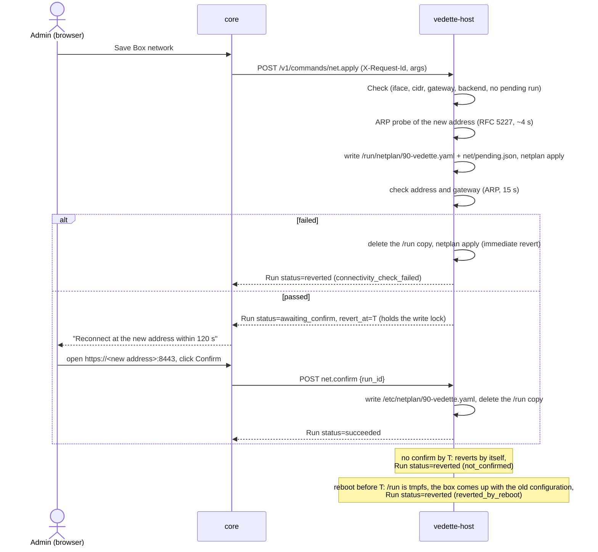

# Host API: the internal socket of `vedette-host`

Status: implemented in `host/` (written 2026-11-09 before the code); what was settled during implementation is in §15 and §16, and `net.*`, `decoy_ip.*` and `container.*` in §18. Where this spec and the code or `modules/host/CONTRACT.md` differ, those win. Field names, commands, messages and paths are in English.
Traceability: design requirements (OS updates, one run at a time, DB backup first, health check afterwards, live progress, audit; appliance container, `vedette-host` replaces `vedette-updater`, Podman + Quadlet, internal socket with a **fixed command list**; network configuration, SPAN, secondary IPs for decoys, NTP; decoys on secondary IPs; log export; tar+gzip, no `backup.delete`, unattended-upgrades on apt's timer, `core_data` lock; netplan + networkd; `/run` overlay for the confirmation window; root only sends/reads ARP frames; `vedette-hp` namespace; minisign and cosign verified in code; pull/start/rollback/revocation; Quadlet units are code; chrony; test seams), `update-manifest.md`; SYS-1…8 (`MODULE_CONTRACTS.md`); stories S-CORE-2, S-CORE-7, S-CORE-6, S-CORE-8, S-HP-1, S-HP-2.

## 1. Purpose

`vedette-host` is a **very small root** process (systemd) that does what the `core` container is **not allowed** to do: OS updates, network configuration, pulling/running/rolling back containers, backups. `core` (Go, takes untrusted input from the web) calls the host over an internal socket. The security value of the design rests on one thing: **this API is a fixed command list, each command has strictly typed parameters, and there is no general execution command** (SYS-1). If `core` is compromised, the attacker can only do what the list allows, with parameters that the host checks again.

Exists only on the **Appliance** install type. The "Container only" type has no host: `core` sees that the socket is absent and the GUI says clearly which features are limited.

## 2. Actors

| Actor | Role |
|---|---|
| `vedette-host` | server on a unix socket, root |
| `core` | **the only client**; applies RBAC (admin for every write operation) before calling the host |
| Administrator | triggers through the GUI; the host does not know users, it only receives the `actor` label set by core for the audit record |
| `systemd`/`podman`/`apt` | tools the host drives with a fixed argv |

Threat model: **`core` is treated as possibly compromised.** Every command has an independent check on the host, a rate threshold, and bounded consequences. The host trusts no field from `core` except the `actor` label (and only for display).

## 3. Transport and authentication

- **Unix domain socket** `/run/vedette/host.sock`, HTTP/1.1 JSON (no TCP, no network bind).
- Permissions: directory `/run/vedette` mode `0750 root:vedette` (created by the host itself at `Listen` when missing and checked when present; the unit has no `RuntimeDirectory=`), socket mode `0660 root:vedette`; `vedette` is the group of the Quadlet account that runs `core`. The socket is **bind-mounted only into the `core` container**, not into `sensor`/`honeypot`/`scan`/`greenbone`.
- Client authentication (all three layers must pass, run on **every** connection):
  1. **File permissions** above.
  2. `SO_PEERCRED`: the peer's `uid` must equal the uid of the account that runs `core` (written in `/etc/vedette/host.conf`, generated by the installer, ships-as-code).
  3. Check that the peer's `pid` belongs to the **cgroup of the `vedette-core.service` unit** (`/proc/<pid>/cgroup`): blocks other processes with the same uid.
  Any layer failing → close the connection, audit record `peer_not_allowed`.
- No application token or password, since the client is a container on the same machine. If request signing at the application layer is needed later: open question §14.
- Required headers: `Content-Type: application/json` (for POST), `X-Request-Id: <uuid v4>` (idempotency key; **required for every write command**), `X-Vedette-Actor: <label>` (regex `^[a-zA-Z0-9_.@:-]{1,64}$`, or `system` for automatic jobs), `X-Vedette-Host-Proto: 1`.

## 4. Command model

- Write commands: `POST /v1/commands/<name>`, body `{ "args": { … } }`. Unknown parameters → `400 invalid_args` (not ignored, fail-closed; the sensor protocol does the same).
- Response `202`: `Run`.

| `Run` field | Type | Notes |
|---|---|---|
| `run_id` | string | `rn_<16 hex>` |
| `command` | string | command name |
| `status` | enum | `queued` \| `running` \| `awaiting_confirm` \| `succeeded` \| `failed` \| `reverted` \| `refused` |
| `started_at`, `finished_at` | datetime | |
| `actor`, `request_id` | string | |
| `result` | object? | per-command result (§6) |
| `error` | `{code,message}`? | |
| `revert_at` | datetime? | only `net.apply` when `awaiting_confirm` |
| `parked_deadline` | datetime? | only when a `running` run is parked (`server.Parked`): the run survives a host restart and ends at this time at the latest |
| `audit_id` | string | key of the host's audit record (§9) |

- `GET /v1/runs/{id}`, `GET /v1/runs?limit=…`: status; **runs are durable** (written to disk at `/var/lib/vedette-host/runs/`) and survive restarts of the host and of `core`. Kept for 90 days or 500 runs.
- **One write run at a time**: a second write command while a run is `queued|running` → `409 busy` with `{ "run_id": "<running>" }`; while an `awaiting_confirm` run of `net.apply` holds the lock → `409 pending_confirm` with that `run_id`, and only `net.confirm`/`net.revert` carrying exactly that `run_id` get through. Read-only commands are not locked.
- **Idempotency:** same `X-Request-Id` + same `command` + same `args` (hash comparison) → returns **that same run** (`200`, not run again). Same `X-Request-Id` but a different command/parameters → `422 request_id_reuse`. Records are kept for 30 days.
- Progress: `GET /v1/runs/{id}/events` is **SSE** (`text/event-stream`). Each event: `{ "seq": n, "ts": …, "kind": "log"|"progress"|"state", "line": string≤2 KiB?, "percent": 0-100?, "status": …? }`. Supports `Last-Event-ID` for resuming. Keeps at most 10 000 lines/run (the oldest line is dropped, `truncated: true`). `core` relays to the GUI over its own SSE (matches `OsRun.lines`).
- Every file path the host reads/writes is **decided by the host** from a hex `id`; no command takes a path from the client (no exceptions).

## 5. Read-only commands (no lock, no heavy audit)

| Endpoint | Returns |
|---|---|
| `GET /v1/info` | `{ host_version, proto, commands[], runner: "podman", hostname?, os: {distro, release, kernel}, arch, booted_at, time }`. `hostname` (#471, optional, added without changing `proto`): the OS host name (the `uname` nodename; the host shares the machine's UTS namespace because the unit must not set `ProtectHostname=`), only when it is valid RFC 1123 (labels of letters/digits/inner hyphens, 1–63 characters, joined by single dots, total ≤ 64 bytes, no trailing dot: `api.ValidHostname`); any other name, or a name that cannot be read, **drops the field**. Old hosts do not send this field; `core` checks it again and uses `vedette` when it is missing (the box's device row, the Logs source page, the HOSTNAME of SIEM records) |
| `GET /v1/state/os` | the last snapshot from `os.check` (pending packages, security, reboot needed, support end date, scheduled reboot): enough for `OsState`. Never checked → `404 no_check_yet`. The reboot-needed flag, boot time, reboot schedule and `auto_security` are read again at call time, not taken from the snapshot |
| `GET /v1/state/net` | the list of cards (name, MAC, state, speed, the interface's packet/byte/error **counters** from `/sys/class/net/*`; SPAN card: listen mode, whether it has an IP), the running configuration (management, SPAN, DNS, gateway from `/proc/net/route`, NTP), the run awaiting confirmation (`pending: {run_id, revert_at}` or `null`), decoys `[{ip, mac}]`. There is **no** count of MACs other than the box's and no time of the last received packet: root does not read traffic; those two numbers are measured by the `sensor` container (`sensor-passive` `SpanStats()`) and `core` merges them into `span_status` | **Built** (body: `host/api/net.go`): `{interfaces[{name, mac, state, speed_mbps, role, promisc, addresses[], dynamic[] (addresses that have a lease, the `IFA_F_PERMANENT` flag not set; old hosts do not send it), counters{rx/tx packets, bytes, errors, dropped}}], config{mgmt{iface, mode, address, gateway, dns[], search[]}\|null, span\|null, ntp[]}, default_route{iface, gateway, mac?}\|null, default_routes6[{iface, gateway, mac?}], pending\|null, decoys[], resolvers[]}`; **plus** three optional fields (no proto change: the `core` client does not reject unknown fields, and when an old host does not send them `core` reads them as absent): `default_routes6` from `/proc/net/ipv6_route`: **every** `::/0` route of every table (VPN, VRF, policy) and each next hop of an equal-cost route (UP+GATEWAY flags and not REJECT, unicast next hop, link-local allowed; lowest metric first; the same next hop on the same card once; at most 16; `gateway` has no zone, `iface` is the card; always an array), the gateway's `mac` on each route (the kernel neighbour table entry on the route's own card, state REACHABLE/STALE/DELAY/PROBE/PERMANENT, not NOARP, a 6-byte unicast MAC; read with a single netlink `RTM_GETNEIGH` dump, no program is run; absent when there is no entry; `core` only seeds a gateway, DNS and MAC that have stayed stable: from the first answer, or present in 3 consecutive answers over ≥ 10 minutes), `resolvers` are the DNS servers in use (the `nameserver` lines of `/run/systemd/resolve/resolv.conf` and `/etc/resolv.conf`; reads only regular files of 1 B–64 KiB, does not follow a link in the last component (`O_NOFOLLOW`), `/etc/resolv.conf` follows a link exactly one level, `O_NONBLOCK|O_NOCTTY`, fstat must match lstat; drops the loopback stubs `127.0.0.53`/`::1`, unspecified, multicast; drops the zone; no duplicates; at most 16; always an array); `decoys` is real since the decoy work (the content of `hp/decoys.json`, by IP; a broken or unreadable file gives `[]` and one log line); `pending` is `{run_id, revert_at, reboot_at?}` when a run is waiting (or the host has scheduled a reboot after a failed revert) and `net/pending.json` is readable, and `config.ntp` is the servers in `vedette.sources` (`[]` = default pool); details in §18 "Built: network state and ARP" and "Built: network apply, confirm, revert and NTP"
| `GET /v1/state/containers` | per service: the running `version` and `digest`, `previous {version, digest}`, the latest pulled release, `enabled` (the unit has `[Install] WantedBy=`), unit state, health |
| `GET /v1/state/hp-touches` | **Added after a review** (added without changing `proto`; old hosts return `404 unknown_command`): `{touches[{src, dst, age_s}], recording, full}` the elements of the `touched` set in `vedette-hp`, from one fixed run of `ip netns exec vedette-hp /usr/sbin/nft -j list set inet vedette_hp touched` (fixed `ip` grammar, no shell, no parameters from the request); `age_s` = `timeout − expires` (seconds since the first attempt). Only keeps pairs whose `dst` is a decoy in `hp/decoys.json` and whose `src` is not a decoy, loopback, multicast, unspecified (0.0.0.0) or limited broadcast. Namespace not proven → `[]`. `recording: false` when the loaded ruleset has no set (fallback §6.6); `full: true` (and one log line) when the set has ≥ 1000 elements: new pairs may be missing. Output that is not nft JSON, an element that is not two IPv4 addresses, truncated output, a non-zero exit code → `500 internal` (never invents an attempt). No lock, no audit line. `core` (honeypot) reads it every 15 seconds to detect scans (honeypot INV-24) |
| `GET /v1/state/packages` | **Added later** (no `proto` change; old hosts return `404 unknown_command`): `{packages[{name, version, arch, source}]}` the Debian packages that have files on the box, sorted by name then architecture. One fixed run of `dpkg-query -W -f=${Package}\t${Version}\t${Architecture}\t${source:Package}\t${db:Status-Status}\n` (shared runner, no shell, no parameters from the request; output cap 8 MiB). Only keeps the states `installed`, `triggers-awaited`, `triggers-pending` (drops `not-installed`, `config-files`); a package in progress (`half-installed`, `unpacked`, `half-configured`) → `409 packages_changing`, no list (retry later; `core` keeps the old list); `version` is the full Debian version (epoch, revision); `source` is the source package (dpkg prints the package's own name when there is no Source field). Fail-closed on structure: a line without exactly 5 fields, an unknown state, truncated output, a non-zero exit code, 0 packages or more than 20 000 packages → `500 internal`, never half a list. An installed package whose name/version/architecture/source package breaks dpkg's rules is dropped on its own (counted, logged by the host), the other packages are still returned. No lock, no audit line. `core` uses it as the software of "This box" (inventory INV-3) |
| `GET /v1/state/ports` | **Added 2026-11-17** (no `proto` change; old hosts return `404 unknown_command`): `{ports[{port, proto, process}]}` the ports the box listens on at every address or at an address of one of the box's network cards, not loopback, a container bridge or a virtual link (TCP `LISTEN`, UDP with no peer), one entry per port and protocol, sorted by protocol then port, at most 1000. Reads `/proc/net/{tcp,tcp6,udp,udp6}` and `/proc/<pid>` (no program is run). `process`: the Vedette unit (`vedette-core`) or the `conmon` unit, otherwise `comm`; `""` when unknown. `/proc/net/tcp` unreadable → 500. Host INV-9b. |
| `GET /v1/zap/{id}/content` | The JSON report of the last `zap.baseline` (`id` = the 32-hex `report_id` of the result; a regular file, ≤ 4 MiB, `application/json`); the host only keeps the report of the last run, until the next run or the next start; unknown `id` → `404 zap_report_unknown`. No lock. Old host → `404 unknown_command` |
| `GET /v1/state/time` | **Added 2026-11-24** (no `proto` change; old hosts return `404 unknown_command`): `{timezone}` the operating system's time zone, the IANA name the `/etc/localtime` link points at (the part after `zoneinfo/`, checked with `api.ValidZoneName`); `""` when it is not a link into a zone database (a copied file, no file). Reads one link: no program, no lock, no audit line. `core` compares it with the organization's zone (§6.18) |
| `GET /v1/state/backups` | list of backups `{backup_id, kind, created_at, size, sha256, version, db_schema, includes_secrets}` |
| `GET /v1/audit?since=…` | the host's audit records (paginated; used by log export) |
| `GET /v1/backups/{id}/content`, `GET /v1/exports/{id}/content` | file download (see the related command); only files the host created and recorded in its index (`id` = 32 hex; unknown id → `404 backup_unknown` / `export_unknown`; a backup with keys → `403 contains_secrets`) |

## 6. Command list (complete)

Command names are the **contract**: there is no name outside this table. Every write command follows §4 (shared lock, idempotency, audit). Every value goes into argv through a checked type, never by string concatenation.

Validation conventions: `ip` = `netip.ParseAddr` (IPv4 unicast); `cidr` = `netip.ParsePrefix` (**prefix length required**); `iface` = a card name **present in** `GET /v1/state/net` and matching `^[a-z][a-z0-9._-]{0,14}$`; `service` ∈ {`core`,`sensor`,`honeypot`,`scan`,`greenbone`}; `uuid`/`hex` by fixed length.

### 6.1 `os.check`

Updates the apt index and recomputes the list of pending packages. Args: `{}`.
Effect: `apt-get update`, then a simulated upgrade to list packages; marks `security` by source repository (`-security`); reads `/var/run/reboot-required`; the release's support end date comes from a static table in the host (updated by a new host release). Result: `{ pending[], security_count, reboot_required, reboot_reasons[], last_check }` (matches `OsState`).
Idempotent: running again refreshes the index. Progress: the head and tail of the apt output (filtered), written after apt finishes (`core/exec` does not stream yet). Refusals: `busy`; `dpkg_locked` (`409`, `retry_after_s: 60`: another `unattended-upgrades`/apt holds the lock; the host asks the kernel through `fcntl F_GETLK` on the four apt/dpkg lock files and does **not** take the lock; an error while asking counts as held; never forces); `not_appliance` (`412`: the release is not in the support table). Settled details in §16. *The "turn off update checks" policy (Privacy) belongs to `core`: when it is off, `core` does not call this command (the host does not know that setting).* Timeout 5 minutes.

### 6.2 `os.install`

Args: `{ "scope": "security" | "all", "snapshot": hex32 }`. `snapshot` is the id of the snapshot `core` just created, which the host copies into the `pre_os_update` backup; missing or malformed → `400 invalid_args`, a snapshot that is missing/too old/breaks the contract → `412 snapshot_required|snapshot_invalid` right at the check step (before apt runs).
Effect, in order: (1) check conditions; (2) **internal `backup.create`** (`kind=pre_os_update`); (3) run a **fixed apt command list** (`apt-get -y install --only-upgrade …`, with the package list **recomputed by the host from apt state**, never package names from the client); (4) **health check** (all `vedette-*` units running, `core` answers `/healthz`, the sensor still has a heartbeat); (5) report `reboot_required`. Result: `{ installed, security, backup_id, health[{name,ok}], reboot_required }` (matches `OsRunResult`).
Implementation details (§16): the install argv is `apt-get -y -q -o Dpkg::Options::=--force-confdef -o Dpkg::Options::=--force-confold --no-remove install --only-upgrade <packages…>` (adds `--no-remove` and two conffile options compared with the draft: apt must not remove packages and must not ask); no package to install → success, `installed: 0`, **no** backup, apt is **not** run; the health check in the first part covers only the `core` unit. A `failed` run carries `result` (number of packages installed, `health[]`) with `error` (`apt_failed`, `health_check_failed`).
Refusals: `busy`; `dpkg_inconsistent` (`dpkg --audit` not clean); `low_disk` (< 1 GiB free on `/var`, a parameter); `stale_check` (with no `os.check` in 24 hours the host runs `os.check` itself first instead of refusing; only when that step fails because of apt does the run end `failed` with code `stale_check`; `no_check` is no longer a refusal code); `not_appliance`. Never upgrades the release (`do-release-upgrade`, changing the codename in sources): that command **does not exist**. Timeout 60 minutes. A failed health check does **not** remove packages by itself (apt cannot be undone): the run is `failed`, left as is, and reported; the DB backup from step 2 is the way back for the data.

### 6.3 `os.auto_security.set`

Args: `{ "enabled": bool }`. Writes `/etc/apt/apt.conf.d/52vedette-unattended` from a fixed template (the origin is only the security repository of the current distro) and enables/disables the `apt-daily*.timer` timers according to `enabled`; **verified by effect** (`apt-config dump` and timer state), not by exit code (ships-as-code rule). Template: `#clear`, then only the distro's security origins (Ubuntu: `${distro_id}:${distro_codename}-security` and the two ESM repositories; Debian: `Origins-Pattern` with `label=Debian-Security`), `Automatic-Reboot "false"`, `APT::Periodic::Unattended-Upgrade` `"1"|"0"`; written as a temporary file + `rename`, mode `0644`. **Verified by effect**: `apt-config dump` must show the right switch and (when enabled) every origin must be a security one; `systemctl is-enabled` of both timers must print `enabled`/`disabled` (the output is read, not the exit code); a mismatch → `failed` with code `effect_not_verified`. Idempotent. Refusals: `busy`, `not_appliance`. The maintenance window (day/time) is kept by `core`; unattended-upgrades runs on apt's timer, so it does **not** respect Vedette's window: accepted (Ubuntu/Debian boxes all run this way), and the GUI will say so in its help text.

### 6.4 `os.reboot` and `os.reboot.cancel`

`os.reboot` args: `{ "when": "now" | "at", "at": "<RFC3339 UTC>" }` (`at` required when `when=at`, at least 60 seconds ahead, at most 7 days ahead; `core` converts from the local `HH:MM` window to an absolute time before calling).
Effect: `now` → runs `systemctl reboot` right after the run turns `succeeded` (the host writes the run **before** rebooting); `at` → stores a durable schedule, the host sets its own timer and runs `systemctl reboot` at that time. Idempotent: a single reboot schedule; setting it again replaces the old one. After the machine restarts, Quadlet brings every container up; the host checks and records `reboot_completed`.
`os.reboot.cancel` args `{}`: clears the schedule (no schedule → success, does nothing).
Refusals: `install_in_progress` (`409`; an `os.install` is running. The shared write lock returns `busy` first, so this code is a second line of defence); `net_pending_confirm` (`409`; no reboot while a network confirmation is pending; before the `net.*` commands existed the check function returned `false`, and `Deps.NetPending` now connects it to the real pending state; the shared write lock of the pending run returns `pending_confirm` first, so this code is the second line); `at_in_past` (`412`; `at` must be ≥ 60 seconds from now), `at_too_far` (`412`; > 7 days); `reboot_limit_reached` (`409`); `reboot_inhibited` (`409`; below). Rate: at most 3 `now` reboots/24 hours (default; stops a reboot loop from a compromised `core`); **every** reboot the host starts itself (scheduled ones too) counts toward the durable counter; at 3, `now` is refused and a schedule that comes due is dropped (`reboot_skipped_limit`). `not_appliance` does not apply (apt is not touched). Settled details in §16.

**logind shutdown lock.** While installing packages, APT holds a logind inhibitor ("APT is installing or removing packages", `what` includes `shutdown`, `mode=block`; measured on Debian 13.7 and Ubuntu 26.04.1); from a system service, `systemctl reboot` then exits 1 ("Operation denied due to active block inhibitor"). **logind only blocks root from systemd 257** (Debian 13, Ubuntu 26.04): on systemd 255 (Ubuntu 24.04) `logind_check_inhibitors` returns at once for euid 0 and `verify_shutdown_creds` skips locks with the same uid as the caller, and APT's lock is uid 0 like the host, so the reboot goes through and cuts dpkg off; there **the host's own read is the only barrier** (review finding). The host **never** overrides the lock: no `--check-inhibitors=no`, no `--force` (cutting dpkg off in the middle of configuration can break packages), the `systemctl` argv validator only accepts a bare `reboot`; also **no** `--check-inhibitors=yes` (on 255 it also refuses when another user is logged in, such as an administrator's SSH session).
- **Reading the list:** `busctl --system --json=short call org.freedesktop.login1 /org/freedesktop/login1 org.freedesktop.login1.Manager ListInhibitors` (the only fixed argv for `busctl`, `/usr/bin/busctl` from the `systemd` package the `.deb` already depends on; `--json` exists since systemd 240: Ubuntu 24.04 has 255, Debian 13 has 257, Ubuntu 26.04 has 259; the host does not speak D-Bus itself; `systemd-inhibit --list` has no JSON, even in 259, and its columns are free text). A lock that blocks reboot = `mode` exactly `block` and `shutdown` is one word in `what` (split on `:`); `delay` (unattended-upgrades) does not block; `block-weak` (systemd 257) does not count because logind ignores it for root. Closed parser: exactly `{"type":"a(ssssuu)","data":[[[what,who,why,mode,uid,pid],…]]}`, no unknown fields, no trailing data, ≤ 8192 locks, output ≤ 1 MiB; anything else → **unknown** (never a partial list). `who`/`why` are text from any program on the machine: only printable ASCII is kept except `"`, `'`, `<`, `>`, `&`, the backquote and `\` (other characters become `?`), whitespace is collapsed, at most 64/120 bytes, no trailing whitespace, empty becomes `unknown`. One read takes at most 3 s in `Check` (the framework stops `Check` at 5 s) and 10 s elsewhere.
- **Unknown list → let it through, log WARN once** (the first unknown after a successful read): on 257+ logind still refuses a locked reboot; **on 255 it means the host reboots with no barrier in front of apt**, like every older host release. Refusing on unknown would leave the box unable to reboot when `busctl` or its output breaks; the output format was confirmed in the lab on all three releases.
- **`now`:** `Check` (after the 3/24-hour cap) reads the list; a blocking lock → `409 reboot_inhibited`, the message says who and why, for example "The box cannot reboot now: APT holds a shutdown lock (APT is installing or removing packages). Reboot after it finishes."
- **Before every `systemctl reboot`** (`now`, schedule, every retry) the host reads the list again; a lock → does not call, goes to the wait below.
- **Schedule (`at`) comes due:** the list is read **first**, outside the `rbMu` lock and before raising the gate; a blocking lock → retry in 1 minute (`rebootRetryBusy`), the schedule is **kept** (`reboot_scheduled_at` still present), write commands still run, audit `reboot_waiting_inhibitor` `{kind, who, why, locks}` **once** per schedule; the wait cap is the existing rule: more than 24 hours late gives `reboot_schedule_expired`. Unknown list → go on (the step above reads it again).
- **Wait of a reboot that has started** (a lock seen right before the call, or `systemctl reboot` refused by logind and the list read again has a lock; never reads the translated stderr of `systemctl`): retries every 30 s for at most 30 minutes from the start, each time **raising the `rebooting` gate again** (so the gate outlives its 10 minutes during the wait; no new write command starts, `os.reboot.cancel` included), audit `reboot_waiting_inhibitor` once. After 30 minutes → `reboot_failed` `{kind, reason: "inhibited", who, why, locks}`, `Pending` cleared, gate lowered. A failure with no lock (or an unknown list) → `reboot_failed` `{kind, reason: "systemctl_failed"}` at once, as before. Retries do not add to the 3/24-hour cap (counted at the start). `Ops.Close` stops the next retry.
- **Host restarts during the wait:** `Pending` has `issued` (set when `systemctl reboot` was accepted). A host starting on the **same** boot only keeps the gate for a reboot that was `issued` less than 10 minutes ago (the box is shutting down); every other `Pending` on the same boot → audit `reboot_failed` `{kind, reason: "host_restarted", started_at, issued}` and cleared, **not** rescheduled, so the next boot does not record a false `reboot_completed`.
- **How `core` and the GUI find out:** today only through the host's audit (`actor: system`) and logs; `core` does not have the `reboot_inhibited` code in its mapping table yet (it falls into `502 host_error`), and `GET /v1/state/os` does not yet say whether a reboot is waiting on a lock or has failed. **Later:** (1) `core` maps `reboot_inhibited` → `409` with the host's (sanitized) message and the GUI shows it at the Reboot button; (2) `state/os` adds `reboot_wait {kind, since, who, why} | null` (a reboot that has started or a schedule waiting on a lock) and `reboot_failed {at, kind, reason, who?, why?} | null` (the last failure from `reboot.json`, cleared on `reboot_completed`), read at call time like `reboot_scheduled_at`; the Updates GUI shows "Waiting for <who> (<why>) to finish before rebooting" and "The reboot did not happen: …".

### 6.5 `net.apply`, `net.confirm`, `net.revert`

`net.apply` args (desired state of the **part Vedette manages**):

| Field | Type | Rule |
|---|---|---|
| `mgmt.iface` | iface | required |
| `mgmt.mode` | `dhcp` \| `static` | |
| `mgmt.address` | cidr | required when `static`; unicast, not the network/broadcast address |
| `mgmt.gateway` | ip | in the same network as `address` |
| `mgmt.dns` | ip[≤ 3] | unicast; not loopback |
| `span.iface` | iface \| null | different from `mgmt.iface`; a card with no IP, in listen mode (promisc), holding no IPv6 |
| `ntp` | string[≤ 4] | IPv4 or a name matching the name regex (`^[a-zA-Z0-9][a-zA-Z0-9_.-]{0,63}$`); empty = `pool.ntp.org` |
| `confirm_timeout_s` | int | 30–600, default 120 |

`net.confirm` and `net.revert` args: `{ "run_id": "rn_<16 hex>" }`.

Effect: the host builds `/etc/netplan/90-vedette.yaml` (renderer `networkd`; the **only netplan file** on the box, 0600) from a typed struct, never by joining strings; NTP is not in netplan but is written to `/etc/chrony/sources.d/vedette.sources`. Only when the **management part** changes (`mgmt.iface`, `mgmt.mode`, `mgmt.address` including the prefix, `mgmt.gateway`) does it enter **auto-revert mode**:

1. `Check` (read-only): the card exists, `same_iface`, `gateway_outside_subnet`, no run is pending (`pending_confirm`), the backend is usable (`net_backend_unsupported`).
2. In the run: ARP probe of the new static address per RFC 5227 (about 4 seconds); a machine answers → run `refused` with code `address_conflict`.
3. Writes the new version to `/run/netplan/90-vedette.yaml` (tmpfs; netplan lets a file in `/run` fully shadow the file of the same name in `/etc`) and `net/pending.json` `{run_id, revert_at, boot_id, old_sha, new_sha}` (0600, atomic write). **The old configuration is still on disk.**
4. `netplan apply`, then **checks the effect**: the address is on the card (DHCP: an IPv4 address within 15 seconds) and the gateway answers ARP within 15 seconds (retried every second). Failure → **immediate revert** (`status=reverted`, `error.code=connectivity_check_failed`).
5. Re-applies the decoys (§6.6). Passed: `status=awaiting_confirm`, `revert_at = now + confirm_timeout_s`. The run **holds the write lock** for the whole window: other write commands → `409 pending_confirm` with the `run_id`; only `net.confirm`/`net.revert` carrying exactly that `run_id` get through. The revert timer runs inside the host process (no systemd transient timer).
6. The admin reaches the box at the new address through the GUI, `core` calls `net.confirm {run_id}`: the host writes `/etc/netplan/90-vedette.yaml` atomically, deletes the copy in `/run` (the running configuration does not change), deletes `pending.json` → `status=succeeded`. Time runs out without a confirm → the host **reverts by itself**: deletes the copy in `/run`, `netplan apply`, re-applies the decoys, checks the effect → `status=reverted`, `error.code=not_confirmed`.

`net.revert {run_id}` cancels early and reverts at once (the admin clicks "Cancel"): `status=reverted`, `error.code=cancelled`. A revert where `netplan apply` fails → `status=failed`, `error.code=revert_failed`: the file on disk is still the old configuration, so restarting the box brings it back; the GUI says so.

**Reboot and host crash.** Reboot inside the window: `/run` is tmpfs, so the box comes back with the old configuration on disk; the host sees `pending.json` carrying a different `boot_id` → run `reverted`, code `reverted_by_reboot`. Host crash (same `boot_id`): at start, before listening on the socket, the host sets the timer again for the pending run, or reverts at once if `revert_at` has passed. The GUI says beforehand: "If the box restarts before you confirm, it comes back on the old address." (S-CORE-8).

**No confirmation needed:** changing only `mgmt.dns`, `span.iface` or `ntp` → written straight to `/etc` (and chrony), `succeeded` at once (matches the GUI's "DNS-only changes apply at once"). Idempotent: applying the same state that is running → `succeeded` with no change, and does **not** enter the confirmation wait. The decoy secondary IPs (§6.6) are **re-applied** after every `net.apply` or revert.
Refusals: `busy`; `pending_confirm` (`409`, with the `run_id` of the pending run); `iface_unknown`; `same_iface` (mgmt = span); `span_has_address` (`412`; the SPAN card holds an address that is not link-local: SPAN changes apply at once with no confirmation window, so stripping the address of the management card the admin session runs through would cut it off with no way back); `span_not_physical` (`412`; the SPAN card is not a physical card: VLAN, bridge, bond, veth, podman interface); `address_conflict` (`412`, returned by the run after the ARP probe); `gateway_outside_subnet`; `net_backend_unsupported` (`412`: there is a netplan file other than the host's in `/etc/netplan`, `/run/netplan` or `/lib/netplan`, or `/usr/sbin/netplan` is missing; the installer must hand netplan exclusively to the host); `invalid_args` with `details[]`; `last_mgmt_removed` (the result would leave no management card); `not_appliance`. `net.confirm`/`net.revert`: a `run_id` that is not the pending run (already finished or nonexistent) → `412 not_awaiting_confirm` (GUI: "409 when none is pending or it expired"). Timeout `net.apply` 120 seconds (+ the confirmation window); `net.confirm`, `net.revert` 60 seconds.

### 6.6 `decoy_ip.add`, `decoy_ip.set_ports` and `decoy_ip.remove`

Secondary IPs for decoys. Args `add`: `{ "ip": ip, "oui": hex6? }`; `remove`: `{ "ip": ip }`. No card parameter: the parent card is always the management card (`mgmt.iface`), because decoys must sit in the management subnet.
Effect: the host keeps the network namespace **`vedette-hp`** (created when the host starts, before the honeypot unit; `/run/netns` is tmpfs). Each decoy is a macvlan link `vdh<8 hex of the IP>` (`mode bridge`) on the management card, moved into `vedette-hp`, with an address, its own routing table (subnet + `default via <gateway>`) and `ip rule from <ip>`. The `honeypot` container joins that namespace with `Network=ns:/run/netns/vedette-hp` (Quadlet), so it sees new decoys without restarting. The namespace has the constant sysctls `arp_ignore=1`, `arp_announce=2`, `rp_filter=2`, `ip_unprivileged_port_start=0` (the container does not need `NET_BIND_SERVICE`) and a constant nft ruleset that blocks every **new** outgoing connection (`ct state established,related accept; oif lo accept; ct state new drop` on the output hook, and a `forward` chain with `policy drop`): the decoys only answer incoming connections. Durable state `hp/decoys.json`; re-applied after `net.apply`, after a revert and at every host start; a decoy that falls outside the current management subnet is removed and reported (the honeypot shows `conflict`).
**MAC** (answers §14.5): by default the first 6 bytes of `HMAC-SHA256(hp/mac.key, ip)` (a 32-byte key per install, 0600), locally-administered bit set, multicast bit cleared: stable per IP, different between boxes. With `oui` (6 hex; unicast, globally administered: the two low bits of the first byte are 0) the MAC = OUI + 3 HMAC bytes, so the decoy looks like the vendor of its fake role; `core` takes the OUI from its OUI table. Result `{ ip, mac }`.
Refusals (`add`): `ip_not_in_mgmt_subnet`; `ip_is_gateway|ip_is_host|ip_is_network|ip_is_broadcast`; `ip_in_use` (ARP probe per RFC 5227: 3 probes 1 second apart, listening until 2 seconds after the last probe, about 4 seconds; a machine answers); `duplicate_decoy` (the IP is already a decoy **and its link is alive** in the proven namespace, even with a different `oui`: remove it, then add it again; an IP that is in `hp/decoys.json` but whose link is gone, as after `failClosed`, makes `add` rebuild every link in the file and return the old entry's `{ip, mac}`, keeping the old MAC and `ports`, a review finding); `limit_reached` (at most 32, default); `invalid_args` (`oui` not exactly 6 hex, multicast or locally administered); `not_appliance`. Blocking clashes with **devices in the inventory** is `core`'s job (the honeypot module refuses first); the host checks the **real network** again with ARP.
`remove`: an absent IP → success, does nothing (idempotent). The host does not stop the `honeypot` container; `core` then calls `container.start`/configures the honeypot from the DB.
No command takes an arbitrary list, only one IP at a time. At a rate of 10 write commands/minute, 32 decoys take from 3 minutes: `core` only sends the difference between the DB and `decoys` in `GET /v1/state/net`, it does not resend every IP (honeypot CONTRACT). Timeout 30 seconds per command.

**IPv6 off on decoy links (lab check)**: macvlan links are created in the host's namespace, so they carry the host's IPv6 defaults into `vedette-hp`; before bringing one up, the host sets `net.ipv6.conf.vdh<8 hex>.disable_ipv6=1` (`ip netns exec vedette-hp /usr/sbin/sysctl -w …`, fixed grammar by link name) and reads it back with `sysctl -n` (must be `1`; otherwise the decoy fails, `decoy_failed`). Without this, the link sends DAD/RS/MLD from the decoy MAC with no IPv4 and the sensor creates a device from that MAC.

**Per-IP ports.** OpenCanary is still a single process listening on every address of the namespace; the host holds each decoy IP to its own set of services with an **allow list in the nft ruleset of `vedette-hp`**.
- Port type: `{ "proto": "tcp"|"udp", "port": 1…65535 }`; at most 64 ports per IP, no duplicates; the host stores and returns them sorted (proto, then port). Invalid → `400 invalid_args` field `ports`.
- `decoy_ip.add` also takes an optional `ports`. **Absent (`null`) = no allow list**: the IP answers every port the honeypot listens on (the old behaviour, for older `core` releases). A list, even an empty one = only those ports.
- New command **`decoy_ip.set_ports`** `{ "ip": ip, "ports": [ … ] }` (`ports` required, may be empty: closes every TCP/UDP port of that IP): replaces the whole list of an existing decoy. Refuses `not_a_decoy` (412) when the IP is not a decoy yet (in `Check`, no run starts). Same list → success, nothing is loaded. Result `{ ip, ports }`. Timeout 30 seconds, a write command, same `hpMu` lock as `add`/`remove`.
- `GET /v1/state/net` `decoys[]` gains `ports` (absent = no allow list). Old hosts do not send this field.
- **Compatibility**: `core` only sends `ports` (in `add`) and calls `set_ports` when `GET /v1/info` `commands[]` includes `decoy_ip.set_ports` (old hosts return `invalid_args` for unknown fields, §4). A new host serving an old `core`: decoys without `ports` stay open as before.
- **Ruleset** (built from `hp/decoys.json`, loaded as one block with `flush ruleset` in the same nft transaction): table `inet vedette_hp` has the set `open` (`type ipv4_addr`: the IPs with no allow list), the set `allow` (`type ipv4_addr . inet_proto . inet_service`: `ip . proto . port` of every allowed port), the dynamic set `touched` (`type ipv4_addr . ipv4_addr`, `size 1024`, `flags dynamic,timeout`, `timeout 2m`: source . decoy IP of every new connection attempt, a review finding), the `input` chain (`policy accept`): `iif lo accept`; `meta l4proto { tcp, udp } meta pkttype host ct state new add @touched { ip saddr . ip daddr }` (every new **unicast** SYN/UDP to a decoy, whether the port is open or not: an nmap SYN scan does not complete the connection, so OpenCanary records nothing; broadcast/multicast (NetBIOS, mDNS, SSDP) does not enter, so it does not fill the set; `add` keeps the first time, so an element's age = time since the first attempt; every ruleset reload empties the set; limits: FIN/NULL/Xmas scans are `ct state invalid` and are not recorded, IPv6 is not recorded (the namespace has IPv6 off)); **fallback** (review findings): a ruleset with the `touched` set that nft prints in a form the effect check does not know, **or that `nft -f` refuses for that part alone** (old kernel/nft) → the host loads the ruleset without the set and that rule (including when building the namespace), proves it, decoys still come up (no `failClosed`), audit line `decoy_ip/touch_record_off`, `hp-touches` returns `recording: false`, until the host restarts; `ct state established,related accept`; `ip daddr @open accept`; `ip daddr . meta l4proto . th dport @allow accept`; `meta l4proto tcp reject with tcp reset`; `meta l4proto udp reject`. An IP in no set answers no TCP/UDP port (closed on error); ICMP still passes per the policy (real devices answer ping). RST/ICMP packets generated by `reject` are `related`, so the `output` chain (unchanged) lets them out. The `output` and `forward` chains stay as above.
- **Loading and effect check**: when building the namespace, after a successful `add` (after writing state and checking the link), after `set_ports`, after `remove` and after a re-apply that changes the sets. Every load runs `nft list ruleset` again and requires: the namespace has only **one** table `inet vedette_hp` (another table = not the ruleset the host loaded), the outgoing block exactly as before, the `input` chain with exactly each rule in order, exactly two sets and three chains, the elements of the two sets **exactly equal** to what `decoys.json` wants (an element list printed over several lines is still readable; proto printed as `tcp` or `6` are both accepted; port must be a number). `ensureHP` compares the loaded ruleset with the desired one and reloads when they differ (if someone edits the namespace by hand, the next write resets it).
- **Rebuild after closing** (review finding): the first write command (`add`, `set_ports`) that can prove a closed namespace again (`hpOK` false) at once rebuilds every link in `hp/decoys.json` (reconcile), so `state/net` never lists a decoy whose link is gone.
- **Errors**: an `add` whose new ruleset cannot be proven → removes the link, drops it from the state, reloads the old ruleset, `failed decoy_failed`. A failed `set_ports` → writes the old entry back, reloads the old ruleset, `failed decoy_failed`; if the old entry cannot be written back (the file holds the new ports but the ruleset is not proven) → closes the namespace (`closeUnproven`), never leaving the file and the ruleset saying different things. When even the old ruleset cannot be proven, the namespace is treated as unusable, as when the outgoing block cannot be proven: `state/net` lists no decoys, every decoy link is deleted (`failClosed`), and `decoys.json` keeps the intent for the next rebuild.
- **Does not touch the box's network**: `nft` only runs through `ip netns exec vedette-hp` (so `flush ruleset` only empties the namespace's ruleset, never the box's firewall); the ruleset only has the table `inet vedette_hp`, only names decoy addresses and the `lo` interface, only hooks `input`/`output`/`forward` of the namespace; outside the namespace the host only creates/deletes the decoys' own `vdh<8 hex>` links (no address, route, netplan, sshd or nft table of the box). `TestTheRulesetTouchesOnlyItsOwnTableAndTheDecoys`, `TestValidateIPRefusesEverythingElse`.
- **The lab must prove**: from another netns, `nmap -sS -p 22,80,445,1433,3389` against an IP with the "File server" set (SMB 445, RDP 3389) sees only 445 and 3389 `open`, the other ports `closed` (RST, not `filtered`); an IP without `ports` sees every port the honeypot listens on; `nft list ruleset` in `vedette-hp` matches the sets.

**Built** (`host/ops/{decoy,decoyargv,decoystate,hpns,mac}.go`, `host/api/decoy.go`; details in §18 "Built: decoy IPs"). Differences from the text above: (1) two new refusal codes `link_name_in_use` (a link named `vdh<8 hex>` already exists outside the namespace and the host did not create it: left untouched) and `mac_in_use` (the derived MAC equals another decoy's MAC, only possible with `oui`); terminal error codes `hp_namespace_unavailable`, `mac_key_invalid`, `decoys_state_invalid`, `decoy_failed`; (2) `remove` returns `{removed: bool}`; (3) a re-apply **never** fails or reverts a network change because of decoys: a decoy that is no longer valid is removed from the state, and "reported" means an audit line `decoy_ip/decoy_dropped` (with `ip`, `reason`) plus a log line, and the decoy disappears from `decoys` in `GET /v1/state/net`; (4) `decoy_ip.add` only takes IPv4.

### 6.7 `container.pull`

Args:

| Field | Type | Notes |
|---|---|---|
| `service` | service | |
| `version` | semver | must equal `release-manifest.version` (different → `412 manifest_mismatch`) |
| `source` | `registry` \| `bundle` | `bundle`: loaded from the offline bundle `core` wrote to `<core_data>/bundles/<bundle_id>.tar`; see "The `bundle` source" below |
| `bundle_id` | hex(32) | only when `source=bundle`: 32 random hex set by `core`, the bundle's file name (not a hash) |
| `index`, `index_sig` | base64 | `index.json` and `.minisig` (≤ 256 KiB per file); **required on every `registry` pull**; with `bundle` they are **not sent** (the host reads them from the bundle; sending them → `400`) |
| `manifest`, `manifest_sig` | base64 | `release-manifest.json` and `.minisig` (≤ 256 KiB per file); the image's cosign signature is **inside** the manifest (`images[].cosign`, `update-manifest.md` §4.2) |

The request body of this command may be up to **1 MiB** (other commands 512 KiB, §10): two documents and two signatures in base64 come to about 700 KiB.
Effect (`update-manifest.md` §5): the host **verifies by itself** (does not trust `core`), with the `internal/release` package, **before** pulling:
1. Strict JSON decoding (unknown fields, duplicate keys, keys duplicated after case folding → `signature_invalid` or `invalid_args`).
2. Index: minisign format `ED` (the old `Ed` is refused), `key_id` is an embedded key not revoked by the stored index (`key_revoked`); `sequence ≥` the value the host stored (equal is allowed; lower → `sequence_regress`); a newer index is stored and is the host's **only source of revocations**; expiry only warns.
3. Manifest: minisign as above; `version` equals the args; the release and digest are not revoked (`release_revoked`); `install_modes` includes `appliance` and `platforms` includes `linux/<GOARCH>` (`platform_mismatch`); `service` is in `images` (`digest_not_in_manifest`); `images[].ref` must be exactly `ghcr.io/knt048/vedette-<service>:<version>` (`registry_not_allowed`). It need not be the latest release of the channel (an old release can be pulled again).
4. Cosign: `images[].cosign.signature` is ECDSA P-256 over the SHA-256 of `images[].cosign.payload`, verified with the embedded cosign key; the payload has `critical.type` = `cosign container image signature` and `critical.image.docker-manifest-digest` equal to `images[].digest` (`signature_invalid`). Rekor is not checked (offline).
5. `podman pull -q ghcr.io/knt048/vedette-<service>@sha256:<64 hex>`: the reference is built from **compile-time constants** and the verified digest, never from a request string; `podman image inspect` confirms the digest; tags `localhost/vedette-<service>:<version>`; stores the pulled record `{version, digest, key_id, manifest}`.
The byte count is not compared with `size` (Podman does not report how many bytes it downloaded; the pinned digest already guarantees integrity); `size` is only used for `low_disk`. Result: `{ digest, size, verified: ["minisign","cosign"] }`.
Idempotent: the image already present with the right digest → `succeeded` at once (signatures are still checked; the index is stored only when newer). Refusals: `busy`; `signature_invalid`; `key_revoked`; `release_revoked`; `digest_not_in_manifest`; `registry_not_allowed`; `sequence_regress`; `platform_mismatch`; `manifest_mismatch`; `bundle_not_found`, `bundle_invalid` (`source=bundle`; `bundle_unsupported` only remains on older hosts); `low_disk` (< 2 × `size`; bundle: < 3 × the archive size); `not_appliance`. Timeout 45 minutes (raised from 30 to 45 when the `scan` build step was added). There is no command to pull an image by an arbitrary name/tag. **With `service=scan`, after pulling and tagging the base image, the host builds the image with nmap on the box: adds the run code `scan_build_failed` (`failed`), and the record gains `base_digest`, `nmap_version`.**

**Built: container pull** (`host/ops/{pull,pullstate,podmanargv}.go`, `host/api/containers.go`, `host/client` `ContainerPull`; host CONTRACT INV-19):
- **Every refusal is decided in `Check`**, so `core` gets `412` at once and no run starts, no `podman` call is made. Order: `not_appliance` (the release table of `os.install`), `bundle_not_found`/`bundle_invalid` (`source=bundle`, replacing `bundle_unsupported`; see "The `bundle` source"), `no_trusted_keys`, `release_state_invalid`, index (`signature_invalid`, `key_revoked`, `sequence_regress`), manifest (`signature_invalid`, `key_revoked`, `release_revoked`, `registry_not_allowed` for **every** image in the manifest), `manifest_mismatch` (the version differs from the args; or the version is the `latest` of **some channel** in the index and the manifest's SHA-256 differs from the `manifest_sha256` of **any** such channel, `update-manifest.md` §5.3 step 4; a manifest that is no longer the `latest` of any channel has no hash to compare against, so a superseded manifest must be revoked by `image_digest` in the index), `not_appliance` (the manifest has no `appliance` in `install_modes`), `platform_mismatch` or `digest_not_in_manifest` (the service is not in `images`), the cosign signature (`signature_invalid`), `low_disk` (measured after one `image inspect` asking "is the image already here": an image that is already here needs no free space, so a `low_disk` refusal has exactly one read-only `podman` call). `busy` comes from the shared framework (409). Each typed error of `internal/release` maps to exactly one code; the text of the original error never goes into the answer.
- **Args**: `source` required (`registry`|`bundle`); `bundle_id` only goes with `bundle` (hex 32; present with `registry` → `400`); with `bundle` the four documents **must not be sent** (present → `400`, replacing the old text "ignored and returns `412 bundle_unsupported`"). With `registry`, each document is standard padded base64, **no** line breaks, 1 byte to 256 KiB after decoding, each signature 1 byte to 2 KiB (`release.MaxSigBytes`; invalid → `400 invalid_args`); body at most 1 MiB (`Spec.MaxBody`). `version` is a plain release version (no `+build`, no `v` prefix; the prerelease part at most 32 characters because it must make a Podman tag, longer → `400 invalid_args`). Unknown fields (`image`, `ref`, `digest`, `registry`, `argv`…) → `400`: no request field names a reference, digest or path.
- **Stored index**: `releases/index.json` = `{index, sig, carried}` (raw base64 index, signature, the carried revocation list, cap 4096). On every load, `VerifyIndex` runs again on the raw index with the carried list as the stored index; broken, not verifiable (including because the embedded keys changed), unknown fields, a symlink → `412 release_state_invalid`, and the host **does not guess "no index yet"** (guessing that reopens replay and freeze attacks). The operator deletes the file (the message names the path) and the host starts again from empty. An index **different** from the stored one (different SHA-256 or a different signing key: a higher sequence, or recovery with the backup key) is stored atomically **as soon as it is received, even when the manifest is then refused** (a revocation must not be lost because that very index is the reason for the refusal); each store has a warning in the log and an audit line `release_index_stored` (`old_sequence`, `new_sequence`, `signer`, `backup_signed`, `revoked_added`, `revoked_dropped` and counts; at most 16 names per list); an equal sequence with the same bytes is accepted and not rewritten. `Start` deletes the `.tmp-*` files of writes cut off midway in `releases/` and `containers/`. A retired embedded key (`Trust.Retired`) can still verify the stored index (§5.2 of `update-manifest.md`); when nothing is stored yet, `sequence` must be ≥ the build's floor (`release.MinSequenceText`).
- **`low_disk`**: measured with `Deps.FreeBytes` (statfs, `Bavail × Bsize`) on `/var/lib/containers` (Podman's default graph root, `podman info` is **not** asked; the installer installs the default `storage.conf`); if that path does not exist yet (ENOENT, ENOTDIR) it moves up to the nearest existing parent, and on other errors (for example insufficient permissions) it does not measure elsewhere but refuses. Refuses when free < 2 × `size` (exactly 2 × is enough); cannot measure → also `low_disk`.
- **Podman argv** (`podmanargv.go`, four forms, built from a closed list, `digestRE` and `tagVersionRE`, the constant `release.RegistryPrefix`; the validator accepts exactly what the builder produces, fuzzed): `pull -q ghcr.io/knt048/vedette-<service>@sha256:<64 hex>`; `image inspect --format json <ref>` with `<ref>` the pull reference or `localhost/vedette-<service>:<version>`; `tag <pull reference> localhost/vedette-<service>:<version>`; `container inspect vedette-<service>` (from the container start work). No `rmi` in this step (the rollback work adds `rmi <Id>` and `image ls --format json` for retention, §6.8; the 2026-11-12 lab added `untag <Id> <local tag>`).
- **Run sequence** (repeats every check first): `image inspect <pull reference>` (already present?) → if not, `pull -q` → `image inspect` read back → `tag` → `image inspect <tag>` read back → store the pulled record. The `image inspect` output is not trusted: exactly one image (a one-element JSON array, no trailing data, ≤ 1 MiB), `Id` 64 hex, and `Digest` equal to the verified digest **or** `RepoDigests` containing the pull reference; `Os`/`Architecture`, if present, must be `linux`/`<GOARCH>`; ≤ 256 `RepoDigests`. Wrong → run `failed` `effect_not_verified`, no tag, no record.
- **Idempotent**: an image already present with the right digest → no `pull`, but signatures are still checked, `tag` is still run (the tag may be missing from a previous attempt) and the pulled record is stored.
- **Partial pull**: an error at any step → the pulled record is not stored (the record of the previous pull stays), no tag from this attempt. **No `podman rmi`**: a pull by digest only creates an image when the content matches the digest, so what remains is verified content the retry finds at once; and `rmi` could remove an image a running container uses. Retention/removal belongs to the rollback work.
- **Pulled record**: `containers/pulled-<service>.json` = `{service, version, digest, key_id, size, pulled_at, manifest, manifest_sig}` (the manifest and signature are the signed bytes, base64, so that `container.start` has the `version` and `rollback` can verify again against the stored index); one record per service (the last pull), atomic, 0600; read strictly (no unknown fields, every value in the right shape; invalid is treated as not pulled). `GET /v1/state/containers` reads it as `latest_pulled {version, digest}`.
- **Result**: `{digest, size (of the manifest), verified: ["minisign","cosign"], index_expired}`; `index_expired: true` when the index used for verification is past `expires_at` (with an audit line `index_expired`); `container.start` and the `core` GUI must show it. Timeout 45 minutes (the `pull` call at most 25 minutes; the `podman build` of `scan` at most 15 minutes and the `nmap --version` check at most 1 minute).
- **New codes**: `no_trusted_keys` (412: this binary does not embed real release keys, so it refuses every pull; fail closed), `release_state_invalid` (412), `pull_failed` (run `failed`: Podman could not pull/tag, or the pulled record could not be written), `effect_not_verified` (run `failed`, an existing code).
- An expired index only warns: one line in the run log, `index_expired` in the result and in the audit.

**The `bundle` source (`host/ops/bundle.go`; host CONTRACT PULL-8)**, replacing `412 bundle_unsupported`:
- **Where the bundle is**: `core` writes the uploaded file (streamed) to `<core_data>/bundles/<bundle_id>.tar`, then calls the command with only `bundle_id`. The host builds the name from the id (it takes no path), opens it through `core`'s tree (INV-14: `os.Root`, the descriptor must be a regular file of `core_uid`, one link, ≤ 8 GiB, no symlink, `O_NONBLOCK`). Missing → `412 bundle_not_found` (also when `core_data` is not set or not safe); invalid → `412 bundle_invalid`. The host does **not** write or delete anything in `bundles/`; `core` deletes the file when done.
- **Reading the tar (untrusted)**: only headers are read (bodies are skipped by seeking); names belong to the closed list `bundle.json`, `index.json`(`.minisig`), `release-manifest.json`(`.minisig`), `sbom.json`, `images/<service>.oci.tar` (five services), `host/<name>.deb`, the directories `images/`, `host/`; only regular files and those two directories (no symlink, hard link, device, FIFO, sparse), no duplicates, ≤ 64 entries, each entry under its cap (documents 256 KiB, signatures 2 KiB, `bundle.json` 1 MiB, `sbom.json` 64 MiB, `.deb` 256 MiB, image 8 GiB). Never extracts by name; the four documents are read into memory; `bundle.json`, `sbom.json`, `host/*.deb` are allowed but the host does not read them.
- **`Check` order**: `not_appliance` → open and read the bundle (`bundle_not_found`, `bundle_invalid`, including a missing one of the four documents) → **exactly** the `registry` check chain on the bundle's four documents (the index is stored as when it is sent; expiry only warns, so an old index in a bundle can still be imported with `index_expired`) → the bundle must have `images/<service>.oci.tar` (`bundle_invalid`) → image already present? (one `image inspect`) → `low_disk`: free ≥ **3 ×** the archive size on **both** the image store (`/var/lib/containers`) **and** the host's state directory (the staging copy, then Podman's copy and unpacked layers).
- **Run**: repeats every check; image not present → **measures free space again** for the exact archive size `Check` saw (short → run `failed` `low_disk`; review finding: `core` could rewrite the file after `202`) → reopens the bundle, the archive must be **exactly that size** (different → `failed` `bundle_invalid`) → copies the archive out to `<state>/bundle/img-*` (0700, new): only `oci-layout`, `index.json`, `blobs/sha256/<64 hex>` (written to new files, hashed while writing, ≤ 4096 blobs). In both tars: **sparse** entries (GNU, or PAX `GNU.sparse.*` which Go's reader expands into regular files) are refused, and the total size of the entries must not exceed the real size of the file (review finding, overflow-safe addition); the archive's `index.json` must name **exactly one** image whose digest **equals the signed digest** (`images[].digest`, a multi-platform index digest); that blob, the `linux/<arch>` manifest it lists, the config and that manifest's layers must all be present, with the right sizes. A blob that does not hash to its name or a different digest → run `failed` **`archive_digest_mismatch`**; missing pieces, links, unknown names, truncated entries → `failed` **`bundle_invalid`**. Then the host **writes** the layout's `index.json` **itself** (verified descriptor, annotation `org.opencontainers.image.ref.name=ghcr.io/knt048/vedette-<service>:<version>`) and runs `podman pull -q oci:<dir>:ghcr.io/knt048/vedette-<service>:<version>`. Podman stores the image under that name with `Digest` = the index digest and `RepoDigests` containing the pull reference (measured on Podman 5.7.0, 2026-11-12), so what follows is the unchanged `registry` path: `image inspect <pull reference>` → `tag localhost/…` → `image inspect <tag>` → store the pulled record, build `scan`, `container.start`, `rollback`, image retention. The layout is deleted right after the load command, on the next bundle pull and at `Start`.
- **Idempotent**: image already present with the right digest → no copy, no load (signatures are still checked, the tag and record are still written).
- **New argv** (adds one `pull` form to the fixed `podman` forms): `pull -q oci:<directory>:ghcr.io/knt048/vedette-<service>:<version>`; the directory is a plain absolute path created by the host (`validBuildDir`), the name is the service's `release.ImageRef` in the closed list and the version passes `tagVersionRE`.
- **`host/*.deb`** is not `container.pull`'s job: `core` copies the package out to `<core_data>/host-packages/<id>.deb` and calls `host.self_update` (§6.14) with the bundle's four documents; the host checks the SHA-256 against the signed manifest as always. `host.self_update` does not change.
- **Limitation**: `scan` still needs a Debian mirror to build nmap on the box: a box without Internet that pulls `scan` from a bundle ends with `scan_build_failed` (the base image is still loaded and tagged). Timeout unchanged (45 minutes).

### 6.8 `container.start`

Args: `{ "service": service, "version": semver?, "restart": bool?, "snapshot": hex32? }`.
- `version` **optional**: omitted = enable and start the current release (turns on a stopped service: `greenbone`, `honeypot` when the module is on, SYS-5; `previous` does not change); present = switch to that release.
- `restart` **optional** (default `false`): restart even when the right digest is running (the honeypot reloads the `opencanary.conf` that `core` just wrote).
- `snapshot` **required when `service=core`** (snapshot contract §6.11): when the digest changes, the host creates a `pre_update` backup from that snapshot **in the run**, before changing the unit (same code as `backup.create`); missing → `400 invalid_args`, a snapshot that is missing/too old/breaks the contract → `412 snapshot_required|snapshot_invalid` at the check step. For other services, a `snapshot` → `400 invalid_args`.

Effect: with `version`, that release must already have been `container.pull`ed **and** verified successfully on this host (`not_pulled`); keys and revocations are checked again against the stored index (`key_revoked`, `release_revoked`); lower than the running release in SemVer order → `downgrade_not_allowed` (downgrades must go through `container.rollback`); a running release lower than the target manifest's `min_upgrade_from` → `upgrade_path_required`. Then: write the transition journal `containers/transition.json` → (`core`) the `pre_update` backup → the host builds the **whole** unit `/etc/containers/systemd/vedette-<service>.container` from a constant template (filling in only the digest, the `[Install] WantedBy=multi-user.target` line, and `core_uid`/`core_gid` for `core`; no drop-ins), writes it safely, keeps the old bytes in `containers/units/<service>.prev` → `systemctl daemon-reload` → `systemctl restart vedette-<service>.service` (the unit name is generated from the enum) → **checks the effect**: `podman container inspect` gives the right `ImageDigest` and health `healthy` within 120 seconds (polled). A successful switch: the previously running release becomes `previous`; images other than the running release, `previous` and the latest pulled release are removed (`podman untag <Id> <local tag>`, then `podman rmi <Id>`, never `prune -a`; see "Image retention"). Result: `{ version, digest, previous_digest, healthy, backup_id? }`.
Idempotent: the right digest running, healthy and no `restart` → `succeeded`, no restart, no backup.
Failure: the old unit is written back and restarted (for `core` when the target manifest has `rollback.safe=false`, together with restoring the `pre_update` backup just created as in §6.10) → `status=reverted`, `error.code=unit_failed`; the host dies midway → at start the host reads `transition.json` and resets the unfinished, unhealthy switch (like `restore.json`).
**Built: Quadlet units and container start/stop**: initially only an empty `version` and `restart`; a `version` gave `412 not_pulled` until pull and versioned start were built (below). Refusals: `busy`; `not_pulled`; `key_revoked`; `release_revoked`; `downgrade_not_allowed`; `upgrade_path_required`; `snapshot_required`/`snapshot_invalid` (`core`); `low_disk` (`core`, as in §6.11); `not_appliance`. `core`'s order: **`core` first**, then `sensor`/`honeypot`/`scan` (the sensor/worker health is a heartbeat received by `core`, so it can only be judged once `core` is on the new release; `core` accepts their proto and the one right before it, `sensor-protocol.md` §10); the host keeps the run durable, so the new `core`, once up again, asks `GET /v1/runs/{id}` again and then switches the remaining services. `container.rollback` goes in reverse order: other services first, `core` last. `greenbone` only when the option is on. Timeout **15 minutes** for every service (one number for the whole command: restart up to the unit's `TimeoutStartSec`, health wait 120 s, revert; the backup + restore of `core` is covered below).

**Built: versioned start, rollback and image retention** (`host/ops/{update,versions,retain}.go`, `containers.go`, `coredata.go`, `host/api`; host CONTRACT INV-20, INV-21):
- **Every refusal in `Check`** (synchronous 412, no run, no writing `podman` call, no file changed): `not_appliance`, `unit_unknown`/`host_conf_incomplete`, `transition_pending`, `unit_unsafe`, `not_pulled` (no pulled record with the right `version`, **or** no stored index, **or** the record does not match its signed manifest, **or** the image is no longer on the machine: one read-only `podman image inspect`), `no_trusted_keys`, `release_state_invalid`, then the manifest signature **checked again against the stored index** (`key_revoked`, `release_revoked` for the version or digest, cosign checked again), `downgrade_not_allowed` (SemVer order, a prerelease is lower than a normal release), `upgrade_path_required` (`min_upgrade_from`), `port_in_use` (when the run is certain to restart: `restart` is set or the digest changes; the unit about to be written publishes a host port that the unit on disk does not have yet and another program is listening there; the message names the port and the process; also applies to `container.start` without `version` and to `container.rollback`), and for `core` when the digest changes `snapshot_required`/`snapshot_invalid`/`low_disk`/`db_unreadable` with exactly the `backupPreflight` of `backup.create`. `Run` calls the same function again (`planStartVersion`, and checks ports right before the journal and once more right before writing the unit, after the `pre_update` backup; a stopped service: every port of the unit; `port_in_use` in `Run` ends the run `refused`). A `container.start` without `restart` of a healthy running service never adds a host port: it keeps the unit's template (only `[Install]` may come back), succeeds, audit `unit_migration_deferred` on whatever is correct at that moment. Args: `core` with a `version` **requires** `snapshot` (missing → `400`, even when the digest does not change); other services with a `snapshot` → `400`.
- **Which release has run**: `containers/versions-<service>.json` = `{service, current, previous}`, each a pulled record (with the signed manifest and signature) plus the `backup_id` of the `pre_update` backup made when switching **into** that release (`core`); one file, one atomic write. When there is no `current` yet (a unit built by bootstrap/installer; the bootstrap writes the first record) the first `container.start` with a `version` of exactly the digest the unit pins **only records it** (`current`, no restart, no `previous`); switching digest from a unit with no `current` gives `412 current_version_unknown` (fail closed, fixed after review: with no running release, `downgrade` and `min_upgrade_from` have nothing to compare against).
- **Digest switch (`Run`)**: journal (`op: start`, plus `version`, `from_digest`) → `core`: `createBackup(kind=pre_update)` from `snapshot` **in the run** (same code as `backup.create`, bound 15 min; the journal updates `backup_id`, and `db_revert: backup` when the target manifest has `rollback.safe=false`) → write the unit → `daemon-reload` → `restart` → wait for health 120 s. Success: journal `verified` + `applied` (durable) → write `versions` (`previous` = the release just left) → delete the journal → image retention. Result `{version, digest, previous_digest, healthy, restarted, backup_id?, index_expired?}`. Unhealthy → the old unit is written back + restart (`reverted` `unit_failed`); for `core` when the target release has `rollback.safe=false`, it **first** stops `core`, restores the `pre_update` backup just made (same `extract` + `swap` as §6.12), then the old unit, restart and wait for health; a failed reset step → `failed` `unit_failed`, the journal stays `pending`. The right digest already running and healthy, no `restart` → `succeeded`, no restart, no backup (only records the version).
- **Host dies midway**: `Start` extends the existing transition-journal mechanism instead of adding a second one: journal `pending` → reset the bytes (as before); if the bytes are already the new release and `db_revert=backup`, then after READY `AfterReady` stops `core`, restores the `pre_update` backup, and only then starts the old release; journal `verified` + `applied` → finish writing `versions` (idempotent), then delete. The journal gains `version`, `from_digest`, `backup_id`, `db_revert` (`backup`|`aside`), `applied`; every value is read strictly (invalid → quarantine).
- **Image retention** (`retain.go`): after a start that changes the digest, a start that records the version, or a **successful** rollback (never after a failure): `podman image ls --format json` (read-only, ≤ 1 MiB, ≤ 512 images), then `podman rmi <Id>` (the 64-hex Id from `image ls`) for each image of the service whose names **all** belong to `ghcr.io/knt048/vedette-<service>` or `localhost/vedette-<service>`, that has no container (`Containers = 0`) and no digest (`Digest` or `RepoDigests`) in the keep set: the digests of **every** unit, every `current`/`previous`, every pulled record (of every service, so an image shared by two services is never removed) and the digests of running containers. Leftover images of a failed pull (with only a digest name) are also removed if nobody keeps them. **Untagged** images are only considered for `scan`, and only when they carry the label `io.vedette.build=scan` of the constant Containerfile (a local build whose tag moved to a newer build of the same version, or a failed build that could not be removed at the time): removed with `rmi <Id>` when `sha256:<Id>` is not in the keep set. No `prune`, no `-f` (Podman itself refuses images that have containers), ≤ 16 `rmi` per run; a failed `rmi` only writes a log line and an audit line `image_removal_failed`, it does not fail the run. The Podman argv now has **seven** forms (`pull -q`, `image inspect`, `tag`, `container inspect`, `image ls --format json`, `rmi <Id 64 hex>`, `untag <Id> <local tag>`) plus **four** for the local `scan` build (end of this section) and `volume exists vedette-creds-{passive,active}` (read-only). **Lab 2026-11-12 (Podman 4.9.3)**: `rmi <Id>` refuses an image with more than one name in `Names` (exit 125, "by ID with more than one tag"), and every pulled release has two (`localhost/vedette-<service>:<version>` and the pull reference), so before `rmi` the host runs `podman untag <Id> <local tag>` for the local tags (keeping one name; run for real: `untag` exit 0, then `rmi <Id>` exit 0); a failed `untag` → no `rmi`, recorded like a failed `rmi`; `untag` done but `rmi` failed → the audit line has `untagged`. An image that still has two registry names afterwards is skipped (not counted in the 16).
- **Audit** (`actor: system`, via `Ops.note`): `version_switch`, `pre_update_backup_made` (`backup.create`), `backup_restored` (`backup.restore`), `image_removed`, `image_removal_failed`, `index_expired`, `versions_recorded`; `index_expired` is also in the result and the run's log line.
- **After review**: `current_version_unknown` (412): the running release is not known (no `current`) and the target digest differs from the unit's digest → refused (fail closed; `vedette-host -bootstrap` writes the first record; a `container.start` with a `version` of exactly the digest the unit pins only records it). `transition_pending` (412) is the code for commands that **touch `core`** (`container.*` of `core`, `backup.*`) while `core`'s journal is still there (resetting the DB, or already `unrecoverable`); other commands (`os.*`, other services, `net.*`, `decoy_ip.*`) still run. The DB reset **does not give up** on errors a retry can fix (backing off up to 5 minutes, logging; a run that fails at the reset step restarts the retry loop by itself after releasing the lock); an error that cannot be fixed (`errUnrecoverable`) → stops, leaves `core` stopped, one audit line `core_data_unrecoverable`, journal `unrecoverable`, RUNBOOK. `container.rollback` of `core` also has **`412 core_data_invalid`** when a file next to the DB (or an old `.rollback` file) is not a regular file: checked before stopping `core`. Anything unexpected met during the reset is renamed `<name>.quarantine-<unix nano>`, never traversed or deleted. The journal also records `aside` (exactly the names renamed or about to be renamed, written **before** renaming); `setAside` deletes every old `.rollback` file first, only `Remove`s regular files (no `RemoveAll`; directories/symlinks placed by `core` are left as they are and an error is reported). A `verified` journal that cannot be written → no `settle`, run `failed` `unit_unwritable` (a good switch is not reverted; `Start` then resets the old release). Images are removed with `podman rmi <Id>` (64 hex, from `image ls`), the keep check is on `Digest`+`RepoDigests`. The `pre_update` backup in the run has a 15-minute bound (same as `backup.create`).
- Timeout of `container.start` **45 minutes** for every service (one number for the whole command; the test `TestTimeLimitsAreConsistent` checks the worst-case bound for `core`), correcting the 15 minutes above.

### 6.9 `container.stop`

Args: `{ "service": service, "persist": bool }`. `persist=false`: `systemctl stop` (the unit keeps `[Install]` and comes back up after a reboot); `persist=true` (module off, SYS-5): the host rebuilds the unit **without** the `[Install] WantedBy=` line (a unit generated by Quadlet cannot be `systemctl enable`d/`disable`d; the generator applies `[Install]` at `daemon-reload`), `systemctl daemon-reload`, then `systemctl stop`; `container.start` rebuilds it with `[Install]`. Effect check: `systemctl is-active` prints `inactive` (the output is read, not the exit code).
**Built: Quadlet units and container start/stop**: the whole command; the effect check reads the `is-active` output (only `inactive`, at most 20 s), added code `stop_not_verified`. Refusals: **`cannot_stop_core`** (`service=core`: the command would kill the caller itself; `core` can only be stopped through `os.reboot`, `container.start` (controlled restart), `container.rollback` or `backup.restore`); `busy`; `not_appliance`. Idempotent: already stopped (and in the right `[Install]` state) → success. Timeout 2 minutes.

### 6.10 `container.rollback`

Args: `{ "service": service }`.
Effect: only back to the stored `previous` (verified at pull time); checked again against the stored index (`previous_revoked`: the old release or digest has been revoked, or its signing key) and against the `rollback.min_version` of the **running** manifest (`previous` lower → `rollback_not_allowed`); writes `containers/transition.json`; rebuilds the unit with the digest of `previous` as in §6.8 and restarts; checks the effect (digest, health within 120 seconds); after a rollback `previous` becomes the release just removed (two rollbacks = back where you started). **`core` when the running manifest has `rollback.safe=false`**: in the **same run**, the host stops `core` → restores the `pre_update` backup of the switch into the running release (same file-swap code through the handle of §6.12) → writes the unit of `previous` → starts → health check; on failure it resets both the DB and the unit of the running release (`status=reverted`). Replaces the old text "`core` calls `backup.restore`": both steps stop `core`, and restoring under the new image would run the migrations again. The GUI warns "data written since the update is lost" and asks for confirmation before `core` calls the command (S-CORE-2). The host never rolls back by itself because of a revocation; `core` decides (`update-manifest.md` §8). Result `{ digest, from_digest, restored_backup_id? }`.
Refusals: `busy`; `no_previous`; `previous_revoked`; `rollback_not_allowed`; `rollback_backup_missing` (`412`: `rollback.safe=false` but the `pre_update` backup of that switch is no longer in the index, for example deleted by retention; retention does not delete a backup that `versions` still points to); `restore_failed` (`412`: the backup index cannot be read, so it is not known whether the backup exists; retry later, unlike `rollback_backup_missing`); `unit_failed` (rollback failed: the running release is reset, `reverted`; if the reset step itself fails → `failed` `rollback_revert_failed`, the host **stops in the final state and reports**, no loop); `not_appliance`. Timeout 3 minutes; `core` 30 minutes (like `backup.restore`).

**Built: versioned start, rollback and image retention** (same files as §6.8; host CONTRACT INV-20, INV-21):
- **`Check`** (412, no writes): `not_appliance`, `unit_unknown`, `transition_pending`, `unit_unsafe`, `no_previous` (no `previous` and a `current` that matches the unit; or the image of `previous` is no longer on the machine), `previous_revoked` (the stored manifest of `previous` checked again against the stored index: version, image digest or signing key revoked), `rollback_not_allowed` (`previous` lower than the `rollback.min_version` of the **running** manifest), `rollback_backup_missing` (see below), `port_in_use` (as in `container.start`). The running manifest's signature is checked with an index that **revokes nothing**: a running release that has been revoked can still be left.
- **`previous` can be higher than the running release** (after a rollback, `previous` is the release just left): for services **other than `core`**, a second rollback goes **up** (back to where it started); `rollback_not_allowed` only looks at `min_version` and does not use `release.CheckRollback`. For **`core`** it is **`412 rollback_is_upgrade`** ("use `container.start` with `version` and `snapshot`", which creates a new `pre_update` backup): going up by rollback would use a backup from a different point in time. When `current`/`previous` swap places, `backup_id` never carries over to a record it does not belong to (the release that becomes `current` loses its `backup_id`).
- **A resend must use the same `X-Request-Id`**: rollback is a toggle (two of them return to the start), so a `core` that resends after losing the connection must use **exactly the old request ID** so that the host returns the old run instead of running again; no parameter is added.
- **Additional refusals**: `not_pulled` (no stored record or index), `release_state_invalid` (the stored index is broken), `rollback_is_upgrade` (`core`, above), `current_version_unknown` (the running release is not known), `transition_pending`.
- **`core` going down from a release with `rollback.safe=false`**: the `pre_update` backup of the switch **into** the running release (`backup_id` in the `current` record) must still be in the index **and** the file must still exist (`rollback_backup_missing`); `core` does not go up by rollback (`rollback_is_upgrade`). In **one run**: extract and check the backup (checksum, free space) **before** touching anything → journal (`op: rollback`, `db_revert: aside`) → stop `core` → **rename** `vedette.db` (with `-wal`/`-shm`/`-journal`) and the key (when the backup has keys) to `<name>.rollback` inside the `os.Root` handle (no copy: the host does not open the DB, and there is no snapshot to keep the current state because §6.10 has no `snapshot`) → `swap` in the backup (the code of §6.12) → write the unit of `previous` → `daemon-reload` → `restart` → wait for health. Failure → stop `core`, move the `.rollback` files back, write back the running unit, restart, wait for health (`reverted` `unit_failed`); that step itself fails → `failed` `rollback_revert_failed`, the host **stops**, the journal stays `pending` (no loop). Success: journal `verified` + `applied`, the `.rollback` files are **deleted**, `versions` swaps `current` and `previous`.
- **Other services, or a safe `core` (`rollback.safe=true`) or going up**: unit only: write, reload, restart, wait for health; failure → `revertUnit` (as in `container.start`), `reverted`; failed reset → `failed` `rollback_revert_failed`.
- Result `{digest, from_digest, restored_backup_id?}`. Image retention runs after success (§6.8). Audit lines `rollback_start`, `backup_restored`, `versions_recorded`, `image_removed`. Timeout 30 minutes for every service (one number for the whole command).

### 6.11 `backup.create`

Args: `{ "kind": "manual" | "pre_update" | "pre_os_update" | "pre_restore", "include_secrets": bool, "label": string≤64, "snapshot": hex32 }`.
Effect: **the host never opens, parses or runs SQL on `core`'s data.** `core` makes a consistent snapshot of itself (contract below), and the host only **copies the snapshot's bytes by file descriptor** into a tar + gzip from the Go standard library (no zstd), with the key file when `include_secrets` (there is no other configuration directory: all of `core`'s configuration is in the DB, `DATA_MODEL` §5); computes the SHA-256 of the compressed file; writes a small `manifest.json` (`version`, `db_schema` taken from `core`'s `snapshot.json`, `created_at`, `includes_secrets`) → `/var/lib/vedette-host/backups/<backup_id>.tar.gz` (0600). Result `{ backup_id, size, sha256 }`. Settled details in §16.
`include_secrets=false` (default for `manual`): does **not** contain the `core/secrets` key or the secrets; that backup **can be downloaded** (`GET /v1/backups/{id}/content`). (A password-protected download from Settings carries the key, but `core` adds it inside its own encryption on the way out; the host still serves only keyless backups: core CONTRACT INV-19.) A `kind` starting with `pre_`: **requires** `include_secrets=true` (so it can be restored) and **cannot be downloaded** (`403 contains_secrets`); it only exists on the machine.
Retention: the host keeps the 3 most recent `pre_update`/`pre_os_update` backups, separately the 3 most recent `pre_restore` backups (a separate group: several restores do not push out the update backups, and the backup holding the data just replaced is not pushed out by updates) and `manual` until the admin deletes them (≤ 10, default); beyond that the oldest is deleted. A backup that `versions-<service>.json` (`current`/`previous`.`backup_id`) or a transition journal still points to is never deleted and does not count toward the limit of 3; the backup just created is always kept and counts toward the limit, even when the clock goes backwards (another oldest backup is dropped); if a `versions-*.json` file or journal cannot be read, that pass keeps every `pre_update` backup (only this kind is referenced), other kinds expire normally, and an audit line `backup_retention_unknown` is written. `os.install` gets `412 transition_pending` when `core`'s journal is pending or `unrecoverable`, like `backup.create`.
Refusals: `busy`; `snapshot_required` (`412`: no directory/`snapshot.json` for that id, or the snapshot is older than 10 minutes); `snapshot_invalid` (`412`: breaks the contract below); `low_disk` (< 2 × the DB snapshot size); `db_unreadable` (also when `core_data` is not in `host.conf` or the directory tree is not safe); `key_unreadable` (the key is needed but the snapshot has no key); `not_appliance` does not apply (apt is not touched). Timeout 15 minutes.

**`core`'s snapshot contract.** Before every command that needs a backup (`backup.create`, `os.install` for the `pre_os_update` backup, `backup.restore` for the `pre_restore` backup), `core` makes a consistent snapshot of itself with `VACUUM INTO` or the SQLite backup API into `<core_data>/snapshots/<id>/`, then calls the command with `args.snapshot = <id>`. `<id>` is 32 lowercase hex generated randomly by `core`. The directory has exactly these files:

| File | Content | Constraints |
|---|---|---|
| `vedette.db` | the consistent DB, **one self-contained file** (no `-wal`, `-shm`) | required; 1 byte to 64 GiB |
| `vedette.key` | a copy of the `core/secrets` key | only when `includes_key: true`; 1 to 4096 bytes |
| `snapshot.json` | `{"created_at": RFC 3339, "db_schema": "module=version,…", "includes_key": bool}` | required; ≤ 4 KiB; no unknown fields, no trailing data; `db_schema` follows the manifest grammar (≤ 64 pairs, may be empty) |

Every file: a regular file (no symlink, FIFO or device), owned by `core_uid`, **exactly one link**, within the size limits above; the `snapshots/<id>` directory is inside `core_data` (a symlink pointing outside is blocked by `os.Root`). `core` writes `snapshot.json` **last**; the host reads it **first** (missing = no snapshot yet = `snapshot_required`). Maximum age **10 minutes** from `created_at` (older gives `snapshot_required`: make a new one; more than 1 minute ahead of the host's clock gives `snapshot_invalid`). Anything else that breaks the contract → `snapshot_invalid`. `db_schema` and `includes_key` are `core`'s declarations: the host only writes them into the manifest and uses them as an early warning, it **does not check them again by opening the DB**. The host deletes nothing in `core`'s tree; `core` cleans up the snapshot directory itself (after the command, or when `core` starts). The same id can be used for several commands within 10 minutes.

### 6.11a `backup.purge`

Args: `{}` (any field → `400 invalid_args`). Effect: **deletes (does not overwrite)** every backup in the store (`backups/`, every `kind`) together with the `index.json` index and the `.tmp-*` temporary files the host wrote; in the same pass, under the write lock, it deletes the rest of the host's own data: the `exports/` store with its index (`<hex32>.jsonl.gz`, `index.json`, `.tmp-*`) and the runs' temporary files/directories in `tmp/` (`ex-<number>`, `bk-`/`rs-`/`rb-`/`rv-`/`rl-<number>`), with the same exact-name rule and `os.Root` below. **The systemd journal is out of scope**: it does not belong to the host and the host does not delete it; log exports are already filtered of secrets. Purpose: so that "Delete all data" keeps its promise of "nothing left on the machine": the `pre_*` and `manual` backups contain the old DB and sometimes the key too, and a later `container.rollback`/`backup.restore` could restore them. **There is no per-backup delete** (no selective delete). Only deletes regular files the host wrote (names `<32 hex>.tar.gz`, `index.json`, `.tmp-<number>`), through an `os.Root` opened on the store (no path traversal, no following symlinks; a symlink or unknown name stays, and its target is not touched); deletes the index **first**, then each backup (a crash midway only leaves orphan files, which `sweepBackups` cleans up at start). Never touches `core_data`. A store with no directory yet = `deleted: 0`.
It is **a run** like every command (the framework has no synchronous commands), `Timeout` 1 minute, holds the write lock: another run in progress → `409 busy`. `Check` as in `backup.create` (§6.11): a pending or `unrecoverable` unit transition journal of `core` → `412 transition_pending`, every backup stays (the journal may still need one; to delete, handle that transition first). Result `{ "deleted": n }` (number of backups deleted). Audit (`actor: system`): `backups_purged` `{deleted}`. A delete error → `failed` `purge_failed`.
Consequence: after a purge, `container.rollback` of `core` with a `rollback.safe=false` release → `412 rollback_backup_missing` (nothing is restored); `os.install` can still create its internal `pre_os_update` backup.

### 6.12 `backup.restore`

Args: `{ "backup_id": hex, "snapshot": hex32 }`. `snapshot` is a snapshot of `core`'s **current state** (contract §6.11): the host keeps it as the `pre_restore` backup.
Effect: checks that `backup_id` is in the host's index and its `sha256` still matches; checks free space by the member sizes the archive headers declare (total × 1.1, in the host's temporary directory and in `core_data`); runs `backup.create kind=pre_restore` itself from the `snapshot`; stops `core` (the **only** path where the host stops `core`, since the client has finished its turn), **writes the archive's files back into `core_data` through an `os.Root` handle** (random `O_EXCL` names, `fchown core_uid:core_gid` and `fchmod 0600` on the descriptor, `fsync`, `rename` inside the handle; old `-wal`/`-shm`/`-journal` files are deleted), starts `core` again, health check. **The host does not open the DB in the archive**: `core` checks the DB itself at start (a newer schema or a broken DB → `core` does not come up → the health check fails). Failure → puts the `pre_restore` backup back, `status=reverted`. Result `{ restored_backup_id, pre_restore_backup_id, version }`.
Refusals: `busy`; `backup_unknown` (`404`); `restore_failed` (`412` in `Check`: the backup index cannot be read, so it is not known whether `backup_id` exists; retry later); `snapshot_required`/`snapshot_invalid` (`412`, §6.11: without a snapshot of the current state there is no `pre_restore`, so no restore); `checksum_mismatch` (the file changed compared with the index); `schema_newer` (`409`; early warning: `db_schema` in the manifest (written by the host at backup time) compared with `db_schema` in `core`'s new `snapshot.json`; a module whose version in the backup is higher, or that exists only in the backup; the final decision is `core`'s at start); `secrets_missing` (`412`; the host cannot read `core_secret`, so it refuses cautiously when the archive has no key **and** the current snapshot has no key either); `low_disk` (`412`; at the check step: < 2 × the snapshot size; in the run: below the total member size × 1.1; no byte written yet, `core` not stopped yet); a failed extraction check/file signature → `failed` `restore_failed`. Failure after stopping `core` → puts `pre_restore` back, `status=reverted`, `error.code=restore_health_failed` (if the put-back step also fails: `failed` `restore_revert_failed`, `core` stays stopped, the `pre_restore` backup is still in the index). Settled details in §16. Note on effect: the run must be **durable** because the client connection drops when `core` stops; `core`, once up again, calls `GET /v1/runs/{id}` to learn the result. Restoring from a **file uploaded by the user**: **there is no separate host command.** `core` reads the uploaded file (the shared archive reading rules, package `host/archive`), checks its DB, writes the DB (and the key when the user supplies the right key file) as a snapshot under the §6.11 contract, calls `backup.create {kind: manual, include_secrets: <has key>, label: "Uploaded backup of <date>"}` so the host takes it like any `manual` backup, then `backup.restore`s that backup as above.
**The way out of `core_data_unrecoverable`**: when `core`'s unit transition journal is valid and carries `unrecoverable` (the host has given up resetting `core`'s data, and the `transition_pending` message points to the RUNBOOK), `backup.restore` is **not** stopped by `transition_pending` in `Check`; every other command that touches `core` (`container.*` of `core`, `backup.create`) still is. A journal still being processed (not `unrecoverable`), broken or unreadable still blocks the restore. The steps are as above (the `pre_restore` backup from `core`'s `snapshot`, stop `core`, `swap` through the `openCore` handle, start, health check); **when the restore succeeds and `core` is healthy** the host deletes the journal and writes the audit line `core_data_recovered` (`actor: system`, `run_id`, `restored_backup_id`, `pre_restore_backup_id`); on failure (the previous state already reset) the journal stays. The `*.rollback`/`*.quarantine-*` files next to the DB are not touched (clean up by hand). `core` must be running to create the `snapshot`: if `core` is stopped, only the manual RUNBOOK remains.

### 6.13 `logs.export`

Args: `{ "units": string[], "since": datetime, "until": datetime }`; `units` ⊂ {`vedette-core`,`vedette-sensor`,`vedette-honeypot`,`vedette-scan`,`vedette-greenbone`,`vedette-host`}; `until - since ≤ 31 days`.
Effect: reads the journal with a fixed argv (`journalctl -u <unit> --since <t> --until <t> -o json --no-pager`), **filters secrets** by known patterns (`vdt_osquery_…`, the path `…/blocklist/<token>`, `xapp-…`, `xoxb-…`, `Authorization: Bearer …`, `password=`) as a secondary line of defence (SYS-4: secrets are normally not logged), writes each filtered line, compresses with gzip (standard library) into `/var/lib/vedette-host/exports/<export_id>.jsonl.gz`, returns `{ export_id, size, sha256 }`; downloaded with `GET /v1/exports/{id}/content`; the file deletes itself after 24 hours; the host keeps at most **3** exports and **512 MiB** in total (deletes the oldest first); each download writes an audit line `logs.download`.
Refusals: `busy`; `low_disk` (`412`: free space < 2 × 256 MiB, like backups); `range_too_large` (`412`); `unit_unknown` (`412`); `output_too_large` (`412`, > 64 MiB of text from **one** unit or > 256 MiB summed over the units: stops and reports, never truncates silently; a line that is not JSON or is > 1 MiB is replaced by a note line, not dropped silently). Malformed `units`/`since`/`until` are `400 invalid_args`. Timeout 10 minutes. Settled details in §16. Serves log export (the platform logs part); business logs (audit, AI, responses) are exported by `core`.

### 6.14 `host.self_update`

**Status: built** (`host/api/selfupdate.go`, `host/ops/selfupdate.go`, `selfupdatestate.go`, `selfupdateargv.go`: args, codes, `Check`, `Run` up to `server.Parked`, two argv validators, strict read/write of three files, first-version adoption, `GET /v1/state/host`), then: the settling goroutine, `Start`/`Resume`/`AfterReady`, the `-self-update-apply` applier (`selfupdatesettle.go`, `selfupdateapply.go`, `cmd/vedette-host/apply.go`), the command in the command table. Settled in the second step: the applier takes `<state>` from the path of its own copy (`<state>/selfupdate/applier`), not from a flag; the host does not write a `log` event "handed to vedette-host-upgrade" (the framework has no way to add events to a parked run; the audit line `self_update_dispatched` replaces it); safety net: past `deadline` + 15 minutes the run ends `self_update_interrupted` whatever the unit, and `Resume` no longer keeps that run; `rollback_failed`, `self_update_interrupted` and a goroutine panic raise the write gate (`409 transition_pending` for every write command); a later host meets that journal again and raises the gate again, until the operator handles it and deletes the journal (RUNBOOK §5.6); the journal is only deleted after `SettleParked` (a host stopped midway leaves the journal for the next host). Settled in the first step: `verifyRelease` is shared with `container.pull`; the simulation also refuses when apt would **upgrade** another installed package; the file name refuses a prerelease with an inner `-` and build metadata; first-version adoption prunes down to two files at once. Story: S-CORE-2. Replaces the "later" text of §14.2 and §18.

The host upgrades **its own `.deb` package** to the `vedette-host` release of a signed release. Three things decide the command's shape:
1. **The host does not go online.** `core` downloads the `.deb` from the GitHub Release (the same `DefaultReleaseBase` origin and the same list of redirect hosts as flow 6 of PRIVACY) into `core_data`, the host reads it **by descriptor** like a snapshot, copies it into a directory only root can write and checks the SHA-256 against the `host.files[]` entry of a **minisign-signed** manifest (checked again as in §6.7). The source of the bytes does not matter; only the signature decides.
2. **`dpkg` runs outside the unit's cgroup**: the upgrade's postinst runs `try-restart vedette-host.service`, and `KillMode=control-group` kills everything in the host's cgroup, including a `dpkg` run by the host. The host starts a transient unit `vedette-host-upgrade.service` with `systemd-run`; the process inside it (**the applier**: a **copy** of the **old** binary, `<state>/selfupdate/applier`, running in `-self-update-apply` mode) runs apt/dpkg, survives the host restart, and decides healthy or revert.
3. **The side that decides the revert is not the new release.** A new release that dies right at start cannot roll itself back; the applier sits outside the unit and is a copy of the old binary (not `/usr/lib/vedette/vedette-host`, the file dpkg replaces with the new release as soon as it unpacks), so it is still there to reinstall the previous release, even when it has to run again after a reboot (Mender's "commit" pattern: the new release must prove itself, otherwise it is rolled back).
4. **The run is parked, it does not run throughout.** The host restart triggered by postinst sends SIGTERM; `Server.Shutdown` cancels the context of every running run and that run ends `failed` (`host/server/server.go` `Shutdown`, `handlers.go` branch `outcome`/`finish`). So `Run` **returns right after handing over to the applier** with the value `server.Parked` (like `server.Awaiting`): the run stays `running` on disk, **the write lock is still held**, `Shutdown` leaves it alone, and at start `Options.Resume` keeps the parked run; a goroutine of `Ops` (the old host before the restart, the new host after) ends it with `SettleParked`.

**Args.**

| Field | Type | Notes |
|---|---|---|
| `version` | semver | must equal `release-manifest.version` (different → `412 manifest_mismatch`) |
| `index`, `index_sig`, `manifest`, `manifest_sig` | base64 | as in §6.7: standard padded base64, 1 byte–256 KiB per document, signature ≤ 2 KiB; body ≤ 1 MiB (`Spec.MaxBody` as in `container.pull`) |
| `package` | hex(32) | id of the file `core` wrote: the host reads **exactly** `<core_data>/host-packages/<package>.deb`; it takes no path, file name or URL |

Unknown fields (`url`, `path`, `sha256`, `deb`, `argv`…) → `400 invalid_args`. Write command: the shared write lock (§4) **is held for the whole run, across the host's own restart** (below); `409 busy`/`pending_confirm`/`rebooting` as for every write command.

**Host files** (`<state>/selfupdate/`, 0700 root; every file 0600, atomic write temp + `fsync` + `rename` + directory `fsync`, read strictly, symlinks refused):
- `packages/vedette-host_<semver>_<arch>.deb`: **the running release (`current`) and the one before it (`previous`)**, no more (pruned after every success). The name uses the **SemVer form** of the version (`0.2.0-rc.1`, not the Debian form `0.2.0~rc.1`), exactly the name of the GitHub Release asset and of `host.files[].name`; a single validator `^vedette-host_<SemVer per release.validVersion>_(amd64|arm64)\.deb$` (`release.ParseHostPackageName` in `internal/release`, used by the host and the `scripts/release` builder; `install.sh` `host_version_ok` is the same rule in sh, and the test `TestInstallShHostVersionRuleIsTheOneRule` keeps the two in step) for adoption, `install.sh`, the builder, argv and retention. `versions.json` = `{current: {version, sha256, size}, previous: {…}|null}`.
- `staged/<sha256>.deb`: the release about to be installed, copied from `core_data`.
- `applier`: a copy (0700 root) of the running binary, copied from `/proc/self/exe` in Run step 4; this is what `systemd-run` runs.
- `journal.json`: the journal of the upgrade (below).
- `started.json` = `{version, pid, boot_id, at}`: **the new host's testimony**, written after `Ops.Start` finishes, the socket is listening and `READY=1` has been sent.
- `installed-by-us`: the names of packages that a self-update had apt **newly** install (one name per line, sorted, no duplicates; Run 3c), so that `install.sh --uninstall` hands them back to apt together with its own list: a name is only removed when the package is not marked manual and either apt `autoremove` finds it no longer needed, or removing it pulls in no package outside Vedette's lists. The host never deletes names; `install.sh --uninstall --keep-data` deletes the whole file; absent when no package has ever been added.

**State format unchanged until "commit" (Mender).** A new host release must not rewrite the host's state files (`runs/`, `idem/`, `containers/*`, `releases/`, `backups/index.json`, `net/`, `hp/`, the audit chain, `selfupdate/*`) into a form the previous release cannot read, **as long as** there is a `journal.json` of a self-update that has not ended `installed`: the applier may reinstall the old release, and the old release must be able to start on that state. General rule: the state format only adds optional fields the previous release can ignore, **or** the previous release reads strictly but the new release does not write the new field until the run is `succeeded`; every real format change must have a migration step that runs **after** `SettleParked(succeeded)`. Test: a sample state directory of release N+1 (captured at `checking`) is read by release N well enough to start (each release keeps its own sample in `testdata`).

**First-version adoption.** At `Start`, when `versions.json` is absent or `current.version` differs from the binary's own version: if `packages/vedette-host_<the binary's SemVer>_<arch>.deb` exists (regular file, root, 0600), it is recorded as `current` (SHA-256 computed then; `previous` = the old `current` if its file still exists), audit line `host_package_adopted`. `install.sh` places that file (0600 root, directory `install -d -m 0700`) after checking the SHA-256 baked into the script and the name/version with `dpkg-deb`, **before** apt installs it: on an upgrade, postinst restarts the host within that same apt run, so the file must already be there for the new host to adopt; on a first install the host starts later, in `start_and_wait`. Written under a temporary name, `sync` the file, rename (`mv -fT`), `sync` the directory; if apt fails and the package is not `installed` at that version, the file this run just wrote is deleted again. After installing, `install.sh` checks the file again (0600 root, same SHA-256). Done on every install, repair and upgrade through `install.sh`; a file that is already correct is not rewritten. Reinstalling the same version (apt changes nothing, postinst does not restart) when `versions.json` does not contain the file's SHA-256 → `systemctl try-restart vedette-host.service` so the host adopts it. The `install.sh` preflight refuses (changes nothing) while `selfupdate/journal.json` still exists or `vedette-host-upgrade.service` is not `inactive`/`failed`/`unknown`. `--uninstall` deletes it together with `/var/lib/vedette-host`; `--keep-data` keeps that whole directory. The directory is root-writable only, so trust-on-first-use adoption is enough. A binary with version `dev` (not SemVer) adopts nothing.

**`Check`** (read-only, ≤ 5 s; refusal = `412` unless stated otherwise, no run starts, no file changes except storing a new index as in §6.7 PULL-1). Order:
1. `not_appliance` (release table §16); `host_version_unknown` (the running binary has no SemVer version: a dev build); `transition_pending` (there is still a unit transition journal of any service, a `restore.json`, or a `journal.json` of an unfinished upgrade: one recovery at a time); `busy` (`409`, with `run_id` when known) when `systemctl is-active vedette-host-upgrade.service` does not print `inactive`/`failed`/`unknown` (the previous applier is still alive).
2. Documents, **the same function as `container.pull`** (the index + manifest part of `verifyPull`): `no_trusted_keys`, `release_state_invalid`, `signature_invalid`, `key_revoked`, `sequence_regress`, `release_revoked`, `manifest_mismatch` (a release other than `args.version`, or a SHA-256 different from the `manifest_sha256` of the channel where that release is `latest`, §6.7), `not_appliance` (`install_modes` has no `appliance`).
3. The package in the manifest: `no_host_package` (the manifest has no `host`); `platform_mismatch` (no `host.files[]` entry named exactly `vedette-host_<host.version>_<arch>.deb`, `<arch>` = `amd64`|`arm64` from `GOARCH`); the entry has a `size` of 1 byte–256 MiB.
4. Version (`host.version` compared with the running binary, SemVer order of `internal/release`): `test_version_refused` when `host.version` has a `-test.` prerelease (or ends in `-test`, the same rule as `refuseTestVersion` in `scripts/release` and `install.sh`) while the build's trust root is not a test key (`Trust.TestOnly=false`) and the running host itself is not a test build (its version has no `-test.` and does not end in `-test`, same rule: a test-channel build from `make install-artifacts` trusts a temporary key through an overlay, so it can upgrade to another test build; a release never carries `-test.`); `downgrade_not_allowed` when lower. **Equal → no refusal**: the run is `succeeded`, `changed: false`, nothing is touched (idempotent).
5. `current_package_missing`: what the applier reinstalls on a revert is **the running release** (`from` = `versions.json.current`), so three things must match: `current.version` = the running binary's version = the version `dpkg-query` prints for `vedette-host` (with `~` turned back into `-`) with state `installed`; and the `current` `.deb` file still exists with the recorded SHA-256. Any mismatch → refused: with no way back, no upgrade.
6. `core`'s file: opens `host-packages/<package>.deb` through the `os.Root` handle of `core_data` (`openCore`: `O_RDONLY|O_NOFOLLOW|O_NONBLOCK`, `fstat` on the descriptor: regular file, `nlink == 1`, owner `core_uid`); absent → `package_missing`; malformed or a size other than the manifest's `size` → `package_invalid`; `core_data` not safe → `db_unreadable` (an existing code from §6.11).
7. `low_disk`: free < 2 × `size` in `<state>` or in `/usr/lib/vedette` (statfs, moving up to an existing parent as in §6.7).
8. `dpkg_locked` (`409`, `retry_after_s: 60`, the same `F_GETLK` query as `os.check`); `dpkg_inconsistent` (`dpkg --audit` not clean).

**Run** (the running host, the old release):
1. Calls `Check` again on the state at that moment.
2. Copies `core`'s file (the checked descriptor, exactly `size` bytes, stopping at `size`) to `staged/<tmp>`, computing the SHA-256 in the same pass; different from `host.files[].sha256` → deletes the copy, run `failed` `checksum_mismatch` (nothing changes). Renames it to `staged/<sha256>.deb`.
3. `dpkg-deb --field <staged> Package Version Architecture`: must be exactly `vedette-host`, `host.version` with the prerelease `-` turned into `~` (the project's Debian package naming convention), and `<arch>`; wrong → `failed` `package_mismatch` (an error of the release job; nothing changes).
3b. **Dependencies**: a new release may add `Depends` (such as `conntrack`), so it is installed with `apt-get` and a local file (like `install.sh`), not a bare `dpkg -i`. An apt snapshot from `os.check` older than 24 hours, or none → `apt-get -q update` first (like `os.install`, same flow 6 of PRIVACY). Then simulate `apt-get -s -q -o Debug::NoLocking=1 --no-remove --no-install-recommends install <staged>`: apt cannot resolve it, or there are `Remv`/`Purg` lines → `failed` `dependencies_unavailable` (nothing changes).
3c. **Recording new dependencies**: the names of the simulation's new packages (`Inst` lines without `[old version]`, other than `vedette-host`) are merged into `selfupdate/installed-by-us` **before** installing (like `install.sh` `record_new_packages`). A new package whose name breaks the Debian package name rule, or that has an architecture suffix `:<arch>` (the `install.sh` filter would never remove that name), is reported as `failed` `dependencies_unavailable` at 3b, nothing changes. With no new packages nothing is written; a file that exists but cannot be read (a link, over 64 KiB) or a failed write → `failed` `applier_failed` (nothing changes), and the message names the file's path; a broken file blocks every later self-update until the operator fixes or deletes it.
4. Copies `/proc/self/exe` (the running binary, that is the `from` release) to `<state>/selfupdate/applier` (temporary `O_EXCL` + `fsync` + `rename`, 0700 root); error → `failed` `applier_failed`.
5. Writes `journal.json` = `{run_id, request_id, from: {version, sha256}, to: {version, sha256, size}, applier_sha256, phase: "staged", attempt: 0, boot_id, started_at, deadline, reason: null, log: []}` (`deadline` = `started_at` + 130 minutes, see "Deadlines"); audit line `self_update_staged`.
6. **Park first, hand over after** (handing over inside `Run` and parking afterwards would leave a gap in which a SIGTERM ends the run `failed shutting_down` and releases the lock while the applier is still upgrading): `Run` returns `server.Parked{Deadline: deadline}` at once, **without** calling `systemd-run` yet. The framework writes the run as `running`, **holds the write lock**, and no longer applies `Spec.Timeout` (the 10-minute `Spec.Timeout` only covers Check + copy + `apt-get update` + simulation). A SIGTERM before parking ends the run like any command (`failed`), and at that point there is no applier yet: the `staged` journal is cleaned up at `Start` (below, "Orphan journals").
7. **Hand over** (the first pass of the settling goroutine, only on a parked run): writes `attempt: 1`, `phase: "dispatched"` into the journal, **then** `systemd-run --unit=vedette-host-upgrade --collect --quiet --service-type=exec --property=RuntimeMaxSec=60min --setenv=NEEDRESTART_MODE=l --setenv=NEEDRESTART_SUSPEND=1 --description=… <state>/selfupdate/applier -self-update-apply rn_<16 hex>` (fixed argv, only `run_id` varies and it has passed the regex; `<state>` is a build constant or the `-state-dir` flag checked at start). Error (including the unit name already existing) → `SettleParked(failed, applier_failed)`, deletes the journal, `staged/` and `applier`, nothing changes. Success → audit line `self_update_dispatched`, `log` event "handed to vedette-host-upgrade". If the host dies between writing `attempt: 1` and `systemd-run`: at start, a `dispatched` journal whose unit cannot run is handled like a dead applier (below). Normally the old host **is restarted by postinst** afterwards: `Shutdown` does not touch the parked run (like an `awaiting_confirm` run), the run stays `running` on disk and the lock goes with it to the new host.

**The applier** (`<state>/selfupdate/applier -self-update-apply <run_id>`, root, in `vedette-host-upgrade.service`, its own cgroup). Opens no socket, does not take `host.lock`, **does not write the audit chain** (an append-only file has one writer: the host); writes the phase and at most 50 log lines (≤ 512 bytes per line) into `journal.json`, and logs to the transient unit's journald. Every child process goes through `core/exec` with its own argv validator (table below). Steps:
1. Reads `journal.json` strictly; `run_id` must match, `attempt` ≥ 1; checks the SHA-256 of `staged/<to.sha256>.deb` and of `packages/<from>.deb` again. Wrong → phase `not_started`, `reason: package_changed`.
2. **Choosing how to install** (review finding: dpkg cut off in the middle of unpacking leaves a non-empty `/var/lib/dpkg/updates/`, and apt refuses every install with "dpkg was interrupted"): `dpkg-query` for the state of `vedette-host` and `dpkg --audit`. State `installed` and a clean `--audit` → **apt** (step 3). Any other state (`half-installed`, `unpacked`, `half-configured`, `triggers-*`) or an unclean `--audit` → **`dpkg -i <file>`**: only touches this package, dpkg reads its own `updates/` journal, and new dependencies were already installed by apt on attempt 1 (if missing, `dpkg -i` fails → revert). Never `dpkg --configure -a` (touches other packages). **`dpkg -i` does not wait for the lock by itself** (unlike apt with `DPkg::Lock::Timeout`), and this path runs exactly after a reboot, when the `apt-daily*` timers tend to fire: before every `dpkg -i` (install or revert) the applier waits with exactly the `F_GETLK` query of `host/ops/lock.go` (the four lock files `lock-frontend`, `lock`, `lists/lock`, `archives/lock`) every 5 s, at most **10 minutes in total** for that install; a `dpkg -i` that exits non-zero while the repeated query finds the lock held (taken between the query and dpkg opening the lock) → keeps waiting within the **same** 10-minute budget, then retries **once**; budget used up → that install counts as failed (step 5 or `rollback_failed`).
3. Phase `installing` → `apt-get -y -q --no-remove --no-install-recommends -o DPkg::Lock::Timeout=600 -o Dpkg::Options::=--force-confdef -o Dpkg::Options::=--force-confold install <staged>` (environment `DEBIAN_FRONTEND=noninteractive NEEDRESTART_MODE=l NEEDRESTART_SUSPEND=1`, like `install.sh` `apt_run`; apt **waits by itself** for the dpkg lock for up to 10 minutes instead of asking `F_GETLK` and then running, so an `unattended-upgrades` slipping in between does not break the install; the package has no conffiles; apt installs new dependencies from the repositories and removes nothing), or `dpkg -i <staged>` per step 2. postinst runs `try-restart` on the host (synchronous: waits until the new host's `READY=1` or `TimeoutStartSec`).
4. Phase `checking` → **checks the effect, does not trust exit codes**: `dpkg-query -W -f=${Version}|${db:Status-Status} vedette-host` prints exactly the new release and `installed`; if `started.json` does not carry the new release after 10 s (postinst could not restart, for example `policy-rc.d` forbids it), the applier itself runs `systemctl restart vedette-host.service` (it is outside the cgroup, so this is safe). **Healthy** = within 120 s `started.json` has `version` = the new release, the current `boot_id` and `pid` = the `MainPID` of `systemctl show vedette-host.service -p ActiveState,MainPID,NRestarts` with `ActiveState=active`, and then **stays so** for 30 s (same `MainPID`, `NRestarts` does not increase). Healthy → phase `installed`, the applier exits 0.
5. Unhealthy, or apt/dpkg failed (any of steps 3–4) → phase `rolling_back`, `reason: self_update_unhealthy|install_failed`. **Check the effect first**: `dpkg-query` prints the `from` release with `installed` and the health check of step 4 passes with **the `from` release** (for example apt timed out waiting for the lock before changing anything) → `rolled_back` at once, no reinstall. Otherwise reinstall **`from`** (= `versions.json.current` at the start, `packages/vedette-host_<from>_<arch>.deb`, SHA-256 checked again): the install method is chosen as in step 2, apt with the step 3 argv plus `--allow-downgrades` (only that local file; new dependencies the new release pulled in stay, nothing is removed; no dpkg `--force-*`), or `dpkg -i <from file>` when the package is half-done → the same health check with the `from` release → `rolled_back`. The reset fails too → `rollback_failed`, the applier **stops** (no loop; RUNBOOK "vedette-host self-update stopped half way": a manual `dpkg -i` of the `from` file in `packages/`).

**The settling goroutine and the host restart (normal case).** Framework: `server.Parked` is the value `Run` returns for a command that declares `Spec.Parks`; the run is stored as `running` + `parked_deadline`, holds the lock, one audit line `parked`; `Shutdown` neither cancels nor ends a parked run; `recover()` asks `Options.Resume` for `awaiting_confirm` runs **and parked runs** (`running` with `parked_deadline`; other unfinished runs are not asked, because the network's `(*Ops).Resume` would treat an interrupted `net.apply` as "kept" and skip the orphan cleanup) and keeps the parked run when the answer is yes, with the write lock; `(*Server).SettleParked(runID, status, result, *RunError)` (its own name because the awaiting run's `Settle` already exists; a nil `result` keeps `Parked.Result`) ends the parked run exactly once (compare-and-swap; the loser gets `ErrNotParked`) and only then releases the lock. Built in `host/server/parked.go` (CONTRACT FW-7). The host's `Start` (new or old) reads `journal.json` **before** listening on the socket; `Options.Resume` answers "keep" for the `running` `host.self_update` run that a valid journal points to; other write commands → `409 busy` with `run_id`. The new host sends `READY=1` **before** waiting for anything from the applier (postinst is waiting for that READY: waiting the other way round deadlocks). After `READY=1`: writes `started.json`, audit line `self_update_resumed`, then the settling goroutine (the same code that runs in the old host from Run step 6, whose first pass is hand-over step 7) reads the journal **and** `systemctl is-active vedette-host-upgrade.service` every 2 s, and **ends the run** (`SettleParked`) when the phase ends:
- `installed` → `versions.json` (`previous` = the release just left, `current` = the new release, copies `staged` into `packages/`), deletes `.deb` files other than those two and `staged/`, audit line `self_update_installed`, run `succeeded`.
- `rolled_back` → deletes `staged/`, `versions.json` unchanged, line `self_update_rolled_back` (`reason`), run `reverted` with `error.code` = `reason`.
- `rollback_failed` → line `self_update_rollback_failed`, run `failed` `rollback_failed`; the journal is **kept** (blocks with `transition_pending` every command with `Check` item 1 until the operator handles it per the RUNBOOK and deletes it).
- `not_started` → run `failed` with `reason` (`dpkg_locked`, `package_changed`), nothing changes.
- The applier's log lines do **not** become `log` events of the run (as built: the framework has no way to add events to a parked run); they are in `journal.json` while the phase is open, in the transient unit's journald, and the run's terminal code states the result. Recorded as an accepted deviation.
When done, `journal.json` and `applier` are deleted (except on `rollback_failed`, which keeps both). `core` loses the socket connection while the host restarts, reconnects and asks `GET /v1/runs/{id}` (§4; the same way as `container.start` of `core`).

**Dead applier (crash, `RuntimeMaxSec`, box restart).** The settling goroutine notices at once (on every read pass, not only at `Start`) an unfinished journal whose transient unit is not running (`inactive`/`failed`/`unknown`, read again after 2 s to be sure): `attempt` = 1 **and** now + 60 minutes (the `RuntimeMaxSec` of one applier run) ≤ `deadline` → writes `attempt: 2`, then runs **exactly the argv** of step 7 again; `attempt` = 1 but the rerun would pass `deadline` → no rerun, run `failed` `self_update_interrupted` (journal kept, RUNBOOK), so the run never lives past the `deadline` that `core` waits for. The rerun is still **the `applier` copy of the old binary** (not `/usr/lib/vedette/vedette-host`, which may already be the new release); the applier continues by phase: `dispatched` → starts from step 1; `installing`/`checking` → checks the effect first (the new release already `installed` and healthy → `installed`), otherwise reinstalls `<staged>` per steps 2–3 (half-done package → `dpkg -i`), then checks as above; `rolling_back` → step 5 once. `attempt` = 2 and the applier dies again → run `failed` `self_update_interrupted`, journal kept, RUNBOOK. Before the rerun, the host checks that `applier` is still a regular file, root, 0700 (its SHA-256 recorded in the journal at step 5 and compared again); wrong → `self_update_interrupted`. Remaining limit: the new release dies **before** reading the journal **and** the box restarts within the applier window → nobody reruns the applier; the GUI sees that the host does not answer, and the RUNBOOK is the way out.

**Orphan journals** (a `journal.json` exists but its run is no longer `running`: a SIGTERM before parking, a run ended by `recover()` because the run file was broken, or a run record already pruned). At `Start`, before listening on the socket:
- `attempt` = 0 (`staged`: no applier has run, nothing changed) → deletes the journal, `staged/` and `applier`, audit line `self_update_abandoned` `{run_id, phase}`. A resend from `core` with the same `X-Request-Id` gets the old `failed` run; `core` starts again with a new request.
- `attempt` ≥ 1 (the applier was handed over and may have changed the package) → **not** deleted: the host raises the write-blocking gate (the same `Options.WriteGate` mechanism as `os.reboot`, §16) returning `409 transition_pending` for every write command, runs the same settling goroutine on the journal but with no run to `SettleParked` (a dead applier gets the rerun rule above), writes audit lines by phase as usual, and when the phase ends it lowers the gate and cleans up as above (`rollback_failed`/`self_update_interrupted`: keeps the journal and the gate, RUNBOOK). With the "park first, hand over after" design, this case only happens when the run file is broken or lost.

**Result** `{from, to, changed, sha256, rolled_back_to?}`. States and codes:

| Outcome | `status` | `error.code` | Box is running |
|---|---|---|---|
| new release healthy | `succeeded` | — | the new release |
| same version | `succeeded`, `changed: false` | — | unchanged |
| new release unhealthy | `reverted` | `self_update_unhealthy` | the old release (reinstalled) |
| apt/dpkg failed | `reverted` | `install_failed` | the old release (reinstalled) |
| failed before changing anything | `failed` | `checksum_mismatch`, `package_mismatch`, `dependencies_unavailable`, `applier_failed`, `dpkg_locked`, `package_changed` | the old release, untouched |
| reset failed / cut off more than twice | `failed` | `rollback_failed`, `self_update_interrupted` | uncertain: RUNBOOK |

**Deadlines** (three clocks; the test `TestTimeLimitsAreConsistent` checks both the revert and the rerun):
- The part before parking (`Spec.Timeout`): **10 minutes** = Check + copy ≤ 256 MiB + `apt-get update` ≤ 5 min + simulation + `dpkg-deb`.
- One applier run (`RuntimeMaxSec`): **60 minutes** ≥ 2 × effect check (one look + 30 s stable, context ≤ 1 minute) + 2 × half (`applyHalf` = lock wait ≤ 10 min **in total**, including the `F_GETLK` query of the four lock files before both apt and `dpkg -i` and the rest as apt's `DPkg::Lock::Timeout`, + tools with the postinst restart or the applier's own restart ≤ 16 min, in one 26-min context; + health 2.5 min) = 59 minutes; each part is a bounded context in the code (`applyEffect`, `applyStep`, `applyHalf`), and `TestTimeLimitsAreConsistent` adds them up. The `dpkg -i` retry is within the same context. An applier whose own context ends (`RuntimeMaxSec`, reboot, `systemctl stop`) writes no further phase: the last real phase stays and the host hands over a second time or ends with `self_update_interrupted` (review finding).
- The whole run: `deadline` = `journal.started_at` + **130 minutes** (10 + 2 × 60; a rerun after a first applier run that used its full 60 minutes is not guaranteed: the second one is only handed over when it can finish in time), recorded in the journal and in the run, so a restarted host counts from **the same mark** (the clock does not restart). The second applier run is only handed over when now + 60 minutes ≤ `deadline`, so every applier stops before `deadline`; `core` waits for the `host` step until `deadline` + **20 minutes** (the host's 15-minute safety net below + 5 minutes; `coreWaitPastDeadline` in `host/ops` and `selfUpdateGrace` in `modules/core`, and `TestTimeLimitsAreConsistent` checks that it is larger than the safety net) and never gives up before the run can end. Past `deadline` with the journal unfinished: the host does **not** stop the transient unit (stopping it could cut dpkg off midway; `RuntimeMaxSec` already bounds each run); it waits until the unit is no longer running, then ends with `self_update_interrupted`, and **past `deadline` + 15 minutes** it ends the run `self_update_interrupted` whether or not the unit or journal can still be read (safety net, built; `Resume` no longer keeps that run either; an `installed` journal where the host cannot write `versions.json` gives a `succeeded` run, journal kept, write gate raised); until then the GUI still sees the run `running` with its step. The **first** hand-over also only happens when now + 60 minutes ≤ `deadline` (a host that dies between parking and handing over and comes back late: `failed` `applier_failed`, nothing changes). The write lock is held for at most that long (about the same as two 45-min `container.start` runs).

**New argv** (table §16; constant paths `/usr/bin/systemd-run`, `/usr/bin/dpkg-deb`, `/usr/bin/dpkg-query`, the existing `apt-get`; every file is built by the host from the constant `<state>` + 64 hex or a checked package name; fuzzed):

| Who | Binary | Argv |
|---|---|---|
| host | `systemd-run` | exactly the form in Run step 7 (`rn_<16 hex>` is the only part that varies; the executable path is `<state>/selfupdate/applier`) |
| host | `systemctl` | `is-active vedette-host-upgrade.service` |
| host | `dpkg-deb` | `--field <state>/selfupdate/staged/<64 hex>.deb Package Version Architecture` |
| host | `dpkg-query` | `-W -f=${Version}\|${db:Status-Status} vedette-host` (Check item 5) |
| host | `apt-get` | `-s -q -o Debug::NoLocking=1 --no-remove --no-install-recommends install <staged>` (simulation; the `-q update` form already exists) |
| applier | `apt-get` | `-y -q --no-remove --no-install-recommends -o DPkg::Lock::Timeout=600 -o Dpkg::Options::=--force-confdef -o Dpkg::Options::=--force-confold install <state>/selfupdate/staged/<64 hex>.deb`; the same form plus `--allow-downgrades` only with `<state>/selfupdate/packages/vedette-host_<SemVer>_<amd64\|arm64>.deb` |
| applier | `dpkg` | `--audit`; `--force-confdef --force-confold -i <state>/selfupdate/staged/<64 hex>.deb`; `--force-confdef --force-confold -i <state>/selfupdate/packages/vedette-host_<SemVer>_<amd64\|arm64>.deb` (only when the package is half-done, step 2; the two conffile flags as for apt, because the package has the conffile `/etc/apparmor.d/vedette-container`: does not stop at a conffile prompt when stdin is `/dev/null`) |
| applier | `dpkg-query` | `-W -f=${Version}\|${db:Status-Status} vedette-host` |
| applier | `systemctl` | `show vedette-host.service -p ActiveState,MainPID,NRestarts`; `restart vedette-host.service` |

Environment of every applier `apt-get`/`dpkg`: `DEBIAN_FRONTEND=noninteractive`, `NEEDRESTART_MODE=l`, `NEEDRESTART_SUSPEND=1` (the key list of `core/exec` `Binary.Env` gains the two `NEEDRESTART_*` keys, constant values).

The **host**'s argv validator does not accept `apt-get install <file>` (only the `-s` simulation form), `dpkg -i` (only the existing `dpkg --audit` of §16) or `systemctl restart vedette-host.service` (test: no call does that from the host's cgroup); the applier is a separate runner, built only in `-self-update-apply`.

**Audit** (`actor: system`, besides the framework's `accepted`/result lines): `self_update_staged` `{from, to, sha256}`, `self_update_dispatched` `{unit, attempt}`, `self_update_resumed` `{run_id, phase}`, `self_update_installed` `{from, to}`, `self_update_rolled_back` `{from, to, reason}`, `self_update_rollback_failed` `{from, to}`, `self_update_interrupted` `{attempt}`, `host_package_adopted` `{version, sha256}`, `host_package_removed` `{version}`.

**Reads** (§5): `GET /v1/info` already has `host_version` and `commands[]`. New: `GET /v1/state/host` = `{version, previous: {version}|null, packages_kept: [version…], update: {run_id, phase, to}|null}` (reads `versions.json` and `journal.json`; a broken file → that field is `null` and one log line).

**The `core` and GUI side** (not part of the host, written down to connect the pieces; S-CORE-2; built: GUI, and `core` in `modules/core/updates_host.go`, core CONTRACT INV-35; the package architecture follows the host's `/v1/info.arch`): when the manifest being installed has a `host.version` higher than `host_version`, `core`'s software run has a first step `host`: downloads `<base>/v<version>/vedette-host_<host.version>_<arch>.deb` (cap = `size`, SHA-256 checked before calling the host to report early) into `<core_data>/host-packages/<hex32>.deb` (`O_EXCL`, 0600), calls `host.self_update`, deletes the file when the run ends (and sweeps files older than 1 hour at start, like snapshots). A `host` step that is not `succeeded` → the software run stops (`failed` or `reverted`), **no image is touched**: the new release may need commands of the new host. **A host too old to update itself** (`host.version` higher than `host_version` but `commands[]` has no `host.self_update`): `core` does **not** skip the step but stops the run before any host call (`failed`, API code `host_too_old`) with the text "This box's system helper (<running>) is too old to update itself. Run install.sh of release <version> on the box (it upgrades the helper and keeps your data), then apply again." (same reason: the new image may need the new host). The host has been upgraded but the image step after it fails → the new host stays (the host serves proto N and N−1, §13). Software **rollback** (`container.rollback`) does **not** downgrade the host; there is no command to downgrade the host by hand. The `host` component in `UpdatesState.components` has `previous: null` (no Rollback button).

**Proposal for `modules/host/CONTRACT.md`** (not edited yet; to be added in the same PR as the code, with tests):
- **INV-26 (signed packages only, upward only)**: `host.self_update` only hands `dpkg` a file that the host **copied itself** into `<state>/selfupdate/staged/` (root, 0700) and whose SHA-256 + size equal the `host.files[]` entry named `vedette-host_<host.version>_<arch>.deb` of a manifest that has passed exactly the checks of `container.pull` (embedded keys, stored index, revocation, `install_modes`, manifest hash); `host.version` must be **higher** than the running release (equal = do nothing), no `-test.` except in test-key builds; every refusal in `Check`; the host opens no network connection and takes no path, URL or hash from the request. Tests: `TestContract_SelfUpdate_RefusalsAreAllDecidedInCheckWithNoWrite` (every `Check` code), `…_ABitFlipInThePackageIsChecksumMismatchAndDpkgNeverRuns`, `…_TheStagedCopyIsWhatDpkgGetsNotCoresFile` (changes `core`'s file after the copy), `…_SameVersionIsANoOp`, `…_NoNetworkInTheSelfUpdatePath` (code scan).
- **INV-27 (apt/dpkg outside the cgroup)**: `apt-get install <file>` only runs in the `vedette-host-upgrade.service` created by `systemd-run`; the host process's argv validator only accepts the `-s` simulation form, and accepts neither `dpkg -i` nor `systemctl restart vedette-host.service`; the `systemd-run` argv has exactly one form. Tests: `TestValidateSystemdRun`, `FuzzValidateSystemdRun`, `TestContract_SelfUpdate_TheHostRunnerRefusesDpkgInstall`.
- **INV-28 (always back to a known state)**: every run ends on a healthy new release (`succeeded`), the old release reinstalled and healthy (`reverted`), nothing changed (`failed` with a "before any change" code), or `failed` `rollback_failed`/`self_update_interrupted` with the journal kept and every other write command `transition_pending`; healthy = the `started.json` testimony of exactly that version, `boot_id`, `MainPID`, stable for 30 s, exit codes not trusted; the applier runs at most twice, always the `applier` copy of the `from` binary; no loop; a parked run (`server.Parked`) survives `Shutdown` and `recover()` with the write lock; every applier `apt-get` waits for the dpkg lock (`DPkg::Lock::Timeout`), a half-done package is installed with a `dpkg -i` of this package only, a revert checks the effect before reinstalling; the new host does not change the state format before the run is `succeeded`. Tests (markers of `opstest.SelfUpdate`): `…_SIGTERMWhileParkedKeepsTheRunRunningAndTheLockHeld` (framework), `…_TheApplierIsDispatchedOnlyAfterTheRunIsParked`, `…_ASIGTERMBeforeParkingStartsNoApplierAndTheStagedJournalIsCleared`, `…_AFailedDispatchSettlesApplierFailedAndCleansUp`, `…_AnOrphanJournalAfterDispatchGatesWritesUntilItsPhaseEnds`, `…_ASecondApplierIsNotStartedWhenItWouldPassTheDeadline`, `…_DpkgInstallWaitsForTheLockAndRetriesOnceWithinTenMinutes` (marker "lock taken right after the probe"), `…_TheApplierIsTheCopyOfTheOldBinaryEvenAfterUnpack`, `…_ADpkgInterruptedMidUnpackIsFinishedWithDpkgInstallNotApt` (marker "dpkg interrupted": `updates/` not empty, apt refuses), `…_UnattendedUpgradesTakingTheLockBetweenCheckAndInstallIsWaitedFor` (marker "lock taken after Check"), `…_ARollbackWhoseEffectIsAlreadyThereDoesNotReinstall`, `…_ADeadApplierIsSeenByTheSettleLoopNotOnlyAtStart`, `…_TheDeadlineCountsFromTheJournalAcrossRestarts`, `…_StateWrittenByTheNewHostBeforeCommitStartsTheOldHost` (`testdata` sample N+1 → N), `…_AnUnhealthyNewHostIsReplacedByThePreviousPackage`, `…_AnAptFailureReinstallsThePrevious`, `…_ANewDependencyIsInstalledAndAMissingOneIsRefusedBeforeAnyChange`, `…_ARollbackThatFailsStopsAndKeepsTheJournal`, `…_TheHostRestartedByPostinstKeepsTheRunAndTheLock`, `…_AHostRestartedAtEachPhaseFinishesOrRollsBack` (after `dispatched`, `installing`, `checking`, `rolling_back`), `…_ADeadApplierIsDispatchedAgainOnceThenInterrupted`, `…_PostinstWithoutRestartIsRestartedByTheApplier`.
- **INV-29 (no manual downgrade)**: no command downgrades `vedette-host`; only the applier, after a failed upgrade, reinstalls exactly the journal's **`from`** release (= `versions.json.current` at the start, checked in `Check` to be the running release by binary and by `dpkg-query`; SHA-256 checked again). The `previous` in `versions.json` is only for display and retention, it is never installed. `container.rollback` does not touch the host. Tests: `TestContract_INV1_CommandTableIsClosedAndMatchesTheSpec` (command table), `…_SelfUpdate_DowngradeIsRefused`.
- **INV-30 (one audit writer)**: the applier does not open the audit file, the socket or `host.lock`; its phases and logs go through `journal.json`, and the host turns them into audit lines and events. Test: `…_TheApplierNeverWritesTheAuditChain` (code scan + the chain still verifies after every scenario).
- **POST-5**: `succeeded` → `dpkg-query` prints the new release `installed`, `GET /v1/info.host_version` is the new release, `versions.json` has `previous` = the old release with its `.deb` still present and the right SHA-256, `packages/` has only two files, `staged/` is empty, the journal is deleted; `reverted` → the same with the old release and `versions.json` unchanged.
- **FORBID-7**: running `dpkg`/`apt` to install **the `vedette-host` package** from the cgroup of `vedette-host.service` (`os.install` still runs apt in the host's cgroup as in §6.2, but no apt repository has a `vedette-host` package; a second layer is planned: `os.install` drops that name from the upgrade list); downgrading `vedette-host` at `core`'s request.

### 6.15 `zap.baseline`

**Passive web scan** (exposure INV-24; the command does **not** take the shared write lock: a scan of up to 8 minutes must not block `container.*`, decoys or updates; it only touches its own things, and keeps **one run at a time** by itself, a second one → `409 busy`; idempotency by `X-Request-Id` does not apply, as for every non-write command; there are still accepted + result audit lines as in §9, with `txt_token` masked in `args_redacted`). A passive scan of one web page of a verified exposure target with ZAP baseline in a run-once container.

- **Parameters** (checked in `Validate`, invalid → `400 invalid_args` with the field name): `url` exactly of the form `http(s)://<host>[:<port>]/` (the port only when it differs from the scheme's default; no user, query, fragment, or path other than `/`; ≤ 300 characters); `ip` a **public** IPv4 (`egressip.IsPublicIPv4`: not private, loopback, link-local, CGNAT, documentation, multicast, reserved); `port` 1–65535, equal to the port of `url`; `kind` ∈ {`ip`, `domain`}; `kind=ip`: `host` = the `ip` itself, no `domain`/`txt_token`, and optionally `proven_at` (RFC 3339, not with `typed`; step (3)); `kind=domain`: `domain` is a domain name (exposure's regex, ≤ 253), `host` = `domain` or a name under it (whole labels, `badexample.com` is not under `example.com`), `txt_token` hex 16–64.
- **`Run` order**: (1) one run at a time (`busy`); (2) the image is on the box (`podman image exists <pinned image>`); if not → the host starts a background pull (`podman pull -q <image pinned by digest>`, ≤ 45 minutes, needs ≥ 4 GiB free under `/var/lib/containers`, checked again with `image exists`, audit line `zap_image_pulled`/`zap_image_pull_failed`) and returns `409 zap_image_pulling` (the next time after the previous pull failed: `409 zap_image_pull_failed` and a retry); (3) **the host checks ownership again by itself** right before running: `kind=ip` with `proven_at` (RFC 3339, only for the box's own IP: on a domain page, with `typed` or not RFC 3339 → `400 invalid_args`; an older host refuses the unknown field the same way, which core reads as "update the box") → the latest sighting of `ip` as the box's egress that core's gate rests on: while it holds (`egressip.ProofHolds`: at most 90 days old, at most 5 minutes ahead of the host's clock) the page runs without asking anyone, also while the box goes out through another Internet line (run log line `own IP … proven by the box's sighting at …`); a proof that does not hold, or none, → the box goes out to the Internet through exactly `ip` (`core/egressip`, two of three services agree; no answer → `failed ownership_unchecked`; different → `412 target_not_owned`), `kind=domain` → `txt_token` is the box's key token: the domain fence of §6.17 (a domain not in the host's list → `412 token_foreign`); another token (a domain verified before the domain fence existed): as before, `domain` still has the TXT record `vedette-verify=<txt_token>` (missing → `target_not_owned`) **and** `host` still points (A record, the system resolver, time-limited) to exactly `ip` (`ip` not in the answer → `412 zap_name_moved`, an error of that page alone: `core` reports it on that page's row and moves on to the next page); DNS error → `ownership_unchecked`; (4) **clean up the old one**: a `vedette-zap` container (`container exists`, `container inspect`) carrying the label `io.vedette.owner=vedette-host` or the `zap/active` marker of the previous run → cleaned up as in (8); cleanup not finished → `409 zap_cleaning_up`; a container with the same name but no label → `failed zap_fence_failed`, never deleted; **network fence**: the podman network `vedette-zap` (`network create --driver bridge --interface-name vedette-zap0 --disable-dns --label io.vedette.owner=vedette-host vedette-zap` when missing), read back with `network inspect` (exact name, label, bridge `vedette-zap0`, no driver options, not `internal`, one IPv4 subnet, no DNS, no IPv6; otherwise → `failed zap_fence_failed`, nobody's network is deleted); the nft table `inet vedette_zap` loaded in one transaction (`nft -f -`, text generated from `netip.Addr` and the port number, and the host checks the text is exactly that ruleset before handing it to nft) with two base chains `forward` and `input` at priority −10: only allows TCP to `ip:port` from `vedette-zap0`, drops everything else from that bridge (IPv6, DNS and the box's own servers too), then read back with `nft -j list table inet vedette_zap` (exactly two chains, each with exactly two rules); failure → `zap_fence_failed`, ZAP does not run; (5) the work directory `zap/wrk` (`0700`, owner uid 1000 = the image's `zap` user); cannot be created → `failed zap_failed` (the host's disk, not the fence); (6) `podman --module /usr/lib/vedette/apparmor-containers.conf run --rm --pull=never --name vedette-zap --label io.vedette.owner=vedette-host --network vedette-zap --dns none [--add-host <host>:<ip> only when kind=domain] --cap-drop ALL --security-opt no-new-privileges --read-only --tmpfs /home/zap:rw,size=256m,mode=1777 --volume <state>/zap/wrk:/zap/wrk:rw,nosuid,nodev,noexec --user 1000:1000 --memory=1g --memory-swap=1g --pids-limit=256 --no-healthcheck --workdir /zap/wrk <pinned image> zap-baseline.py --autooff -t <url> -m 1 -T 5 -J out.json -z "-silent -Xmx512m -config spider.processform=false -config spider.postform=false -config spider.thread=1"` (`--autooff` pins the traditional runner, where the spider options of `-z` take effect: the Automation Framework runner, the default in 2.17.0, overrides them with the spider job's defaults of processing and submitting forms; `--workdir` because the traditional runner writes `zap.out` into the current directory, and `/zap` is on the read-only root), everything for one page up to the end of the run fits in 7 minutes from the start of the command (under exposure's 8 minutes); never `-a`, `-u`, `-j`; (7) exit code 0, 1, 2 **and** an `out.json` present → success; anything else (3, 125–127, 137 = memory cap hit) → `failed zap_failed`; the traditional runner's code 3 covers both "the page could not be reached" (an access error, or no URL found) and "ZAP could not start", so the message names all three possibilities; timeout → `failed zap_timed_out`; a report that is a symlink/FIFO/not a regular file → `zap_failed`; > 4 MiB → `failed zap_report_too_large`; (8) **cleanup on every path, the fence outlives the container**: a labelled container → `podman rm --force --ignore --time 0 vedette-zap`, then `podman container exists vedette-zap` must answer "no"; **only then** `nft delete table inet vedette_zap`, delete `zap/wrk`, then delete the `zap/active` marker; if it cannot be proven that the container is gone (rm error, timeout, unreadable answer) → keep the table and the marker, audit line `zap_cleanup_incomplete`, and the next run (`409 zap_cleaning_up` until cleanup succeeds) or the next start retries; the host dies midway → the next start sees the marker and cleans up the same way, then deletes the old report.
- **Result** (`succeeded`): `{report_id: hex32, size, exit_code}`; the report is kept in `zap/<report_id>.json` (`0600`) **until the next run or the next start**, downloaded with `GET /v1/zap/{report_id}/content` (§5). The report is untrusted data: `core` reads it with `exposure.ParseZAPReport`.
- **Codes**: `400 invalid_args`; `409 busy`, `409 zap_cleaning_up`, `409 zap_image_pulling`, `409 zap_image_pull_failed`, `412 target_not_owned`, `412 zap_name_moved`, `412 token_foreign` (kind `domain`: the token is not the box's key token); `failed`: `ownership_unchecked`, `fence_unavailable`, `zap_fence_failed`, `zap_failed`, `zap_timed_out`, `zap_report_too_large`. The command runs out of `Timeout` at 9 minutes like every command.
- **Image**: `ZAP_IMAGE` of `deploy/containers/pins.env` (ZAP 2.17.0, the digest of the multi-architecture index), not signed with the project's key: integrity by digest (a stated exception). Pulled when first needed, not at install. `install.sh --uninstall` deletes the `vedette-zap` container and network only when they carry the label `io.vedette.owner=vedette-host`, that image (when no other container uses it), and the `inet vedette_zap` table only when podman answers clearly "no `vedette-zap` container" (code 1 of `container exists`) and it is not considered hung.

### 6.16 `greenbone.up`, `greenbone.down`, `greenbone.sync_feed`

**OpenVAS** (LEAN-1; exposure INV-25). OpenVAS (Greenbone Community Edition; customers see the name **OpenVAS**, while code, compose and images keep the Greenbone name): the host runs **Greenbone's official compose project** under Greenbone's project name `greenbone-community-edition`, with `podman compose` and the docker-compose v2 provider. The three commands do **not** take the shared write lock (as in §6.15: a first `up` pulls about 9 GB of images and feed, up to 60 minutes); the host itself keeps **one OpenVAS operation at a time** (`up`/`sync_feed` wait up to 30 minutes for the previous operation, no `409`; their own limit counts from when their turn comes); `greenbone.down` is a **new generation**: it **cancels** the running operation (an `up` pulling images, or a feed update), and every `up`/`sync_feed` that was already waiting before it gives up when its turn comes, so stopping never loses to an `up` queued earlier; a cancelled operation ends `failed greenbone_cancelled`; `down` waits at most 2 minutes for the cancelled operation to end. There are accepted + result audit lines as in §9.

- **Files**: `/usr/lib/vedette/greenbone/compose.yaml` (the official file, only adding a pin to the multi-architecture index digest for every image that runs code, matching the `GREENBONE_*` values of `pins.env`; the seven feed data images keep Greenbone's tags so a feed update can pull new versions) and `/usr/lib/vedette/greenbone/compose.vedette.yaml` (Vedette's part: gvmd's socket directory is the host directory `/run/vedette-greenbone/gvmd`, `gsa`, `gsad`, `nginx`, `gvm-config`, `gvm-tools`, `openvas` are turned off with the `disabled` profile so **no port is published**; the SCAP and CERT data `scap-data`, `cert-bund-data`, `dfn-cert-data` are also turned off with the `disabled` profile, and the two mounts `scap_data_vol`, `cert_data_vol` and those three `depends_on` are dropped from gvmd with compose merge tags (`volumes: !override` is Greenbone's list minus the two mounts, `depends_on: {…: !reset null}`; docker-compose ≥ 2.24.4), the label `io.vedette.started-by=vedette-host`, and the GMP login at gvmd user creation: the file secret `vedette-gmp-password` = `/var/lib/vedette-host/greenbone/gvmd-admin-password` (docker-compose v2 bind-mounts it read-only at `/run/secrets/vedette-gmp-password`, no swarm) and gvmd's `command` `/bin/sh -c` reads that file into `PASSWORD` (a missing or empty file → the container stops before `start-gvmd`, never creating `admin/admin`), then `exec /usr/local/bin/start-gvmd`, the image's own CMD, which runs `gvmd --create-user=admin --password=$PASSWORD` before starting the daemon), both installed by the `vedette-host` package (`0644 root:root`).
- **Fixed argv** (the runner's validator accepts exactly these forms): `podman compose -p greenbone-community-edition -f <compose.yaml> -f <compose.vedette.yaml>` + `up -d` | `stop` | `stop gvmd` | `ps --services --status running` | `pull <4 feed services>` | `up -d <4 feed services>` (4 feed services = `notus-data`, `vulnerability-tests`, `report-formats`, `data-objects`); `podman compose version --short`; `podman exec -u gvmd greenbone-community-edition-gvmd-1 timeout -k 5 60 gvmd --user=admin --new-password=<48 hex>`; `podman container exists greenbone-community-edition-gvmd-1`; `podman image inspect --format {{.Id}} registry.community.greenbone.net/community/<feed service, or scap-data|cert-bund-data|dfn-cert-data>` and `podman rmi <64 hex>` (no `-f`); only for the SCAP/CERT cleanup step: `podman exec greenbone-community-edition-pg-gvm-1 psql -U gvmd -d gvmd -v ON_ERROR_STOP=1 "--command=SET lock_timeout = '2min'; SET statement_timeout = '10min'; DROP SCHEMA IF EXISTS scap CASCADE; DROP SCHEMA IF EXISTS cert CASCADE"`, the same psql with `-At` and the fixed query `gbSchemasSQL` (which `scap`/`cert` schema still holds feed data: one of the tables `cves`, `cpes`, `cert_bund_advs`, `dfn_cert_advs` has pages), `podman container inspect --format {{index .Config.Labels "io.vedette.started-by"}}` and `podman rm --force --ignore` of `greenbone-community-edition-<scap-data|cert-bund-data|dfn-cert-data>-1`, `podman volume exists|rm greenbone-community-edition_<scap_data_vol|cert_data_vol>` (no `-f`); `systemctl is-enabled|enable --now|start|is-active podman.socket`; `apt-get -q update` and `apt-get -y -q -o Dpkg::Options::=--force-confdef -o Dpkg::Options::=--force-confold --no-remove --no-install-recommends install <package>` with package = `docker-compose-v2` (Ubuntu 24.04/26.04) or `docker-compose` (Debian 13), always `--no-install-recommends` (docker-compose-v2 Recommends `docker.io`: never pulls in the Docker daemon). Never `down`, `-v`, `prune`, and no `rm`/`volume` other than exactly the forms of the SCAP/CERT cleanup step above (three containers, two volumes, fixed names).
- **`greenbone.up`** — parameter `{password}`: exactly 48 lowercase hex characters (the GMP password `core` generates and keeps in `core/secrets`); invalid → `400 invalid_args` field `args.password`, the message does not repeat the value; `args_redacted` masks it by key. Order: (1) both compose files exist; (2) provider: `podman compose version --short` ≥ 2.24.4 (major.minor.patch comparison; 2.24.0–2.24.3 ignore `!override` without saying so); missing → (an `os.install` running or the dpkg lock held → `409 dpkg_locked`) `apt-get update`, install the distribution's package, check again by effect; another distribution or still not found → `failed greenbone_no_provider`; audit line `greenbone_provider_installed`; the package is not written to the `install.sh` removal list (it serves a project the uninstall does not touch); (3) `podman.socket` (docker-compose talks to the podman API): `is-enabled`; not `enabled` → `enable --now` and write the marker `<state>/greenbone-podman-socket.enabled` (audit line `greenbone_podman_socket_enabled`; `install.sh --uninstall` only turns it off again when this marker exists); then `is-active` = `active`, otherwise `start` and check again; (4) `/run/vedette-greenbone` (**`0750`, root, `core`'s group = the `core_gid` of host.conf**, also created and its permissions fixed when the host starts, because `core`'s unit mounts it: only root and `core` reach the socket) and `gvmd/` inside it (`0755`, uid:gid 1001 = the `gvmd` user of the gvmd image; gvmd does not need the parent directory because the runtime bind-mounts `gvmd/` straight to `/run/gvmd`), not through a symlink; (5) write the password to `<state>/greenbone/gvmd-admin-password` (the state directory must be the `/var/lib/vedette-host` the override names, otherwise → `failed greenbone_failed`; directory `0700` root, a directory with another owner or open to others → refused, not fixed; leftover `.tmp-*` temporary files from a cut-off write are deleted; file `0400` uid 1001 = `gvmd`, through a temporary file already `0400` and chowned before writing, then rename; error → `failed greenbone_failed`, no `compose up`); (6) `compose up -d`: gvmd creates the admin user **with Vedette's password** at creation time (override, Files item), so a volume created by the current host release **never has a default login**, however long gvmd takes to load the feed (on a test box much longer than the old 20-minute wait: gvmd holds a lock while loading CERT/SCAP, and `--new-password` has to wait for that lock). A volume created by an older release was created with `admin/admin` and keeps it until the reset (8) succeeds; meanwhile only root and `core` reach the socket through `/run/vedette-greenbone` (known limitation); the old rule "stop the project when the login cannot be set" no longer applies; (7) `compose ps` must have `gvmd`, `ospd-openvas`, `pg-gvm`, `redis-server` running; (7b) **SCAP/CERT cleanup on every `up`** (LEAN-1 stage A), each step decided by the box's state at that moment (no permanent marker: data an old release brings back after a rollback is cleaned up again): (i) the three containers `…-scap-data-1`, `…-cert-bund-data-1`, `…-dfn-cert-data-1`, when present, have their `io.vedette.started-by` label read and are then deleted (`rm --force --ignore`), **always first**, whatever happens next (`compose stop` does not stop services with a disabled profile, so they would make `greenbone.down` fail; `down` also skips those three names in its `ps` check); (ii) only when a `scap`/`cert` schema still holds feed data (the fixed query; an empty schema gvmd recreates by itself does not count) → `compose stop gvmd`, drop the two schemas (one transaction, `lock_timeout` 2 minutes, `statement_timeout` 10 minutes; the query and the drop are retried at most 6 times 10 seconds apart while PostgreSQL is still starting), then `compose up -d` again whether or not the stop or the drop succeeded (gvmd is never left stopped, except when the `up` is cancelled: a `down` that comes after stops the whole project) and `compose ps` as in (7); gvmd must be stopped during the drop because `CASCADE` also drops the views `result_vt_epss`/`vulns` that result queries use, and gvmd recreates them at start; (iii) the volumes `…_scap_data_vol`, `…_cert_data_vol`, when present, get `volume rm` (no `-f`); (iv) images of services whose container **carries Vedette's label** (`vedette-host`): `rmi <ID>` of the Greenbone tag (no `-f`); refused (another container uses it) → log, the rest still runs; an image without a container carrying that label is never deleted (a customer's own Greenbone keeps its images). With no SCAP/CERT feed files, gvmd recreates the two empty schemas once (`last_update` 0 = the timestamp of an absent feed) and then treats them as current, without looping (per the gvmd 26.43.0 source). A pass that deleted anything → audit line `greenbone_scap_cert_removed {containers, schemas_dropped, volumes, images}`; a failed step → log, the `up` still succeeds and the next `up` does it again; only gvmd failing to run again is `failed greenbone_failed`, and a cancelled `up` is `greenbone_cancelled`. Limitation: "the box has run SCAP/CERT" is recognized by the project name `greenbone-community-edition`, a name Vedette shares with the official compose: a customer's Greenbone project with the same name loses those two data volumes and two schemas the same way (images are kept, per the label rule); then `up` returns **without waiting for gvmd's lock**; (8) runs in the background after `up`, and at host start when the password file exists and `compose ps` has `gvmd` (a host restart in the middle of a feed load does not lose it): resets the password with gvmd's own command (the way Greenbone documents it, for an existing volume whose admin user holds another password: a volume of an older release, or data `core` restored without a volume) through the image's `timeout -k 5 60`, one command at a time, the pause doubling from 10 seconds up to 5 minutes, **with no time limit** as long as gvmd's container exists in any state (`podman container exists`; gvmd restarting midway does not stop it); stops when it succeeds, on `greenbone.down` (cancelled together with the running operation), when a later `up` replaces it, when the host stops, or when the container is gone; logs the first failure and then one line per hour (attempt count, last exit code), never the argv; never `compose stop` because gvmd is busy; Vedette never uses the default login. The password lives on the host in the file above, kept after `down` because gvmd is recreated and the reset at host start needs it (only root and uid 1001 can read it; `install.sh --uninstall --yes` deletes `/var/lib/vedette-host`, after which the remaining project's gvmd cannot start again with this override), and it is visible in the box's process list as the argv of `gvmd --create-user` (at every gvmd start, a few seconds) and of each reset attempt (at most 65 seconds, one at a time), to every local user of the box; a host account with uid 1001 can read gvmd's environment (`PASSWORD`) through `/proc` (known limitation); it is not logged and does not go into error messages.
- **`greenbone.down`** — no parameters: cancels the running operation and the background password reset, `compose stop`, then `compose ps` must be empty; the volumes (feed about 41 GB, gvmd's database) stay.
- **`greenbone.sync_feed`** — no parameters: Greenbone's feed update procedure: reads the image IDs of the four feed services Vedette runs (no SCAP/CERT), `compose pull` those four services, then `compose up -d` exactly those four; gvmd loads the new data by itself; success → `podman rmi <old ID>` for each feed image that was replaced (only those four feed repositories, by ID, no `-f`: podman refuses an image still used by a container or still holding another name). `core` never sends `down` because an update is slow.
- **Codes**: `400 invalid_args`; `409 dpkg_locked`; `412 not_appliance` (unsupported distribution); `failed`: `greenbone_failed` (a step failed; the message says which step, the host log has the rest; the 60-minute limit of `up`/`sync_feed` or the 5-minute limit of `down` ran out), `greenbone_no_provider`, `greenbone_cancelled`.
- **Uninstall**: `install.sh --uninstall` never touches the project, its containers, images, volumes, the provider package or `/run/vedette-greenbone`; podman stays because it holds things that are not Vedette's, and the final reminder no longer suggests `podman system reset` (which would also delete OpenVAS's volumes); `podman.socket` gets `disable --now` only when the host's marker exists.
- **Orphan containers**: at host start (after every install, upgrade, self-update, machine restart), a background goroutine holding the OpenVAS turn (`up` waits for it) looks for containers **running without podman knowing them**: root `conmon` processes in `/proc` with `-c` = `-u` = a 64-hex id, `-b /var/lib/containers/storage/overlay-containers/<id>/userdata` (rootful podman, default store) and `-n` a Vedette name (`vedette-core|sensor|scan|honeypot|greenbone|zap`) or a Greenbone project name (`greenbone-community-edition-<service>-<n>`); other names, rootless podman, CRI-O, exec sessions are never touched. The list is read **after** taking the OpenVAS turn. Each candidate: `podman container exists <id>` (fixed argv, 64-hex id): 0 → podman's, left alone; 1 → asked again after 2 seconds, an orphan only when both answers are 1 and that conmon (same pid, same start time) is still running after each answer (a podman container just deleted or recreated during a deploy is never an orphan); any other code or no answer within 60 seconds → **nothing is stopped** (fail closed). Orphans: `systemctl kill --signal=SIGTERM libpod-<id>.scope …` (one command for all), wait 10 seconds, then `systemctl kill --signal=SIGKILL libpod-<id>.scope libpod-conmon-<id>.scope …` for what is left, wait 20 seconds (the validator only accepts units `libpod-[conmon-]<64 hex>.scope`, at most 128). For each one stopped: unmounts the mounts carrying its id (`…/userdata/shm`, and the rootfs named by the crun state if it is an overlay `merged` directory; `MNT_DETACH`), deletes `/run/crun/<id>`, and its network namespace: the inode of `/proc/<pid>/ns/net` of the container process (pid from the crun state) is read before the kill; afterwards exactly the `/run/netns/netns-<uuid>` entry with the same device and inode, when no process is left in it, is `MNT_DETACH`ed and deleted (the veth and the IP on the bridge go with it). Each one is logged (name, id, start time) and audited `host.start` `orphan_container_stopped` or `orphan_container_stuck`. Greenbone service logs: podman's `json-file` driver (= `k8s-file`), `max-size` 10 MB per container, read with `podman logs`, not in the box's journal.

### 6.17 `exposure.token`, `exposure.token_forget`, `exposure.fence_check`

**Domain fence**: the host holds the box's fence key, `core` never does. The commands do **not** take the shared write lock and change nothing on the system; each call is a run, so the audit chain keeps every refusal.

- **Key**: at start (including `-bootstrap`), if missing, the host creates `<state>/fence.key` (32 random bytes, `0600`, owned by the host's owner = root); once present it is never replaced (every domain's token stays the same). The copy for the scan container: `/var/lib/vedette-fence/fence.key` (`0400`, directory `0500`, owner `sensor_uid:sensor_gid`), only the scan unit mounts `Volume=/var/lib/vedette-fence:/var/lib/vedette-fence:ro`; the core unit mounts neither it nor the host's state directory. Key unusable → log, `fence_unavailable`, every `domain_ip` job is refused; the copy directory is still created (the scan unit mounts it), so the scan container still runs, just without `domain_ip`; the rest of the host runs normally. **Domain list**: `<state>/fence-domains` (root `0600`, one domain per line, at most 20) is the domains the host has issued tokens for; the copy `/var/lib/vedette-fence/domains` (`0400`) is for the worker; the executor refuses domains not in the list (`token_foreign`). Removing a domain from the list: `exposure.token_forget`.
- **`exposure.token`** — parameter `{domain}` (exposure's domain regex, ≤ 253 bytes; invalid → `400 invalid_args`); result `{token}` = the first 16 characters (the domain token length of `exp_target`) of `hex(HMAC-SHA256(key, "vedette-verify\x00" + domain))`. A domain already in the list → the same token, no new audit line; a new domain → writes the list (and the copy), audit line `fence_domain_added {domain, domains}` (a failed audit write → `failed fence_unavailable`, not added), then returns the token; the list already at 20 → `409 fence_domains_full` (deleting a domain target frees its slot). Order: the audit line first, then the list file (a failed write → line `fence_domain_not_added`, `failed fence_unavailable`), then the copy for the worker. The copy is rewritten on every fence operation (even when the domain already exists) and at host start; each time as a temporary file in the same directory, already chowned/chmodded, then `rename` (the worker always sees either the old file or the whole new file). Timeout 10 s.
- **`exposure.token_forget`** — parameter `{domain}` (as above): drops the domain from the list (`core` calls it when deleting a domain target, or when adding a domain failed after the host had issued a token); audit line `fence_domain_removed` first, then the file, then the copy; a domain not in the list → `{removed: false}`, nothing changes (idempotent). From then on every executor refuses that domain. Timeout 10 s.
- **`exposure.fence_check`** — parameters `{domain, name, ip, token, proof_at?, disruptive?, recheck?}` (`proof_at`: a parent name of the domain, the zone apex, where the domain's record lives; it must lie between the domain and its registered domain, `proofat.Within`, otherwise `400 invalid_args`; `zap.baseline` takes the same `proof_at` field, only with a box-bound token, going through the fence) (`recheck`: re-checks a running task, always does a fresh DNS lookup, no cache): the `core/domainfence` check, like the scan container's worker: (1) grammar: domain, `name` is the domain or a name under it, `ip` a public IPv4 (`localnet.Public`), `token` 16 hex → otherwise `400 invalid_args`; (2) the token must be exactly this box's key token for the domain (constant-time comparison) and the domain must be in the list → otherwise `412 token_foreign`; (3) the TXT record of the domain (or of `proof_at`; the `domainfence.Owned` rule) contains `vedette-verify=<token>` → otherwise `412 target_not_owned`; (4) `name` resolves (A, system resolver, 10 s) to a set containing `ip` → otherwise `412 name_moved`; (5) CNAME lookup of `name`; `disruptive` and a canonical name outside the domain → `412 cname_outside`; DNS lookup error → `failed ownership_unchecked`. A "yes" is cached for 5 minutes per `(domain, name, ip)`. Result `{chain}`: the CNAME chain `name -> canonical name` (the standard resolver only returns the end of the chain). `core` asks this command right before an OpenVAS task starts on the address of a name under the domain (not the box's IP) and every 3 minutes while the task runs; any answer other than "yes" makes `core` stop the task. Because `core` drives gvmd itself over GMP, this is an **advisory** host check that `core` honours (a compromised `core` could skip it), not yet a network fence like ZAP's (later work: an egress fence for the OpenVAS container).
- **`zap.baseline` kind `domain`** (step (3) of §6.15): `txt_token` is the box's key token → this check; another token (a domain verified before the domain fence existed) → the old check (TXT carrying `txt_token`, the name points to `ip`), line `legacy_token` in the run's log.
- **Codes**: `400 invalid_args`; `409 fence_domains_full`, `412 token_foreign`, `412 target_not_owned`, `412 name_moved`, `412 cname_outside`; `failed`: `ownership_unchecked`, `fence_unavailable`.

### 6.18 `os.timezone.set`

**One time zone for the box** (added 2026-11-24, no `proto` change; old hosts return `404 unknown_command`): the pages, the mails, the logs and the operating system read the same zone. `core` keeps the organization's zone (Settings › General, the first-run setup) and asks the host to give the operating system the same one: after a change, and at its own start when `GET /v1/state/time` names another zone.

- **Args**: `{ "zone": "<IANA name>" }`, shape checked by `api.ValidZoneName` (one to three parts of letters, digits, `_`, `+`, `-`, each starting with a letter; at most 64 bytes; never `.`/`..`, never absolute, never the `posix/` or `right/` trees, `posixrules`, `localtime`, `Factory`) → otherwise `400 invalid_args`.
- **Check**: the name is opened through an `os.Root` on `/usr/share/zoneinfo` (a link inside the database such as `UTC -> Etc/UTC` is followed, one that leads outside is not; opened `O_NONBLOCK`) and must be a regular `TZif` file of at most 1 MiB → otherwise `412 zone_unknown`. An alias the distribution's tzdata package no longer ships (Ubuntu 26.04 moved `Asia/Saigon`, `Asia/Calcutta`, `US/Eastern` and the other backward links to `tzdata-legacy`) is refused here; `core` writes such names under their current IANA name before it asks.
- **Effect**: the link already names the zone → `succeeded`, result `{zone, changed: false}`, no program runs. Otherwise exactly `timedatectl set-timezone <zone>` (fixed argv, no flag, no other verb), then the link is read back: `{zone, changed: true}`; a non-zero exit → `failed timezone_not_set` (the message carries timedatectl's reason, clipped); a link that does not name the zone afterwards → `failed effect_not_verified`. It does **not** take the shared write lock (like `zap.baseline`): it touches only `/etc/localtime`, which no other command writes, so a person's update, backup or network change is never refused `busy` because `core` aligned the zone at that moment; one runs at a time (an in-process mutex); idempotency and the audit line as for every command. Refused `409 install_in_progress` while `os.install` runs and `409 dpkg_locked` while apt holds its lock (the `tzdata` package may rewrite the link); `core` tries again. `Timeout` 1 minute.
- **Nothing restarts**: timedated writes `/etc/localtime` (and `/etc/timezone` where the distribution keeps one) and tells the kernel and its D-Bus listeners; systemd watches the link and recomputes its calendar timers (the `apt-daily*` timers of §6.3); journald stores UTC and `journalctl` writes in the reader's zone; Vedette installs no crontab. Network, SSH and services are not touched.

### 6.19 `box_agent.check`

**The osquery agent on the box itself** (added 2026-11-25, no `proto` change; old hosts return `404 unknown_command`): Vedette's Linux install command (Devices › Setup › Agents) can be run on the box like on any server. What it writes to `/etc/osquery` is not part of Vedette's package, so a reinstall (`install.sh --uninstall --yes`, then an install) or a data purge, which both give the box a new CA, leaves that agent pinning the CA of the earlier install: it then fails its TLS handshake with the box every few seconds and never reports. `core` calls this command at every start with the certificates agents pin now (`GET /intake/ca.pem`).

- **Args**: `{ "ca": "<PEM>" }`: one or more `CERTIFICATE` blocks that parse as X.509, at most 16 KiB (`api.ParseAnchor`) → otherwise `400 invalid_args`. Nothing in the request names a file, a unit or a host.
- **Effect**: `/etc/osquery/vedette-ca.pem` (only Vedette's install command writes it) does not exist → `{state: "none"}`. `/etc/osquery`, `/var/osquery` or the drop-in folder is a link → `failed effect_not_verified`, nothing touched. **Fail closed on ownership** → `{state: "not_vedette"}`, nothing touched: every line of `/etc/osquery/osquery.flags`, trimmed of space, tab, CR, VT and FF as osquery trims it, must be empty or exactly `--name=value` (name `[a-z0-9_]+`, value of `[]A-Za-z0-9._/:@%+,=-[]`), with no `--flagfile` include, and the last `--tls_server_certs` must be `/etc/osquery/vedette-ca.pem`; a comment, a single-dash flag, the space form, quotes or anything else is a doubt (osquery honours forms this reading would not follow). install.sh reads the file with the same rule (`osq_flags_owned`; `TestBoxAgentParsersAgree` runs the same bytes through both). A pinned file with no certificate that can be read (empty, cut short while being written, not PEM) → `failed effect_not_verified`, nothing touched. It holds one of the certificates of `ca` → `{state: "current"}`, nothing touched. Otherwise the host part of the last `--tls_hostname` in `/etc/osquery/osquery.flags` must name this machine (a loopback address, an address of one of its cards, its host name short or full, or a name the resolver answers with one of those, 5 s) → else `{state: "elsewhere"}` (the agent reports to another box), nothing touched. Then the unit must start osqueryd with that flag file: exactly `systemctl show -p ExecStart -p Environment -p EnvironmentFiles osqueryd.service`, read fail closed (one start command; osqueryd with only `--flagfile` and `--config_path`; the flag file is `/etc/osquery/osquery.flags`, or `$FLAG_FILE` with no `Environment=` naming `FLAG_FILE`, exactly the package's `EnvironmentFile` `/etc/default/osqueryd` and in it a last `FLAG_FILE=` of that path) → else `{state: "not_vedette"}`. When it does: exactly `systemctl disable --now osqueryd.service` (a non-zero exit, such as a unit that is gone, is logged and the files still go), then the restart drop-in `/etc/systemd/system/osqueryd.service.d/vedette-restart.conf` (its folder only when empty), `systemctl daemon-reload`, `/etc/osquery/osquery.flags`, `/etc/osquery/enroll.secret`, osquery's database `/var/osquery/osquery.db` (the node key of the old enrolment) and, last, `/etc/osquery/vedette-ca.pem`, so a run cut short is done again at the next start → `{state: "removed"}`; `core` then writes one audit row (`core.box_agent_removed`) and a WARN line that says to run the install command on the box to enrol it again. The osquery package and `/etc/osquery/osquery.conf` stay (the install command's `--uninstall` removes those). A file of the list that is a link or not a regular file of at most 64 KiB → `failed effect_not_verified`, nothing removed. It does **not** take the shared write lock (like `os.timezone.set`): it touches only osquery's own files and unit, which no other command writes; one runs at a time (an in-process mutex). `Timeout` 2 minutes.
- **Why the host may stop a unit that is not Vedette's**: the unit is fixed (`osqueryd.service`, the one argv above), it is touched only when Vedette's own install command configured it to report to this box, and what it would send goes to `core`, which could refuse it anyway; the worst a compromised `core` can do with this command is stop an agent whose only receiver is itself.

## 7. What does **not** exist (and is refused if tried)

SYS-1 applies in full. This API does **not** have and never accepts:

- general execution (shell, `exec`, `sh -c`, running files, running scripts, `eval`);
- reading/writing arbitrary files, client-supplied paths;
- `apt install|remove|purge` of arbitrary packages, adding/editing apt sources, OS release upgrades;
- arbitrary `systemd` control (only `vedette-*` units by the `service` enum, only through the container commands; the constant exceptions: `systemctl show -p ExecStart -p Environment -p EnvironmentFiles osqueryd.service` and `systemctl disable --now osqueryd.service` of §6.19);
- arbitrary `podman` parameters, `--privileged`, `--cap-add`, mounts, host networking, pulling images by arbitrary name (the only constant exception: the ZAP image pinned by digest and the fixed argv forms of §6.15);
- changes to `sysctl`, the firewall (UFW/nft), users, SSH, keys, OS certificates. Exceptions: the **constant** sysctls and nft ruleset inside the `vedette-hp` namespace of §6.6, with no parameter from the request; and the nft table `inet vedette_zap` of §6.15, which only matches Vedette's own `vedette-zap0` bridge, is generated from a public `netip.Addr` and a checked port number, and is deleted after every run.

A call to a path/command not in §5–§6: `404 unknown_command`. This is a checkable contract: the contract test lists `GET /v1/info.commands` and compares it with this table; adding a command must change this document, `CONTRACT.md` and the test at the same time.

## 8. Sequence: applying network configuration with auto-revert

## 9. Audit (SYS-3)

- The host records **every** command (refused ones too) in `/var/log/vedette-host/audit.jsonl` (root, `0600`, append-only): `{ seq, id, ts, request_id, actor, peer: {uid, pid, unit}, command, args_digest, args_redacted, result: "ok"|"refused"|"failed"|"reverted", code?, run_id?, prev_hash, hash }` (`seq` increases from 1 and is part of what is hashed) with `hash = SHA-256(prev_hash "\n" canonical-JSON(the remaining fields))` (the same hash-chain style as the audit log). `core` **cannot write** this file, so it cannot delete/edit its own traces.
- `core` also writes `core_audit` (who clicked what); the two logs are matched by `request_id`. `args_redacted` drops sensitive values (any string that looks like a key/token; the commands themselves take no secrets).
- `GET /v1/audit?since=…` lets `core` pull the host log to include it in "download all box logs".

## 10. Limits

| Item | Default limit |
|---|---|
| Request body | 512 KiB; `container.pull` alone 1 MiB (per-command limit, `Spec.MaxBody`) |
| Requests/minute from `core` | 60; write commands 10/minute |
| Concurrent (write) runs | 1 (an `awaiting_confirm` run still holds the lock) |
| Per-command timeout | `os.check` 5 min; `os.install` 60 min; `net.apply` 120 s + confirmation window ≤ 600 s (probe 4 s + NTP ≤ 15 s + `netplan apply` + address ≤ 15 s + gateway ≤ 15 s can exceed 60 s); `net.confirm`, `net.revert` 60 s; `decoy_ip.add`, `decoy_ip.remove` 30 s; `container.pull` 30 min; `container.start` 45 min for every service (one number for the whole command: `core` backup ≤ 15 min + restart + health wait + restore); `container.stop` 2 min; `container.rollback` 30 min for every service (one number for the whole command, like `backup.restore`); `os.auto_security.set` 2 min; `os.timezone.set` 1 min; `os.reboot` and `os.reboot.cancel` 30 s; `backup.create` 15 min; `backup.restore` 30 min; `logs.export` 10 min; `host.self_update` 10 min until parking, each applier run `RuntimeMaxSec` 60 min, the whole run ≤ 130 min from `journal.started_at` (§6.14 "Deadlines") |
| ARP | probe ≈ 4 s (3 probes 1 s apart + 2 s listening, RFC 5227); gateway check ≤ 15 s; frame exactly 42 bytes |
| Container health check | `healthy` within 120 s (polled) |
| Images kept per service | the running release, `previous`, the latest pulled release |
| Event lines/run | 10 000; each line ≤ 2 KiB |
| Runs kept | 90 days or 500 |
| `logs.export` | ≤ 31 days, ≤ 256 MiB |
| Secondary IPs for decoys | ≤ 32 |
| `os.reboot now` | ≤ 3/24 hours |
| Network confirmation wait | 30–600 s (default 120) |

The numbers above are unmeasured starting points (ARCH §8).

## 11. Error handling

Common format `{ "error": { "code": "snake_case", "message": "English", "details": [ { "field": "args.ip", "reason": "…" } ]? } }`.

| HTTP | `code` group |
|---|---|
| 400 | `invalid_args`, `invalid_request_id`, `invalid_actor` |
| 403 | `peer_not_allowed`, `contains_secrets` (downloading a backup with keys) |
| 404 | `unknown_command`, `run_not_found`, `backup_unknown`, `no_check_yet`, `export_unknown` |
| 409 | `busy`, `pending_confirm` (with the `run_id` of the run awaiting network confirmation), `install_in_progress`, `net_pending_confirm`, `dpkg_locked` (with `retry_after_s`), `reboot_limit_reached`, `reboot_inhibited` (`os.reboot now` when a logind `block` inhibitor prevents shutdown, for example apt installing; the message says who and why), `rebooting` (the host has started a reboot: every write command is refused until `boot_id` changes, at most 10 minutes), `schema_newer`, refusals due to system state |
| 412 | refusals due to preconditions (`low_disk`, `dpkg_inconsistent`, `address_conflict`, `not_appliance`, `at_in_past`, `at_too_far`, `db_unreadable`, `key_unreadable`, `snapshot_required`, `snapshot_invalid`, `checksum_mismatch`, `secrets_missing`, `unit_unknown`, `range_too_large`, `output_too_large`, `signature_invalid`…). The network, decoy and container commands add: network `iface_unknown`, `same_iface`, `span_has_address`, `span_not_physical`, `gateway_outside_subnet`, `last_mgmt_removed`, `net_backend_unsupported`, `not_awaiting_confirm`; decoy `ip_not_in_mgmt_subnet`, `ip_is_gateway`, `ip_is_host`, `ip_is_network`, `ip_is_broadcast`, `ip_in_use`, `duplicate_decoy`, `limit_reached`; image `signature_invalid`, `key_revoked`, `release_revoked`, `digest_not_in_manifest`, `registry_not_allowed`, `sequence_regress`, `platform_mismatch`, `manifest_mismatch`, `bundle_not_found`, `bundle_invalid` (`bundle_unsupported` only from older hosts), `no_trusted_keys`, `release_state_invalid`, `not_pulled`, `downgrade_not_allowed`, `upgrade_path_required`, `cannot_stop_core`, `unit_unsafe`, `host_conf_incomplete`, `transition_pending` (the journal of the previous unit switch has not been recovered yet: retry later), `no_previous`, `previous_revoked`, `rollback_not_allowed`, `rollback_is_upgrade`, `rollback_backup_missing`, `current_version_unknown`, `core_data_invalid`, `port_in_use` |
| 422 | `request_id_reuse` |
| 429 | `rate_limited` (+ `retry_after_s`) |
| 503 | `host_shutting_down` |

Run terminal codes (in `error.code`, not HTTP refusals) added by the network, decoy and container commands: `connectivity_check_failed`, `not_confirmed`, `cancelled`, `reverted_by_reboot` (all `reverted`), `revert_failed` (`failed`), `unit_failed` (`reverted`; `failed` when the old unit cannot be reset either), `unit_unwritable` (`failed`), `stop_not_verified` (`failed`), `rollback_revert_failed` (`failed`), `pull_failed` (`failed`), `archive_digest_mismatch`, `bundle_invalid`, `low_disk` (`failed`: loading from a bundle), (§6.14: `self_update_unhealthy`, `install_failed` (`reverted`); `checksum_mismatch`, `package_mismatch`, `dependencies_unavailable`, `applier_failed`, `dpkg_locked`, `package_changed`, `rollback_failed`, `self_update_interrupted` (`failed`); new `412` refusals `host_version_unknown`, `no_host_package`, `test_version_refused`, `current_package_missing`, `package_missing`, `package_invalid`), `scan_build_failed` (`failed`: the `scan` base image was pulled and checked but the image with nmap built on the box was not, or nmap is below the floor; the previous image and the previous unit stay), `effect_not_verified` (`failed`).
Refusals (`status=refused`) still **create a run** and an audit record, so the GUI sees the reason. When the connection drops midway, `core` asks `GET /v1/runs/{id}` again (it knows which run thanks to `X-Request-Id`) instead of resending the command.

## 12. Security considerations (SYS mapping)

| SYS | Applied as |
|---|---|
| SYS-1 | Closed command list; each command builds its argv from constants + checked values; binaries by absolute path; clean environment (`PATH`, `LANG=C`, `DEBIAN_FRONTEND=noninteractive`); no shell; §7 |
| SYS-2 | Strict schema per command, `invalid_args` on unknown fields; IPs through `netip`, names through standard regexes; no value from a free-form string goes into argv |
| SYS-3 | The host's hash audit chain (§9) plus `core_audit` |
| SYS-4 | The host takes no secrets over the API; `include_secrets` only for local backups; logs are filtered; keys live in `core/secrets` |
| SYS-5 | `container.stop persist=true` implements "module off = no ports, no jobs"; data is kept |
| SYS-6 | Every manifest/bundle/log is untrusted data: the host verifies signatures itself, limits sizes, fails closed; logs are filtered |
| SYS-7 | The host only talks out to fixed hosts (the `ghcr.io` registry through `podman pull`, apt mirrors) and ARP inside the LAN for network checks (no ICMP); the index and manifest are downloaded from GitHub by `core` and handed to the host to check. The clock is kept by chrony, not by the host |
| SYS-8 | AI has no path to the socket (not bound into containers other than `core`; `core` does not relay AI-generated commands) |

"Bounded consequence" measures when `core` is compromised: command rates (reboot, writes), an auto-revert confirmation window for the network (the new configuration is only written durably on confirmation), every command reversible/backed up (`pre_*`), the host verifies signatures itself and builds the pull reference from constants (no way to force a foreign image to run), no downgrade other than to the verified `previous`, `cannot_stop_core`, no path to read arbitrary files, root does not parse captured traffic. Remaining risk: a compromised `core` can still cause disruption (stop `sensor`, reboot within the rate); accepted because there is no path to privilege escalation or execution.

## 13. Versioning

- `X-Vedette-Host-Proto` is an integer; `GET /v1/info` returns `proto` and `commands[]` (capabilities). Path `/v1`.
- The host supports proto **N and N−1**. When the appliance updates, `core` and `host` may differ for a short time (the host updates itself with a signed `.deb`, `host.self_update` §6.14; a host release must serve the `core` of the previous release, because a software rollback does not downgrade the host): `core` only calls commands present in `commands[]`; a missing one → the feature is treated as absent (shown clearly), never guessed.
- Adding a command = a new (minor) release; changing the meaning of / removing a parameter = `v2`.
- Unit names, directories and constants are generated by the installer (ships-as-code) and written to `/etc/vedette/host.conf`.

## 14. Open questions

1. **Who opens inbound ports (UFW)?** The appliance design mentions UFW, but the allowlist has no firewall command: port 8443 (UI/API), syslog, sensor ports, and decoy ports on secondary IPs need to be opened by the installer at install time and by the host when a module is turned on. To be decided (add a tightly bounded `firewall.*` command, or the installer opens them up front by configuration and the host only changes them per module).
2. ~~**Updating `vedette-host` itself**~~ **Settled:** the host updates itself with a signed `.deb` package on the GitHub Release, health check, and back to the previous release on failure. The `host.self_update` command was **not** part of the first network/container command set. **Design:** §6.14.
3. ~~Network backend~~ **Settled:** netplan with the `networkd` renderer on Ubuntu 24.04, Ubuntu 26.04 and Debian 13; the installer hands netplan exclusively to the host.
4. ~~Backups restorable on another machine~~ **Settled:** the downloaded backup still has no key; the administrator downloads the key separately once (Settings → Data → Download decryption key, `core`'s `POST /core/data/key`, not through the host) and stores it away from the backup; a new box takes both in the setup wizard (`core` imports the file with `backup.create`, then `backup.restore`, §6.12). There is no password-protected key backup.
5. ~~`decoy_ip.add`: fake OUI per role?~~ **Settled:** yes, optionally: the `oui` parameter; the default is still an HMAC-generated locally-administered MAC (§6.6). `core` choosing an OUI per role comes later.
6. Is a request signature at the application layer between `core` and the host (HMAC with a pre-installed key) needed on top of `SO_PEERCRED` + cgroup, or is that enough?
7. ~~The maintenance window does not control `unattended-upgrades`~~ **Settled:** accepted; unattended-upgrades runs on apt's timer (Ubuntu and Debian both ship it that way); the GUI says so in its help.
8. ~~`backup.delete` and scheduled backups~~ **Settled:** no story yet, not done; only automatic retention (§6.11). **Narrowed:** there is only `backup.purge`, which deletes everything (§6.11a); still no selective delete.
9. Every limit number (§10) is a starting point, not yet measured.

## 15. Settled when the framework was implemented

Code: `host/{api,config,peer,server,client}`, `cmd/vedette-host`; the contract tests are in `modules/host/contract_test.go`. The system commands (§6) live in `host/ops` (§16); `DefaultRegistry()` has been removed, and `cmd/vedette-host` builds the registry once from `ops.Commands()`.

**`/etc/vedette/host.conf`** (generated by the installer). `key = value` lines, blank lines and lines starting with `#` are skipped; strict: unknown keys, repeated keys, missing keys and invalid values are all errors, at most 4 KiB. The file must be a regular file, owned by root, not writable by group/others.

| Key | Meaning |
|---|---|
| `core_uid` | uid that runs `core` (decimal, must **not** be 0) |
| `core_gid` | `core`'s gid: files restored into `core_data` belong to `core_uid:core_gid`, mode 0600; the owner is **never** taken from an existing entry in `core`'s tree (decimal, required) |
| `core_unit` | `core`'s systemd unit name, of the form `vedette-core.service` |
| `socket` | absolute, clean path, at most 100 bytes (`/run/vedette/host.sock`); the `-socket` flag overrides it |
| `socket_gid` | gid of the `vedette` group (**equal to `core_gid`**: `core` reaches the socket through its primary group): group owner of the socket (0660) and of its directory (0750) |
| `core_data` | optional: `core`'s data directory (absolute, clean, ≤ 200 bytes, no `..`, no `//`, not `/`), holding `vedette.db`, `vedette.key` and `snapshots/`; written by the installer. The host opens it **once per command** with `os.OpenRoot` after checking (at start and on every command) that it is a real directory (not a symlink), owned by `core_uid` or root, and that **every parent directory is owned by root and not writable by group/others** (like sshd `StrictModes`, with no exception for the sticky bit: in a sticky directory the owner of an entry can still rename it, and `core` owns `core_data`; `/tmp` cannot be a parent. The installer places `core_data` under `/var/lib/vedette` or equivalent, owned by root, 0755). Missing or unsafe → backups return `db_unreadable`. The host never takes a path from a request |
| `core_cgroup` | optional: the cgroup path (absolute, clean, no `..`, no control characters) the `core` process must be **at or under**; default `/system.slice/<core_unit>`. A rootless core (a user Quadlet) lives under the user manager, so the installer writes the real path. *The settled design makes `core` a **system** Quadlet unit, rootful, with a fixed `User=<core_uid>:<core_gid>`, so the default is right; the key is kept for other installs* |
| `sensor_uid` | **optional as a pair with `sensor_gid`** (missing: the host still runs, only the `core`, `sensor`, `scan` units return `412 host_conf_incomplete`): uid that runs the `sensor` and `scan` containers (decimal, must **not** be 0, different from `core_uid`); filled into `User=<sensor_uid>:<sensor_gid>` of both units, no `UserNS`. The installer creates a dedicated system user |
| `sensor_gid` | gid of `sensor`/`scan` (decimal, not 0, different from `core_gid` and `socket_gid`): group of the key volumes `vedette-creds-{passive,active}` (`Group=`), of the key files `0640 core_uid:sensor_gid`, and of `core`'s `PodmanArgs=--group-add=<sensor_gid>` |

Other flags: `-state-dir` (default `/var/lib/vedette-host`), `-audit-log` (default `/var/log/vedette-host/audit.jsonl`), `-version`. The process refuses to start if it is not root or not on Linux.

**Caller authentication (§3).**
- Layer 3: cgroup v2 only, **anchored to the path**: `/proc/<pid>/cgroup` must be exactly **one line** `0::<path>` with `path == anchor` or starting with `anchor + "/"` (anchor = `core_cgroup`, default `/system.slice/<core_unit>`; Quadlet containers live in child cgroups). Matching "the unit name somewhere in the path" was dropped because a process with the same uid can create a cgroup with that name under another parent. Several lines (including fake lines from a directory name containing a newline, and v1/hybrid layouts), any control character, a `(deleted)` suffix, a file > 64 KiB → refused.
- Against pid reuse (the pid read from `SO_PEERCRED` may be taken by another process before `/proc` is read): kernel ≥ 6.5 uses `SO_PEERPIDFD`, and the pidfd's `fdinfo` must still show the same pid **before and after** reading the cgroup (process already dead → `Pid: -1` → refused); older kernels: refuse a process whose start time (`/proc/<pid>/stat` field 22 + `btime`) is after the accept time. The fallback checks both before and after reading the cgroup. The Linux code cannot run on the development machine yet (deferred).
- Runs at `Accept`, before reading any byte, for **every** connection. Refused → close the connection + audit line `peer_not_allowed` (command `-`), at most one line every 10 seconds (the number of skipped lines is recorded in `args_redacted.skipped`) so strangers cannot fill the disk.
- The socket's directory: if it already exists, it is **not changed**, only checked: a real directory (not a symlink), owned by uid 0 and gid `socket_gid`, no more open than 0750; otherwise start is refused. If missing, it is created 0750 with that ownership. An old socket nobody listens on is replaced; a file that is not a socket, or a live socket, is refused. After `bind`, by path: `Lchown` (does not follow symlinks), `chmod 0660`, and checks the path is still the socket just created (same inode) before and after. No `umask` around `bind` (setting `umask` is process-wide state); the directory is owned by root and nobody else can write it, so nobody can swap the path between `bind` and `chmod`. The state and log directories must also be owned by uid 0; the audit file is opened with `O_NOFOLLOW`, owned by uid 0, mode 0600. No `ReadTimeout` on the HTTP server (it would cut event streams); every request (except event streams) has a 30-second body read deadline (`BodyDeadline`); an event stream request with a body gets its connection closed after the response.

**Headers and body.** `X-Request-Id` (uuid v4, lowercase or uppercase accepted) and `X-Vedette-Actor` are required on **every** `POST /v1/commands/<name>` (including read-only and unknown commands). `X-Vedette-Host-Proto` is required on every request; currently only `1` is accepted (N=1, there is no N−1 yet). Missing/wrong proto or `Content-Type` → `400 invalid_args` with `details[]` (no separate code). Body `{"args":{…}}`; unknown fields in the body or in `args` → `400 invalid_args`; missing `args` or an empty body = `{}`; `args: null` is refused; body > 512 KiB → `400 invalid_args`. Unknown query parameters on `GET` → `400 invalid_args`. (Go matches JSON field names case-insensitively; accepted, every value still passes type checks.)

**Read-only commands in the command table.** Table entries have a `write` flag. Read-only commands also run through `POST /v1/commands/<name>`, take no write lock, do not count toward the write rate, and still create a run and an audit line; `GET /v1/state/*` (§5) **did not exist** in the first framework release and returned `404 unknown_command` like any unknown path (§7); the OS commands added them as a thin layer through `server.Readers` (§16): `state/os` and `state/backups` and the two download paths came first, while `state/net` and `state/containers` stayed `404 unknown_command` until their commands existed.

**Run.** Every command creates a run. Write commands: `queued` (holds the lock, written to disk) → synchronous condition check `Check` (≤ 5 seconds; a refusal returns `409`/`412` per §11, run `refused`, the lock is released, the idempotency key is deleted so the same id can be retried) → `running`. The write lock is only released **after** the final run and the audit line have been written, and only then is the final `state` event sent: a client that sees the final event knows the lock is free. Writing the final run and releasing the lock is one step (both under the server's internal lock): a client that reads `GET /runs/{id}`, sees the final state and immediately sends the next write command never gets `409 busy` because of that same run (exception: the lock held on purpose while the goroutine has not returned). Timeout (POST-4): the context is cancelled; if the handler does not return within 3 seconds (`KillGrace`), the client sees the run `failed` (`timeout`) but **the write lock stays held** until the goroutine really returns (INV-3: never two write commands at once; a new write command → `409 busy` with that run). If it still has not returned 5 minutes later, the host logs ERROR, writes an audit line `host_wedged` and exits with code 70 so systemd restarts it (`Restart=always`, `KillMode=control-group` kills child processes; the run was already written as `failed`/`timeout`, so recovery does not touch it; the `host_wedged` line is the record of the event). `Check` is also bounded (5 seconds + `KillGrace`) and **may only read, never change the system**: a panic becomes a 500 error; a `Check` that overruns its bound makes the run `failed` (500) but the write lock is held until its goroutine returns (same `host_wedged` ceiling as above). Every run that runs has **two** audit lines: `accepted` (peer, masked parameters, written before running; survives a crash) and the result line; the recovery line `host_restarted` references the `accepted` line (`args_redacted.accepted_audit_id`). A refused run has only one line. When the host restarts, `queued|running|awaiting_confirm` runs become `failed` with code `host_restarted` (the handling of a `net.apply` in `awaiting_confirm` was left open at first; **decided**: the awaiting run is kept or reverted by `Options.Resume`, §6.5, §18); the second exception is a parked `running` run with a `parked_deadline` from a command that declares `Spec.Parks` (CONTRACT FW-7): `Options.Resume` keeps it together with the write lock). Idempotency applies to every accepted `POST` (write commands): same `X-Request-Id` + command + parameter hash → `200` and the old run, even after a restart; a different command or different parameters → `422 request_id_reuse` (read-only commands too); a refused request does **not** remember the id.

**Additional errors (§11).** `503 audit_unavailable` (the audit chain is broken or cannot be written: blocks every `POST`, reads still work), `500 internal` (the host cannot write the run), run codes `timeout`, `host_restarted`, `command_failed` (generic error, does not leak content), `host_shutting_down`. The `error` object also has `run_id` (on `busy`: the run holding the lock) and `retry_after_s` (on `rate_limited`, with a `Retry-After` header). The 60/minute rate counts **every** authenticated request (including `GET`, opening SSE and unknown paths): `core` must use SSE instead of polling `GET /v1/runs/{id}` every second.

**Events.** `truncated: true` is set on every event of a run that has dropped old lines. Besides the 10 000 events there is a **total of 8 MiB** per run (oldest dropped) so 500 runs cannot fill the disk. Events of a finished run are stored in `runs/<id>.events.json`; a refused run or one recovered after a restart has only one `state` event. Lines: valid UTF-8, control characters turned into spaces, ≤ 2 KiB. Client side: each SSE event ≤ 64 KiB (`ErrEventTooLarge`, no retry); the host closing the connection without answering (usually because the peer check refused) → `ErrDenied`, different from `ErrUnreachable` (cannot connect to the socket).

**Audit (§9).** The result line is written when the run ends (`audit_id` is assigned when the run is created) and, for runs that run, an `accepted` line is written at the start (`result: "accepted"`, outside the original §9 list); `args_digest` = SHA-256 of the JSON encoding of the decoded parameters (or of the raw body when it cannot be decoded); the chain formula is `core/chain`, lines are written as canonical JSON (sorted keys). At start the host reads the **whole** file; anything wrong → nothing more is written (`audit_unavailable`, `/v1/info.audit_ok=false`), no self-repair; a truncated line (no trailing `\n`) also counts as broken. `GET /v1/audit?since=<seq>&limit=<1..500, default 100>` returns `{records, next}` (`next` = the `since` value of the next page). A request that does not become a command (bad headers) still gets an audit line with `actor: "-"`; `rate_limited` is limited to one line every 10 seconds; unknown paths over the rate are not audited. `peer_not_allowed` is limited **per uid** (one line every 10 seconds per uid). When a window ends with skipped events, the host writes **one summary line** (number skipped, at most 8 pids) at the next refusal of any uid or at the periodic sweep, then deletes the entry. The table holds at most 256 uids in one window; the excess goes into an `overflow` entry, whose summary line lists at most 32 uids without their own entry (`args_redacted.uids`). The recorded parameters are the **decoded** parameters (re-encoded), not the raw body; a JSON object with two keys that differ only in case, or duplicate keys, gets `400 invalid_args` (Go matches field names case-insensitively, so the raw body and the value used could differ). Two keys count as one when `encoding/json` treats them as the same field (simple Unicode case folding: `s` and `ſ`, `k` and the Kelvin sign `K`; compared with `ToLower(ToUpper(k))`). Keys are also masked if they look like secrets. `args_redacted` masks by key name (`pass|secret|token|key|auth|cred|private|cookie|session|signature|bearer`), known prefixes (`vdt_`, `xapp-`, `xoxb-`, `sk-`, `ghp_`, `Bearer `…), JWT, PEM, and high-entropy strings of ≥ 20 characters mixing digits/upper/lower case; limits: depth 6, 32 elements, strings of 256 characters, 4 KiB in total.

**Known limits (ponytail).** A run pruned at the 500 mark takes its idempotency record with it even before 30 days (only happens with > 500 runs in 30 days). `GET /v1/audit` reads the file from the start for every page (upgrade: an offset index). The audit file is not rotated yet.

**`core/exec` Env.** `Binary.Env` only accepts keys on the allow list (`DEBIAN_FRONTEND`, and `HOME` with an absolute, clean path other than `/`: only the `scan` container uses it, for nuclei); `LD_*`, `LC_*`, `PATH`, `LANG`… are refused by name.

## 16. Settled when the OS, backup and log export commands were implemented

Code: `host/ops` (commands and state reads), `host/ops/opstest` (fake machine for tests), `host/api/ops.go` (args/result types), `host/client/ops.go` (typed call functions). Added to the `host/server` framework: `Options.Readers` (the `GET` paths of §5 provided by commands; a missing function → `404 unknown_command`), `Server.Note` (audit lines made by the host itself: `actor: "system"`, `result: "ok"`, codes such as `reboot_started`, `reboot_completed`), `Server.WriteActive`, `RunContext.AfterFinish` (work that runs **after** the run has been written and the lock released: reboot), `Failure.Result` and `Reverted` (`failed`/`reverted` runs still carry `result`), `Refuse` accepts `404`, `RefuseRetry` (`retry_after_s`). `args_redacted` does not mask bool/number values under sensitive keys (`include_secrets: true` must stay readable).

**Child processes.** A single `exec.Runner` (`PATH`, `LANG=C`, `DEBIAN_FRONTEND=noninteractive`, no shell). Paths are constants (`/usr/bin/apt-get`, `apt-config`, `dpkg`, `systemctl`, `journalctl`); only tests replace the paths (through `ops.NewWithDeps`, a test function the contract forbids `cmd/vedette-host` and `host/server` from referencing), and the argv validator is **never** replaced. The only valid argv:

| Binary | Argv |
|---|---|
| `apt-get` | `-q update`; `-q -s -o Debug::NoLocking=1 dist-upgrade` (simulation only, `dist-upgrade` only goes with `-s`); `-y -q -o Dpkg::Options::=--force-confdef -o Dpkg::Options::=--force-confold --no-remove install --only-upgrade <1..3000 package names>`; each name passes `^[a-z0-9][a-z0-9+.-]{1,127}(:[a-z0-9-]{2,20})?$` (the first character cannot be `-`) |
| `apt-config` | `dump` |
| `dpkg` | `--audit` |
| `systemctl` | `reboot`; `stop\|start\|is-active <core_unit>`; `is-enabled apt-daily.timer\|apt-daily-upgrade.timer`; `enable\|disable --now apt-daily.timer apt-daily-upgrade.timer` |
| `journalctl` | `-u <one of the six units> --since <t UTC> --until <t UTC> -o json --no-pager` |
| `busctl` | `--system --json=short call org.freedesktop.login1 /org/freedesktop/login1 org.freedesktop.login1.Manager ListInhibitors` (read-only; `os.reboot`) |
| `systemd-run`, `dpkg-deb`, `dpkg-query`, `apt-get -s … install <staged>`, `systemctl is-active vedette-host-upgrade.service` | `host.self_update`: exactly the forms of the "New argv" table in §6.14; the applier has its own runner (apt/dpkg install, `systemctl show|restart vedette-host.service`), and the host's runner never has those forms |

**Support table** (static, in code): `ubuntu/24.04` (standard end 2029-05-31, extended 2034-04-25), `ubuntu/26.04` (2031-05-29, 2036-04-23), `debian/13` (2028-08-09, 2030-06-30). Any other release → `412 not_appliance` in `os.check`, `os.install`, `os.auto_security.set`. The exact dates are taken from `distro-info-data` 2026.10.12 (`/usr/share/distro-info/{ubuntu,debian}.csv`, the data Ubuntu's and Debian's own tools read), cross-checked on 2026-11-11 against https://ubuntu.com/about/release-cycle (months only) and https://www.debian.org/releases/trixie/.

**`os.check`.** The `apt-get -s dist-upgrade` simulation was chosen over `apt list --upgradable`: one read gives the name, old version, new version and **every** origin (`Inst libc6 [2.39-0ubuntu8.2] (2.39-0ubuntu8.3 Ubuntu:24.04/noble-updates, Ubuntu:24.04/noble-security [amd64])`); a package without `[old version]` is a new dependency (not in the upgrade list; `apt install` pulls it in by itself). `security` = has an origin whose repository (after `/`) ends in `-security` (including ESM's `-apps-security`, `-infra-security`). The parser is a pure function (`ParseSimulation`, fuzzed): non-matching lines are skipped, names/versions/origins pass strict regexes, at most 5000 packages, a line > 4 KiB stops the read and marks it truncated. `mirrors` = host names from the `Get:/Hit:/Ign:/Err:` lines of `apt-get update` (http/https, ≤ 20). `cves` is always `[]` (the host knows no CVEs; `core` fills them in). The snapshot `os/snapshot.json` (0600, atomic write) is the source of `GET /v1/state/os`.

**`os.install`.** Order: (1) `Check` reads: `not_appliance`, `dpkg_locked`, `dpkg --audit`, free space on `/var`, and `core`'s snapshot (`snapshot_required|invalid`, `low_disk`, §6.11); (2) in the run: a snapshot older than 24 hours, or none, runs `os.check` first (same run, same lock); (3) **simulate again**, then filter by `scope` (security = `security: true`); (4) no packages → done, no backup; (5) internal `backup.create` `pre_os_update` from `args.snapshot` (an error here stops before apt runs); (6) `apt-get … install --only-upgrade` with the host's list; (7) **verify by effect**: simulate again, `installed` = the number of packages from the list no longer pending (exit codes are not trusted), `security` counted among those; (8) write the snapshot again; (9) health check (first version: the `core` unit is `active`); (10) `reboot_required`. No step removes or reverses packages: no `apt remove|purge|autoremove`, no `--reinstall`, no `do-release-upgrade`, no editing apt sources (a test scans literals and the recorded argv).

**`os.reboot`.** `reboot.json` (0600): a single schedule `{at, set_at, boot_id}`, the reboots the host started in the last 24 hours, the pending one `{boot_id, started_at, kind}`. `now`: writes the counter and `boot_id` **in** the run, then `AfterFinish` runs `systemctl reboot` **after** the `succeeded` run has been written (the test reads the run file at the moment `systemctl` receives the command); `Note reboot_started` is written first. `at`: stores the schedule, the host's timer (`AfterFunc`); a timer that fires earlier than `at` is reset; a write command running (`Server.WriteActive`) or an `os.install` postpones it by 1 minute; more than 24 hours late drops it (`reboot_schedule_expired`). At host start: a pending entry whose `boot_id` differs from the current `boot_id` → `Note reboot_completed` (once); a pending entry with the same `boot_id` is dropped (the reboot did not happen; there is now a `reboot_failed` line with `reason: host_restarted`); a schedule with a different `boot_id` is dropped (`reboot_schedule_dropped`, the box has already restarted), a schedule more than 5 minutes late is dropped, the rest get their timer set again. `os.reboot.cancel` with no schedule → success, does nothing. **Write-blocking gate:** from the moment the host decides to reboot (writes `Pending` to `reboot.json`, then raises the gate) until `boot_id` changes, `Options.WriteGate` refuses every write command with `409 rebooting` (with an audit line and a `refused` run in the list, like every refused command in §4: nothing runs, the `X-Request-Id` key is not kept; a resend with exactly the `X-Request-Id` of an accepted command still returns the old run), so `core` cannot interrupt dpkg or a restore midway by queueing commands before the shutdown; state reads still work. The gate lowers itself after 10 minutes if the reboot does not come (and at once when `systemctl reboot` fails, unless it failed because of a logind shutdown lock: then the host raises the gate again on every retry, at most 30 minutes, §6.4); a host restarted on the same `boot_id` within 10 minutes keeps the gate if `systemctl reboot` was accepted (`issued`). The cap of 3 reboots/24 hours also counts marks recorded in the **future** (a clock moved backwards does not reset the cap). Blocking shutdown with a logind inhibitor around `os.install` is still later work.

**Backups: format and what is excluded.** `backups/<backup_id>.tar.gz` (`backup_id` = 32 random hex) contains exactly three members in order: `manifest.json`, `vedette.db`, and `vedette.key` only when `include_secrets`. Manifest: `{version: 1, db_schema, created_at, includes_secrets}`; `version` is the **backup format** version number (the host does not know `core`'s software version); `db_schema` is a sorted, comma-separated `module=version` string **declared by `core` in `snapshot.json`** (from its goose tables `core_migration_<module>`, the highest version applied; the host does not read the DB), empty when there is none. The index `backups/index.json` lists `{backup_id, kind, label, created_at, size, sha256, version, db_schema, includes_secrets}`; only files in the index can be downloaded or restored; orphan files (a crash between `rename` and writing the index) are deleted at start. **No key means no secrets:** `core/secrets` only stores secrets as AES-256-GCM ciphertext in `core_secret` (the key is a separate file outside the DB), and `DATA_MODEL` §5.4 states that no column holds a secret in plain text (passwords are argon2id hashes, tokens are SHA-256), so leaving out the key file is enough to make the backup useless to whoever gets it; the host does **not** read or edit table contents (it does not open the DB). `pre_*` forces `include_secrets=true` (the forced value is stored in the args and the audit), not downloadable; if the box has no key file yet (core has never run: the snapshot has `includes_key: false`), `pre_*` has no key and the manifest records `false`. A `manual` backup with `include_secrets=true` cannot be downloaded either. Retention: the 3 most recent `pre_update`/`pre_os_update` backups (one shared group), the 3 most recent `pre_restore` backups (a separate group) and the 10 most recent `manual` backups.

**Backups: the snapshot made by `core`.** The host does **not** import `database/sql` or any SQL driver (contract test INV-13 checks `opstest` too), and does not open, parse or run SQL on `core`'s DB: the security review showed that when root works by path and parses a DB defined by `core`, a compromised `core` can make root chmod an arbitrary file (a symlink in place of `-wal`), copy out another SQLite DB of root's (a symlink in place of `vedette.db`), or evaluate SQL expressions written by `core` (generated columns, FTS5 virtual tables). Following Home Assistant Supervisor, Proxmox vzdump/TrueNAS and SQLite's "untrusted database files" guidance: the privileged side only copies bytes, the side that owns the data makes the snapshot. The snapshot contract is in §6.11. The host reads `snapshot.json` (small text, strictly checked by `parseSnapshotMeta`, fuzzed), then copies `vedette.db` (and `vedette.key` when needed) **at exactly the size checked on the descriptor** into tar+gzip; a file that grows after the check is cut at the checked size, a file that shrinks is an error. There is no longer a `PRAGMA quick_check`, `journal_mode=DELETE` or `core_secret` count on the host side: the DB snapshot made by `core` must be a self-contained single file, and `core` checks the DB at start. The `db_schema` in the manifest and the index is `core`'s declaration in `snapshot.json`. Accepted consequence: a broken snapshot only shows up at restore (core does not come up, and the host puts the previous one back).

**`core` is not trusted: access by descriptor.** The `core_data` directory belongs to `core`. Every command that uses it: (1) checks by path **only once, in `checkChain`**: `core_data` is a real directory, not a symlink, owned by `core_uid` or root; every parent directory (after resolving the parents' symlinks, which root controls) is owned by root and not writable by group/others (even with the sticky bit); (2) opens the directory with `open(O_DIRECTORY|O_NONBLOCK)` (a FIFO swapped in cannot block the host), compares dev/ino with the checked directory, then `os.OpenRoot` on the path of that very descriptor (`/proc/self/fd/N`, `/dev/fd/N` on macOS dev) and compares `os.SameFile` again (swapped midway → `db_unreadable`); free space is measured with `Fstatfs` on the handle (swapped midway → `db_unreadable`); (3) every file is opened through that handle (`openat`, never leaving the tree) with `O_RDONLY|O_NOFOLLOW|O_NONBLOCK`, then `fstat` **on the descriptor**: a regular file (FIFOs/devices excluded, and `O_NONBLOCK` keeps a FIFO from blocking `open`), `nlink == 1`, owner `core_uid`, size within the cap; `Root.OpenFile` ignores `O_NOFOLLOW` on the last component and follows symlinks inside the tree, so `Root.Lstat` + `SameFile` is where symlinks are refused (a test pins this behaviour). Every `chmod`/`chown` is `f.Chmod`/`f.Chown` on the descriptor; `Root.Chmod/Chown` (racy per the Go documentation) and path-based `os.Lstat/Chmod/Chown/Lchown/...` no longer appear in `host/ops` outside `checkChain`/`openCore`; `Config.CoreData` is only read in `openCore`, `checkChain`, `checkCoreAtStart`, `NewWithDeps` (contract test INV-14 checks the types with `go/types`). Lessons from systemd-tmpfiles CVE-2017-18078 (chmod/chown by path as root on a user-writable tree) and OpenSSH privilege separation. On restore, new files are written under a random name `.vedette-restore-<hex>` with `O_EXCL|O_NOFOLLOW` through the handle, `fchown core_uid:core_gid` (from `host.conf`, never from an existing entry), `fchmod 0600`, `fsync`, `rename` over the target **inside the handle** (rename replaces a symlink/FIFO without opening it; a directory `core` placed at the target name is `RemoveAll`ed first); old `-wal`, `-shm`, `-journal` files are deleted (symlinks too, not followed); temporary files of a restore that died midway are cleaned up at host start: only regular files named exactly `^\.vedette-restore-[0-9a-f]{16}$`, deleted with `Root.Remove` (no `RemoveAll`), reading at most 4096 names per sweep (`core` cannot hold the host at start). A FIFO swapped in at any moment makes the run `snapshot_invalid` at once, without blocking.

**Restore.** Order: look up the index (`backup_unknown`) → SHA-256 and file size against the index (`checksum_mismatch`) → read the declared member sizes, check free space in the temporary directory (total × 1.1, `low_disk`) → extract into the host's 0700 temporary directory (only three fixed names, the first must be the manifest, regular type, each member capped in size, stops at exactly the declared size, no PAX/links/devices/directories/paths; a broken archive → `restore_failed`) → `schema_newer` (the manifest compared with the current snapshot's `db_schema`) → `secrets_missing` → `backup.create pre_restore` from the current snapshot → write `restore.json` → `systemctl stop` + wait for `inactive` → check free space in `core_data`, then swap (through the handle, as above) → `systemctl start` + wait for `active` and still `active` after the settling time → health. A failure at the swap/start step: stop, put `pre_restore` back, start; `reverted`. A `restore.json` left over at host start means the host died midway: if `core` is running, only the marker is deleted and `restore_interrupted action=none` is written; if `core` is not running, `pre_restore` is put back, started, and `action=reverted` written. A backup without a key restores onto **the box's own key** (the key file is not touched). The run is durable across `core` being stopped (the test opens a new client, asks `GET /v1/runs/{id}` and replays the same `X-Request-Id`).

**`logs.export`.** For each unit (deduplicated, sorted) `journalctl` runs once; `until` is rounded up to the second. Each line: capped at 1 MiB, must be a JSON object, passes the secret filter (`RedactJournalLine`: PEM blocks, `Authorization: Bearer|Basic`, `Bearer`, `vdt_…`, `/blocklist/<token>`, `xapp-`/`xoxb-`/`xoxp-`…, `sk-`/`ghp_`/`gho_`/…, `github_pat_`/`glpat-`, `AKIA…`, JWT, `password|passwd|pwd|secret|token|api_key` in the form `key=value` or `key: value`). The rules never eat a `"` or `\`, so a valid JSON line stays valid (fuzzing also checks idempotence). The 256 MiB cap is counted on the filtered text summed across units; each `journalctl` is cut at **64 MiB** (the `Truncated` flag → `output_too_large`: `core/exec` keeps output in memory, so an export never holds more than that; upgrade path: let the `Runner` write straight into the filter). Before running: `low_disk` if free space < 2 × 256 MiB. A JSON line with a field that is a **number array** (journald prints fields containing TAB, ESC, CR or invalid UTF-8 as byte arrays) is decoded into bytes, filtered for secrets as text, then re-encoded as an array; then the rules run on the whole line; arrays are recognized anywhere in the line (both `"F":["text",[…]]` and `"F":[[…],[…]]` for a field that appears twice). The `COREDUMP_*` and `_COREDUMP*` fields of systemd-coredump (stack, environment of the crashed process) are dropped from the export. The file `exports/<export_id>.jsonl.gz` (0600) + index; deleted after 24 hours (at start, every hour, on every export, on every download); at most 3 exports and 512 MiB in total are kept (the newest always kept, the oldest deleted first); every backup or log export download writes a host audit line (`backup.download`, `logs.download`; if the line cannot be written, the file is not served).

**Known limits (ponytail).** `core/exec` collects the output before returning, so apt progress shows up after the apt command finishes, and one export unit uses up to 64 MiB of RAM (upgrade: let the `Runner` write straight to a file). The first health check only covers the `core` unit; sensor/honeypot/scan/greenbone and `/healthz` wait for the container commands. The support end dates in the static table need cross-checking. `core`'s systemd model (system or user, rootless Quadlet) has not been checked on a real machine (the design chose a rootful system unit; the lab check is still open). Packages whose names end in `+` or `-` (for example `g++`) do not pass the package name rule (apt reads them as modifiers), so the host never upgrades them. The `core` side of the snapshot contract (creating `snapshots/<id>/`) is implemented (§17). The `vedette-host` binary still **links** `modernc.org/sqlite` indirectly (through `core/chain` → `core/store`; the host only uses the hash formula of `core/chain`); that code is never called, but moving the hash formula into a package with no SQL dependency is later work (deferred).

## 17. Settled when the `core` side was implemented

Code: `modules/core/{snapshot,handlers_os,oshost,osrun,osview,osmaint}.go`, `core/store` (`SnapshotTo`, `SchemaVersions`), `cmd/vedette` (`-host-socket`); the contract is in `modules/core/CONTRACT.md` INV-18…INV-21 (the host code → API code mapping table is in INV-21).

- **`core`'s `core_data`** is the directory holding the DB file (`filepath.Dir` of the `-db` flag); the key is in the `-key` flag. The host restores the fixed names `vedette.db` and `vedette.key` into `core_data`, so the installer must pass `-db <core_data>/vedette.db -key <core_data>/vedette.key` and write the same path to `core_data` in `host.conf`; `main` warns when the name or directory differs.
- **Writing the snapshot.** `vedette.db` with `VACUUM INTO` on `core/store`'s **write connection** (the read connection is `query_only`, which SQLite refuses): other writes wait during the copy (the box's DB is small; upgrade path: a separate read-only connection without `query_only`). The target file is created first with `O_EXCL` mode 0600 (`VACUUM INTO` accepts an empty file), so there is never a mode-0644 window. `snapshot.json` is written as `<id>.meta` next to the `snapshots/<id>/` directory and then `rename`d in: the directory never has half a file, and this file only appears once every other file is done. `db_schema` comes from the goose tables (`core_migration_<module>`, the part after `core_migration_`, hence underscores as in `sensor_passive`: the manifest grammar does not accept hyphens).
- **With or without the key.** `os.install` (the `pre_os_update` backup kept on the box) writes a snapshot **with** the key; `backup.create` for a downloadable backup (`manual`, `include_secrets: false`) writes a snapshot **without** the key, `includes_key: false`, no key file.
- **Snapshot lifetime.** The same id can be used by several commands within 10 minutes, but `core` uses each snapshot for exactly one command. The snapshot of `os.install` lives **until the run ends** (the host copies it in step 5 *inside* the run, after the `os.check` step if the apt snapshot is stale), then `core` deletes it; the snapshot of `backup.create` is deleted as soon as the run finishes. At start `core` sweeps directories and `.meta` files older than 1 hour (names not of the 32-hex form are skipped).
- **Following the run.** `core` opens **one** SSE stream per install run (`Events` of `host/client`, resumed with `Last-Event-ID`) and keeps the last 500 lines in memory for `GET /core/updates/os/run`; the host is only asked again when `core` starts (rebuilt from `ListRuns` and the stored events). Short commands (`os.check`, `os.auto_security.set`, `os.reboot*`, `backup.create`) are awaited inside the request through the event stream, then `GetRun`.
- **Idempotency and labels.** Every call gets a new UUID v4 `X-Request-Id` (a user who clicks twice issues two commands; two truly simultaneous ones get `busy` for the second). `X-Vedette-Actor` is the user's email if it matches `^[a-zA-Z0-9_.@:-]{1,64}$`, otherwise `user:<id>`.
- **Reboot time.** `core` converts `window`/`custom` into a UTC time between 2 minutes and 7 days minus 1 minute from `core`'s clock (a safety margin for the host's 60-second to 7-day range, §6.4); the time zone is the organization's, never the machine's.

## 18. Settled for `net.*`, `decoy_ip.*` and `container.*`

Settled on paper (2026-11-10) before the code was written; the code then landed in a series of small PRs. Planned code: `host/server` (awaiting-confirmation runs, `Settle`, per-command body limit, `Readers.Net`/`Readers.Containers`; **built**, see "Built: awaiting-confirm framework" below), `internal/release` (minisign, cosign, index, manifest, SemVer, revocation; pure, shared with `core`), `host/ops/{netstate,netplan,arpframe,arp_linux,arp_other,net,netpending,ntp,decoy,hpns,mac,quadlet,units,containers,pull}.go`, `cmd/vedette-host` (`-bootstrap`).

**Constraint for container pull:** the host stores the **raw** index with its signature and the carried revocation list (release, digest, key); on reload it verifies again with `release.VerifyIndex` and then re-applies the carried list, because that list is not part of the signed index and may be longer than 256 entries (cap 4096). The index and manifest come from `internal/release`; `VerifyImage` only accepts a manifest produced by `VerifyManifest`. **Built: container pull**: `releases/index.json` keeps the raw index, the signature and the carried list; reloaded with `VerifyIndex` using that list as the stored index.

**Framework: awaiting-confirmation runs.** The handler returns `server.Awaiting{RevertAt, Result}` → run `awaiting_confirm`, one audit line `awaiting_confirm`, one `state` event; **the write lock stays held**. `(*Server).Settle(runID, status, *RunError)` ends the awaiting run exactly once (compare-and-swap: when a confirm races the timer one side wins and the other gets `not_awaiting_confirm`), writes the run, the result audit line and the final event, and only then releases the lock. `Spec.WhileAwaiting` (only `net.confirm`, `net.revert`) lets a command through the lock if and only if `args.run_id` is the awaiting run; every other write command → `409 pending_confirm` with `run_id`. `Options.Resume func(api.Run) bool`: `recover()` asks before turning an `awaiting_confirm` run into `host_restarted`; `Ops.Start` (before `Listen`) rebuilds the timer from `net/pending.json` or reverts (§6.5). Resending `net.confirm` with the same `X-Request-Id` returns the old run (§4). `Spec.MaxBody`: per-command body limit (default 512 KiB; `container.pull` 1 MiB). `GET /v1/state/net` and `GET /v1/state/containers` came with the network state and the Quadlet unit work.

**Built: awaiting-confirm framework** (`host/server/awaiting.go` and neighbouring files; no production command used it at first, the tests use commands that exist only in `_test.go`):
- `server.Awaiting{RevertAt, Result}` is a value `Run` returns (value or pointer, `nil` error) and is only valid for a command that declares `Spec.Awaits` (a write command, not `WhileAwaiting`), holding the lock, when there is no awaiting run yet; `RevertAt` must be in the future and no more than 660 s after the run started. Invalid → run `failed command_failed`, lock released. The run stores `awaiting_confirm` + `revert_at` + `result`, holds the lock, writes the audit line `awaiting_confirm` (result `awaiting_confirm`, next to `accepted` and the final result) and one `state` event; the event is written to disk at once so it can be resumed after a host restart. The command's `AfterFinish` runs when `Settle` ends the run. The command sets its timer in `rc.OnParked(fn)` (run right after the run starts waiting, so a timer that fires early never meets a run that is "not yet waiting"). After a restart, `AfterFinish` and `OnParked` are **gone**: `Ops.Start` rebuilds the timer from `pending.json`. Events of the awaiting run are written to disk after every event; when `Settle`/`Finish` releases the lock while a `WhileAwaiting` command is still running, the lock is handed to that command.
- `(*Server).Claim(runID) (*Claimed, error)` then `Claimed.Finish(status, *RunError)`: Claim is a compare-and-swap that takes the run out of the awaiting state but **keeps the lock**; `net.confirm` and `net.revert` Claim first, apply the effect, then Finish (the race with the timer is decided before any effect; the loser gets `ErrNotAwaiting`/`412`). `(*Server).Settle(runID, status, *RunError) error` = Claim + Finish: `status` is `succeeded`, `failed` or `reverted` (the latter two need a `RunError`); keeps the awaiting run's `result`. `ErrNotAwaiting` when there is no awaiting run with that id (also the loser's result in the confirm/timer race), `ErrShuttingDown` after `Shutdown` has started. `(*Server).AwaitingConfirm() bool` connects `Deps.NetPending` (through `ops.Notifier`, nil means ask the server).
- `Spec.WhileAwaiting` (write commands with a `run_id` in args): runs only when `args.run_id` is the awaiting run, otherwise `412 not_awaiting_confirm` (the framework refuses, the command does not run); one command at a time (`busy` with run_id). Other write commands while a run is awaiting: `409 pending_confirm` with `run_id` (new codes `pending_confirm`, `not_awaiting_confirm` in `host/api`).
- `Options.Resume func(api.Run) bool`, called in `New` (before `Listen`); `true` keeps the run and the lock (always treated as a write run; a `revert_at` past `started_at + 660 s` is clamped), otherwise `failed host_restarted`. Only the first awaiting run is kept.
- `Spec.MaxBody` (default 512 KiB, cap 4 MiB). `Readers.Net`, `Readers.Containers` have the paths `GET /v1/state/net|containers`; `nil` returns `404 unknown_command` as today.
- `core`: `mapHostCode` maps `pending_confirm` and `net_pending_confirm` to `409 pending_confirm` (API_CONVENTIONS, 409 item).

**System files the host writes (nothing else):** `/etc/netplan/90-vedette.yaml` (0600) and the overlay `/run/netplan/90-vedette.yaml`; `/etc/chrony/sources.d/vedette.sources`; `/etc/containers/systemd/vedette-<service>.container` (0644); the namespace `/run/netns/vedette-hp` and its `vdh<8 hex>` links. Every file is written through `os.Root`, a temporary file `O_CREATE|O_EXCL|O_NOFOLLOW`, `fsync`, rename, directory `fsync`; the directory **holding** the file (only the leaf, not the whole parent chain) must be a regular directory (not a symlink), owned by the host's owner and not writable by group/others; the network apply code (`netfs.go`) does **not** check the parent chain up to `/`. Reason (from its review): the parents (`/`, `/etc`, `/run`, `/etc/chrony`) are the distro's system directories owned by root, so whoever can overwrite them is already root and has already won; checking the whole chain like `ChainTop` in `coredata.go` only makes sense for `core`'s tree (a non-root user) and for the Quadlet unit directory built by the installer, where it is still required. Private state under `-state-dir` (0600, atomic writes): `net/pending.json`, `hp/decoys.json`, `hp/mac.key`, `containers/units/<service>.prev`, `containers/transition-<service>.json`, the stored index and each service's pulled record.

**Child processes (added to the argv table of §16).** Binary paths are constants (only tests replace them, `Deps.BinPaths`); every value passes through a checked type; the detailed grammar lives in each binary's argv validator and is fuzzed.

| Binary | Argv |
|---|---|
| `netplan` | `apply` (and `generate --root-dir <tmp>` only in tests on Linux CI) |
| `ip` | `netns add vedette-hp`; `link add link <mgmt> name vdh<8 hex> address <mac> type macvlan mode bridge`; `link set vdh<8 hex> netns vedette-hp`; `-n vedette-hp` with `addr`, `link set … up`, `route` (subnet and `default via <gw>`, tables 100–131), `rule from <ip> lookup <table>`, `link del`; `netns exec vedette-hp` + the absolute path of `sysctl` or `nft` |
| `sysctl` | `-w` the four constant keys of §6.6 with constant values, only in `vedette-hp` |
| `nft` | loads the ruleset of §6.6 (built from `hp/decoys.json`, through stdin); `list ruleset` for the effect check; only in `vedette-hp` |
| `chronyc` | `reload sources`; `-N -c sources` |
| `timedatectl` | `set-timezone <zone>` (`api.ValidZoneName`, §6.18) |
| `podman` | `pull -q ghcr.io/knt048/vedette-<service>@sha256:<64 hex>`; `image inspect --format json <ref>` (`<ref>`: the pull reference or `localhost/vedette-<service>:<version>`); `tag <pull reference> localhost/vedette-<service>:<version>`; `container inspect vedette-<service>`; `image ls --format json` and `rmi <Id 64 hex>` (image retention); `untag <Id> <local tag>` (image retention, lab 2026-11-12); the four local `scan` build forms (`build … --network vedette-int --cap-drop NET_RAW …`, `run … nmap --version`, `tag <Id> localhost/vedette-scan-nmap:<version>`, `image inspect <Id>`) |
| `systemctl` | adds `daemon-reload`; `restart\|stop\|is-active vedette-<service>.service` (name from the `service` enum) |

**Network.** The host never reads or parses a netplan file it did not write: an unknown file is `net_backend_unsupported`. The installer installs `netplan.io` on Debian, turns off cloud-init networking (`/etc/cloud/cloud.cfg.d/99-vedette-network.cfg`), moves other netplan files aside, keeps ifupdown/NetworkManager from managing the cards, and owns `chrony.conf` (`sourcedir /etc/chrony/sources.d`, no distro pool). `netplan apply` may make other cards flap (recorded risk; checked in the lab).

**ARP.** An `AF_PACKET` socket through `golang.org/x/sys/unix`; frames are built and read with pure functions, exactly 42 bytes, fuzzed; only an ARP frame whose sender IP equals the address being probed is a conflict, and frames from the box's own MAC are ignored. Root does not count MACs and reads no other packet (host CONTRACT INV-18). `vedette-host.service` adds `AF_PACKET` to `RestrictAddressFamilies` (`DEPLOYMENT.md` §12).

**Decoys.** `vedette-host.service` is `Type=notify`: the host creates `vedette-hp` (sysctl, nft ruleset) and re-applies the decoys in `Ops.Start`, then sends `READY=1`, so the honeypot unit (`After=vedette-host.service`) never joins a namespace that does not exist yet. Decoys outside the management subnet after `net.apply` are removed and reported; `core` shows `conflict`. macvlan does not work over Wi-Fi and is blocked by the MAC policy of VMware/Hyper-V vSwitches (the decoy goes silent): the GUI must say so, the lab must check it.

**Built: decoy IPs** (`host/ops/{decoy,decoyargv,decoystate,hpns,hpns_linux,hpns_other,mac}.go`, `host/api/decoy.go`, `cmd/vedette-host/notify.go`; host CONTRACT DECOY-1…DECOY-8):
- **Namespace** (`hpns.go`). `Ops.Start` calls `ensureHP(configure=true)` **before** `recoverNet` (a revert at start re-applies the decoys into it): creates `vedette-hp` with `ip netns add` when missing, sets the sysctls (one call `ip netns exec vedette-hp /usr/sbin/sysctl -w` with the four constant keys), loads the constant nft ruleset from stdin (`… /usr/sbin/nft -f -`, starting with `flush ruleset`, so a reload is an atomic replacement), then **checks the effect**: `… nft list ruleset` must have the table `inet vedette_hp` with an `output` hook chain containing `ct state established,related accept` then `ct state new drop`; otherwise the namespace is unusable. A failed Start writes a log line and the audit line `decoy_ip/hp_namespace_failed`, and the host keeps serving (network commands must still run); `decoy_ip.add` retries (`ensureHP(false)`: recreates it if missing, reloads the ruleset if `list` has no rule) and a failure is `hp_namespace_unavailable`, with no link created. `ip netns exec` runs `sysctl` and `nft` as root inside the namespace: the `ip` grammar only accepts exactly those three forms (constant absolute paths `/usr/sbin/sysctl`, `/usr/sbin/nft`); `sysctl` and `nft` have **no** entry of their own on the allow list (run outside the namespace, `nft` would change the box's own firewall). Different from the argv table above: there is no separate `sysctl`/`nft` "binary"; those two binaries are only reachable through `ip netns exec`.
- **Checking `/run/netns/vedette-hp`** (`checkNSFile`): `lstat` of the `/run/netns` directory (a regular directory, not a symlink, owned by the host's owner, not writable by group/others) and of the name (a regular file, not a symlink, right owner), then open with `O_NOFOLLOW|O_NONBLOCK` and ask **through the descriptor**: a regular file, the same inode as the `lstat`, and `fstatfs` reports the filesystem as **nsfs** (`0x6e736673`, `unix.NSFS_MAGIC`). A bind-mounted namespace shows up as a regular file on nsfs; an empty file, a copy, a symlink, a directory or a FIFO does not. A failed check gives `errNotOurNS` and the host **touches** nothing (no `ip netns add` over it, no `del`). `Deps.IsNsfs` is where tests substitute (there is no nsfs in tests); `hpns_other.go` (not Linux) always says "no".
- **MAC** (`mac.go`): `hp/mac.key` 32 random bytes, 0600, created once with `writeFileAtomic` when absent; refuses a symlink, a non-regular file, the wrong owner, permissions other than 0600, a length other than 32 (an existing key is never regenerated: changing the key changes every MAC). HMAC-SHA256 runs over the **4 bytes of the IPv4 address** (not the string). Default: the first 6 bytes, bit `0x02` set, bit `0x01` cleared; with `oui` (exactly 6 hex, the two low bits of the first byte 0, upper or lower case accepted): `oui` + the first 3 bytes of the HMAC. An empty `oui` = none.
- **Routing tables**: each decoy's table number is the lowest number in 100…131 not used by another decoy, **stored with the decoy** in `hp/decoys.json` and kept until removal; 32 tables for at most 32 decoys, so there is always a table when the limit allows an addition; the state file is refused if two decoys share a table.
- **`decoy_ip.add`**: order `not_appliance` (the same release table as `os.install`), `ip_not_in_mgmt_subnet`, `ip_is_network|broadcast|gateway|host`, `duplicate_decoy`, `limit_reached` (all in `Check` and checked again in the run), then in the run: ARP probe (`ip_in_use`; a probe error is `arp_probe_failed`), MAC key, `mac_in_use`, `link_name_in_use`, `ensureHP`, removing orphan `vdh*` links, creating the link (`link add` → `link set … netns` → `addr add` → `link set up` → `route flush table` (a table that does not exist has nothing to flush: iproute2 6.19+ exits 2 with the kernel's `Error: ipv4: FIB table does not exist.`, and only exactly that text counts as success, #475) → `route replace <subnet>` → `route replace default via` when the box has a gateway → `rule del` (errors ignored) → `rule add`), writes `hp/decoys.json`, **checks the effect** with `ip -n vedette-hp -j addr show` (the link has the right MAC, the `UP` flag and the address with the management network's prefix length). Any failed step removes exactly what was just created (its own link, in the namespace, or in the host right after a successful `link add` and before `link set netns`) and restores the state. Management network: the card, address and static gateway from the host's netplan file; with DHCP or no configuration, the card's first IPv4 address (the default route's card when unconfigured) and the gateway from `/proc/net/route`.
- **`link_name_in_use`**: before `ip link add`, the name `vdh<8 hex>` must not be in the host's link list (`Interfaces()`); if it is, refused and no command runs. Deletion only happens **inside the namespace** (`-n vedette-hp link del`); deletion in the host's namespace is only for cleaning up the link just created right after a failed `link set netns`.
- **`decoy_ip.remove`**: an absent IP → `{removed:false}`, `ip` is not run. Present: the state is written **first** (a crash midway leaves a link nobody owns, which the next re-apply removes; the reverse order would bring a removed decoy back), then `rule del`, `route flush table`, `link del` (errors ignored), then checks: a link still in the namespace makes the run `failed decoy_failed`.
- **Re-apply** (`reapplyDecoys(ctx, hint)`, the hook from the network apply work, and `Ops.Start` after `recoverNet`): reads `hp/decoys.json`; no decoys → only removes orphan links; otherwise `ensureHP`, finds the management network (`hint` is the configuration being applied, `nil` means read it; DHCP waits for an address up to `NetWait`), lists the namespace, removes orphans, then for each decoy: outside the subnet or now the network/broadcast/gateway/box address → **removed and reported**; a link still correct (MAC, `UP`, address, same parent card) gets its routing table rebuilt (the gateway may have changed); the rest are rebuilt from scratch, and a failure is removed and reported as `apply_failed`. **Reported**: an audit line `decoy_ip/decoy_dropped` (actor `system`, details `ip` and `reason`: a refusal code from §6.6 or `apply_failed`), a log line, and the decoy is no longer in `decoys` of `state/net`, so `core` sees it missing when comparing with the DB and the honeypot shows `conflict`. No field is added to `state/net`. A re-apply **never** fails a network change: errors are recorded as `decoy_ip/decoy_reapply_failed` and the decoy is left as is; only an error writing `decoys.json` returns an error.
- **`hp/decoys.json`**: `{"decoys":[{ip, mac, table, iface, ports?}]}` (`ports`: absent = no allow list; when present it must be in the sorted form, no duplicates, at most 64), 0600, atomic. Read as hostile input: at most 64 KiB, `DisallowUnknownFields`, no trailing data, at most 32 entries, canonical unicast IPv4, lowercase unicast MAC, table 100…131, card name by regex, no duplicate IP/MAC/table; a symlink or non-regular file is invalid. Writers (add, remove, re-apply) rename an invalid file to `decoys.json.invalid` (keeping the evidence), write the audit line `decoy_ip/decoys_state_invalid` and start from an empty state; `vdh*` links no entry owns are removed at the next re-apply. The reader (`state/net`) just returns `[]`.
- **`vedette-host.service` `Type=notify`**: `cmd/vedette-host/notify.go` (`sdNotify`, one `READY=1` datagram to `NOTIFY_SOCKET`, a path or an abstract `@`) sends it **after `Listen`** (after `Ops.Start`: the namespace is ready, decoys re-applied, unfinished runs recovered, the socket exists). The sample unit in `DEPLOYMENT.md` §6 already declares `Type=notify`; the repository had no unit file yet at that point (the installer), so there was no file to edit.
- **Argv** (`decoyargv.go`): every command line is built from typed values (`netip`, constants) by the `argv…` functions, and `validateIP` matches the **whole** argv against a fixed template (each fixed word must be equal, each value slot must pass a regex or canonical `netip`, no word starts with `-` other than the fixed `-n`, `-j`, `-w`, `-f`, `-`); prefix 1…30; table 100…131 with no leading zero. Fuzzing: `FuzzValidateIP`, `FuzzDecoyBuilders`, `FuzzParseDecoys`.

**Built: container pull** (`host/ops/{pull,pullstate,podmanargv}.go`): `container.pull` complete as in §6.7 ("Built: container pull"); `Deps.Keys` (trust root; default `release.Embedded`, a build without real keys refuses every pull) and `Deps.Arch` are test seams; `releases/` is a new state directory (0700). Podman argv: see the table above. PRIVACY flow 6 adds `ghcr.io`.

**Additions to the decoy work**: (1) the `vedette-host.service` unit has no filesystem namespace options and has `TimeoutStartSec=15min` (DEPLOYMENT.md §6, §12; **now 16 minutes**, adding 60 s to reset a half-done unit). (2) `checkNSFile`: the namespace must be nsfs, `NS_GET_NSTYPE` = `CLONE_NEWNET`, not the host process's own namespace (`Deps.IsNsfs` renamed to `Deps.IsNetNS`); an empty file with the same `st_dev` as `/run/netns` is the trace of an `ip netns add` that died midway and is `unlinkat`ed through `os.Root` and recreated. (3) The sysctls add `forwarding=0` and `disable_ipv6=1` (`all` and `default`), read back with `ip netns exec vedette-hp /usr/sbin/sysctl -n <key>` and compared; `lo` is brought up with `ip -n vedette-hp link set lo up`; the ruleset adds `oif lo accept` before `ct state new drop` and a `forward` chain with `policy drop`; `hasEgressDrop` checks strictly (exactly three rules in order, no `flags dormant`, `forward` empty with policy drop). (4) Egress cannot be proven: `vdh*` links are deleted, `hp/decoys.json` is kept, and `decoys[]` of `state/net` only lists entries when the latest `ensureHP` succeeded (audit line `decoy_ip/decoys_closed`). (5) A re-apply stops when the context is cancelled, keeping every entry. (6) `hp/decoys.json` is only moved to `decoys.json.invalid-<unix nano>` (keeping 3 files) when it is really broken; I/O errors are returned as they are. (7) At `Start`, host `vdh<8 hex>` links with a MAC derived from the key are deleted (`host_link_reclaimed`). (8) A broken `hp` directory turns decoys off (`hp_state_unusable`), and the host keeps running.

**Signature, pull, start, rollback.** The trust root embedded in the binary: the active minisign key, the offline backup minisign key, the cosign key; the maintainer creates all three offline (the private parts never go into the repository or onto a box), and the binary embeds the public parts. Tests use their own trust root through `Deps.Keys` (production must not reference it). There is no way for `core` to set an arbitrary registry, tag or reference. Multi-arch: `images[].digest` must be the digest of the multi-platform index (checked in the lab). `source=bundle` exists (§6.7 "The `bundle` source"; replacing `bundle_unsupported`).

**Quadlet units.** Per-service templates (contract tests on the built unit): `core`: bridge `vedette-int`, `PublishPort=8443:8443` (no IP), `127.0.0.1:8444:8444` and syslog `514:5514/udp`, `514:5514/tcp` and syslog over TLS `6514:5515/tcp`, `User=<core_uid>:<core_gid>`, no `UserNS=auto`, `DropCapability=ALL`, a read-only mount of `/run/vedette-greenbone` (OpenVAS's gvmd socket directory, created by the host at start); `sensor`: `Network=host`, only `NET_RAW`; `scan`: `Network=host`, only `NET_RAW`; `honeypot`: `Network=ns:/run/netns/vedette-hp`, `DropCapability=ALL`, `ContainersConfModule=/usr/lib/vedette/honeypot-containers.conf` (a file from the `.deb` package, clears `default_sysctls`, #486); `greenbone`: no unit (OpenVAS is Greenbone's compose project, §6.16; `container.*` with `greenbone` is still `412 unit_unknown`). Every unit (except greenbone) has `ContainersConfModule=/usr/lib/vedette/apparmor-containers.conf`, which selects the `vedette-container` AppArmor profile from the `.deb` package. No unit has `--privileged`, free-form `PodmanArgs` or mounts outside the table. `podman inspect` fields differ between 4.9 and 5.4: the reader accepts both, checked in the lab. `Notify=healthy` waits until every supported distro has Podman ≥ 5.

**First start (bootstrap).** `vedette-host -bootstrap -index <file> -index-sig <file> -manifest <file> -manifest-sig <file> [-services core,sensor,scan,honeypot] [-force-units] [-config …] [-state-dir …]` runs **once and exits**, as root, for `install.sh` (the installer is not `core`, so it cannot pass the socket's peer check); there is no registry command named `bootstrap` and no path to it through the socket. The images' cosign signatures are **inside the manifest** (§6.7), so there are no separate flags for them. Operating system: Debian/Ubuntu in the support table (the same `platform()` as every container command); otherwise → `not_appliance`.
- **Refused while the daemon is running**: two layers: the `Listen` probe (the socket accepts connections) and the `flock` lock `<state-dir>/host.lock`, which the daemon holds for its whole life and bootstrap holds for its whole run (so two bootstraps cannot run at once); exit code 6 `daemon_running`. Bootstrap writes into the daemon's `-audit-log` audit chain: `release_index_stored` when storing a new index and one `installed` line per service that had something written (a rerun that changes nothing writes no line); if it cannot be opened, exit 1. A `-services` subset while a service **outside** the list already has a `current` of a version other than this one → `mixed_versions`.
- **Checks**: exactly `container.pull`'s `verifyPull` for each service (embedded keys, stored index and `sequence` floor, revocation, platform, `install_modes` includes `appliance`, manifest hash in the index, cosign), then `renderFor` (`host_conf_incomplete`), no unit transition journal left, a safe Quadlet directory chain (`unit_unsafe`), free space for the **total** size of the images to pull (`low_disk`). Every refusal is decided **before** the first write (except storing a newer index, as in `container.pull`, so revocations are not lost).
- **Work**: creates `core_data` if `host.conf` has it and the directory does not exist yet (0700, `core_uid:core_gid`; the parent belongs to root); pulls each image with the same `podman` grammar and `pullAndRecord` (writing `containers/pulled-<service>.json`); **only after the last image has been pulled** does it write the units from the constant templates with the safe unit writer and `containers/versions-<service>.json` with `current` = the verified record. **Starts nothing**: the installer runs `systemctl daemon-reload` itself, starts the services and checks health.
- **Repeats**: the same documents on a finished box → writes nothing (`nothing to do`); another release on a box that already has a `current` (or a host unit pinning another image) → `already_installed` (exit code 4; upgrades go through `container.pull` and `container.start`; `-force-units` does not change that once there is a `current`). A failure midway (for example the third image cannot be pulled) → no unit is written, and a rerun after the fix finishes it.
- **A unit that is not the host's** (different by even one byte): refused with `unit_foreign` (code 5); only with `-force-units` is it overwritten, printing one line for **each** replaced file and keeping the old bytes in `containers/units/<service>.prev`. A file that is not a regular file/link is still `unit_unsafe`.
- **Where the key lives**: `core`'s master key is `<core_data>/vedette.key`, exactly the file `backup.*` reads and `backup.restore` writes back (§17); the `core` unit **binds the `core_data` directory** to `/var/lib/vedette` (a strictly checked value) and has **no** `-key` or separate key mount, so the key `core` reads (default `/var/lib/vedette/vedette.key`) is that file; bootstrap does not create the key (`core` creates it on its first run), it only creates the directory: when missing, relative to the checked parent (the parent must exist, be real, owned by root, writable by nobody else; no `MkdirAll`), when present it is checked (owner `core_uid` + 0700; an empty directory owned by someone else is handed to `core`; anything else is `core_data_invalid`).
- **Exit codes and one stderr line** `vedette-host: bootstrap: <code>: <message>` (no secrets, no document content): 0 done; 1 failed (`bootstrap_failed`, `pull_failed`, `effect_not_verified`, `unit_unwritable`, …); 2 misuse (`invalid_args`); 3 refused by a check (every code of §6.7: `signature_invalid`, `key_revoked`, `release_revoked`, `sequence_regress`, `platform_mismatch`, `not_appliance`, `manifest_mismatch`, `digest_not_in_manifest`, `no_trusted_keys`, `low_disk`, `host_conf_incomplete`, `transition_pending`, `core_data_invalid`, `mixed_versions`, …); 4 `already_installed`; 5 `unit_foreign`, `unit_unsafe`; 6 `daemon_running`.
- **Logs of one-shot commands**: `-bootstrap` and `-recover-core-data` (a person in a terminal, `install.sh` or RUNBOOK §5.5) write JSON logs like the daemon (for example the warning `release index stored`) to the journal through the syslog socket `/dev/log`, identifier `vedette-host`, at each line's own priority (`journalctl -t vedette-host`); the terminal only gets progress (stdout), the exit line (stderr) and ERROR lines in the form `level=ERROR msg=… key=value` (no time). If there is no syslog socket when the command starts, every JSON line still goes to stderr as before. If the socket exists at first but a later write fails (journald restarted midway), that INFO/WARN line is lost; ERROR lines still reach the terminal. An index signed with the backup key (`backup_signed`) is also stated in words on the terminal: a progress line `the release index is signed with Vedette's offline backup key …` (`cmd/vedette-host/journal.go`, `host/ops/bootstrap.go`).

**The `core` side (not part of the host, written down to connect the pieces; the network screen part is done in `modules/core/handlers_network.go`, CONTRACT INV-25: the pending `run_id` is taken from `state/net.pending` instead of `ListRuns`, `previous_address` is in `core_setting`):** the network screen merges each `PUT` into a full desired state and then calls `net.apply`, remembers the `run_id` awaiting confirmation and rebuilds it from `ListRuns` at start, merges `span_status` from the host's counters and the `sensor`'s measurements, and refreshes the IP of "This box" after confirmation; the honeypot switch (replacing `notAnAppliance`) reads `/v1/info.commands`, compares `decoys` from `GET /v1/state/net` with the DB and only adds/removes the difference, starts with `restart` when the configuration changes, stops with `persist`, passes `oui`; software updates check the index/manifest with `internal/release`, take a snapshot, then `container.pull` each service → `container.start` (`core` last, with `snapshot`), rollback through `container.rollback` after the user confirms data loss when `rollback.safe=false`. The host code → API code mapping table is added to `modules/core/CONTRACT.md` as INV-21.

**Built: network state and ARP** (`host/ops/{netstate,netplan,arpframe,arpprobe,arp_linux,arp_other}.go`, `host/api/net.go`; before any `net.*` command):
- `GET /v1/state/net` (§5). Lists every non-`lo` interface that has an address (VLAN, bond, bridge, WireGuard, Podman bridge: `core` treats all those addresses as the box's), plus cards with a parent hardware device (`/sys/class/net/<card>/device`) and cards named in the host's netplan file; order: management card, physical cards, the rest; physical cards have counters, virtual links may be zero. Counters and state are read through `os.OpenRoot(<root>/sys)`: the root is `/sys` (not `/sys/class/net`) because `class/net/<card>` is a relative symlink into `/sys/devices`; links pointing outside `/sys` are refused and read as "absent". `role` is `management` for the card the host's netplan file names (if the host has not written the file yet, **the default route's card is marked as management**) and `span` for the SPAN card. `promisc` is the kernel's `IFF_PROMISC` flag (the sensor sets it on its socket; netplan has no such key). At most 64 interfaces × 64 addresses (the management card is never cut; global addresses before link-local); `core` accepts at most 2048 addresses. The configuration (`config`) is only read back from the `90-vedette.yaml` file the host built (`/run/netplan` shadows `/etc/netplan`), and only when the file matches byte for byte what the host would build; otherwise `config.mgmt = null`. A `/run` file that exists but is broken gives `null` and does **not** fall back to `/etc` (netplan uses the `/run` file); opened with `O_NONBLOCK|O_NOFOLLOW` and a regular-file `fstat`.
- The netplan builder: `renderNetplan` (typed struct, `go.yaml.in/yaml/v3`, header "Written by vedette-host", every value checked first: see host CONTRACT NET-2). Static: `dhcp4: false`, `addresses`, `routes: [{to: default, via}]`, `nameservers`; DHCP: `dhcp4: true`; SPAN: `dhcp4/dhcp6/accept-ra: false`, `link-local: []`, `optional: true`.
- `CheckBackend()` = the "backend usable" half of `net.apply`'s `Check`: `412 net_backend_unsupported`; lists `/etc/netplan`, `/run/netplan`, `/lib/netplan`, never opens unknown files.
- ARP: `Deps.Probe` (`Prober`): `Probe` (3 probes 1 s apart, 2 s listening) and `GatewayCheck` (retried every 1 s up to 15 s). Frames are built/read with pure functions, exactly 42 bytes; **42 bytes are parsed; longer frames are cut to the first 42 bytes** (Ethernet pads to 60, a card may keep the FCS or a trailer; refusing long frames would make the check falsely "open"), and the rest is never read. The socket is created with protocol 0 and then `bind` sets `ETH_P_ARP` and the card at the same time (no packet queues before that), and frames with an `Ifindex` other than the card are dropped. Conflict: an ARP whose sender IP is the probed address, or another machine's probe for the same address (RFC 5227 §2.1.1), from a MAC other than the box's. Gateway check: only a reply from the gateway IP sent to our source address.
- Argv: the `netplan generate --root-dir <directory>` grammar exists in the code but is **not** in the production runner (it only validates strings); only CI tests use it. The network apply work decided not to put it into production: nobody needs it (`netplan apply` checks the file itself). No `ip` or `networkctl` added (not needed).
- The `core` side (`cmd/vedette`): `host/client.StateNet`; `deps.HostNet` is now real: one shared `hostNetCache` (every address of every interface and decoy as `/32` or `/128`, at most 2048; 30 s, errors remembered for 10 s, one call for all callers) for `boxSources` (INV-23), the `ProtectedIPs` of `sensor-active` and the honeypot's box addresses (never a decoy).

**Built: network apply, confirm, revert and NTP** (`host/ops/{net,netpending,netfs,ntp}.go`, `host/api/net.go`, `host/client`, `cmd/vedette-host`; see host CONTRACT NET-6…NET-11):
- `net.apply` (`Spec.Awaits`, 120 s), `net.confirm`, `net.revert` (`Spec.WhileAwaiting`, 60 s, arg `run_id` of the form `rn_<16 hex>`) exactly per §6.5. Args `{mgmt{iface, mode, address, gateway, dns[]}, span{iface|null}, ntp[], confirm_timeout_s}`: **the full state** (an absent field means "none"); `mgmt.search` is not in the args (no story needs it; the file can still render an empty `search`). `Check` returns `412` `same_iface`, `gateway_outside_subnet`, `iface_unknown` (the card is not on the machine or is `lo`), `net_backend_unsupported`; `last_mgmt_removed` **never happens** (`mgmt` is required, so the result always has a management card) and `not_appliance` does not apply (apt is not touched). Result: `{changed, confirm}`. Terminal codes in addition to §11: `netplan_apply_failed` (`failed` when nothing could be reverted yet, `reverted` when it was reverted), `ntp_not_applied` (`failed`; chrony does not list the sources, the old file has been put back), `arp_probe_failed` (`failed`; could not probe, nothing changed), `boot_id_unreadable` (`failed`; cannot tell a reboot from a crash), `pending_invalid` (`reverted`; the note or overlay cannot be trusted, at confirm and at start), `confirm_failed` (`reverted` when writing `/etc` failed; `failed` when `/etc` was written but the overlay could not be deleted).
- Classification and order (§6.5, NET-6): a change to the management part (`iface`, `mode`, `address` with prefix, `gateway`; or the host has not written any configuration yet) → probe → NTP → note → overlay → `netplan apply` → effect check → decoy hook → `Awaiting`; everything else is written straight to `/etc` and applied at once. **NTP is done before the network part and is not part of the revert**: a timeout or `net.revert` only puts netplan back, the new NTP list stays; an NTP failure happens before netplan is touched.
- `net/pending.json` `{run_id, revert_at, boot_id, old_sha, new_sha}` is written twice (when building, with a temporary `revert_at`, then when waiting, with `revert_at = now + confirm_timeout_s`); `old_sha` is the hash of the `/etc` file before the change (`""` when there was none). `Ops.Resume` keeps the awaiting run when there is a note; `Ops.Start` (before `Listen`) sets the timer again, reverts at once, `reverted_by_reboot` or `pending_invalid` per CONTRACT NET-8; a note or overlay without a run is cleaned up (`confirm_completed_at_start`, `pending_dropped_at_start`, `reverted_at_start`: host audit lines). The timer is a `Deps.AfterFunc` set in `rc.OnParked`; `Ops.Close` stops it (the run still waits on disk).
- Chrony: `vedette.sources` (0644) through `os.Root`; `chronyc reload sources`; effect check with `chronyc -N -c sources`.
- Production argv: `netplan apply`, `chronyc reload sources`, `chronyc -N -c sources`; no `generate`.
- Test seams: `Deps.NetPoll` (1 s), `Deps.NetWait` (15 s) for the two effect checks, `Deps.NetRetryGap` (30 s) between revert attempts; `Notifier.Claim`.
- After the independent review (2026-11-10): (1) the framework measures the 660 s bound as `elapsed (monotonic clock) + (RevertAt - now)`, and the command registers `AfterFinish` as soon as there is an overlay: a run that ends without ever reaching `OnParked` (the framework refused to park, an error after the overlay, a panic) has its overlay removed (`undoOverlay`, audit line `unwatched_overlay_undone`); `readNetplanConfig` treats an overlay with no awaiting run as unknown. (2) an overlay still in `/run` or an unreadable `boot_id` at start = a full revert (`netplan apply`), never a silent cleanup; code `pending_invalid` (an unknown note, the overlay still there) or `not_confirmed` (boot id unreadable). (3) `412 span_has_address` and `412 span_not_physical` (reads `/sys/class/net/<card>/device`). (4) `netplan apply` failing during a revert: at most 3 attempts about 30 s apart; still failing, the host schedules an `os.reboot` in 60 s through the existing reboot path, writes the audit line `reboot_scheduled_after_failed_revert`, and `state/net` has `pending.reboot_at`; a `net.confirm` during that minute gets `412` because the overlay has been removed. (5) a `Resume`d run whose `/etc` already equals `new_sha` = the confirm had completed → `succeeded`. (6) an NTP name whose labels are all decimal or `0x`-hex is refused (the `inet_aton` form). (7) an error after NTP has changed says "The NTP servers were updated; the network change was not kept." (8) a revert compares `/etc` with `old_sha`; on a mismatch it logs and writes the audit line `etc_differs_from_old_sha`, then still removes the overlay. (9) a failed DNS/SPAN `restore` → `failed revert_failed` ("could not be restored"). `net/pending.json` also has `started_at` (wall clock; a timer rebuilt at start is clamped to ≤ 660 s from it because the monotonic clock is lost after a restart) and `reboot_at`; `net.confirm` Finishes exactly once, even on panic.

**Built: Quadlet units and container start/stop** (`host/ops/{quadlet,units,containers,contstate}.go`, `host/api/containers.go`, `host/config`, host CONTRACT INV-17):
- **Fixes after review ("Changes" item)**: recovery at `Start` only resets the bytes and runs `daemon-reload` (no restart, no health wait); the state is given back after READY by `Ops.AfterReady` under the write lock (`Server.WithWriteLock`); a per-service journal `containers/transition-<service>.json` with phase `pending|restored|verified` and `was_active`; `412 transition_pending`; a unit "of the host" = identical bytes; `Pull=never`; `sensor`/`scan` `Wants=` core; `core` mounts `/run/vedette` (the directory) and `config` rw / `log` ro; `core`'s `Exec=` matches the real flags; `core_gid == socket_gid`; `failed` counts as stopped.
- Constant unit templates for `core`, `sensor`, `honeypot`, `scan` (`greenbone` has no template yet: `412 unit_unknown`); fill-in slots: the digest `sha256:<64 lowercase hex>`, `[Install]` (appended, not in the template), `core_uid/gid`, `sensor_uid/gid` (numbers 1…2^31-1). No drop-ins, no free-form strings. Golden files in `host/ops/testdata/units/`. `host.conf` gains the two required keys `sensor_uid`, `sensor_gid` (§15).
- Writing (`units.go`): the directory chain up to `/etc/containers/systemd` must be real, owned by root, not writable by group/others (no sticky exception), opened with `os.OpenRoot` and compared again by descriptor (`SameFile`), temporary file `O_EXCL|O_NOFOLLOW` 0644, `fsync`, `Rename`, directory `fsync`; a symlink/directory/FIFO at the unit name is refused (`412 unit_unsafe`); the host does not create directories; `.prev` keeps the old bytes when the bytes differ, and an error there blocks the write.
- **Units across host releases**: a unit "of the host" = byte for byte what the current template **or an earlier template** in `legacyTemplates` (`host/ops/quadlet_legacy.go`, a list starting from when the honeypot log moved to a volume) produces for the same digest, the same `[Install]` and the ids of the current `host.conf`; every read and command treats it as the host's. Once per `Start` (not in the retries of the post-READY recovery), before READY, in the same `daemon-reload` as the journal recovery: a unit from an earlier template is rewritten with the current template (same digest and `[Install]`, the volume it mounts created first, `.prev` keeping the old bytes), audit `container.start unit_migrated` (`unit_migration_failed`); **no restart**: the new text takes effect at the next restart (the image step of a software run, a `container.start` with `restart`, a reboot); skipped while there is a `selfupdate/journal.json` or a unit transition journal for that service; never adds a host port: when the current template publishes a host port the old unit does not have yet, whether the port is free or not, the old unit is kept, an audit line `unit_migration_deferred` with `ports` on every `Start`, and only a `container.start` with restart (port check, revert when unhealthy) writes the current template; `container.stop persist` drops `[Install]` using the unit's own template. A `container.start` without `restart` of a healthy running service writes the current template, reloads, and leaves the container alone (unless the current template adds a host port: the old template is kept). A unit someone edited (one byte off from every template) is still `unit_unsafe`/`unit_foreign`. Key volumes: a `vedette-creds-*.volume` file with exactly the text the host writes but for a `core_uid`/`sensor_gid` other than `host.conf`'s, **and** the volume still present (`podman volume exists vedette-creds-<role>`: only exit 1 means "gone", any other answer counts as present; when the volume is gone, Quadlet recreates it with the new unit's ids, no refusal) → `412 unit_unsafe` in the `Check` of `container.start` `core`/`sensor`/`scan`, and in bootstrap even with `-force-units` (Quadlet only sets the owner when creating the volume; the host does not chown; the manual procedure is in RUNBOOK §3).
- `container.start` (no version) and `container.stop` per §6.8/§6.9; the journal `containers/transition-<service>.json` and recovery at `Start` (bytes) and after READY (state); `GET /v1/state/containers` of the form `{services:[{service, installed, version, digest, configured_digest, previous, latest_pulled, enabled, unit_state, health}]}` (`version`, `previous` were `null` until versioned start existed; `latest_pulled` is written by `container.pull`).
- Argv: `systemctl daemon-reload`, `restart|stop|is-active vedette-<service>.service`; `podman container inspect vedette-<service>`. Fuzz: `FuzzRenderUnit`, `FuzzParseUnit`, `FuzzValidateSystemctlContainers`, `FuzzValidatePodmanPull`, `FuzzClassifyActive`, `FuzzParseInspect`.
- Test seams: `Deps.HealthWait` (120 s), `HealthPoll` (2 s), `Sleep`; `opstest.StatefulContainers`.

**Still later**: a lab test loading bundles on a real box and the bundle builder (the host-side bundle exists), `host.self_update` (designed in §6.14), management IPv6, `core` choosing `oui`, port scan detection on decoys with nft `log` in `vedette-hp`, `firewall.*` (§14.1), logind inhibitor, `Notify=healthy`, and all lab checks on Ubuntu 24.04, Ubuntu 26.04, Debian 13.

**`sensor`/`scan` units, key volumes and the local `scan` build (sensor protocol; settled on paper first, code after the Quadlet unit and container pull work).** Replaces the `sensor`/`scan` part of the "Quadlet units" paragraph above (`NET_RAW` + `NET_BIND_SERVICE`) and adds to `core`; the rest of that paragraph stays. Extra fill-in slots in the templates: `sensor_uid`, `sensor_gid` (§15). The host never reads, writes or sees the sensor's keys: `core` writes them into the volume itself.

| Unit | Template (contract tests on the built unit) |
|---|---|
| `vedette-core.container` | adds `Volume=vedette-creds-passive.volume:/var/lib/vedette-creds/passive` and `Volume=vedette-creds-active.volume:/var/lib/vedette-creds/active` (read-write); `PodmanArgs` adds a constant `--group-add=<sensor_gid>` (Quadlet 4.9 has no `GroupAdd=`); still `PublishPort=127.0.0.1:8444:8444` |
| `vedette-sensor.container` | `Network=host`; `User=<sensor_uid>:<sensor_gid>`; **no** `UserNS`; `DropCapability=ALL`, **only** `AddCapability=NET_RAW` (`NET_BIND_SERVICE` dropped until there is syslog; never `NET_ADMIN`); `NoNewPrivileges=true`; `ReadOnly=true`; `Tmpfs=/tmp`; `Volume=vedette-creds-passive.volume:/var/lib/vedette-creds:ro`; `Exec=passive …` |
| `vedette-scan.container` | like `sensor`, but `Volume=vedette-creds-active.volume:/var/lib/vedette-creds:ro`, `Volume=/var/lib/vedette-fence:/var/lib/vedette-fence:ro`, `Exec=active …`, and `Image=` is the 64-hex ID of the locally built image (below), `RunInit=true` |
| `vedette-creds-passive.volume`, `vedette-creds-active.volume` | `[Volume]` constant `VolumeName=`, `User=<core_uid>`, `Group=<sensor_gid>`; written with the same safe unit writer |

No other unit mounts the two key volumes; each volume is mounted read-write only in `core` and read-only only in the container of the matching role. Added to the "System files the host writes" list above: `/etc/containers/systemd/vedette-creds-{passive,active}.volume` (0644); added to the child process table: `podman build` (and `podman run` for the `nmap --version` check step), with the grammar settled below. Fallback if the lab finds that ambient `NET_RAW` does not work with a non-root uid on Podman 4.9 or 5.x: `User=0`, still no `UserNS`, still only `NET_RAW`.

**The local `scan` build.** The project does not distribute nmap (`LEGAL.md`): the image `ghcr.io/knt048/vedette-scan` is only a **base image** (Debian slim + `vedette-sensor`), signed and pulled like every service (§6.7). With `service=scan`, after step 5 of §6.7, `container.pull` runs `podman build` with a fixed argv from a **constant** Containerfile in the host binary: `FROM` exactly the digest just verified, `apt-get install --no-install-recommends nmap` from the Debian package repositories; tag `localhost/vedette-scan-nmap:<version>` (different from the base image's `localhost/vedette-scan:<version>`); effect check `nmap --version` in the image just built. A failed build → the previous image stays, run `failed` with code `scan_build_failed`. **Settled**: (a) fixed argv, sixteen elements, `build --pull=never --no-cache --network vedette-int --cap-drop NET_RAW --iidfile <context>/iid --build-arg BASE_IMAGE=ghcr.io/knt048/vedette-scan@sha256:<verified digest> --build-arg NMAP_MIN_VERSION=<constant floor, = pins.env> --tag localhost/vedette-scan-nmap:<version> <host context directory>`; the context `<state>/build/scan-*` (0700) only holds the constant `Containerfile` (a copy of `deploy/containers/scan/Containerfile.onbox`), deleted after the run; network `vedette-int`, exactly that name, no other network and not none (apt needs it; PRIVACY flow 6; #467: on a box with Docker, the FORWARD DROP policy drops packets of the default `podman` network, and only `vedette-int` gets a dedicated `DOCKER-USER` rule letting it through; `install.sh` starts `vedette-int-network.service` before `-bootstrap`, and `-bootstrap` syncs the `DOCKER-USER` rule once before building because the daemon is not running yet; the build container is `core`'s neighbour on `vedette-int`, can reach 8443/5514/5515, which are open to the LAN anyway, and 8444 in `core`'s namespace (mTLS, no client certificate), and cannot reach the host's loopback; `--cap-drop NET_RAW` because apt does not need it and the bridge is shared; a dedicated build network was ruled out). (b) check `run --rm --pull=never --network none --cap-drop ALL --read-only --security-opt no-new-privileges --memory=256m --pids-limit=64 --entrypoint nmap <ID> --version`: the first line is a **non-empty** `Nmap version <M.m…> ( … )`, ≤ 4 KiB, major.minor ≥ the floor. (c) the built image ID is read from the `--iidfile` file (no tag lookup), and the tag must point to it; a failure after `build`: `tag <old ID> <tag>` and `rmi <new ID>` (except IDs a unit, a record or a container holds); the record does not change. **During `-bootstrap`, `scan_build_failed` does not stop the install: `scan` is skipped (no unit, no record), exit 0, one audit line `service_skipped`.** (d) the `pulled-scan.json` record: `digest` = `sha256:<built image ID>`, `base_digest` = the signed manifest digest, `nmap_version`. (e) the unit pins `Image=<64-hex ID>`; `container.start`/`rollback` check with `image inspect <ID>` and the `Image` field of `container inspect`. (f) the two `.volume` files written by the host. The security review of this work must attack: root running `podman build` (the `RUN` step runs as the container's root, with network, trusting the base image's apt keys), `--group-add` widening `core`'s rights, unit injection through `host.conf` values.

#### Public IPs typed by the user (§6.17)

`exposure.token` also takes a canonical public IPv4 (`domain` = the IP itself, not any public suffix); the host gives the IP's box-bound token (no list needed); only with `proved: true` (core has seen the proof) does the host list the IP in the separate file `<state>/fence-ips` (copy for the scan container: `ips`, next to `domains`, so an old container can still read the domain list), with its own cap of 20 IPs, not taking domain slots; `exposure.token_forget` also removes IPs. `exposure.fence_check` and `zap.baseline` (`kind` `ip`) also take `typed` `{method, ptr_name?, cover_domain?, cover_token?, cover_proof_at?}`: the host checks the IP's proof itself (a token file served on the IP, or a forward-confirmed PTR under one of the box's domains) before OpenVAS or ZAP runs, and OpenVAS asks again every 3 minutes; an unknown token → `token_foreign`, no proof found → `target_not_owned`. Old hosts that do not know the `typed` field refuse with `invalid_args`.
