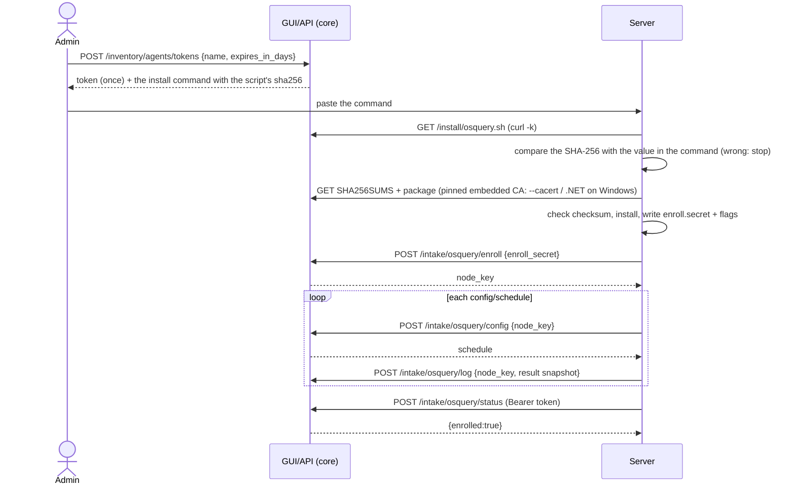

# osquery intake: the box is osquery's TLS server, and pulls Wazuh through its API

Status: implemented in `agent-intake` (written 2026-11-09 before the code). Where this spec and the code or `modules/agent-intake/CONTRACT.md` differ, those win. Field names, messages and paths are in English.
Traceability: story S-INV-4; GUI mock `web/src/features/inventory` (`contract.ts`, `installScripts.ts`, `agentConfig.ts`, `scripts/osquery.{sh,ps1}`). The paths `/api/v1/install/*` and `/api/v1/intake/*` are the mock's names; this spec fixes them, and the backend must match.

## 1. Purpose

Let Linux servers (Debian, Ubuntu, RHEL, Rocky, AlmaLinux) and Windows Server report software/operating system to the box to build the inventory and match vulnerabilities (S-INV-4), by two paths:

1. **osquery** (default): Vedette acts as osquery's TLS server (remote plugins `tls`), installed with a one-line command served from the box itself.
2. **Wazuh**: the box pulls by itself through the Wazuh server API with a read-only account; nothing is installed on the agent machine.

Server operating systems only; no macOS, no Trivy.

## 2. Actors

| Actor | Role |
|---|---|
| Administrator (admin) | creates/revokes tokens, copies the install command, configures the Wazuh connection |
| `osqueryd` on the server | a TLS client, calls out to the box |
| `core` | the intake server, serves the script and the osquery package, holds the CA |
| Wazuh manager | the customer's API server; the box is the client |

## 3. Transport and authentication

- Everything is served on `https://<box IP>:8443` (the same port as the UI/API). The box uses a **self-signed internal CA**; the box has no public domain name, so a public CA is not used.
- Three different layers of credentials, never mixed:

| Layer | Used for | Properties |
|---|---|---|
| **Enroll token** `vdt_osquery_<32 characters [a-z2-9]>` | only enrolling a new osquery and asking `status` | shown **once** at creation, stored hashed + the last 4 characters, expires after 7 days by default (`0` = never expires, at most 365 days), revocable, **never in a URL**, always in the `Authorization: Bearer` header or the `enroll_secret` field of the body |
| **`node_key`** | every `config`/`log` call of an enrolled machine | generated by core at enroll (256 bits), bound to one `host`, stored hashed, revoked per host |
| Admin session | the GUI that creates tokens | like the rest of core |

- A token **only allows enrolling** (`enroll`) and `status`; a token reads no data (matches the `AgentToken` description). Revoking a token does **not** invalidate a `node_key` already issued; to cut off a machine, revoke the host (see §10, the open questions).
- CA: `GET /api/v1/intake/ca.pem` (public). Acceptable because the CA is a public certificate; its trustworthiness comes from the pinning described in §6, not from this endpoint itself.

## 4. Endpoint

| Method | Path | Auth | Purpose |
|---|---|---|---|
| GET | `/api/v1/install/osquery.sh` | public (contains no secret) | the Linux install script |
| GET | `/api/v1/install/osquery.ps1` | public | the Windows Server install script |
| GET | `/api/v1/install/osquery/SHA256SUMS` | public | checksums of the packages mirrored by the box |
| GET | `/api/v1/install/osquery/<file>` | public | the package `osquery_<ver>-1.linux_amd64.deb`, `osquery-<ver>-1.linux.x86_64.rpm`, `osquery_<ver>-1.linux_arm64.deb`, `osquery-<ver>-1.linux.aarch64.rpm`, `osquery-<ver>.msi` |
| GET | `/api/v1/intake/ca.pem` | public | the box's CA |
| POST | `/api/v1/intake/osquery/status` | Bearer token | the script asks "has this machine reported yet" → `{ "enrolled": bool, "hosts": int }` |
| POST | `/api/v1/intake/osquery/enroll` | `enroll_secret` | enrol |
| POST | `/api/v1/intake/osquery/config` | `node_key` | returns the query schedule |
| POST | `/api/v1/intake/osquery/log` | `node_key` | receives results |

The `enroll/config/log` endpoints follow osquery's TLS remote protocol exactly (JSON, every request is a POST). There is **no** `distributed_read`/`distributed_write` and no carve: the box has **no** path to run arbitrary queries on a client machine (SYS-1, SYS-8). The accompanying osquery flags are `--disable_distributed=true --disable_extensions=true`.

### 4.1 `enroll`

Request (sent by osquery itself): `{ "enroll_secret": "<token>", "host_identifier": "<hostname>", "platform_type": "<number>", "host_details": { "os_version": {…}, "system_info": {…}, "osquery_info": {…} } }`.

Response `200`: `{ "node_key": "<…>" }` or `{ "node_invalid": true }` when the token is wrong/expired/revoked (osquery will retry and does not crash).

Rules: `host_identifier` is validated against the name regex (`^[a-zA-Z0-9][a-zA-Z0-9_.-]{0,63}$`; otherwise → rejected, `node_invalid`); a hostname equal to an older host under the same token → **a new `node_key` is issued and the old one is invalidated** (a machine reinstalled). It raises `AgentToken.hosts`, sets `last_received`, and writes `core_audit` (`inventory.agent_enroll`).

### 4.2 `config`

Request `{ "node_key": "…" }` → Response `{ "schedule": { … }, "decorators": {} }`. The schedule is **fixed and read only**, generated from code (there is no schedule input field in the GUI) and shown verbatim in the GUI so users know what the box collects (`OSQUERY_SCHEDULE`):

| Name | Table | Interval | Platform |
|---|---|---|---|
| `os_version` | `os_version` | 3600 s | all |
| `system_info` | `system_info` | 86400 s | all |
| `deb_packages` | `deb_packages` | 3600 s | linux |
| `rpm_packages` | `rpm_packages` | 3600 s | linux |
| `programs` | `programs` | 3600 s | windows |
| `patches` | `patches` | 3600 s | windows |

All are `snapshot: true`. Changing the schedule = changing the code + `THIRD_PARTY_NOTICES`/PRIVACY if another kind of data is collected; there is no per-machine configuration.

### 4.3 `log`

Request `{ "node_key": "…", "log_type": "result"|"status", "data": [ … ] }`. Core processes only a `result` whose `name` ∈ the schedule in §4.2, with `action: "snapshot"` and columns of the right name/number; every other `result` is dropped and counted. `status` (the log of osqueryd itself) keeps at most the 100 most recent lines per host for diagnosis (it does not go into an error report unless the user previews it).

Mapping into the store: each package row → `inv_software` (`vendor`, `product`, `version`, derived `cpe`/`purl`, `source=agent`, `confidence=1.0`); `os_version`/`system_info` → `inv_observation` (`source=agent`). Source priority manual > agent > snmp > nmap > passive (ARCH §4). A reporting host is matched to an asset by the hostname/IP already seen; if there is no match an `unapproved` asset is created (S-INV-3).

Response: `200 {}`; a wrong `node_key` → `{ "node_invalid": true }`.

## 5. One-line install script and the SHA-256 check

The box serves two scripts (`osquery.sh`, `osquery.ps1`) with these pre-inserted: the box address, the osquery version, and the **CA content** (embedded directly in the script). The script **contains no secret**; the token travels as a command-line parameter.

The command the user copies from the GUI (an admin who is logged in) contains the `sha256` of the script:

- Linux: `(command -v sudo >/dev/null 2>&1 || sudo() { "$@"; }; f=$(mktemp) && { curl -fsSLk <box>/api/v1/install/osquery.sh -o "$f" || wget -qO "$f" --no-check-certificate <box>/api/v1/install/osquery.sh; } && echo "<sha256>  $f" | sha256sum -c - && sudo sh "$f" --token <token>; r=$?; rm -f "$f"; exit $r)` (a subshell: the exit code of the download/check/install is preserved after cleanup, and `exit` does not close the terminal) (a new temporary file each time, then deleted: a fixed name in `/tmp` left by another user could not be overwritten under `fs.protected_regular=2`)
- Windows (PowerShell 5.1): download with `curl.exe -fsSLk` into `%TEMP%\vedette-osquery-<GUID>.ps1`, compare `Get-FileHash -Algorithm SHA256` with the value in the command, if wrong delete the file and `throw`, if right run `-File … -Token '<token>'` and then delete the file.
- The script prints only Vedette's own lines: the output of `dpkg`/`rpm` (including numbered lines printed by the osquery package's script) goes into a temporary log and is printed only when the install fails; `systemctl enable --quiet`.
- Uninstall: `--uninstall` / `-Uninstall`.

Chain of trust (spelled out because the first download uses `-k`):

1. The admin trusts the GUI (a logged-in session, TLS to the box) → the script's SHA-256 fingerprint is in the copied command.
2. The first download skips certificate verification (`-k`) because there is no CA yet; the risk (a MITM replacing the script) is blocked by the SHA-256 comparison **before running**.
3. The script matches its hash → the CA embedded in the script is the real CA → **every later download** (the osquery package, `SHA256SUMS`, `status`) pins that CA and no longer uses `-k`: on Linux with `curl --cacert`; on Windows with .NET (`HttpWebRequest` with a certificate check function for each request: the chain must contain exactly the embedded certificate, revocation is not checked because the box's CA has no CRL/OCSP, and the name/IP must match; nothing is added to the Windows certificate store), because `curl.exe --cacert` (Schannel) cannot verify the box's CA.
4. The osquery package is **mirrored by the box from the official release** and its checksum was verified on the box side; the target server checks the package's SHA-256 against `SHA256SUMS` (three files `.deb/.rpm/.msi`) before installing, so no Internet access is needed.

The SHA-256 is of **the exact bytes of the script the box serves** (with the CA, address, and version inserted): the box must serve byte-identical content for the same (address, version, CA); changing any of them changes the hash and the GUI shows the new hash. The script must be **deterministic** (no embedded time/nonce).

Script behaviour (already in the mock, kept by the spec): runs with root/Administrator rights, idempotent (running again = upgrade/repair), Linux `x86_64` or `arm64`/`aarch64` (per `dpkg --print-architecture`, or `uname -m` when it is not available); writes `enroll.secret` with mode 600/equivalent ACL; writes the flags `--config_plugin=tls --logger_plugin=tls --host_identifier=hostname --enroll_secret_path --tls_server_certs --tls_hostname=<host:port> --enroll_tls_endpoint --config_tls_endpoint --logger_tls_endpoint`; enables the `osqueryd` service; waits up to 2 minutes by calling `status` (24 times, 5 s apart). Exit code `3` = installed but no check-in seen yet.

A machine where osquery cannot run (musl such as Alpine, Arch with no dpkg/rpm, another architecture): the same command, the same token, and the script installs `vedette-reporter` (POSIX sh) in place of osquery. It enrols and sends `log` to exactly the two osquery endpoints above, every hour (a systemd timer, cron.d or busybox crond), with `os_version`, `system_info`, `interfaces` and a package list (`apk_packages`, `pacman_packages`, `deb_packages`, `rpm_packages`). The secret is read from a mode-600 file, the box's CA is pinned, each list row is read with a strict pattern, an unknown row is dropped, and a list from which no row can be read is not sent.

Manual install ("Advanced") uses the `pkg.osquery.io` repository and the steps in `agentConfig.ts`; the user must compare the CA fingerprint themselves (`openssl x509 -fingerprint -sha256`).

## 6. Pinning the CA

osquery runs with `--tls_server_certs=<path to the box's CA>`, and does **not** use the system CA store, so it trusts only this CA (that is the pinning). `--tls_hostname` includes the port (without `https://`). If the box changes IP: the server certificate uses a SAN that holds the current IP **and** a fixed name; changing the IP does not change the CA so the osquery servers still trust it; but the old `--tls_hostname` will not reach the box: how to handle this is an open question (§10).

The CA has a long lifetime (10 years proposed) and the server certificate is signed by the CA with a shorter lifetime (a parameter) so that rotation does not force an agent reinstall. Rotating the CA requires running the script again (idempotent).

## 7. Wazuh through the API

The box is a **client**: `PUT /inventory/agents/wazuh` (admin) stores the connection after authenticating.

| Field | Type | Rule |
|---|---|---|
| `url` | string ≤ 200 | `https://<host>:55000`; `https` only; host through `netip`/the name regex; **within the LAN scope or a source the user declared** (SYS-7) |
| `username` | string ≤ 64 | |
| `password` | string ≤ 200 | AES-GCM encrypted (SYS-4); left blank when editing = keep the old one; the UI shows only the last 4 characters |
| `interval_minutes` | int | one of 5, 15, 60, 360, 1440 |

Flow of each pull: `POST /security/user/authenticate?raw=true` (Basic) → a short-lived JWT → `GET /agents` → for each agent `GET /syscollector/{agent_id}/packages` and `/os` (paging with `limit`/`offset`, by default at most 500 items per page) → mapped into `inv_software` / `inv_observation` (`source=agent`). The JWT is not stored.

The Wazuh user must be read only: the policy `agent:read` + `syscollector:read` on every agent (stated in the GUI instructions `wazuhReaderSteps`). The box requires no other permission and does not call any write endpoint, including active-response.

`POST /inventory/agents/wazuh/test` tries the values in the form **without saving**; returns `{ ok, version, agents }`.

The Wazuh certificate is usually self-signed: the user chooses to **paste Wazuh's CA** or, if not, the box **pins the certificate fingerprint** seen on the first attempt and shows it for confirmation. There is no "skip certificate verification" button (open question: the mock does not yet have a CA/fingerprint field for Wazuh).

Status `never | connected | error`, `last_sync`, `agents`, `packages`, `error` (a short English string, without the body of Wazuh's response).

## 8. Sequence

## 9. Error handling and limits

| Situation | Behaviour |
|---|---|
| Wrong token | `enroll`: `{node_invalid:true}`; `status`: `403 invalid_token` |
| Token expired | `403 token_expired` ("Create a new one in Vedette") |
| Token revoked | `403 invalid_token` (indistinguishable from a wrong one, so the state is not revealed) |
| Wrong token name | `400 bad_name` (≤ 64 characters) |
| `kind` other than `osquery` when creating a token | `400 bad_kind` |
| An unknown `result` row/type | dropped, counted, shown on the Agents page |
| Body too large | `413` |

Limits (default, not measured): the `log` body ≤ 5 MiB; each host ≤ 30,000 package rows per snapshot; `enroll` ≤ 10 times/minute/IP and 5 wrong tries/minute/IP before `429`; at most 500 hosts per box (ARCH §8 targets 1,000 assets); each token creates ≤ 100 hosts. Mirrored packages: the box serves only **the five package files + `SHA256SUMS`** (six fixed names, agent-intake INV-17 (d)) listed in §4, with names matching a fixed regex; it does not serve files by an arbitrary path (against path traversal).

## 10. Security considerations (mapping to SYS)

| SYS | Applies |
|---|---|
| SYS-1 | The box has no path to run queries/commands on a client machine (`distributed` is off); the install script is static text and does not `eval` data from the box |
| SYS-2 | Every body is validated against a schema; hostname against a regex; `platform_type` against an enum |
| SYS-3 | Creating/revoking tokens, enrolling, connecting/disconnecting Wazuh writes `core_audit` |
| SYS-4 | Tokens and `node_key` are stored hashed; the Wazuh password is AES-GCM; nothing is logged; the GUI shows only the last 4 characters |
| SYS-5 | Module `inventory` off → the `/intake/*` routes do not exist (osqueryd sees 404/`node_invalid` and keeps its old data) |
| SYS-6 | Data from a server (which may have been taken over) is untrusted: only known columns, size limits, package names shown as text; no CPE is built from an unnormalised string |
| SYS-7 | The Wazuh address is within the declared LAN range or explicitly entered by an admin |
| SYS-8 | The AI does not read tokens/node_key; it has no write tool |

Risks worth noting: (a) the token is on the command line and can leak through `ps`/shell history: it is only for enrolling, expires in 7 days, and is revocable; (b) `enroll.secret` still sits on the machine (osquery needs it to enrol again when the `node_key` is lost); (c) `-k` on the first download: reduced by the SHA-256 comparison and stated in the GUI; (d) the box stands in the middle as a software source for servers: packages only from the official release, checksums checked at both ends, and the GPG signature of the `.deb/.rpm` packages should be verified by the box when mirroring (see the open questions).

## 11. Versioning

- The paths `/api/v1/intake/…` and `/api/v1/install/…` are tied to the API version; the script embeds the osquery `VERSION`. Raising the osquery version = a Vedette update (content/software package) that changes `osquery_version` → the script hash changes → the GUI shows a new command; old machines keep working until the script is run again.
- The osquery TLS protocol is decided by osquery; core accepts the known fields and ignores unknown ones. A change to the schedule contract (§4.2) = recorded in the CONTRACT of the `inventory` module (rule `contracts.md`).

## 12. Open questions

1. Should revoking a token also cut off the `node_key` of hosts enrolled with that token? Currently: no (a token is only for enrolling); a per-host "Revoke" button is not yet in the mock.
2. Box IP change: an osquery server configured with `--tls_hostname=<IP>:8443` will lose its connection. Is a fixed name (mDNS/internal DNS) needed, or instructions to run the script again? A decision is needed before the backend is written.
3. Should the box verify the GPG signature of osquery packages when mirroring (and record it in `THIRD_PARTY_NOTICES`/PRIVACY: pulling from a GitHub release/`pkg.osquery.io` is a new outbound flow)? PRIVACY does not list this source yet.
4. The lifetime of the CA/server certificate and the rotation mechanism.
5. A CA or fingerprint field for the Wazuh connection is not yet in the mock (`WazuhInput`).
6. ~~Only Linux `x86_64` for the current script (mock): is ARM supported?~~ Closed: the box serves the official arm64 packages (deb, rpm) as well, pinned like the x86_64 packages.
7. The numeric limits (§9) are a starting point, not measured.
