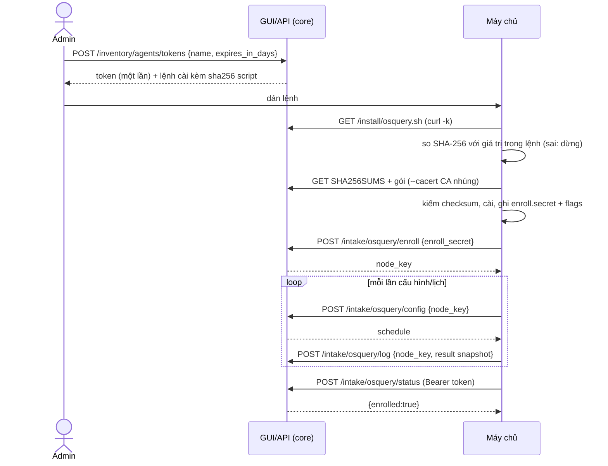

# osquery intake: hộp là máy chủ TLS của osquery, và kéo Wazuh qua API

Trạng thái: bản nháp M2-0 (docs-first), 2026-11-09. Văn xuôi tiếng Việt; tên trường, thông điệp, đường dẫn bằng tiếng Anh.
Truy vết: D-33, D-34, D-8, D-28; story S-INV-4; GUI mock `web/src/features/inventory` (`contract.ts`, `installScripts.ts`, `agentConfig.ts`, `scripts/osquery.{sh,ps1}`). Đường dẫn `/api/v1/install/*` và `/api/v1/intake/*` là tên của mock; spec này chốt chúng, backend phải khớp.

## 1. Mục đích

Cho phép máy chủ Linux (Debian, Ubuntu, RHEL, Rocky, AlmaLinux) và Windows Server báo phần mềm/hệ điều hành về hộp để lập kho và khớp lỗ hổng (S-INV-4), theo hai đường:

1. **osquery** (mặc định): Vedette làm máy chủ TLS của osquery (remote plugins `tls`), cài bằng một dòng lệnh phục vụ từ chính hộp.
2. **Wazuh**: hộp tự kéo qua Wazuh server API bằng tài khoản chỉ đọc; không cài gì lên máy agent.

Chỉ hệ điều hành máy chủ; không macOS, không Trivy (D-33).

## 2. Actors

| Actor | Vai trò |
|---|---|
| Quản trị viên (admin) | tạo/thu hồi token, sao chép lệnh cài, cấu hình kết nối Wazuh |
| `osqueryd` trên máy chủ | client TLS, gọi ra hộp |
| `core` | máy chủ intake, phục vụ script và gói osquery, giữ CA |
| Wazuh manager | máy chủ API của khách, hộp là client |

## 3. Transport và xác thực

- Mọi thứ phục vụ trên `https://<IP hộp>:8443` (cùng cổng với UI/API, D-33). Hộp dùng **CA nội bộ tự ký**; hộp không có tên miền công khai, nên không dùng CA công cộng.
- Ba lớp thông tin xác thực khác nhau, không dùng lẫn:

| Lớp | Dùng cho | Đặc tính |
|---|---|---|
| **Token enroll** `vdt_osquery_<32 ký tự [a-z2-9]>` | chỉ đăng ký osquery mới và hỏi `status` | hiện **một lần** lúc tạo, lưu băm + 4 ký tự cuối, hết hạn mặc định 7 ngày (`0` = không hết hạn, tối đa 365 ngày), thu hồi được, **không bao giờ trong URL**, luôn trong header `Authorization: Bearer` hoặc trường `enroll_secret` của body |
| **`node_key`** | mọi gọi `config`/`log` của một máy đã đăng ký | sinh bởi core khi enroll (256 bit), gắn với một `host`, lưu băm, thu hồi theo từng host |
| Phiên quản trị | GUI tạo token | như phần còn lại của core |

- Token **chỉ cho phép đăng ký** (`enroll`) và `status`; token không đọc được dữ liệu nào (khớp mô tả `AgentToken`). Thu hồi token **không** làm mất `node_key` đã cấp; muốn ngắt một máy thì thu hồi host (xem §10, câu hỏi mở).
- CA: `GET /api/v1/intake/ca.pem` (công khai). Chấp nhận được vì CA là chứng chỉ công khai; độ tin cậy của nó đến từ cách ghim ở §6, không từ chính endpoint này.

## 4. Endpoint

| Method | Path | Auth | Mục đích |
|---|---|---|---|
| GET | `/api/v1/install/osquery.sh` | public (không chứa secret) | script cài Linux |
| GET | `/api/v1/install/osquery.ps1` | public | script cài Windows Server |
| GET | `/api/v1/install/osquery/SHA256SUMS` | public | checksum các gói do hộp phản chiếu |
| GET | `/api/v1/install/osquery/<file>` | public | gói `osquery_<ver>-1.linux_amd64.deb`, `osquery-<ver>-1.linux.x86_64.rpm`, `osquery_<ver>-1.linux_arm64.deb`, `osquery-<ver>-1.linux.aarch64.rpm` (D-399), `osquery-<ver>.msi` |
| GET | `/api/v1/intake/ca.pem` | public | CA của hộp |
| POST | `/api/v1/intake/osquery/status` | Bearer token | script hỏi "máy này đã báo về chưa" → `{ "enrolled": bool, "hosts": int }` |
| POST | `/api/v1/intake/osquery/enroll` | `enroll_secret` | đăng ký |
| POST | `/api/v1/intake/osquery/config` | `node_key` | trả lịch truy vấn |
| POST | `/api/v1/intake/osquery/log` | `node_key` | nhận kết quả |

Các endpoint `enroll/config/log` theo đúng giao thức TLS remote của osquery (JSON, mọi request là POST). **Không có** `distributed_read`/`distributed_write` và không có carve: hộp **không** có đường chạy truy vấn tuỳ ý trên máy khách (SYS-1, SYS-8). Cờ osquery đi kèm `--disable_distributed=true --disable_extensions=true`.

### 4.1 `enroll`

Request (osquery tự gửi): `{ "enroll_secret": "<token>", "host_identifier": "<hostname>", "platform_type": "<số>", "host_details": { "os_version": {…}, "system_info": {…}, "osquery_info": {…} } }`.

Response `200`: `{ "node_key": "<…>" }` hoặc `{ "node_invalid": true }` khi token sai/hết hạn/bị thu hồi (osquery sẽ thử lại, không crash).

Quy tắc: `host_identifier` validate theo regex tên (`^[a-zA-Z0-9][a-zA-Z0-9_.-]{0,63}$`; khác → từ chối, `node_invalid`); trùng hostname với host cũ cùng token → **cấp lại `node_key` mới và vô hiệu cái cũ** (cài lại máy). Tăng `AgentToken.hosts`, đặt `last_received`, ghi `core_audit` (`inventory.agent_enroll`).

### 4.2 `config`

Request `{ "node_key": "…" }` → Response `{ "schedule": { … }, "decorators": {} }`. Lịch **cố định, chỉ đọc**, sinh từ code (không có ô nhập lịch trong GUI) và hiển thị nguyên văn ở GUI để người dùng biết hộp thu thập gì (`OSQUERY_SCHEDULE`):

| Tên | Bảng | Chu kỳ | Nền tảng |
|---|---|---|---|
| `os_version` | `os_version` | 3600 s | tất cả |
| `system_info` | `system_info` | 86400 s | tất cả |
| `deb_packages` | `deb_packages` | 3600 s | linux |
| `rpm_packages` | `rpm_packages` | 3600 s | linux |
| `programs` | `programs` | 3600 s | windows |
| `patches` | `patches` | 3600 s | windows |

Tất cả `snapshot: true`. Đổi lịch = đổi mã + `THIRD_PARTY_NOTICES`/PRIVACY nếu thu thêm loại dữ liệu; không có cấu hình theo máy.

### 4.3 `log`

Request `{ "node_key": "…", "log_type": "result"|"status", "data": [ … ] }`. Core chỉ xử lý `result` có `name` ∈ lịch ở §4.2, `action: "snapshot"` và cột đúng tên/số cột; mọi `result` khác bị bỏ và đếm. `status` (log của chính osqueryd) giữ tối đa 100 dòng gần nhất mỗi host để chẩn đoán (không vào gói báo lỗi trừ khi người dùng xem trước, D-42).

Map vào kho: mỗi dòng gói → `inv_software` (`vendor`, `product`, `version`, `cpe`/`purl` suy ra, `source=agent`, `confidence=1.0`); `os_version`/`system_info` → `inv_observation` (`source=agent`). Ưu tiên nguồn manual > agent > snmp > nmap > passive (ARCH §4). Host báo về được ghép vào asset theo hostname/IP đã thấy; không khớp thì tạo asset `chưa duyệt` (S-INV-3).

Phản hồi: `200 {}`; sai `node_key` → `{ "node_invalid": true }`.

## 5. Script cài một dòng và kiểm SHA-256 (D-34)

Hộp phục vụ hai script (`osquery.sh`, `osquery.ps1`) có chèn sẵn: địa chỉ hộp, phiên bản osquery, và **nội dung CA** (nhúng thẳng vào script). Script **không chứa secret**; token đi qua tham số dòng lệnh.

Lệnh người dùng sao chép từ GUI (admin đã đăng nhập) chứa `sha256` của script:

- Linux: `(f=$(mktemp) && curl -fsSLk <box>/api/v1/install/osquery.sh -o "$f" && echo "<sha256>  $f" | sha256sum -c - && sudo sh "$f" --token <token>; r=$?; rm -f "$f"; exit $r)` (subshell: mã thoát của tải/kiểm/cài giữ nguyên sau khi dọn, `exit` không đóng terminal) (tệp tạm mới mỗi lần rồi xoá: tên cố định trong `/tmp` do người dùng khác để lại không ghi đè được khi `fs.protected_regular=2`, lượt đi thật 2 W2-3)
- Windows (PowerShell 5.1): tải bằng `curl.exe -fsSLk` vào `%TEMP%\vedette-osquery-<GUID>.ps1`, so `Get-FileHash -Algorithm SHA256` với giá trị trong lệnh, sai thì xoá tệp và `throw`, đúng thì chạy `-File … -Token '<token>'` rồi xoá tệp.
- Script in các dòng của Vedette thôi: đầu ra của `dpkg`/`rpm` (kể cả dòng số do script của gói osquery in) vào log tạm, chỉ in ra khi cài lỗi; `systemctl enable --quiet` (W2-2).
- Gỡ: `--uninstall` / `-Uninstall`.

Chuỗi tin cậy (viết rõ vì lần tải đầu dùng `-k`):

1. Admin tin GUI (phiên đã đăng nhập, TLS tới hộp) → vân tay SHA-256 của script nằm trong lệnh sao chép.
2. Lần tải đầu bỏ kiểm chứng chỉ (`-k`) vì chưa có CA; rủi ro (kẻ MITM thay script) bị chặn bởi bước so SHA-256 **trước khi chạy**.
3. Script được so đúng hash → CA nhúng trong script là CA thật → **mọi lần tải sau** (gói osquery, `SHA256SUMS`, `status`) dùng `--cacert` với CA đó, không còn `-k`.
4. Gói osquery do hộp **phản chiếu từ bản phát hành chính thức** và đã kiểm checksum phía hộp; máy chủ đích kiểm lại SHA-256 gói theo `SHA256SUMS` (ba file `.deb/.rpm/.msi`) trước khi cài, nên không cần Internet.

Sha256 là của **chính byte script hộp phục vụ** (đã chèn CA, địa chỉ, phiên bản): hộp phải phục vụ byte-giống-nhau cho cùng (địa chỉ, phiên bản, CA); đổi bất kỳ thứ nào đổi hash và GUI hiện hash mới. Script phải **deterministic** (không nhúng thời gian/nonce).

Hành vi script (đã có ở mock, spec giữ): chạy với quyền root/Administrator, idempotent (chạy lại = nâng cấp/sửa), Linux `x86_64` hoặc `arm64`/`aarch64` (D-399, theo `dpkg --print-architecture`, không có thì `uname -m`); ghi `enroll.secret` mode 600/ACL tương đương; ghi cờ `--config_plugin=tls --logger_plugin=tls --host_identifier=hostname --enroll_secret_path --tls_server_certs --tls_hostname=<host:port> --enroll_tls_endpoint --config_tls_endpoint --logger_tls_endpoint`; bật dịch vụ `osqueryd`; chờ tối đa 2 phút bằng cách gọi `status` (24 lần cách 5 s). Mã thoát `3` = đã cài nhưng chưa thấy check-in.

Cài thủ công ("Advanced") dùng kho `pkg.osquery.io` và các bước trong `agentConfig.ts`; bắt buộc người dùng tự đối chiếu vân tay CA (`openssl x509 -fingerprint -sha256`).

## 6. Ghim CA

osquery chạy với `--tls_server_certs=<đường dẫn CA của hộp>`, **không** dùng kho CA hệ thống, nên chỉ tin CA này (đó là sự ghim). `--tls_hostname` kèm cổng (không có `https://`). Nếu hộp đổi IP: chứng chỉ máy chủ dùng SAN gồm IP hiện tại **và** tên cố định; đổi IP không đổi CA nên máy chủ osquery vẫn tin; nhưng `--tls_hostname` cũ sẽ không tới được hộp: cách xử lý là câu hỏi mở (§10).

CA có thời hạn dài (đề xuất 10 năm) và chứng chỉ máy chủ ký bởi CA, thời hạn ngắn hơn (tham số) để xoay không buộc phải cài lại agent. Xoay CA yêu cầu chạy lại script (idempotent).

## 7. Wazuh qua API (D-33)

Hộp là **client**: `PUT /inventory/agents/wazuh` (admin) lưu kết nối sau khi xác thực.

| Trường | Kiểu | Quy tắc |
|---|---|---|
| `url` | string ≤ 200 | `https://<host>:55000`; chỉ `https`; host qua `netip`/regex tên; **trong scope LAN hoặc nguồn do người dùng khai** (SYS-7) |
| `username` | string ≤ 64 | |
| `password` | string ≤ 200 | mã hoá AES-GCM (SYS-4); bỏ trống khi sửa = giữ cũ; UI chỉ 4 ký tự cuối |
| `interval_minutes` | int | một trong 5, 15, 60, 360, 1440 |

Luồng mỗi lần kéo: `POST /security/user/authenticate?raw=true` (Basic) → JWT ngắn hạn → `GET /agents` → với từng agent `GET /syscollector/{agent_id}/packages` và `/os` (phân trang `limit`/`offset`, mặc định tối đa 500 mục mỗi trang) → map vào `inv_software` / `inv_observation` (`source=agent`). JWT không lưu.

Người dùng Wazuh phải chỉ đọc: policy `agent:read` + `syscollector:read` trên mọi agent (đã nêu trong hướng dẫn GUI `wazuhReaderSteps`). Hộp không yêu cầu quyền nào khác và không gọi endpoint ghi, kể cả active-response.

`POST /inventory/agents/wazuh/test` thử với giá trị trong form mà **không lưu**; trả `{ ok, version, agents }`.

Chứng chỉ của Wazuh thường tự ký: người dùng chọn **dán CA của Wazuh** hoặc, nếu không, hộp **ghim vân tay chứng chỉ** thấy lần thử đầu và hiển thị để xác nhận. Không có nút "bỏ qua kiểm chứng chỉ" (câu hỏi mở: mock hiện chưa có trường CA/vân tay cho Wazuh).

Trạng thái `never | connected | error`, `last_sync`, `agents`, `packages`, `error` (chuỗi tiếng Anh ngắn, không kèm thân response của Wazuh).

## 8. Sequence

## 9. Xử lý lỗi và giới hạn

| Tình huống | Hành vi |
|---|---|
| Token sai | `enroll`: `{node_invalid:true}`; `status`: `403 invalid_token` |
| Token hết hạn | `403 token_expired` ("Create a new one in Vedette") |
| Token bị thu hồi | `403 invalid_token` (không phân biệt với sai, để không lộ trạng thái) |
| Tên token sai | `400 bad_name` (≤ 64 ký tự) |
| `kind` khác `osquery` khi tạo token | `400 bad_kind` |
| Dòng/kiểu `result` lạ | bỏ, đếm, hiện ở trang Agents |
| Thân quá lớn | `413` |

Giới hạn (mặc định, chưa đo): thân `log` ≤ 5 MiB; mỗi host ≤ 30 000 dòng gói mỗi snapshot; `enroll` ≤ 10 lần/phút/IP và 5 lần sai/phút/IP trước khi `429`; tối đa 500 host mỗi hộp (ARCH §8 nhắm 1.000 asset); mỗi token tạo ≤ 100 host. Gói phản chiếu: hộp chỉ phục vụ **năm tệp gói + `SHA256SUMS`** (sáu tên cố định, agent-intake INV-17 (d), D-399) liệt kê ở §4, tên khớp regex cố định; không phục vụ tệp theo đường dẫn tuỳ ý (chống path traversal).

## 10. Cân nhắc bảo mật (ánh xạ SYS)

| SYS | Áp dụng |
|---|---|
| SYS-1 | Hộp không có đường chạy truy vấn/lệnh trên máy khách (`distributed` tắt); script cài là văn bản tĩnh, không `eval` dữ liệu từ hộp |
| SYS-2 | Mọi body validate theo schema; hostname theo regex; `platform_type` theo enum |
| SYS-3 | Tạo/thu hồi token, enroll, kết nối/ngắt Wazuh ghi `core_audit` |
| SYS-4 | Token và `node_key` lưu băm; mật khẩu Wazuh AES-GCM; không log; GUI chỉ 4 ký tự cuối |
| SYS-5 | Module `inventory` tắt → các route `/intake/*` không tồn tại (osqueryd thấy 404/`node_invalid`, giữ dữ liệu cũ) |
| SYS-6 | Dữ liệu từ máy chủ (có thể đã bị chiếm) là không tin cậy: chỉ cột đã biết, giới hạn kích thước, tên gói hiển thị như văn bản; không lập CPE từ chuỗi chưa chuẩn hoá |
| SYS-7 | Địa chỉ Wazuh nằm trong dải LAN khai báo hoặc do admin nhập tường minh |
| SYS-8 | AI không đọc token/node_key; không có công cụ ghi |

Rủi ro đáng nêu: (a) token nằm trên dòng lệnh, lộ qua `ps`/lịch sử shell: chỉ cho enroll, hết hạn 7 ngày, thu hồi được; (b) `enroll.secret` vẫn nằm trên máy (osquery cần để đăng ký lại khi mất `node_key`); (c) `-k` ở lần tải đầu: giảm bằng so SHA-256, ghi rõ ở GUI; (d) hộp đứng giữa như nguồn cài phần mềm cho máy chủ: gói chỉ từ bản phát hành chính thức, kiểm checksum cả hai đầu, chữ ký GPG của gói `.deb/.rpm` nên được hộp kiểm khi phản chiếu (xem câu hỏi mở).

## 11. Versioning

- Đường dẫn `/api/v1/intake/…` và `/api/v1/install/…` gắn với phiên bản API; script nhúng `VERSION` osquery. Nâng phiên bản osquery = bản cập nhật Vedette (gói nội dung/phần mềm) đổi `osquery_version` → hash script đổi → GUI hiện lệnh mới; máy cũ vẫn chạy được tới khi chạy lại script.
- Giao thức osquery TLS do osquery quyết định; core chấp nhận các trường đã biết và bỏ qua trường lạ. Hợp đồng lịch (§4.2) đổi = ghi trong CONTRACT của module `inventory` (rule `contracts.md`).

## 12. Câu hỏi mở

1. Thu hồi token có nên ngắt luôn `node_key` các host đã đăng ký bằng token đó? Hiện: không (token chỉ để đăng ký); nút "Revoke" theo từng host chưa có trong mock.
2. Đổi IP hộp: máy chủ osquery đã cấu hình `--tls_hostname=<IP>:8443` sẽ mất kết nối. Có cần tên cố định (mDNS/DNS nội bộ) hay hướng dẫn chạy lại script? Cần quyết trước khi viết backend.
3. Hộp có nên kiểm chữ ký GPG của gói osquery khi phản chiếu (và ghi vào `THIRD_PARTY_NOTICES`/PRIVACY: kéo từ GitHub release/`pkg.osquery.io` là luồng ra mới)? PRIVACY hiện chưa liệt kê nguồn này.
4. Thời hạn CA/chứng chỉ máy chủ và cơ chế xoay.
5. Trường CA hoặc vân tay cho kết nối Wazuh chưa có trong mock (`WazuhInput`).
6. ~~Chỉ `x86_64` Linux cho script hiện tại (mock): ARM có hỗ trợ không?~~ Đóng (D-399): hộp phục vụ cả gói arm64 chính thức (deb, rpm), ghim như gói x86_64.
7. Các giới hạn số (§9) là điểm xuất phát, chưa đo.
