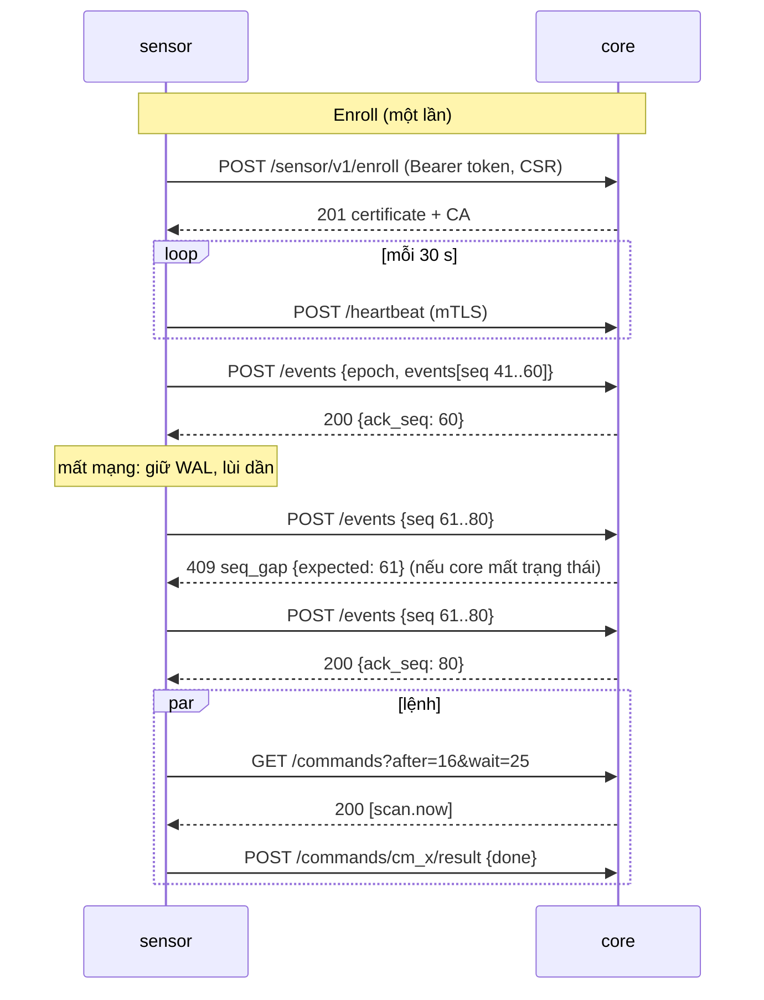

# Sensor protocol: sensor ↔ core

Trạng thái: bản nháp M2-0 (docs-first), 2026-11-09. Văn xuôi tiếng Việt (D-28 cho tài liệu nội bộ); tên trường, thông điệp, đường dẫn bằng tiếng Anh.
Truy vết: D-8, D-24, D-43, D-44, D-50, D-55, D-56; `ARCHITECTURE.md` §3 và §4; story S-INV-1, S-INV-3, S-HP-1, S-HP-2, S-LOG-1, S-LOG-2, S-LOG-4, S-RESP-3.

## 1. Mục đích

Định nghĩa giao thức giữa `sensor` và `core` để hai bên **tách được từ ngày đầu** (ARCHITECTURE §3) mà không đổi mã:

- trong appliance, `sensor` và `core` là hai container trên cùng một máy (D-55), nói đúng giao thức này qua loopback;
- khi tách (sensor ở máy khác trong cùng một site), cùng giao thức đó đi qua LAN.

Giao thức chỉ có **một chiều khởi tạo**: sensor gọi ra, core không bao giờ gọi vào sensor. Lệnh từ core tới sensor là một hàng đợi mà sensor tự hỏi (poll).

Ngoài phạm vi: nhiều site / nhiều sensor ở site khác (D-24: chưa hỗ trợ, không lộ ra GUI); osquery và Wazuh (xem `osquery-intake.md`); log syslog của thiết bị khác tới sensor (xem §5.3 chỉ nói phần chuyển tiếp).

## 2. Actors

| Actor | Vai trò | Ghi chú |
|---|---|---|
| `core` | máy chủ giao thức; giữ CA nội bộ, DB, tập IOC, cấu hình | container `core` |
| `sensor` | thu: thụ động (ARP/DHCP/mDNS/SSDP/LLDP), SPAN metadata (D-43), syslog nhận vào, quét chủ động theo lệnh | container `sensor`, mạng host, `CAP_NET_RAW` (D-55) |
| `honeypot` | OpenCanary trên IP phụ (macvlan) và honey token (D-50) | container riêng; xem §5.4 về việc nó đi qua đâu |
| Quản trị viên | tạo token enroll của sensor tách rời | **chưa có story/GUI** (D-24); xem §12 |

Mô hình tin cậy: sensor là **máy bị tấn công được** (đứng trên LAN, nhận dữ liệu từ kẻ tấn công). Core coi mọi thứ sensor gửi là dữ liệu không tin cậy về nội dung (SYS-6), nhưng tin danh tính sensor sau mTLS.

## 3. Transport và xác thực

- HTTPS/1.1 JSON (`Content-Type: application/json`, tuỳ chọn `Content-Encoding: gzip` cho request). TLS 1.3 tối thiểu.
- Tiền tố đường dẫn: `/sensor/v1/…`. Cổng: **chưa chốt** (§12); mặc định đề xuất là một listener riêng với cổng UI `8443` vì listener này **bắt buộc** chứng chỉ client còn listener UI thì không.
- Chứng chỉ máy chủ: do CA nội bộ của hộp cấp (cùng CA mà `/api/v1/intake/ca.pem` công bố cho osquery, `osquery-intake.md` §4). Sensor **ghim CA** bằng vân tay SHA-256 truyền lúc enroll (`--ca-sha256`); không có vân tay thì từ chối enroll (không TOFU âm thầm).
- Chứng chỉ client: ECDSA P-256, `CN=sensor:<sensor_id>`, SAN URI `vedette:sensor:<sensor_id>`, thời hạn mặc định 90 ngày (tham số), core cấp khi enroll.
- Phân quyền: chứng chỉ chỉ mở các endpoint dưới `/sensor/v1/`. Mọi request mang `X-Vedette-Proto: 1` và `X-Vedette-Sensor-Version: <semver>`.
- Thu hồi: core giữ `sensor_id → status` (`active | revoked`) và kiểm ở **mỗi** request (không dựa vào CRL phân phối). Thu hồi → `403 sensor_revoked`.

### 3.1 Enroll

Token enroll của sensor: một lần dùng, hết hạn mặc định 1 giờ, thu hồi được, **chỉ trong header `Authorization: Bearer`**, không bao giờ trong URL (cùng nguyên tắc D-34). Trên appliance, installer sinh token cục bộ vào volume dùng chung; người dùng không thấy.

`POST /sensor/v1/enroll` (TLS một chiều, chưa có chứng chỉ client)

| Trường (request) | Kiểu | Bắt buộc | Quy tắc |
|---|---|---|---|
| `csr` | string (PEM PKCS#10) | có | khoá ECDSA P-256; core bỏ mọi subject/SAN do sensor đặt và tự ghi |
| `name` | string | có | regex `^[a-zA-Z0-9][a-zA-Z0-9_.-]{0,63}$` |
| `version` | string | có | semver |
| `interfaces` | string[] | không | tên card (`^[a-z0-9._-]{1,15}$`), tối đa 16 |
| `capabilities` | string[] | không | tập con của `passive`, `span`, `active_scan`, `syslog` |

Response `201`: `{ "sensor_id": "sn_…", "certificate": "<PEM>", "ca": "<PEM>", "not_after": "<RFC3339>", "poll": { "commands_wait_s": 25 } }`.

Lỗi: `401 invalid_token`, `403 token_expired | token_used`, `400 invalid_csr`, `409 name_taken`.

Gia hạn: `POST /sensor/v1/renew` (mTLS, body `{ "csr": "…" }`) khi còn ≤ 1/3 thời hạn; trả chứng chỉ mới cùng `sensor_id`. Chứng chỉ hết hạn → phải enroll lại bằng token mới.

## 4. Quy ước chung

- Mọi thời điểm: RFC 3339 UTC. Mọi id: chuỗi ASCII ≤ 64 ký tự.
- Mọi response lỗi: `{ "error": { "code": "snake_case", "message": "English text", "retry_after_s": 30? } }`. `code` là hợp đồng; `message` chỉ để người đọc.
- Trường lạ trong request: **bỏ qua** (tương thích tiến); trường bắt buộc thiếu hoặc sai kiểu: từ chối sự kiện đó (§5.5).

## 5. Lô sự kiện

### 5.1 Phong bì

`POST /sensor/v1/events`

| Trường | Kiểu | Quy tắc |
|---|---|---|
| `epoch` | string | đổi khi sensor mất kho cục bộ hoặc cài lại; mỗi epoch có dãy `seq` riêng |
| `batch_id` | string (uuid) | chỉ để theo dõi/log; **không** là khoá idempotency |
| `sent_at` | datetime | |
| `events` | object[] | 1 … 500 phần tử, tăng dần theo `seq` |

Mỗi phần tử trong `events`: `{ "seq": uint64, "type": "<type>", "observed_at": datetime, "payload": { … } }`.

Response `200`: `{ "ack_seq": uint64, "rejected": [ { "seq": n, "code": "invalid_payload", "field": "payload.dest" } ] }`.

### 5.2 `seq` và idempotency

- `seq` là bộ đếm tăng đơn điệu **mỗi (sensor_id, epoch)**, bắt đầu từ 1, ghi bền xuống WAL cục bộ **trước khi** gửi.
- Core giữ `last_seq` cho mỗi (sensor_id, epoch) và dùng khoá duy nhất `(sensor_id, epoch, seq)`.
- Sự kiện có `seq ≤ last_seq` → **bỏ qua, vẫn tính là đã ack** (gửi lại sau mất kết nối là an toàn).
- Có khoảng trống (`seq > last_seq + 1`) → `409 seq_gap` với `{ "expected": last_seq + 1 }`; sensor gửi lại từ `expected` (nó giữ WAL tới khi nhận `ack_seq`).
- `ack_seq` = `seq` cao nhất đã xử lý liên tục (kể cả sự kiện bị `rejected`; sự kiện hỏng không được chặn dãy).
- Epoch mới: core thấy `epoch` lạ → mở dãy mới, ghi `core_audit` (`sensor.epoch_reset`).
- Sensor ngắt kết nối: lùi theo cấp số nhân 1 s → 60 s, có jitter. WAL cục bộ có trần (§9); đầy → bỏ sự kiện **cũ nhất loại `logs.*`** trước, ghi bộ đếm `dropped` trong heartbeat; `honeypot.hit` và `inventory.observation` bỏ sau cùng.

### 5.3 Các loại sự kiện

Tất cả `payload` có giới hạn kích thước ở §9; chuỗi tự do bị cắt, không bị từ chối.

**`inventory.observation`** (map 1–1 vào `inv_observation`, ARCHITECTURE §4, không ghi đè)

| Trường | Kiểu | Ghi chú |
|---|---|---|
| `mac` | string? | `^([0-9a-f]{2}:){5}[0-9a-f]{2}$` |
| `ip` | string? | IPv4/IPv6 qua `netip`; ít nhất một trong `mac`, `ip` |
| `source` | enum | `passive` \| `nmap` \| `snmp` (hai nguồn còn lại của ARCH §4 là `agent`, `manual` không đi qua sensor) |
| `field` | string | `hostname`, `vendor`, `model`, `os`, `kind`, `service`, `lldp_neighbor`… theo từ điển của `inv_observation` |
| `value` | string | ≤ 512 ký tự |
| `confidence` | number 0–1 | |
| `evidence` | string? | ≤ 1 KiB (ví dụ trích banner) |

**`logs.batch`** (syslog sensor nhận từ firewall/DNS/proxy, S-LOG-1)

| Trường | Kiểu | Ghi chú |
|---|---|---|
| `source_ip` | string | địa chỉ gửi syslog |
| `transport` | enum | `udp` \| `tcp` \| `tls` |
| `lines` | string[] | dòng thô, ≤ 200 dòng, mỗi dòng ≤ 8 KiB (dư bị cắt, `truncated: true`) |
| `received_from` | datetime | thời điểm nhận dòng đầu |

Sensor **không phân tích** dòng syslog; parser theo hãng nằm trong gói nội dung ký của core (UPDATES kênh 2) nên sensor không cần cập nhật khi thêm nguồn. Core gộp, tính baseline (S-LOG-1).

**`logs.ioc_hit`** (S-LOG-2, S-LOG-4, D-43; chỉ từ **metadata SPAN**, không lưu payload)

| Trường | Kiểu | Ghi chú |
|---|---|---|
| `src_ip` | string | thiết bị trong LAN |
| `src_mac` | string? | |
| `dest` | string | IP hoặc domain/SNI/Host |
| `dest_kind` | enum | `ip` \| `domain` |
| `seen_via` | enum | `span_dns` \| `span_sni` \| `span_http` \| `span_flow` (đúng bộ giá trị của `IocHit.seen_via` trong mock; hit từ syslog được **core** tạo, không phải sensor) |
| `ioc_set_version` | string | phiên bản tập IOC sensor đã khớp |
| `count` | int | số lần gộp trong cửa sổ ≤ 60 s cùng `(src_ip, dest)` |

`feeds[]` và `confidence` do **core** điền khi tra lại `dest` trong `feeds_ioc` (sensor không quyết định độ tin cậy; tránh sensor bị chiếm tự gán độ tin cậy cao để kích hoạt phản ứng, D-44/D-51). Sensor khớp cục bộ bằng tập IOC kéo về ở §6.2.

**`honeypot.hit`** (S-HP-1, S-HP-2, D-50; khớp `Hit` trong mock honeypot)

| Trường | Kiểu | Ghi chú |
|---|---|---|
| `kind` | enum | `service` \| `token` \| `scan` |
| `service` | string? | `smb`, `rdp`, `ssh`, `mssql`, `http`… khi `kind=service` |
| `label` | string | ≤ 200 ký tự |
| `port` | int? | |
| `src_ip` | string | |
| `decoy_ip` | string? | IP bẫy bị chạm |
| `excerpt` | string | ≤ 2 KiB, **không tin cậy**, core hiển thị như văn bản thuần |
| `token_id` | string? | khi `kind=token` |

Chạm bẫy không cần chờ gộp: sensor flush lô ngay (§9, độ trễ mục tiêu ≤ 2 s) vì S-HP-1 đòi cảnh báo tức thì.

### 5.4 Honeypot đi qua đường nào

D-55 để honeypot là container riêng. Hai cách tuân theo cùng giao thức; spec chọn **honeypot gửi qua sensor** (sensor tail log JSON của OpenCanary trên volume chia sẻ chỉ-đọc rồi phát `honeypot.hit`), để chỉ có **một** danh tính mTLS và một dãy `seq`. Phương án honeypot có chứng chỉ riêng ghi ở §12.

### 5.5 Sự kiện hỏng (fail-closed, SYS-6)

Core kiểm từng `payload` theo schema; sự kiện sai schema hoặc vượt giới hạn được đưa vào `rejected[]`, **không** lưu, **không** làm hỏng cả lô, và tăng bộ đếm `sensor_rejected{type,code}` hiện ở trang Sensors. `type` lạ: `rejected` với `code=unknown_type` (không lưu).

## 6. Hàng đợi lệnh (sensor poll, core không gọi vào)

### 6.1 Long-poll

`GET /sensor/v1/commands?after=<cmd_seq>&wait=25`

- Core giữ request tới `wait` giây (tối đa 30); có lệnh mới trả ngay.
- Response `200`: `{ "commands": [ { "id": "cm_…", "seq": 17, "type": "…", "args": { … }, "issued_at": …, "expires_at": … } ] }` hoặc `204` khi hết giờ.
- Giao **ít nhất một lần**; sensor loại trùng theo `id`. Lệnh quá `expires_at` (mặc định 10 phút) bị core bỏ, sensor bỏ lệnh đã hết hạn nếu lỡ nhận.
- Sensor trả kết quả: `POST /sensor/v1/commands/{id}/result` với `{ "status": "done"|"failed"|"refused", "detail": string≤1KiB, "finished_at": … }`. `refused` = sensor tự từ chối vì lệnh vi phạm bất biến cục bộ (§6.3).

### 6.2 Loại lệnh (hết danh sách; không có lệnh tổng quát)

| `type` | `args` | Tác dụng |
|---|---|---|
| `scan.now` | `{ "targets": [CIDR…≤64], "profile": "light"\|"standard", "scan_id": string }` | quét ngay (S-INV-1); dùng cho cả quét thiết bị mong manh lần đầu ở tốc độ thấp nhất (D-45) |
| `config.refresh` | `{ "version": string }` | báo có cấu hình mới; sensor kéo `GET /sensor/v1/config` (ETag) |
| `ioc.refresh` | `{ "version": string }` | báo có tập IOC mới; sensor kéo `GET /sensor/v1/ioc-set` |
| `scan.cancel` | `{ "scan_id": string }` | |

Nội dung dài (cấu hình, tập IOC) **không** nằm trong lệnh: lệnh chỉ là cái huých, sensor kéo bản có phiên bản + ETag. Nhờ vậy lệnh nhỏ, kiểm được, và cấu hình sinh từ DB (ships-as-code).

`GET /sensor/v1/config` trả: `interface`, `span: bool`, bộ lọc loại trừ (dải, máy, cổng; D-56), trần tài nguyên, cửa sổ quét hoạt động, `scan_scope[]` (CIDR đã xác thực), danh sách thiết bị mong manh/loại chỉ quét một lần (D-45), cấu hình honeypot sinh từ DB (IP phụ, vai giả, token). `GET /sensor/v1/ioc-set`: tập `{ ip/cidr, domain }` cho khớp cục bộ, `ETag` + `Content-Encoding: gzip`, ≤ 8 MiB nén.

### 6.3 Bất biến phía sensor

Sensor **tự kiểm lại**, không chỉ tin core: `scan.now` có `targets` nằm ngoài `scan_scope` đang giữ → `refused` (SYS-7). Không có lệnh nào mang chuỗi shell, đường dẫn tệp, hoặc URL.

## 7. Heartbeat

`POST /sensor/v1/heartbeat` mỗi 30 s (tham số): `{ "version", "uptime_s", "queue_depth", "dropped": {"logs": n, "other": n}, "interfaces": [ { "name", "mode": "mgmt"|"span", "pps", "other_macs_seen", "last_packet_at" } ] }`.
Core dùng cho `Sensor.status` (`online` nếu thấy trong 3 chu kỳ) và trạng thái SPAN của D-56 (cảnh báo khi không có lưu lượng hoặc chỉ thấy MAC của chính hộp). Response `200 { "server_time", "min_sensor_version", "commands_pending": bool }`.

## 8. Sequence

## 9. Giới hạn và trần kích thước (mặc định, chỉnh được trong cấu hình core)

| Mục | Giới hạn |
|---|---|
| Sự kiện mỗi lô | 500 |
| Thân request (sau giải nén) | 1 MiB; vượt → `413 payload_too_large`, sensor chia nhỏ |
| Dòng syslog | 8 KiB, 200 dòng mỗi `logs.batch` |
| `excerpt` honeypot | 2 KiB |
| Tần suất `POST /events` | 10 request/giây/sensor; vượt → `429` + `retry_after_s` |
| Tuổi sự kiện chấp nhận | `observed_at` không quá 24 giờ trước và 5 phút sau giờ core; ngoài khoảng → `rejected: out_of_window` (đồng hồ lệch: heartbeat trả `server_time` để sensor báo lỗi) |
| WAL sensor | 256 MiB hoặc 24 giờ, đến trước thì thôi |
| Lệnh chờ trong hàng | 100 mỗi sensor |
| Tập IOC | 8 MiB nén (đủ 50k IOC, ARCH §8) |

Các số trên là điểm xuất phát để đo lại khi có code (ARCH §8), không phải kết quả đo.

## 10. Xử lý lỗi

| HTTP | `code` | Sensor làm gì |
|---|---|---|
| 400 | `invalid_envelope` | lỗi lập trình; ghi log, không thử lại cùng lô |
| 401 | `invalid_token`, `no_client_cert` | dừng; cần enroll lại |
| 403 | `sensor_revoked`, `cert_expired` | dừng, giữ WAL, báo trên giao diện sensor |
| 409 | `seq_gap`, `epoch_conflict` | gửi lại từ `expected` |
| 413 | `payload_too_large` | chia đôi lô |
| 426 | `proto_unsupported` | sensor quá cũ/mới: dừng và đợi cập nhật (§11) |
| 429 | `rate_limited` | chờ `retry_after_s` |
| 5xx | `internal`, `unavailable` | lùi theo cấp số nhân, giữ WAL |

## 11. Versioning

- Đường dẫn `/sensor/v1`; `X-Vedette-Proto` là số nguyên. Core hỗ trợ **N và N−1**; bản mới chỉ thêm trường (tương thích tiến) hoặc thêm `type`/lệnh mới. Đổi nghĩa trường hoặc bỏ trường = `v2`.
- `min_sensor_version` trong heartbeat cho phép core ép nâng cấp; appliance cập nhật cả hai container cùng lô (`update-manifest.md`), nên lệch phiên bản chủ yếu xảy ra khi sensor tách.
- Sensor gặp lệnh/`type` không biết: trả `refused` / bỏ qua, không crash.

## 12. Cân nhắc bảo mật (ánh xạ SYS)

| SYS | Áp dụng ở đây |
|---|---|
| SYS-1 | Không có lệnh nào chạy shell; `scan.now` gọi nmap qua `core/exec` với argv cố định phía sensor |
| SYS-2 | Mọi payload validate theo schema ở core trước khi vào service; IP qua `netip`, tên theo regex chuẩn |
| SYS-3 | Enroll, thu hồi, đổi epoch, tạo lệnh đều ghi `core_audit` |
| SYS-4 | Token enroll hiển thị một lần, lưu băm; khoá riêng của sensor chỉ ở sensor (0600); không log |
| SYS-5 | Module tắt → listener `/sensor/v1` không route cho các loại tương ứng (ví dụ honeypot tắt → `honeypot.hit` bị `rejected: module_off`); dữ liệu giữ nguyên |
| SYS-6 | Sensor, syslog, SPAN, banner = không tin cậy: giới hạn kích thước, `rejected` thay vì lỗi lô; `excerpt` chỉ hiển thị như văn bản; độ tin cậy IOC do core quyết |
| SYS-7 | Sensor tự kiểm `scan_scope`; core chỉ phát `scan.now` cho dải đã xác thực (D-25) |
| SYS-8 | Không liên quan trực tiếp (AI không nằm trong giao thức này) |

Rủi ro riêng: (a) sensor bị chiếm gửi `honeypot.hit`/`ioc_hit` giả để kích hoạt phản ứng: giảm bằng việc core tính độ tin cậy, mọi hành động cần duyệt (D-51), quy tắc giới hạn theo giờ, cầu dao; (b) lặp gói tin cũ: `seq` + `observed_at` cửa sổ; (c) token enroll lộ: một lần dùng, hết hạn 1 giờ; (d) đồng hồ lệch làm hỏng cửa sổ thời gian: heartbeat trả `server_time`.

## 13. Câu hỏi mở

1. **Không có story cho enroll sensor tách rời** (D-24 gỡ nhiều-site khỏi GUI; S-INV-1 chỉ nói sensor của chính hộp). Theo `no-imagined-features`, phần §3.1 (token enroll thủ công, `renew`) nên chỉ xây khi có story mới; trên appliance dùng enroll tự động. kien chốt: giữ spec cho tương lai hay cắt.
2. Cổng listener `/sensor/v1` (đề xuất: riêng, bắt buộc client cert) và việc dùng cùng CA cho server và client hay tách CA ký sensor.
3. Honeypot có danh tính mTLS riêng hay đi qua sensor (§5.4).
4. Khớp IOC ở sensor (spec này) hay gửi toàn bộ metadata DNS/SNI về core để core khớp và lập baseline: đổi lại là lưu lượng và dung lượng, được lợi là một nơi khớp duy nhất. Cần đo ở M2.
5. Phân tích syslog ở core (spec này) hay ở sensor khi tách; ảnh hưởng đến băng thông khi sensor ở xa.
6. Thời hạn chứng chỉ client (90 ngày) và trần/WAL là điểm xuất phát chưa đo.
