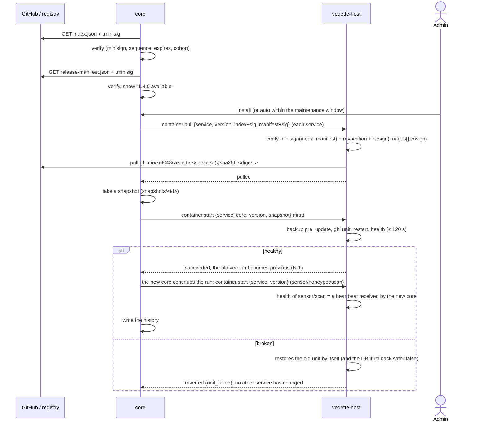

# Update manifest: release, signing, rollout, revocation, rollback

Status: draft (docs-first), 2026-11-09. Field names, formats and paths are in English.
Traceability: design requirements (signing, cohort, A/B, revocation, SBOM; GitHub publishes only signed software updates, with the content packs that go with them; OS updates, the box being the first device; appliance container, cosign, batches, rollback with an old tag, two install modes; ghcr, cosign with a key, offline verification; signature check in code, cosign in the manifest; the `scan` image is a base image, nmap is installed on the box at build time; pull, start, rollback, revocation); `docs/UPDATES.md`; stories S-CORE-2, S-CORE-7; GUI mock `web/src/features/core` (`UpdatesSection.tsx`, `OsUpdates.tsx`, `bundles.ts`, `contract.ts`).

## 1. Purpose

Defines **what the box downloads and how the box trusts it**: the release manifest, the signatures (minisign for the manifest, cosign for the container images), rollout in batches (cohort), the revocation list, rollback with an old tag, the OS update flow through `vedette-host`, and the offline bundle for air-gapped networks.

Principles (UPDATES): signatures are mandatory, the public key is in the binary, a change is never switched on globally (a lesson from Cloudflare 2025-12-05), and an update must be reversible. Feed data no longer goes through this channel; **the "1. Data" channel of UPDATES §1 is now the box pulling each feed from its source by itself**, outside this spec (`DATA_PIPELINE.md`).

Channel scope: **2. Content packs** (skills, confirmed recommendation packs, log parsers, recog…) and **3. Software** (container images, the `vedette-host` binary), plus **4. Product advisories**. Updating **operating-system packages** is handled by the distribution's apt (§9) and is **not** in the manifest.

## 2. Actors

| Actor | Role |
|---|---|
| Maintainer (the release approver) | creates the tag by hand, holds the signing key |
| CI GitHub Actions | builds, SBOM, signs, publishes the GitHub Release |
| GitHub Releases + image registry | the distribution store (see §14: registry) |
| `core` | checks for a new version, verifies the manifest signature, displays, orchestrates |
| `vedette-host` | **the final verifier** of the image (does not trust `core`), pulls and starts containers, rollback (`host-api.md`) |
| Administrator | chooses the channel/mode, presses update/rollback, imports a bundle |

## 3. Transport and authentication

- The box downloads over HTTPS from GitHub (Releases/API) and the image registry (PRIVACY flow 6: a request carries only the current Vedette version; no customer data).
- **The source is authenticated by signature, not by TLS.** Every file (index, manifest, image) is rejected if unsigned or wrongly signed, no matter where it comes from (mirror, bundle, USB). TLS only protects against eavesdropping.
- No token/account is sent to GitHub; while the repository is private, test boxes need a different mechanism before the first public release (open question §14).

## 4. Data definitions

Two JSON documents, both with a detached minisign signature (`<file>.minisig`).

### 4.1 `index.json`: the state of each channel (floating, signed, downloaded on every check)

| Field | Type | Rule |
|---|---|---|
| `schema` | int | `1` |
| `sequence` | uint64 | **strictly increasing**; the box rejects a `sequence` lower than one it has seen (against rollback/replay) |
| `generated_at`, `expires_at` | datetime | `expires_at` ≤ `generated_at` + 14 days; once expired → "update info is stale" (a warning; it does not yet block updating by bundle) |
| `channels` | object | `stable`, `beta` → `{ "latest": "<version>", "manifest": "<url>", "manifest_sha256": "<hex>", "rollout": { "percent": 0–100 } }` |
| `revoked` | object[] | xem §8 |
| `advisories` | object[] | `{ "id", "severity", "title", "affects": "<semver range>", "fixed_in": "<version>"?, "url" }`: channel 4 of UPDATES, shown as a banner (`UpdatesState.advisories`) |
| `keys` | object[] | `{ "key_id", "kind": "minisign"\|"cosign", "status": "active"\|"retired", "not_after" }`: so the box knows which key is in use; it is **not** a root of trust (the root is in the binary) |

### 4.2 `release-manifest.json`: one release (immutable, signed)

```json
{
  "schema": 1,
  "version": "1.4.0",
  "channel": "stable",
  "released_at": "2026-12-02T08:00:00Z",
  "min_upgrade_from": "1.2.0",
  "db_schema": 14,
  "rollback": { "safe": true, "min_version": "1.3.0" },
  "install_modes": ["appliance", "container"],
  "images": [
    { "service": "core", "ref": "ghcr.io/knt048/vedette-core:1.4.0", "digest": "sha256:…", "size": 61203456, "platforms": ["linux/amd64", "linux/arm64"], "cosign": { "payload": "<base64>", "signature": "<base64>" } },
    { "service": "sensor", "ref": "ghcr.io/knt048/vedette-sensor:1.4.0", "digest": "sha256:…", "size": 0, "platforms": ["linux/amd64"], "cosign": { "payload": "<base64>", "signature": "<base64>" } }
  ],
  "host": { "version": "1.4.0", "files": [ { "name": "vedette-host_1.4.0_amd64.deb", "sha256": "…", "size": 0 } ] },
  "content": [ { "name": "mitigation-packs", "version": "2026-12-02.1", "in_image": "core", "path": "/opt/vedette/content/…", "sha256": "…" } ],
  "bundled": [ { "service": "honeypot", "name": "opencanary", "version": "0.9.4" } ],
  "sbom": { "format": "CycloneDX", "url": "…", "sha256": "…" },
  "notes": "Short English text shown in the Updates page"
}
```

| Field | Notes |
|---|---|
| `images[].digest` | **the real key of trust**: the box pulls by digest, not by tag; the tag is for display only. A multi-platform image: the digest of the multi-platform index (checked in a lab) |
| `images[].ref` | must be exactly `ghcr.io/knt048/vedette-<service>:<version>`; the host compares it with a compile-time constant (`registry_not_allowed`) and builds the pull reference `…@sha256:<digest>` itself, and does not use this string to pull |
| `images[].size` | used only to check free space (`low_disk`: < 2 × `size`); it is **not** compared with the number of bytes downloaded |
| `images[].cosign` | `{ "payload": base64, "signature": base64 }`: cosign's Simple Signing payload and the ECDSA P-256 signature (DER) over the SHA-256 of the payload, produced by a version-pinned cosign with `sign --key --new-bundle-format=false --use-signing-config=false` (the legacy format); the same signature is also pushed to ghcr for anyone who wants to verify it themselves. The payload must have `critical.type` = `cosign container image signature`, `critical.image.docker-manifest-digest` equal to `digest`, and `critical.identity.docker-reference` **exactly equal** to `ghcr.io/knt048/vedette-<service>` (the repository, with no tag and no digest; because the signature travels inside the manifest nothing else ties it to a repository, and the signature of the `core` image is not accepted for a `sensor` entry). **How the release job signs:** `cosign sign --key <key> --new-bundle-format=false --use-signing-config=false --upload=false --output-payload payload.json --output-signature sig.b64 ghcr.io/knt048/vedette-<service>@sha256:<digest>` (signing by `<repository>@<digest>`, not by tag, with no `--sign-container-identity`; that is exactly what makes cosign write `docker-reference` = the repository), then the `base64` of `payload.json` and the content of `sig.b64` go into `images[].cosign`; verify again with `internal/release` before publishing. Unknown fields and duplicate keys are rejected. Because the manifest is signed with minisign, the image signature travels with the signed document, and there is no need to read the signature from the registry |
| `images[].service` | ∈ `core`, `sensor`, `honeypot`, `scan`, `greenbone`; any other value → the manifest is rejected |
| `min_upgrade_from` | a version jump that is too far must go through an intermediate release; a release that raises the sensor proto to N sets it no lower than the first release that has proto N-1 (`core` accepts only N and N-1); `release-manifest` reads the proto of this release and of every earlier release tag (`v<SemVer>`, not `-test.`) from git and refuses when it is missing |
| `db_schema`, `rollback` | whether rollback is safe or a DB restore is needed (§10) |
| `host` | the `vedette-host` package of the release; see the end of §9. **Mandatory, and `host.version` = `version`** (added 2026-11-12: `install.sh` always installs the release's `vedette-host_<version>_<arch>.deb`; the test channel does not go through the builder). The builder (`scripts/release` `buildHostPart`) refuses: a missing `host` part; `host.version` different from `version`; `host.version` containing `-test.`; a file name different from `vedette-host_<host.version>_<amd64\|arm64>.deb` under the unique naming rule `release.ParseHostPackageName` (SemVer form, a prerelease with no `-` inside, no build metadata; `host-api.md` §6.14); two files for one architecture; a missing file for an architecture for which an image is built |
| `content[]` | content packs **shipped together** with the update; only an index and hashes for display/verification, the files are in the `core` image |
| `bundled[]` | versions of pinned dependencies that live **inside the signed image** (OpenCanary in `honeypot`…), shown under "Managed packages", not installed with apt. **nmap is never listed here** (`LEGAL.md`): the `scan` image in `images[]` is only a base image (Debian slim + `vedette-sensor`), and `vedette-host` builds `localhost/vedette-scan-nmap:<version>` **on the box** with nmap from the Debian package repository (`host-api.md` §18); the running nmap version comes from the `scan` heartbeat (`sensor-protocol.md` §6.3), not from the manifest. Each entry: `service`, `name`, `version` are mandatory; `sha256` (64 lowercase hex) and `license` (an SPDX expression, ≤ 64 characters) are optional and checked when present. `release-in` fills it from `pins.env` and the committed package index, read from git at the tag `v<version>`. The `scan` image lists `{"service":"scan","name":"nuclei","version":"3.11.1","license":"MIT"}` (no `sha256`: nuclei is built from source for each architecture, and no single hash names it; the signed image digest does) and `{"service":"scan","name":"nuclei-templates-pack","version":"2026.11.1","sha256":"<the sha256 label in the pack's index.json>","license":"MIT"}`; values come from `deploy/containers/pins.env` and the package index generated by `make scan-pack` |
| `sbom` | a CycloneDX per release |
| `install_modes` | `appliance` and/or `container`, non-empty, with no duplicates (the `manifest` builder and `internal/release` both refuse). When `container` is present the release **must** publish the four files of the container-only build next to the manifest: `vedette.env` (three image lines filled with exactly `ghcr.io/knt048/vedette-<service>@sha256:<64 hex>` from `images[]`), `compose.yaml`, `compose.sensors.yaml`, `compose.syslog.yaml`, each file with a `.minisig` signed by the manifest's key, trusted comment `file:<file> version:<version>`; `release verify` refuses when they are missing, and refuses those files when there is no `container` (`release container-assets`) |

Relation to `UpdatesState` in the mock: `components` ↔ `images[]`/`content[]`; `signature: valid|invalid|unsigned` ↔ the verification result of §5.

## 5. Signing and verification

### 5.1 Two signature layers

| Object | Tool | Who verifies | Key |
|---|---|---|---|
| `index.json`, `release-manifest.json`, the `host` file | **minisign** (Ed25519 over BLAKE2b-512, format `ED`; the legacy `Ed` is rejected) | `core` (for display), **and `vedette-host`** (before acting) | two public keys embedded in the `core` and `vedette-host` binaries: the active key and an offline backup key held by the maintainer |
| Container image | **cosign** (ECDSA P-256, legacy format; the signature travels **in the manifest** at `images[].cosign`, a copy is pushed to ghcr for people to verify themselves) | `vedette-host` at `container.pull`, **before** pulling | the cosign public key embedded in `vedette-host` |

`core` is not the only verifier: **the host verifies by itself** the manifest, the digest and the image signature (see `host-api.md` §6.7). If `core` is taken over, it **cannot** make the host run an unsigned image, because the host accepts only a digest present in a correctly signed manifest and builds the pull reference from a constant itself.

Verification implementation (**decided**): the project's `internal/release` package, pure, shared by host and `core`, using only the standard library (`crypto/ed25519`, `crypto/ecdsa` `VerifyASN1`) and the pinned `golang.org/x/crypto/blake2b`. Rekor is not checked (offline verification); Podman's `policy.json` `sigstoreSigned` is not used (it is Podman-wide configuration, needs `use-sigstore-attachments` in registries.d, and depends on the level of cosign support in Podman 4.9), `sigstore-go` is not used (79 modules in a root process), and the cosign CLI is not run on the box. JSON is decoded strictly (unknown fields, duplicate keys, and duplicate keys after case folding are rejected). The contract is unchanged: **pull by digest, run only when the signature is valid**. Risk: cosign v4 will drop the legacy format; before then the new bundle format (DSSE) must be verified in code.

**Installed:** `internal/release` (the `internal/jsonstrict` package holds the strict JSON rule shared with the host). API: `VerifyIndex(raw, sig, trust, stored)`, `VerifyManifest(raw, sig, trust, idx)`, `VerifyImage(m, service, digest, trust)`, `CheckUpgrade`, `CheckRollback`, `CheckPlatform`, `CheckInstallMode`, `CheckManifestSHA256`, `PullRef`; typed errors (`ErrBadSignature`, `ErrKeyRevoked`/`ErrReleaseRevoked` both match `ErrRevoked`, `ErrSequenceRegress`, `ErrDowngrade`, `ErrUpgradePath`, `ErrRollbackNotAllowed`, `ErrPlatform`, `ErrRegistryNotAllowed`, `ErrDigestNotInManifest`, `ErrUnknownSchema`, `ErrNoTrustKeys`…). The public keys are compile-time constants in `keys.go` (the real keys come from the key ceremony of 2026-11-11, `docs/RELEASE_KEYS.md`): a build with an empty constant or an invalid key **rejects everything** and logs the reason; test keys exist only when built with the tag `releasetestkeys` (`Trust.TestOnly`). The key revocation rule (§8) is enforced by code: only an index signed with the backup key can revoke an embedded key, no index can revoke the backup key, and revoking an embedded key is retained through every later index (sticky); release and digest revocations are replaced by the new index. A cosign ECDSA signature with a high S is still accepted (cosign does not normalise S). `critical.identity.docker-reference` is checked as in SIGNATURE_SPEC. **Changes after an independent review (fixes):** (1) revoking a release and a digest is also **retained** (sticky) like key revocation; only an index signed with the backup key can drop a release/digest revocation (its list is authoritative), while an index signed with the active key that omits one still has it retained; (2) key revocations (`kind=key`) are accepted only from an index signed with the backup key: in an index signed with the active key they are dropped and logged, whether or not the binary embeds that key; a stored revocation of the current backup key is ignored; (3) `sequence`: an index signed with the backup key that revokes the signer of the stored index may set any `sequence`, even a lower one (only once per exposed key because revocation is retained); an equal `sequence` is accepted only when the SHA-256 of the index bytes equals the stored copy; (4) the revocation list that is carried along is not part of the signed portion, so it can be longer than 256 entries (cap 4096; beyond that an index signed with the backup key is needed); (5) `VerifyImage` refuses a `Manifest` that was not produced by `VerifyManifest`; `Embedded()` refuses test keys outside test files; `CheckRollback` requires the target version to be lower than the running one. A cosign key can also be revoked with `kind=key` (id: the hex SHA-256 of the PKIX DER), and two cosign keys can be embedded during key rotation. Out of scope for this part: storing the index/manifest (host), cohort (core), bundle verification.

### 5.2 Key or keyless (cosign): the trade-off

| | **Key (cosign `--key`)** | **Keyless (Sigstore: Fulcio + Rekor, GitHub OIDC identity)** |
|---|---|---|
| Verification on an offline box | Yes, only the embedded public key is needed | Needs Sigstore's "trusted root" (TUF) and log evidence (Rekor); offline verification is possible with a bundle but an old root on a rarely updated box may break |
| Long-term key risk | The private key sits in CI/on the maintainer's machine: a leak = forged signatures until revoked | No long-term key; identity = the workflow `…/release.yml@refs/tags/v*` |
| Revocation | revoke the `key_id` in `index.json` + a new binary embeds the new key | no key revocation; revoke by digest/release |
| Dependency on an external service when signing | None | Yes (Fulcio, Rekor; a problem if the free infrastructure changes) |
| Information leak | None | **The public Rekor records identity/repository**: it exposes the name of a private repository until the repository is made public |
| Someone with write access to the repository/workflow | can sign | can sign (the same level) |

**Decided:** the box **verifies only with the embedded public cosign key** (offline, no dependence on Sigstore, suitable for an air-gapped network). The rest is still a proposal and not yet decided: CI **would also publish a keyless signature** in parallel for users/auditors who want to verify by themselves (matching UPDATES §4.4 "minisign for the box, cosign for people"). The box does not require a keyless signature. The cosign key is **separate** from the minisign key and from every other CI secret; key rotation = a new binary embeds both the old and the new key during a transition period (signed with both).

**Rotating the minisign key and the stored index.** A build also embeds a list of **retired keys** (`Trust.Retired`, the constant `prodMinisignRetired`, empty until the first rotation). A retired key is used **only** to re-verify an index that the box stored while the key was still in use (`release.VerifyStoredIndex`), so the `sequence` number and the stored revocation list survive the rotation; it **never** accepts a new index or manifest (`VerifyIndex`, `VerifyManifest` do not know it). The rotation procedure: the new build has the new key as the active key and the old key in `Retired`; the operator does not need to delete `releases/index.json`.

**The `sequence` floor at build time.** When no index has been stored, the host accepts an index whose `sequence` ≥ the build's `release.MinSequenceText` (the release job sets it with `-ldflags "-X github.com/knt048/vedette/internal/release.MinSequenceText=<n>"` equal to the `sequence` of the current index at build time; the default 0 means no floor), so a fresh install cannot be fed an old index. When there is a stored index, the stored number is the floor.

### 5.3 The box's verification procedure (`core`, then `host` repeats it)

1. Download `index.json` + `.minisig`; check the signature with the embedded key, and check that `key_id` is not revoked.
2. `sequence` ≥ the stored value (`core_audit` stores the highest value seen); `expires_at` has not passed (or show "stale").
3. Choose the release: the chosen channel, `rollout.percent` against the cohort (§6), `min_upgrade_from` satisfied.
4. Download `release-manifest.json` by the URL in the index; check `sha256` against `manifest_sha256` and check the minisign signature.
5. Check that the manifest is not revoked (§8).
6. Show it to the admin (or install automatically if the mode is `auto`).
7. Update: `host` repeats steps 1, 2, 4, 5 with the documents `core` hands over, checks the cosign signature in the manifest and `platform`, then pulls each image by **digest** (without matching `size`; `host-api.md` §6.7).

Each check writes `core_audit` (who, when, version, sha256) as in UPDATES §5.

## 6. Cohort and batch rollout

- `install_id` = a random 256-bit string generated at install (used only for rollout); it is **never sent out**. `cohort = uint32(SHA-256(install_id || "vedette-cohort")[0:4]) mod 100`, computed locally.
- A box is **eligible** for a release when `cohort < rollout.percent` of that release in `index.json`. Default schedule: 10 % → 50 % → 100 %, each later step after ≥ 24 hours with no error reports (UPDATES §2). Software: `beta` before `stable` for at least 7 days.
- The admin's "Check now" still respects the cohort; there is **no** "Install anyway" button for a release whose cohort has not arrived (to avoid a global switch-on through a button; open question §15).
- Lowering `percent` (pausing a rollout): boxes that have not updated will not receive it; boxes that have updated are not forced back (to force a rollback use `revoked`, §8).
- Channels: `stable` and `beta` (like `UpdateChannel`); chosen in Settings → Updates. Mode `auto|manual` like `UpdatesState.mode`; in `auto`, it installs by itself only within the maintenance window and only a release that is **not** revoked.

## 7. Software update (appliance)



Rule: A/B by **tag/digest** (replacing the old design's "A/B slot binary" with the old tag); `core` is changed **before** the other services (a sensor/worker is never newer than `core`, and `core` accepts their proto and the one just before, `sensor-protocol.md` §10), and the process continues when the new `core` comes back up because the host keeps the run state (see `host-api.md` §6 on the durable `run`), and the new `core` itself changes the remaining services. A service that then breaks returns to its old version by itself, and `core` stays on the new version (run `failed`, with history); Rollback returns the whole box. Rollback goes the other way: the other services first, `core` last. Only one update at a time.

**The "Container only" install mode** (the customer's existing Docker/Podman, with no `vedette-host`): the box **does not update images by itself**; Settings → Updates shows the new version, the `pull`/`up` commands, and instructions to verify the signature (cosign) for the customer to run; no OS operations. The limitation is stated plainly in the GUI.

## 8. Revocation list

`index.json.revoked[]`:

| Field | Example |
|---|---|
| `kind` | `release` (one version), `image_digest`, `key` (a signing key), `advisory_only` |
| `id` | `1.3.2`, `sha256:…`, `key_id` |
| `reason` | a short English string |
| `since` | datetime |
| `action` | `block_install` \| `block_install_and_warn` \| `rollback_if_possible` |

Box behaviour:

- `block_install`: never install that release/digest (including under auto, and by bundle).
- A **running** release that is revoked: a severity banner on every page when `action` is `block_install_and_warn` or `rollback_if_possible`, only a note on the Updates page when it is `block_install` (`UpdatesState.running_revoked`) + a notification on the admin channel (not built yet); `rollback_if_possible` goes back automatically only in `auto` mode, when tag N−1 still exists, is not revoked, and `rollback.safe`; otherwise the admin decides.
- A revoked key: a manifest signed with that key is rejected even if it was installed earlier (the box does not remove the software, it only stops trusting any further).
- The revocation itself is signed within `index.json`; a newer `index.json` replaces it (by `sequence`). The box stores the highest version it has seen so an old index cannot "resurrect" a revoked release.

## 9. OS updates through `vedette-host`

OS updates do **not** go through the manifest/cohort/cosign: the signature is **apt's** (the Debian/Ubuntu repository). The manifest only shows status. Flow:

1. The admin goes to Settings → Updates (mock `/core/updates/os*`); `core` calls the host's `os.check` → `apt-get update` + lists the upgradable packages, marking security ones, a needed reboot (`/var/run/reboot-required`), and the release's support deadline (`OsState`).
2. `os.install {scope: security|all}`: the host **backs up the DB first** (`backup.create`), runs a fixed list of apt commands (SYS-1), streams progress, runs a health check afterwards, and reports whether a reboot is needed.
3. Reboot now/within a window (`os.reboot`); automatic security updates = `unattended-upgrades` configured by the host (`os.auto_security`), a maintenance window.
4. Upgrading the OS release (Ubuntu 24.04 → 26.04, Debian 13 → a later release): **instructions only** (`release_upgrade`), never done automatically.
5. The package repository is an outbound flow already listed in PRIVACY flow 6; the user can point apt at an internal mirror.

Two install modes: the "Container only" mode has no such flow.

### Updating `vedette-host` itself

The host is a small root process; updating it is the most sensitive task. The manifest has a `host` entry (§4.2) so the `.deb` is handled by the host/installer. **Decided**: the host updates itself with the signed `.deb` on the GitHub Release, checks its health, and returns to the previous version if it breaks. **Design:** `host-api.md` §6.14 `host.self_update`: the host checks the index and manifest like `container.pull`, installs only a file whose SHA-256 equals the entry `host.files[]` `vedette-host_<host.version>_<arch>.deb`, and only goes upward (`host.version` compared with the running host version, not with the manifest's `version`).

## 10. Rollback

- Keep **N−1** for each service: the host keeps the running version, `previous` and the newest version pulled (tag `localhost/vedette-<service>:<version>`), removes any other version with `podman rmi <digest>` after each successful start, and never uses `prune -a`; together with the `pre_update` DB backup that **the host creates inside `core`'s `container.start`** from the `core` snapshot handed over (`host-api.md` §6.8). `container.rollback {service}` returns a service to `previous`; the GUI has a Rollback button for each component (S-CORE-2).
- **Software rollback differs from DB rollback.** The manifest declares `db_schema` and `rollback.safe`: if `true`, the new version's code only adds backward-compatible columns/tables, so the old version can run on the new DB; if `false`, rollback **must** be accompanied by restoring the DB from the `pre_update` backup of that update (losing data written since the update): the host does both **in the same run** `container.rollback` (stop `core` → restore → old unit → start → health check, and if it fails, restore both); `core` does not call `backup.restore` separately. The GUI warns "data written since the update is lost" and calls the host only when the user confirms (`confirm_data_loss`, S-CORE-2). The `pre_update` backup no longer exists → `rollback_backup_missing`.
- **Schema epoch.** The release builder reads `core/store/SCHEMA_EPOCH` at the tag of the release and of every earlier release.
  Within one epoch the migrations only go forward (none removed, edited or numbered below an earlier release's), whatever
  `rollback.safe` says. A release whose epoch is above the previous release's starts a new migration history: the builder refuses
  `rollback.safe=true` for it, so a rollback across it always restores the `pre_update` backup. The epoch is not a manifest field
  (a box of schema 1 refuses unknown fields); core refuses a database of another epoch at start, so an update from a release of an
  earlier epoch fails its health check and the host puts the previous release and its database back.
- `rollback.min_version` is the lowest version that can be rolled back to: a lower `previous` → `rollback_not_allowed`. Lowering the version with `container.start` is always refused (`downgrade_not_allowed`, SemVer order); only a rollback to the verified `previous` may lower it.
- Rollback does not go through the cohort/rollout check, but it **still** must: the target version has been verified on this host before, is not revoked per the stored index (`previous_revoked`), the anti-downgrade `sequence` does not apply to a user-initiated rollback to the installed N−1 (allowed), and it writes `core_audit` + the history `action: rollback`.
- A failed start after an update: the host **itself** restores the old unit (and the DB when `rollback.safe=false`) in the very run of `container.start` (`reverted`, `unit_failed`). A failed rollback (rare) → the host restores the running version; if that step itself fails, `vedette-host` keeps the last state and reports it for the admin to handle by hand (`rollback_revert_failed`): no automatic loop. The host never rolls back by itself because of a revocation (§8: `core` decides).

## 11. Offline bundle (air-gapped network)

Matches `/core/updates/bundle` in the mock (export signed, import rejects a wrong signature) and `vedette bundle export|import` (UPDATES §3).

Structure of `vedette-bundle-<version>.tar` (no nested compression; images are already compressed):

```
bundle.json                 { schema, version, channel, created_at, files:[{path,sha256,size}] }
index.json  + .minisig      the index as of the time of export
release-manifest.json + .minisig
images/<service>.oci.tar    an oci-archive with exactly the digest in the manifest
host/*.deb                  (if there is a host release)
sbom.json
```

- **The bundle has no signature of the exporting box**: trust comes from the existing release signatures (minisign for the manifest, cosign for the image; the cosign signature is already in the manifest at `images[].cosign`, so the bundle needs no `signatures/` directory). Importing a bundle into the host: `container.pull` with `source: bundle` (`host-api.md` §6.7 "The `bundle` source"); `core` writes the file to `<core_data>/bundles/<bundle_id>.tar` and sends only the id. `bundle.json` is only a list of hashes so `core` detects damage early; the host does not read it: every byte the host uses is either signed, or hashed and compared against something that is signed.
- **The tar rules (checked by the host)**: only the names above (plus the directories `images/`, `host/`), only regular files (no symlink, hard link, device, FIFO, sparse), no duplicate names, ≤ 64 entries; caps: documents 256 KiB, signatures 2 KiB, `bundle.json` 1 MiB, `sbom.json` 64 MiB, each `.deb` 256 MiB, the whole bundle 8 GiB. The order of entries is free.
- **The rules of `images/<service>.oci.tar` (the builder must follow)**: an OCI image layout in tar form (`oci-layout`, `index.json`, `blobs/sha256/<hex>`, nothing else) whose `index.json` names **exactly one** image with a digest **equal to the manifest's `images[].digest`** (the digest of the multi-platform index as pushed to `ghcr.io`), exported **preserving the digest**: `skopeo copy --all --preserve-digests docker://ghcr.io/knt048/vedette-<service>@<digest> oci-archive:images/<service>.oci.tar:ghcr.io/knt048/vedette-<service>:<version>` (or `podman manifest push --all <list> oci-archive:…`, tried on Podman 5.7.0: `index.json` keeps the digest of the list); it must contain the blobs of every platform the manifest lists in `platforms`. The archive's `ref.name` annotation is not used: the host writes `index.json` itself when loading.
- **`host/*.deb`**: `core` copies it to `<core_data>/host-packages/<id>.deb` and calls `host.self_update` with the four documents of the package (the host checks the SHA-256 against the signed `host.files[]`); `container.pull` does not read it.
- **Import:** (1) verify the manifest and index signatures with the embedded key; (2) check `sequence`, revocation, `min_upgrade_from`; (3) for each image, verify that the digest **of the archive itself** (`oci-archive` recomputed) matches the manifest and the cosign signature; (4) only then ask the host to load it (`container.pull` with `source: bundle`). A bad signature → `Import rejected` (the mock GUI says "a bad signature is rejected"), and there is no way to skip this.
- A bundle does **not** replace the index's `expires_at`: an expired index inside a bundle is still imported once (this is the offline path) but shows a "stale" warning.
- A bundle contains only **software packages + content**; feed data for an air-gapped machine is imported with a feed bundle ("switch to offline bundles" in PRIVACY flow 1): outside this spec.
- Size: a bundle includes images so it is several hundred MiB to several GiB; **an upload from the GUI needs streaming (multipart) to a temporary file in the volume**, not JSON base64 as in the mock (the mock is only a preview, `BundleUpload.content`).

## 12. Limits

| Item | Default limit |
|---|---|
| `index.json`, `release-manifest.json` | ≤ 256 KiB each; the `container.pull` body (two documents + two signatures, base64) ≤ 1 MiB (`host-api.md` §10) |
| Number of images per manifest | ≤ 16 |
| Image size | `size` is only for checking free space (≥ 2 × `size` free); it is **not** compared with the number of bytes downloaded: Podman does not report the byte count, and pulling by digest already guarantees integrity |
| Images kept per service | the running version, `previous`, and the newest version pulled |
| Uploaded bundle | a configured cap (proposed 8 GiB; the host refuses a file > 8 GiB), requires ≥ 2× free space on `core` when receiving; when loading an image the host requires ≥ 3 × the size of its archive (room for the image and the host state) |
| Check frequency | at most every 6 hours + jitter ± 30 minutes (default, can be turned off at Privacy → `update_check`) |
| Index expiry | ≤ 14 days |
| Health-check deadline after an update | 120 seconds (default) |
| History shown in the GUI | the 20 most recent entries (UpdatesState.history) |

## 13. Security considerations (mapping to SYS)

| SYS | Applies |
|---|---|
| SYS-1 | Updates have no shell; only commands in the `vedette-host` allowlist (`host-api.md`); `core` does not touch apt/podman |
| SYS-2 | The manifest/index JSON is validated against a schema, `service` against an enum, digest against `^sha256:[a-f0-9]{64}$`, URLs only `https` and the host in the declared list |
| SYS-3 | Every check/install/rollback/bundle import writes `core_audit` and the host's log |
| SYS-4 | The **private** signing key never enters the box; only the public key is embedded |
| SYS-5 | Turning the check off (`update_check=false`) → no job, no outbound request; data is kept |
| SYS-6 | A manifest/index/bundle from the network/USB is **untrusted** until signed; size limits, fail-closed parsing |
| SYS-7 | Download URLs belong to the **fixed host list** declared in PRIVACY (GitHub, the registry, the apt mirror); redirects outside the list are not followed |
| SYS-8 | The AI has no path to trigger an update |

Threats and measures: (a) taking over the GitHub repository/registry → it cannot sign, so the box refuses; (b) a leaked signing key → revoke the key in an `index.json` signed with the embedded offline backup key + a new binary (a weakness if both leak); (c) rollback/replay of an old manifest with a vulnerability → `sequence`; (d) freeze (holding back an old index so the box does not see the fix) → `expires_at` + a warning on the Updates page (`UpdatesState.stale_since`); (e) bundle poisoning → re-verify all signatures; (f) spread of a bad release → cohort + `beta` ≥ 7 days + health check + rollback; (g) `core` taken over → the host verifies independently.

## 14. Versioning

- The `schema` of `index.json` and the manifest is an integer; a `schema` different from the one the box understands → "Update the box through bundle or reinstall" (the box does not guess). **Within the same `schema`, unknown fields are rejected** (fail closed, SYS-6): adding a field must raise `schema`. So that old boxes can still receive revocations, the publisher **keeps publishing the previous schema's index** next to the new one (for example `index.v1.json`) for at least 12 months after each `schema` increase. This replaces the earlier sentence "unknown fields are ignored", which contradicted §5.1.
- Version label: SemVer 2.0; the `beta` channel uses the suffix `-beta.N`.
- `min_upgrade_from` protects against version jumps; `db_schema` increases monotonically.
- The host protocol (`host-api.md`) has its own version number; the manifest records the minimum `host.version` needed to install this release.

## 15. Open questions

1. ~~**Cosign: key or keyless**~~ **Decided:** the box verifies with an embedded, offline cosign key, in the project's own code, with the signature travelling in the manifest; the offline backup minisign key held by the maintainer is embedded together with the active key. Still open: whether CI also publishes a keyless signature for users. The verification code exists (section 5.1); the maintainer still has to create the three offline keys and paste the public parts into `internal/release/keys.go`.
2. **The image registry and where `index.json` is stored**: the design uses GitHub only to publish software; GHCR is reasonable but not settled. A test box needs a read token while the repository is still private (where does the credential live?). Should `channels.json` + the second mirror of UPDATES §6 be kept now that the builder/Cloudflare has been dropped for data?
3. ~~**Updating `vedette-host` itself**~~ **Decided:** the `.deb` signed on the GitHub Release, the host upgrades itself; the command is not yet in the allowlist (left for later).
4. Should there be an "Install anyway" button for a release whose cohort has not arrived (spec: no)?
5. The key `K_cohort`/`install_id`: it is local only and used for the rollout cohort; no anonymous signal exists, so nothing else shares it.
6. Automatic `rollback_if_possible`: on by default or always needing an admin?
7. The health-check time, check frequency and bundle cap are starting points, not measured.
8. Signatures of third-party dependencies in the image (nuclei, OpenCanary; nmap is in no signed image, it is installed when `scan` is built on the box): Vedette packages and signs the **whole image**; how they are used (a separate process in a container) must be recorded in `THIRD_PARTY_NOTICES` when building (rule `legal.md`).
