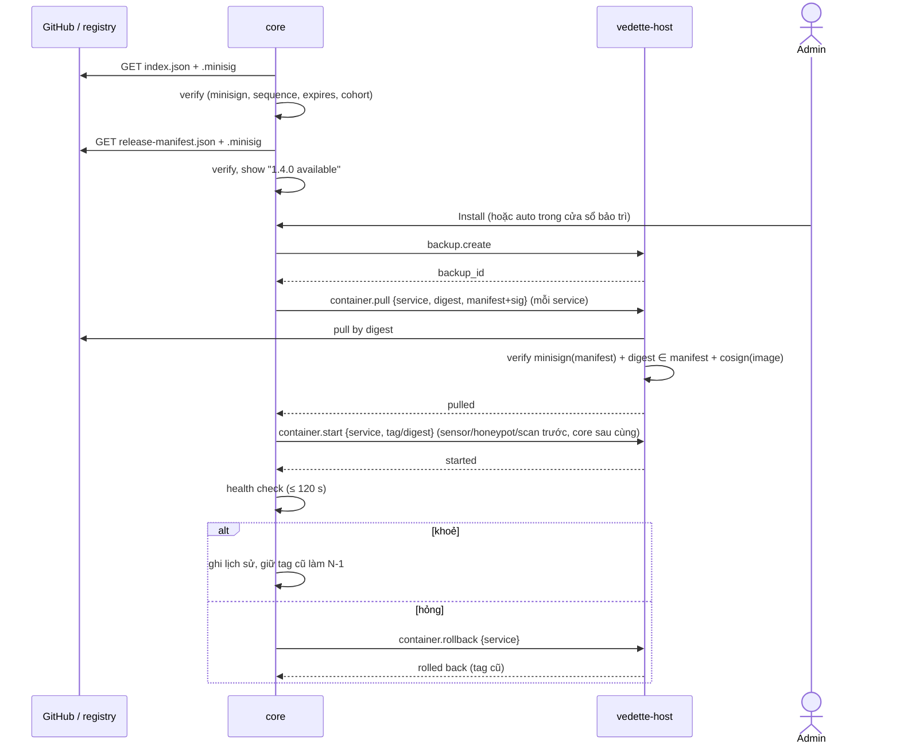

# Update manifest: phát hành, ký, rollout, thu hồi, hoàn tác

Trạng thái: bản nháp M2-0 (docs-first), 2026-11-09. Văn xuôi tiếng Việt; tên trường, định dạng, đường dẫn bằng tiếng Anh.
Truy vết: D-12 (ký, cohort, A/B, thu hồi, SBOM; **cập nhật bởi D-55**), D-36 (GitHub chỉ phát hành bản cập nhật phần mềm ký số; gói nội dung đi kèm), D-53 (cập nhật OS, hộp là thiết bị đầu tiên), D-55 (appliance container, cosign, lô, hoàn tác bằng tag cũ, hai kiểu cài), D-54 (repo `kiennt048/vedette` riêng tư), D-16; `docs/UPDATES.md`; story S-CORE-2, S-CORE-7; GUI mock `web/src/features/core` (`UpdatesSection.tsx`, `OsUpdates.tsx`, `bundles.ts`, `contract.ts`).

## 1. Mục đích

Định nghĩa **thứ hộp tải về và cách hộp tin nó**: manifest phát hành, chữ ký (minisign cho manifest, cosign cho image container), rollout theo lô (cohort), danh sách thu hồi, hoàn tác bằng tag cũ, luồng cập nhật OS qua `vedette-host`, và gói offline cho mạng cách ly.

Nguyên tắc (UPDATES, D-12): chữ ký bắt buộc, khoá công khai trong binary, không bao giờ bật toàn cục một thay đổi (bài học Cloudflare 2025-12-05), cập nhật phải hoàn tác được. D-36: dữ liệu feed không còn đi qua kênh này; **kênh "1. Dữ liệu" của UPDATES §1 nay là hộp tự kéo từng feed từ nguồn**, ngoài spec này (`DATA_PIPELINE.md`).

Phạm vi kênh: **2. Gói nội dung** (skill, gói khuyến nghị đã xác nhận, parser log, recog…) và **3. Phần mềm** (image container, binary `vedette-host`), cộng **4. Advisory sản phẩm**. Cập nhật **gói của hệ điều hành** do apt của distro lo (§9), **không** nằm trong manifest.

## 2. Actors

| Actor | Vai trò |
|---|---|
| kien (người duyệt phát hành) | tạo tag tay (AI không tạo tag), giữ khoá ký |
| CI GitHub Actions | build, SBOM, ký, đăng GitHub Release |
| GitHub Releases + registry image | kho phân phối (xem §14: registry) |
| `core` | kiểm tra bản mới, xác minh chữ ký manifest, hiển thị, điều phối |
| `vedette-host` | **bên xác minh cuối cùng** của image (không tin `core`), kéo và khởi động container, rollback (`host-api.md`) |
| Quản trị viên | chọn kênh/chế độ, bấm cập nhật/rollback, nhập bundle |

## 3. Transport và xác thực

- Hộp tải bằng HTTPS tới GitHub (Releases/API) và registry image (PRIVACY luồng 6: yêu cầu chỉ mang phiên bản Vedette hiện tại; không dữ liệu khách).
- **Xác thực nguồn là chữ ký, không phải TLS.** Mọi tệp (index, manifest, image) bị từ chối nếu không ký/sai ký, bất kể đến từ đâu (mirror, bundle, USB). TLS chỉ chống nghe lén.
- Không gửi token/tài khoản tới GitHub; repo riêng tư (D-54) tới go/no-go M0 cần cơ chế khác cho hộp thử nghiệm (câu hỏi mở §14).

## 4. Định nghĩa dữ liệu

Hai tài liệu JSON, cả hai có chữ ký detached minisign (`<file>.minisig`).

### 4.1 `index.json`: trạng thái từng kênh (nổi, ký, tải mỗi lần kiểm tra)

| Trường | Kiểu | Quy tắc |
|---|---|---|
| `schema` | int | `1` |
| `sequence` | uint64 | **tăng đơn điệu**; hộp từ chối `sequence` nhỏ hơn đã thấy (chống rollback/replay) |
| `generated_at`, `expires_at` | datetime | `expires_at` ≤ `generated_at` + 14 ngày; quá hạn → "update info is stale" (cảnh báo, chưa chặn cập nhật bằng bundle) |
| `channels` | object | `stable`, `beta` → `{ "latest": "<version>", "manifest": "<url>", "manifest_sha256": "<hex>", "rollout": { "percent": 0–100 } }` |
| `revoked` | object[] | xem §8 |
| `advisories` | object[] | `{ "id", "severity", "title", "affects": "<semver range>", "fixed_in": "<version>"?, "url" }`: kênh 4 của UPDATES, hiện banner (`UpdatesState.advisories`) |
| `keys` | object[] | `{ "key_id", "kind": "minisign"\|"cosign", "status": "active"\|"retired", "not_after" }`: để hộp biết khoá nào đang dùng; **không** là gốc tin cậy (gốc nằm trong binary) |

### 4.2 `release-manifest.json`: một bản phát hành (bất biến, ký)

```json
{
  "schema": 1,
  "version": "1.4.0",
  "channel": "stable",
  "released_at": "2026-12-02T08:00:00Z",
  "min_upgrade_from": "1.2.0",
  "db_schema": 14,
  "rollback": { "safe": true, "min_version": "1.3.0" },
  "install_modes": ["appliance", "container"],
  "images": [
    { "service": "core", "ref": "ghcr.io/kiennt048/vedette-core:1.4.0", "digest": "sha256:…", "size": 61203456, "platforms": ["linux/amd64", "linux/arm64"], "signature": "cosign" },
    { "service": "sensor", "ref": "…", "digest": "sha256:…", "size": 0, "platforms": ["linux/amd64"], "signature": "cosign" }
  ],
  "host": { "version": "1.4.0", "files": [ { "name": "vedette-host_1.4.0_amd64.deb", "sha256": "…", "size": 0 } ] },
  "content": [ { "name": "mitigation-packs", "version": "2026-12-02.1", "in_image": "core", "path": "/opt/vedette/content/…", "sha256": "…" } ],
  "bundled": [ { "service": "scan", "name": "nmap", "version": "7.95" }, { "service": "honeypot", "name": "opencanary", "version": "0.9.4" } ],
  "sbom": { "format": "CycloneDX", "url": "…", "sha256": "…" },
  "notes": "Short English text shown in the Updates page"
}
```

| Trường | Ghi chú |
|---|---|
| `images[].digest` | **khoá tin cậy thật**: hộp kéo theo digest, không theo tag; tag chỉ để hiển thị |
| `images[].service` | ∈ `core`, `sensor`, `honeypot`, `scan`, `greenbone` (D-55); mọi giá trị khác → từ chối manifest |
| `min_upgrade_from` | nhảy phiên bản quá xa phải qua bản trung gian |
| `db_schema`, `rollback` | hoàn tác an toàn hay cần khôi phục DB (§10) |
| `host` | bản mới của `vedette-host` (nếu có); xem cuối §9 và câu hỏi mở |
| `content[]` | gói nội dung **đóng chung** với bản cập nhật (D-36); chỉ là chỉ mục và băm để hiển thị/xác minh, tệp nằm trong image `core` |
| `bundled[]` | phiên bản các phụ thuộc ghim (nmap, OpenCanary…) hiển thị ở "Managed packages" (D-53 mục 2); trong appliance chúng nằm trong image `scan`/`honeypot`, không cài bằng apt |
| `sbom` | CycloneDX mỗi phát hành (D-12) |

Quan hệ với `UpdatesState` trong mock: `components` ↔ `images[]`/`content[]`; `signature: valid|invalid|unsigned` ↔ kết quả xác minh §5.

## 5. Ký và xác minh

### 5.1 Hai lớp chữ ký

| Đối tượng | Công cụ | Ai xác minh | Khoá |
|---|---|---|---|
| `index.json`, `release-manifest.json`, tệp `host` | **minisign** (Ed25519) | `core` (để hiển thị), **và `vedette-host`** (trước khi hành động) | public key nhúng trong binary `core` và `vedette-host` |
| Image container | **cosign** (chữ ký lưu cạnh image trong registry) | `vedette-host` khi `container.pull` | public key nhúng trong `vedette-host` (hoặc danh tính, §5.2) |

`core` không phải bên xác minh duy nhất: **host tự kiểm** manifest, digest, chữ ký image (xem `host-api.md`). Nếu `core` bị chiếm, nó **không** thể bắt host chạy một image không ký, vì host chỉ chấp nhận digest có mặt trong một manifest ký đúng.

Triển khai xác minh image cosign: dùng chính cơ chế của Podman (`policy.json` kiểu `sigstoreSigned` với khoá công khai, do `vedette-host` sinh từ mã, ships-as-code) và/hoặc thư viện Go (sigstore-go) trong `vedette-host`; chọn cái nào là chi tiết cài đặt, hợp đồng là: **kéo theo digest, chỉ chạy khi chữ ký hợp lệ**.

### 5.2 Khoá hay keyless (cosign): đánh đổi

| | **Khoá (cosign `--key`)** | **Keyless (Sigstore: Fulcio + Rekor, danh tính GitHub OIDC)** |
|---|---|---|
| Xác minh trên hộp offline | Có, chỉ cần public key nhúng sẵn | Cần "trusted root" của Sigstore (TUF) và bằng chứng log (Rekor); xác minh offline được bằng bundle nhưng root cũ trên hộp ít cập nhật có thể hỏng |
| Rủi ro khoá dài hạn | Khoá riêng nằm ở CI/máy kien: lộ = ký giả mạo mãi tới khi thu hồi | Không có khoá dài hạn; danh tính = workflow `…/release.yml@refs/tags/v*` |
| Thu hồi | thu hồi `key_id` trong `index.json` + bản binary mới nhúng khoá mới | không thu hồi khoá; thu hồi theo digest/phát hành |
| Phụ thuộc dịch vụ ngoài khi ký | Không | Có (Fulcio, Rekor; vấn đề nếu hạ tầng free đổi) |
| Rò thông tin | Không | **Rekor công khai ghi danh tính/repo**: lộ tên repo riêng tư (D-54) tới khi repo công khai |
| Kẻ có quyền ghi repo/workflow | ký được | ký được (cùng mức) |

**Đề xuất của spec (chờ kien chốt):** hộp **chỉ xác minh bằng khoá cosign công khai nhúng sẵn** (offline, không phụ thuộc Sigstore, hợp mạng cách ly). Đồng thời CI **vẫn đăng chữ ký keyless** song song cho người dùng/kiểm toán muốn tự xác minh (đúng ý UPDATES §4.4 "minisign cho hộp, cosign cho người"). Hộp không đòi chữ ký keyless. Khoá cosign **tách** khỏi khoá minisign và tách khỏi mọi bí mật CI khác; xoay khoá = bản binary mới nhúng cả khoá cũ và mới trong một giai đoạn chuyển (ký bằng cả hai).

### 5.3 Quy trình xác minh của hộp (`core`, rồi `host` lặp lại)

1. Tải `index.json` + `.minisig`; kiểm chữ ký bằng khoá nhúng, kiểm `key_id` không bị thu hồi.
2. `sequence` ≥ giá trị đã lưu (`core_audit` lưu giá trị cao nhất đã thấy); `expires_at` chưa qua (hoặc hiện "stale").
3. Chọn bản: kênh đã chọn, `rollout.percent` so với cohort (§6), `min_upgrade_from` thoả.
4. Tải `release-manifest.json` theo URL trong index; kiểm `sha256` bằng `manifest_sha256` và kiểm chữ ký minisign.
5. Kiểm manifest không bị thu hồi (§8).
6. Hiển thị cho admin (hoặc tự động nếu chế độ `auto`).
7. Cập nhật: `host` kéo từng image theo **digest**, kiểm chữ ký cosign, đối chiếu `size`, kiểm `platform` (§10).

Mỗi lần kiểm tra ghi `core_audit` (ai, khi nào, phiên bản, sha256) như UPDATES §5.

## 6. Cohort và rollout theo lô

- `install_id` = chuỗi ngẫu nhiên 256 bit sinh lúc cài (cũng là `install_id` của tín hiệu ẩn danh, D-16); **không gửi đi** chỉ để rollout. `cohort = uint32(SHA-256(install_id || "vedette-cohort")[0:4]) mod 100`, tính cục bộ.
- Hộp **đủ điều kiện** cho một phát hành khi `cohort < rollout.percent` của phát hành đó trong `index.json`. Mặc định lịch của kien: 10 % → 50 % → 100 %, mỗi bước sau ≥ 24 giờ không có báo lỗi (UPDATES §2). Phần mềm: `beta` trước `stable` ít nhất 7 ngày.
- "Kiểm tra ngay" của admin vẫn tôn trọng cohort; **không có** nút "Install anyway" cho bản chưa tới cohort (tránh bật toàn cục qua nút; câu hỏi mở §15).
- Hạ `percent` (tạm dừng rollout): hộp chưa cập nhật sẽ không nhận; hộp đã cập nhật không bị ép lùi (muốn ép lùi dùng `revoked`, §8).
- Kênh: `stable` và `beta` (như `UpdateChannel`); chọn trong Settings → Updates. Chế độ `auto|manual` như `UpdatesState.mode`; ở `auto`, chỉ tự cài trong cửa sổ bảo trì (D-53) và chỉ bản **không** bị thu hồi.

## 7. Cập nhật phần mềm (appliance)



Quy tắc: A/B theo **tag/digest** (D-55 thay "A/B slot binary" của D-12 bằng tag cũ); `core` luôn bị khởi động lại sau cùng và quá trình tiếp tục khi core lên lại nhờ host giữ trạng thái run (xem `host-api.md` §6 về `run` bền). Chỉ một lần cập nhật tại một thời điểm.

**Kiểu cài "Chỉ container"** (D-55: Docker/Podman sẵn có của khách, không có `vedette-host`): hộp **không tự cập nhật** image; Settings → Updates hiển thị bản mới, lệnh `pull`/`up` và hướng dẫn xác minh chữ ký (cosign) để khách chạy; không thao tác OS. Hạn chế ghi rõ trên GUI.

## 8. Danh sách thu hồi

`index.json.revoked[]`:

| Trường | Ví dụ |
|---|---|
| `kind` | `release` (một phiên bản), `image_digest`, `key` (khoá ký), `advisory_only` |
| `id` | `1.3.2`, `sha256:…`, `key_id` |
| `reason` | chuỗi tiếng Anh ngắn |
| `since` | datetime |
| `action` | `block_install` \| `block_install_and_warn` \| `rollback_if_possible` |

Hành vi hộp:

- `block_install`: không bao giờ cài bản/digest đó (cả khi auto, cả bằng bundle).
- Bản **đang chạy** bị thu hồi: banner mức nghiêm trọng trên mọi trang + thông báo kênh admin; `rollback_if_possible` chỉ tự lùi khi chế độ `auto`, tag N−1 còn, không bị thu hồi và `rollback.safe`; còn lại để admin quyết.
- Khoá bị thu hồi: manifest ký bằng khoá đó bị từ chối kể cả đã cài trước đó (hộp không gỡ phần mềm, chỉ ngừng tin thêm).
- Revocation tự có chữ ký trong `index.json`; `index.json` mới hơn thay thế (theo `sequence`). Hộp lưu bản cao nhất đã thấy để một index cũ không "hồi sinh" bản bị thu hồi.

## 9. Cập nhật hệ điều hành qua `vedette-host` (D-53, D-55)

Cập nhật OS **không** qua manifest/cohort/cosign: chữ ký là của **apt** (kho Debian/Ubuntu). Manifest chỉ hiện trạng thái. Luồng:

1. Admin vào Settings → Updates (mock `/core/updates/os*`); `core` gọi `os.check` của host → `apt-get update` + liệt kê gói nâng cấp, đánh dấu security, cần reboot (`/var/run/reboot-required`), hạn hỗ trợ bản phát hành (`OsState`).
2. `os.install {scope: security|all}`: host **sao lưu DB trước** (`backup.create`), chạy danh sách lệnh apt cố định (SYS-1), stream tiến trình, chạy health check sau, báo cần reboot.
3. Reboot ngay/theo cửa sổ (`os.reboot`); tự cập nhật bảo mật = `unattended-upgrades` do host cấu hình (`os.auto_security`), cửa sổ bảo trì.
4. Nâng bản phát hành OS (Debian 12 → 13, Ubuntu LTS mới): **chỉ hướng dẫn** (`release_upgrade`), không bao giờ tự làm.
5. Kho gói là luồng ra đã có trong PRIVACY luồng 6; người dùng có thể trỏ apt tới mirror nội bộ.

Hai kiểu cài (D-55): chế độ "Chỉ container" không có luồng này.

### Cập nhật chính `vedette-host`

Host là tiến trình root nhỏ; cập nhật nó là việc nhạy cảm nhất. Manifest có mục `host` (§4.2) để bản `.deb` do host/installer xử lý; **cơ chế host tự nâng cấp chưa nằm trong danh sách lệnh của `host-api.md`**; xem câu hỏi mở §14.

## 10. Hoàn tác

- Giữ **N−1** cho mỗi service (tag/digest cũ nằm trong kho image cục bộ) cùng bản sao lưu DB trước cập nhật. `container.rollback {service}` đưa service về tag trước; GUI nút Rollback từng thành phần (S-CORE-2).
- **Hoàn tác phần mềm khác hoàn tác DB.** Manifest khai `db_schema` và `rollback.safe`: nếu `true`, mã bản mới chỉ thêm cột/bảng tương thích ngược nên bản cũ chạy được trên DB mới; nếu `false`, rollback **phải** kèm khôi phục DB từ bản sao lưu trước cập nhật (mất dữ liệu ghi từ lúc cập nhật; GUI nói rõ và xin xác nhận). `min_version` là phiên bản thấp nhất được rollback tới.
- Rollback không đi qua kiểm cohort/rollout, nhưng **vẫn** phải: tag đích đã từng xác minh, không bị thu hồi, `sequence` anti-downgrade không áp dụng cho rollback người dùng chủ động tới bản N−1 đã cài (được phép), và ghi `core_audit` + lịch sử `action: rollback`.
- Health check sau cập nhật tự kích hoạt rollback (§7). Rollback hỏng (hiếm) → `vedette-host` giữ trạng thái cuối và báo để admin xử lý tay: không vòng lặp tự động.

## 11. Gói offline (mạng cách ly)

Khớp `/core/updates/bundle` trong mock (xuất ký, nhập từ chối chữ ký sai) và `vedette bundle export|import` (UPDATES §3).

Cấu trúc `vedette-bundle-<version>.tar` (không nén lồng; image đã nén sẵn):

```
bundle.json                 { schema, version, channel, created_at, files:[{path,sha256,size}] }
index.json  + .minisig      bản index tại lúc xuất
release-manifest.json + .minisig
images/<service>.oci.tar    oci-archive đúng digest trong manifest
signatures/<service>.cosign chữ ký cosign của image (nếu lưu ngoài)
host/*.deb                  (nếu có bản host)
sbom.json
```

- **Gói không có chữ ký riêng của hộp xuất**: tin cậy đến từ chữ ký phát hành có sẵn (minisign cho manifest, cosign cho image). `bundle.json` chỉ là danh sách băm để phát hiện hỏng; mọi băm và digest được đối chiếu lại với manifest ký.
- **Nhập:** (1) kiểm chữ ký manifest và index bằng khoá nhúng; (2) kiểm `sequence`, thu hồi, `min_upgrade_from`; (3) với mỗi image kiểm digest **của chính archive** (`oci-archive` tính lại) khớp manifest và chữ ký cosign; (4) mới yêu cầu host nạp (`container.pull` với `source: bundle`). Sai chữ ký ⇒ `Import rejected` (GUI mock nói "a bad signature is rejected"), không có đường bỏ qua.
- Bundle **không** thay `expires_at` của index: index trong bundle đã hết hạn vẫn được nhập một lần (đây là đường offline) nhưng hiện cảnh báo "stale".
- Bundle chỉ chứa **gói phần mềm + nội dung**; dữ liệu feed của máy cách ly nhập bằng bundle feed (D-37, "switch to offline bundles" ở PRIVACY luồng 1): ngoài spec này.
- Kích thước: bundle gồm image nên vài trăm MiB tới vài GiB; **upload từ GUI cần truyền dòng (multipart) tới tệp tạm trong volume**, không qua JSON base64 như mock (mock chỉ để xem trước, `BundleUpload.content`).

## 12. Giới hạn

| Mục | Giới hạn mặc định |
|---|---|
| `index.json`, `release-manifest.json` | ≤ 256 KiB |
| Số image mỗi manifest | ≤ 16 |
| Kích thước image | theo `size` trong manifest; hộp từ chối nếu byte thực tế ≠ `size` |
| Bundle tải lên | trần cấu hình (đề xuất 8 GiB), đòi dung lượng trống ≥ 2× |
| Tần suất kiểm tra | tối đa mỗi 6 giờ + jitter ± 30 phút (mặc định, tắt được ở Privacy → `update_check`) |
| Hết hạn index | ≤ 14 ngày |
| Thời hạn health check sau cập nhật | 120 giây (mặc định) |
| Lịch sử hiện ở GUI | 20 lần gần nhất (UpdatesState.history) |

## 13. Cân nhắc bảo mật (ánh xạ SYS)

| SYS | Áp dụng |
|---|---|
| SYS-1 | Cập nhật không có shell; chỉ lệnh trong allowlist của `vedette-host` (`host-api.md`); `core` không chạm apt/podman |
| SYS-2 | JSON manifest/index validate theo schema, `service` theo enum, digest theo `^sha256:[a-f0-9]{64}$`, URL chỉ `https` và host nằm trong danh sách khai báo |
| SYS-3 | Mọi kiểm tra/cài/rollback/nhập bundle ghi `core_audit` và nhật ký của host |
| SYS-4 | Khoá ký **riêng** không bao giờ vào hộp; chỉ khoá công khai nhúng |
| SYS-5 | Tắt kiểm tra (`update_check=false`) → không job, không request ra; dữ liệu giữ |
| SYS-6 | Manifest/index/bundle từ mạng/USB là **không tin cậy** tới khi ký; giới hạn kích thước, parse fail-closed |
| SYS-7 | URL tải thuộc **danh sách host cố định** khai trong PRIVACY (GitHub, registry, mirror apt); không theo redirect ra ngoài danh sách |
| SYS-8 | AI không có đường kích hoạt cập nhật |

Mối đe doạ và biện pháp: (a) chiếm kho GitHub/registry → không ký được nên hộp từ chối; (b) lộ khoá ký → thu hồi khoá trong `index.json` ký bằng khoá còn lại + binary mới (điểm yếu nếu cả hai lộ; nên có khoá gốc ngoại tuyến, câu hỏi mở); (c) rollback/replay manifest cũ có lỗ hổng → `sequence`; (d) freeze (giữ index cũ để hộp không thấy bản vá) → `expires_at` + banner; (e) đầu độc bundle → kiểm lại toàn bộ chữ ký; (f) lan rộng bản lỗi → cohort + `beta` ≥ 7 ngày + health check + rollback; (g) `core` bị chiếm → host xác minh độc lập.

## 14. Versioning

- `schema` của `index.json` và manifest là số nguyên; hộp hiểu N và N−1; trường lạ bị bỏ qua nhưng `schema` mới hơn hộp hiểu → "Update the box through bundle or reinstall" (hộp không đoán).
- Nhãn phiên bản: SemVer 2.0; kênh `beta` dùng hậu tố `-beta.N`.
- `min_upgrade_from` bảo vệ nhảy phiên bản; `db_schema` tăng đơn điệu.
- Giao thức host (`host-api.md`) có số phiên bản riêng; manifest ghi `host.version` tối thiểu cần để cài bản này.

## 15. Câu hỏi mở

1. **Cosign: khoá hay keyless** (§5.2): đề xuất khoá nhúng + keyless song song cho người. Cần kien chốt, và cần khoá gốc ngoại tuyến để xoay khoá minisign không phụ thuộc vào chính khoá bị lộ.
2. **Registry image và nơi lưu `index.json`**: D-36 nói GitHub chỉ để phát hành phần mềm; GHCR hợp lý nhưng chưa chốt. Hộp thử nghiệm khi repo còn riêng tư (D-54) cần token đọc (credential nằm ở đâu?). `channels.json` + mirror thứ hai của UPDATES §6 còn giữ không khi D-7 đã bỏ builder/Cloudflare cho dữ liệu?
3. **Cập nhật chính `vedette-host`** (cuối §9): bằng `.deb` ký do chính host nâng cấp, hay installer chạy lại bằng tay? Chưa có lệnh trong allowlist; phải thêm hoặc loại.
4. Có nên cho nút "Install anyway" với bản chưa tới cohort (spec: không)?
5. Khoá `K_cohort`/`install_id`: giữ chung với tín hiệu ẩn danh hay riêng để tắt tín hiệu không đổi cohort.
6. `rollback_if_possible` tự động: bật mặc định hay luôn cần admin?
7. Thời gian health check, tần suất kiểm tra, trần bundle là điểm xuất phát chưa đo.
8. Chữ ký của phụ thuộc bên thứ ba trong image (nmap, nuclei, OpenCanary): Vedette đóng gói và ký **toàn image**; cần ghi vào `THIRD_PARTY_NOTICES` cách dùng (tiến trình riêng trong container) khi xây (rule `legal.md`).
