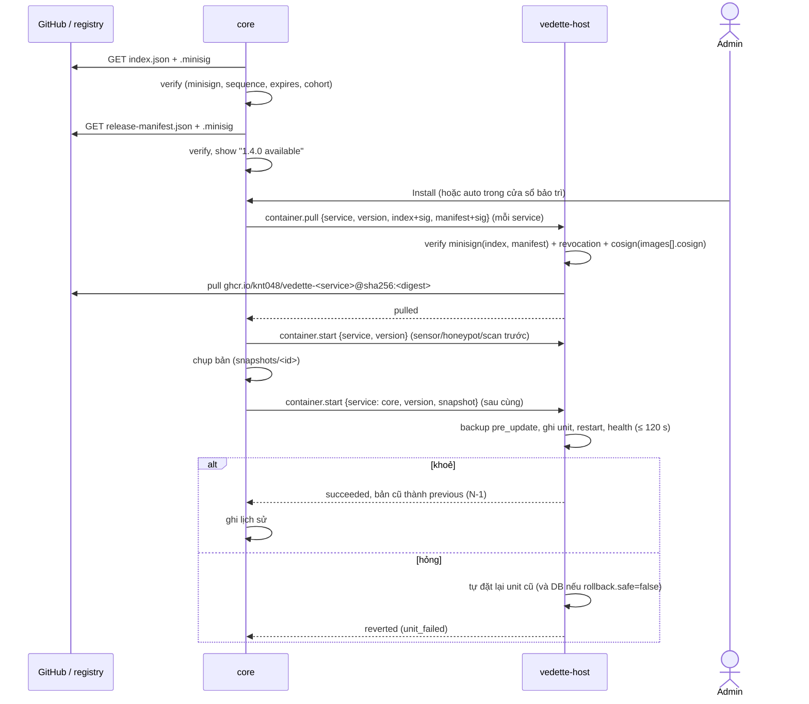

# Update manifest: phát hành, ký, rollout, thu hồi, hoàn tác

Trạng thái: bản nháp M2-0 (docs-first), 2026-11-09. Văn xuôi tiếng Việt; tên trường, định dạng, đường dẫn bằng tiếng Anh.
Truy vết: D-12 (ký, cohort, A/B, thu hồi, SBOM; **cập nhật bởi D-55**), D-36 (GitHub chỉ phát hành bản cập nhật phần mềm ký số; gói nội dung đi kèm), D-53 (cập nhật OS, hộp là thiết bị đầu tiên), D-55 (appliance container, cosign, lô, hoàn tác bằng tag cũ, hai kiểu cài), D-54 (repo `kiennt048/vedette` riêng tư), D-16, D-57 (3) (ghcr, cosign bằng khoá, kiểm ngoại tuyến), D-103 (kiểm chữ ký trong mã, cosign trong manifest), D-113 (image `scan` là image nền, nmap cài khi dựng trên hộp), D-104 (kéo, khởi động, hoàn tác, thu hồi); `docs/UPDATES.md`; story S-CORE-2, S-CORE-7; GUI mock `web/src/features/core` (`UpdatesSection.tsx`, `OsUpdates.tsx`, `bundles.ts`, `contract.ts`).

## 1. Mục đích

Định nghĩa **thứ hộp tải về và cách hộp tin nó**: manifest phát hành, chữ ký (minisign cho manifest, cosign cho image container), rollout theo lô (cohort), danh sách thu hồi, hoàn tác bằng tag cũ, luồng cập nhật OS qua `vedette-host`, và gói offline cho mạng cách ly.

Nguyên tắc (UPDATES, D-12): chữ ký bắt buộc, khoá công khai trong binary, không bao giờ bật toàn cục một thay đổi (bài học Cloudflare 2025-12-05), cập nhật phải hoàn tác được. D-36: dữ liệu feed không còn đi qua kênh này; **kênh "1. Dữ liệu" của UPDATES §1 nay là hộp tự kéo từng feed từ nguồn**, ngoài spec này (`DATA_PIPELINE.md`).

Phạm vi kênh: **2. Gói nội dung** (skill, gói khuyến nghị đã xác nhận, parser log, recog…) và **3. Phần mềm** (image container, binary `vedette-host`), cộng **4. Advisory sản phẩm**. Cập nhật **gói của hệ điều hành** do apt của distro lo (§9), **không** nằm trong manifest.

## 2. Actors

| Actor | Vai trò |
|---|---|
| kien (người duyệt phát hành) | tạo tag tay (AI không tạo tag), giữ khoá ký |
| CI GitHub Actions | build, SBOM, ký, đăng GitHub Release |
| GitHub Releases + registry image | kho phân phối (xem §14: registry) |
| `core` | kiểm tra bản mới, xác minh chữ ký manifest, hiển thị, điều phối |
| `vedette-host` | **bên xác minh cuối cùng** của image (không tin `core`), kéo và khởi động container, rollback (`host-api.md`) |
| Quản trị viên | chọn kênh/chế độ, bấm cập nhật/rollback, nhập bundle |

## 3. Transport và xác thực

- Hộp tải bằng HTTPS tới GitHub (Releases/API) và registry image (PRIVACY luồng 6: yêu cầu chỉ mang phiên bản Vedette hiện tại; không dữ liệu khách).
- **Xác thực nguồn là chữ ký, không phải TLS.** Mọi tệp (index, manifest, image) bị từ chối nếu không ký/sai ký, bất kể đến từ đâu (mirror, bundle, USB). TLS chỉ chống nghe lén.
- Không gửi token/tài khoản tới GitHub; repo riêng tư (D-54) tới go/no-go M0 cần cơ chế khác cho hộp thử nghiệm (câu hỏi mở §14).

## 4. Định nghĩa dữ liệu

Hai tài liệu JSON, cả hai có chữ ký detached minisign (`<file>.minisig`).

### 4.1 `index.json`: trạng thái từng kênh (nổi, ký, tải mỗi lần kiểm tra)

| Trường | Kiểu | Quy tắc |
|---|---|---|
| `schema` | int | `1` |
| `sequence` | uint64 | **tăng đơn điệu**; hộp từ chối `sequence` nhỏ hơn đã thấy (chống rollback/replay) |
| `generated_at`, `expires_at` | datetime | `expires_at` ≤ `generated_at` + 14 ngày; quá hạn → "update info is stale" (cảnh báo, chưa chặn cập nhật bằng bundle) |
| `channels` | object | `stable`, `beta` → `{ "latest": "<version>", "manifest": "<url>", "manifest_sha256": "<hex>", "rollout": { "percent": 0–100 } }` |
| `revoked` | object[] | xem §8 |
| `advisories` | object[] | `{ "id", "severity", "title", "affects": "<semver range>", "fixed_in": "<version>"?, "url" }`: kênh 4 của UPDATES, hiện banner (`UpdatesState.advisories`) |
| `keys` | object[] | `{ "key_id", "kind": "minisign"\|"cosign", "status": "active"\|"retired", "not_after" }`: để hộp biết khoá nào đang dùng; **không** là gốc tin cậy (gốc nằm trong binary) |

### 4.2 `release-manifest.json`: một bản phát hành (bất biến, ký)

```json
{
  "schema": 1,
  "version": "1.4.0",
  "channel": "stable",
  "released_at": "2026-12-02T08:00:00Z",
  "min_upgrade_from": "1.2.0",
  "db_schema": 14,
  "rollback": { "safe": true, "min_version": "1.3.0" },
  "install_modes": ["appliance", "container"],
  "images": [
    { "service": "core", "ref": "ghcr.io/knt048/vedette-core:1.4.0", "digest": "sha256:…", "size": 61203456, "platforms": ["linux/amd64", "linux/arm64"], "cosign": { "payload": "<base64>", "signature": "<base64>" } },
    { "service": "sensor", "ref": "ghcr.io/knt048/vedette-sensor:1.4.0", "digest": "sha256:…", "size": 0, "platforms": ["linux/amd64"], "cosign": { "payload": "<base64>", "signature": "<base64>" } }
  ],
  "host": { "version": "1.4.0", "files": [ { "name": "vedette-host_1.4.0_amd64.deb", "sha256": "…", "size": 0 } ] },
  "content": [ { "name": "mitigation-packs", "version": "2026-12-02.1", "in_image": "core", "path": "/opt/vedette/content/…", "sha256": "…" } ],
  "bundled": [ { "service": "honeypot", "name": "opencanary", "version": "0.9.4" } ],
  "sbom": { "format": "CycloneDX", "url": "…", "sha256": "…" },
  "notes": "Short English text shown in the Updates page"
}
```

| Trường | Ghi chú |
|---|---|
| `images[].digest` | **khoá tin cậy thật**: hộp kéo theo digest, không theo tag; tag chỉ để hiển thị. Image đa nền tảng: digest của index đa nền tảng (kiểm ở lab) |
| `images[].ref` | phải đúng `ghcr.io/knt048/vedette-<service>:<version>`; host so với hằng biên dịch (`registry_not_allowed`) và tự dựng tham chiếu kéo `…@sha256:<digest>`, không dùng chuỗi này để kéo (D-104) |
| `images[].size` | chỉ để kiểm chỗ trống (`low_disk`: < 2 × `size`); **không** so với số byte đã tải (D-104) |
| `images[].cosign` | `{ "payload": base64, "signature": base64 }` (D-103): payload Simple Signing của cosign và chữ ký ECDSA P-256 (DER) trên SHA-256 của payload, sinh bằng cosign ghim phiên bản với `sign --key --new-bundle-format=false --use-signing-config=false` (định dạng cũ), cùng chữ ký đó cũng đẩy lên ghcr cho người muốn tự kiểm. Payload phải có `critical.type` = `cosign container image signature`, `critical.image.docker-manifest-digest` bằng `digest` và `critical.identity.docker-reference` **đúng bằng** `ghcr.io/knt048/vedette-<service>` (kho, không tag, không digest; D-108 (7): chữ ký đi trong manifest nên không còn gì khác buộc nó vào một kho, và chữ ký của image `core` không được xác minh cho mục `sensor`). **Cách ký của job phát hành:** `cosign sign --key <khoá> --new-bundle-format=false --use-signing-config=false --upload=false --output-payload payload.json --output-signature sig.b64 ghcr.io/knt048/vedette-<service>@sha256:<digest>` (ký theo `<kho>@<digest>`, không theo tag, không `--sign-container-identity`; đó chính là điều khiến cosign ghi `docker-reference` = kho), rồi `base64` của `payload.json` và nội dung `sig.b64` vào `images[].cosign`; kiểm lại bằng `internal/release` trước khi đăng. Trường lạ và khoá trùng bị từ chối; trường lạ và khoá trùng bị từ chối. Vì manifest đã ký minisign, chữ ký image đi cùng tài liệu đã ký, không cần đọc chữ ký từ registry |
| `images[].service` | ∈ `core`, `sensor`, `honeypot`, `scan`, `greenbone` (D-55); mọi giá trị khác → từ chối manifest |
| `min_upgrade_from` | nhảy phiên bản quá xa phải qua bản trung gian |
| `db_schema`, `rollback` | hoàn tác an toàn hay cần khôi phục DB (§10) |
| `host` | gói `vedette-host` của bản phát hành; xem cuối §9. **Bắt buộc, và `host.version` = `version`** (D-316 bổ sung 2026-11-12: `install.sh` luôn cài `vedette-host_<version>_<arch>.deb` của bản phát hành; kênh thử không qua builder). Builder (`scripts/release` `buildHostPart`, D-316) từ chối: thiếu phần `host`; `host.version` khác `version`; `host.version` có `-test.`; tên tệp khác `vedette-host_<host.version>_<amd64\|arm64>.deb` theo quy tắc tên duy nhất `release.ParseHostPackageName` (dạng SemVer, prerelease không có `-` bên trong, không build metadata; `host-api.md` §6.14); một kiến trúc hai tệp; thiếu tệp cho một kiến trúc mà image được dựng |
| `content[]` | gói nội dung **đóng chung** với bản cập nhật (D-36); chỉ là chỉ mục và băm để hiển thị/xác minh, tệp nằm trong image `core` |
| `bundled[]` | phiên bản các phụ thuộc ghim **nằm trong image đã ký** (OpenCanary trong `honeypot`…) hiển thị ở "Managed packages" (D-53 mục 2), không cài bằng apt. **nmap không bao giờ có ở đây** (D-4, D-57 (2), `LEGAL.md`): image `scan` của `images[]` chỉ là image nền (Debian slim + `vedette-sensor`), và `vedette-host` dựng `localhost/vedette-scan-nmap:<version>` **trên hộp** với nmap từ kho gói Debian (D-113 (7), `host-api.md` §18); phiên bản nmap đang chạy lấy từ heartbeat của `scan` (`sensor-protocol.md` §6.3), không từ manifest. Mỗi mục: `service`, `name`, `version` bắt buộc; `sha256` (64 hex thường) và `license` (biểu thức SPDX, ≤ 64 ký tự) tuỳ chọn, kiểm khi có (D-146). Image `scan` liệt kê `{"service":"scan","name":"nuclei","version":"3.11.1","sha256":"<sha256 của binary>","license":"MIT"}` và `{"service":"scan","name":"nuclei-templates-pack","version":"2026.11.1","sha256":"<nhãn sha256 trong index.json của gói>","license":"MIT"}`; giá trị lấy từ `deploy/containers/pins.env` và chỉ mục gói do `make scan-pack` sinh |
| `sbom` | CycloneDX mỗi phát hành (D-12) |
| `install_modes` | `appliance` và/hoặc `container`, không rỗng, không lặp (builder `manifest` và `internal/release` cùng từ chối). Có `container` thì bản phát hành **phải** đăng bốn tệp của bản chỉ container cạnh manifest: `vedette.env` (ba dòng image điền đúng `ghcr.io/knt048/vedette-<service>@sha256:<64 hex>` từ `images[]`), `compose.yaml`, `compose.sensors.yaml`, `compose.syslog.yaml`, mỗi tệp một `.minisig` do khoá của manifest ký, trusted comment `file:<tệp> version:<version>`; `release verify` từ chối khi thiếu, và từ chối các tệp đó khi không có `container` (D-451, `release container-assets`) |

Quan hệ với `UpdatesState` trong mock: `components` ↔ `images[]`/`content[]`; `signature: valid|invalid|unsigned` ↔ kết quả xác minh §5.

## 5. Ký và xác minh

### 5.1 Hai lớp chữ ký

| Đối tượng | Công cụ | Ai xác minh | Khoá |
|---|---|---|---|
| `index.json`, `release-manifest.json`, tệp `host` | **minisign** (Ed25519 trên BLAKE2b-512, định dạng `ED`; `Ed` cũ bị từ chối) | `core` (để hiển thị), **và `vedette-host`** (trước khi hành động) | hai public key nhúng trong binary `core` và `vedette-host`: khoá đang dùng và khoá dự phòng ngoại tuyến do kien giữ (D-103) |
| Image container | **cosign** (ECDSA P-256, định dạng cũ; chữ ký đi **trong manifest** ở `images[].cosign`, bản sao đẩy lên ghcr cho người tự kiểm) | `vedette-host` khi `container.pull`, **trước** khi kéo | public key cosign nhúng trong `vedette-host` |

`core` không phải bên xác minh duy nhất: **host tự kiểm** manifest, digest, chữ ký image (xem `host-api.md` §6.7). Nếu `core` bị chiếm, nó **không** thể bắt host chạy một image không ký, vì host chỉ chấp nhận digest có mặt trong một manifest ký đúng và tự dựng tham chiếu kéo từ hằng.

Triển khai xác minh (**đã chốt, D-103**): gói `internal/release` của dự án, thuần, dùng chung cho host và `core`, chỉ dùng thư viện chuẩn (`crypto/ed25519`, `crypto/ecdsa` `VerifyASN1`) và `golang.org/x/crypto/blake2b` đã ghim. Không kiểm Rekor (kiểm ngoại tuyến, D-57 (3)); không dùng `policy.json` `sigstoreSigned` của Podman (cấu hình chung của Podman, cần `use-sigstore-attachments` trong registries.d, phụ thuộc mức hỗ trợ cosign của Podman 4.9), không dùng `sigstore-go` (79 module trong tiến trình root), không chạy CLI cosign trên hộp. JSON giải mã chặt (trường lạ, khoá trùng, khoá trùng sau gập chữ bị từ chối). Hợp đồng không đổi: **kéo theo digest, chỉ chạy khi chữ ký hợp lệ**. Rủi ro: cosign v4 sẽ bỏ định dạng cũ; trước lúc đó phải kiểm bundle mới (DSSE) trong mã.

**Đã cài (WP-07b phần 3, lát 3-2, D-108):** `internal/release` (gói `internal/jsonstrict` giữ quy tắc JSON chặt dùng chung với host). API: `VerifyIndex(raw, sig, trust, stored)`, `VerifyManifest(raw, sig, trust, idx)`, `VerifyImage(m, service, digest, trust)`, `CheckUpgrade`, `CheckRollback`, `CheckPlatform`, `CheckInstallMode`, `CheckManifestSHA256`, `PullRef`; lỗi có kiểu (`ErrBadSignature`, `ErrKeyRevoked`/`ErrReleaseRevoked` đều khớp `ErrRevoked`, `ErrSequenceRegress`, `ErrDowngrade`, `ErrUpgradePath`, `ErrRollbackNotAllowed`, `ErrPlatform`, `ErrRegistryNotAllowed`, `ErrDigestNotInManifest`, `ErrUnknownSchema`, `ErrNoTrustKeys`…). Khoá công khai là hằng biên dịch trong `keys.go` (khoá thật từ nghi thức 2026-11-11, D-256, `docs/RELEASE_KEYS.md`): bản dựng có hằng rỗng hay khoá không hợp lệ **từ chối mọi thứ** và ghi log lý do; khoá thử nghiệm chỉ có khi dựng với tag `releasetestkeys` (`Trust.TestOnly`). Quy tắc thu hồi khoá (§8) do mã thi hành: chỉ index ký bằng khoá dự phòng mới thu hồi được khoá nhúng, không index nào thu hồi được khoá dự phòng, thu hồi khoá nhúng được giữ qua mọi index sau (sticky); thu hồi bản và digest thì index mới thay thế. Chữ ký cosign ECDSA dạng S cao vẫn được nhận (cosign không chuẩn hoá S). `critical.identity.docker-reference` bị bỏ qua đúng như SIGNATURE_SPEC. **Sửa đổi sau rà soát độc lập (D-108, bản sửa):** (1) thu hồi bản và digest cũng **được giữ** (sticky) như thu hồi khoá; chỉ index ký bằng khoá dự phòng mới bỏ được một thu hồi bản/digest (danh sách của nó là chuẩn), index ký bằng khoá đang dùng bỏ sót thì vẫn bị giữ lại; (2) thu hồi khoá (`kind=key`) chỉ nhận từ index ký bằng khoá dự phòng: trong index ký bằng khoá đang dùng chúng bị bỏ và ghi log, dù binary có nhúng khoá đó hay không; thu hồi đã lưu của khoá dự phòng hiện tại bị bỏ qua; (3) `sequence`: index ký bằng khoá dự phòng và thu hồi người ký của index đã lưu được đặt `sequence` tuỳ ý, thấp hơn cũng được (chỉ một lần cho mỗi khoá lộ vì thu hồi được giữ); `sequence` bằng nhau chỉ được nhận khi SHA-256 của byte index trùng bản đã lưu; (4) danh sách thu hồi được mang theo không thuộc phần đã ký nên có thể dài hơn 256 mục (trần 4096; vượt thì cần index ký bằng khoá dự phòng); (5) `VerifyImage` từ chối `Manifest` không do `VerifyManifest` tạo; `Embedded()` từ chối khoá thử nghiệm ngoài tệp test; `CheckRollback` đòi bản đích thấp hơn bản đang chạy. Khoá cosign cũng thu hồi được bằng `kind=key` (id: SHA-256 hex của PKIX DER), và có thể nhúng hai khoá cosign khi xoay khoá. Ngoài phạm vi lát này: lưu index/manifest (host 3-7), cohort (core), kiểm bundle.

### 5.2 Khoá hay keyless (cosign): đánh đổi

| | **Khoá (cosign `--key`)** | **Keyless (Sigstore: Fulcio + Rekor, danh tính GitHub OIDC)** |
|---|---|---|
| Xác minh trên hộp offline | Có, chỉ cần public key nhúng sẵn | Cần "trusted root" của Sigstore (TUF) và bằng chứng log (Rekor); xác minh offline được bằng bundle nhưng root cũ trên hộp ít cập nhật có thể hỏng |
| Rủi ro khoá dài hạn | Khoá riêng nằm ở CI/máy kien: lộ = ký giả mạo mãi tới khi thu hồi | Không có khoá dài hạn; danh tính = workflow `…/release.yml@refs/tags/v*` |
| Thu hồi | thu hồi `key_id` trong `index.json` + bản binary mới nhúng khoá mới | không thu hồi khoá; thu hồi theo digest/phát hành |
| Phụ thuộc dịch vụ ngoài khi ký | Không | Có (Fulcio, Rekor; vấn đề nếu hạ tầng free đổi) |
| Rò thông tin | Không | **Rekor công khai ghi danh tính/repo**: lộ tên repo riêng tư (D-54) tới khi repo công khai |
| Kẻ có quyền ghi repo/workflow | ký được | ký được (cùng mức) |

**Đã chốt (D-57 (3), D-103):** hộp **chỉ xác minh bằng khoá cosign công khai nhúng sẵn** (offline, không phụ thuộc Sigstore, hợp mạng cách ly). Phần sau vẫn là đề xuất, chưa có quyết định: đồng thời CI **vẫn đăng chữ ký keyless** song song cho người dùng/kiểm toán muốn tự xác minh (đúng ý UPDATES §4.4 "minisign cho hộp, cosign cho người"). Hộp không đòi chữ ký keyless. Khoá cosign **tách** khỏi khoá minisign và tách khỏi mọi bí mật CI khác; xoay khoá = bản binary mới nhúng cả khoá cũ và mới trong một giai đoạn chuyển (ký bằng cả hai).

**Xoay khoá minisign và index đã lưu (D-130, sửa đổi L1).** Bản dựng nhúng thêm danh sách **khoá đã nghỉ** (`Trust.Retired`, hằng `prodMinisignRetired`, rỗng tới lần xoay đầu). Khoá đã nghỉ **chỉ** dùng để xác minh lại index mà hộp đã lưu lúc khoá còn dùng (`release.VerifyStoredIndex`), nên số `sequence` và danh sách thu hồi đã lưu còn nguyên qua lần xoay; nó **không bao giờ** nhận index hay manifest mới (`VerifyIndex`, `VerifyManifest` không biết nó). Quy trình xoay: bản dựng mới có khoá mới là khoá đang dùng và khoá cũ trong `Retired`; không cần người vận hành xoá `releases/index.json`.

**Sàn `sequence` lúc dựng (D-130, L2).** Khi chưa lưu index nào, host nhận index có `sequence` ≥ `release.MinSequenceText` của bản dựng (job phát hành đặt bằng `-ldflags "-X github.com/knt048/vedette/internal/release.MinSequenceText=<n>"` bằng `sequence` của index hiện hành lúc dựng; mặc định 0 là không có sàn), để một bản cài mới không bị mớm index cũ. Có index đã lưu thì số đã lưu là sàn.

### 5.3 Quy trình xác minh của hộp (`core`, rồi `host` lặp lại)

1. Tải `index.json` + `.minisig`; kiểm chữ ký bằng khoá nhúng, kiểm `key_id` không bị thu hồi.
2. `sequence` ≥ giá trị đã lưu (`core_audit` lưu giá trị cao nhất đã thấy); `expires_at` chưa qua (hoặc hiện "stale").
3. Chọn bản: kênh đã chọn, `rollout.percent` so với cohort (§6), `min_upgrade_from` thoả.
4. Tải `release-manifest.json` theo URL trong index; kiểm `sha256` bằng `manifest_sha256` và kiểm chữ ký minisign.
5. Kiểm manifest không bị thu hồi (§8).
6. Hiển thị cho admin (hoặc tự động nếu chế độ `auto`).
7. Cập nhật: `host` lặp lại bước 1, 2, 4, 5 với tài liệu `core` đưa, kiểm chữ ký cosign trong manifest và `platform`, rồi kéo từng image theo **digest** (không đối chiếu `size`, D-104; `host-api.md` §6.7).

Mỗi lần kiểm tra ghi `core_audit` (ai, khi nào, phiên bản, sha256) như UPDATES §5.

## 6. Cohort và rollout theo lô

- `install_id` = chuỗi ngẫu nhiên 256 bit sinh lúc cài (cũng là `install_id` của tín hiệu ẩn danh, D-16); **không gửi đi** chỉ để rollout. `cohort = uint32(SHA-256(install_id || "vedette-cohort")[0:4]) mod 100`, tính cục bộ.
- Hộp **đủ điều kiện** cho một phát hành khi `cohort < rollout.percent` của phát hành đó trong `index.json`. Mặc định lịch của kien: 10 % → 50 % → 100 %, mỗi bước sau ≥ 24 giờ không có báo lỗi (UPDATES §2). Phần mềm: `beta` trước `stable` ít nhất 7 ngày.
- "Kiểm tra ngay" của admin vẫn tôn trọng cohort; **không có** nút "Install anyway" cho bản chưa tới cohort (tránh bật toàn cục qua nút; câu hỏi mở §15).
- Hạ `percent` (tạm dừng rollout): hộp chưa cập nhật sẽ không nhận; hộp đã cập nhật không bị ép lùi (muốn ép lùi dùng `revoked`, §8).
- Kênh: `stable` và `beta` (như `UpdateChannel`); chọn trong Settings → Updates. Chế độ `auto|manual` như `UpdatesState.mode`; ở `auto`, chỉ tự cài trong cửa sổ bảo trì (D-53) và chỉ bản **không** bị thu hồi.

## 7. Cập nhật phần mềm (appliance)



Quy tắc: A/B theo **tag/digest** (D-55 thay "A/B slot binary" của D-12 bằng tag cũ); `core` luôn bị khởi động lại sau cùng và quá trình tiếp tục khi core lên lại nhờ host giữ trạng thái run (xem `host-api.md` §6 về `run` bền). Chỉ một lần cập nhật tại một thời điểm.

**Kiểu cài "Chỉ container"** (D-55: Docker/Podman sẵn có của khách, không có `vedette-host`): hộp **không tự cập nhật** image; Settings → Updates hiển thị bản mới, lệnh `pull`/`up` và hướng dẫn xác minh chữ ký (cosign) để khách chạy; không thao tác OS. Hạn chế ghi rõ trên GUI.

## 8. Danh sách thu hồi

`index.json.revoked[]`:

| Trường | Ví dụ |
|---|---|
| `kind` | `release` (một phiên bản), `image_digest`, `key` (khoá ký), `advisory_only` |
| `id` | `1.3.2`, `sha256:…`, `key_id` |
| `reason` | chuỗi tiếng Anh ngắn |
| `since` | datetime |
| `action` | `block_install` \| `block_install_and_warn` \| `rollback_if_possible` |

Hành vi hộp:

- `block_install`: không bao giờ cài bản/digest đó (cả khi auto, cả bằng bundle).
- Bản **đang chạy** bị thu hồi: banner mức nghiêm trọng trên mọi trang khi `action` là `block_install_and_warn` hay `rollback_if_possible`, chỉ ghi chú trên trang Updates khi là `block_install` (D-386, `UpdatesState.running_revoked`) + thông báo kênh admin (chưa xây); `rollback_if_possible` chỉ tự lùi khi chế độ `auto`, tag N−1 còn, không bị thu hồi và `rollback.safe`; còn lại để admin quyết.
- Khoá bị thu hồi: manifest ký bằng khoá đó bị từ chối kể cả đã cài trước đó (hộp không gỡ phần mềm, chỉ ngừng tin thêm).
- Revocation tự có chữ ký trong `index.json`; `index.json` mới hơn thay thế (theo `sequence`). Hộp lưu bản cao nhất đã thấy để một index cũ không "hồi sinh" bản bị thu hồi.

## 9. Cập nhật hệ điều hành qua `vedette-host` (D-53, D-55)

Cập nhật OS **không** qua manifest/cohort/cosign: chữ ký là của **apt** (kho Debian/Ubuntu). Manifest chỉ hiện trạng thái. Luồng:

1. Admin vào Settings → Updates (mock `/core/updates/os*`); `core` gọi `os.check` của host → `apt-get update` + liệt kê gói nâng cấp, đánh dấu security, cần reboot (`/var/run/reboot-required`), hạn hỗ trợ bản phát hành (`OsState`).
2. `os.install {scope: security|all}`: host **sao lưu DB trước** (`backup.create`), chạy danh sách lệnh apt cố định (SYS-1), stream tiến trình, chạy health check sau, báo cần reboot.
3. Reboot ngay/theo cửa sổ (`os.reboot`); tự cập nhật bảo mật = `unattended-upgrades` do host cấu hình (`os.auto_security`), cửa sổ bảo trì.
4. Nâng bản phát hành OS (Ubuntu 24.04 → 26.04, Debian 13 → bản sau): **chỉ hướng dẫn** (`release_upgrade`), không bao giờ tự làm.
5. Kho gói là luồng ra đã có trong PRIVACY luồng 6; người dùng có thể trỏ apt tới mirror nội bộ.

Hai kiểu cài (D-55): chế độ "Chỉ container" không có luồng này.

### Cập nhật chính `vedette-host`

Host là tiến trình root nhỏ; cập nhật nó là việc nhạy cảm nhất. Manifest có mục `host` (§4.2) để bản `.deb` do host/installer xử lý. **Đã chốt (D-57 (21))**: host tự cập nhật bằng gói `.deb` đã ký trên GitHub Release, kiểm sức khoẻ, hỏng thì về bản trước. **Thiết kế (D-316):** `host-api.md` §6.14 `host.self_update`: host kiểm index và manifest như `container.pull`, chỉ cài tệp có SHA-256 bằng mục `host.files[]` `vedette-host_<host.version>_<arch>.deb`, chỉ đi lên (`host.version` so với bản host đang chạy, không so `version` của manifest).

## 10. Hoàn tác

- Giữ **N−1** cho mỗi service: host giữ bản đang chạy, `previous` và bản mới nhất đã kéo (tag `localhost/vedette-<service>:<version>`), gỡ bản khác bằng `podman rmi <digest>` sau mỗi lần khởi động thành công, không bao giờ `prune -a` (D-104); cùng bản sao lưu DB `pre_update` mà **host tạo trong `container.start` của `core`** từ bản chụp `core` đưa (`host-api.md` §6.8). `container.rollback {service}` đưa service về `previous`; GUI nút Rollback từng thành phần (S-CORE-2).
- **Hoàn tác phần mềm khác hoàn tác DB.** Manifest khai `db_schema` và `rollback.safe`: nếu `true`, mã bản mới chỉ thêm cột/bảng tương thích ngược nên bản cũ chạy được trên DB mới; nếu `false`, rollback **phải** kèm khôi phục DB từ bản `pre_update` của lần cập nhật đó (mất dữ liệu ghi từ lúc cập nhật): host làm cả hai **trong cùng một run** `container.rollback` (dừng `core` → khôi phục → unit cũ → khởi động → kiểm sức khoẻ, hỏng thì đặt lại cả hai, D-104); `core` không gọi `backup.restore` riêng. GUI cảnh báo "data written since the update is lost" và chỉ gọi host khi người dùng xác nhận (`confirm_data_loss`, S-CORE-2). Bản `pre_update` không còn → `rollback_backup_missing`.
- `rollback.min_version` là phiên bản thấp nhất được rollback tới: `previous` thấp hơn → `rollback_not_allowed`. Hạ bản bằng `container.start` luôn bị từ chối (`downgrade_not_allowed`, thứ tự SemVer); chỉ rollback về `previous` đã xác minh mới được hạ.
- Rollback không đi qua kiểm cohort/rollout, nhưng **vẫn** phải: bản đích đã từng xác minh trên host này, không bị thu hồi theo index đã lưu (`previous_revoked`), `sequence` anti-downgrade không áp dụng cho rollback người dùng chủ động tới bản N−1 đã cài (được phép), và ghi `core_audit` + lịch sử `action: rollback`.
- Khởi động hỏng sau cập nhật: host **tự** đặt lại unit cũ (và DB khi `rollback.safe=false`) trong chính run `container.start` (`reverted`, `unit_failed`). Rollback hỏng (hiếm) → host đặt lại bản đang chạy; nếu chính bước đó hỏng thì `vedette-host` giữ trạng thái cuối và báo để admin xử lý tay (`rollback_revert_failed`): không vòng lặp tự động. Host không bao giờ tự rollback vì thu hồi (§8: `core` quyết).

## 11. Gói offline (mạng cách ly)

Khớp `/core/updates/bundle` trong mock (xuất ký, nhập từ chối chữ ký sai) và `vedette bundle export|import` (UPDATES §3).

Cấu trúc `vedette-bundle-<version>.tar` (không nén lồng; image đã nén sẵn):

```
bundle.json                 { schema, version, channel, created_at, files:[{path,sha256,size}] }
index.json  + .minisig      bản index tại lúc xuất
release-manifest.json + .minisig
images/<service>.oci.tar    oci-archive đúng digest trong manifest
host/*.deb                  (nếu có bản host)
sbom.json
```

- **Gói không có chữ ký riêng của hộp xuất**: tin cậy đến từ chữ ký phát hành có sẵn (minisign cho manifest, cosign cho image; chữ ký cosign đã nằm trong manifest ở `images[].cosign`, D-103, nên bundle không cần thư mục `signatures/`). Nhập bundle vào host: `container.pull` với `source: bundle` (D-452, `host-api.md` §6.7 "Nguồn `bundle`"); `core` ghi tệp vào `<core_data>/bundles/<bundle_id>.tar` và chỉ gửi id. `bundle.json` chỉ là danh sách băm để `core` phát hiện hỏng sớm; host không đọc nó: mọi byte host dùng hoặc được ký, hoặc được băm đối chiếu với thứ được ký.
- **Luật của tar (D-452, host kiểm)**: chỉ đúng các tên trên (thêm thư mục `images/`, `host/`), chỉ tệp thường (không symlink, hard link, thiết bị, FIFO, sparse), không trùng tên, ≤ 64 mục; trần: tài liệu 256 KiB, chữ ký 2 KiB, `bundle.json` 1 MiB, `sbom.json` 64 MiB, mỗi `.deb` 256 MiB, cả gói 8 GiB. Thứ tự mục tự do.
- **Luật của `images/<service>.oci.tar` (D-452, bộ dựng phải theo)**: một OCI image layout dạng tar (`oci-layout`, `index.json`, `blobs/sha256/<hex>`, không gì khác) mà `index.json` nêu **đúng một** ảnh, có digest **bằng `images[].digest`** của manifest (digest của index đa nền tảng như đã đẩy lên `ghcr.io`), xuất **giữ nguyên digest**: `skopeo copy --all --preserve-digests docker://ghcr.io/knt048/vedette-<service>@<digest> oci-archive:images/<service>.oci.tar:ghcr.io/knt048/vedette-<service>:<version>` (hoặc `podman manifest push --all <list> oci-archive:…`, đã thử trên Podman 5.7.0: `index.json` giữ digest của list); phải có blob của mọi nền tảng manifest liệt kê trong `platforms`. Chú thích `ref.name` của archive không được dùng: host tự viết `index.json` khi nạp.
- **`host/*.deb`**: `core` chép ra `<core_data>/host-packages/<id>.deb` và gọi `host.self_update` với bốn tài liệu của gói (D-316, host kiểm SHA-256 với `host.files[]` đã ký); `container.pull` không đọc nó.
- **Nhập:** (1) kiểm chữ ký manifest và index bằng khoá nhúng; (2) kiểm `sequence`, thu hồi, `min_upgrade_from`; (3) với mỗi image kiểm digest **của chính archive** (`oci-archive` tính lại) khớp manifest và chữ ký cosign; (4) mới yêu cầu host nạp (`container.pull` với `source: bundle`). Sai chữ ký ⇒ `Import rejected` (GUI mock nói "a bad signature is rejected"), không có đường bỏ qua.
- Bundle **không** thay `expires_at` của index: index trong bundle đã hết hạn vẫn được nhập một lần (đây là đường offline) nhưng hiện cảnh báo "stale".
- Bundle chỉ chứa **gói phần mềm + nội dung**; dữ liệu feed của máy cách ly nhập bằng bundle feed (D-37, "switch to offline bundles" ở PRIVACY luồng 1): ngoài spec này.
- Kích thước: bundle gồm image nên vài trăm MiB tới vài GiB; **upload từ GUI cần truyền dòng (multipart) tới tệp tạm trong volume**, không qua JSON base64 như mock (mock chỉ để xem trước, `BundleUpload.content`).

## 12. Giới hạn

| Mục | Giới hạn mặc định |
|---|---|
| `index.json`, `release-manifest.json` | ≤ 256 KiB mỗi tệp; thân `container.pull` (hai tài liệu + hai chữ ký, base64) ≤ 1 MiB (`host-api.md` §10) |
| Số image mỗi manifest | ≤ 16 |
| Kích thước image | `size` chỉ để kiểm chỗ trống (≥ 2 × `size` trống); **không** so với số byte đã tải: Podman không cho biết số byte, và kéo theo digest đã bảo đảm toàn vẹn (D-104) |
| Image giữ lại mỗi service | bản đang chạy, `previous`, bản mới nhất đã kéo (D-104) |
| Bundle tải lên | trần cấu hình (đề xuất 8 GiB; host từ chối tệp > 8 GiB, D-452), đòi dung lượng trống ≥ 2× ở `core` khi nhận; host khi nạp một image đòi ≥ 3 × kích thước archive của nó (chỗ chứa ảnh và trạng thái host) |
| Tần suất kiểm tra | tối đa mỗi 6 giờ + jitter ± 30 phút (mặc định, tắt được ở Privacy → `update_check`) |
| Hết hạn index | ≤ 14 ngày |
| Thời hạn health check sau cập nhật | 120 giây (mặc định) |
| Lịch sử hiện ở GUI | 20 lần gần nhất (UpdatesState.history) |

## 13. Cân nhắc bảo mật (ánh xạ SYS)

| SYS | Áp dụng |
|---|---|
| SYS-1 | Cập nhật không có shell; chỉ lệnh trong allowlist của `vedette-host` (`host-api.md`); `core` không chạm apt/podman |
| SYS-2 | JSON manifest/index validate theo schema, `service` theo enum, digest theo `^sha256:[a-f0-9]{64}$`, URL chỉ `https` và host nằm trong danh sách khai báo |
| SYS-3 | Mọi kiểm tra/cài/rollback/nhập bundle ghi `core_audit` và nhật ký của host |
| SYS-4 | Khoá ký **riêng** không bao giờ vào hộp; chỉ khoá công khai nhúng |
| SYS-5 | Tắt kiểm tra (`update_check=false`) → không job, không request ra; dữ liệu giữ |
| SYS-6 | Manifest/index/bundle từ mạng/USB là **không tin cậy** tới khi ký; giới hạn kích thước, parse fail-closed |
| SYS-7 | URL tải thuộc **danh sách host cố định** khai trong PRIVACY (GitHub, registry, mirror apt); không theo redirect ra ngoài danh sách |
| SYS-8 | AI không có đường kích hoạt cập nhật |

Mối đe doạ và biện pháp: (a) chiếm kho GitHub/registry → không ký được nên hộp từ chối; (b) lộ khoá ký → thu hồi khoá trong `index.json` ký bằng khoá dự phòng ngoại tuyến đã nhúng sẵn (D-103) + binary mới (điểm yếu nếu cả hai lộ); (c) rollback/replay manifest cũ có lỗ hổng → `sequence`; (d) freeze (giữ index cũ để hộp không thấy bản vá) → `expires_at` + cảnh báo trên trang Updates (D-386, `UpdatesState.stale_since`); (e) đầu độc bundle → kiểm lại toàn bộ chữ ký; (f) lan rộng bản lỗi → cohort + `beta` ≥ 7 ngày + health check + rollback; (g) `core` bị chiếm → host xác minh độc lập.

## 14. Versioning

- `schema` của `index.json` và manifest là số nguyên; `schema` khác bản hộp hiểu → "Update the box through bundle or reinstall" (hộp không đoán). **Trong cùng một `schema`, trường lạ bị từ chối** (fail closed, D-103 (4), SYS-6): thêm trường phải tăng `schema`. Để hộp cũ vẫn nhận được thu hồi, người phát hành **tiếp tục đăng index của schema trước** cạnh bản mới (ví dụ `index.v1.json`) ít nhất 12 tháng sau mỗi lần tăng `schema` (D-108). Điều này thay câu "trường lạ bị bỏ qua" trước đây, vốn mâu thuẫn với §5.1.
- Nhãn phiên bản: SemVer 2.0; kênh `beta` dùng hậu tố `-beta.N`.
- `min_upgrade_from` bảo vệ nhảy phiên bản; `db_schema` tăng đơn điệu.
- Giao thức host (`host-api.md`) có số phiên bản riêng; manifest ghi `host.version` tối thiểu cần để cài bản này.

## 15. Câu hỏi mở

1. ~~**Cosign: khoá hay keyless**~~ **Đã chốt:** hộp kiểm bằng khoá cosign nhúng, ngoại tuyến (D-57 (3)), trong mã của dự án, chữ ký đi trong manifest (D-103); khoá minisign dự phòng ngoại tuyến do kien giữ được nhúng cùng khoá đang dùng (D-103 (2)). Còn mở: CI có đăng thêm chữ ký keyless cho người dùng không. Mã kiểm đã có (lát 3-2, mục 5.1); kien còn phải tạo ba khoá ngoại tuyến và dán phần công khai vào `internal/release/keys.go` (`.ai/deferred/feat-host-net-containers.md`).
2. **Registry image và nơi lưu `index.json`**: D-36 nói GitHub chỉ để phát hành phần mềm; GHCR hợp lý nhưng chưa chốt. Hộp thử nghiệm khi repo còn riêng tư (D-54) cần token đọc (credential nằm ở đâu?). `channels.json` + mirror thứ hai của UPDATES §6 còn giữ không khi D-7 đã bỏ builder/Cloudflare cho dữ liệu?
3. ~~**Cập nhật chính `vedette-host`**~~ **Đã chốt (D-57 (21)):** `.deb` ký trên GitHub Release, host tự nâng cấp; lệnh chưa có trong allowlist (để sau).
4. Có nên cho nút "Install anyway" với bản chưa tới cohort (spec: không)?
5. Khoá `K_cohort`/`install_id`: giữ chung với tín hiệu ẩn danh hay riêng để tắt tín hiệu không đổi cohort.
6. `rollback_if_possible` tự động: bật mặc định hay luôn cần admin?
7. Thời gian health check, tần suất kiểm tra, trần bundle là điểm xuất phát chưa đo.
8. Chữ ký của phụ thuộc bên thứ ba trong image (nuclei, OpenCanary; nmap không nằm trong image ký nào, nó được cài lúc dựng `scan` trên hộp, D-113 (7)): Vedette đóng gói và ký **toàn image**; cần ghi vào `THIRD_PARTY_NOTICES` cách dùng (tiến trình riêng trong container) khi xây (rule `legal.md`).
